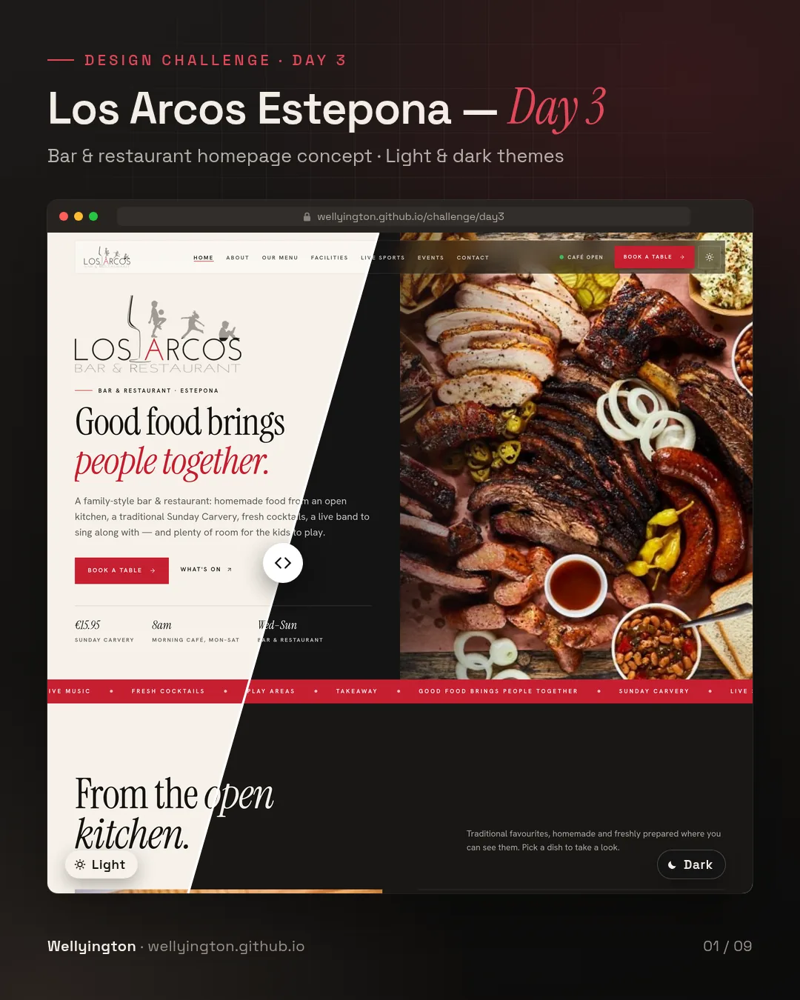
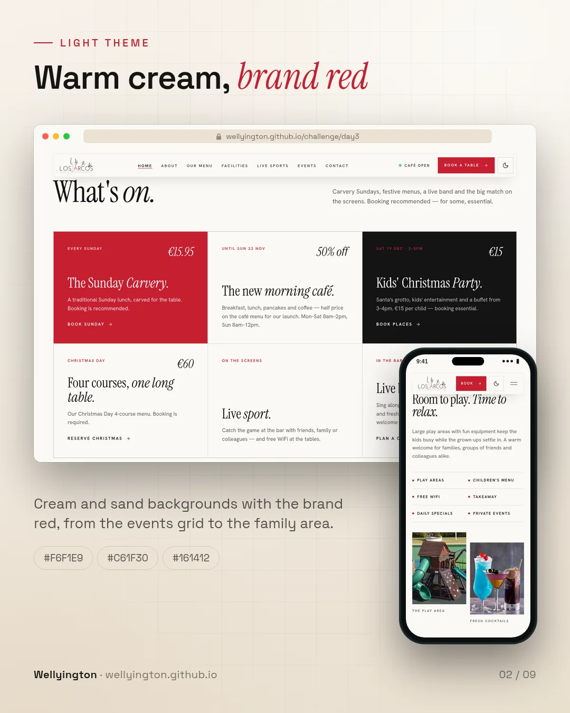
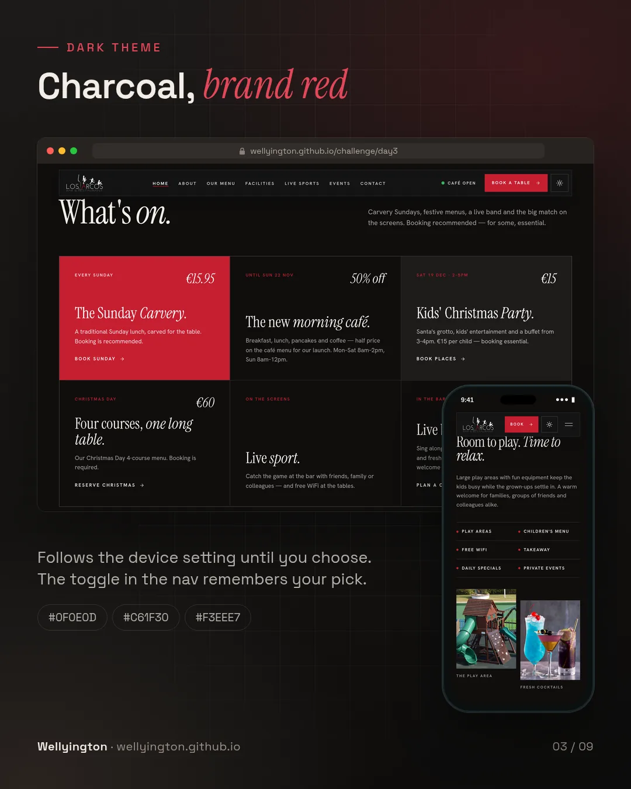
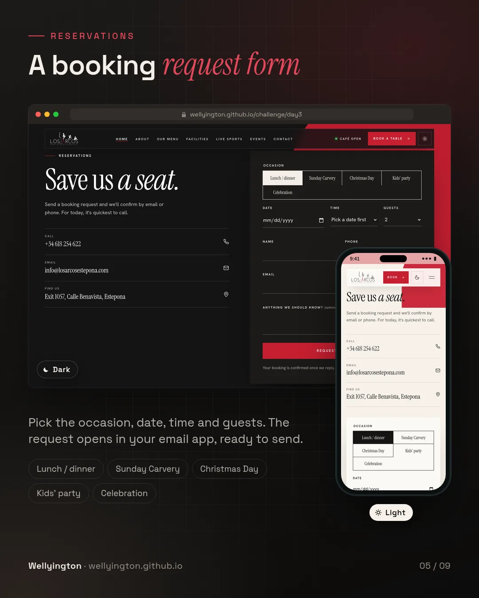
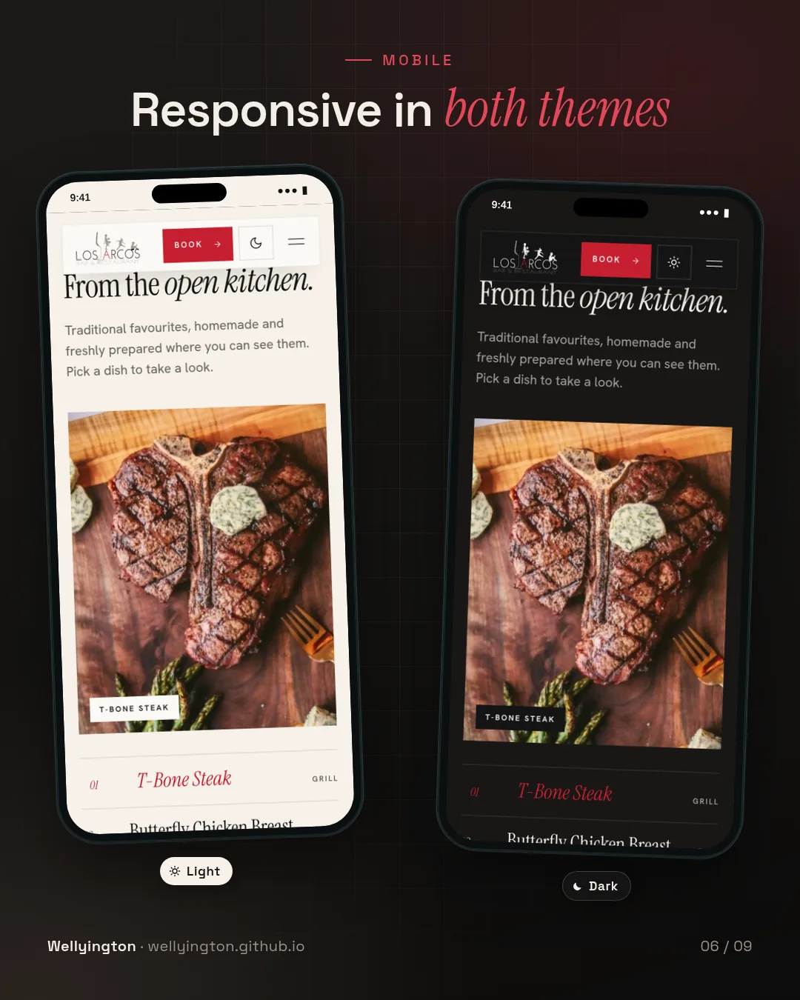
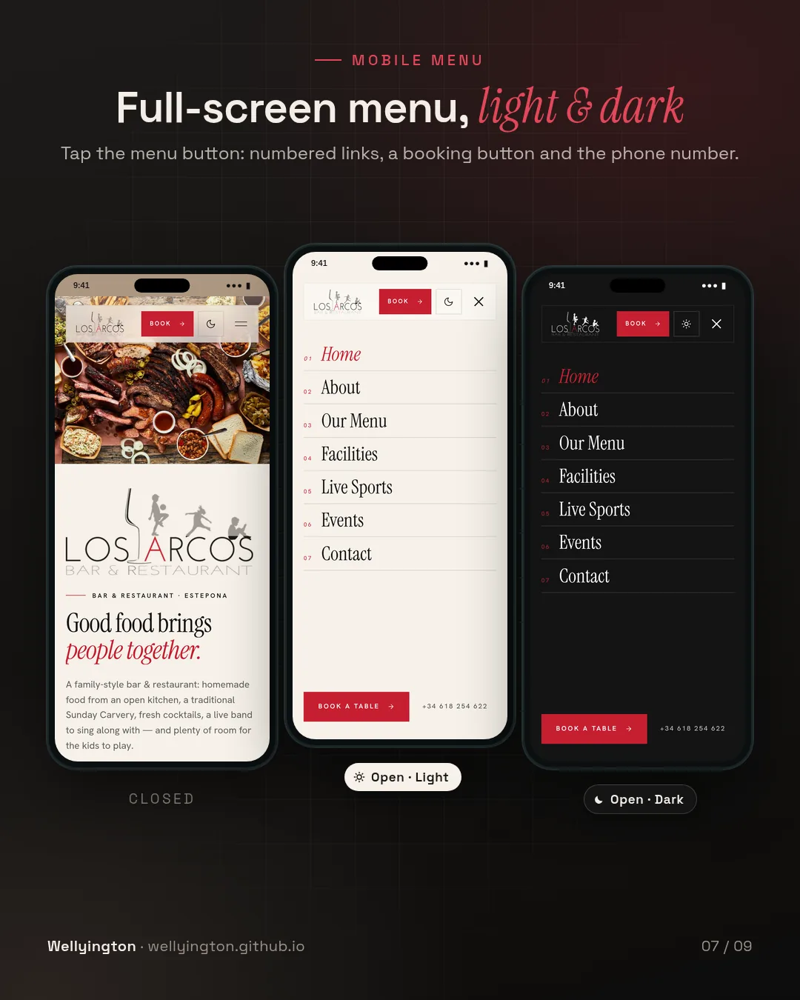
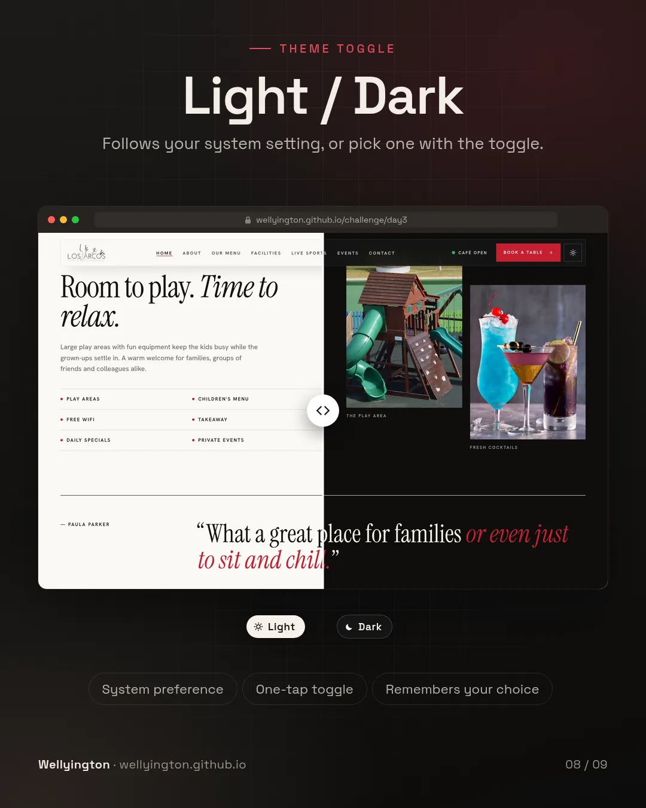

On 19 November I posted the third note of this run: a hundred days, a hundred businesses, a hundred websites, each one open to anyone. The first day was a family builder in the Marina Alta who needed a clear first page, something he could look at before a contract. [That page is here.](https://wellyington.github.io/journal/en/articles/built-before-the-yes/) The second was a theatre in Málaga that already had a full season and needed an order a person could use. [That one is here.](https://wellyington.github.io/journal/en/articles/room-for-a-whole-season/) Today the walk is shorter.

Los Arcos is a bar and restaurant on Calle Benavista, by exit 1057, in Estepona. I work from Estepona, so this is the first business in the run in my own town. That changes very little about the work and quite a lot about the care. People here will open the page and know whether it sounds like the place. You can open the concept here: [Los Arcos, day three](https://wellyington.github.io/challenge/day3/).

Nobody at Los Arcos asked me for it. It is not a commission and it is not their official site. Their name, their dishes and their week are on the page. The concept is mine, and for now it lives on my own address, the honest place for work nobody has adopted yet. I have not been told that anyone there has looked.

## a place with more than one reason to come

The builder had one job to explain, and the theatre had a season. A family bar and restaurant has something less tidy. People come for different reasons, at different hours, often in the same group.

Someone wants a Sunday roast. Someone else wants the match on a big screen. A couple wants a cocktail and the band. A parent wants to sit down for an hour while the children run somewhere safe. On a weekday morning, someone just wants coffee and pancakes before work. Los Arcos does all of that under one roof: an open kitchen, the Sunday Carvery, a morning café, live sport, live music, play areas, takeaway.

A homepage that lists all of it at the same volume says nothing. One that picks a single reason leaves out half the people who already go. So the job was an order. First, what kind of place this is. Then what you can eat. Then what is on this week. Then when the doors are open, why it works for families, and how to get a table. Everything a regular already knows, in the order a newcomer needs it.

## good food brings people together

The opening keeps their own line, because it is a good one: good food brings people together. It sits in a tall, narrow serif, with the second half in italic and in the house red. Above it is the logo, the arches with the little figures playing. Below, one paragraph: a family-style bar and restaurant, homemade food from an open kitchen, a traditional Sunday Carvery, fresh cocktails, a live band to sing along with, and plenty of room for the kids to play.

Then two buttons, book a table or see what's on. Below them, three facts you might otherwise have to ask for: the Sunday Carvery at €15.95, the morning café from 8am Monday to Saturday, and the bar and restaurant from Wednesday to Sunday. A red band runs across the foot of the screen with the reasons people come, one after another: live music, fresh cocktails, play areas, takeaway, and the line about good food.

On the right, a large photograph of a platter: carved chicken, ribs, sausages, onion rings, a pot of beans, a dish of sauce. I wanted the first screen to look like a table, not a brochure.

*The first screen, cut in two. The same opening by day and after dark.*

## two lights, one restaurant

That diagonal cut is the point of the concept. The page comes in two themes, and the same restaurant has to feel right in both.

The light one is warm cream, close to a tablecloth, with the brand red for anything you can press and for the italic words. It reads easily at noon on a terrace with the sun on the screen. The dark one is charcoal, almost black, with the same red. It is easier at ten at night, when someone is checking whether the kitchen is still open or sending the page to a friend from the sofa.

If your phone is already set to dark, the page opens dark. If it is set to light, it opens light. A small button in the navigation switches it, and the page remembers your choice next time. The cards, the photographs and the red stay the same. Only the room around them changes.

*The light theme: warm cream, brand red, and the week in a grid.*

*The dark theme. It follows the device until you choose, and the toggle remembers.*

## from the open kitchen

A restaurant page is opened to see the food, so the food comes second, straight after the welcome. The heading says it plainly: from the open kitchen. One line underneath says the favourites are traditional, homemade and freshly prepared where you can see them.

Then a short list of six dishes, numbered like a menu card: T-Bone Steak, Butterfly Chicken Breast, Salmon Steak with Chilli Roast Potatoes, Chilli Con Carne, Sausage and Mash, Chocolate Fudge Cake. Each carries a small label: grill, fish, house, classic, dessert. Pick one and its photograph comes up beside the list. The T-Bone arrives on a wooden board with a round of herb butter melting on top.

Under the list, one sentence names the rest of the menu so nobody thinks those six are all there is: legendary ribs, beer-battered cod, sirloin, burgers, pizza, crisp and Caesar salads, a children's menu, a specials board in the bar and food to take away. I have not eaten my way through it, so I will not describe the taste. The page describes the dishes as Los Arcos does, and puts the pictures where a hungry person will look.

## what's on, and when to find us

Next comes the week, because a bar like this lives by it. The heading is What's on, and the grid is honest about booking: recommended for some things, essential for others.

The Sunday Carvery gets the red card: every Sunday, €15.95, a traditional Sunday lunch carved for the table. Beside it, the new morning café, half price on the café menu until Sunday 22 November for the launch, Monday to Saturday from 8am to 2pm and Sunday from 8am to noon. The Kids' Christmas Party, Saturday 19 December from 2 to 5pm, has Santa's grotto, entertainment and a buffet from 3 to 4pm, at €15 a child, booking essential. Christmas Day is four courses at €60, one long table, booking required. Then the screens, for the match with friends, family or colleagues and free WiFi at the tables. Then the bar, with a live band, fresh cocktails, and a note that weddings, birthdays and reunions are welcome.

Every card ends in one action: book Sunday, book places, reserve Christmas, plan a celebration. Nobody has to work out what to do next.

The hours follow, under When to find us. Three tabs, because Los Arcos keeps three kinds of hours: restaurant, bar and café. Choose one and the large line on the left tells you what matters right now, in Estepona time: open, or opens at 14:00, later today. On the right is the full week, with today marked in red. The restaurant is closed on Monday and Tuesday, open from 14:00 to 21:00 Wednesday to Friday, from 12:00 to 21:00 on Saturday and from 12:00 to 20:00 on Sunday. The small green dot in the navigation does the same job at a glance. It says café open when the café is open.

*Pick a dish to see it. Pick restaurant, bar or café to see when it is open today.*

## room to play, time to relax

There is a section for families, because that is a large part of why people choose Los Arcos over the place next door. Room to play. Time to relax. Large play areas with equipment keep the children busy while the grown-ups settle in. Six short points sit in two columns: play areas, children's menu, free WiFi, takeaway, daily specials, private events. Two photographs carry the rest, the climbing frame with its green slides and a row of cocktails, one bright blue. It is the same afternoon seen by two generations.

Under that, one sentence from a guest, Paula Parker: what a great place for families, or even just to sit and chill. I kept it to one quote, set large, with no stars and no counter. One real sentence does more than a carousel.

## save us a seat

The booking section is called Save us a seat. On the left are the three ways to reach the restaurant, each one tappable: the phone, +34 618 254 622, the email, info@losarcosestepona.com, and the address, exit 1057, Calle Benavista. A short line says what anyone who runs a restaurant would tell you: for today, it is quickest to call.

On the right is the request form. First the occasion, as five buttons: lunch or dinner, Sunday Carvery, Christmas Day, Kids' party, celebration. Then the date, a time that is only offered once a date is chosen, and the number of guests. Then name, phone, email and anything the kitchen should know. Press the button and your email app opens with the request already written, ready to send.

The concept does not pretend to be a booking system. There is no account, and the form says plainly that the booking is confirmed once the restaurant replies. On this coast, a table is still often agreed by phone or by a reply from the owner, and a page that promised more than that would be lying.

*Choose the occasion, the date, the time and the guests. The request opens in your email, ready to send.*

## the same evening on a phone

Most people will meet this page on a phone. Someone parked outside wants to know whether the kitchen is open. A group chat is deciding where to watch the match. A parent is booking the children's Christmas party in the five minutes between two other things.

On a phone everything stacks in the same order. The heading, the line, the photograph, and the dish name on a small label over the picture. The book button stays in the top bar, next to the theme toggle, where a thumb can reach it from anywhere on the page.

The menu opens over the whole screen. Seven links, numbered like the dishes: home, about, our menu, facilities, live sports, events, contact. At the bottom are the two things a person in a hurry wants, a book a table button and the phone number. It works the same in both lights.

*The open kitchen on a phone, in both themes.*

*The full-screen menu: seven numbered links, a booking button and the phone, light or dark.*

## an offer, not a takeover

Los Arcos did not hire me. This is not their website, and nothing here means they have approved it. They already have a site, a phone that rings, regulars, and a Sunday that fills up. The dishes, the prices, the dates and the guest's words on the page are theirs, not mine. What I added is an order, two lights, and a booking request that tells the truth about how a table gets confirmed.

I have no figures for covers or takings, and I will not invent any. If someone at Los Arcos opens the concept and wants nothing from me, that is a complete ending. If they want it, the rest is practical: their own photographs, their own words where mine are standing in, the hours kept up to date, the form sent to whoever answers bookings, and a domain in their name.

*It follows your system setting, or you choose. One tap, and the choice is remembered.*

## if your place has many doors

You may not run a restaurant. A lot of businesses on this coast look more like Los Arcos than like a one-line company. A gym with a café. A beach club with a shop. A school with summer camps. People come in through different doors, at different hours, for different reasons, and the website usually tries to hold every door open at once.

What helps is an order, not more blocks. Say what the place is in one line. Show the thing people actually come for. Put the week where it can be read and the hours where they answer "now". Make the way in, a phone, a form, a table, honest about what happens next. Then let the page follow the light the person is in.

I am a web designer in Estepona, on the Costa del Sol, and I build websites like this one for businesses across Spain. If that sounds like your business, write to me from [the main site](https://wellyington.github.io/). Tell me what you do and where, and I will answer in plain language. The short public version of today is the note: day three of a hundred, a homepage for a family restaurant in my own town, light or dark, the guest choosing. [The note is here.](https://x.com/wellyington/status/2123056661220733019) Tomorrow is another business, and another finished page.
