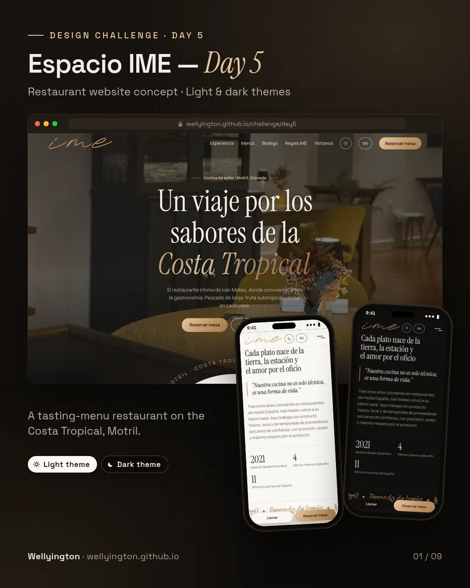
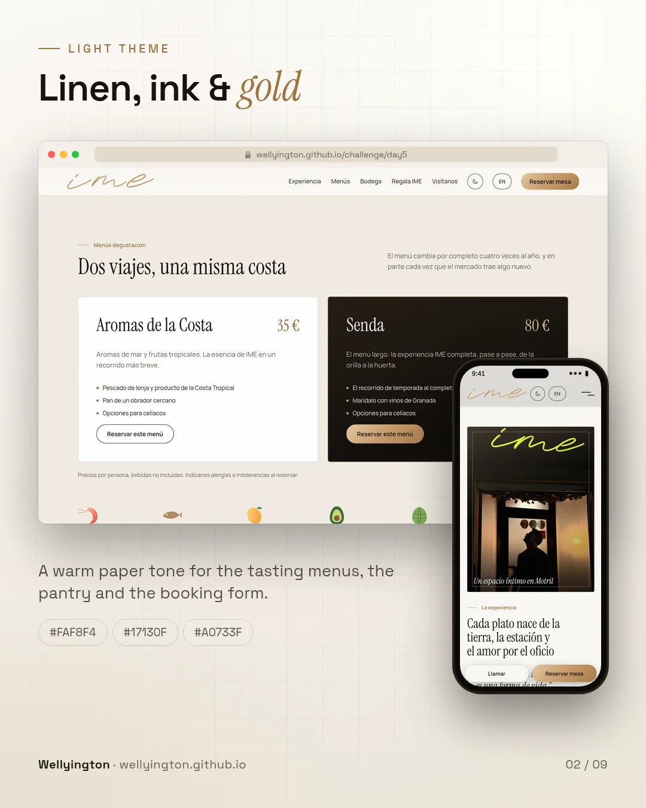
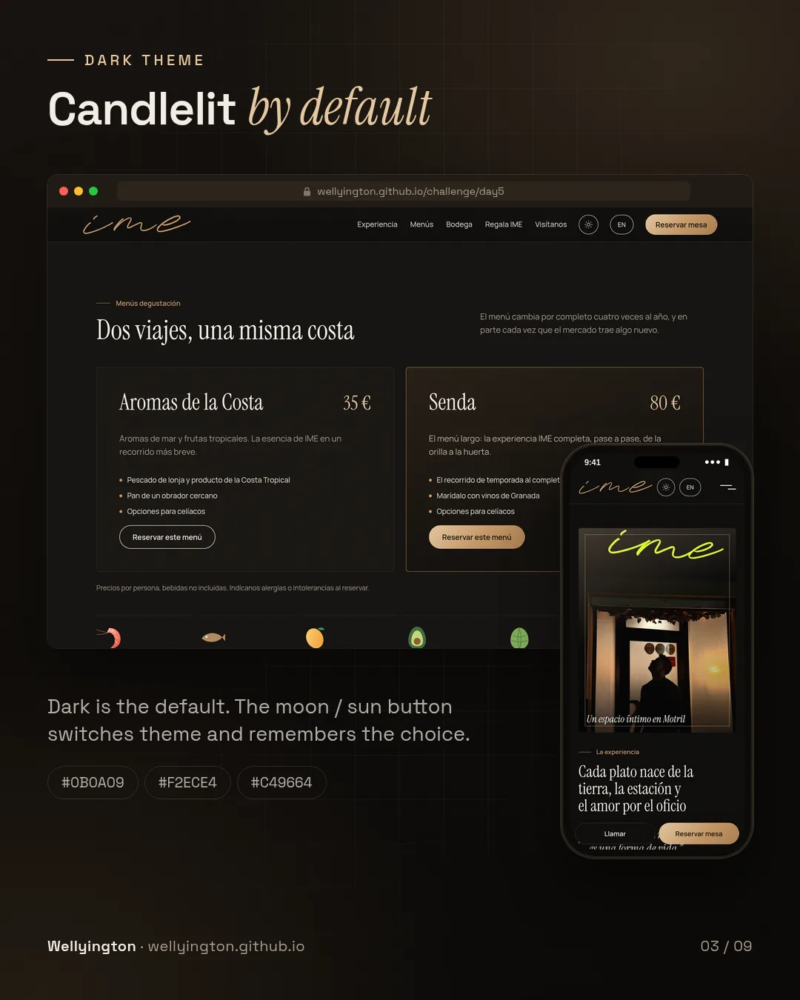
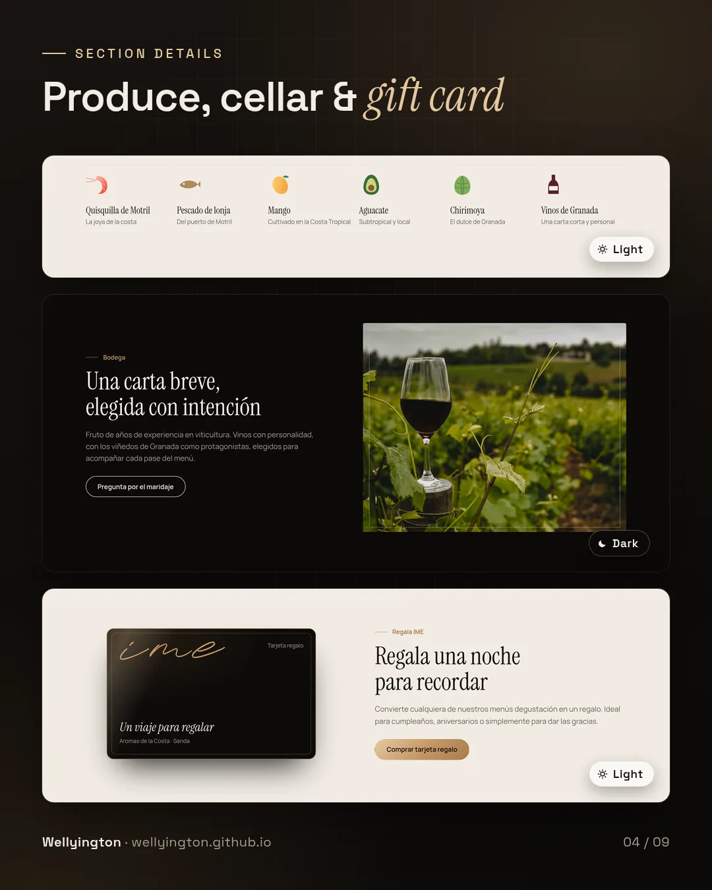
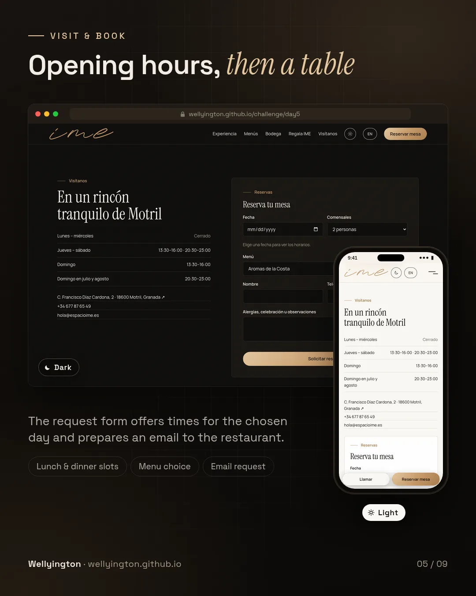
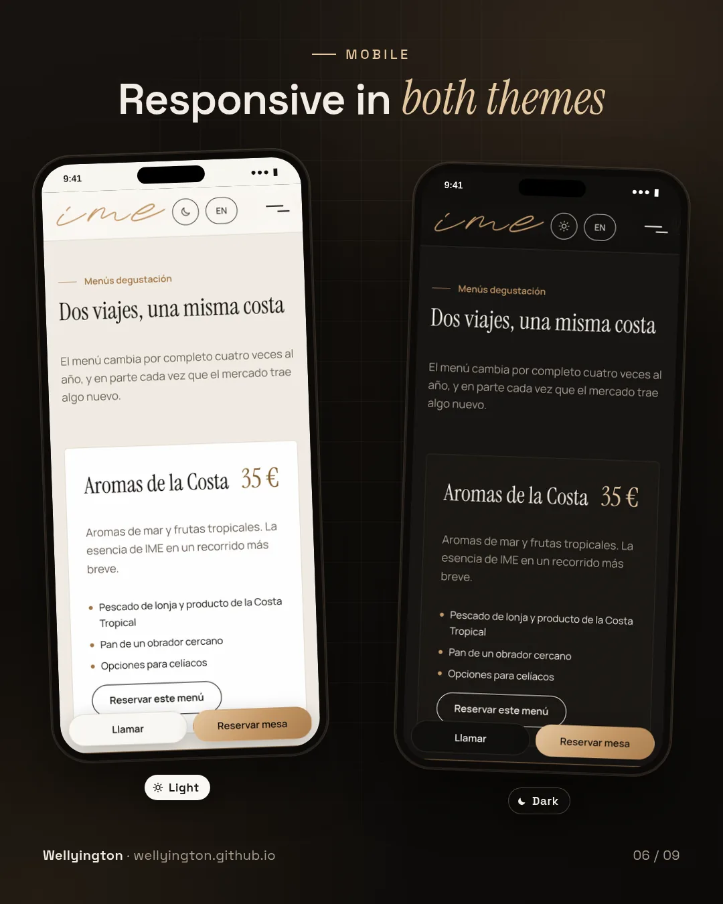
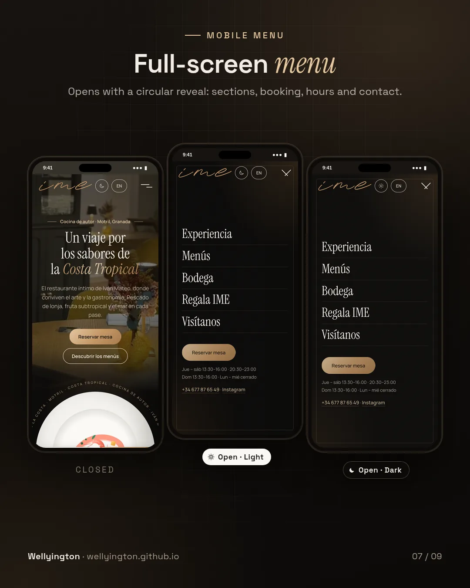
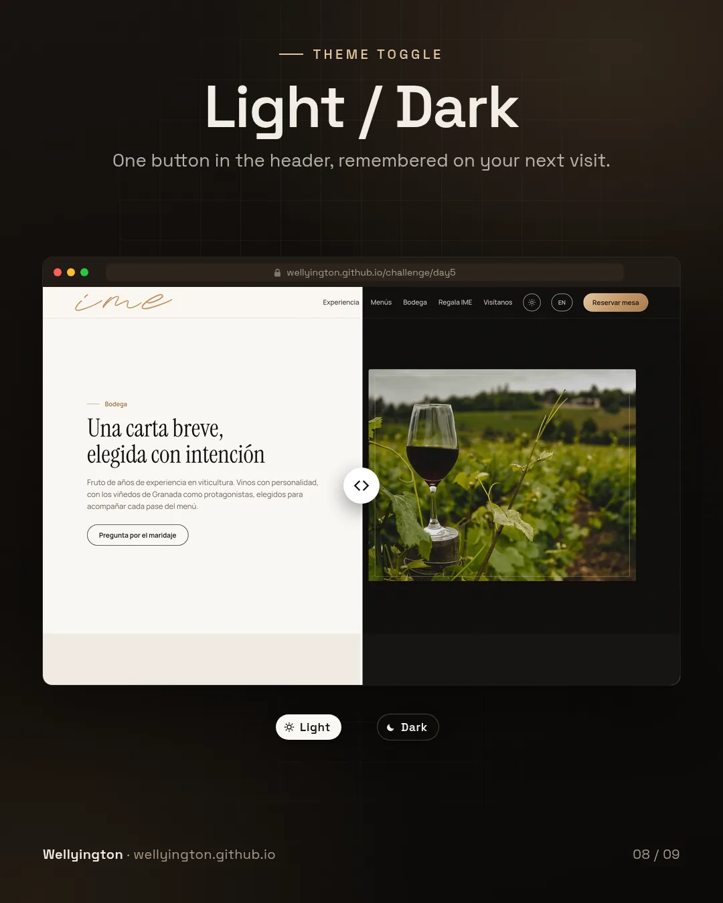

On 21 November I posted the fifth note of this run, the challenge Ramiah Trask set: a hundred days, a hundred businesses, a hundred websites. Day one was a family builder in the Marina Alta. [That page is here.](https://wellyington.github.io/journal/en/articles/built-before-the-yes/) Day two was a theatre in Málaga. [That one is here.](https://wellyington.github.io/journal/en/articles/room-for-a-whole-season/) Day three was a family restaurant in my own town, Estepona. [That one is here.](https://wellyington.github.io/journal/en/articles/a-seat-at-the-long-table/) Day four was a private property practice in Málaga. [That one is here.](https://wellyington.github.io/journal/en/articles/judgement-over-volume/) Today is a restaurant again, but a very different one.

Espacio IME is a small tasting-menu restaurant in Motril, on the Costa Tropical, the stretch of the Granada coast where mangoes, avocados and custard apples grow a few minutes from the sea. The chef is Iván Mateo. He came home to Motril after eleven years cooking in restaurants around Spain, and he has run IME since December 2021. His cooking is built on local produce: fish from the Motril market, the coast's subtropical fruit, Granada wines.

The guides have noticed. Espacio IME is a recommended restaurant in the Repsol Guide for 2026. It is selected in the Michelin Guide. Macarfi, the guide that scores restaurants on food, setting and service, gives it a card of its own and singles out a rice with Motril shrimp as worth the trip by itself.

Some restaurants deserve websites as good as the food they serve. The concept is here: [Espacio IME, day five](https://wellyington.github.io/challenge/day5/). The restaurant's own website is at [espacioime.es](https://www.espacioime.es/), and its Instagram is [@espacioime](https://www.instagram.com/espacioime/).

This is an independent design concept. It is not a collaboration with Espacio IME, nobody there asked me for it, and nothing on the page means they have approved it. Like the four before it, it lives on my own address for now.

## a website that belongs next to the awards

Think about how people arrive at a restaurant like this. Hardly anyone finds a tasting menu in Motril by walking past. They read about it in a guide, see a plate on Instagram, hear about it from a friend who drove down from Granada. Then they look it up. The website is the second impression, and it comes straight after a guide has told them this place is worth a special trip.

If the website then looks like a template, with stock photos and a contact form in a corner, the visitor feels the gap. Not because a template is a crime, but because everything else about the place says care: the produce, the plating, the short wine list, the small room. The website is the only part of the experience the restaurant gives away for free, to everybody, before they have tasted anything.

So I set myself a simple brief. The site should show the same attention to detail as the kitchen. A clear order, the produce at the front, the menus with their prices, the wine, the gift, and a calm way to ask for a table. Nothing that shouts.

## a journey through the flavours of the coast

The site opens in the dining room. A wide photograph of the room fills the screen, darkened so the text sits on it comfortably: wooden tables, mustard chairs, a vase of dried flowers.

The headline is set in a tall, narrow serif: un viaje por los sabores de la Costa Tropical, a journey through the flavours of the Costa Tropical. The last two words are in italic and in a soft gold. Above it is a small line, cocina de autor, Motril, Granada, which is how a guide would describe the place. Below it, one sentence: the intimate restaurant of Iván Mateo, where art and food live together, with market fish, subtropical fruit and the sea in every course.

Then two buttons: book a table, or discover the menus. At the bottom of the screen, a white plate rises into view, with a line of text running around its rim like the edge of a ceramic stamp: Costa Tropical, Motril, cocina de autor, Iván Mateo.

Just under the opening sits a quiet row with the three recognitions: the Michelin Guide 2026, the Repsol Guide 2026 and Macarfi. They are small and set in the same type as everything else, and the footer links to the restaurant's pages in the Michelin and Repsol guides. Awards work best when they are easy to check and not shouted.

*The opening on a large screen, and the experience section on two phones.*

## every plate starts with the land

The first section after the opening is about the cook, not the menu. Its heading reads: cada plato nace de la tierra, la estación y el amor por el oficio. Every plate starts with the land, the season and a love of the craft.

Next to it is one quotation from the kitchen, set large in italic with a thin gold line beside it: our cooking is not only technique, it is a way of life. Then a short paragraph. After eleven years cooking in restaurants across Spain, Iván Mateo came back to his home town. Here he works with fresh, local, seasonal produce from trusted suppliers nearby, with precision, order and the greatest respect for the ingredient.

Three figures close the section. 2021, open since December. 4, new menus every year. 11, years in kitchens across Spain. I prefer figures like these to adjectives. A guest can check every one of them, and together they say more about the place than "exceptional" ever could.

## the produce, by name

A tasting menu is hard to describe in advance, because it changes. What does not change is where it comes from. So between the story and the menus there is a band of ingredients, with a small drawing for each one and a line underneath.

Quisquilla de Motril, the local shrimp, the jewel of the coast. Fish from the market, from the port of Motril. Mango, grown on the Costa Tropical. Avocado, subtropical and local. Chirimoya, the custard apple, Granada's sweet fruit. And the wines of Granada, a short and personal list.

The same names run across the screen as a slow ticker further up, in gold italic, one after another. A visitor from Madrid or London may not know what a quisquilla is. After this page, they will want to try one.

## two journeys, one coast

The menus come next, under the heading dos viajes, una misma costa: two journeys, one coast. One line explains how the kitchen works. The menu changes completely four times a year, and partly every time the market brings in something new.

There are two menus, side by side, each on its own card with the price set large in the corner, the way a printed menu would show it.

Aromas de la Costa, at 35 euros, is the shorter route: the aromas of the sea and tropical fruit, the essence of IME in a shorter journey. It lists fish from the market and produce from the Costa Tropical, bread from a nearby bakery, and options for coeliacs.

Senda, at 80 euros, is the long menu: the full IME experience, course by course, from the shore to the vegetable garden. It covers the whole seasonal route, a pairing with Granada wines, and the same care for coeliac guests. In the light theme this card is dark, and in the dark theme it has a gold border, so the eye knows which one is the full experience without being told.

Each card ends with one button: book this menu. A line under both says that prices are per person, drinks are not included, and allergies or intolerances should be mentioned when booking.

Showing prices was a deliberate choice. Some restaurants at this level hide them, and the visitor has to email to find out. That puts off exactly the people who might be planning a birthday or an anniversary and want to know what to expect. Clear prices are a form of hospitality.

*The light theme: linen, ink and gold, for the menus, the produce and the booking form.*

## candlelit by default

Every site in this run so far has had a light theme and a dark theme. This one is the first where dark is the starting point.

A tasting menu is mostly a dinner, and the room is lit low. So the site opens in its dark version: near-black, #0B0A09, warm off-white text, #F2ECE4, and a muted gold, #C49664, for anything you can press. The light theme is linen and ink, #FAF8F4 and #17130F, with a deeper gold, #A0733F. A small sun and moon button in the header switches between them, and the site remembers your choice the next time you visit.

The type is a pairing I have wanted to use for a while: Instrument Serif, a condensed serif with a beautiful italic, for headings, menus and prices, and Manrope, a clean sans, for everything else. The logo is a thin handwritten ime, in gold.

*Dark is the default. The moon and sun button switches the theme and remembers the choice.*

## the cellar and the gift

Two smaller sections follow, and both matter more than their size suggests.

The first is the cellar, bodega. Heading: una carta breve, elegida con intención, a short list, chosen with intention. The text explains that the list comes from years of experience in viticulture: wines with personality, with Granada's vineyards in the lead, chosen to go with each course. Beside it is a photograph of a glass of red wine standing among the vines. There is no long table of bottles and vintages. A short list is the point, and the button simply says ask about the pairing.

The second is the gift. Regala IME, give IME. The heading is regala una noche para recordar, give a night to remember. Any of the tasting menus can be turned into a gift, for a birthday, an anniversary or simply to say thank you. On the left is a gift card drawn as an object, dark with the gold IME signature and the words un viaje para regalar, a journey to give. The button, buy a gift card, goes straight to the gift page the restaurant already runs. I did not build a new shop. The existing one works, and the job of the concept is to make it easier to find.

Gift cards are a quiet part of the business for many good restaurants. People who have eaten somewhere special want to send their parents, their friends, their best client. A visible, well-presented gift section gives them a reason to.

*The produce, the cellar and the gift card, each given its own space.*

## opening hours, then a table

The last section on the page is called visítanos, visit us, and it puts the hours first. Monday to Wednesday, closed. Thursday to Saturday, lunch from 13:30 to 16:00 and dinner from 20:30 to 23:00. Sunday, lunch only, from 13:30 to 16:00. Sunday in July and August, dinner from 20:30 to 23:00. Under the hours are the address, Calle Francisco Díaz Cardona 2 in Motril, which opens in maps, the phone number and the email address.

Next to the hours is the booking request, reserva tu mesa. First the date and the number of guests. Once a date is chosen, the form offers only the times the kitchen is actually serving that day, in half-hour steps for lunch, dinner or both. Choose a Monday, Tuesday or Wednesday and it says, politely, that the restaurant is closed and suggests Thursday to Sunday. Choose a Sunday in August and it offers dinner instead of lunch. Then the menu: Aromas de la Costa, Senda, or we will decide at the table. Then name, phone, and a field for allergies, celebrations or anything else the kitchen should know.

The button says request a booking, and that is exactly what it does. It prepares an email to the restaurant with everything filled in, ready to send. The restaurant confirms. I did not pretend the concept was a full reservation system. A small restaurant with a handful of tables usually prefers to see every request and answer it personally, and the page respects that.

*The hours come first. The form only offers times when the kitchen is open on the chosen day.*

## on a phone

Most people will look at this site on a phone, often on the same day they want to book. On a small screen everything stacks in the same order: the story, the produce, the menus, the cellar, the gift, the hours.

Two buttons stay pinned to the bottom of the screen the whole time: call, and book a table. They are within reach of a thumb wherever you are on the page. Someone who has already decided does not need to scroll to the end to find the form.

The menu opens over the whole screen with a circular reveal that starts from the menu button in the corner, like a curtain drawn from one side. Inside are the five sections, set large in the serif: experience, menus, cellar, give IME, visit us. Below them are the book a table button, the opening hours in one short line, the phone number and Instagram. Everything a guest needs to make up their mind fits on that one screen.

*The menus on a phone, in both themes, with call and book always within reach.*

*The full-screen menu opens with a circular reveal: sections, booking, hours and contact.*

## spanish first, english one tap away

IME's own website is in Spanish, and so is the concept, first. But the Costa Tropical also gets visitors from abroad, and plenty of people living on this coast read English more comfortably than Spanish.

So there is an EN button in the header. Press it, and every piece of text on the page changes to English: the headings, the menus, the opening hours, the form labels, the buttons. It is not a machine translation added on top. Every line has its English version written alongside the Spanish, so both read properly.

## why I think this one deserves a look

Every day in this run has its own job. A builder needed a first clear page. A theatre needed an order. A family restaurant needed to show many reasons to walk in. A property practice needed to put a person at the front.

Espacio IME needed something closer to the kitchen itself: restraint, good materials and attention to small things. A gold line beside a quotation. A plate rising at the foot of the opening screen. Prices set like a printed menu. A booking form that knows the kitchen is closed on Tuesdays.

I will say it plainly: I think this one deserves a look from Awwwards. If it gets one, good. If it does not, the page still does what it was made for, which is to sit next to a Michelin listing without looking out of place.

*One button in the header, remembered on your next visit.*

## an independent concept

Espacio IME did not hire me, and this is not their website. The chef's story, the menus and prices, the produce, the hours, the address and the guide listings come from what the restaurant and the guides already publish. I have not changed any facts. What I changed is the order, the type, the tone and how the page behaves on a phone.

I have no figures on bookings or visits, and I will not make any up. If nobody at IME wants this, the concept stays where it is as day five. If they do, the rest is practical: their words where I have filled in, new photographs for each season's menu, the booking requests sent wherever they want them, and the site moved onto espacioime.es.

## if your kitchen is better than your website

You may not run a tasting-menu restaurant. Many small businesses on this coast are in the same position, though: what they make is better than how they appear online. A bakery that wins awards and has a two-line website. A winery with a beautiful cellar and a page that is mostly a phone number. A hotel with ten perfect rooms and a booking widget from 2015.

What helps is the same as here. Put the people and the produce first. Show the prices if you can. Give the guest one calm way to ask for what they want. Let the design be as careful as the work.

I am a web designer in Estepona, on the Costa del Sol, and I build websites like this one for businesses across Spain. If that sounds like your business, write to me from [the main site](https://wellyington.github.io/). Tell me what you do and where, and I will reply in plain language. The concept is [here](https://wellyington.github.io/challenge/day5/), and Espacio IME's own site is [here](https://www.espacioime.es/), so you can compare the two. Five down, ninety-five to go.
