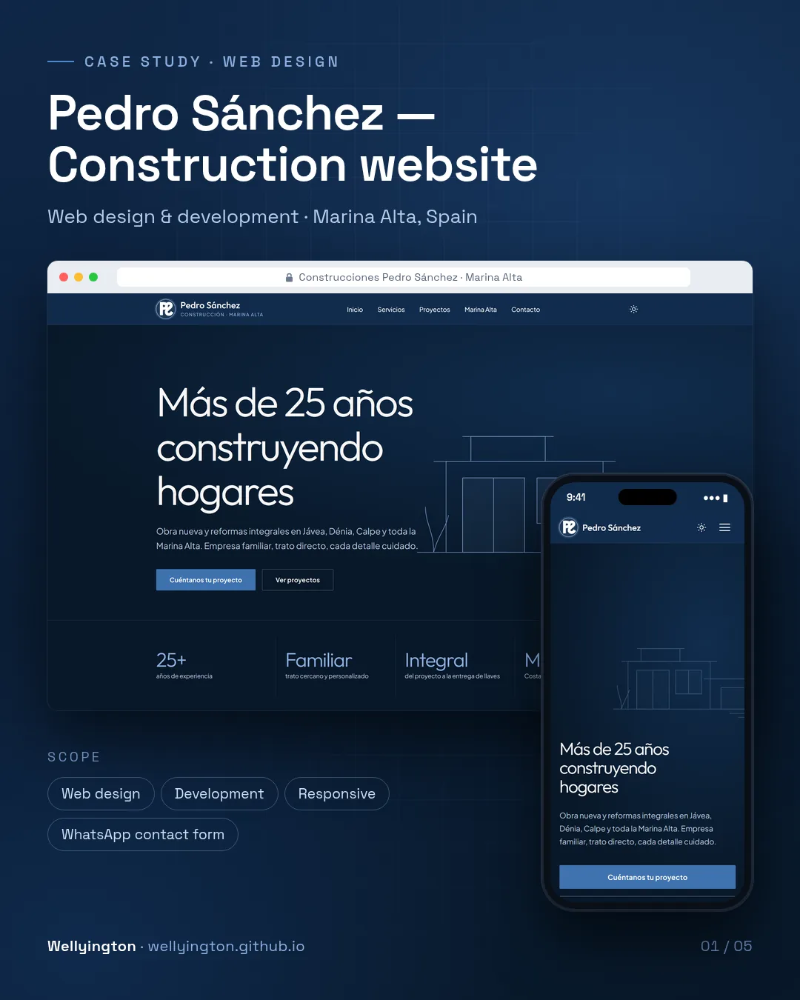
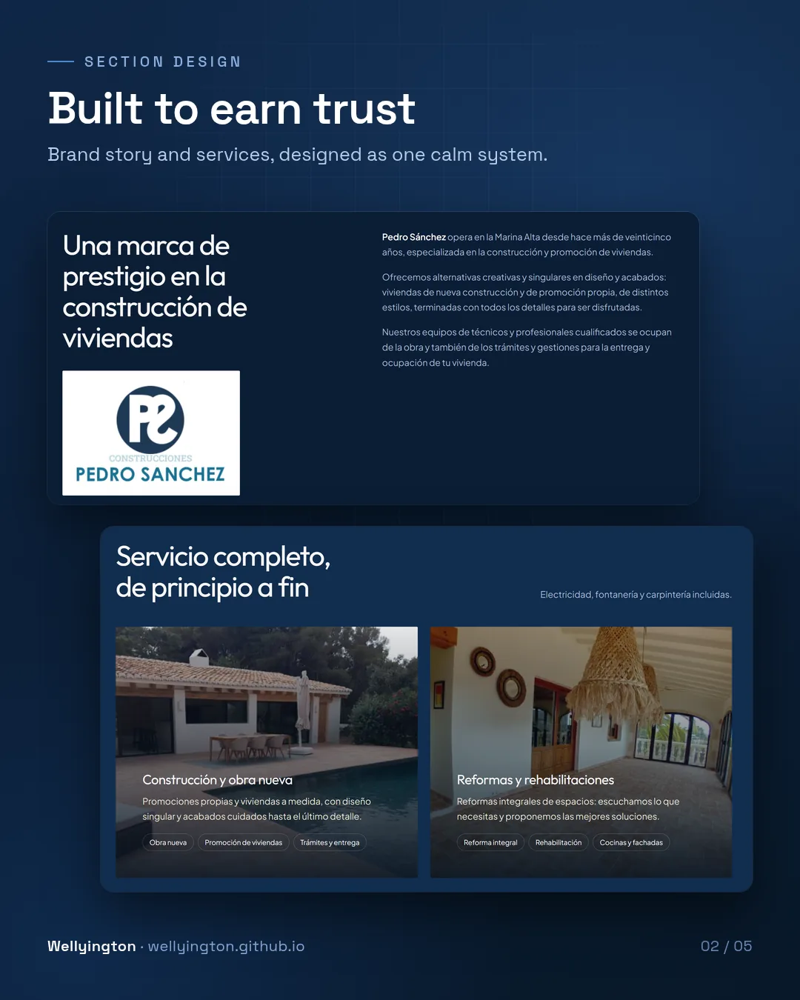
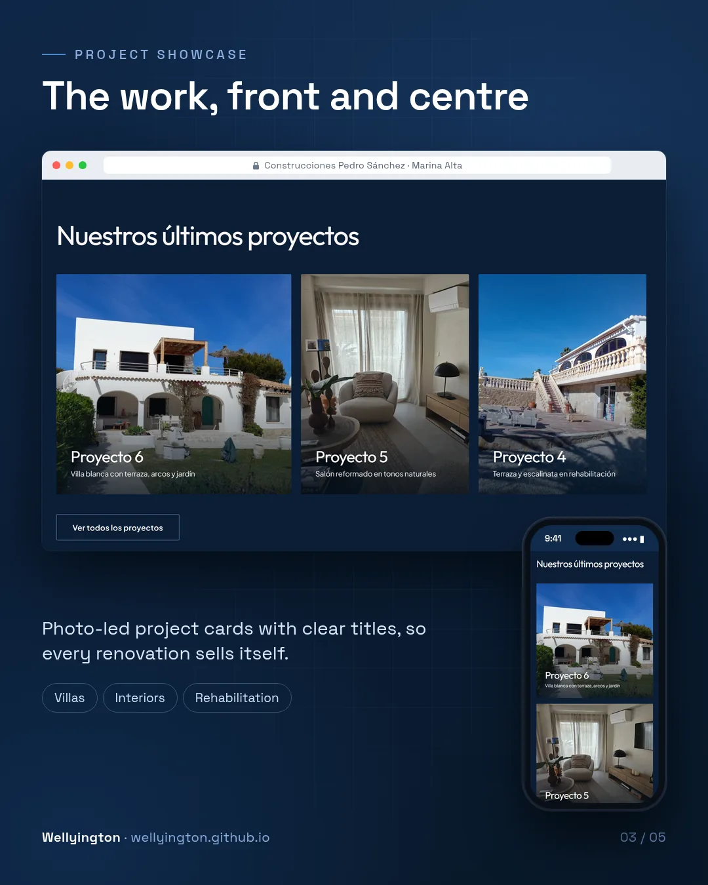
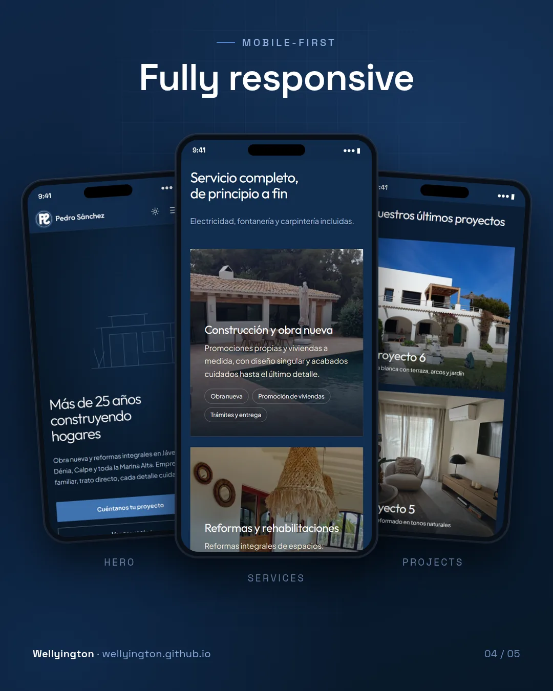

On 17 November I posted a short note. Day one of a challenge I am doing in the open: a hundred days, a hundred businesses, a hundred websites. The first is a single page for Pedro Sánchez Construction, a family builder in the Marina Alta. It is already online.

I work from Estepona, on websites for shops, studios and trades. The site ought to behave like the business: clear about the work, and reachable on an ordinary afternoon. I built this one before anyone hired me.

You can open it here: [Pedro Sánchez Construction, day one](https://wellyington.github.io/challenge/day1/). It sits on my own address for now. That is the honest place until the owner takes it on.

## a hundred days, one business at a time

One business a day, and a real website each time, not a picture saved for a meeting that might never come. After a hundred days I want a hundred pages a person can open and recognise. This builder is the first. Ninety-nine are still ahead.

The idea comes from Ramiah Trask. He thinks a run of days like this is a sound way to build a web design business, because of what it does for the client. Hiring usually means imagining a site that does not exist: other people's pages, a proposal, your own name still on a blank. A finished page is smaller to decide about. You open it, see your towns and your work, and pass a phone across the table. Yes, or no, or change this part.

I have not spoken with Pedro. As far as I know he has not seen the page, and I will not pretend otherwise. It is there so he can look at something finished.

## what a builder's customers are looking for

The page presents a family firm that has been building homes in the Marina Alta for more than twenty-five years. It names Jávea, Dénia and Calpe, and the coast around them, on the Costa Blanca in Alicante. The line at the top is the one they lead with: more than twenty-five years building homes. New houses, full renovations, a close way of dealing with people, care with the detail.

I did not invent that history. Twenty-five years on the same coast is what a client listens for: the firm was here before this year's kitchens, and may still answer if a job runs long. "Family" is spelled out as trato directo. You deal with them, not a switchboard.

The work sits in two kinds. New houses, some they develop themselves and some drawn for one client, finished so a person can live there. Full renovations, where they listen and then propose a way through. Electricity, plumbing and carpentry are included. That last line matters if you have ever renovated. There is a bad middle to those jobs, when the electrics are called somebody else's problem and that somebody has not been booked. I am reporting what the page says. I have not stood on their sites.

The visitor I had in mind is in a particular week. A plot. A house that no longer fits. A kitchen they have disliked for years. They are comparing two or three firms, and they want plain answers. Can I trust these people with a house. Can I see the work. How do I reach them this week, without opening an account.

## the first screen

The first words are large: "Más de 25 años construyendo hogares." Behind them, a line drawing of a house, pale on a deep blue ground. Under the headline, new builds and full renovations in Jávea, Dénia, Calpe and the rest of the Marina Alta. A family company, direct dealing, each detail looked after.

Two buttons. Tell us about your project, or see the projects. Talk now, or look at houses first.

Four short facts run along the bottom. More than twenty-five years. A family firm, close and personal. The whole path from the project to the day the keys are handed over. The place itself: Marina Alta, Costa Blanca, Alicante. They sit where the eye lands before any scrolling.

On a phone the same screen stacks. Headline, a few lines, the button. The drawing stays, smaller, so it is still their page.

*The opening of the page, on a large screen and on a phone.*

## the story, and the two kinds of work

Further down, a few paragraphs say who they are. More than twenty-five years building and developing homes in the Marina Alta. Their own developments, and new houses in different styles, finished so someone can live there. The people they employ handle the building and the paperwork of handing a home over. The heading calls them a respected name in house building. That claim is theirs. The page leaves it alone.

The mark is a PS monogram, the name, and the words construcción and Marina Alta. It says whose page this is, at the top, and again at the foot.

Then the services, under a heading that promises the whole job from start to end. Beside it, electricity, plumbing and carpentry included. Two photographs do the explaining. One is a single-storey house with a tiled roof, a pool, and a table under the trees: new construction, their own developments and houses made to measure. The other is a long covered room, arches along one side, a large woven lamp, the garden at the far end: renovations, where they listen and then propose. Small labels sit on the pictures for anyone in a hurry. New build, housing development, paperwork and handover. Full renovation, rehabilitation, kitchens and façades.

Under the photographs, the order a client lives. First they listen, because each project is its own. Then they propose. Then they carry the work out, from planning to the last day on site.

A short passage follows on living in the Marina Alta. Coves, mild winters, warm summers, food, and some quiet. Dénia, Jávea and Calpe are named on their own. Plenty of people commissioning a house here are choosing the town as well as the firm, so the page says so, briefly, and goes back to the work.

*Who they are, and the two kinds of work: new houses, and full renovations.*

## the houses themselves

People trust a builder when they can see houses. The page shows three recent projects, each a photograph with a title and one line.

A white villa with a terrace, arches and a garden. A living room redone in natural tones: pale curtains, a low chair, wood, a lamp. A terrace and an outside stair still in the middle of the work, the coast behind them. That third one matters. A job in progress says renovation belongs here, not only the finished villas.

There is a way through to all the projects. On a phone the photograph comes before the label. I have not walked these rooms, so I will not invent how they feel. They are shown large, in ordinary Spanish. The word portfolio is not used. At a kitchen table, a client already says "projects".

*Recent work, as photographs with a title and one line each.*

## getting in touch

The end of the page is what makes the rest useful. You can write on WhatsApp, or fill in a short form: name, telephone, email, and what the project is. You tick that you have read the privacy note. The button says send by WhatsApp. WhatsApp then opens with your message already written, and you press send yourself. It does not disappear into an inbox nobody checks. You can see the next step.

Under the number, one line: write on WhatsApp or use the form, and they will reply. The heading above it is "leave your project in the hands of experts." Along this coast a lot of arranging already happens on WhatsApp. A different number later is a small change.

## the same page on a phone

A couple leaving a viewing. Someone sending a kitchen they want taken out to the person who has to agree. A name heard in Dénia, opened in a car park. The screen is narrow, and the moment is short.

The phone shows the same site. The opening line, both kinds of work with their photographs, electricity, plumbing and carpentry named above them, projects that still read as houses. The button sits where a thumb reaches it. The menu leaves once you have chosen. No pinching. No turning the phone sideways to make a sentence fit.

*The same site on a phone: the opening, the services, and the projects.*

## what happens next with this site

It is ready to hand over. That was the reason for building it first. Someone at the company can open it today and say yes, or no, or yes if a few things move.

If they want it, the rest is practical. A domain in their own name, so the address is theirs. A sentence they would rather write themselves. A photograph they prefer. A project added, or taken down. Their words and their pictures, in the places where this page is standing in for a conversation we have not had. Then it goes live under their name, on their phone, answered their way.

Until that happens it stays where I put it. An open address, day one of the challenge, with no pretence that they have agreed. They have not told me they have looked. If you are Pedro, or you work there, I would rather hear "change that terrace" than hear nothing.

## if you run a small business

You may not build houses. From Estepona I see the same bind most months. The business needs a website, or a better one than the page assembled in a hurry years ago. You are shown other trades and asked to picture your own. Often the price arrives first, and the decision is supposed to come out of a meeting.

It can go the other way. The page exists first: your name, the work you do, the towns you serve, a way to be reached that matches how you already talk to people. You open it on your phone. You show a partner, a sibling, the person who looks after the money. Then you decide.

That is the useful part of these hundred days, and it is how I prefer to work when no challenge is running. If you want a page like that, write to me from [the main site](https://wellyington.github.io/). Say what you do, and where. I will answer in ordinary language.

## a small favour

This first site is for a company I would like to work with, and I have no side door in. If you know Pedro Sánchez, or someone at the firm, send them the page. That was the request in the note, and it still is: [day one, written in public](https://x.com/wellyington/status/2122700118528872815).

I will carry on. One business, one website, the next day. If the page finds its owner, good. If it only makes the second one clearer, that still counts.
