On 27 November I posted the eleventh note of this run, the challenge Ramiah Trask set: a hundred days, a hundred businesses, a hundred websites. Day one was a family builder in the Marina Alta. [That page is here.](https://wellyington.github.io/journal/en/articles/built-before-the-yes/) Day two was a theatre in Málaga. [That one is here.](https://wellyington.github.io/journal/en/articles/room-for-a-whole-season/) Day three was a family restaurant in Estepona. [That one is here.](https://wellyington.github.io/journal/en/articles/a-seat-at-the-long-table/) Day four was a private property practice in Málaga. [That one is here.](https://wellyington.github.io/journal/en/articles/judgement-over-volume/) Day five was a tasting-menu restaurant in Motril. [That one is here.](https://wellyington.github.io/journal/en/articles/as-careful-as-the-kitchen/) Day six was a rotisserie chicken house in Estepona. [That one is here.](https://wellyington.github.io/journal/en/articles/from-the-counter-to-the-ticket/) Day seven was a family-run hotel in Kavos, Corfu. [That one is here.](https://wellyington.github.io/journal/en/articles/the-same-pool-after-dark/) Day eight was three houses in Málaga's old town. [That one is here.](https://wellyington.github.io/journal/en/articles/three-houses-one-front-door/) Day nine was a model agency in Marbella and London. [That one is here.](https://wellyington.github.io/journal/en/articles/let-the-photographs-talk/) Day ten was a Pilates studio in Marbella. [That one is here.](https://wellyington.github.io/journal/en/articles/quality-over-trends/)

Today is a virtual assistant. Elevate Admin Studio is Charlotte's business, based in Leeds and working with business owners across the UK. She brings more than 22 years in senior administrative and project support roles, five of them within the NHS at national level, and now offers that experience to coaches, consultants, creatives, small businesses and growing teams who need help behind the scenes but are not ready to hire someone in-house. The work covers admin, inboxes and diaries, social media, finance admin, events, projects, and documents and data. Her current site is at [elevateadminstudio.co.uk](https://elevateadminstudio.co.uk/).

The concept is here: [Elevate Admin Studio, day eleven](https://wellyington.github.io/challenge/day11/).

## the website is the first piece of work

A virtual assistant sells something that is hard to show: order. Nobody can see a well-kept inbox from the outside, or a diary that never double-books, or the follow-up email that went out on time. What a prospective client can see, before they ever speak to her, is the website. And they will read it, consciously or not, as a sample of the work.

That sets the brief. If the site is cluttered, the visitor wonders whether the admin will be cluttered too. If the prices are hidden behind "get in touch for a quote", they wonder what else will be vague. If the next step is unclear, they wonder how clear the weekly updates will be. A site for an assistant has to be the opposite of all that: tidy, honest about money, and plain about what happens next.

So the direction was a calm, ordered one-page site. A navy, cream and gold palette, a classical capital letter for the headings, a light sans-serif for the reading, thin rules dividing the page into clear sections, and everything a client needs on one long scroll, in the order they need it.

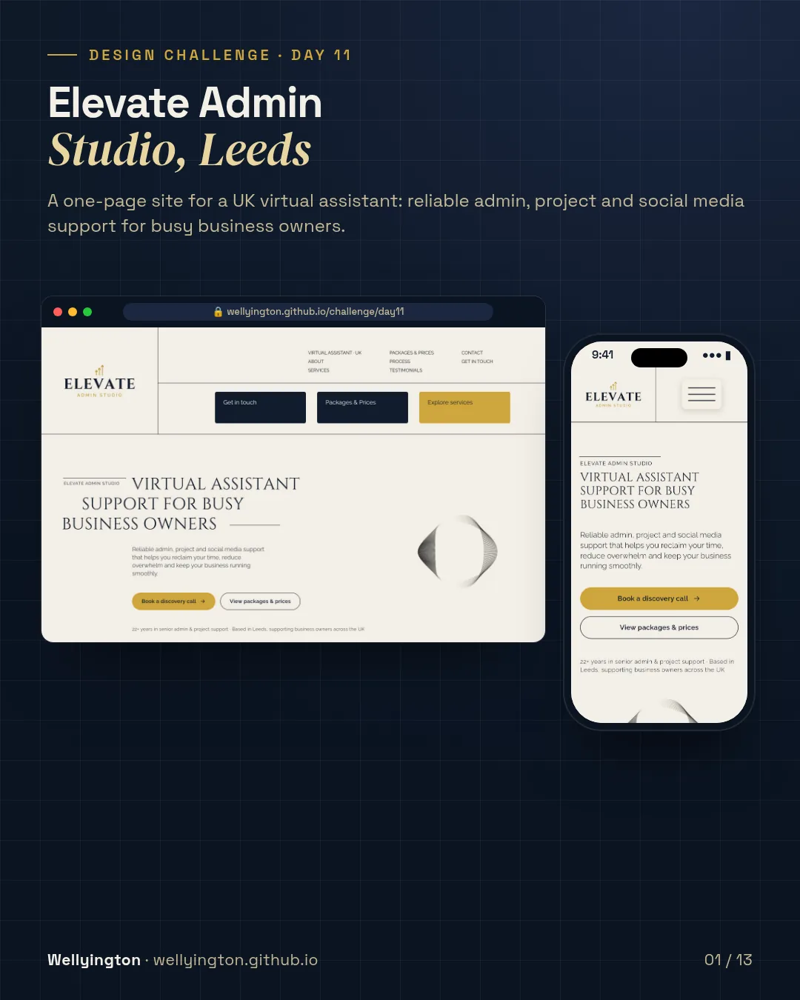
*Day eleven: a one-page site for a UK virtual assistant offering admin, project and social media support.*

## support for busy business owners

The page opens with a short loading screen. A counter runs to a hundred while four words pass by: organising, scheduling, delegating, ready. Then an Enter site button. It is a small piece of theatre, and it says what the service does before a single sentence has been read.

Behind it is the hero. On the left, the headline in tall, spaced capitals: virtual assistant support for busy business owners. Under it, one sentence: reliable admin, project and social media support that helps you reclaim your time, reduce overwhelm and keep your business running smoothly. Then two buttons, a gold one to book a discovery call and an outlined one to view packages and prices. On the right, a short looping film of a shape drawn in fine lines, slowly turning.

And underneath, one quiet line that does a lot of work: 22+ years in senior admin and project support, based in Leeds, supporting business owners across the UK. Experience, place and reach, before anyone has scrolled.

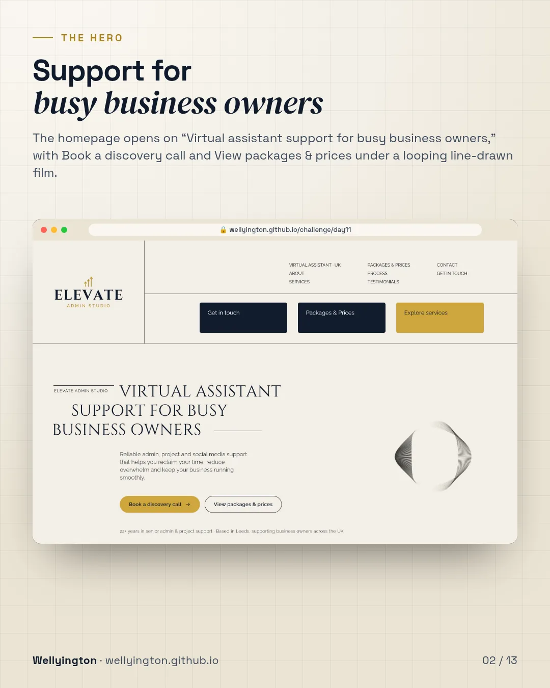
*The hero: one headline, two buttons, a line-drawn film and the line about 22 years of experience.*

## a header that works like a filing cabinet

The header is laid out like an index. The logo sits in its own panel on the left. To the right, the sections are listed in three small columns, as you might label drawers: virtual assistant, about, services; packages and prices, process, testimonials; contact and get in touch. Below them, three blocks act as shortcuts: Get in touch and Packages & Prices in navy, Explore services in gold.

On a phone, and on any screen narrower than 1,025 pixels, that header becomes the logo and a three-line button. Tap it and a navy panel slides in over 0.8 seconds and fills the screen, with the seven sections in a single column, each on its own ruled line: Home, About, Services, Packages & Prices, Process, Testimonials, Contact. The lines are large enough to tap without aiming, and the cross to close it sits where the button was.

On a one-page site the menu is really a table of contents. It should read like one.

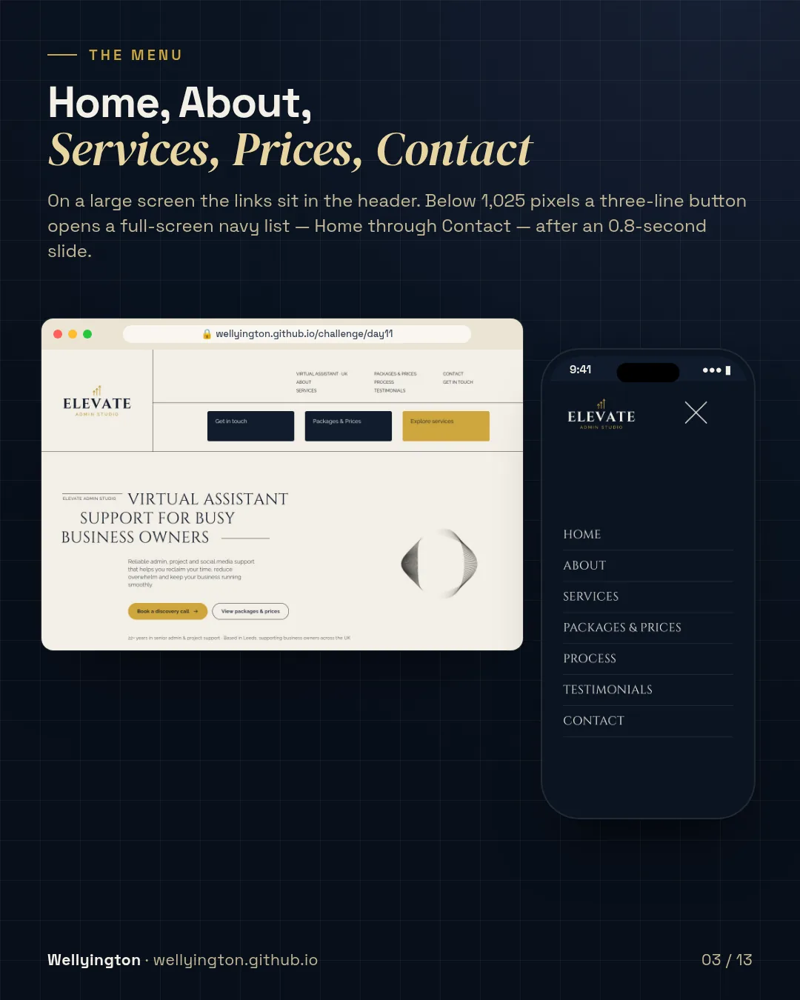
*On a large screen the links sit in the header; on a phone, a full-screen navy list.*

## hi, I'm Charlotte

For a one-person business, the person is the product. So the first section after the hero introduces her, in her own voice: hi, I'm Charlotte, founder of Elevate. Beside it, a portrait.

The text is short and specific. She provides calm, organised and dependable virtual support for busy business owners who need help behind the scenes. She works with people who are juggling too much and need reliable support to keep things organised. Whether that is admin, social media, project co-ordination or day-to-day organisation, she can help create more calm, clarity and structure. A few of those phrases are set in a heavier weight, so a skimming eye picks up the promise without reading every word.

Underneath comes a list of who she works with: coaches and consultants, creatives and service providers, small business owners, growing teams, and business owners who are ready to delegate. Then a prompt: ready to hand over your admin with confidence? That list matters more than it looks. A visitor who sees themselves in it stops wondering whether this is for them.

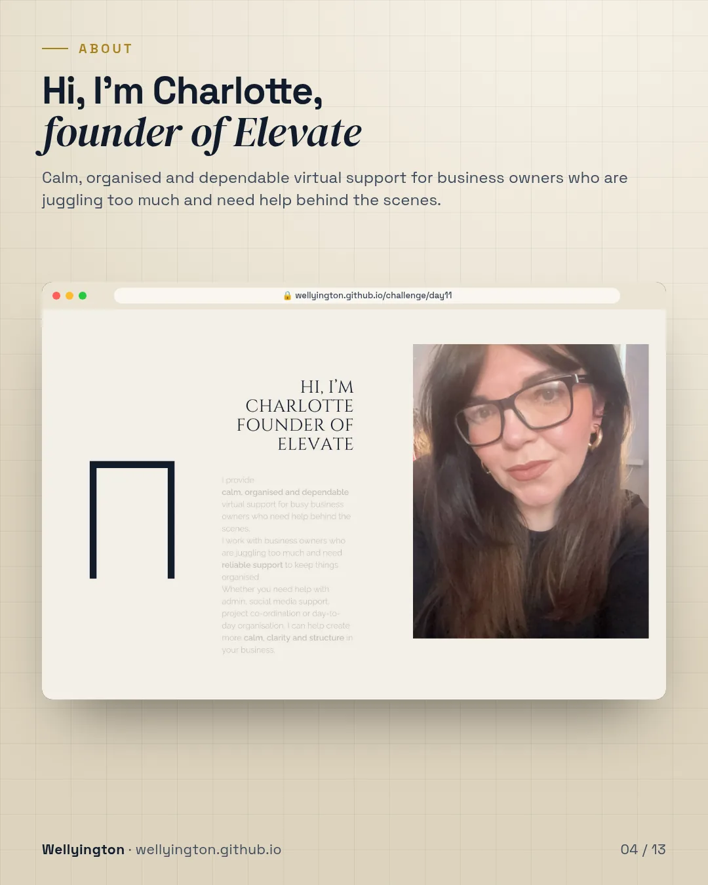
*Hi, I'm Charlotte: a short introduction in her own words, next to a portrait.*

## two decades, in numbers and in values

The next section, meet Charlotte, carries the experience. Over two decades of calm, capable support. Two paragraphs explain where it comes from: senior administrative and project roles, five years in the NHS at national level, supporting teams, leaders and programmes by managing priorities, coordinating meetings, preparing documents and tracking actions. Then the turn to now: bringing that experience to business owners who need trustworthy support without the commitment of hiring in-house.

Three figures sit under the text, and they count up as they come into view: 22+ years in senior admin and project support, 5 years at the NHS at national level, and Leeds, based there and supporting clients UK-wide. To the right, a navy card describes what it is like to work with her, and what a client can expect: clear communication, reliable follow-through, organised systems, a calm and professional approach, support that feels like an extension of the business, and care, discretion and attention to detail.

Below that, five value cards, each with a small gold icon and a few lines: reliability, care and professionalism, organisation and clarity, trust and confidentiality, and supportive partnership. Values sections are often filler. Here they earn their place, because for an assistant who will see your inbox, your invoices and your clients' details, trust and confidentiality are not abstract words. They are the question every client is quietly asking.

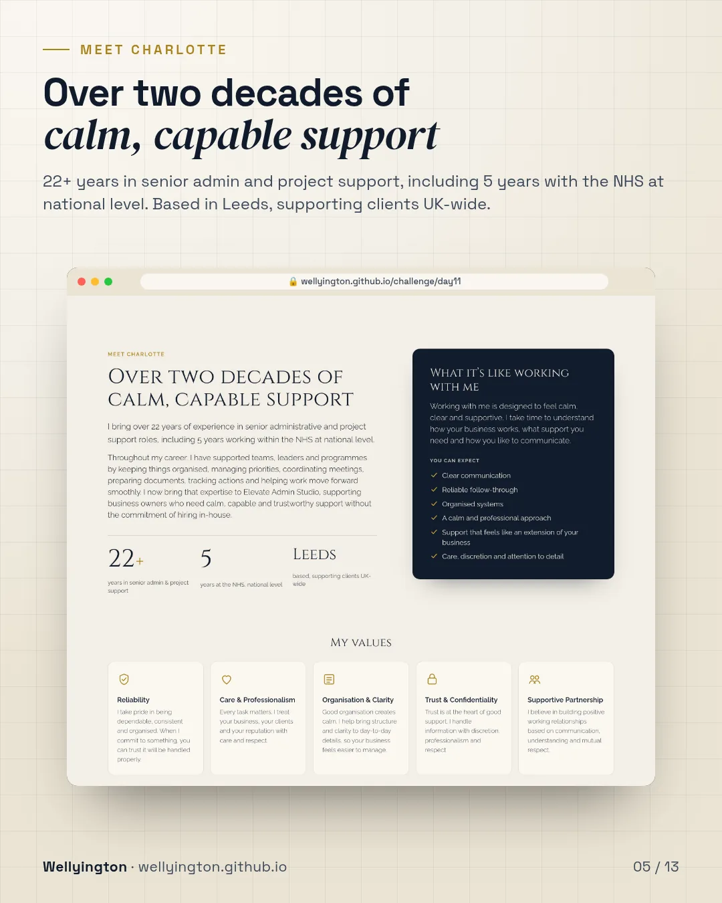
*22 years, 5 at the NHS, based in Leeds, and five values that answer the question of trust.*

## six services, one open at a time

The services section turns dark. It opens with a photograph of a monthly planner and pens, and a short introduction: flexible support designed to help you feel more organised, less overwhelmed and more in control of your workload, whether ongoing or for specific tasks.

Then the six services, as an accordion, with only one open at a time: Social Media Admin Support, Finance Admin Support, Event Admin Support, Project Support, Traditional PA/EA Support, and Documents & Data Support. Each one, when opened, follows the same pattern: a one-line description, the tasks it can include as small outlined chips, who it is ideal for, and a link to enquire about that service specifically.

Social Media Admin Support starts open. Its chips cover monitoring comments, managing inboxes, replying to messages using guidance, content creation support, Canva templates and graphics, caption formatting, scheduling and weekly updates. Finance Admin covers invoices, chasing payments, following up quotes, tracking expenses and updating trackers, and it says plainly that it supports your finance admin but does not replace an accountant or bookkeeper. That one line is the kind of honesty that builds trust, and it saves everyone an awkward conversation later.

The accordion keeps a long list of services from becoming a wall. A visitor opens the one they came for, reads it, and closes it. And each enquiry link opens an email with the service already named in the subject line, so Charlotte knows what the message is about before she opens it.

At the end of the section, a line for the undecided: not sure what support you need? That's completely fine. We can talk through your current workload. And a button to book a discovery call.

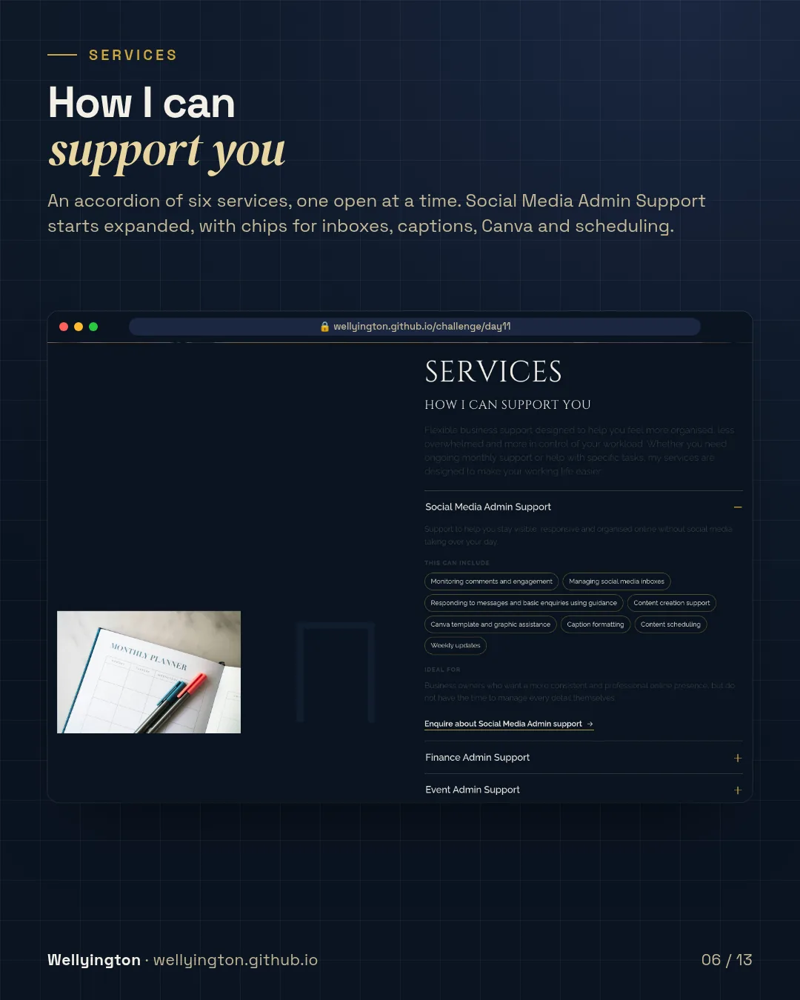
*Six services in an accordion. Social Media Admin Support opens first, with its tasks as chips.*

## what happens when you enquire

One of the quiet reasons people put off hiring help is that they do not know what the process is. Will there be a hard sell? A long form? A contract on the first call? The how it works section removes that worry in six steps, laid out on a vertical line with numbered circles.

Step one, enquire, by email or social media, with a little about the business. You do not need to know exactly what support you need at this stage. Step two, a discovery call: short and informal, with no pressure and no obligation to proceed. A small link opens the list of what will be talked through, from current priorities to which package may suit. Step three, a proposal, sent after the call, with time to review it. Step four, the booking form, contract and invoice, so everything is agreed before work begins. Step five, onboarding: access to systems, shared folders, a Trello board or task tracker, communication preferences and guidance on tone of voice. Step six, support begins, with clear communication and regular updates.

Six steps sounds like a lot. Laid out like this, it reads as the opposite: someone who has done this before and has a system for it. Which is exactly what a client is paying for.

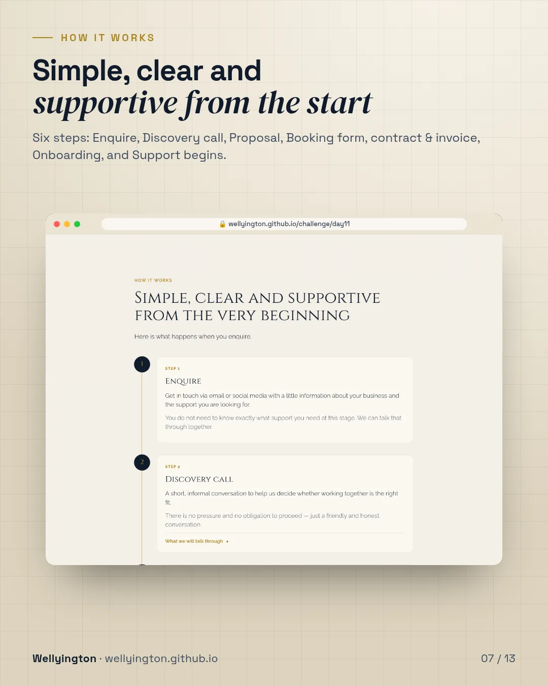
*Six steps from enquiry to support, each on a numbered line.*

## the prices, out loud

This is the part I most wanted to get right. Many service businesses hide their prices, on the theory that a phone call sells better than a number. For a virtual assistant, I think the opposite is true. The people she works with are busy by definition. A visitor who can see the price can decide in a minute whether to book the call. A visitor who cannot has to spend time to find out, and busy people often don't.

The section opens with the argument for a virtual assistant in one sentence: reliable, professional support without the added costs of employment, such as holiday pay, tax, National Insurance, pensions, office space, equipment or training. Then three tabs: monthly retainers, set packages, and ad-hoc and bespoke.

The retainers tab is the interactive part. Rather than six cards side by side, there is a slider: how many hours of support a month? It runs from 12 to 60 hours in six stops. Move it, and the card beside it changes: The Assistant, 12 hours, £420 a month; The Coordinator, 20 hours, £700; The Senior Support, 30 hours, £1,050; The Operations Partner, 40 hours, £1,400; The Executive Support, 50 hours, £1,750; and The Strategic Support, 60 hours, £2,100. Each comes with one line on who it suits and a button to enquire, which opens an email with that retainer's name already in the subject line. It opens on The Coordinator.

The slider does something a table would not. It lets a visitor start from their own question, how much help do I need, and see the answer, rather than reading six options and working backwards. Under it, the helpful details are spelled out: time is tracked to the nearest 15 minutes, unused hours do not roll over, retainer hours include briefing and communication time, a three-month commitment is recommended, and availability is limited. Those are the terms that usually only come up in a contract. Here they come up before the first email.

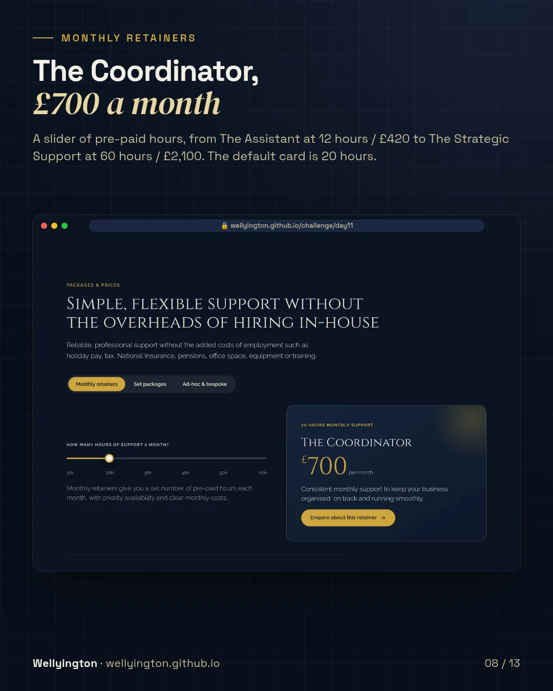
*Slide from 12 to 60 hours and the card changes. At 20 hours, The Coordinator, £700 a month.*

## packages, hours and projects

The second tab is for people who want help with one thing. Three set packages, each on its own card: Elevate Social Support at £450 a month, which includes 10 content pieces across up to two platforms; Executive Support & Project Coordination at £700 a month, combining inbox and diary management with meetings, agendas, minutes and action tracking; and Elevate Inbox Management at £450 a month, from sorting and flagging to drafting replies for approval and a weekly inbox update. Each card has a what's included link that opens the full list, and an enquiry link of its own.

The third tab is for everything else. Ad-Hoc Support is £35 an hour, with a minimum booking of five hours, for one-off tasks, document creation, spreadsheets, inbox clear-outs and short projects. Bespoke Project Support is priced on application, for work that does not fit an hourly or monthly shape, with the price based on the size of the project, the duration and the agreed brief.

Below the tabs sits one sentence: not sure which option is for you? We can talk it through during a discovery call. The prices give people a place to start. The call is still where the decision gets made.

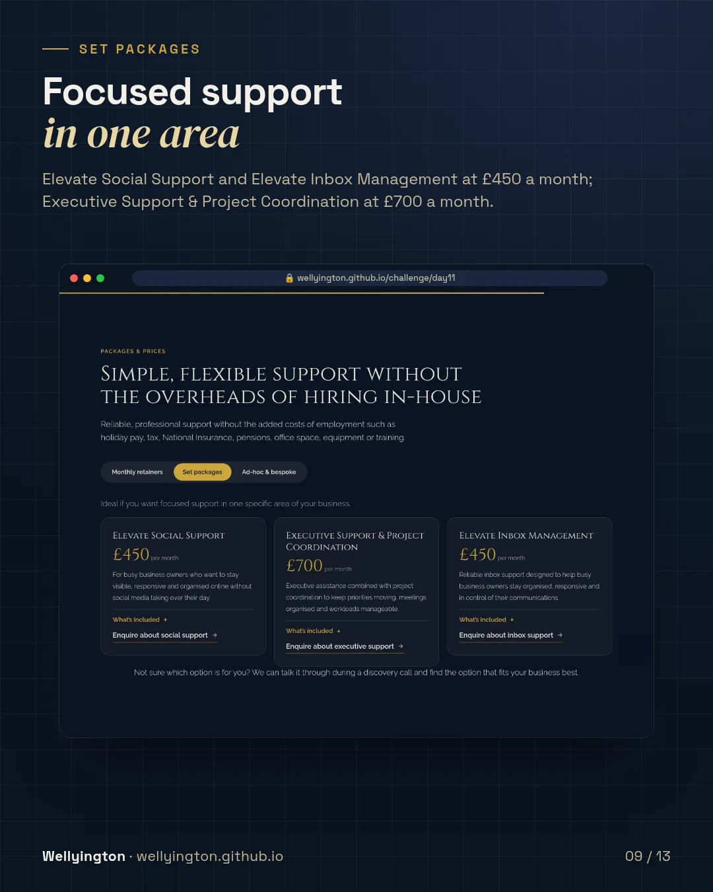
*Three set packages for focused support in one area.*

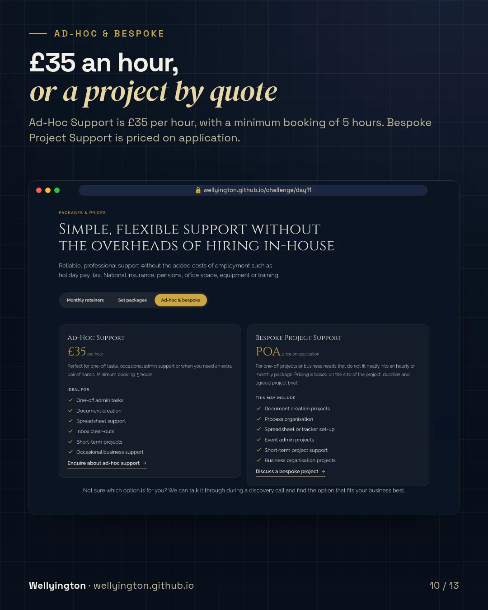
*£35 an hour for one-off tasks, or a bespoke project by quote.*

## support people can rely on

The testimonials section is short, and it should be. There are two quotes, in a single card with arrows to move between them, both from senior people who have worked with Charlotte over several years.

Ellie Gordon, formerly Senior Nurse for Mental Health and Learning Disabilities at NHS England, describes her as "warm, supportive, and adaptable". David Harling, BEM, National Deputy Director for Learning Disability Nursing, writes about national projects, tight timescales and written reports produced to a high standard.

Two testimonials can look thin on some sites. Here they carry weight because of who wrote them and what they describe: years of work, named roles, specific things done. I would rather show two real, specific quotes with full names than ten anonymous ones.

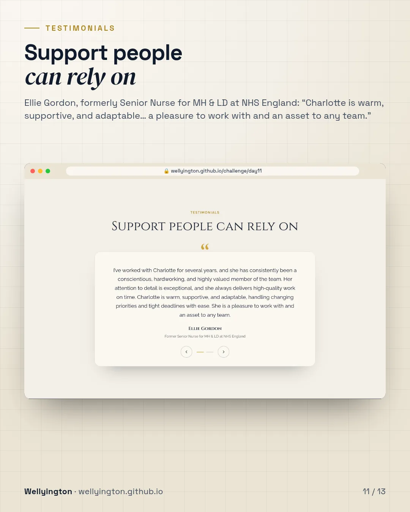
*Two named testimonials from senior colleagues, one card at a time.*

## one address, two buttons

The page ends where every section has been pointing. Get in touch: let's make your workload feel lighter. One short paragraph invites the visitor to say a little about their business and the support they need, and promises a reply with the next steps.

There is no form. There are two buttons: Email Charlotte, which opens a new email already addressed to her, and Copy email address, which copies it and shows a small confirmation, for people who use webmail or would rather write from another device. The address itself is printed underneath, charlotte@elevateadminstudio.co.uk, in plain text.

For a business built on one person answering email well, that felt right. A form adds a step and a layer between the client and her. An email goes straight to the inbox she manages for a living.

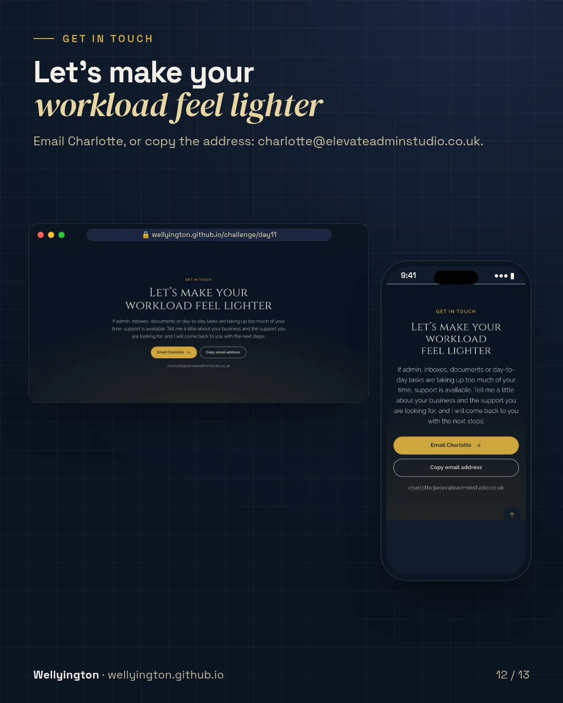
*Email Charlotte, or copy the address. No form in between.*

## the details

The palette has three colours: a deep navy, a warm cream and a muted gold. The navy carries the serious parts, the menu, the services and the prices. The cream carries the personal parts, the introduction, the values and the testimonials. The gold is kept for the things to press: the main buttons, the active tab, the slider.

Headings are set in Cinzel, a classical capital letterform with the feel of a carved inscription, which gives a small business a quiet sense of permanence. The reading text is Raleway, light and open. Both fonts are served from the site itself rather than from Google, so loading the page does not hand anyone's address to a third party.

The movement is gentle. Sections fade and rise into place as you scroll, one item slightly after the other, and scrolling itself is smoothed. For visitors who have asked their device to reduce motion, the reveal effects are switched off and the content simply appears. The whole site is in English only, because her clients are in the UK.

## what the concept is, and what comes next

The facts in the concept come from Elevate Admin Studio: the services and what each includes, the process, the retainers, packages and rates, Charlotte's background and the two testimonials.

What is new is the structure: one ordered page, a menu that reads like a table of contents, services in an accordion with enquiry links that name the service, a process laid out step by step, and prices that a visitor can explore with a slider instead of asking for them.

I have no figures for enquiries, and I will not make any up. Turning the concept into a working site would take the practical steps: the terms of use, privacy and cookie policies that the footer links to, written for UK rules; links to the social media accounts that step one of the process mentions, which the page does not have yet; and a way for Charlotte to update the prices herself when they change, so the page never quotes last year's rate.

## eleven down

A virtual assistant's website has one job above all: to be the first proof that she is organised. The best way to do that is not to say "organised" in the headline. It is to be organised: say who it is for, say what is included, say what it costs, say what happens next, and put each of those things in its own clear place.

If you sell a service rather than a product, the same applies. Show the person behind it. List what is and isn't included. Put a price on the page, even a starting one. Explain the steps from first message to first piece of work. And make the way to get in touch the simplest thing on the page.

I am a web designer based in Estepona, on the Costa del Sol, and I design and build websites for businesses in Spain and beyond. If that sounds like your business, write to me from [the main site](https://wellyington.github.io/). Tell me what you do and where, and I will reply in plain language. The concept is [here](https://wellyington.github.io/challenge/day11/), and Elevate Admin Studio's current site is [here](https://elevateadminstudio.co.uk/), so you can compare the two. Eleven down, eighty-nine to go.
