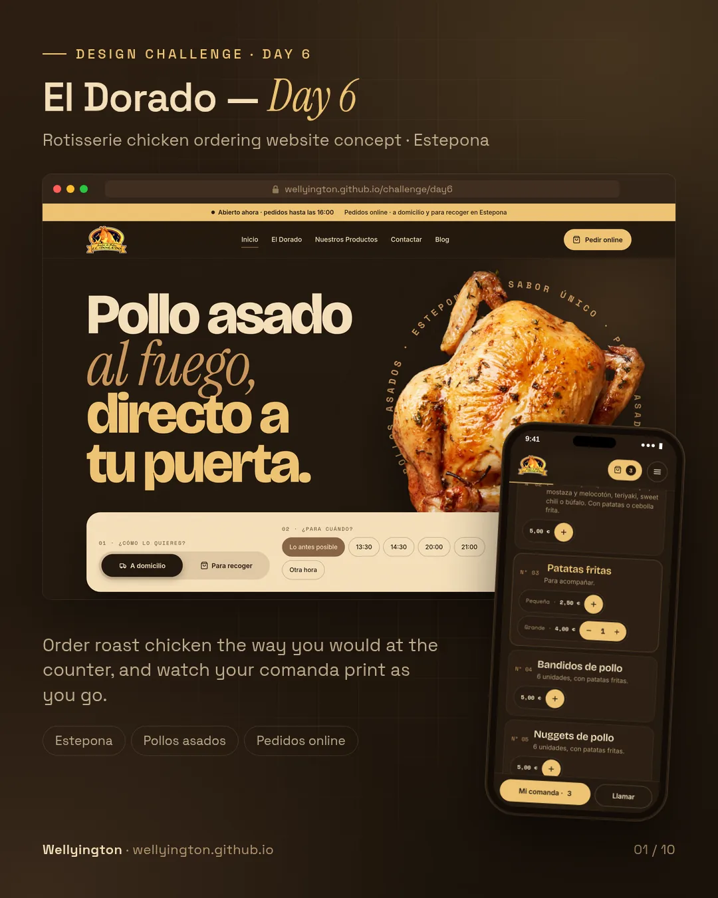
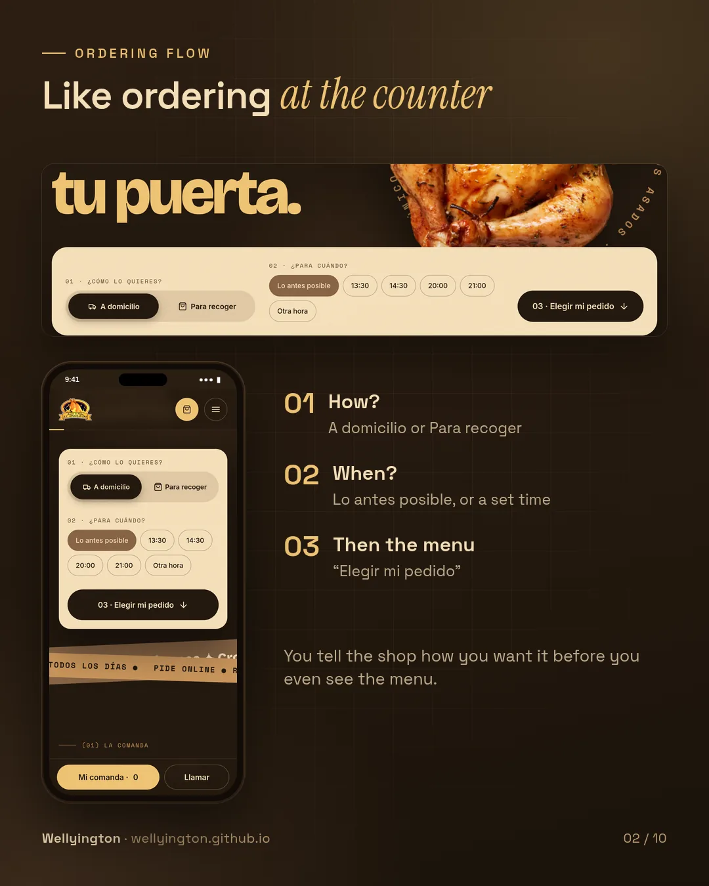
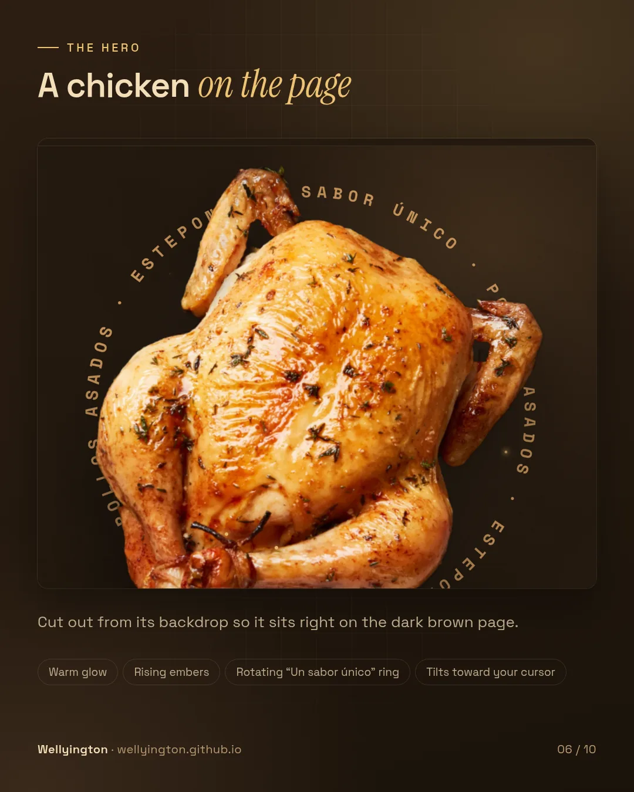
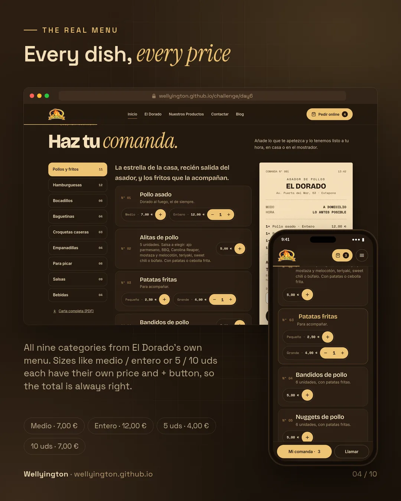
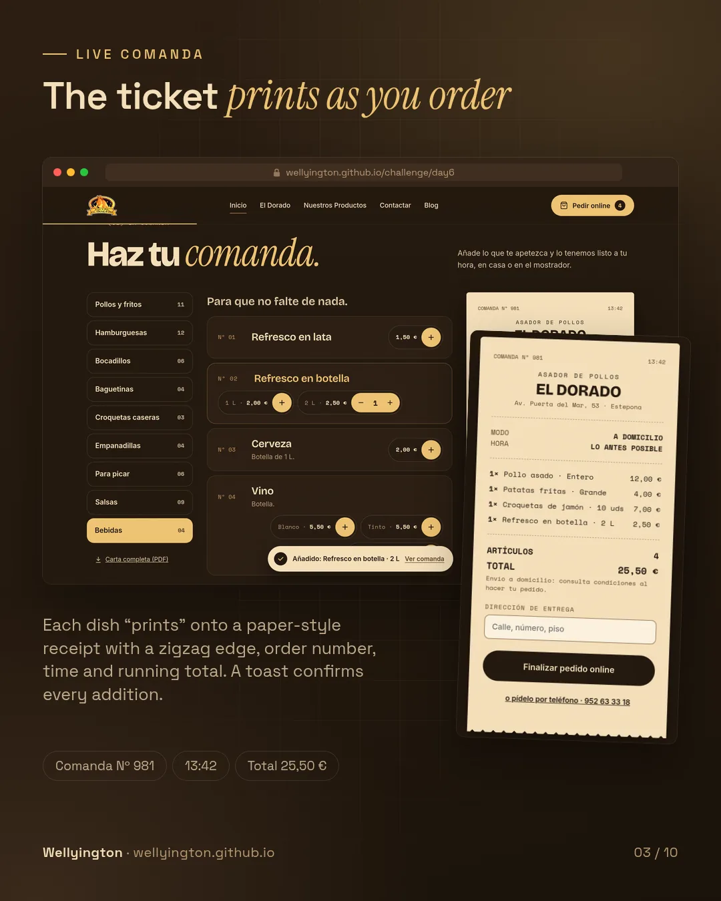
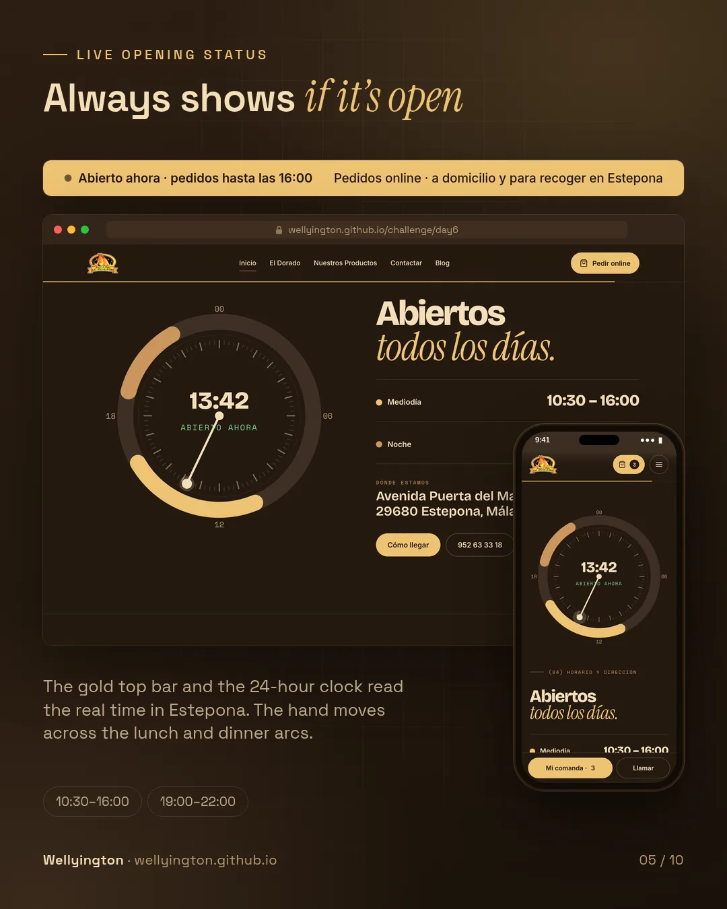
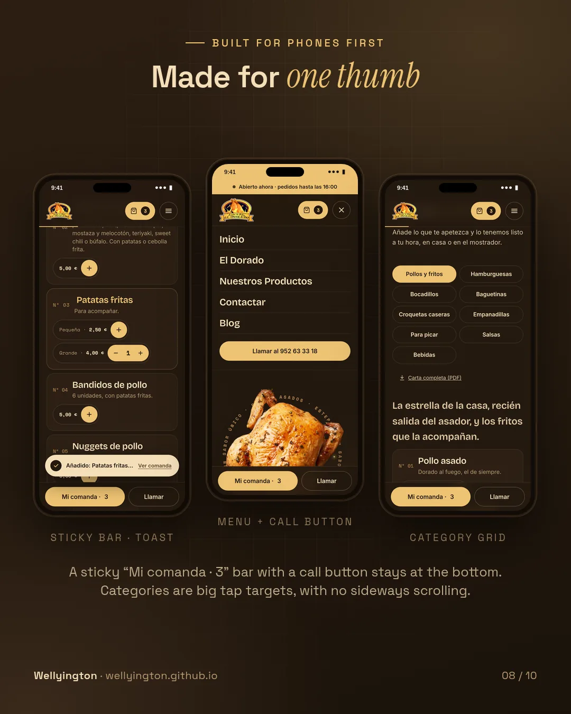
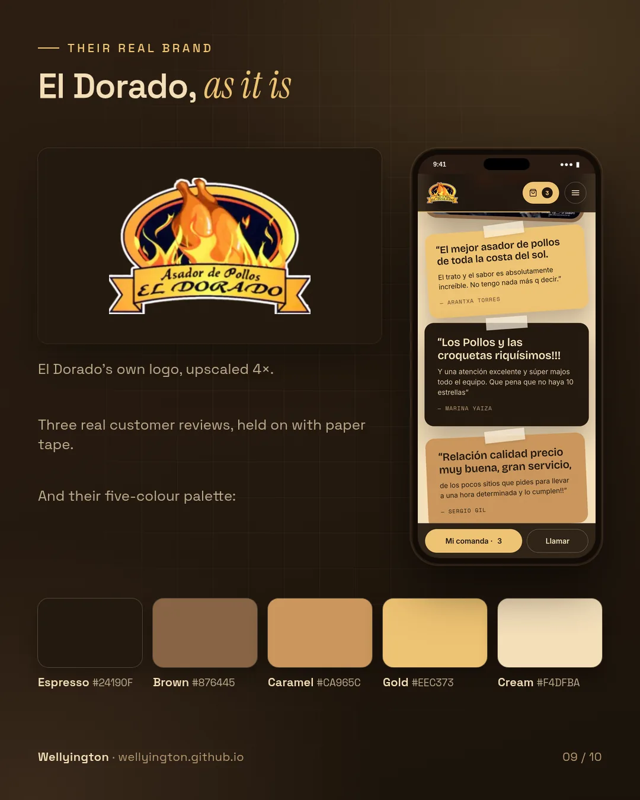
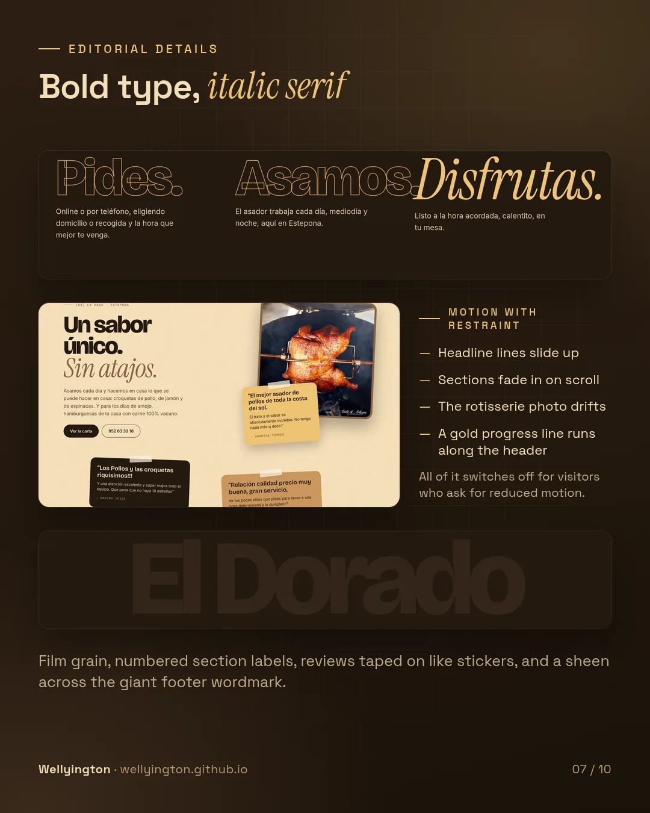

On 22 November I posted the sixth note of this run, the challenge Ramiah Trask set: a hundred days, a hundred businesses, a hundred websites. Day one was a family builder in the Marina Alta. [That page is here.](https://wellyington.github.io/journal/en/articles/built-before-the-yes/) Day two was a theatre in Málaga. [That one is here.](https://wellyington.github.io/journal/en/articles/room-for-a-whole-season/) Day three was a family restaurant in Estepona. [That one is here.](https://wellyington.github.io/journal/en/articles/a-seat-at-the-long-table/) Day four was a private property practice in Málaga. [That one is here.](https://wellyington.github.io/journal/en/articles/judgement-over-volume/) Day five was a tasting-menu restaurant in Motril. [That one is here.](https://wellyington.github.io/journal/en/articles/as-careful-as-the-kitchen/)

Today is the most everyday business of the six, and maybe the one whose website gets used most often. El Dorado is a rotisserie chicken house on Avenida Puerta del Mar in Estepona, my own town. Roast chicken, chips, home-made croquettes, burgers, sandwiches, Argentine empanadas, sauces, drinks. You can order for delivery or for pick-up, every day, at lunch and in the evening. It already has a website and an online shop, at [pollosasadosadomicilioestepona.es](https://pollosasadosadomicilioestepona.es/).

A roast chicken website has two jobs. It should make you hungry, and it should make ordering easy. Most takeaway sites manage one of the two. The concept is here: [El Dorado, day six](https://wellyington.github.io/challenge/day6/).

## the counter, not the catalogue

Think about how you order at the counter of a chicken shop. You do not start by browsing. The person behind the counter asks two questions first: is it to take away or to eat at home, and for when? Only then do you say what you want. A whole chicken, a large chips, some croquettes, a bottle of cola. They write it on a ticket, read it back to you, tell you the total.

Most online ordering does this backwards. It shows you a shop full of products, lets you fill a basket, and only at the very end, at the checkout, asks whether you want delivery and at what time. That is where people find out the slot they wanted is gone, or that delivery does not reach their street, and they give up.

So the concept copies the counter. The first thing on the page, under the headline, is a small panel with two questions. 01: how do you want it, a domicilio or para recoger, delivered or for pick-up. 02: for when, lo antes posible, as soon as possible, or a set time from a row of buttons, 13:30, 14:30, 20:00, 21:00, or another time. Then one dark button: 03, elegir mi pedido, choose my order. It takes you down to the menu.

You tell the shop how you want it before you even see the menu. That is how the person at the counter would do it, and it means the rest of the page already knows what you are planning.

*The opening: the headline, the chicken, and the two questions the counter would ask first.*

*How, when, then the menu. Like ordering at the counter.*

## a chicken on the page

The headline is the plainest sentence I could write: pollo asado al fuego, directo a tu puerta. Roast chicken from the fire, straight to your door. It is set very large in a heavy, slightly squashed sans, in cream and gold, with al fuego in a thin italic serif in between. It reads like the sign on a shopfront.

Next to it is the thing people actually come for: a roast chicken, golden and glistening, herbs on the skin. I cut it out of its photograph so it sits directly on the dark brown page, without a box around it. A slow ring of text turns around it, un sabor único, pollos asados, Estepona, which is El Dorado's own line. There is a warm glow behind it, a few embers rising, and on a computer it tilts very slightly towards your cursor.

I know how that sounds on paper. On the screen it is quiet. The point is to make the first thing you see the food, at a size where you can almost smell it.

*Cut out from its backdrop, so it sits right on the page. A warm glow, a few embers, and a ring of text turning slowly.*

## the real menu, every price

The second section is called haz tu comanda, make your order. A comanda is the Spanish word for the order ticket the kitchen works from, and the whole idea of this concept rests on it.

On the left are the nine categories from El Dorado's own menu, each with the number of dishes in it: chicken and fried sides, burgers, sandwiches, baguettes, home-made croquettes, empanadas, things to share, sauces and drinks. In the middle are the dishes of the chosen category, numbered like a menu board, each with a short description and its price. On the right is the ticket.

I did not simplify the menu to make the design easier. A real chicken shop has sizes, and sizes are where online ordering usually goes wrong. Half a chicken is 7 euros and a whole one 12. Chips are 2.50 small and 4 large. Croquettes come in fives and tens. A bottle of cola is a litre or two. So every size has its own price and its own plus button. You do not choose a size from a menu and then press add. You press the plus next to the size you want. The total is always right, because there is no step in between where it can go wrong.

The wings list their nine sauces, from garlic and parmesan to Carolina Reaper. The burgers say what they are made of, 100% beef. And under the categories there is a small link to the full menu as a PDF, the one El Dorado already publishes, for anyone who prefers to read it all at once.

*All nine categories from El Dorado's own menu. Each size has its own price and its own plus button, so the total is always right.*

## the ticket prints as you order

This is the part I enjoyed most. As you add things, they appear on a ticket on the right of the screen, drawn like the paper slips that come out of a kitchen printer: cream paper, a typewriter typeface, a zigzag torn edge at the bottom.

At the top it says comanda number 981, or whatever number it gives you, with the time. Then asador de pollos El Dorado, and the address. Then the two answers you gave at the start: a domicilio, lo antes posible. Then each line as you add it: 1 roast chicken, whole, 12 euros. 1 chips, large, 4 euros. 1 ham croquettes, 10, 7 euros. 1 bottle of cola, 2 litres, 2.50. A count of items, and the total, 25.50 euros.

Every time you add something, a small message slides in at the bottom of the screen to confirm it: added, bottle of cola, 2 litres, with a link to see the ticket. If you change your mind, the plus turns into a minus and a number.

Under the total there is a line about delivery terms, a field for the delivery address, and a button: finalizar pedido online, finish the order online. Below it, in small letters, the alternative: o pídelo por teléfono, or order by phone, 952 63 33 18.

To be clear about what the concept does at that point: the button takes you to El Dorado's existing online shop to complete the order there. The items on the ticket are not passed across in the concept. In a real build, the ticket is exactly what the kitchen would receive, either into the shop they already use or straight to a printer behind the counter. The design is the part that matters for the customer: you can see your order the whole time, in the same form the kitchen will.

*Each dish prints onto a paper-style ticket, with a zigzag edge, an order number, the time and a running total.*

## always shows if it is open

Nothing is more annoying than ordering from a takeaway that turns out to be closed. El Dorado opens every day from 10:30 to 16:00 and from 19:00 to 22:00, and the concept says so everywhere it matters.

A gold bar runs across the very top of the page. When the shop is open it reads abierto ahora, pedidos hasta las 16:00, open now, orders until 16:00, or until 22:00 in the evening. When it is closed, it says when it opens again, at 10:30 or at 19:00, and adds programa tu pedido, schedule your order. Nobody is turned away. They are told when to come back, and that they can order ahead.

Further down, the hours section has a 24-hour clock face. The two opening periods are drawn as arcs around the edge, lunch in gold and evening in caramel, and the hand shows the real time in Estepona. At 13:42 it sits inside the lunch arc and the centre says abierto ahora. Next to it: abiertos todos los días, open every day, the two time slots, the address on Avenida Puerta del Mar, a button for directions and the phone number.

The clock reads the time in Estepona, not on your phone, so it is right even for someone ordering for their parents from London.

*The gold top bar and the 24-hour clock read the real time in Estepona. The hand moves across the lunch and evening arcs.*

## made for one thumb

Most orders from a place like this happen on a phone, with one hand, often while doing something else. So I designed the phone version first and the large screen after.

At the bottom of the screen there is a bar that never moves: mi comanda, with the number of items, and llamar, call. Tap the first and you jump to your ticket. Tap the second and your phone dials the shop. Whatever you are looking at, ordering or calling is one tap away.

On a phone, the categories are not a row you have to scroll sideways, which is easy to miss. They are a grid of large buttons, two per row, so all nine are visible at once and each one is big enough for a thumb. The confirmation message appears just above the bottom bar, where your eyes already are.

The menu opens over the whole screen, with the gold opening-status bar at the top, the five sections of the site, a large button to call the shop on 952 63 33 18, and the chicken again at the bottom.

*A sticky bar with the ticket and a call button. Categories as big tap targets, with no sideways scrolling.*

## their brand, as it is

Every concept in this run so far has had a new look. This one does not, and on purpose.

El Dorado already has a brand that people in Estepona know: a logo with a chicken in front of flames and a ribbon reading asador de pollos El Dorado. It is not a minimalist logo, and it does not need to be. It is the sign over the shop. So I kept it, cleaned up and enlarged to stay sharp on modern screens, and built everything else around it.

The colours come from the logo as well. Espresso, #24190F, for the background. Brown, #876445. Caramel, #CA965C. Gold, #EEC373, for buttons and the top bar. Cream, #F4DFBA, for the ticket and the light sections. On a dark page they look like the inside of a rotisserie, which is the point.

The type is new. Bricolage Grotesque, heavy and tightly spaced, for the big headlines, so they read like a shop sign. Instrument Serif in italic for the warmer words. Space Mono, a typewriter face, for the ticket and the small labels. Inter for everything you need to read quickly.

There is also a section about the house: un sabor único, sin atajos, a unique flavour, no shortcuts. They roast every day and make at home what can be made at home: chicken, ham and spinach croquettes, and burgers with 100% beef. Next to it, three real customer reviews, held on with strips of paper tape like notes on a fridge. One customer calls El Dorado the best rotisserie on the whole Costa del Sol. Another praises one of the few places where you order for a set time and they keep it.

*El Dorado's own logo, three real customer reviews, and the five-colour palette taken from the brand.*

## motion with restraint

A few small things move on this page, and each one has a job. The lines of the headline slide up one by one as the page loads. Sections fade in as you scroll to them. The rotisserie photo in the house section drifts slightly. A thin gold line along the top of the header shows how far down the page you are.

Between the sections there is a short story in three words, the way a shop might paint it on the wall. Pides. Asamos. Disfrutas. You order, online or by phone. We roast, every day, lunch and evening, here in Estepona. You enjoy, ready at the agreed time, still hot. At the very bottom of the page, El Dorado is written very large in the footer, with a slow sheen across it.

All of the motion switches off for visitors who have asked their phone or computer to reduce motion. The page works exactly the same without it.

*Bold type, italic serif, reviews taped on like notes, and motion that switches off when asked.*

## what the concept is, and what comes next

El Dorado's logo, colours, menu, prices, hours, address, phone number and customer reviews on the page are their own. I have not changed any of them. What is new is the order of things, the ticket, the clock and the way the page behaves on a phone.

Two things would need to happen to turn the concept into a working shop. First, the ticket has to reach the kitchen: either into the online shop El Dorado already runs, or as a printed ticket behind the counter. Second, the time slots should come from the kitchen itself, so that a busy Sunday lunch can close a slot before it fills up. Neither is complicated. Both are worth doing properly.

I have no figures for orders or takings, and I will not make any up.

## if people order from you on their phone

You may not sell roast chicken. A lot of small businesses on this coast take orders, though: a bakery that does cakes to order, a pizzeria, a florist, a laundry, a butcher who prepares barbecue packs for the weekend. Their customers usually order from a phone, in a hurry, and the website usually asks them to think like a shop assistant.

What helps is the same as here. Ask how and when first. Show every option with its own price. Let people see their order the whole time, in the form you will receive it. Say clearly whether you are open, and if not, when. And keep the phone number one tap away, because some people will always prefer to call.

I am a web designer in Estepona, on the Costa del Sol, and I build websites like this one for businesses across Spain. If that sounds like your business, write to me from [the main site](https://wellyington.github.io/). Tell me what you do and where, and I will reply in plain language. The concept is [here](https://wellyington.github.io/challenge/day6/), and El Dorado's current site is [here](https://pollosasadosadomicilioestepona.es/), so you can compare the two. Six down, ninety-four to go.
