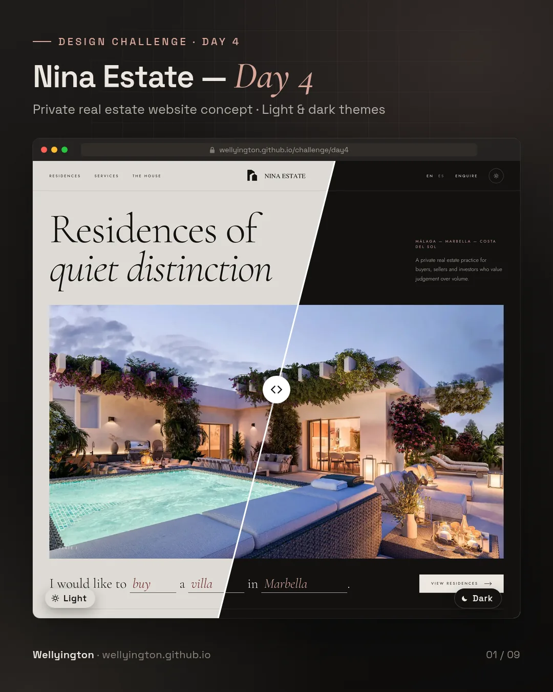
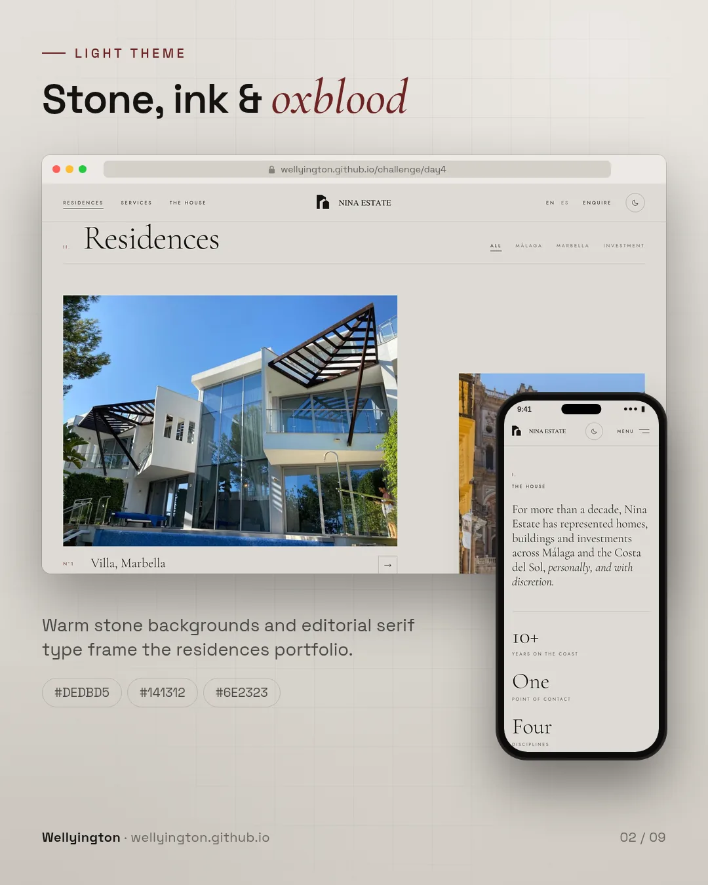
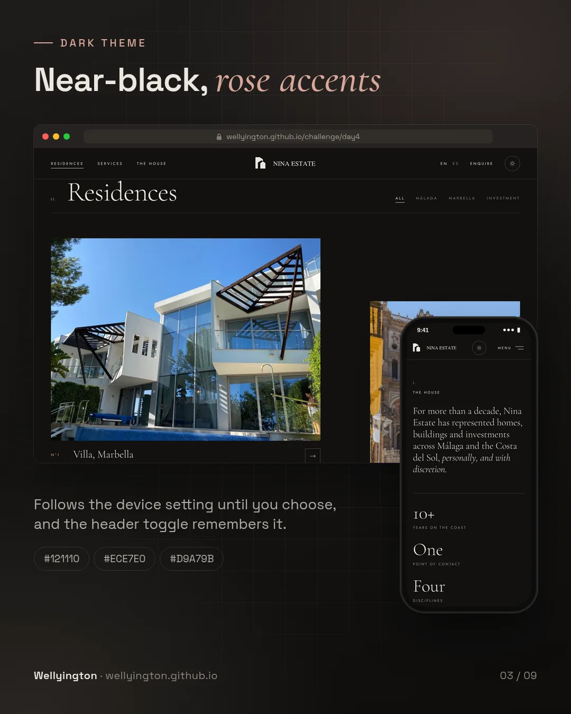
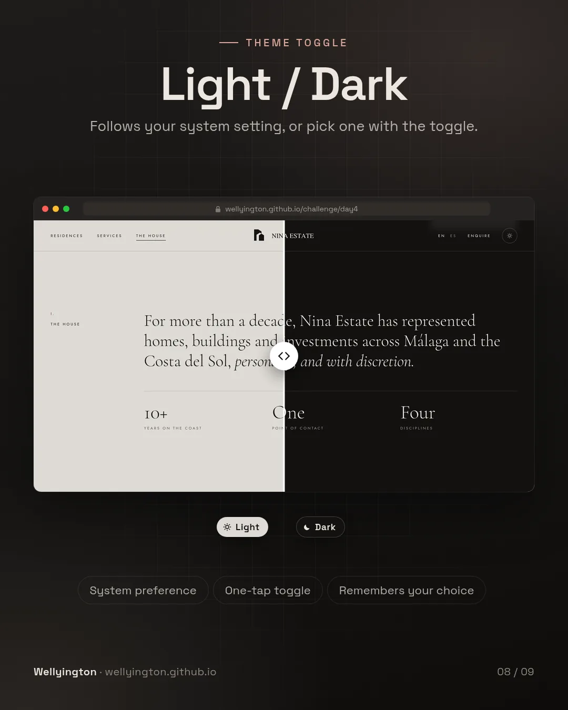
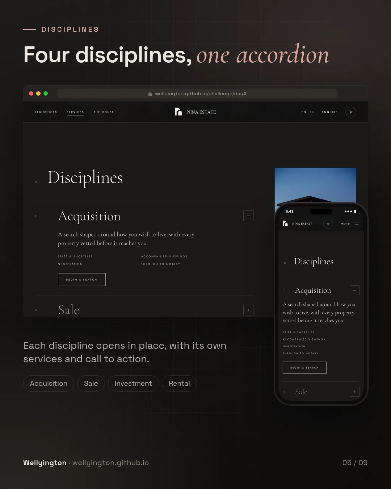
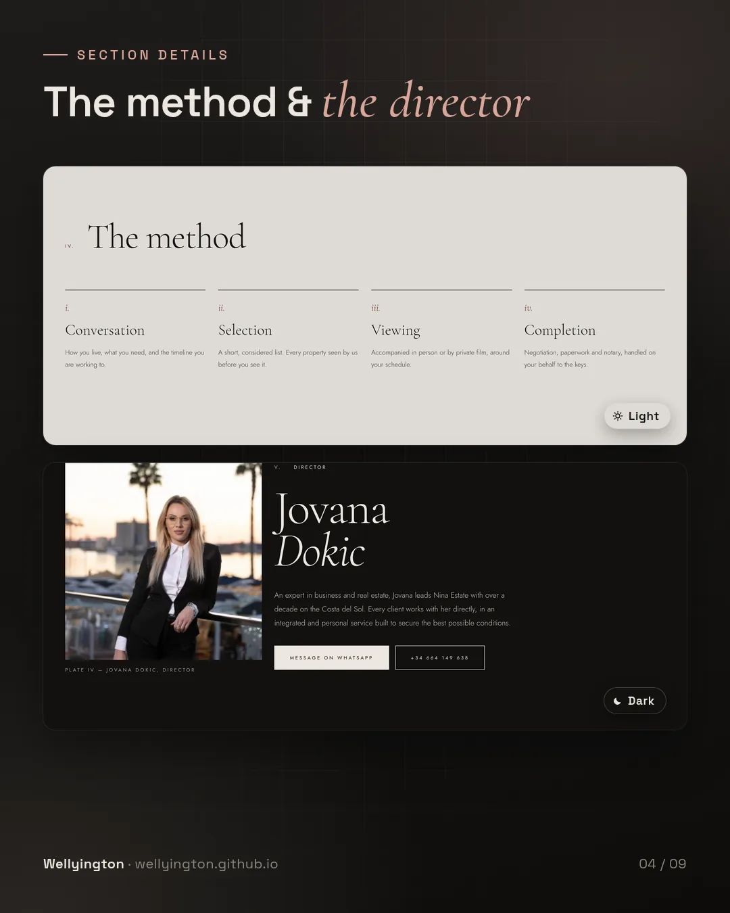
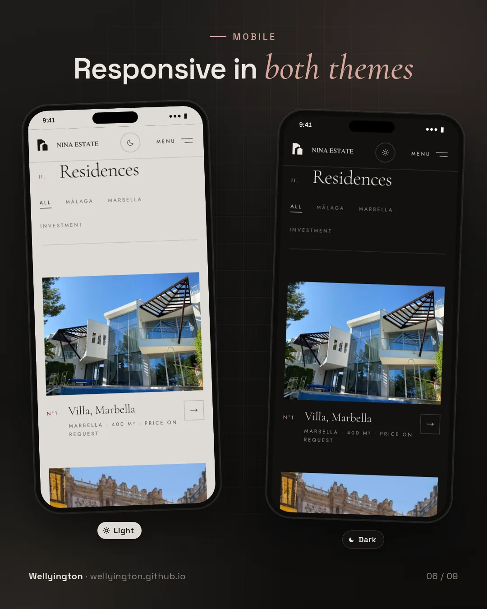
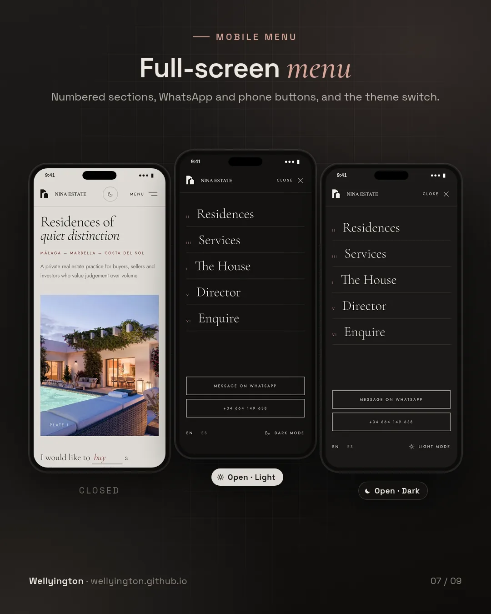

On 20 November I posted the fourth note of this run, the challenge Ramiah Trask set: a hundred days, a hundred businesses, a hundred websites. Day one was a family builder in the Marina Alta who needed a first clear page. [That page is here.](https://wellyington.github.io/journal/en/articles/built-before-the-yes/) Day two was a theatre in Málaga with a full season and no order to it. [That one is here.](https://wellyington.github.io/journal/en/articles/room-for-a-whole-season/) Day three was a family restaurant in my own town, with many reasons to walk in. [That one is here.](https://wellyington.github.io/journal/en/articles/a-seat-at-the-long-table/) Today the business sells something people take months to decide on.

Nina Estate is a real estate agency in Málaga, with an office on Avenida de Cánovas del Castillo. It works across the city and the Costa del Sol: homes, whole buildings, investments and long-term rentals. It already has a website, at [ninaestate.com](https://ninaestate.com/), which sets out its experience, its properties and its services. My concept is here: [Nina Estate, day four](https://wellyington.github.io/challenge/day4/).

This is an independent redesign. It is not a collaboration with Nina Estate, nobody there asked for it, and nothing on the page means they approve of it. It lives on my own address for now, like the three before it.

## a different kind of agency page

Most property websites are built like shop windows. A search bar at the top, a grid of listings, a price on every card, a phone number in the corner. That works for an agency that wins on volume, with hundreds of homes and a buyer who wants to scroll.

Nina Estate is a different shape of business. A small number of properties, several of them whole buildings. Prices on request. One person, the director, who deals with every client herself. Somebody buying or selling at that level of the luxury market is not mainly choosing a listing. They are choosing who they trust to choose for them.

So I took a different approach from the existing site. Less like a traditional agency, more like a private practice, where the way things are presented, the personal service and the attention to detail are part of what the client gets. The existing site leads with experience, properties and services. The concept leads with the relationship: who you will deal with, how the search will go, and what happens from the first call to the keys.

The idea is simple to say. The website should feel closer to the service it sells.

## residences of quiet distinction

The opening is mostly empty, on purpose. A headline in a large, light serif: residences of quiet distinction, with the second line in italic. A small line in oxblood under it reads Málaga, Marbella, Costa del Sol. On the right is one sentence that does the job of a mission statement: a private real estate practice for buyers, sellers and investors who value judgement over volume.

Below that is one wide photograph, labelled Plate I, as in a book: a villa at dusk, the pool lit, bougainvillea over the terrace, lanterns on the low wall. The page holds it at that size and puts nothing on top of it.

Under the photograph, where most agency sites would put a search form with a dozen fields, there is a sentence to complete. I would like to buy a villa in Marbella. Each of the three words in italic is a menu. Buy can become rent, invest in or sell. Villa can become house, apartment or building. Marbella can become Málaga Centro, El Limonar or the Costa del Sol. Then one button: view residences.

It is a small thing, and it changes the tone. A search form asks you to filter. A sentence asks what you want, in the way an agent would on the phone. In the concept the sentence leads to the residences. It does not pretend to run a search the business does not need.

*The opening, cut in two. The same welcome in daylight and after dark.*

## stone, ink and oxblood

The colours come from what this market already looks like when it is done well: plaster, old paper, dark wood, a glass of red on a table.

The light theme is warm stone, #DEDBD5, with near-black ink, #141312, for the text, and oxblood, #6E2323, for the small things that matter: the numbers, the active filter, the italic words in the sentence. The dark theme is almost black, #121110, with off-white text, #ECE7E0, and a muted rose, #D9A79B, where the oxblood was. Neither is the main version. They are two complete sites, and the same residence has to look right in both.

The type does most of the work. Cormorant Garamond, a light, high-contrast serif, for headings and the property names. Jost, a plain sans, very small and widely spaced, for labels. Sections are numbered in Roman numerals, I to VI, and photographs are called plates. It reads like a printed catalogue for a gallery more than an app, which is closer to how these homes are sold in person.

As on the earlier days, the page follows your phone or computer. If it is set to dark, the site opens dark. A round button in the header switches it, and the site remembers your choice next time.

*The light theme: warm stone, ink and oxblood, with editorial serif type.*

*The dark theme. It follows the device until you choose, and the header button remembers.*

## the house

Section I is called The House, and it is one paragraph long. For more than a decade, Nina Estate has represented homes, buildings and investments across Málaga and the Costa del Sol, personally, and with discretion.

Three figures sit under it, each with a small label. 10+, years on the coast. One, point of contact. Four, disciplines. I wanted figures a client can check, not totals of square metres sold or a counter of happy families. The second one is the most important line on the page. At this level, a buyer wants to know that the person who answers the first call will still be there at the notary.

*Follows your system setting, or pick one with the toggle.*

## four residences, not four hundred

Section II is the portfolio, under the plain heading Residences. Four filters sit on the right: all, Málaga, Marbella, investment. Choosing one rearranges the cards without reloading the page.

There are four properties in the concept. N°1, a villa in Marbella, 400 square metres. N°2, a building by the Cathedral in Málaga, sold whole. N°3, another building in the Centro Histórico. N°4, a residence in El Limonar, 329 square metres. Every one says price on request. The cards are large, set at different heights rather than in a tight grid, and each has one small arrow to open it.

Four is not many for a property website, and I left it at four. A long grid would make the business look like a portal, and it is not one. Under the cards is one line in italic: some of our finest homes are never published. Next to it is a button, request private access. In this part of the market, a lot of the best stock changes hands off-market, without a public listing. The page says so plainly and offers the way in.

Below that is a second full-width photograph, Plate II, with one line set over the quiet part of the image: discretion is not a service, it is the standard.

## four disciplines, one at a time

Section III sets out the work in four parts: acquisition, sale, investment and rental. On the existing site, the services read as a list. Here each one is a row that opens in place, so a seller does not have to read past the buyer's process to find their own.

Acquisition: a search shaped around how you wish to live, with every property vetted before it reaches you. Then brief and shortlist, accompanied viewings, negotiation, through to notary, and a button, begin a search. Sale: your property presented the way buyers at this level expect, and placed before the right people, with valuation, editorial photography, qualified buyers and discreet marketing. Investment: buildings, assets and income properties in the historic centre and along the coast, with whole buildings, yield analysis, off-portal opportunities and asset support. Rental: long-term lets handled for owners and tenants alike, with tenant selection, contracts and inventory, owner representation and relocation.

Each discipline ends with its own next step: begin a search, request a valuation, discuss an investment, enquire about rentals. Somebody who only came to sell never has to read about yields.

*Each discipline opens in place, with its own services and next step.*

## the method

Section IV answers the question every first-time buyer in Spain asks sooner or later: what actually happens, and in what order? Four steps, numbered in small Roman numerals and set side by side.

Conversation: how you live, what you need, and the timeline you are working to. Selection: a short, considered list, with every property seen by the agency before you see it. Viewing: accompanied in person, or by private film around your schedule, which matters when the buyer lives in London or Dubai. Completion: negotiation, paperwork and notary, handled on your behalf through to the keys.

None of this is new to anyone who has bought property here. Written down in four short lines, it makes the process feel known before it starts, and for an expensive and slow decision that is a large part of what the client is paying for.

## the person behind the business

Section V is the change I care most about. On a lot of agency websites the people are small photographs on an about page, if they appear at all. Here the director gets a section of her own, at the same size as the properties.

Jovana Dokic. Her name is set large, with the surname in italic, next to a portrait of her on a terrace above the port at dusk. The text is short: an expert in business and real estate, she leads Nina Estate with over a decade on the Costa del Sol, and every client works with her directly, in an integrated and personal service built to secure the best possible conditions. Under it are two buttons, message on WhatsApp and the phone number, +34 664 149 638.

The reason is practical. In a firm this size, the person is the service. Clients will speak to her, view with her and sign with her beside them. A website that hides that behind stock photos of keys and handshakes undersells the one thing a larger agency cannot easily copy.

*The method in four steps, and the director, with a direct line to her.*

## by appointment

The last section, VI, is called private enquiries, and the heading reads by appointment. On the left are three ways in: the telephone, the email address, jovana@ninaestate.com, and the office on Avenida de Cánovas del Castillo 8, Málaga.

On the right is a short form. Name, email, telephone, a choice of what the enquiry is about, matching the four disciplines, and a message. Sending it opens the visitor's email app with everything already written and addressed to Jovana. A line under the button says every enquiry is answered personally and in confidence. There is no client portal and no automatic reply that pretends to be a person. A private practice answers its own post.

## on a phone

Many first contacts with an agency like this happen on a phone, at odd hours, from another country. A buyer in a hotel lobby looks up the agent a friend recommended. A seller abroad checks who they are about to call.

On a phone the residences stack one under another, each with its number, name, area, size and price on request, and a square arrow to open it. The filters wrap onto two lines rather than shrink. Both themes work the same way.

The menu opens over the whole screen. Five sections, numbered like the page: residences, services, the house, director, enquire. Below them are the two buttons someone on a phone actually uses, message on WhatsApp and the phone number, then the language choice and the theme switch. Everything a visitor needs to make contact fits on the first screen of the menu.

*The residences on a phone, in both themes.*

*The full-screen menu: numbered sections, WhatsApp and phone, the language choice and the theme switch.*

## english and spanish

The people buying on this coast come from everywhere, and the people selling are often Spanish. The concept has EN and ES in the header and in the mobile menu from the start, because a practice like this needs both from the first day.

To be clear about what exists: the concept is written in English, and the Spanish switch is in place but the Spanish pages are not written yet. I would rather write them with the business than guess at how Jovana speaks to her Spanish clients.

## an independent concept

Nina Estate did not hire me, and this is not their website. The properties, the director's name and words, the phone, the email and the office are taken from what Nina Estate already publishes. I have not changed the facts. What I changed is the order, the tone and how the page looks: a private practice instead of a catalogue, the person at the front, and the process written down.

I have no figures on enquiries or sales, and I will not make any up. If nobody at Nina Estate wants it, the concept stays where it is as day four. If they do, the rest is practical: their own words in place of mine where I have filled in, the Spanish pages, every residence with its own page, the enquiry form sent wherever they want it, and the site moved onto ninaestate.com.

## if your clients take months to decide

You may not sell property. Plenty of businesses sell something people decide on slowly: a school, a clinic, an architect, a lawyer, a yacht broker. The website is often built for quick decisions anyway, with grids, prices, counters and urgency.

For a slow decision it helps to do the opposite. Say who the client will deal with, and show them. Write the process down in a few steps. Show a small amount of work at a size where it can be looked at properly. Give one direct way to reach a person. Let the design be calm enough that the visitor reads instead of scrolls.

I am a web designer in Estepona, on the Costa del Sol, and I build websites like this one for businesses across Spain. If that sounds like your business, write to me from [the main site](https://wellyington.github.io/). Tell me what you do and where, and I will reply in plain language. The concept is [here](https://wellyington.github.io/challenge/day4/), and Nina Estate's own site is [here](https://ninaestate.com/), so you can compare the two. Four down, ninety-six to go.
