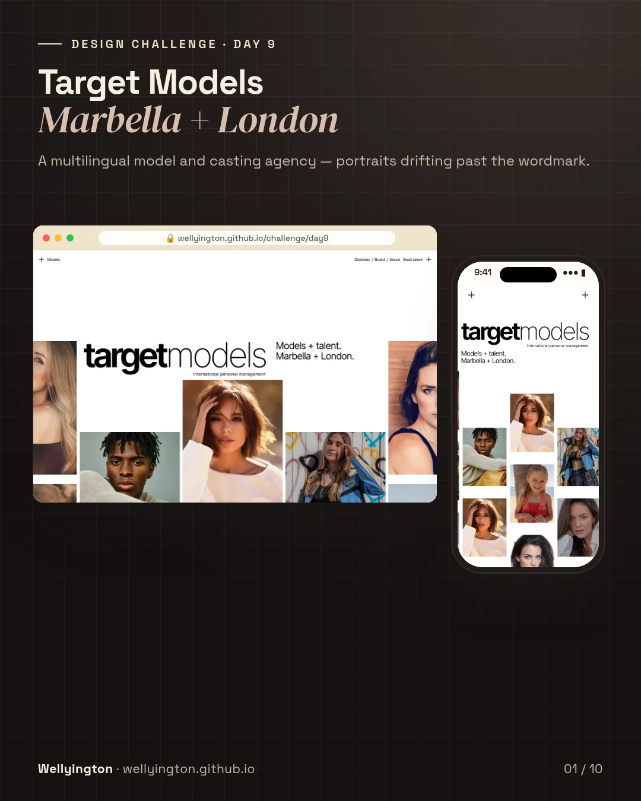
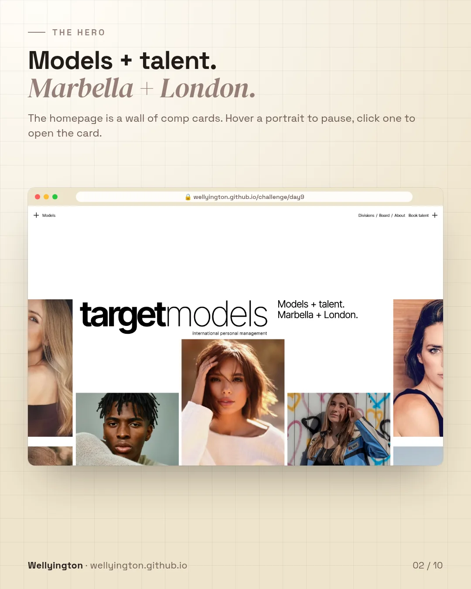
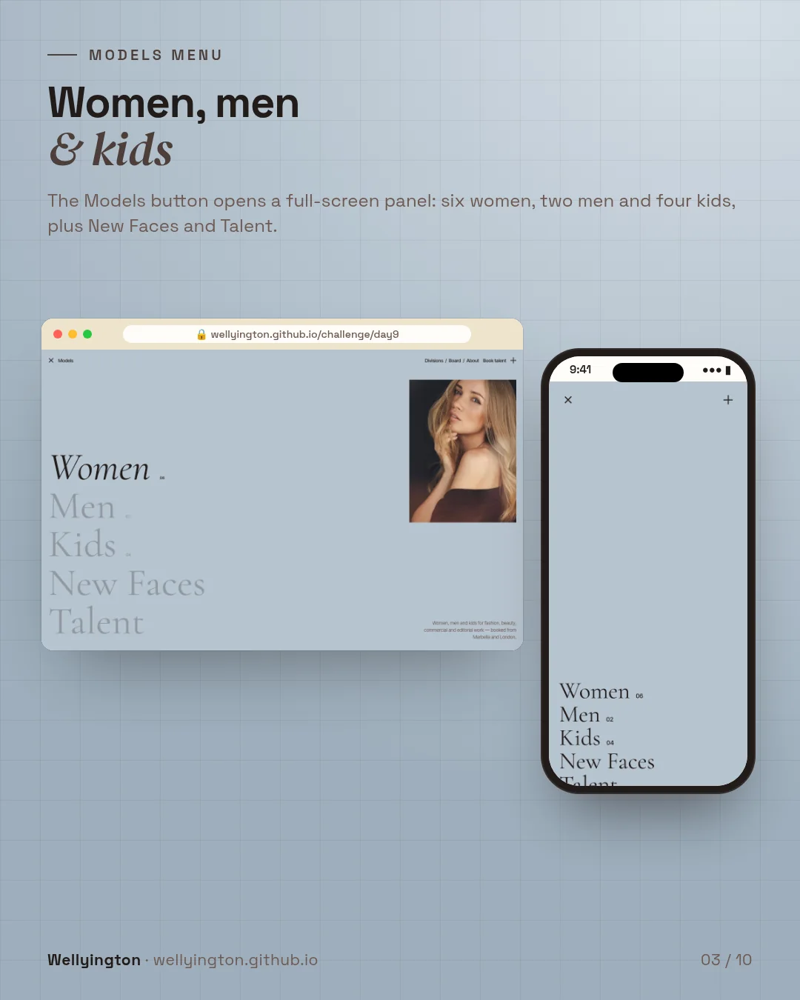
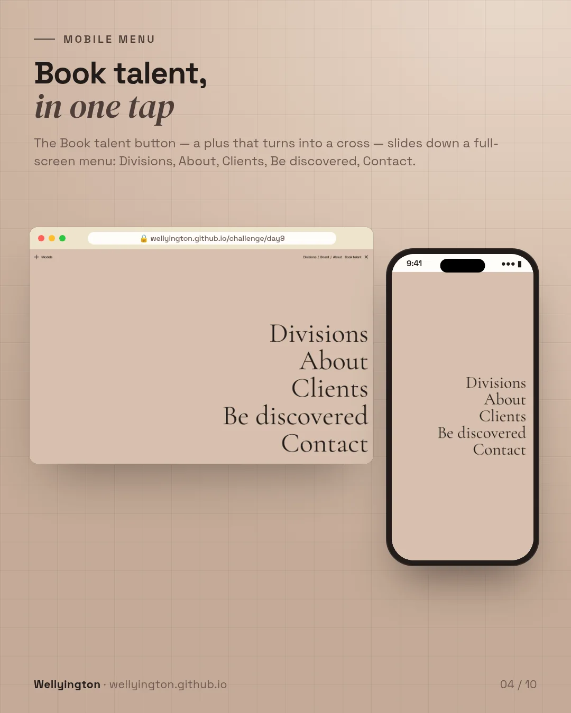
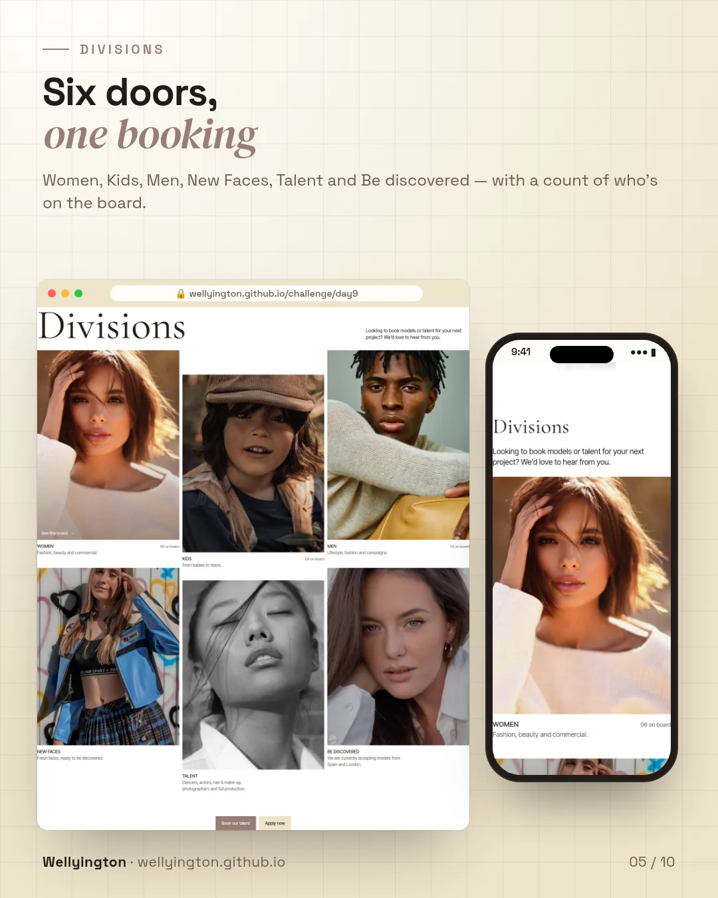
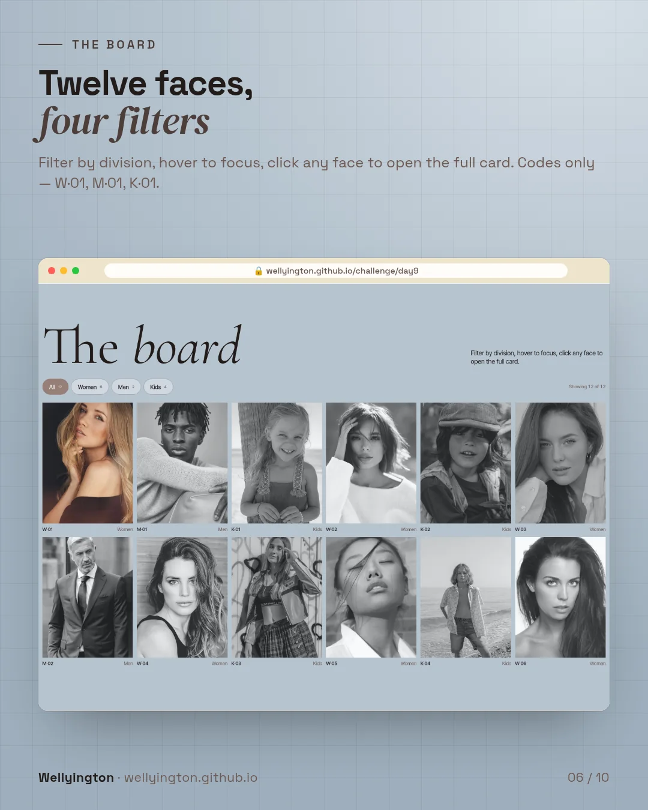
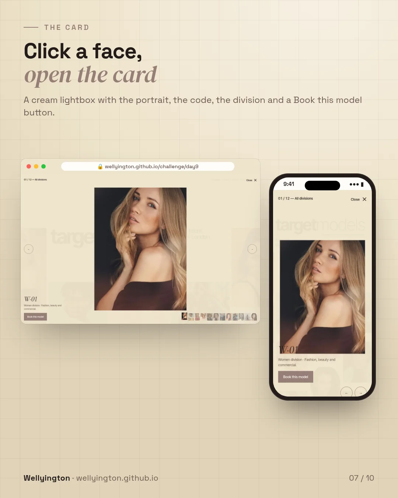
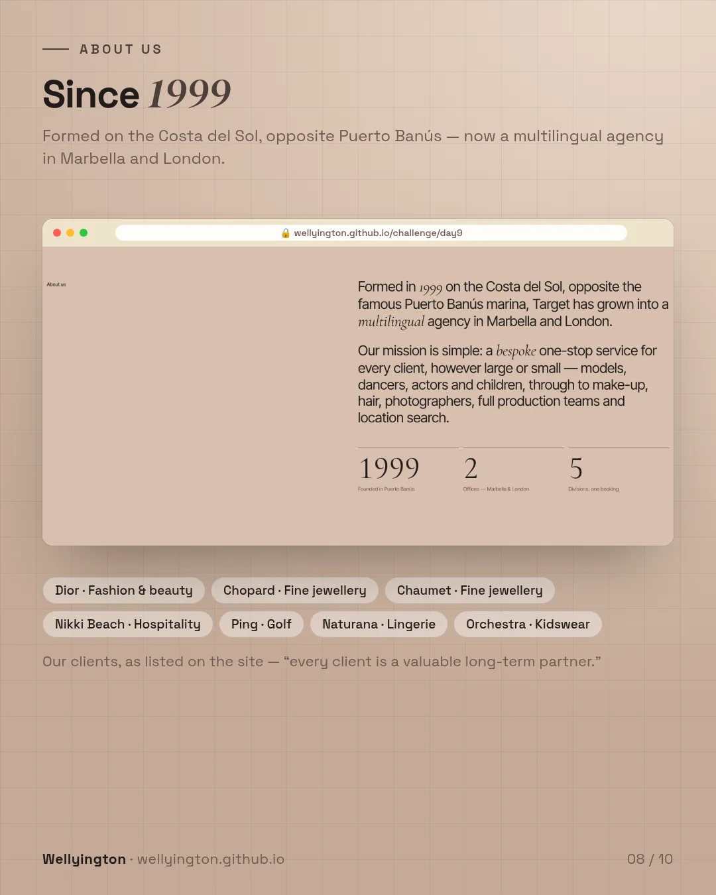
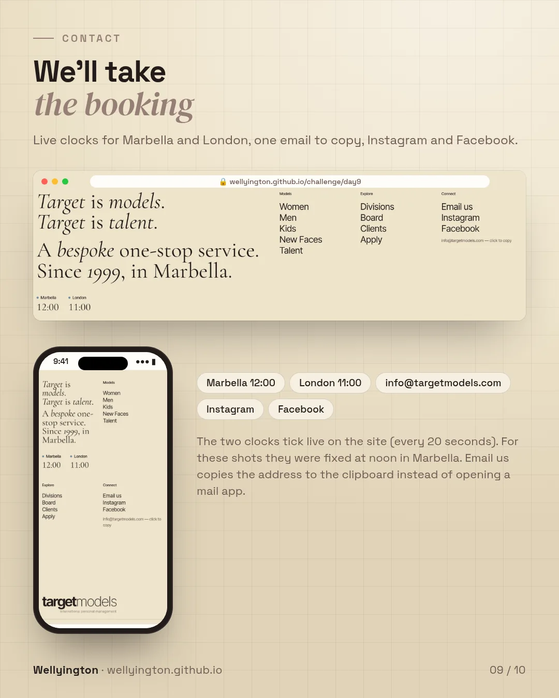

On 25 November I posted the ninth note of this run, the challenge Ramiah Trask set: a hundred days, a hundred businesses, a hundred websites. It was the second of the day. Day one was a family builder in the Marina Alta. [That page is here.](https://wellyington.github.io/journal/en/articles/built-before-the-yes/) Day two was a theatre in Málaga. [That one is here.](https://wellyington.github.io/journal/en/articles/room-for-a-whole-season/) Day three was a family restaurant in Estepona. [That one is here.](https://wellyington.github.io/journal/en/articles/a-seat-at-the-long-table/) Day four was a private property practice in Málaga. [That one is here.](https://wellyington.github.io/journal/en/articles/judgement-over-volume/) Day five was a tasting-menu restaurant in Motril. [That one is here.](https://wellyington.github.io/journal/en/articles/as-careful-as-the-kitchen/) Day six was a rotisserie chicken house in Estepona. [That one is here.](https://wellyington.github.io/journal/en/articles/from-the-counter-to-the-ticket/) Day seven was a family-run hotel in Kavos, Corfu. [That one is here.](https://wellyington.github.io/journal/en/articles/the-same-pool-after-dark/) Day eight was three houses in Málaga's old town. [That one is here.](https://wellyington.github.io/journal/en/articles/three-houses-one-front-door/)

Today is a different kind of business. Target Models is a model and casting agency, founded in 1999 on the Costa del Sol, opposite the marina at Puerto Banús. It now works from two offices, Marbella and London, in several languages. It represents women, men and kids for fashion, beauty, commercial and editorial work, and also books dancers, actors, hair and make-up artists, photographers and whole production teams. Their current website is at [targetmodels.eu](https://www.targetmodels.eu/).

The concept is here: [Target Models, day nine](https://wellyington.github.io/challenge/day9/).

## the faces are the product

Most of the websites in this run have had to explain something. What a house is like inside, why a tasting menu costs what it does, how to order a chicken. A model agency has a simpler problem, and a harder one. It doesn't need to explain much. The faces are the product. If the website gets in their way, it has failed, however clever it is.

So the idea for this one was to let the photography do most of the talking. Plenty of white space, very little colour, small type, and portraits as large as the screen allows. Everything else, the menus, the divisions, the booking, steps back until someone asks for it.

The other job is less visible. The people who use a model agency website are mostly not models. They are art directors, photographers, brand managers and production companies, looking for a face for a shoot next week. They want to see who is on the board, narrow it down, and get in touch. The site has to make that quick without ever looking like a catalogue.

*Day nine: a multilingual model and casting agency, with portraits drifting past the wordmark.*

## a wall of comp cards

Model agencies used to send out comp cards: a printed card with a few photographs of a model and their details, pinned to the wall of every casting office in town. The front page of the concept is that wall.

It opens on white. The name, targetmodels, sits across the middle in very large type, target in heavy black and models in a hairline weight beside it, with international personal management in small letters underneath. To its right, two short lines: models and talent; Marbella and London. That is the entire introduction.

Around and behind the name, the portraits move. They are arranged in columns, each column a slightly different height from the next, and each one drifts slowly up or down at its own pace, so the wall is never still and never repeats in the same way. Move your mouse over a column and it stops, so you can look properly. Click a face and its card opens.

On a phone the same wall becomes three narrow columns under the name, still drifting, still stopping when you touch them.

There is no slideshow, no big welcome message and no button asking you to scroll. The first thing you see is the name and the people, which is what an agency is.

*The homepage is a wall of comp cards. Hover a portrait to pause, click one to open the card.*

## two buttons, two menus

The header is almost nothing: a plus sign and the word Models on the left, a plus sign and Book talent on the right, and between them a quiet line of links on a computer, Divisions, Board and About. The two plus signs are the whole navigation, because the site has two kinds of visitor.

Press Models and a panel slides over the page in pale sky blue. On the left, the divisions in large serif type: Women, Men, Kids, New Faces and Talent, with a small number beside the first three showing how many faces are on that board. As you move down the list, the names you are not pointing at fade, and a portrait from that division appears on the right. It works like flicking through a stack of cards.

Press Book talent and a different panel slides in, in soft blush: Divisions, About, Clients, Be discovered and Contact, set large and aligned to the right. The plus turns into a cross, so it is obvious how to close it. The Escape key closes it too.

On a phone, both buttons stay in the corners of the screen, and both panels fill it. One tap to see the models, one tap to book.

*The Models button opens a full-screen panel: women, men and kids, plus New Faces and Talent.*

*A plus that turns into a cross, and a full-screen menu: Divisions, About, Clients, Be discovered, Contact.*

## six doors, one booking

Target's business is wider than its name suggests. As well as models, it books talent, and it is always looking for new people. The divisions section shows all of it at once, as six doors.

Women, for fashion, beauty and commercial work. Kids, from babies to teens. Men, for lifestyle, fashion and campaigns. New Faces, fresh faces ready to be discovered. Talent, for dancers, actors, hair and make-up, photographers and full production. And Be discovered, for people who want to join: the agency is currently accepting models from Spain and London.

Each door is a large portrait with a label underneath and, for the first three, a count of who is on the board. The portraits are set at slightly different heights, like prints laid out on a table rather than tiles in a grid. Above them, one plain line: looking to book models or talent for your next project? We'd love to hear from you. Below them, two buttons, book our talent and apply now.

The two buttons say who the section is for. Clients book. Future models apply. Neither has to read the other's half of the page.

*Women, Kids, Men, New Faces, Talent and Be discovered, with a count of who's on the board.*

## the board

The board is where a client actually works. It is called simply the board, in large type, half upright and half italic, with one instruction beside it: filter by division, hover to focus, click any face to open the full card.

Above the faces there are four filters, All, Women, Men and Kids, each with its count. Pick one and the board rearranges itself to show only that division, with a small line on the right saying how many you are seeing, showing 6 of 12, for example.

The faces are in black and white until you point at one. Then that portrait turns to colour, and the others stay quiet. On a page full of faces, that one change is enough to show where your attention is, without frames, shadows or zoom effects.

Each face has a code rather than a name: W·01 for the first woman, M·01 for the first man, K·01 for the first child. That is a deliberate choice. A real board would carry the agency's own models, with their names and measurements, and only with their consent. The concept doesn't need to put real names on the internet to show how the board works, so it doesn't.

*Filter by division, hover to focus, click any face to open the full card. Codes only.*

## click a face, open the card

Clicking any face, on the front page, in the divisions or on the board, opens its card. The screen fades to cream, and the portrait appears in the middle, large. In the corner, a counter, 01 of 12, and which division you are browsing. Below, the code in italic serif, the division and what it covers, and one button: book this model.

Arrows on either side, and a row of small thumbnails along the bottom, let you move through the rest without closing anything. On a keyboard, the left and right arrows do the same and Escape closes the card. On a phone, you swipe.

Book this model closes the card and takes you to the contact details. In a real build, it would open an enquiry already marked with the model's code, so the agency knows exactly who the client is asking about.

*A cream lightbox with the portrait, the code, the division and a Book this model button.*

## since 1999

The about section is short. Formed in 1999 on the Costa del Sol, opposite the famous Puerto Banús marina, Target has grown into a multilingual agency in Marbella and London. Its mission is a bespoke, one-stop service for every client, however large or small: models, dancers, actors and children, through to make-up, hair, photographers, full production teams and location search.

A few of those words are set in italic serif in the middle of the sans text, 1999, multilingual and bespoke, the way a magazine picks out a word in a pull quote. Underneath, three numbers: 1999, founded in Puerto Banús; 2, offices in Marbella and London; 5, divisions, one booking.

Then the clients, as the agency lists them: Dior and Chopard, Chaumet, Nikki Beach, Ping, Naturana and Orchestra, from fashion and fine jewellery to hospitality, golf, lingerie and children's wear. One line from the agency sits under them: we believe every client is a valuable long-term partner.

*Formed on the Costa del Sol, opposite Puerto Banús, and now a multilingual agency in Marbella and London.*

## we'll take the booking

The bottom of the page is the agency's voice, in large italic serif: Target is models. Target is talent. A bespoke one-stop service. Since 1999, in Marbella.

Under it, two small clocks, Marbella and London, showing the time in each office. They are an hour apart, and anyone booking a shoot from abroad has to work that out every time. The clocks update on their own while the page is open.

Next to them, three short columns: the model divisions, the rest of the site, and the ways to get in touch. Email us copies the agency's address to your clipboard and says so, rather than opening a mail program you may not use. There are links to Instagram and Facebook, and the name again at the very bottom, in the same heavy and hairline type as at the top.

*Live clocks for Marbella and London, one email to copy, Instagram and Facebook.*

## the details

There are only two typefaces. Inter Tight, a narrow, precise sans, for almost everything, from the huge name at the top to the smallest label. Cormorant Garamond, a classic serif, in italic, for the divisions, the menus, the card titles and the words worth lingering on.

The colours are the agency's own palette: a pale sky blue for the Models panel and the board, cream for the cards and the footer, a soft blush for the Book talent menu and the about section, and a muted taupe for the buttons, all on white. Each colour marks a different part of the agency, so you always know whether you are browsing faces, reading about the business or getting in touch.

The motion is slow on purpose. The columns drift, the headlines rise into place line by line, the menus slide. All of it stops for visitors who have asked their phone or computer to reduce motion, and then the portraits simply stand still in their columns. The fonts are served from my own site rather than from Google, so opening the page doesn't hand a visitor's address to anyone else.

## what the concept is, and what comes next

The agency's facts on the page come from its current website: the year and place it was founded, the two offices, the divisions, the services, the clients it lists, the apply page, the email address and the social profiles. The portraits stand in for the board, with codes instead of names, to show how a real one would work.

What is new is the structure: one wall of faces instead of a home page, two buttons for the two kinds of visitor, the divisions shown side by side, a board that filters and focuses, and a card for every face that leads straight to a booking.

I have no figures on bookings or applications, and I will not make any up. Turning the concept into a working site would take the practical steps: the agency's own board, with each model's name, measurements and portfolio, published with their agreement; an enquiry form that carries the model's code; Spanish alongside English; and a simple way for the agency to add and remove faces without asking anyone.

## if your work is visual

You may not run a model agency. A lot of businesses sell something you have to see, though: a photographer, a florist, an architect, a tattoo studio, a wedding venue, a furniture maker. Their websites often bury the pictures under paragraphs about passion and quality.

What helps is the same as here. Put the work first and keep everything else quiet. Use one or two typefaces, and very little colour. Let people narrow things down, by type, style or size, in one click. Make every picture lead somewhere, to more detail and then to a way of getting in touch. And give the people who want to work with you and the people who want to buy from you separate doors.

I am a web designer based in Estepona, on the Costa del Sol, and I design and build websites for businesses in Spain and beyond. If that sounds like your business, write to me from [the main site](https://wellyington.github.io/). Tell me what you do and where, and I will reply in plain language. The concept is [here](https://wellyington.github.io/challenge/day9/), and Target Models' current site is [here](https://www.targetmodels.eu/), so you can compare the two. Nine down, ninety-one to go.
