On 26 November I posted the tenth note of this run, the challenge Ramiah Trask set: a hundred days, a hundred businesses, a hundred websites. Ten is a small milestone, so a quick look back first. Day one was a family builder in the Marina Alta. [That page is here.](https://wellyington.github.io/journal/en/articles/built-before-the-yes/) Day two was a theatre in Málaga. [That one is here.](https://wellyington.github.io/journal/en/articles/room-for-a-whole-season/) Day three was a family restaurant in Estepona. [That one is here.](https://wellyington.github.io/journal/en/articles/a-seat-at-the-long-table/) Day four was a private property practice in Málaga. [That one is here.](https://wellyington.github.io/journal/en/articles/judgement-over-volume/) Day five was a tasting-menu restaurant in Motril. [That one is here.](https://wellyington.github.io/journal/en/articles/as-careful-as-the-kitchen/) Day six was a rotisserie chicken house in Estepona. [That one is here.](https://wellyington.github.io/journal/en/articles/from-the-counter-to-the-ticket/) Day seven was a family-run hotel in Kavos, Corfu. [That one is here.](https://wellyington.github.io/journal/en/articles/the-same-pool-after-dark/) Day eight was three houses in Málaga's old town. [That one is here.](https://wellyington.github.io/journal/en/articles/three-houses-one-front-door/) Day nine was a model agency in Marbella and London. [That one is here.](https://wellyington.github.io/journal/en/articles/let-the-photographs-talk/)

Today is a Pilates studio. Nordic Balance Studios is in Nueva Andalucía, Marbella, in the Centro Plaza shopping centre on Avenida de Manolete. It teaches Reformer Pilates in small groups at three levels, private and semi-private sessions, and a handful of specialist classes, from Stretch & Mobility to Prenatal & Postnatal. It was founded with a background in sports medicine, rehabilitation and Pilates, and it welcomes men and women. Their current website is at [nordicbalancestudios.com](https://www.nordicbalancestudios.com/).

The concept is here: [Nordic Balance Studios, day ten](https://wellyington.github.io/challenge/day10/).

## the space is the argument

People choose a Pilates studio for three reasons, roughly in this order: whether it feels like a place they want to be, whether the teaching is good, and whether the classes fit their week.

The first one is the hardest to put on a website, and the most often missed. Plenty of studio sites are bright, busy and full of offers: first class half price, five-class pack, new year challenge. They look like a gym. Nordic Balance doesn't. The studio itself is calm: dark floors, warm wood and stone, big windows onto green hills, rows of Reformers under soft light. A website that shouts would be describing a different place.

So the direction was minimalist and Nordic-inspired, in keeping with the name. Dark tones, warm neutrals, editorial typography, and a lot of room for the photography. Then, inside that calm, the two other things people need: what the classes are, and how to book them, without having to hunt for either.

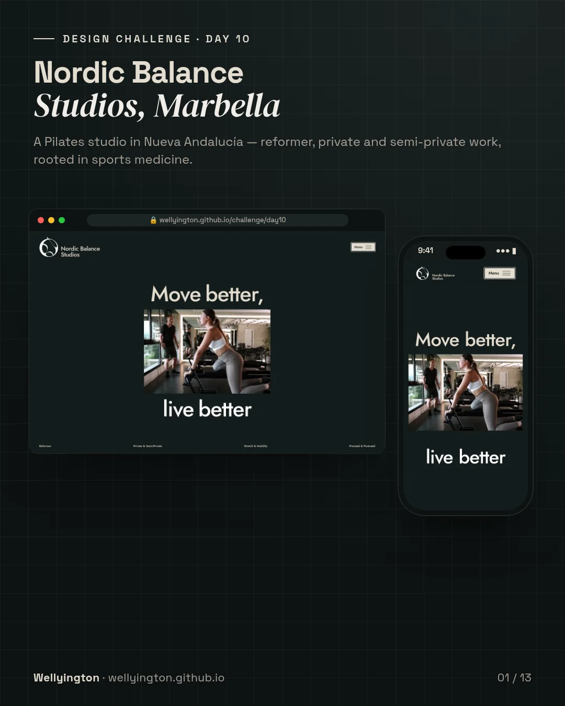
*Day ten: a Pilates studio in Nueva Andalucía, with Reformer, private and semi-private work rooted in sports medicine.*

## move better, live better

The home page opens on near-black. In the middle, in large light type, the studio's line: move better, live better. Between the two halves of the sentence sits a short film from inside the studio, playing on a loop: a client on a Reformer, an instructor walking past, the room behind them. It sits at the size of a photograph in a magazine, and zooms in gently as you start to scroll.

Along the bottom of the first screen run the four things the studio does, as plain words: Reformer, Private & Semi-Private, Stretch & Mobility, Prenatal & Postnatal. There is no slogan beyond the one at the top, no offer, no pop-up.

I chose a film rather than a photograph because Pilates is movement, and a still image of someone on a Reformer can look like anything. A few seconds of slow, controlled movement says what the classes feel like better than any paragraph.

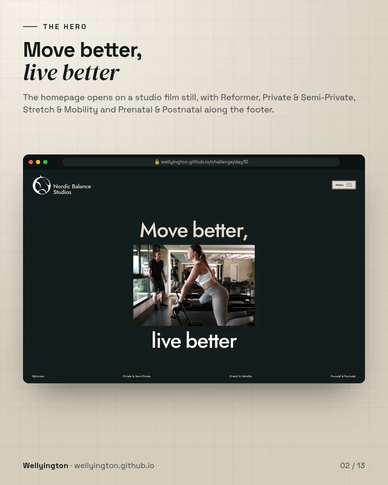
*The home page opens on a still from a studio film, with the four kinds of class along the bottom.*

## one button, one menu

The header holds two things: the studio's round logo and name on the left, and a small Menu button on the right. Press it and the three bars turn into a cross, and a full-screen list appears: Home, Classes, About, Schedule, Contact. At the bottom, one line about the studio and the email address.

It is the same on a computer and on a phone. Five words, large enough to tap without aiming, and nothing else competing with them. For a site this size, that is enough.

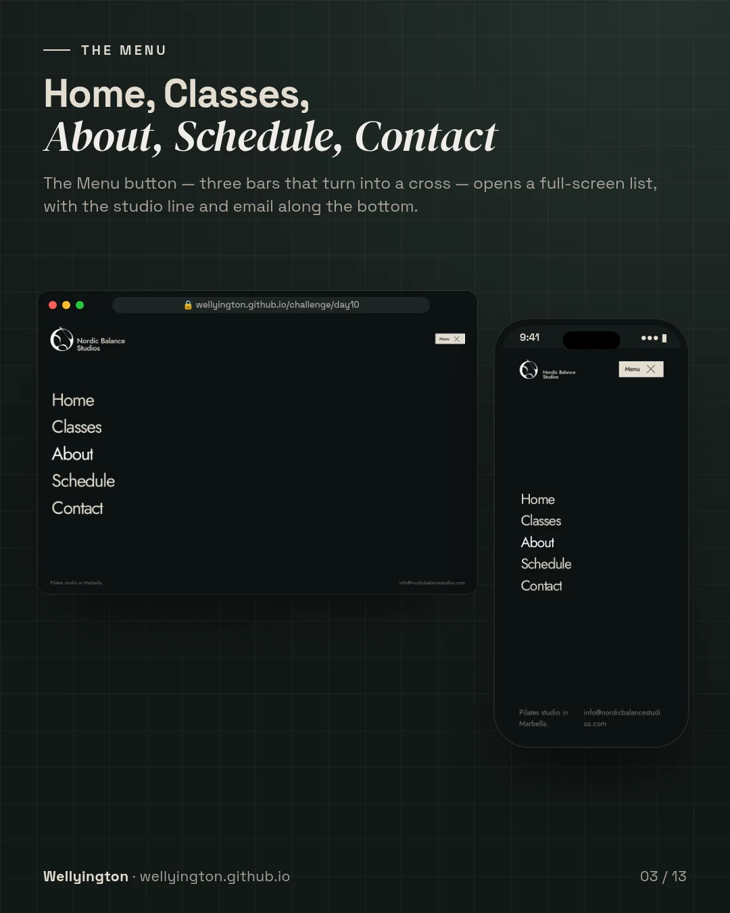
*The Menu button opens a full-screen list, with the studio line and email along the bottom.*

## quality over trends

Scroll on and the next section fills the screen with a photograph: a man on a Reformer, mid-stretch, against the studio's windows and the hills outside. Over it, the sentence that sums up the business, in the studio's own words: if you value quality over trends, you're in the right place. We combine science-based movement with personalised coaching, rooted in sports medicine, rehabilitation and Pilates.

That is the whole introduction. It doesn't list ten benefits or promise a new body in thirty days. It says what kind of studio this is and who it is for, and lets the photograph show the rest. Someone looking for a loud, high-energy class will know straight away that this isn't it. Someone looking for careful, expert teaching will know they've found it. Both outcomes are good for the studio.

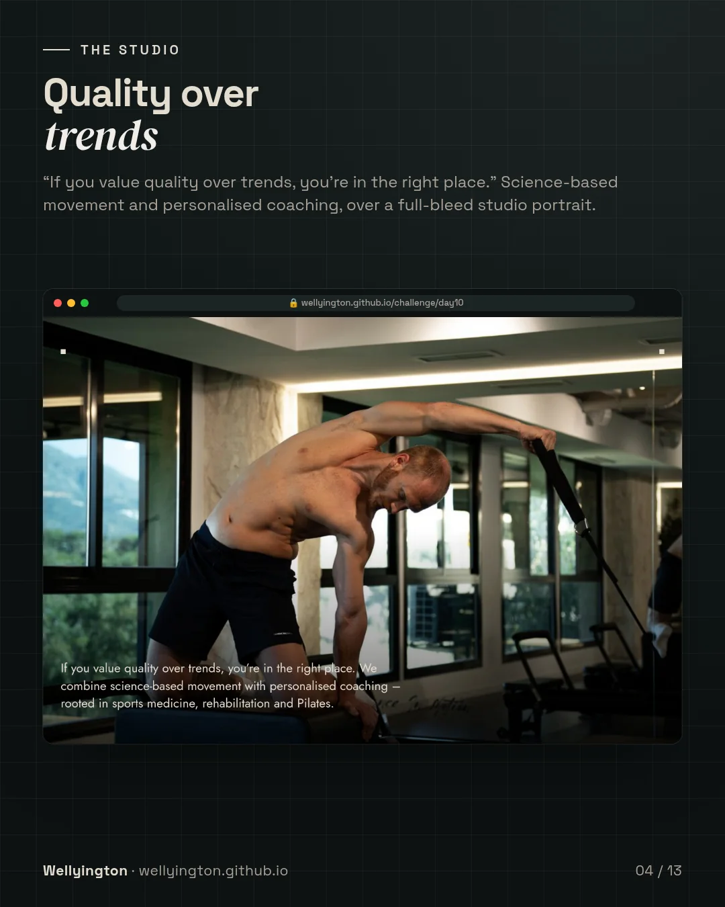
*Science-based movement and personalised coaching, over a full-bleed studio portrait.*

## four doors into the classes

The next section is called classes for every stage. It shows four large tiles, arranged in a loose cross rather than a row, each with a number and a name: 01 Reformer, 02 Private, 03 Specialist, 04 First Visit. A link to all classes sits at the top right.

The tiles are quiet until you need them. Point at one on a computer, or tap it on a phone, and it turns cream and lists what's inside. Reformer opens into Beginners, Intermediate and Advanced Reformer, Semi-Private sessions and small groups with certified instructors. Private lists what the one-to-one work is for: sports performance, rehabilitation and injury recovery, posture correction, spinal health and pregnancy. Specialist covers Stretch & Mobility, Posture for all levels, Longevity 50+, Teen Girls Pilates and Outdoor Mat Pilates. And First Visit explains what happens when you start: a one-to-one Consultation Class, a movement assessment, a talk about goals and previous injuries, and the classes recommended for you.

That last door is the important one. New clients often hesitate because they don't know where they fit. Here, "I'm new" is a category of its own, with a clear first step.

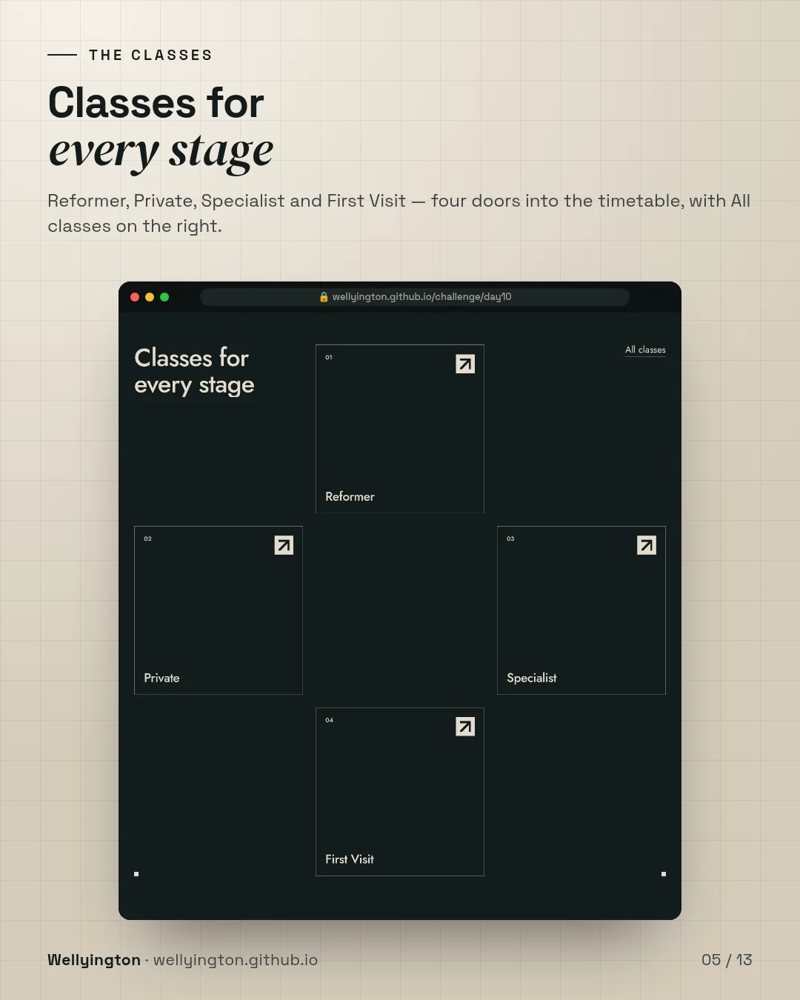
*Reformer, Private, Specialist and First Visit: four doors into the timetable.*

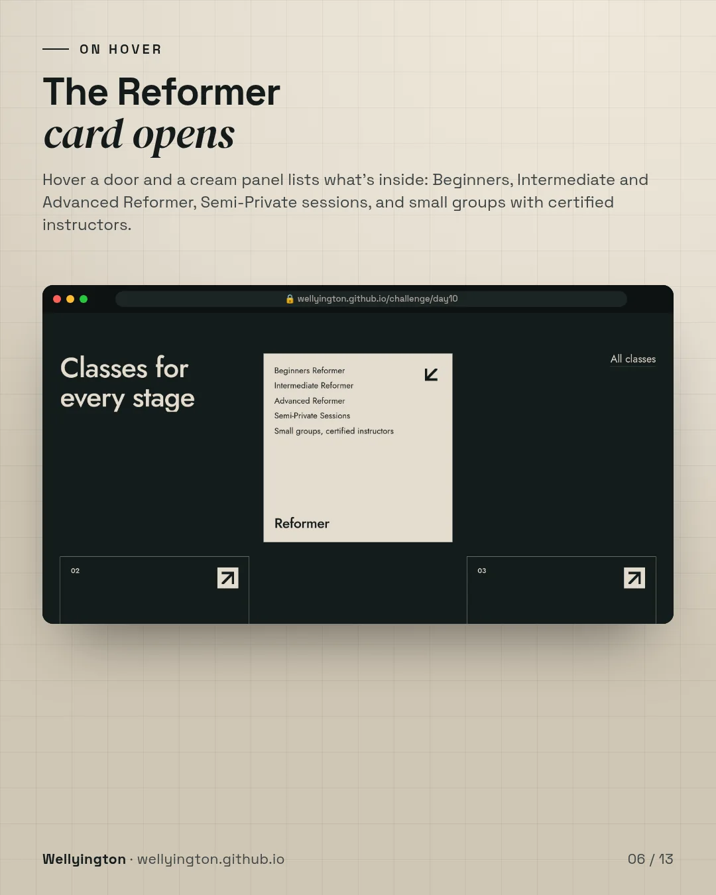
*Point at a door and a cream panel lists what's inside.*

## three ways to book

Most fitness studios use several booking systems at once, and their websites rarely explain which is which. Nordic Balance is the same: group and semi-private classes are booked in the studio's own app, private sessions over WhatsApp, and new clients start with a consultation.

So the booking section, book your session, lays out exactly that, in three columns with a photograph each. Book your group class: Beginner, Intermediate and Advanced Reformer plus specialist sessions, booked directly in the Nordic Balance Studios app, with semi-private sessions too. Book your private class: through WhatsApp on +34 648 876 173, so the studio can match you with the instructor best suited to your goals. And book your first Consultation Class: a one-to-one session to assess your movement, discuss your goals and any injuries, and recommend the right classes.

Each column has two small labels at the top, saying who it's for and where it happens: group classes and app, private classes and WhatsApp, new clients and start here. Nobody has to guess which button leads where.

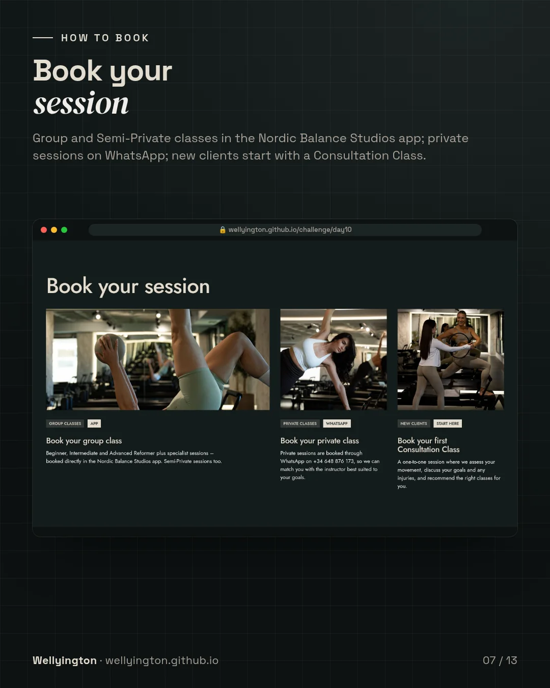
*Group and semi-private classes in the app, private sessions on WhatsApp, and a Consultation Class for new clients.*

## the levels, written out in full

The classes page answers the question every beginner asks and few studio websites answer: which class am I?

Each Reformer level gets a short paragraph in plain language. Beginners Reformer is the place to start if you're new to Reformer Pilates or returning after a break; in small groups, certified instructors help you master the essentials and tell you when you're ready for Intermediate. Intermediate is for clients with a solid foundation, ready for more dynamic movements and longer sequences; as the page puts it, progression isn't about moving faster, it's about moving better. Advanced is for clients with at least a year on the Reformer, with complex patterns that test strength, stability and control. And Private & Semi-Private, the studio's speciality, covers sports performance, rehabilitation, posture, pregnancy, spinal health and injury recovery.

Further down, three numbered steps explain how a new client begins: 01, a Consultation Class; 02, a class plan recommending group, semi-private or private sessions; 03, progress with control, with your instructor telling you when you're ready to move up. Great movement starts with mastering the basics, the page says, and the structure of the page agrees.

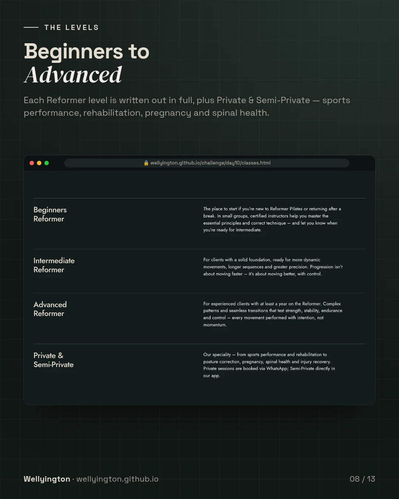
*Each Reformer level written out in full, plus Private & Semi-Private.*

## the week at a glance

Under the levels sits the weekly schedule, as a row of cards you can move through, one per day, with arrows underneath. Each card lists the day's classes with their times, the private-session window in a softer grey, and at the bottom the day and the number of group classes.

Monday has four group classes, from Intermediate at 09:15 to Prenatal & Postnatal at 13:30, with private sessions in the afternoon. Thursday is the busiest, with seven, from Intermediate at 09:15 to Stretch & Mobility at 19:45, and Longevity 50+ at 10:30. Saturday is private sessions only. The row loops, so after Sunday comes Monday again, and on a phone it becomes one card at a time.

The point is to answer "can I make it?" in one look, without downloading an app or opening a PDF. The app is still where you book; the website is where you decide.

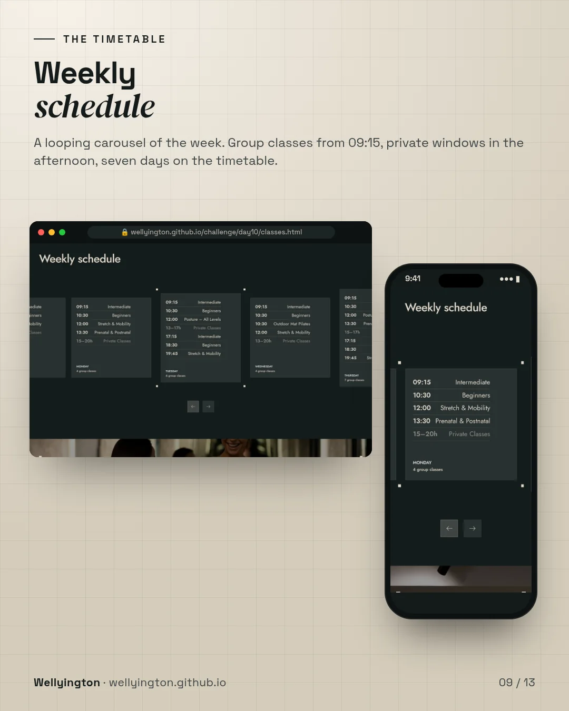
*A looping carousel of the week: group classes from 09:15, private windows in the afternoon.*

## our studio

The about page brings the photography forward again. Four portraits of the studio, each labelled with a class: Reformer Pilates, small groups at three levels; Private sessions, matched to your goals; Posture for all levels, alignment for everyday life; Stretch & Mobility, move more freely. Beside them, one cream card that breaks the dark grid on purpose: new here? Start with a Consultation Class, with a link to book one.

Under that, the studio's philosophy in its own words: we don't follow fitness trends; we focus on long-term health, intelligent movement and lasting results. And three numbers: 5.0, the studio's Google rating from 44 reviews; 3, the Reformer levels; and 7, the days a week on the timetable.

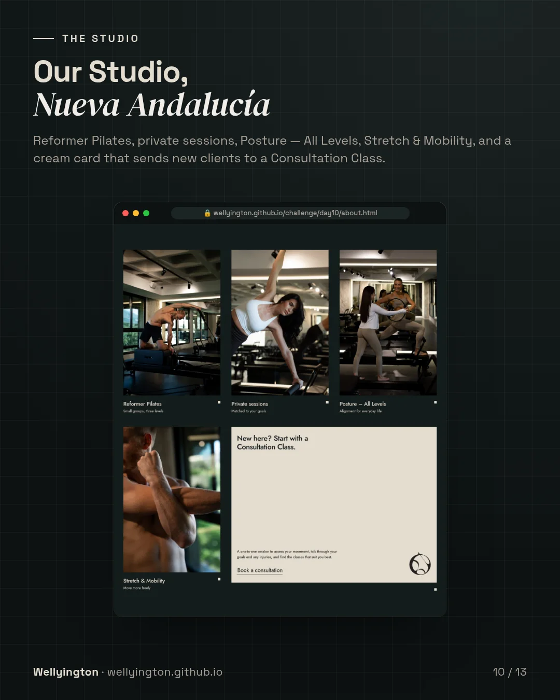
*Reformer, private sessions, posture and stretch, and a cream card that sends new clients to a Consultation Class.*

## open now

The contact page is called get in touch, with the two words pushed to opposite edges of the screen. Underneath, the essentials: the email address, the full address in Centro Plaza, the phone and WhatsApp number, and one line repeating how each type of class is booked.

Next to them sit the class times for each day of the week. The current day is highlighted, and the page says whether the studio is open or closed right now. It works this out from the time in Marbella, not on the visitor's device, so it's right for someone checking from London or Stockholm before a holiday.

Below, the FAQ: five questions, with the first already open, because it is the one most people have. I'm new, where do I start? With a Consultation Class. How do I book a private session? On WhatsApp. Is the studio for women only? No, men and women are welcome, and there are also Teen Girls and Longevity 50+ sessions. When can I move up a level? When your instructor says so; Advanced needs at least a year on the Reformer. How do I book group and semi-private classes? In the app.

Each of those answers is something the studio's staff would otherwise explain on the phone, again and again.

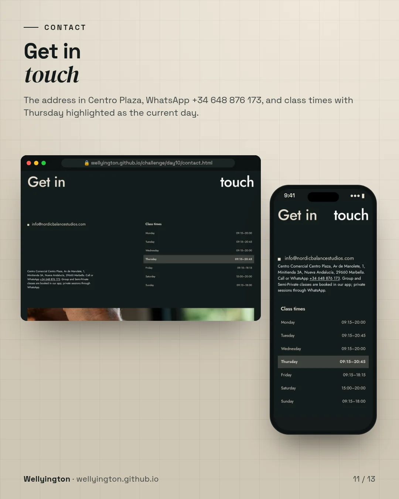
*The address in Centro Plaza, WhatsApp, and class times with the current day highlighted.*

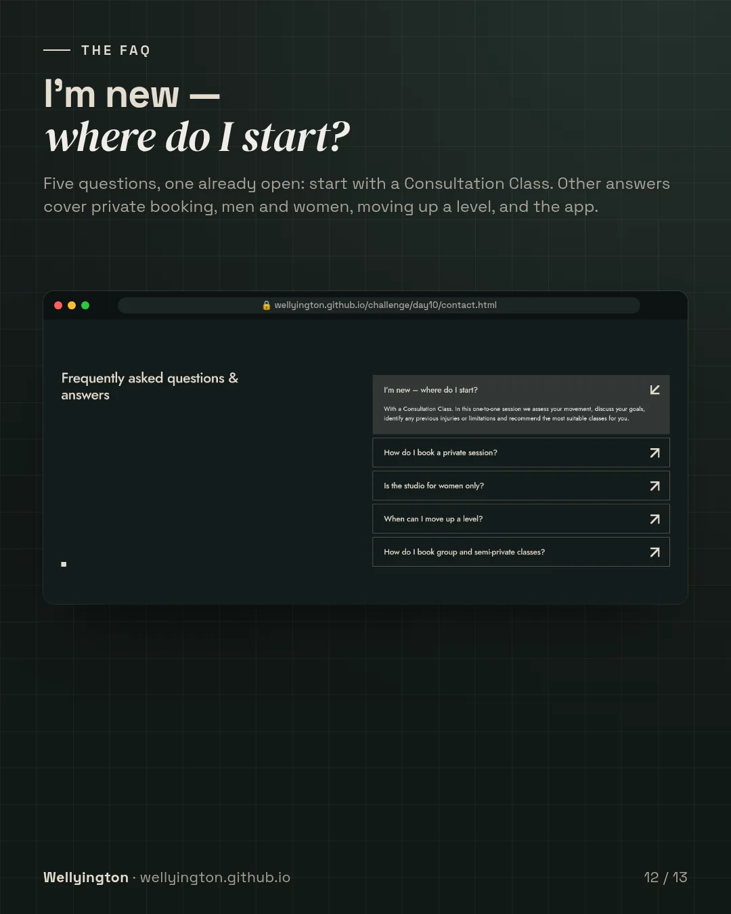
*Five questions, one already open: start with a Consultation Class.*

## the details

There is one typeface, Jost, a clean geometric sans, in light and regular weights for nearly everything and slightly heavier for small labels. Using a single family keeps the pages quiet and lets size and spacing do the work.

The palette has three colours: a near-black with a hint of green, a warm cream, and a soft grey in between. The dark sections hold the photography; the cream ones appear when something needs attention, the open class tile, the consultation card, the highlighted day.

The motion is slow and restrained. Headlines rise into place, the hero film zooms in gently as you scroll, and the pages move smoothly from one section to the next. One thing I would add in a real build: switching the film and the scroll effects off for visitors who have asked their device to reduce motion. The fonts are served from my own site rather than from Google, so opening the pages doesn't hand a visitor's address to anyone else.

## what the concept is, and what comes next

The facts on the pages come from the studio's current website and its public profiles: the classes and levels, the timetable, the booking methods, the address and phone number, the FAQ answers and the Google rating as it appeared.

What is new is the structure: a calm, film-led home page, four doors into the classes with "First Visit" as one of them, booking explained by type, the levels written out in full, the week visible at a glance, and opening hours that know whether the studio is open right now.

I have no figures on bookings, and I will not make any up. Turning the concept into a working site would take the practical steps: linking the timetable to the studio's booking app so it updates itself, a Spanish version alongside the English, and the instructors' own profiles, because in a studio like this the teachers are a large part of the reason people come.

## ten down

Ten days in, a pattern is clear. Every business in this series had a website already. Very few were broken. Most were simply built to look finished rather than to answer the questions their customers actually ask: what is this, is it for me, what does it cost, when can I come, and how do I book. Nordic Balance's answers to those questions already existed, in the app, on WhatsApp, in the staff's heads. The website's job is to put them in one calm place.

If you run a studio, a clinic or any business where people book a time, the same applies. Explain your levels or services in plain words. Show the week. Say exactly how to book each thing. Give new people their own first step. And let the place speak for itself.

I am a web designer based in Estepona, on the Costa del Sol, and I design and build websites for businesses in Spain and beyond. If that sounds like your business, write to me from [the main site](https://wellyington.github.io/). Tell me what you do and where, and I will reply in plain language. The concept is [here](https://wellyington.github.io/challenge/day10/), and Nordic Balance Studios' current site is [here](https://www.nordicbalancestudios.com/), so you can compare the two. Ten down, ninety to go.
