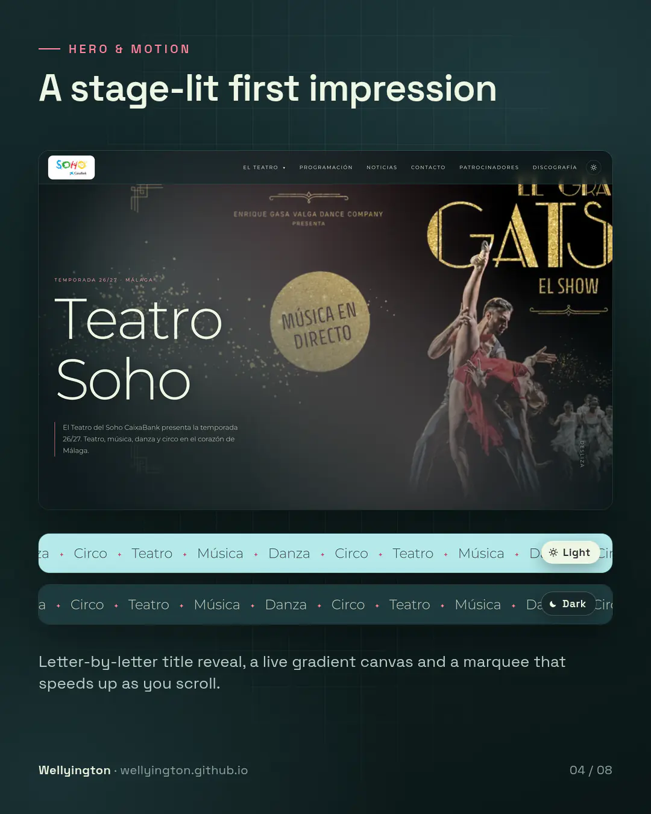
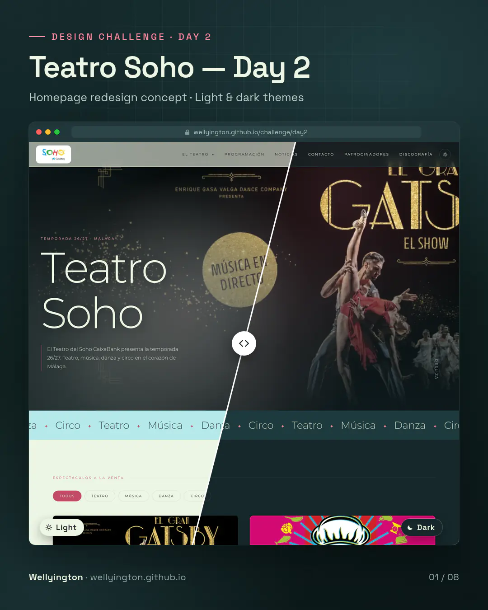
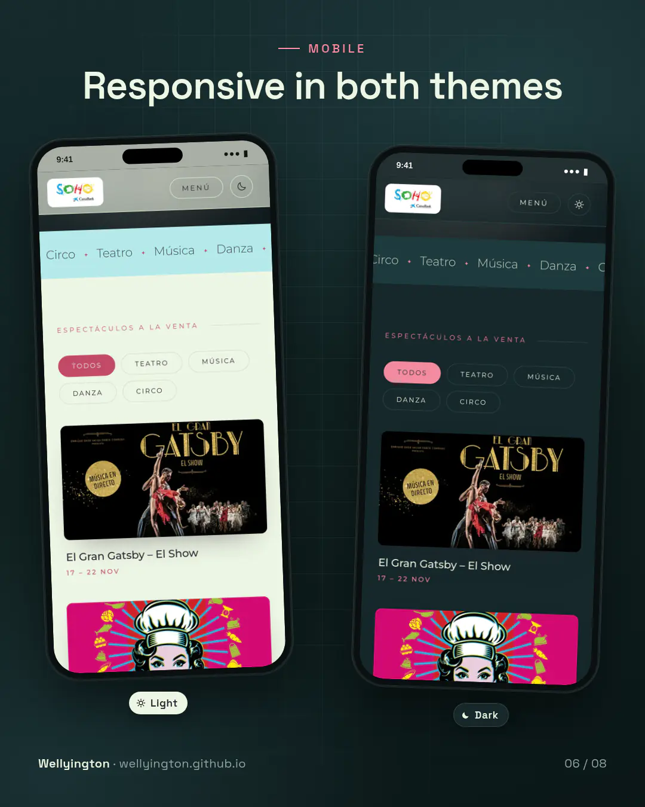
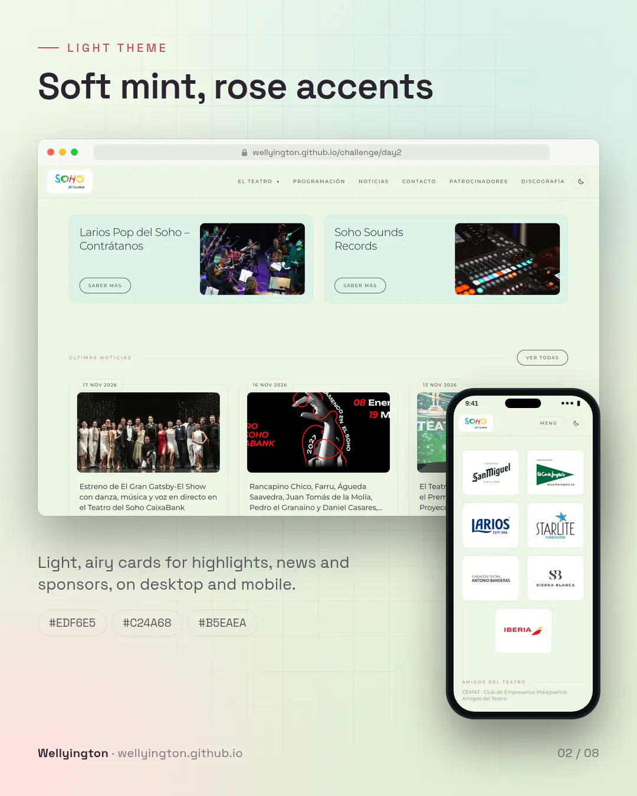
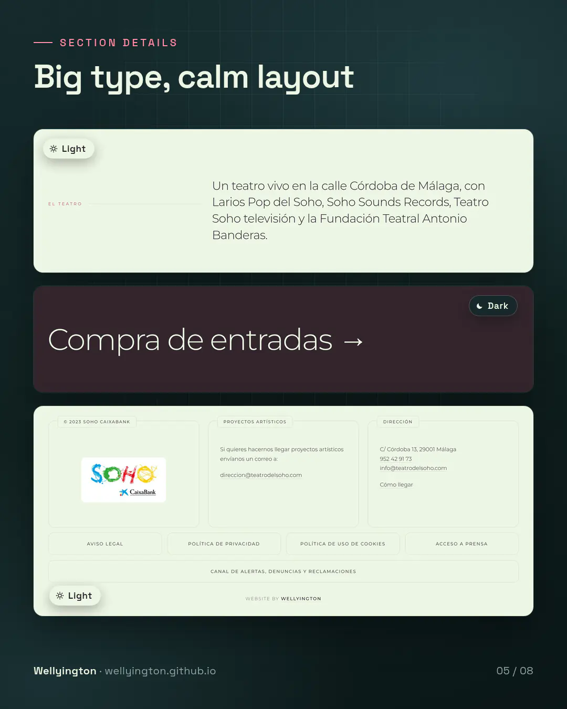
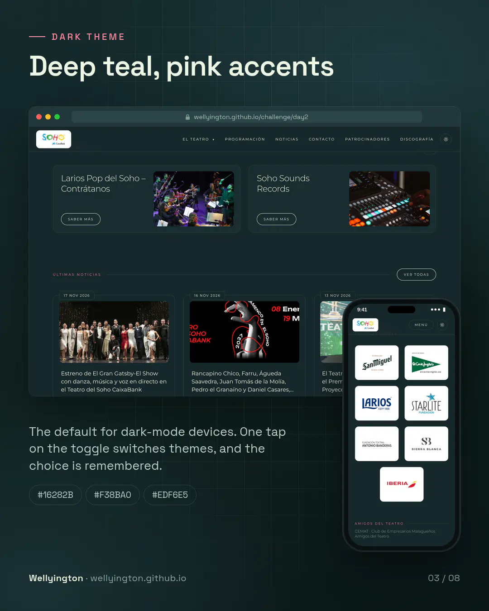

On 18 November I posted the second note of this run: a hundred days, a hundred businesses, a hundred websites, where anyone can open them. The previous day was a family builder in the Marina Alta who needed a first clear page, something finished he could look at before a contract. [That page is here.](https://wellyington.github.io/journal/en/articles/built-before-the-yes/) Today the place is different, and the work changes with it.

Teatro Soho CaixaBank stands on calle Córdoba, in Málaga. I work from Estepona, on the same coast, close enough that I do not have to pretend Málaga is a trip. The theatre already has a season, a building people walk to, a name that carries, and several activities under one roof. It is not waiting for its first sentence online. What I made is a homepage for the life it already has, and you can open the concept here: [Teatro Soho, day two](https://wellyington.github.io/challenge/day2/).

Nobody at the theatre asked me for it. It is not a commission, and it is not affiliated with the theatre or with CaixaBank. Their name is on the page. The concept is mine, and for now it lives on my own address, which is the honest place for work nobody has adopted. I have not been told that anyone there has looked, and I will not write as if they had.

## a house that is already full

The visitor from the previous day wanted to know whether a firm could be trusted with a house. Someone opening a theatre page usually wants a smaller answer, and wants it quickly: what is on this Saturday, whether there is dance, whether a seat is still free, and who is on the stage. The season is the thing on offer, and it changes while the person is still deciding.

The building holds more than a calendar. Beside the theatre sit Larios Pop del Soho, Soho Sounds Records, Teatro Soho televisión and the Fundación Teatral Antonio Banderas, plus sponsors, the week's news, a phone number and a street a taxi can find. Crowd that onto one screen and nobody finishes it. Leave it out and the poster has nowhere to lead. The work is an order a person can use, and a first minute that feels like arriving. After that, the page has to say what is on, and how to get a ticket.

I did not invent the names, the dates or the partners. They are public, and they are what the concept shows. I have not sat through these performances, so this is an account of the page, not of the night.

## the first minute

The opening is this season. Small type at the top reads Temporada 26/27 · Málaga. The name below is large, Teatro Soho, and the letters arrive one by one, the way a title comes up once a room has gone quiet. Behind it is the poster for El Gran Gatsby – El Show: gold lettering, two dancers, a line that Enrique Gasa Valga Dance Company presents the evening, and a round gold mark reading música en directo. Beside a thin rose line, a short paragraph says the house presents the 26/27 season: theatre, music, dance and circus, in the heart of Málaga.

Under that, a band of words keeps moving: Circo, Teatro, Música, Danza, and then the same four again. Move down the page and the band picks up a little. Stop, and it settles. I mean that as a curtain going up, a small change in the room. A slow light also shifts behind the poster, closer to light on a stage than to a row of slides.

*The first screen. The season, the poster, and the name of the house.*

The same opening exists in two lights, because people do not all read in the same place. One is soft mint, with rose kept for the small accents, easy in a bright café or on a sunny pavement. The other is a deep teal, closer to a darkened auditorium, pink used the way a house light is used. If the phone is already set dark, the page opens dark. One tap switches it, and the choice is remembered. The poster and the name stay put. Late at night the page does not glare, and at lunch you are not handed a black screen to fight.

*One homepage, two lights. The season stays, and the room around it changes.*

## finding Saturday

Below the band the heading is plain on purpose: Espectáculos a la venta, shows on sale. Five chips sit under it: Todos, Teatro, Música, Danza, Circo. If you want dance on Saturday, you tap Danza and the rest steps back. That is the whole task, two taps, instead of a search through a list drawn for the box office rather than for the person holding the phone.

Each show is a poster, then the name, then the dates. El Gran Gatsby – El Show runs from 17 to 22 November, filed under dance and music, which agrees with the gold mark. La Cubana, La cuisine de ma cousine, runs from 25 November to 15 December, filed under theatre, on a bright pink card with a cook's hat that belongs to that company and not to the Gatsby poster. The two can sit together. A house programming circus, flamenco, musicals and straight plays will look careless if every card is forced into one frame.

The grid holds a season around those two. Christmas at the Soho, with Antonio Banderas, is there from 25 to 28 December. Duck Pond, by Circa, falls on 19 and 20 December. January brings Mujer en cinta de correr sobre fondo negro, Hija de la Luna, and Flamenco en el Soho 2027 from 8 January to 19 March, including Rancapino Chico and, the next night, Farru with Duquende in Natural. I am listing what the page lists. There is no review here, and no sales figure, because I do not have either.

*Shows on sale, on a phone. Choose dance, and the other cards step aside.*

Open a card and the show comes forward with two routes, buy a ticket or read more. Further down, in type you cannot miss, the line says Compra de entradas. Halfway through, a visitor should not have to guess whether tickets are sold on this page. Buying points to the channels the house already uses. Reading more points to the theatre's own page for that show. I am not opening a second box office.

On a phone the same visit happens in a short moment. Someone at dinner is checking Saturday, or someone a few streets from calle Córdoba is sending a poster to the person who has to agree. The menu tucks into one control: programme, news, contact, sponsors, discography. Filters stay large enough for a thumb, and posters stack as picture, name and dates. You do not pinch the screen, and you do not turn the phone sideways to read the name of the house. A phone also moves, from a bright street at noon to a dark seat after the curtain, which is why the two lights belong here.

## the rest of the house

Calle Córdoba holds more than dates. A row called Destacados moves through three cards. Larios Pop del Soho, with Contrátanos and a photograph of an orchestra in coloured light. Soho Sounds Records, a mixing desk, enough to say a label lives in the building. The Fundación Teatral Antonio Banderas, on a card of its own. Each says saber más and links to the theatre's pages. I kept the names apart, because one soft heading would have made the house look smaller than it is.

News follows, under Últimas noticias, with a way through to the rest. Three notes, dated, with photographs. On 17 November, the opening of El Gran Gatsby – El Show, dance, music and live voice. On 16 November, flamenco: Rancapino Chico, Farru, Águeda Saavedra, Juan Tomás de la Molía, Pedro el Granaíno and Daniel Casares. On 13 November, the Premio Andalucía Excelente, for the theatre's cultural projection. I am repeating the page, not a night I attended. Dated news is how a homepage shows the week is happening, instead of leaving the place parked on a logo from a season already over.

*Highlights and the latest news, in the mint theme. The ground stays quiet so the pictures can be read.*

Then the page slows down on purpose. El teatro is one sentence, set large: a living theatre on calle Córdoba in Málaga, with Larios Pop del Soho, Soho Sounds Records, Teatro Soho televisión and the Fundación Teatral Antonio Banderas. The words come forward as you reach them. It is short because the season above has already introduced the house, and it is there both for someone who does not know the place and for someone who does.

The foot of the page is where the visit becomes practical. C/ Córdoba 13, 29001 Málaga, the phone 952 42 91 73, info@teatrodelsoho.com, and a link for how to arrive. Artistic projects write to direccion@teatrodelsoho.com. Legal notes, privacy, cookies, press access, and a channel for alerts, complaints and claims sit in a row you can scan. A small credit says the website is by me. I left it visible, so the page does not borrow the authority of a house that has not asked for the work.

*The house in one sentence, tickets in large type, and an address a taxi can use.*

## partners, given a proper place

A venue like this lives with its partners. Sponsors have a grid of their own, logos on white cards with enough air to tell them apart, not a grey strip under the legal text. San Miguel, El Corte Inglés, Larios, Fundación Starlite, the foundation, Sierra Blanca and Iberia are among them. Under Amigos del teatro, the line names CEMAT, the club of business people in Málaga who are friends of the theatre, and the cards go on through local names: a hotel, El Pimpi, a hospital group, the technology park.

I do not know the agreements behind those marks, and I will not invent them. A dignified place, on this page, means large enough to read, still tappable when the logos fall into two columns on a phone, and not in charge of the season. The shows stay above. In the darker theme the same stretch sits on deep teal, with pink kept to the small labels. A phone already set to dark will open it that way. One tap brings the mint back, and the choice is remembered.

*The dark theme. One tap switches it, and the choice is kept for the next visit.*

## an offer, not an announcement

The theatre did not hire me, and neither did CaixaBank. This is not an official page, and nothing on it means the house has approved the work. People already buy tickets by the routes the house uses. I worked from public names, public dates, and the way the theatre describes itself, a living house on calle Córdoba with those four activities beside it, so someone in Málaga could recognise the place.

There is no quote, because nobody there gave me one, and I have not been told they have seen it. There is no figure for seats or takings. If they open the concept and want nothing from me, that is a complete ending. The previous day's page existed so a builder could say yes, or no, or change one part. This is the same kind of offer, made to a house that already has an audience.

## if the place is already busy

You may not run a theatre. From Estepona, most months look more like this day than like the first. That builder needed a clear page which did not exist yet: the name, the work, the towns, a way to be reached that matches how people already get in touch. Many businesses are past that. People already come. The season, the menu or the list of jobs is real, and the website grew by addition, a new block whenever something started, a strip for every partner, and the reason for the visit sitting underneath.

A redesign can keep what people already like: the name on the door, the work itself, and the partners in a decent place instead of covering what you sell. The address and the phone stay where a person can act. What changes is the order. Saturday takes two taps, the ticket sits where the hand already is, and the light follows the phone, easy after a show and easy at noon. A new page can make a full business easier to move through, and leave the character where people already found it.

If that is your situation, write to me from [the main site](https://wellyington.github.io/). Say what you do, and where, and I will answer in plain language. The short public version of today is the note from the 18th: day two of a hundred, a homepage for this theatre, light or dark, the visitor choosing. [The note is here.](https://x.com/wellyington/status/2123056661220733019) Tomorrow is another business, and another finished page.
