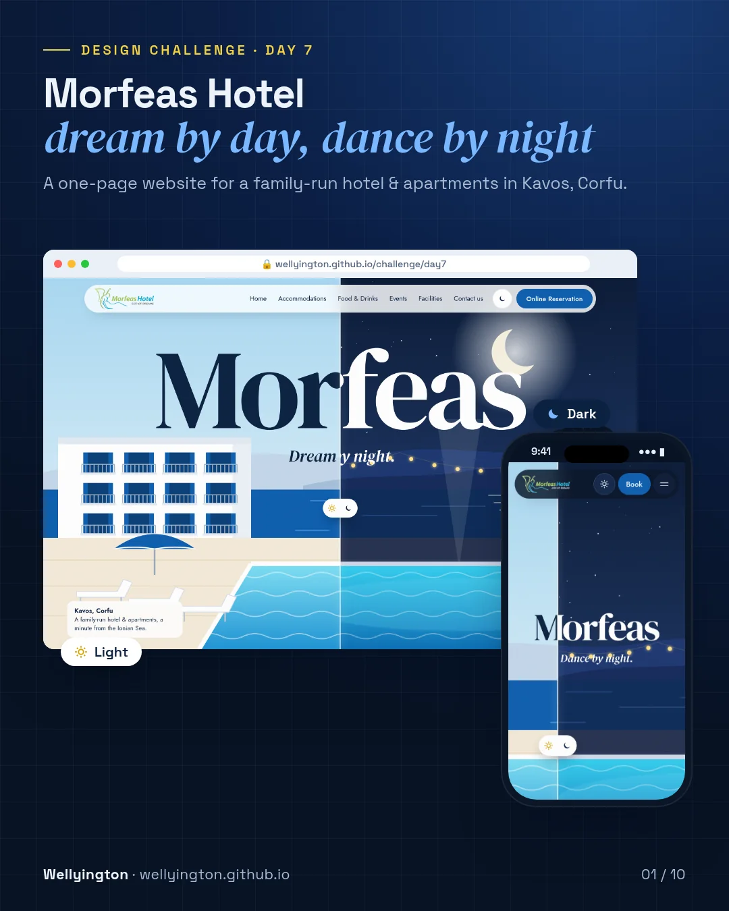
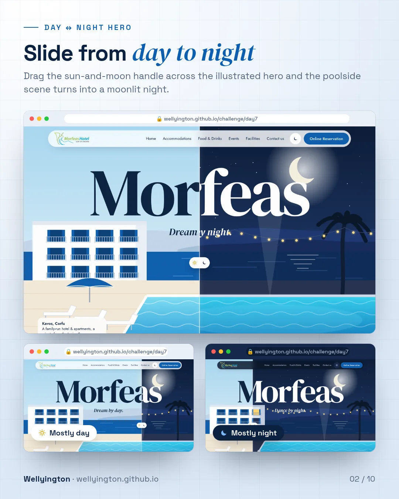
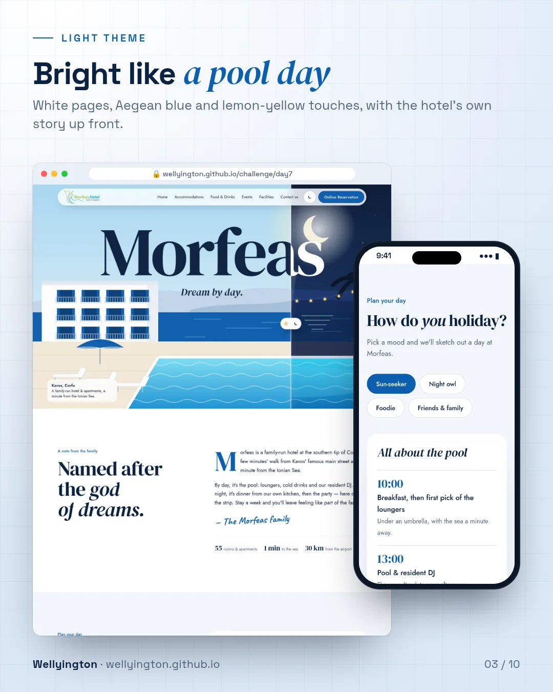
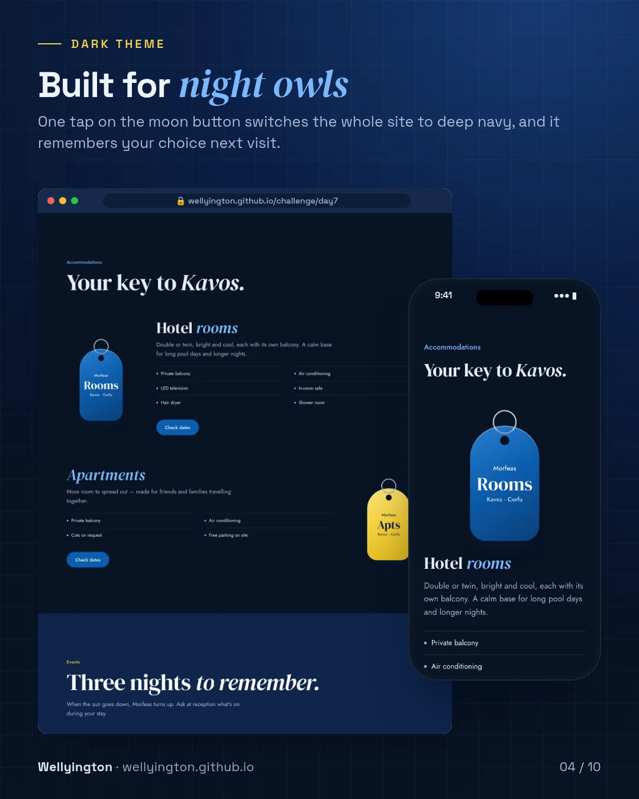
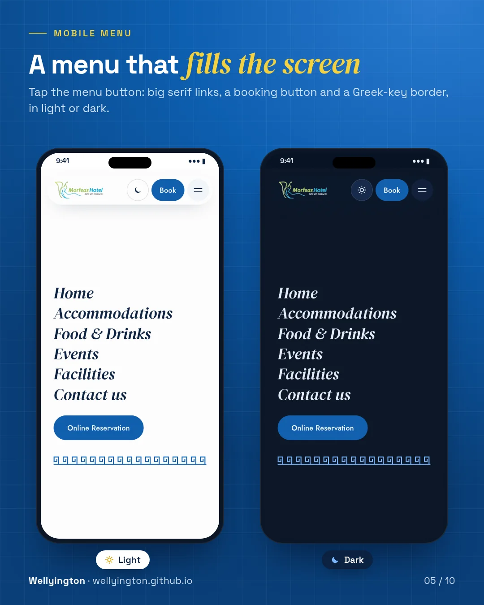
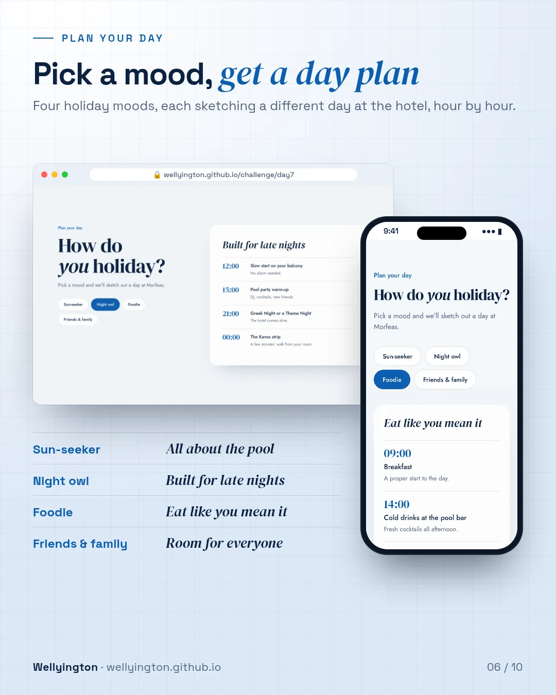
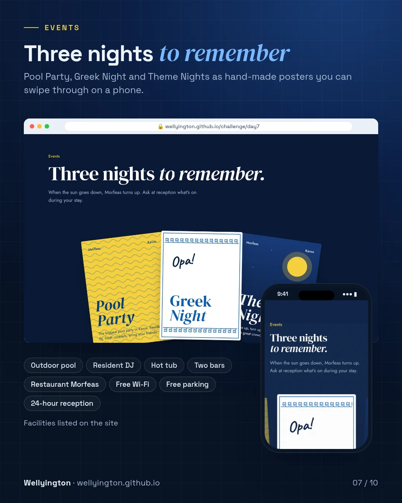
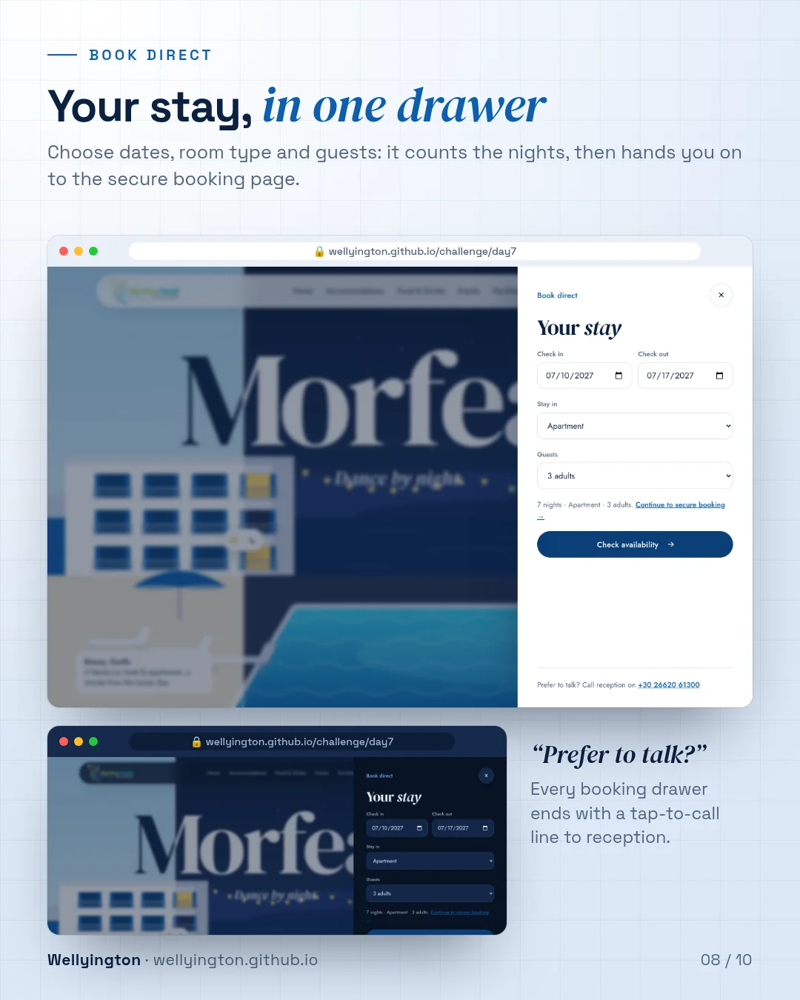
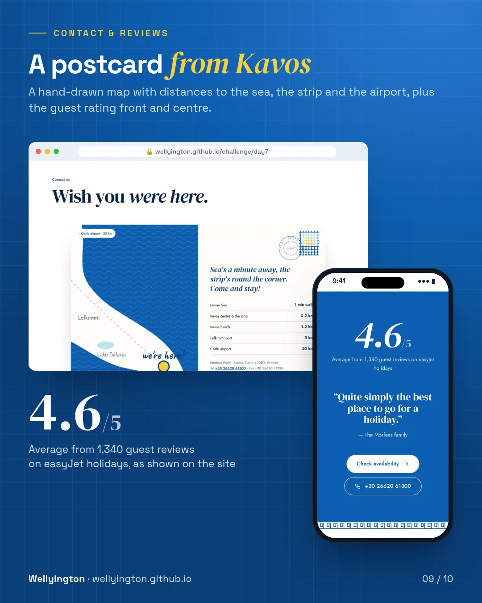

On 23 November I posted the seventh note of this run, the challenge Ramiah Trask set: a hundred days, a hundred businesses, a hundred websites. Day one was a family builder in the Marina Alta. [That page is here.](https://wellyington.github.io/journal/en/articles/built-before-the-yes/) Day two was a theatre in Málaga. [That one is here.](https://wellyington.github.io/journal/en/articles/room-for-a-whole-season/) Day three was a family restaurant in Estepona. [That one is here.](https://wellyington.github.io/journal/en/articles/a-seat-at-the-long-table/) Day four was a private property practice in Málaga. [That one is here.](https://wellyington.github.io/journal/en/articles/judgement-over-volume/) Day five was a tasting-menu restaurant in Motril. [That one is here.](https://wellyington.github.io/journal/en/articles/as-careful-as-the-kitchen/) Day six was a rotisserie chicken house in Estepona. [That one is here.](https://wellyington.github.io/journal/en/articles/from-the-counter-to-the-ticket/)

Today is the first business of the run outside Spain. Morfeas Hotel is a family-run hotel with rooms and apartments in Kavos, at the southern tip of Corfu. It is a minute from the Ionian Sea and a few minutes' walk from the main street of Kavos, which is famous for one thing: going out. The hotel is named after Morpheus, the Greek god of dreams. Its own website is at [morfeashotel.com](https://www.morfeashotel.com/).

The concept is here: [Morfeas Hotel, day seven](https://wellyington.github.io/challenge/day7/).

This is an independent redesign concept. It is not an official collaboration with Morfeas Hotel, nobody there asked me for it, and nothing on the page means they have approved it. Like the six before it, it lives on my own address for now.

## one hotel, two holidays

Most hotel websites describe one holiday. A pool, a room, a breakfast, a sunset. That works for a quiet hotel. It does not work for a hotel in Kavos.

Guests at Morfeas have two holidays in the same week, sometimes in the same day. By day it is the pool: loungers, cold drinks, the resident DJ. By night it is dinner from the hotel kitchen, then the party, either at the hotel or on the strip around the corner. The same people, the same pool, two different moods. The hotel already puts this in one of its lines: dream by day, dance by night.

So instead of choosing one of the two, the concept shows both, and lets the visitor decide which one they are looking at.

*Day seven: one hotel, one pool, two moods.*

## slide from day to night

The top of the page is a drawing rather than a photograph: the white hotel building with its blue shutters, a beach umbrella, two loungers, the sea behind and a pool in the foreground. The word Morfeas sits across it in a large serif, as big as the screen allows.

The drawing exists twice, once by day and once by night, laid exactly on top of each other. A small handle with a sun on one side and a moon on the other sits in the middle. Drag it, and the line between the two drawings moves with your finger. On the left, a pale blue sky and the line dream by day. On the right, a navy sky, stars, a crescent moon, a palm tree in silhouette, a string of party lights over the water and a beam of light rising from the pool. The line there reads dance by night. Drag the handle all the way and the whole hotel goes from noon to midnight.

When the page opens, the handle is not in the middle. It leans towards whatever time it is in Kavos. A visitor arriving in the afternoon sees mostly day. Someone looking at eleven at night, Corfu time, sees mostly night. A small clock in the header shows the time in Kavos with a sun or a moon beside it, which is a small thing but useful for anyone planning a holiday from another time zone.

I drew the scene instead of using photographs for two reasons. A drawing can change from day to night without a second photo shoot. And at a small size on a phone, a simple drawing reads faster than a busy photograph of a pool full of people.

*Drag the handle and the poolside turns from noon to midnight. When the page opens, it leans towards the time in Kavos.*

## a light theme and a dark one

The hero is not the only thing that changes. The whole site has a light theme and a dark one.

The light theme is a pool day: white pages, the deep Aegean blue of Greek shutters and doors, and touches of lemon yellow. The dark theme is the same site after sunset: deep navy pages, light blue for links and buttons, the same lemon yellow. Neither is an afterthought. I designed both, section by section, so that the dark version is not just the light one with the colours inverted.

A button with a moon or a sun in the header switches between them. The site remembers the choice for the next visit. If a visitor has never pressed it, the site follows whatever their phone or computer is already set to. Switching the theme also moves the hero handle, so the drawing at the top agrees with the rest of the page.

*The light theme: white pages, Aegean blue and lemon yellow, with the family's own note near the top.*

*The dark theme. One tap on the moon and the whole site turns navy, and it stays that way next time.*

## a note from the family

Under the hero, the first thing to read is not a list of services. It is a short note from the family, signed in handwriting: Morfeas is a family-run hotel at the southern tip of Corfu, a minute from the sea and a few minutes' walk from the main street. By day, the pool. By night, dinner from their own kitchen and then the party. Stay a week and you leave feeling like part of the family.

Beside it, three numbers in large type: 55 rooms and apartments, one minute to the sea, 30 kilometres from the airport. They answer the three questions people ask about any island hotel before they ask anything else: how big is it, how far is the sea, how far is the airport.

## your key to Kavos

The accommodation section is called your key to Kavos, and each type of stay has a key-tag of its own, the old-fashioned kind that hangs from a room key at reception. A blue one for the hotel rooms. A yellow one for the apartments. They swing gently when they come into view.

The rooms are double or twin, each with its own balcony, air conditioning, a television, a safe, a hair dryer and a shower room. The apartments have more space, for friends and families travelling together, with cots on request and free parking. Each type has a button to check dates, which opens the booking drawer with that type already selected.

## a menu that fills the screen

On a phone, the header shrinks to three things: the logo, a Book button and the menu button. Tap the menu and it fills the whole screen with the six sections of the site in large italic serif letters, an online reservation button, and a Greek key border along the bottom, the pattern you see on plates and tiles all over the islands. It works the same in both themes.

Once you scroll past the top, a bar settles at the bottom of the screen with two things in it: check availability, and a button that calls reception. On a hotel website, booking should never be more than a tap away.

*The menu fills the screen: big serif links, a booking button and a Greek key border, in light or dark.*

## pick a mood, get a day plan

This is the part I would most like a hotel to steal.

People do not choose a hotel in Kavos for its towels. They choose it for the kind of holiday they want. So the section asks: how do you holiday? There are four answers, as buttons: sun-seeker, night owl, foodie, and friends and family. Pick one, and the site sketches out a day at Morfeas for that kind of guest, hour by hour.

The sun-seeker's day is all about the pool: breakfast at ten, then first pick of the loungers, the DJ at one, the hot tub and a cocktail at four, a walk down to the sea before dinner. The night owl's day starts at noon on the balcony, with no alarm, warms up at the pool party at three, goes to Greek Night or a theme night at nine and reaches the strip at midnight. The foodie's day is built around breakfast, the pool bar and dinner at the hotel restaurant. The friends and family day ends with everyone on the balcony, because every room and apartment has one.

Every line of those plans comes from things the hotel actually has. Nothing is invented to make the day sound better. The point is that a visitor sees themselves in it, and in four lines knows whether this is their kind of hotel. You can also move between the four moods with the arrow keys on a keyboard.

*Four holiday moods. Each one sketches a different day at the hotel, hour by hour.*

## three nights to remember

The evening at Morfeas has three regular events: the pool party, Greek Night and theme nights. On most hotel websites they would be three lines in a list. Here they are three posters, the kind you would see taped up by the reception desk.

The pool party poster is lemon yellow with wavy lines like water. Greek Night is white with a blue Greek key border and Opa! written by hand across the top. Theme nights is navy with a big yellow moon. On a computer they lean against each other like posters on a wall. On a phone you swipe through them one by one, with small dots to show where you are. Above them, one honest line: ask at reception what's on during your stay. Dates change every season, and a website that promises a date it cannot keep is worse than one that sends you to the desk.

Next comes the food, with the hotel restaurant, breakfast, the pool bar, dinner and the music lounge, and a link to the menus. Then the facilities: the outdoor pool, the resident DJ, the hot tub, two bars, the restaurant, air conditioning, free Wi-Fi, free parking and a reception that is open 24 hours.

*Pool Party, Greek Night and Theme Nights as hand-made posters you can swipe through on a phone.*

## your stay, in one drawer

Every booking button on the page, whether in the header, under a room type or at the bottom, opens the same thing: a drawer that slides in from the side, called your stay. It asks for four things: check-in date, check-out date, a hotel room or an apartment, and how many guests, from one adult up to two adults and two children.

It counts the nights as you go and writes it back in one line: 7 nights, apartment, 3 adults. Then it hands you on to the hotel's secure booking page. If a date is missing, it says so and puts the cursor in the right field, rather than letting you press the button and wonder why nothing happened.

At the bottom of the drawer there is one more line: prefer to talk? Call reception, with the number ready to tap. Plenty of people still book a family holiday by phone, and the drawer treats that as a perfectly good answer.

To be clear about what the concept does at that point: the drawer gathers the details and sends the visitor to the hotel's current website. It does not pass the dates across in the concept. In a real build it would open the hotel's booking system with the dates and room type already filled in.

*Choose dates, room type and guests. It counts the nights, then hands you on. Every drawer ends with a number to call.*

## a postcard from Kavos

The contact section is a postcard. It is headed wish you were here. On the left half there is a hand-drawn map of the south of Corfu in blue and white, with a yellow pin and we're here written beside it in handwriting. On the right, where you would write the message, there is a short note: the sea's a minute away, the strip's round the corner, come and stay. Under that, the distances: the Ionian Sea, one minute's walk; the centre of Kavos and the strip, 0.2 km; Kavos beach, 1.2 km; the port at Lefkimmi, 5 km; Corfu airport, 30 km. In the corner there is a stamp, a Greek key tile with a little yellow sun, and a postmark.

Then the guest rating, as large as the hotel's name at the top: 4.6 out of 5, the average from 1,340 guest reviews on easyJet holidays, as it appears on the hotel's own site. A line from the family, a button to check availability and the phone number. A Greek key border closes the page.

*A hand-drawn postcard with the distances that matter, and the guest rating front and centre.*

## the details

The type is DM Serif Display for the headlines, set large and tight, with italics for the warmer words. Jost, a clean geometric sans, for everything you read. Caveat, a handwriting face, for the family's signature, Opa! and we're here.

The colours stay close to the island: the Aegean blue of shutters and doors, a deep night navy, lemon yellow and plenty of white. The logo is the hotel's own.

Headlines rise into place word by word as you scroll, sections fade in, the key-tags swing and the stars over the night pool twinkle. All of it switches off for visitors who have asked their phone or computer to reduce motion, and the page works exactly the same without it. The day-and-night handle can be moved with the keyboard as well as the mouse or a finger.

## what the concept is, and what it is not

The facts on the page come from the hotel's current website and public listings: the rooms and apartments, the facilities, the events, the address, the phone numbers, the distances and the guest rating. The family note and the day plans are my own writing, built only from those facts. If the family ever wanted it, they would replace my words with theirs.

What is new is the way it all fits together: one hotel shown in two moods, a page that knows what time it is in Kavos, a planner that speaks to the kind of guest rather than the kind of room, and a booking step that never makes you leave the page until you are ready.

I have no figures on bookings, and I will not make any up. If nobody at Morfeas wants this, the concept stays where it is as day seven. If they do, the rest is practical: their own words in place of mine, their photographs alongside the drawings, the booking drawer connected to their booking system, a Greek version, and the site moved onto morfeashotel.com.

## if your business changes with the hour

You may not run a hotel in Kavos. A lot of businesses still have two faces, though: a beach bar that turns into a cocktail bar, a café that serves dinner, a restaurant with a quiet lunch and a loud Saturday night, a venue that hosts weddings by day and concerts by night. Their websites usually show only one of the two, and the other half of the customers have to guess.

What helps is the same as here. Show both moods, and let people choose. Use the time of day if it matters. Describe the experience in the order a guest lives it, not in the order of your price list. Keep the booking button within reach on every screen. And always leave a phone number for the people who would rather talk.

I am a web designer based in Estepona, on the Costa del Sol, and I design and build websites for businesses in Spain and beyond. If that sounds like your business, write to me from [the main site](https://wellyington.github.io/). Tell me what you do and where, and I will reply in plain language. The concept is [here](https://wellyington.github.io/challenge/day7/), and Morfeas Hotel's current site is [here](https://www.morfeashotel.com/), so you can compare the two. Seven down, ninety-three to go.
