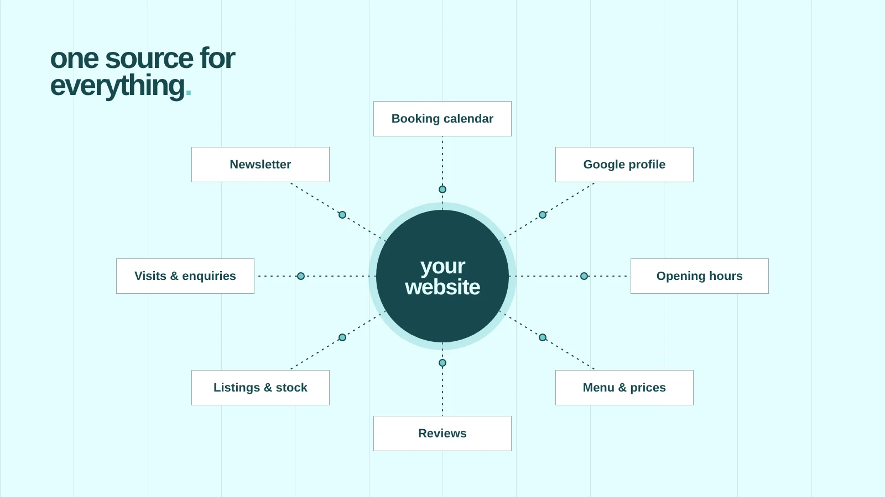
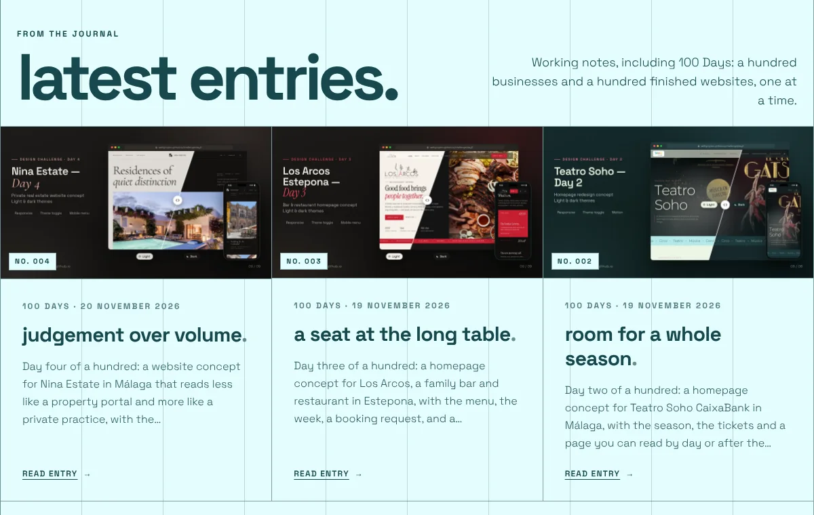
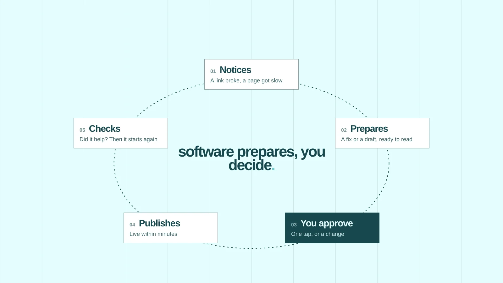
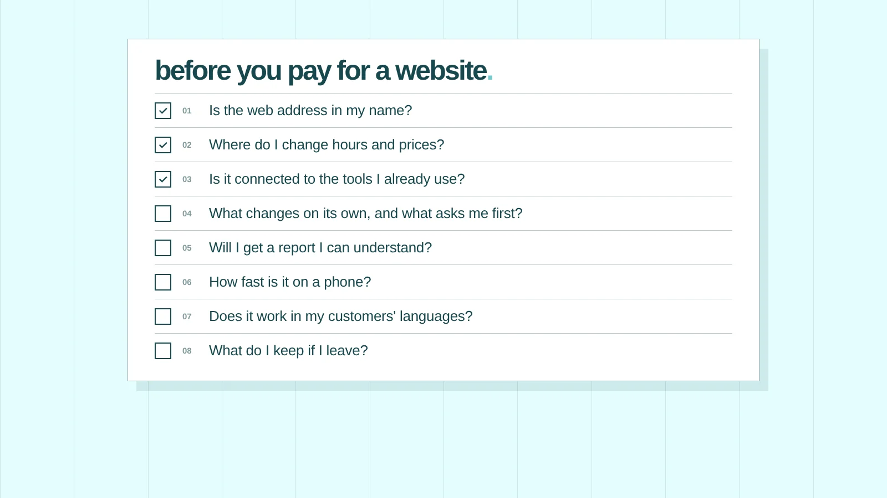

A question I hear from almost every client, usually near the end of the first call: "Once the website is finished, that's it, right? I don't have to keep paying for it?"

It is a fair question. For twenty years the answer was more or less yes. You paid someone to build the site, they handed it over, and it sat there like a printed brochure. Sometimes it was updated. More often it was forgotten.

This week I read a piece on DataDrivenInvestor called [The Slow Death of the Static Website](https://medium.datadriveninvestor.com/the-slow-death-of-the-static-website-why-autonomous-apis-are-finally-fixing-the-small-business-web-4b79db5da819). Its argument, in short, is that the small business website is changing from a brochure that needs constant hands-on care into something closer to a system that can keep itself up to date, because it is now connected to the other tools the business already uses. It is written for people who build websites, and it is full of words like APIs, content management systems and autonomous agents.

This note is the version I would give a client across a table. No code, no acronyms without an explanation, and an honest line between what works today, what is still mostly a sales pitch, and what you should still do yourself.

## the brochure in the drawer

Think about the last printed brochure your business made. On the day it came back from the printer it was perfect. The prices were right, the photos were new, the opening hours were correct.

Six months later, one price had gone up. A year later, the team photo showed someone who had left. Two years later, the box of brochures was in a drawer and nobody gave them out any more, because they were wrong in three small ways and everybody knew it.

Most small business websites have the same life. The difference is that nobody puts a website in a drawer. It stays online, in public, answering questions for you at three in the morning, with the wrong answers.

A website built this way is what people in my trade call static. The word is technical, and I will come back to it, because it causes some confusion. For now, think of static in the everyday sense: it stays the way it was on the day it was finished, until a person sits down and changes it.

## how a website goes quietly out of date

Nobody decides to let their website go stale. It happens one small thing at a time, and usually the customers notice before the owner does.

In the first few months, the opening hours change for summer and nobody updates the site. Someone turns up at a closed door. Then the prices on the menu or the services page drift away from the prices at the till. Then you move to a new booking system, and the old "book now" button still points at the old one. Then a photo goes missing, or a link to a partner breaks because they changed their own site.

Underneath, other things happen that you cannot see. The pieces of software the site depends on need updates, and when they do not get them the site becomes easier to break into. Extra add-ons pile up: a chat bubble, a cookie banner, three tracking tools from three different marketing people. Each one makes the page a little slower on a phone, and slow pages lose visitors and lose ground on Google. The original article calls this silent technical rot, and the name fits. Nothing is broken on any single day. It just gets a little worse each month.

Search is part of it too. Google's sense of what a good page looks like keeps moving. A site that did well in its first year can slide down without anyone touching it, simply because other sites kept improving and this one did not. Looking after search used to be treated as a list you went through before launch. In practice it never stops.

The awkward part is that the owner almost never sees the website the way a customer does. You know the right opening hours, so your eye slides past the wrong ones on the page. A customer only has the page. For them, whatever it says is the truth about your business, right up until they are standing at a locked door or arguing about a price at the counter. By then the website has cost you something, and nobody can point to the day it happened.

None of this is anyone's fault. Owners of small businesses are busy running the business. The website is the one employee who never asks for anything, so it is the one who gets forgotten.

*How a website goes out of date: never in one go, always a little at a time.*

## what an API is, without the jargon

The whole article rests on one word that most business owners never need to learn, so here is the short version.

An API is a way for two pieces of software to talk to each other without a person copying things between them. The easiest picture is a waiter. The kitchen does not come out to your table, and you do not walk into the kitchen. The waiter takes a clear request one way and brings a clear answer back the other way.

You already use services that have one of these waiters, even if you have never seen it. Your booking calendar has one. Your Google Business Profile, the box that appears on Google Maps with your hours and reviews, has one. Online shops, stock lists, review sites, newsletter tools and payment providers have them. The weather has one.

When a website is connected to those services, it stops being a copy of your information and starts reading from the source. Change your hours in one place, and the website shows the new hours. Take the last table on Saturday in your booking system, and the website stops offering it. Sell the last flat in a building, and it comes off the list.

That is the first and most useful half of the change the article describes. It needs no artificial intelligence at all. It is mostly careful plumbing.

*The website reads from the places where your information already lives, instead of keeping its own copy.*

## one place to change things

The goal I aim for with clients is simple to say: every piece of information should be typed in one place only.

On day three of my hundred-day challenge I made a homepage concept for Los Arcos, a family bar and restaurant here in Estepona. A restaurant like that keeps three different sets of hours: the restaurant, the bar and the morning café. On the page they sit in tabs, and the large line on the left answers the only question most people have, which is whether the place is open now. A small green mark in the navigation says café open when the café is open.

To be honest about where that concept stands: the hours there are written into the page once, and the page works out the rest from the clock. The next step, if Los Arcos wanted it, would be to read those hours from the same place they already keep them for Google, so a change for Christmas happens once and shows up everywhere. That is the kind of connection I mean. It is not glamorous, and it saves real people a wasted trip.

*From the Los Arcos concept: three sets of hours, and one plain answer to "are you open now?"*

There is a smaller example on this very site. The homepage of wellyington.github.io now shows the latest entries from this journal, in each of its four languages. Nobody updates that section by hand. When I publish an article, the homepage rebuilds itself a minute later and the new entry is at the top. It is a tiny thing, but it is exactly the idea: write once, and let the rest follow.

*The homepage of this site lists the newest journal entries by itself. Publish once, and it appears there too.*

## from connected to "autonomous"

The second half of the article goes further, and this is where the big words come in. The idea is that a piece of software, usually built on the same kind of artificial intelligence as the chat tools many people now use, sits on top of all those connections and acts on them. Not just reading your hours, but noticing problems and fixing them, writing new pages, and publishing them.

The article lists the kinds of things such a system is connected to: the part of the website where the text is edited, Google Search Console, the visitor statistics, the booking or stock system, and a store of everything the business knows about itself, its tone, its products, its rules.

Google Search Console needs one sentence of explanation, because it comes up in every conversation about this. It is a free report from Google that tells you which searches your website appears for, which pages Google can and cannot read, and what is going wrong. Think of it as the school report your website gets from Google. Most small businesses have never opened theirs, and many have never set it up.

A system with access to that report, your visitor numbers and your bookings can, in principle, see that a page stopped appearing in searches last week, work out why, and suggest a fix before you would ever have noticed. That is the promise. Some of it is real today. Some of it is still a demo.

## what this can already do well

Here is what I would trust software to do on a small business website today, with very little risk.

Check, every week, that every link on the site still goes somewhere, and tell you in plain words when one breaks. Measure how fast the main pages load on a phone, and warn you when a new add-on has made them slow. Watch the Search Console report and send you a short summary once a month, written for a person, not for a developer: which searches brought people in, which pages are slipping, what is worth fixing.

Keep lists in step with their source: events from a calendar, rooms or tables from a booking system, properties from a listings file, opening hours from your Google profile. Prepare a first draft of a news post or an event page from your own notes, for you to read and correct. Produce the first version of a translation, so your Spanish, English or Russian visitors are not left out, again for a person to check. Suggest better titles and descriptions for pages that people find in search but rarely click.

None of these jobs is clever. All of them are the kind of job that falls off a busy person's list and quietly costs money when it does.

## what it should not do on its own

The same piece of software that can fix a broken link can also publish a wrong price to everyone who visits, in seconds, with complete confidence. That is the part of the story the enthusiastic articles tend to skip.

There is a good account of this from the people who build these systems. A design magazine recently published a piece by the makers of an autonomous website platform. They set out to make websites run entirely on their own, assuming that was what owners wanted. When real owners used it, the owners hesitated. Almost nobody, it turned out, wants a website that changes itself completely without asking.

That matches what I see. A business owner is happy to let software fix a broken link at night. They are not happy to wake up and find a new paragraph about their prices, their guarantees or their opening on a bank holiday that they never wrote. And they are right. Some things on a website are promises, and promises should come from a person.

So my rule is simple. Software can notice, measure and prepare. A person approves anything that changes what the business says: prices, offers, promises, opening on special days, anything about health, money or the law, anything about another person, and anything in the business's own voice. The approval can be one tap on a phone. It still matters that it is there.

*Software notices and prepares. You approve. Then it publishes and checks whether the change helped.*

## static is not the enemy

Now the word I promised to come back to. In my trade, static has a technical meaning as well as the everyday one. A technically static website is one where each page is prepared in advance and handed to the visitor as a finished file, rather than being assembled from a database every time someone opens it.

That kind of static is not dying. It is fast, cheap to host, hard to break into and kind to phones on a weak signal. This journal is built that way. So are the hundred-day concepts. Being static in that sense and being out of date are two different things.

The website that is dying is the abandoned brochure: built once, never looked at again, slowly drifting away from the truth. You can avoid that with fast, simple pages that are connected to the places your information lives, rebuilt whenever something changes, and checked regularly by something or someone. The technology behind the curtain matters much less than whether anybody, or anything, is paying attention.

## what this means for the money

Here is the honest answer to the question at the start.

The old model was a large fee to build, and then nothing. Or a monthly fee that paid for hosting and very little else. Neither one paid for what actually keeps a website useful, which is somebody noticing when it has drifted.

What makes sense now is usually a smaller build, because simple fast pages do not need to cost a fortune, followed by a modest monthly amount that pays for real work you can see. The checks run every week. The connections to your booking system, your Google profile and your lists are kept working. You get a short report in plain words. And there is a person to call when you need a change that should not be left to a machine.

When someone offers you a monthly plan, ask them what happens in a normal month. If the answer is "we keep it online," you are paying for a brochure in a drawer. If the answer is a list of things that are checked, updated and reported to you, you are paying for a website that is looked after.

One more thing about money: make sure you own what you pay for. The web address, the text, the photos and the list of your customers' enquiries should be yours, and you should be able to take them with you if you leave. A website that looks after itself is only good news if it is still yours.

## questions to ask before you pay anyone

If you are about to commission a website, or you are unhappy with the one you have, these questions will tell you most of what you need to know. You do not need to understand the technical answers. You only need to hear whether they are clear.

Who owns the web address, and is it in my name? When I change my opening hours or my prices, where do I change them, and how many places is that? Is the site connected to the booking system, the shop or the calendar I already use, or does it keep its own copy? What does the site do on its own, and what does it ask me before it changes? Will I get a regular report I can understand, and how often? How fast is it on a phone with a weak signal? Does it work properly in the languages my customers speak? And if I stop working with you, what do I take with me?

A good answer to the approval question is worth more than anything else on that list.

*Eight questions. You don't need to follow the technical answers, only to hear whether they are clear.*

## how I build for this

For the businesses I work with along this coast, the practical version looks like this.

The pages are fast and simple, prepared in advance, so they load quickly on a phone at a bus stop. The information that changes, such as hours, events, menus, listings and prices, comes from one place, ideally a place the business already uses. Every change to that information rebuilds the site within minutes. Small checks run every week and report to me, and the important ones also report to the owner. Anything that changes what the business promises is shown to a person before it goes live.

None of that needs the word autonomous. It is closer to a well-run shop: the shelves are restocked from the stockroom, someone walks the floor each morning, and the owner signs off on the prices.

## so, is the static website dying?

The brochure website, the one nobody looks after, is fading, and I will not miss it. It sends customers to closed doors and quotes last year's prices, and it does that while looking perfectly fine to the owner, who rarely visits it.

What replaces it does not have to be a mysterious system that runs your business for you. For most small businesses it is something more modest and more useful: a fast website that reads from the same places you already keep your information, tells you when something is wrong, prepares the dull work, and waits for your yes before it says anything new in your name.

The software has become good at the waiting and the noticing. The saying yes is still your job, and I think it should stay that way.

I am a web designer in Estepona, on the Costa del Sol, and I build websites like this one for businesses across Spain. If you would like to know what your current site would need to stop going out of date, write to me from [the main site](https://wellyington.github.io/). Tell me what you do and where, and I will reply in plain language. The article that started this note is [The Slow Death of the Static Website](https://medium.datadriveninvestor.com/the-slow-death-of-the-static-website-why-autonomous-apis-are-finally-fixing-the-small-business-web-4b79db5da819) on DataDrivenInvestor, if you want the technical version.
