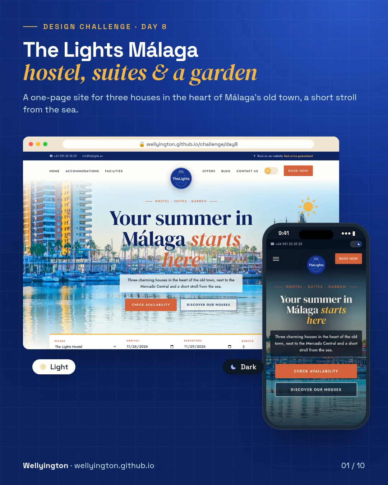
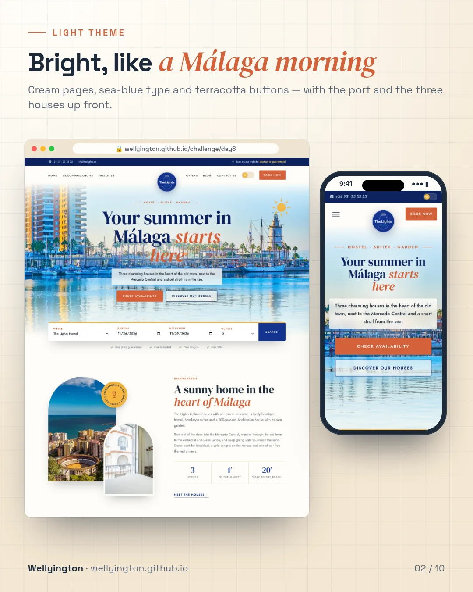
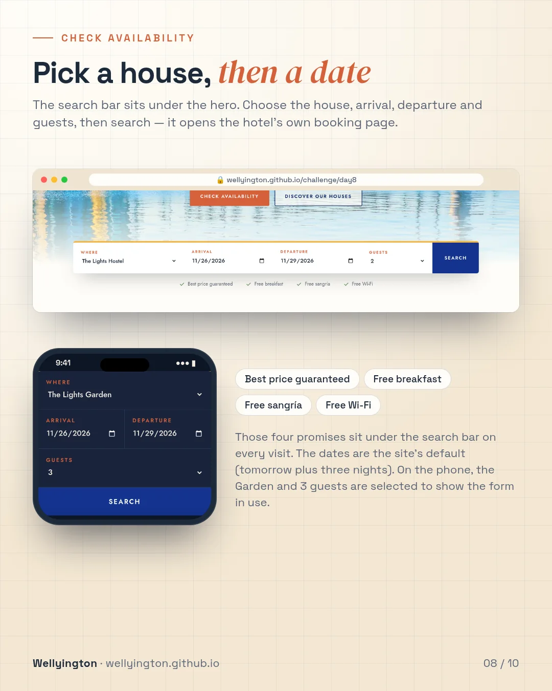
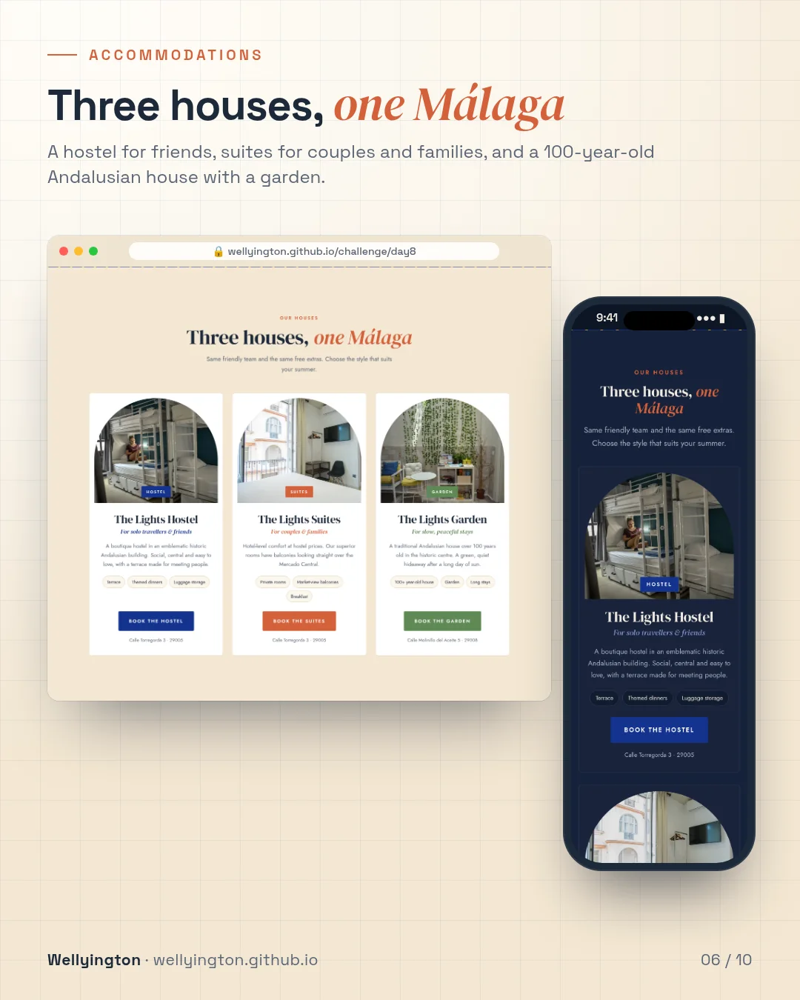
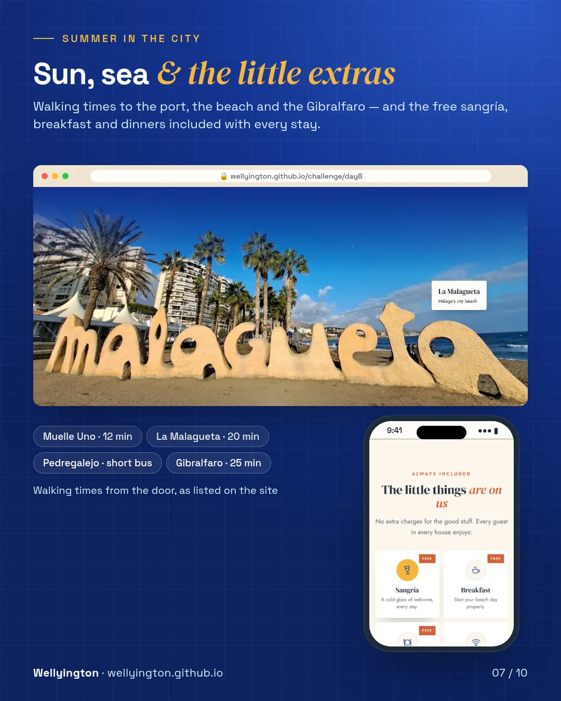
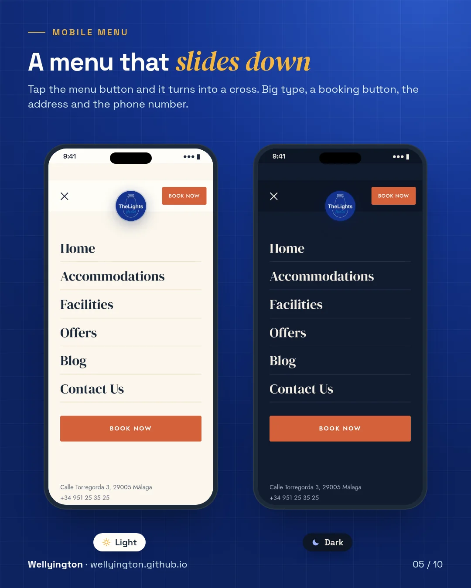
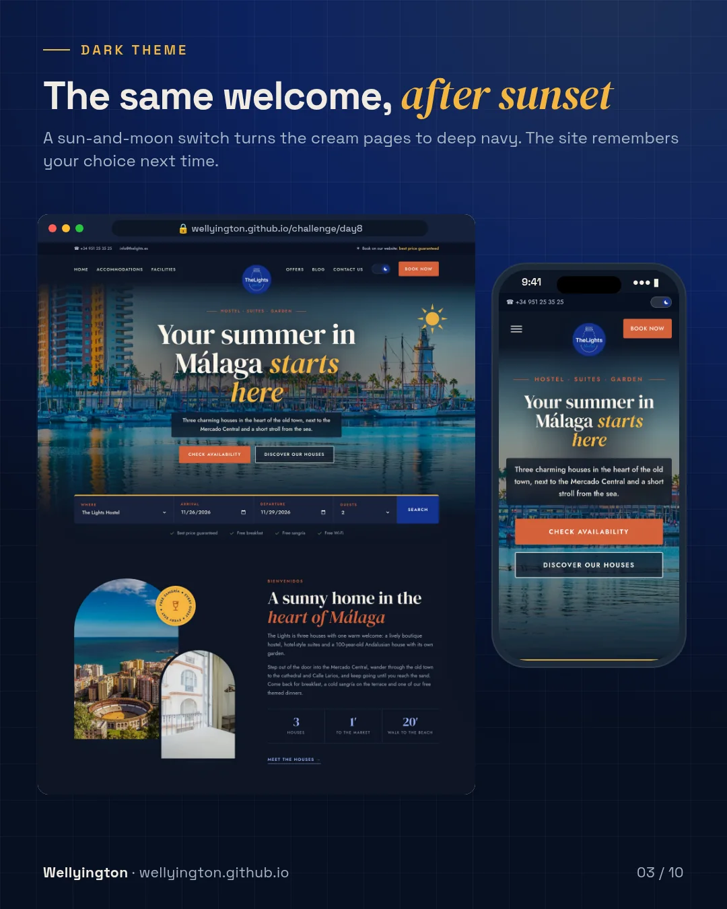
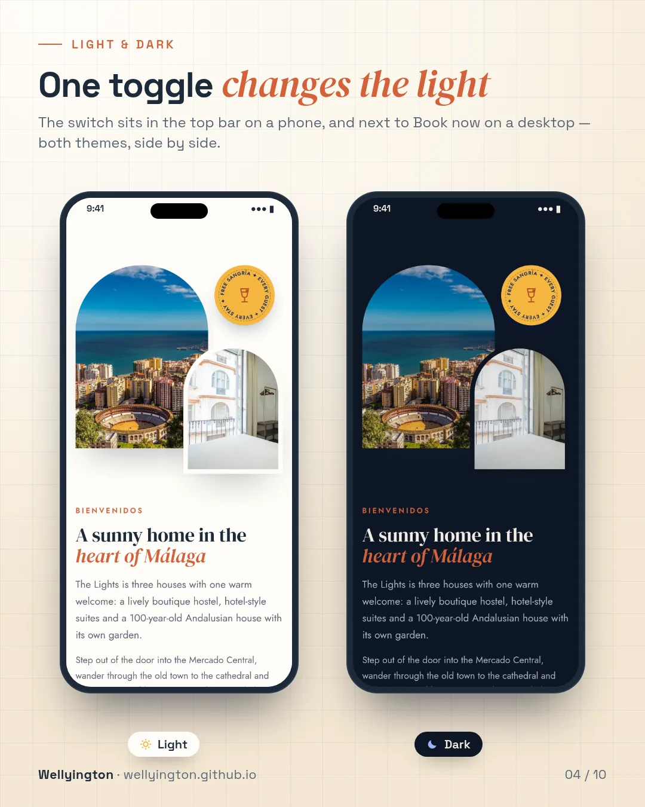

On 25 November I posted the eighth note of this run, the challenge Ramiah Trask set: a hundred days, a hundred businesses, a hundred websites. Day one was a family builder in the Marina Alta. [That page is here.](https://wellyington.github.io/journal/en/articles/built-before-the-yes/) Day two was a theatre in Málaga. [That one is here.](https://wellyington.github.io/journal/en/articles/room-for-a-whole-season/) Day three was a family restaurant in Estepona. [That one is here.](https://wellyington.github.io/journal/en/articles/a-seat-at-the-long-table/) Day four was a private property practice in Málaga. [That one is here.](https://wellyington.github.io/journal/en/articles/judgement-over-volume/) Day five was a tasting-menu restaurant in Motril. [That one is here.](https://wellyington.github.io/journal/en/articles/as-careful-as-the-kitchen/) Day six was a rotisserie chicken house in Estepona. [That one is here.](https://wellyington.github.io/journal/en/articles/from-the-counter-to-the-ticket/) Day seven was a family-run hotel in Kavos, Corfu. [That one is here.](https://wellyington.github.io/journal/en/articles/the-same-pool-after-dark/)

Today is back on the Costa del Sol, in Málaga itself. The Lights is three places to stay in the old town under one name. The Lights Hostel is a boutique hostel in a historic Andalusian building. The Lights Suites are hotel-style private rooms in the same building, some with balconies over the Mercado Central. The Lights Garden is a traditional Andalusian house more than a hundred years old, a few streets away, with its own garden. Their current website is at [thelights.es](https://www.thelights.es/).

The concept is here: [The Lights Málaga, day eight](https://wellyington.github.io/challenge/day8/).

## three houses, three guests

The difficulty here is not the design. It is the brief hiding inside the business.

A hostel, a set of suites and a quiet old house are three different products for three different people. The hostel is for solo travellers and groups of friends who want a terrace, a shared dinner and someone to go to the beach with. The suites are for couples and families who want a private room and a balcony, at a better price than a hotel. The garden house is for people who want peace after a long day in the sun, and often for longer stays.

Put all three on one website and the usual result is a page that talks to nobody. The hostel guest reads about quiet gardens. The family reads about bunk beds and parties. And nobody can find the booking button, because there are three of them in three different places.

So the challenge was to bring them together under one identity, the same name, the same team and the same free extras, while letting each house keep its own character. And to make three things impossible to miss on every screen: where it is, what kind of room you are getting, and how to book it directly.

*Day eight: three houses in the heart of Málaga's old town, a short stroll from the sea.*

## a summer front page

Málaga sells summer. Most people who book a bed in the old town are coming for the sun, the sea and long evenings out, so the first screen says exactly that.

The background is a photograph of the port at Muelle Uno: palm trees, the lighthouse, tall ships and the water. On top, in a large serif in deep sea blue, the line your summer in Málaga starts here, with the last two words in terracotta italics. A small drawn sun turns slowly in the corner. Above the headline, three words in small capitals: hostel, suites, garden. That is the whole business in three words, before anyone has scrolled.

Under the headline, one sentence: three charming houses in the heart of the old town, next to the Mercado Central and a short stroll from the sea. Then two buttons, check availability and discover our houses.

The logo is the one The Lights already uses, a round blue badge with a lamp, sitting in the middle of the header. I did not redraw it. The header around it has the six sections the business already uses, Home, Accommodations, Facilities, Offers, Blog and Contact Us, and a terracotta Book now button on the right.

*The light theme: cream pages, sea-blue type and terracotta buttons, with the port and the three houses up front.*

## the booking bar comes first

Directly under the hero, overlapping the bottom of the photograph, there is a booking bar. Where, arrival, departure, guests, search. It is the first thing you can actually use on the page.

Where is a choice of the three houses. The dates already hold sensible defaults, tomorrow and three nights later, so a visitor only has to change what is different. Guests go from one to six, and then seven or more, a group. On a phone the bar stacks into a neat form, one field above the other, with a large search button at the bottom.

Under the bar, four short promises, each with a tick: best price guaranteed, free breakfast, free sangría, free Wi-Fi. These are the four things a guest compares between booking sites, and here they are written before the guest has to go looking for them.

To be clear about what the concept does at that point: the search button sends the dates, the house and the number of guests to The Lights' current website. Each house has its own booking system, and in a real build the button would open the right one, with the dates already filled in. That connection is the first job on the list if the concept goes further.

*Pick a house, then a date. The four promises sit under the search bar on every visit.*

## three houses, one Málaga

The heart of the page is a section called three houses, one Málaga. Its first line says what the three have in common: the same friendly team and the same free extras. Choose the style that suits your summer.

Then three cards, side by side on a computer and one after another on a phone. Each has a photograph in an arched frame, a nod to the doorways and windows of old Andalusian houses, a colour of its own and a line saying who it is for.

The Lights Hostel is blue, for solo travellers and friends: a boutique hostel in an emblematic historic Andalusian building, social, central and easy to love, with a terrace made for meeting people. Terrace, themed dinners, luggage storage.

The Lights Suites are terracotta, for couples and families: hotel-level comfort at hostel prices, with superior rooms whose balconies look straight over the Mercado Central. Private rooms, market-view balconies, breakfast.

The Lights Garden is olive green, for slow, peaceful stays: a traditional Andalusian house more than a hundred years old in the historic centre, a green, quiet hideaway after a long day of sun. A hundred-year-old house, the garden, long stays.

Each card ends with its own button, book the hostel, book the suites, book the garden, which takes you back up to the booking bar with that house already chosen. And under each button, the address, because two of the houses share one and the garden has another. A guest who books the garden should never turn up at the hostel.

Those three colours, blue, terracotta and olive, run through the whole page. Once you have seen them in the cards, you know which house a button or a line of text is about without reading the label.

*A hostel for friends, suites for couples and families, and a hundred-year-old Andalusian house with a garden.*

## the little things are on us

Hostels in Málaga compete on price, and price on a booking site always looks similar. What differs is what is included. The Lights includes a lot, and their current site mentions it only in passing.

So there is a section for it, called the little things are on us, with a plain line underneath: no extra charges for the good stuff. Eight small cards follow. Free sangría, a cold glass of welcome every stay. Free breakfast, to start your beach day properly. Free themed dinners, shared tables and new friends. Fast Wi-Fi, free everywhere in the house. A sunny terrace, sun by day and sangría by night. Luggage storage, for the early flight or the late check-in. Maps and tips from the team. And groups welcome, with tailored offers for big groups. The first three wear a small terracotta free tag, because those are the ones nobody expects.

There is also a round yellow sticker on the welcome section that reads free sangría, every guest, every stay, turning slowly like a badge on a suitcase. It is the friendliest line on the page, so it gets to move.

## sun, sea and the city

Before the extras, there is a full-width photograph of the sign at La Malagueta, the city beach, and a short invitation: leave the car at home. From the door, Málaga's best summer days are all within walking distance.

Beside it, the walking times, written the way you would plan a day. Muelle Uno and the port, about twelve minutes. La Malagueta beach, about twenty. The beaches at Pedregalejo and El Palo, a short bus ride. Sunset at the Gibralfaro, about twenty-five minutes on foot. These are the questions people ask at reception on their first morning, answered before they arrive.

*Walking times to the port, the beach and the Gibralfaro, and the free sangría, breakfast and dinners that come with every stay.*

## the best address in town

The single strongest argument for The Lights is where it is, so the location is not tucked away in the footer. It has a section of its own, called the best address in town.

On one side, a photograph of the cathedral, which the people of Málaga call La Manquita, the one-armed lady, because its second tower was never finished. On the other, a numbered list of walking times from the door on Calle Torregorda, each in a round badge. One minute to the Mercado Central de Atarazanas, for fresh fish, fruit and tapas bars. Five minutes to Calle Larios, the main shopping street. Eight minutes to the cathedral and the old town squares. Ten minutes to the Picasso Museum and the Alcazaba. Twenty minutes to La Malagueta beach. A small note at the bottom says these are approximate, which they are.

The numbers do the selling. One minute to the market says more about the location than any adjective could.

*A walking-time guide to the market, Calle Larios and the beach, plus both addresses, phones and emails.*

## book direct and save

Every booking a hostel takes through a large platform costs it a commission. The Lights already promises its best price on its own website, and says so in small letters in its header. The concept says it in large ones.

There is a section called always the best price here, with one honest line: skip the booking platforms; when you book on our own website you always get our lowest rate, plus a few extras only we can offer. Then four reasons. Best price guaranteed. A followers' discount, with an exclusive code for people who follow them on social media. Group offers, a tailored price for a crowd. And special rates for long stays in Málaga. One button, check availability, takes you back to the booking bar.

The same promise runs along the top bar of every screen, book on our website, best price guaranteed, in gold. And once you have scrolled past the booking bar on a phone, a slim bar appears at the bottom of the screen with the name, the line best price, booked direct, and a book now button. It stays there until you leave.

## we'll leave a light on for you

The contact section takes its title from the name of the business: we'll leave a light on for you. It is the kind of line a small hotel would write on a handwritten note.

Underneath are two cards, one per address, because The Lights is in two places. Hostel and suites at Calle Torregorda 3, with its phone number, its email, a button for directions and one for WhatsApp. The Garden at Calle Molinillo del Aceite 5, with its own phone, its own email and its own directions. Each card is edged with its house's colour, blue for the hostel and suites, green for the garden, so the two never get mixed up.

## a menu that slides down

On a phone, the header keeps three things: the menu button, the logo in the middle and book now. Above it, a thin bar with the phone number and the light and dark switch.

Tap the menu and it slides down to fill the screen, and the three lines of the button turn into a cross. The six sections appear in large serif type, with a full-width book now button under them and the address and phone number at the bottom, where a thumb can reach them. It works the same in both themes.

*Big type, a booking button, the address and the phone number.*

## the same welcome after sunset

Like the hotel in Corfu yesterday, The Lights has a light theme and a dark one. A small switch with a sun and a moon sits next to book now on a computer and in the top bar on a phone.

The light theme is a Málaga morning: cream and sand pages, deep sea-blue type, terracotta buttons and touches of sun yellow. The dark theme is the same city after sunset: deep navy pages, cream type, the same terracotta and the yellow turning gold. Both were designed section by section, not inverted. The site remembers the choice for the next visit, and if a visitor has never touched the switch, it follows whatever their phone or computer is already set to.

*A sun-and-moon switch turns the cream pages to deep navy, and the site remembers the choice.*

*One toggle changes the light: both themes, side by side.*

## the details

The type is DM Serif Display for the headlines, set large, with italics in terracotta for the warmer words: starts here, one Málaga, light on. Jost, a clean geometric sans, for everything you read, in spaced capitals for the small labels and buttons.

The colours are the city's: the deep blue of the sea and of The Lights' own logo, terracotta from the rooftops, sand and cream from the old town walls, sun yellow, and olive green for the garden. A thin dashed line in blue and yellow, like the edge of a beach towel, separates some of the sections.

Things fade in gently as you scroll, the hero photo drifts very slowly, and the sun and the sangría sticker turn. All of it stops for visitors who have asked their phone or computer to reduce motion, and the page works exactly the same without it. The fonts are served from my own site rather than from Google, so loading the page does not hand a visitor's address to anyone else.

## what the concept is, and what comes next

The facts on the page, the three houses, their addresses, phone numbers and emails, the free extras, the offers and the best-price promise, come from The Lights' current website. Their logo and the sections of their menu are kept as they are. The walking times are approximate, and the page says so.

What is new is the structure: one identity that holds three different houses, a booking bar that comes before everything else, a colour for each house, the extras turned into a reason to book direct, and a location section that lets the numbers speak.

I have no figures on bookings, and I will not make any up. Turning the concept into a working site would take the practical steps: connecting each house to its own booking system so the dates carry across, a Spanish version alongside the English, the blog and the offers pages, and the team's own photographs everywhere they have them.

## if you run more than one place

You may not run a hostel. Plenty of businesses on this coast have more than one place under one name, though: a restaurant group with a beach bar and a town restaurant, a holiday rental company with apartments in three villages, a gym with two locations, a language school with a summer campus.

What helps is the same as here. Say what they have in common first, then let each place keep its own character. Give each one a colour and stick to it. Put every address next to the thing it belongs to, never only in the footer. Make the location a reason to choose you, with real distances rather than adjectives. And put the booking button where people look first, not where there was space left.

I am a web designer based in Estepona, on the Costa del Sol, and I design and build websites for businesses in Spain and beyond. If that sounds like your business, write to me from [the main site](https://wellyington.github.io/). Tell me what you do and where, and I will reply in plain language. The concept is [here](https://wellyington.github.io/challenge/day8/), and The Lights' current site is [here](https://www.thelights.es/), so you can compare the two. Eight down, ninety-two to go.
