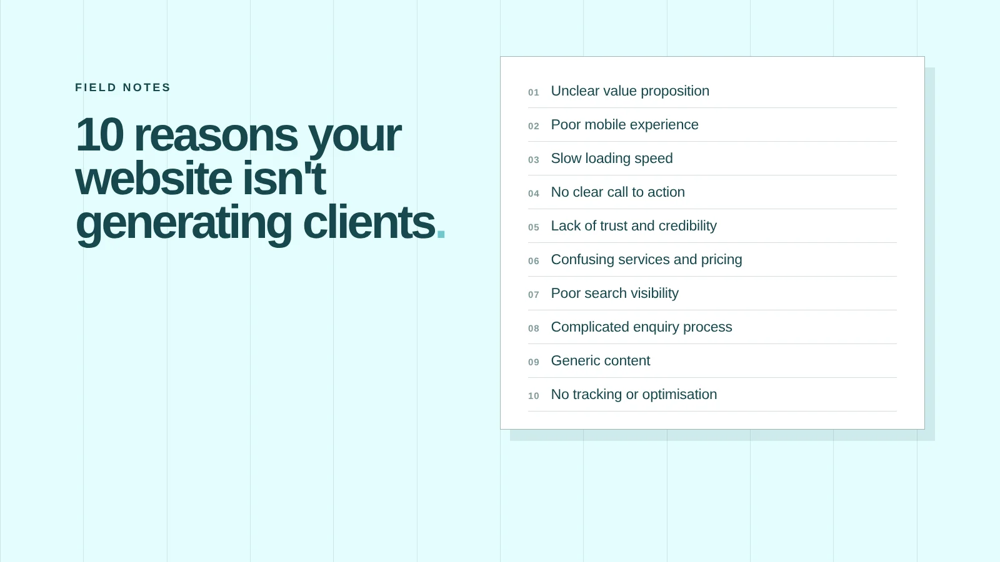
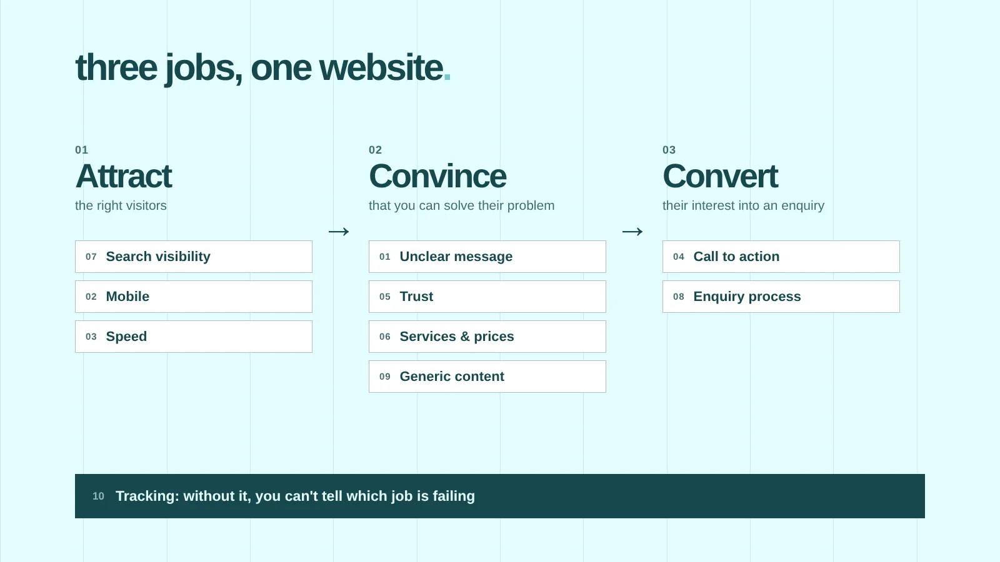
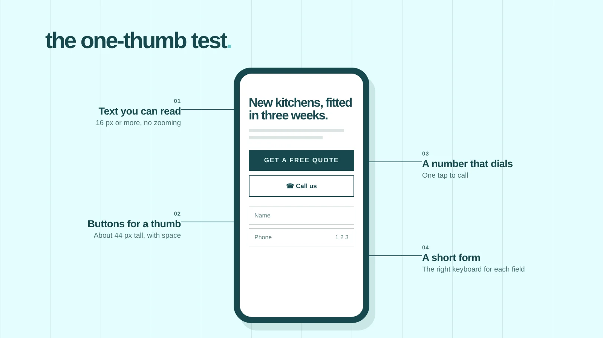
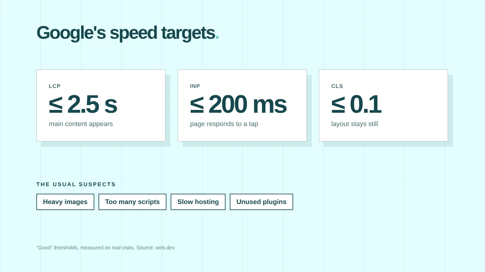
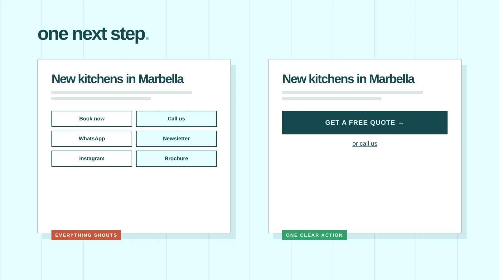
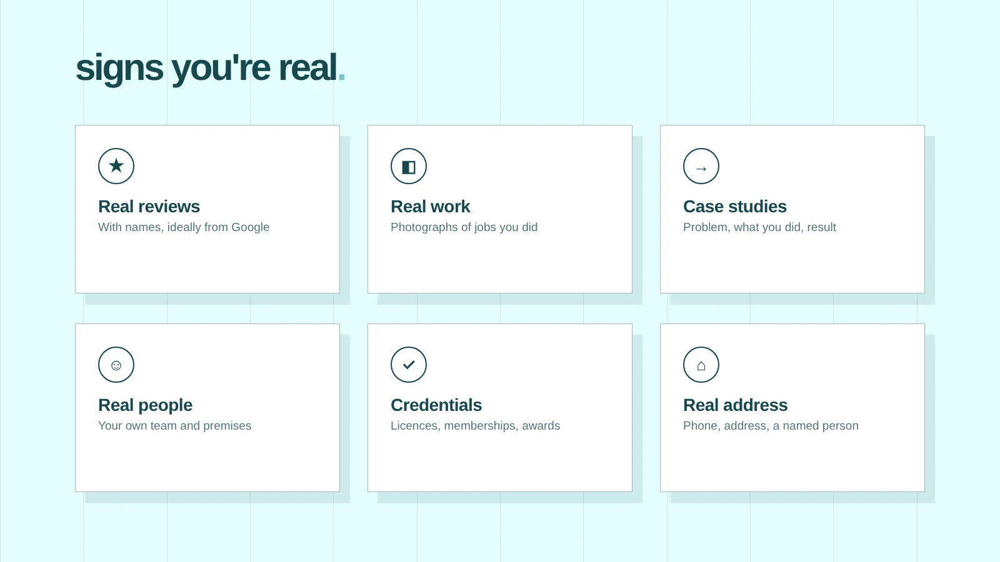
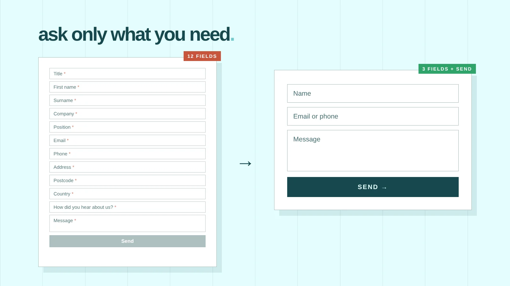
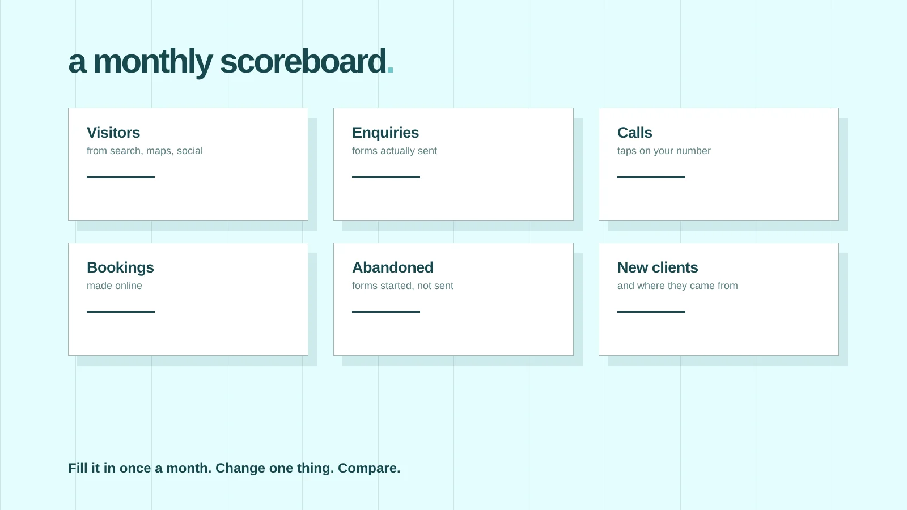

"The website looks great. Everyone says so. It just doesn't bring in any work."

I hear some version of that every few weeks, from restaurants, builders, clinics, agencies and shops along the coast. The site cost good money, the photographs are lovely, friends have complimented it. And the phone doesn't ring because of it.

Almost always, nothing is broken in a way you could point to. The site loads, the pages are there, the contact form sends. The problem is that a website has a job, and a lot of websites were built to look finished rather than to do that job.

This note goes through the ten reasons I see most often. None of them needs a new website to fix. Most need an afternoon, a clear head and the willingness to look at your own site as a stranger would.

*The ten reasons, roughly in the order a visitor meets them.*

## first, what a website is for

Before the list, it helps to be clear about what success looks like. A business website has three jobs, one after the other:

1. Attract the right visitors.
2. Convince them that the business can solve their problem.
3. Turn their interest into an enquiry, a booking or a purchase.

A failure at any one of those stages undermines the whole thing. A beautiful site that nobody finds fails at the first job. A site that gets plenty of visitors who leave without understanding what you do fails at the second. A site that convinces people and then makes them fill in a form with fourteen fields fails at the third.

The ten reasons below fall neatly into those three stages, plus one that runs underneath all of them: not measuring anything.

*Every reason breaks one of three jobs. Tracking runs underneath them all.*

## 1. visitors can't tell what you do

A new visitor gives your home page a few seconds. In that time they need answers to three questions: what do you do, who is it for, and why should I choose you over the next result?

Most home pages answer a different question: who are we? Welcome to our website. We are a leading company with over twenty years of passion and excellence. That sentence could belong to a dentist, a law firm or a scaffolding company. It talks about the business, not about the customer's problem.

Compare two headlines for the same kitchen fitter. "Welcome to Smith Interiors, your trusted partner since 2004." Or: "New kitchens in Marbella and Estepona, fitted in three weeks. Free quote in 48 hours." The second tells you what, where, how long and what to do next, in the space of a sentence.

**How to check:** show your home page to someone who doesn't know your business for five seconds, then close it. Ask them what you do, for whom, and what makes you different. If they can't say, neither can your customers.

**What to do:** rewrite the first line on the page so it names the service, the customer or place, and one concrete reason to choose you. Move the history and the mission statement further down, where people who want them will find them.

*The same business, two first lines. Only one of them answers the visitor's questions.*

## 2. it doesn't work on a phone

Most people who find a local business will see its website on a phone first, often with one hand, often outside. A site that was designed on a large screen and squeezed down afterwards usually shows it: text you have to pinch to read, buttons so close together you hit the wrong one, menus that cover the page, forms where the keyboard hides the field you are typing in.

None of this shows up when the owner checks the site on a laptop. It shows up in the customer's patience.

**How to check:** use your own site on your own phone for five minutes, as a customer would. Find the price of something. Call you. Send the form. Do it with one thumb.

**What to do:** body text large enough to read without zooming, around 16 pixels at the least. Buttons and links big enough for a thumb, about 44 pixels tall, with space between them. The phone number as a link that dials. Forms with the right keyboard for each field, numbers for the phone, email for the email. And design the phone version first, then the large screen, not the other way around.

*Four things to check on your own phone, with one thumb.*

## 3. it takes too long to load

People are impatient, and they have every reason to be. If a page is still blank after a few seconds, a lot of visitors go back and press the next result before they have seen anything you offer.

Google measures this with three numbers it calls Core Web Vitals: Largest Contentful Paint (LCP), Interaction to Next Paint (INP) and Cumulative Layout Shift (CLS). In plain words, how long until the main content appears, how quickly the page responds when you tap something, and how much the layout jumps around while it loads. Google's "good" targets are an LCP of 2.5 seconds or less, an INP of 200 milliseconds or less and a CLS of 0.1 or less, measured across real visits to the page.

The usual suspects are the same on almost every slow site I look at. Photographs uploaded straight from a camera, several megabytes each, when a few hundred kilobytes would look identical on screen. Too many scripts: chat widgets, sliders, trackers and pop-ups, each loading its own code. Cheap shared hosting a long way from the customer. And, on sites built with page builders, a long list of plugins installed once for one small feature and never removed.

**How to check:** run your home page through Google's free PageSpeed Insights and look at the mobile result, not the desktop one.

**What to do:** resize and compress every image, and use a modern format such as WebP. Remove every plugin and script you can't name a reason for. Then look at the hosting.

*Google's three speed targets, and the four things that usually miss them.*

## 4. there's no obvious next step

Someone has read your page and likes what they see. Now what? Should they call, book, ask for a quote, send a message, come in?

Many sites never say. There is a contact page somewhere in the menu, and that's it. Others say too much: book now, call us, WhatsApp us, subscribe to the newsletter, follow us on Instagram, download the brochure, all at once and all the same size. When everything is a button, nothing is.

**How to check:** for each important page, ask what single thing you want a visitor to do after reading it. If you can't answer in one sentence, the page can't either.

**What to do:** choose one main action per page and make it the most visible thing on the screen, repeated at the end of the page and, on a phone, within reach of a thumb. Use words that say what happens: "Get a free quote", "Book a table for tonight", "Call the clinic". Keep one quieter alternative for people who prefer it, such as the phone number under the booking button. Everything else can wait in the footer.

*Six buttons of equal weight, or one clear next step and a quiet alternative.*

## 5. people don't trust it yet

Nobody likes contacting a business they know nothing about. Before they call, people look for signs that you are real, that you are good at what you do, and that people like them have used you and been happy.

A surprising number of business websites offer none of that. No reviews, no names, no examples of work, no photographs of the actual team or premises, only stock images of people shaking hands in an office that could be anywhere.

**How to check:** imagine you have never heard of your business. What on the page would make you believe it is good? Count the things that are specific to you, not to your industry.

**What to do:** show real reviews, with names, ideally pulled from Google so they can be checked. Show your work: photographs of real jobs, short case studies with the problem, what you did and the result. Show your own face and premises. Add the memberships, licences and certifications your customers care about. And put an address, a phone number and the name of a real person where they can be seen.

*Six signs that a business is real, and good at what it does.*

## 6. it's hard to tell what you offer, or what it costs

People do not want to guess. If they can't tell from your site whether you offer exactly the thing they need, or whether it is roughly within their budget, many will choose the business down the road that made it clear.

The usual culprits are vague service names ("solutions", "packages", "bespoke services"), descriptions that list features rather than results, and prices that appear only after a phone call. I understand why many businesses don't publish prices. Every job is different. But no information at all makes people assume the worst.

**How to check:** could a visitor tell, from your site alone, which of your services fits them and roughly what it would cost?

**What to do:** give each service its own clear name and a short page that says who it's for, what's included and what happens next. Show prices where you can, or at least a starting price or a typical range, for example "most bathroom refits are between €6,000 and €9,000". Say what affects the price. People don't need a quote from the website. They need enough to decide that calling you is worth it.

## 7. people can't find you

Even an excellent website can't bring in clients if the people looking for you never see it. For most local businesses, that means two places: Google's search results and Google Maps.

The common problems are simple. The site never says, in words, what you do and where: "kitchen fitter in Estepona" appears nowhere on the page, so Google has nothing to match. Pages aren't indexed because of a setting left over from the build. Every page has the same title. And the Google Business Profile, often the first thing a local customer sees, has the wrong opening hours, no photographs, no services and no replies to reviews.

**How to check:** search for your main service and your town on your phone, signed out, as a customer would. Where do you appear, on the map and in the results? Then look at your Business Profile as a stranger.

**What to do:** say in plain words, on the page and in the page title, what you do and where. Give each service and each area you cover its own page. Connect the site to Google Search Console to see whether it is indexed and what people search to find it. Complete every field of your Business Profile, keep the hours right, add real photographs, and reply to reviews.

## 8. getting in touch takes too much effort

Every extra step between "I'm interested" and "I've sent it" is another chance to give up. I still see contact forms with twelve fields, half of them required: title, first name, surname, company, position, address, postcode, country, how did you hear about us. Booking systems that ask people to create an account before they can see a free slot. Forms that send nothing at all because a setting broke months ago and nobody noticed.

**How to check:** send your own form today, from your phone, and time it. Then check that the message arrived, and where.

**What to do:** ask only for what you need to reply: a name, a way to contact them and the message. Everything else can come in the conversation. Never ask people to register before they enquire. Offer a quick alternative, a phone number or WhatsApp, for those who prefer it. Show a clear confirmation once the form is sent, and say when they will hear back. And test the form every month.

*Twelve fields, or the four you actually need to reply.*

## 9. it sounds like everyone else

"We pride ourselves on quality service." "Your satisfaction is our priority." "Passionate professionals dedicated to excellence." These sentences are on thousands of websites, which is exactly why they say nothing. A customer comparing three businesses can't tell them apart, so they choose on price, or not at all.

The same goes for pictures. A stock photograph of a smiling headset model tells the visitor you didn't have a photograph of your own.

**How to check:** cover your logo and read your home page. Could it belong to a competitor? If you swapped the names, would anybody notice?

**What to do:** write down the questions your customers actually ask, on the phone and in person, and answer them on the site in your own words. How long does it take? What happens if it rains? Do you work weekends? Can I see one you've done? Use specifics only you can say: the streets you work in, the materials you use, the number of jobs you did last year. Replace stock photographs with real ones, even if they're from a phone.

## 10. nobody is measuring anything

The last reason sits underneath all the others. Many businesses launch a website and simply assume it is working. Nobody counts the enquiries it sends, the calls it produces or the bookings it makes. Nobody knows how many people start the form and give up halfway, or which page they leave from.

Without data, all of the problems above stay invisible. You can't tell whether the site has too few visitors or too few enquiries, so you can't tell whether to spend money on advertising or on fixing the page.

**How to check:** can you say how many enquiries your website brought in last month, and how many of those became clients? If not, that is the first thing to fix.

**What to do:** set up simple analytics, with visitors' consent where the law requires it, and count the things that matter to the business, not just page views: forms sent, calls tapped, bookings made, WhatsApp clicks. Ask every new client how they found you, and write it down. Look at the numbers once a month, change one thing, and look again.

*A monthly scoreboard: six numbers that tell you where the problem is.*

## the bigger picture: traffic isn't the same as customers

Once you are measuring, the numbers start to point at the problem. A rough guide I use with clients:

| What you see | Where the problem probably is |
|---|---|
| Very few visitors | Marketing and SEO |
| Many visitors, few enquiries | The message, trust or the offer |
| Many enquiries, few clients | The sales process, pricing or the quality of the leads |
| Many forms started and abandoned | The user experience, or something technical |

This is why "we need more traffic" is often the wrong answer. If a hundred people a week visit and nobody gets in touch, sending two hundred will mostly double the number of people who leave. Fix the leak before you turn up the tap.

*What the numbers say, and where to look first.*

## where to start

If all ten sound familiar, don't try to fix them at once. In my experience the order that pays off fastest is:

1. Make sure the form and the phone link work, today.
2. Rewrite the first line of the home page.
3. Choose one main action per page and make it obvious.
4. Check the site on your phone, with one thumb, and fix what annoys you.
5. Set up tracking, so the next decision is based on numbers.

Everything else, the speed, the reviews, the service pages, the search visibility, gets easier once those five are in place.

## my biggest recommendation

Stop judging your website only by how professional it looks. Judge it by how well it brings in real opportunities for the business.

A beautiful website is an asset. A website that brings in qualified enquiries month after month is a business tool. The two can be the same site, but only if it was built with the second job in mind.

I'm a web designer based in Estepona, on the Costa del Sol, and this is most of what I do: looking at websites that should be working and working out why they aren't. If your site looks good and the phone still doesn't ring, write to me from [the main site](https://wellyington.github.io/). Tell me what you do and where, and I'll tell you in plain language which of these ten I think is costing you the most. You can also see how I approach it in practice in the [100 Days series](https://wellyington.github.io/journal/en/archive/), where I redesign a real business's website every day.
