El 27 de noviembre publiqué la undécima nota de esta serie, el reto que planteó Ramiah Trask: cien días, cien negocios, cien webs. El día uno fue un constructor familiar de la Marina Alta. [Esa página está aquí.](https://wellyington.github.io/journal/es/articles/la-web-antes-del-si/) El día dos, un teatro de Málaga. [Esa está aquí.](https://wellyington.github.io/journal/es/articles/sitio-para-toda-la-temporada/) El día tres, un restaurante familiar de Estepona. [Esa está aquí.](https://wellyington.github.io/journal/es/articles/un-sitio-en-la-mesa-larga/) El día cuatro, una consultora inmobiliaria privada de Málaga. [Esa está aquí.](https://wellyington.github.io/journal/es/articles/criterio-antes-que-volumen/) El día cinco, un restaurante de menús degustación en Motril. [Esa está aquí.](https://wellyington.github.io/journal/es/articles/tan-cuidada-como-la-cocina/) El día seis, un asador de pollos de Estepona. [Esa está aquí.](https://wellyington.github.io/journal/es/articles/del-mostrador-a-la-comanda/) El día siete, un hotel familiar en Kavos, Corfú. [Esa está aquí.](https://wellyington.github.io/journal/es/articles/la-misma-piscina-de-noche/) El día ocho, tres casas en el centro histórico de Málaga. [Esa está aquí.](https://wellyington.github.io/journal/es/articles/tres-casas-una-sola-puerta/) El día nueve, una agencia de modelos de Marbella y Londres. [Esa está aquí.](https://wellyington.github.io/journal/es/articles/que-hablen-las-fotografias/) El día diez, un estudio de Pilates de Marbella. [Esa está aquí.](https://wellyington.github.io/journal/es/articles/calidad-antes-que-modas/)

Hoy toca una asistente virtual. Elevate Admin Studio es el negocio de Charlotte, con base en Leeds y clientes en todo el Reino Unido. Aporta más de 22 años en puestos sénior de apoyo administrativo y de proyectos, cinco de ellos en el NHS, el sistema de salud público británico, a nivel nacional, y ahora pone esa experiencia al servicio de coaches, consultores, creativos, pequeñas empresas y equipos en crecimiento que necesitan ayuda entre bastidores pero no están listos para contratar a alguien en plantilla. El trabajo abarca administración, correo y agenda, redes sociales, administración financiera, eventos, proyectos, y documentos y datos. Su web actual está en [elevateadminstudio.co.uk](https://elevateadminstudio.co.uk/).

El concepto está aquí: [Elevate Admin Studio, día once](https://wellyington.github.io/challenge/day11/).

## la web es el primer trabajo

Una asistente virtual vende algo difícil de enseñar: orden. Nadie ve desde fuera una bandeja de entrada bien llevada, una agenda que nunca se solapa o el correo de seguimiento que salió a tiempo. Lo que un posible cliente sí ve, antes de hablar con ella, es la web. Y la va a leer, lo sepa o no, como una muestra del trabajo.

Ese es el encargo. Si la web está desordenada, el visitante se pregunta si la administración también lo estará. Si los precios se esconden tras un «contacta para pedir presupuesto», se pregunta qué más será impreciso. Si el siguiente paso no está claro, se pregunta cómo de claros serán los informes semanales. Una web para una asistente tiene que ser lo contrario de todo eso: ordenada, honesta con el dinero y clara sobre lo que pasa después.

Así que la dirección fue una web de una sola página, tranquila y ordenada. Una paleta azul marino, crema y dorado, unas mayúsculas clásicas para los titulares, una palo seco ligera para la lectura, líneas finas que dividen la página en secciones claras, y todo lo que un cliente necesita en un solo recorrido, en el orden en que lo necesita.

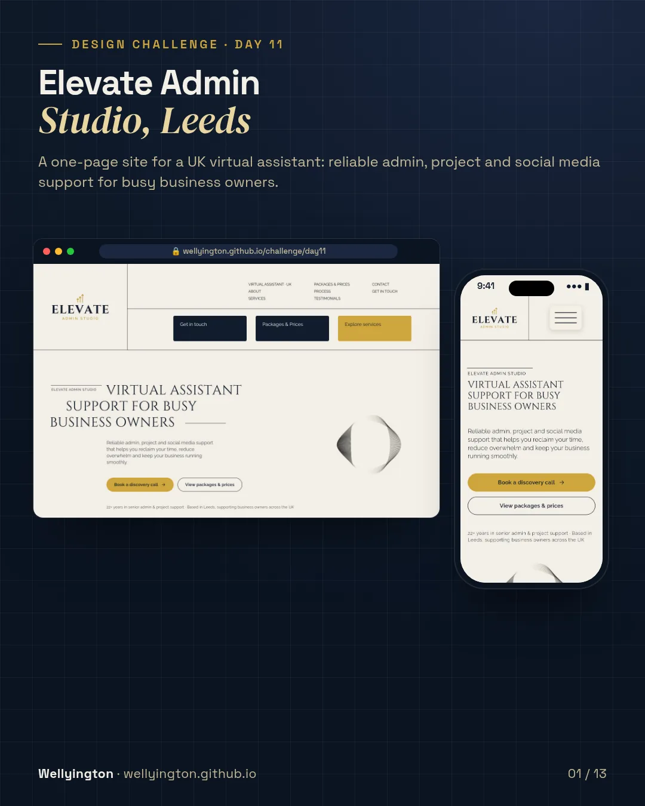
*Día once: una web de una página para una asistente virtual del Reino Unido con apoyo administrativo, de proyectos y de redes sociales.*

## apoyo para empresarios con poco tiempo

La página se abre con una breve pantalla de carga. Un contador llega a cien mientras pasan cuatro palabras: organising, scheduling, delegating, ready, organizar, programar, delegar, listo. Después, un botón Enter site. Es un pequeño gesto teatral, y dice lo que hace el servicio antes de leer una sola frase.

Detrás está la portada. A la izquierda, el titular en mayúsculas altas y espaciadas: virtual assistant support for busy business owners, apoyo de asistente virtual para empresarios ocupados. Debajo, una frase: apoyo administrativo, de proyectos y de redes sociales fiable, que te ayuda a recuperar tu tiempo, reducir el agobio y mantener tu negocio funcionando sin sobresaltos. Luego dos botones, uno dorado para reservar una llamada de presentación y otro con contorno para ver paquetes y precios. A la derecha, un vídeo corto en bucle de una forma dibujada con líneas finas que gira despacio.

Y debajo, una línea discreta que trabaja mucho: más de 22 años en apoyo administrativo y de proyectos sénior, con base en Leeds y clientes en todo el Reino Unido. Experiencia, lugar y alcance, antes de que nadie haya bajado.

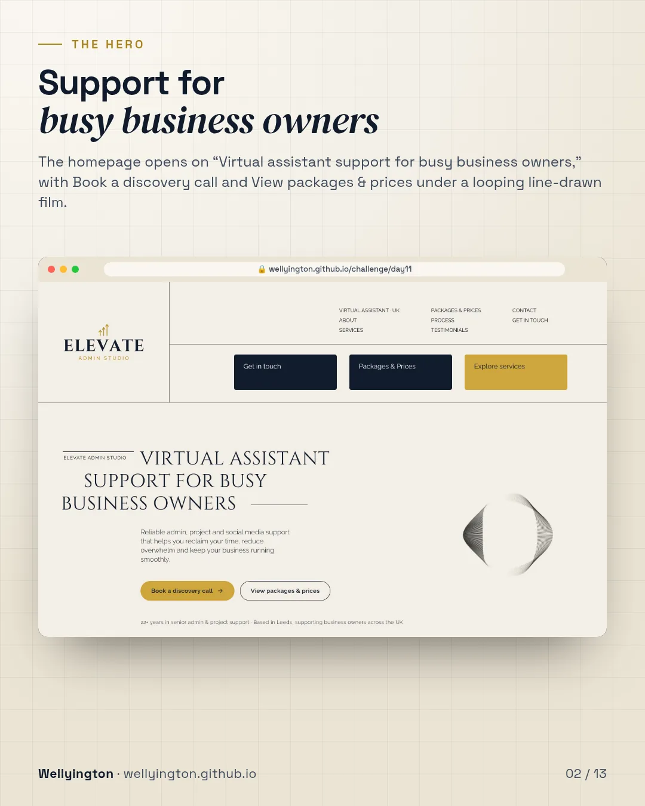
*La portada: un titular, dos botones, un vídeo de líneas y la frase sobre los 22 años de experiencia.*

## una cabecera que funciona como un archivador

La cabecera está organizada como un índice. El logotipo ocupa su propio panel a la izquierda. A la derecha, las secciones se listan en tres columnas pequeñas, como se etiquetarían los cajones: asistente virtual, sobre mí, servicios; paquetes y precios, proceso, testimonios; contacto y escríbeme. Debajo, tres bloques sirven de atajos: Get in touch y Packages & Prices en azul marino, Explore services en dorado.

En el móvil, y en cualquier pantalla de menos de 1.025 píxeles, esa cabecera se reduce al logotipo y un botón de tres rayas. Al tocarlo, un panel azul marino entra deslizándose en 0,8 segundos y llena la pantalla, con las siete secciones en una sola columna, cada una en su propia línea: Home, About, Services, Packages & Prices, Process, Testimonials, Contact. Las líneas son lo bastante grandes para tocarlas sin apuntar, y la cruz para cerrar queda donde estaba el botón.

En una web de una sola página, el menú es en realidad un índice. Debe leerse como tal.

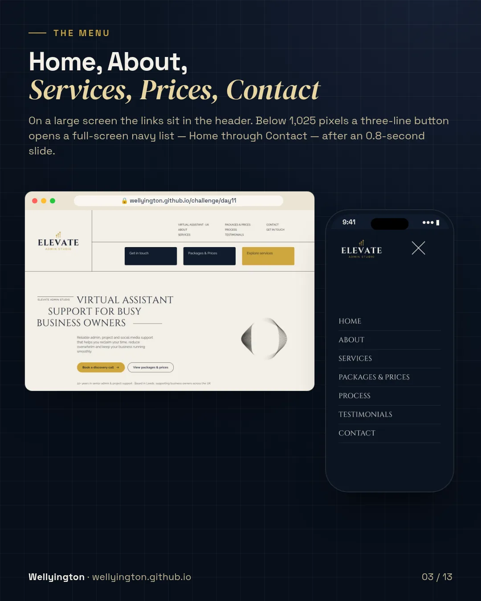
*En pantalla grande, los enlaces en la cabecera; en el móvil, una lista azul marino a pantalla completa.*

## hola, soy Charlotte

En un negocio de una sola persona, la persona es el producto. Por eso la primera sección después de la portada la presenta a ella, con su propia voz: hola, soy Charlotte, fundadora de Elevate. Al lado, un retrato.

El texto es breve y concreto. Ofrece un apoyo virtual tranquilo, organizado y fiable a empresarios ocupados que necesitan ayuda entre bastidores. Trabaja con personas que llevan demasiadas cosas a la vez y necesitan un apoyo fiable para mantenerlo todo en orden. Ya sea administración, redes sociales, coordinación de proyectos u organización del día a día, puede aportar más calma, claridad y estructura. Algunas de esas frases van en un peso más grueso, para que una lectura rápida capte la promesa sin leer cada palabra.

Debajo viene una lista de con quién trabaja: coaches y consultores, creativos y proveedores de servicios, pequeños empresarios, equipos en crecimiento y empresarios listos para delegar. Y una invitación: ¿preparado para delegar tu administración con confianza? Esa lista importa más de lo que parece. Quien se ve reflejado en ella deja de preguntarse si esto es para él.

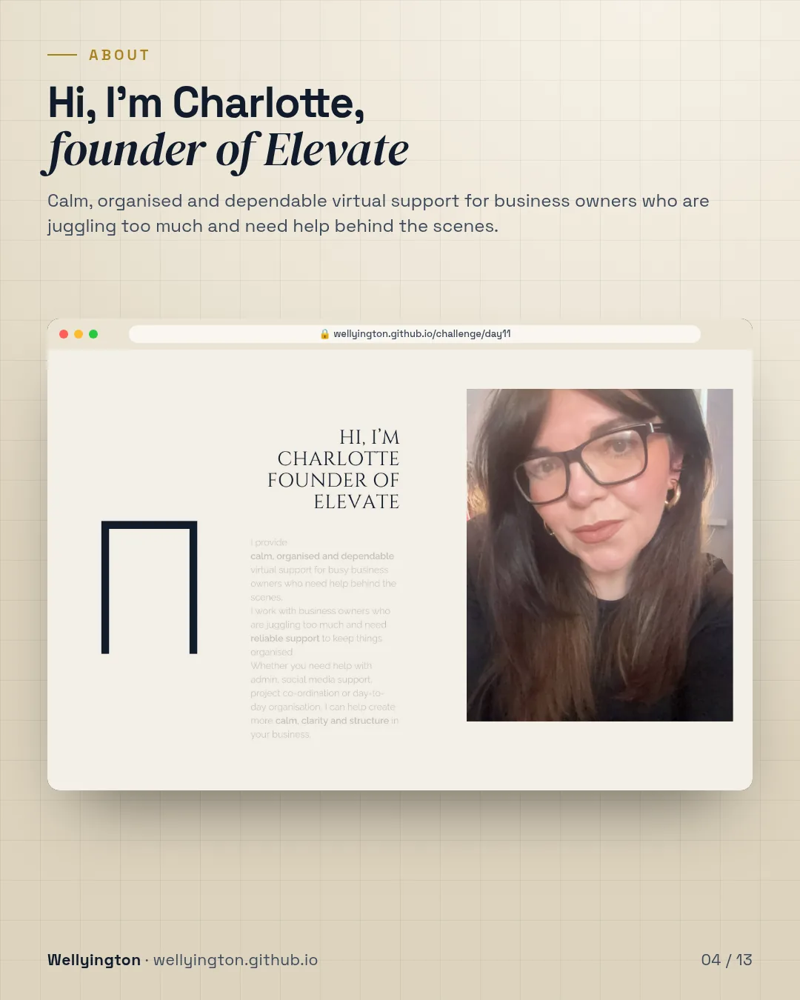
*Hola, soy Charlotte: una presentación breve con sus palabras, junto a un retrato.*

## dos décadas, en cifras y en valores

La siguiente sección, meet Charlotte, conoce a Charlotte, recoge la experiencia. Más de dos décadas de apoyo tranquilo y capaz. Dos párrafos explican de dónde viene: puestos sénior administrativos y de proyectos, cinco años en el NHS a nivel nacional, apoyando a equipos, directivos y programas con la gestión de prioridades, la coordinación de reuniones, la preparación de documentos y el seguimiento de acciones. Y luego el presente: llevar esa experiencia a empresarios que necesitan un apoyo de confianza sin el compromiso de contratar en plantilla.

Bajo el texto hay tres cifras, que suben al aparecer en pantalla: más de 22 años en apoyo administrativo y de proyectos sénior, 5 años en el NHS a nivel nacional, y Leeds, donde tiene su base, con clientes en todo el Reino Unido. A la derecha, una tarjeta azul marino describe cómo es trabajar con ella y qué puede esperar un cliente: comunicación clara, cumplimiento fiable, sistemas organizados, un enfoque tranquilo y profesional, un apoyo que se siente como parte del propio negocio, y cuidado, discreción y atención al detalle.

Más abajo, cinco tarjetas de valores, cada una con un pequeño icono dorado y unas líneas: fiabilidad, cuidado y profesionalidad, organización y claridad, confianza y confidencialidad, y colaboración. Las secciones de valores suelen ser relleno. Aquí se ganan su sitio, porque para una asistente que va a ver tu correo, tus facturas y los datos de tus clientes, la confianza y la confidencialidad no son palabras abstractas. Son la pregunta que todo cliente se hace en silencio.

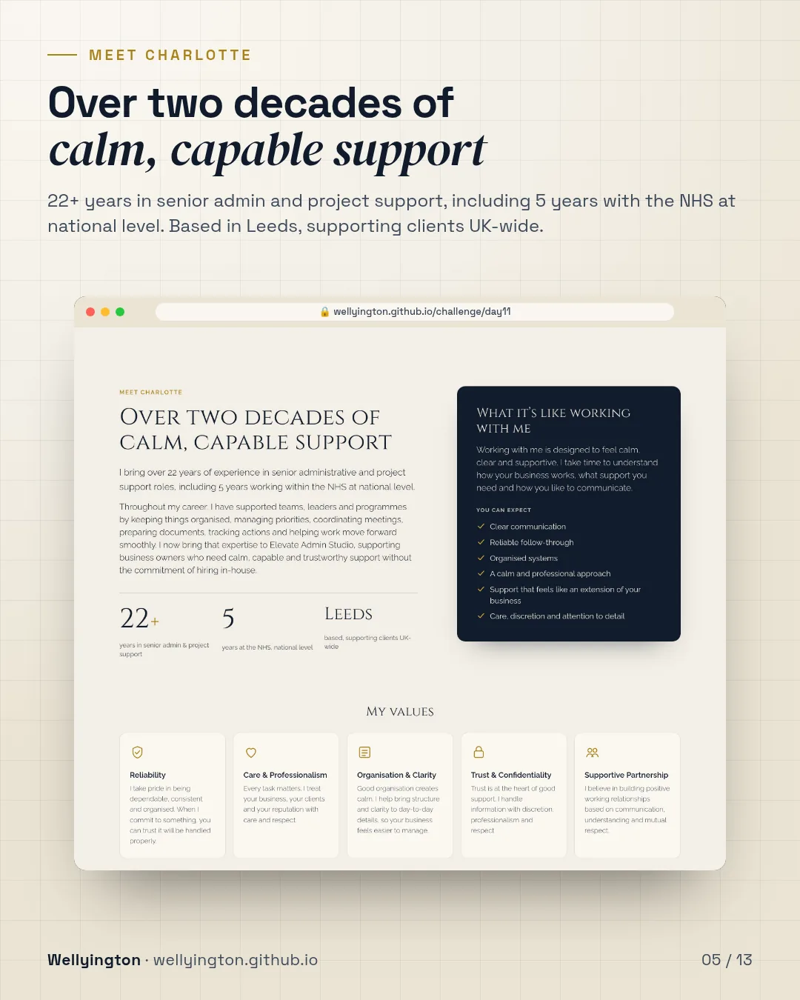
*22 años, 5 en el NHS, base en Leeds y cinco valores que responden a la pregunta de la confianza.*

## seis servicios, uno abierto cada vez

La sección de servicios se vuelve oscura. Se abre con una fotografía de una agenda mensual y unos bolígrafos, y una breve introducción: un apoyo flexible pensado para que te sientas más organizado, menos agobiado y con más control de tu carga de trabajo, sea de forma continua o para tareas concretas.

Después, los seis servicios, en un acordeón con uno solo abierto cada vez: Social Media Admin Support, Finance Admin Support, Event Admin Support, Project Support, Traditional PA/EA Support y Documents & Data Support. Cada uno, al abrirse, sigue el mismo patrón: una descripción de una línea, las tareas que puede incluir como pequeñas etiquetas con contorno, para quién es ideal y un enlace para preguntar por ese servicio en concreto.

El de redes sociales empieza abierto. Sus etiquetas cubren la vigilancia de comentarios, la gestión de mensajes, las respuestas siguiendo tus pautas, el apoyo en la creación de contenido, plantillas y gráficos de Canva, el formato de los textos, la programación y los informes semanales. El de administración financiera cubre facturas, reclamar pagos, seguir presupuestos, controlar gastos y actualizar hojas de seguimiento, y dice claramente que apoya tu administración financiera pero no sustituye a un contable ni a un gestor. Esa línea es el tipo de honestidad que genera confianza, y le ahorra a todo el mundo una conversación incómoda más adelante.

El acordeón evita que una lista larga de servicios se convierta en un muro. El visitante abre el que le interesa, lo lee y lo cierra. Y cada enlace de consulta abre un correo con el servicio ya escrito en el asunto, así que Charlotte sabe de qué va el mensaje antes de abrirlo.

Al final de la sección, una línea para los indecisos: ¿no sabes qué apoyo necesitas? No pasa nada. Podemos repasar tu carga de trabajo actual. Y un botón para reservar una llamada de presentación.

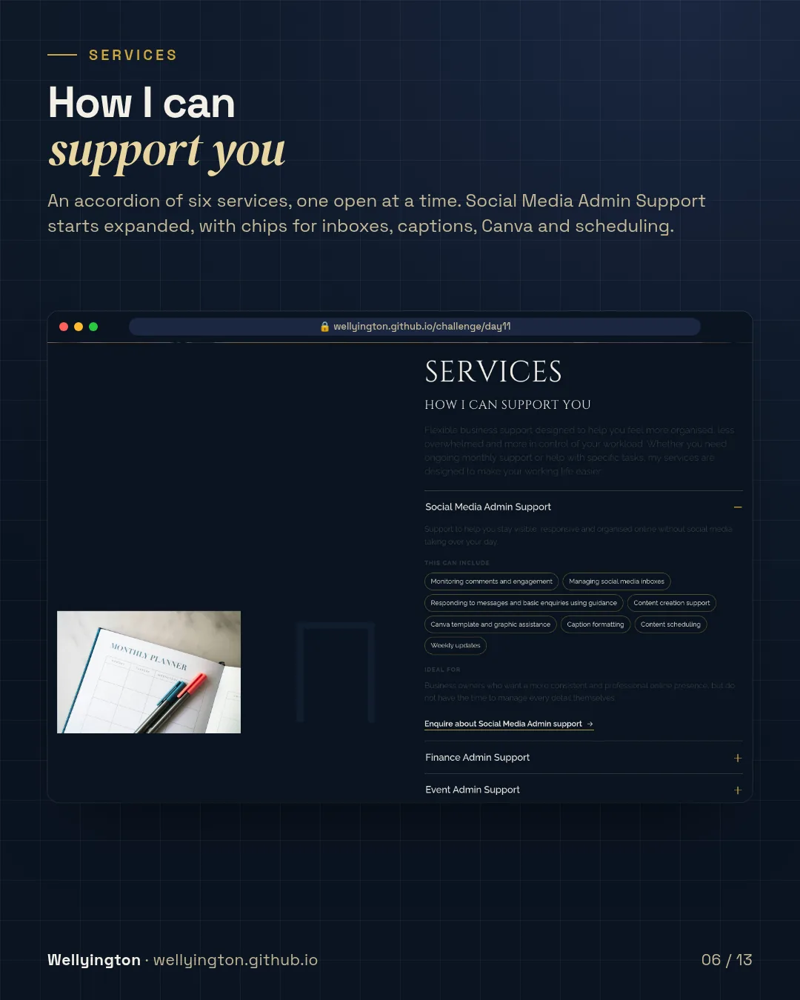
*Seis servicios en acordeón. El de redes sociales se abre primero, con sus tareas como etiquetas.*

## qué pasa cuando escribes

Una de las razones silenciosas por las que la gente aplaza contratar ayuda es que no sabe cómo será el proceso. ¿Habrá presión para vender? ¿Un formulario largo? ¿Un contrato en la primera llamada? La sección how it works, cómo funciona, quita esa preocupación en seis pasos, colocados sobre una línea vertical con círculos numerados.

Paso uno, escribir, por correo o redes sociales, con un poco de información sobre el negocio. No hace falta saber exactamente qué apoyo necesitas. Paso dos, una llamada de presentación: corta e informal, sin presión ni obligación de seguir. Un pequeño enlace abre la lista de lo que se hablará, de las prioridades actuales a qué paquete puede encajar. Paso tres, una propuesta, enviada después de la llamada, con tiempo para revisarla. Paso cuatro, el formulario de reserva, el contrato y la factura, para que todo quede acordado antes de empezar. Paso cinco, la incorporación: acceso a sistemas, carpetas compartidas, un tablero de Trello o un gestor de tareas, preferencias de comunicación y pautas sobre el tono. Paso seis, empieza el apoyo, con comunicación clara e informes regulares.

Seis pasos parecen muchos. Presentados así, se leen al revés: como alguien que ya lo ha hecho antes y tiene un sistema. Que es exactamente lo que un cliente está pagando.

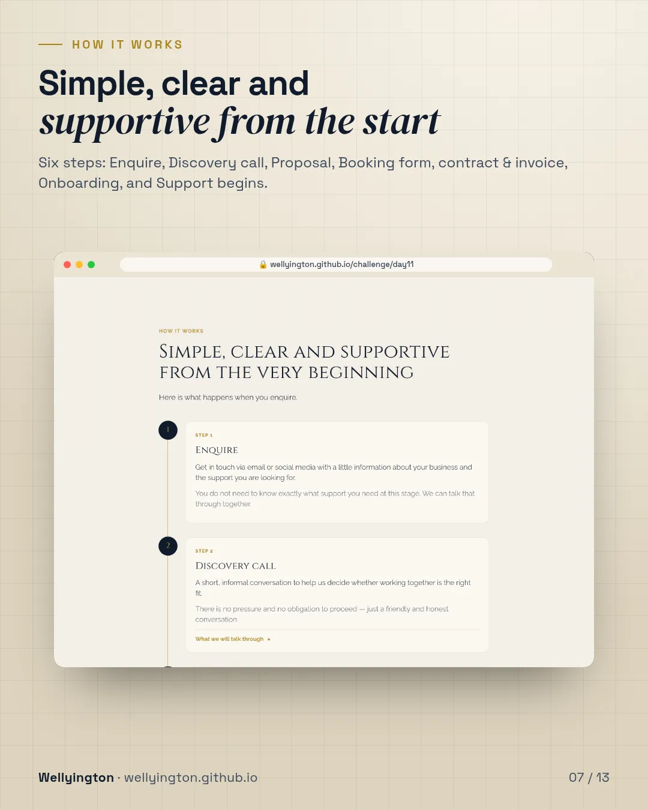
*Seis pasos desde la primera consulta hasta el apoyo, cada uno en una línea numerada.*

## los precios, en voz alta

Esta es la parte que más quería acertar. Muchos negocios de servicios esconden sus precios, con la idea de que una llamada vende mejor que una cifra. Para una asistente virtual, creo que es al revés. Las personas con las que trabaja están ocupadas por definición. Un visitante que ve el precio puede decidir en un minuto si reserva la llamada. Uno que no lo ve tiene que dedicar tiempo a averiguarlo, y la gente ocupada a menudo no lo hace.

La sección se abre con el argumento a favor de una asistente virtual en una frase: un apoyo fiable y profesional sin los costes añadidos de un empleado, como las vacaciones pagadas, los impuestos, la seguridad social, las pensiones, la oficina, el equipo o la formación. Luego tres pestañas: cuotas mensuales, paquetes y por horas o a medida.

La pestaña de cuotas es la parte interactiva. En lugar de seis tarjetas una junto a otra, hay un control deslizante: ¿cuántas horas de apoyo al mes? Va de 12 a 60 horas en seis paradas. Al moverlo, cambia la tarjeta de al lado: The Assistant, 12 horas, 420 £ al mes; The Coordinator, 20 horas, 700 £; The Senior Support, 30 horas, 1.050 £; The Operations Partner, 40 horas, 1.400 £; The Executive Support, 50 horas, 1.750 £; y The Strategic Support, 60 horas, 2.100 £. Cada una lleva una línea sobre a quién le encaja y un botón para preguntar, que abre un correo con el nombre de esa cuota ya en el asunto. Empieza en The Coordinator.

El control deslizante hace algo que una tabla no haría. Permite empezar por la propia pregunta, cuánta ayuda necesito, y ver la respuesta, en vez de leer seis opciones y hacer el camino al revés. Debajo, las condiciones están escritas: el tiempo se registra redondeado a los 15 minutos más cercanos, las horas no usadas no pasan al mes siguiente, las horas incluyen el tiempo de instrucciones y comunicación, se recomienda un compromiso de tres meses y la disponibilidad es limitada. Son condiciones que normalmente solo salen en un contrato. Aquí salen antes del primer correo.

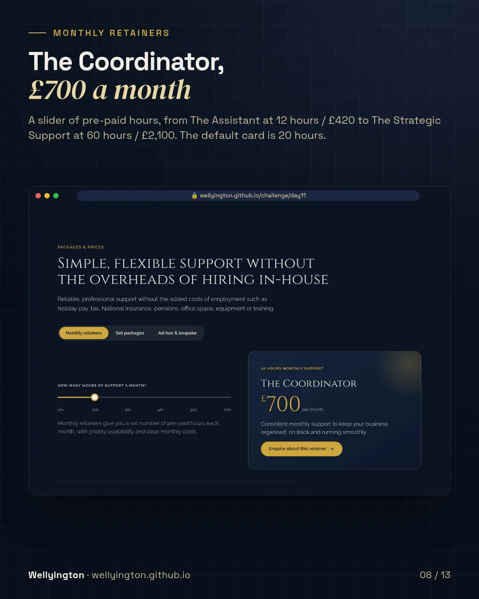
*Desliza de 12 a 60 horas y la tarjeta cambia. A 20 horas, The Coordinator, 700 £ al mes.*

## paquetes, horas y proyectos

La segunda pestaña es para quien quiere ayuda con una sola cosa. Tres paquetes, cada uno en su tarjeta: Elevate Social Support a 450 £ al mes, que incluye 10 piezas de contenido en hasta dos plataformas; Executive Support & Project Coordination a 700 £ al mes, que combina la gestión del correo y la agenda con reuniones, órdenes del día, actas y seguimiento de acciones; y Elevate Inbox Management a 450 £ al mes, desde ordenar y marcar prioridades hasta redactar respuestas para su aprobación y un resumen semanal del correo. Cada tarjeta tiene un enlace what's included que abre la lista completa, y su propio enlace de consulta.

La tercera pestaña es para todo lo demás. Ad-Hoc Support cuesta 35 £ la hora, con una reserva mínima de cinco horas, para tareas puntuales, documentos, hojas de cálculo, limpiezas del correo y proyectos cortos. Bespoke Project Support tiene precio a consultar, para trabajos que no encajan en un formato por horas o mensual, con el precio según el tamaño del proyecto, la duración y el encargo acordado.

Debajo de las pestañas hay una frase: ¿no sabes qué opción es para ti? Lo podemos hablar en una llamada de presentación. Los precios dan a la gente un punto de partida. La llamada sigue siendo donde se decide.

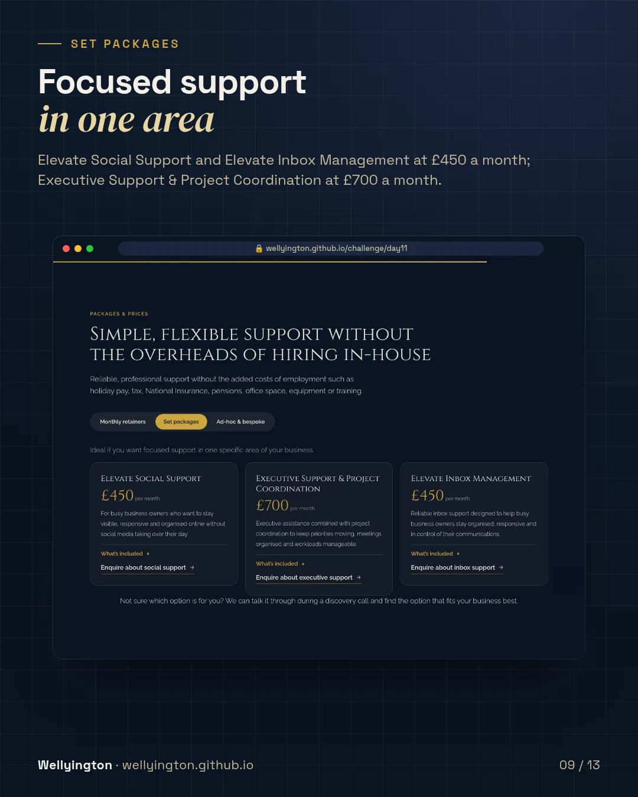
*Tres paquetes para un apoyo centrado en un área.*

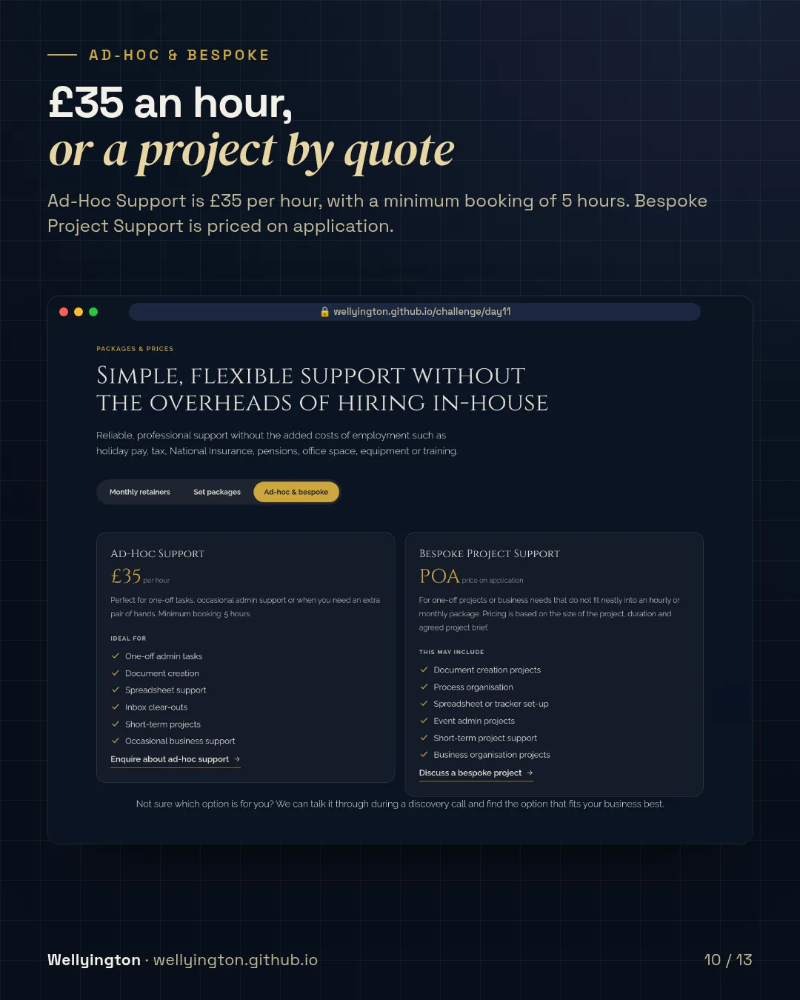
*35 £ la hora para tareas puntuales, o un proyecto a medida con presupuesto.*

## un apoyo en el que confiar

La sección de testimonios es corta, y debe serlo. Hay dos citas, en una sola tarjeta con flechas para pasar de una a otra, de dos personas sénior que han trabajado con Charlotte durante varios años.

Ellie Gordon, que fue Senior Nurse de salud mental y discapacidad intelectual en NHS England, la describe como «cálida, comprensiva y adaptable». David Harling, BEM, National Deputy Director for Learning Disability Nursing, habla de proyectos nacionales, plazos ajustados e informes escritos con un alto nivel.

Dos testimonios pueden parecer pocos en algunas webs. Aquí pesan por quién los firma y por lo que describen: años de trabajo, cargos con nombre, cosas concretas hechas. Prefiero dos citas reales y concretas con nombre completo que diez anónimas.

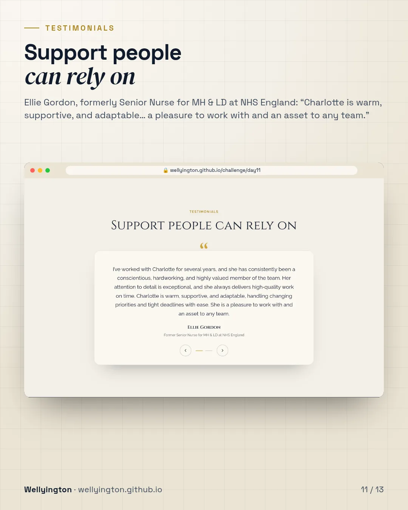
*Dos testimonios con nombre de compañeros sénior, uno cada vez.*

## una dirección, dos botones

La página termina donde apuntaba cada sección. Get in touch: hagamos que tu carga de trabajo pese menos. Un párrafo corto invita a contar un poco sobre el negocio y el apoyo que se necesita, y promete una respuesta con los siguientes pasos.

No hay formulario. Hay dos botones: Email Charlotte, que abre un correo nuevo ya dirigido a ella, y Copy email address, que copia la dirección y muestra una pequeña confirmación, para quien usa el correo en el navegador o prefiere escribir desde otro dispositivo. La dirección está impresa debajo, charlotte@elevateadminstudio.co.uk, en texto normal.

Para un negocio basado en una persona que responde bien al correo, me pareció lo correcto. Un formulario añade un paso y una capa entre el cliente y ella. Un correo va directo a la bandeja que ella gestiona como oficio.

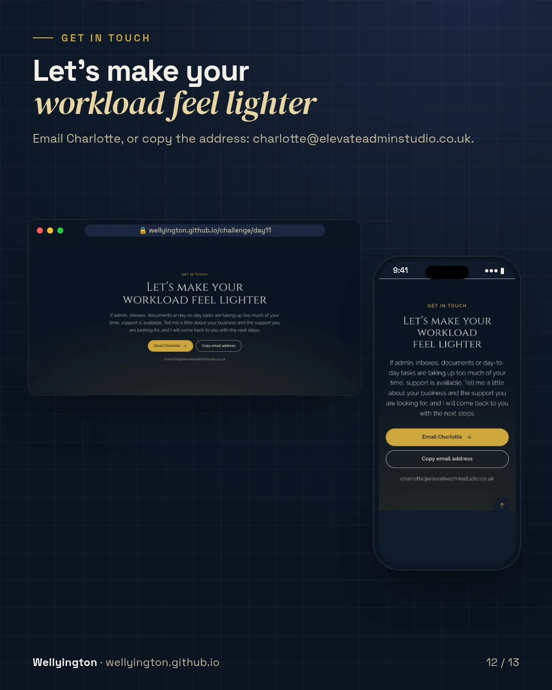
*Escribe a Charlotte o copia la dirección. Sin formulario de por medio.*

## los detalles

La paleta tiene tres colores: un azul marino profundo, un crema cálido y un dorado apagado. El azul marino lleva las partes serias, el menú, los servicios y los precios. El crema lleva las partes personales, la presentación, los valores y los testimonios. El dorado se reserva para lo que hay que pulsar: los botones principales, la pestaña activa, el control deslizante.

Los titulares van en Cinzel, unas mayúsculas clásicas con aire de inscripción grabada, que dan a un negocio pequeño una tranquila sensación de permanencia. El texto de lectura va en Raleway, ligera y abierta. Las dos fuentes se sirven desde la propia web y no desde Google, así que abrir la página no entrega la dirección de nadie a un tercero.

El movimiento es suave. Las secciones aparecen y suben a su sitio al bajar, un elemento un poco después del otro, y el propio desplazamiento está suavizado. Para quien ha pedido a su dispositivo que reduzca las animaciones, los efectos de aparición se apagan y el contenido simplemente está ahí. Toda la web está solo en inglés, porque sus clientes están en el Reino Unido.

## qué es el concepto, y qué viene después

Los datos del concepto vienen de Elevate Admin Studio: los servicios y lo que incluye cada uno, el proceso, las cuotas, paquetes y tarifas, la trayectoria de Charlotte y los dos testimonios.

Lo nuevo es la estructura: una sola página ordenada, un menú que se lee como un índice, los servicios en acordeón con enlaces de consulta que nombran el servicio, un proceso explicado paso a paso y unos precios que se pueden explorar con un control deslizante en vez de tener que pedirlos.

No tengo cifras de consultas, y no me las voy a inventar. Convertir el concepto en una web que funcione requeriría los pasos prácticos: las condiciones de uso y las políticas de privacidad y de cookies a las que enlaza el pie, redactadas según las normas británicas; enlaces a las redes sociales que menciona el primer paso del proceso, que la página aún no tiene; y una forma de que Charlotte actualice ella misma los precios cuando cambien, para que la página nunca muestre la tarifa del año pasado.

## once hechas

La web de una asistente virtual tiene un trabajo por encima de todos: ser la primera prueba de que es organizada. La mejor forma de conseguirlo no es poner «organizada» en el titular. Es serlo: decir para quién es, decir qué incluye, decir cuánto cuesta, decir qué pasa después, y poner cada una de esas cosas en su propio sitio, bien claro.

Si vendes un servicio y no un producto, vale lo mismo. Enseña a la persona que hay detrás. Di qué está incluido y qué no. Pon un precio en la página, aunque sea uno de partida. Explica los pasos desde el primer mensaje hasta el primer trabajo. Y haz que la forma de contactar sea lo más sencillo de la página.

Soy diseñador web en Estepona, en la Costa del Sol, y diseño y construyo webs para negocios de España y de fuera. Si esto se parece a tu negocio, escríbeme desde [la web principal](https://wellyington.github.io/es/). Cuéntame a qué te dedicas y dónde, y te contestaré en un lenguaje claro. El concepto está [aquí](https://wellyington.github.io/challenge/day11/), y la web actual de Elevate Admin Studio [aquí](https://elevateadminstudio.co.uk/), para que puedas compararlas. Once hechas, quedan ochenta y nueve.
