El 26 de noviembre publiqué la décima nota de esta serie, el reto que planteó Ramiah Trask: cien días, cien negocios, cien webs. Diez es un pequeño hito, así que primero una mirada atrás. El día uno fue un constructor familiar de la Marina Alta. [Esa página está aquí.](https://wellyington.github.io/journal/es/articles/la-web-antes-del-si/) El día dos, un teatro de Málaga. [Esa está aquí.](https://wellyington.github.io/journal/es/articles/sitio-para-toda-la-temporada/) El día tres, un restaurante familiar de Estepona. [Esa está aquí.](https://wellyington.github.io/journal/es/articles/un-sitio-en-la-mesa-larga/) El día cuatro, una consultora inmobiliaria privada de Málaga. [Esa está aquí.](https://wellyington.github.io/journal/es/articles/criterio-antes-que-volumen/) El día cinco, un restaurante de menús degustación en Motril. [Esa está aquí.](https://wellyington.github.io/journal/es/articles/tan-cuidada-como-la-cocina/) El día seis, un asador de pollos de Estepona. [Esa está aquí.](https://wellyington.github.io/journal/es/articles/del-mostrador-a-la-comanda/) El día siete, un hotel familiar en Kavos, Corfú. [Esa está aquí.](https://wellyington.github.io/journal/es/articles/la-misma-piscina-de-noche/) El día ocho, tres casas en el centro histórico de Málaga. [Esa está aquí.](https://wellyington.github.io/journal/es/articles/tres-casas-una-sola-puerta/) El día nueve, una agencia de modelos de Marbella y Londres. [Esa está aquí.](https://wellyington.github.io/journal/es/articles/que-hablen-las-fotografias/)

Hoy toca un estudio de Pilates. Nordic Balance Studios está en Nueva Andalucía, Marbella, en el centro comercial Centro Plaza de la avenida de Manolete. Da clases de Pilates Reformer en grupos reducidos y en tres niveles, sesiones privadas y semiprivadas, y unas cuantas clases especializadas, de Stretch & Mobility a Prenatal & Postnatal. Se fundó con una base en medicina deportiva, rehabilitación y Pilates, y recibe a hombres y mujeres. Su web actual está en [nordicbalancestudios.com](https://www.nordicbalancestudios.com/).

El concepto está aquí: [Nordic Balance Studios, día diez](https://wellyington.github.io/challenge/day10/).

## el espacio es el argumento

La gente elige un estudio de Pilates por tres razones, más o menos en este orden: si le parece un lugar donde quiere estar, si se enseña bien y si las clases encajan en su semana.

La primera es la más difícil de llevar a una web, y la que más se pasa por alto. Muchas webs de estudios son luminosas, recargadas y llenas de ofertas: primera clase a mitad de precio, bono de cinco clases, reto de año nuevo. Parecen un gimnasio. Nordic Balance no lo es. El estudio en sí es tranquilo: suelos oscuros, madera y piedra cálidas, grandes ventanales a las colinas verdes, filas de Reformers bajo una luz suave. Una web que grita estaría describiendo otro lugar.

Así que la dirección fue minimalista y de inspiración nórdica, a juego con el nombre. Tonos oscuros, neutros cálidos, tipografía editorial y mucho espacio para la fotografía. Y después, dentro de esa calma, las otras dos cosas que la gente necesita: qué son las clases y cómo reservarlas, sin tener que buscar ninguna de las dos.

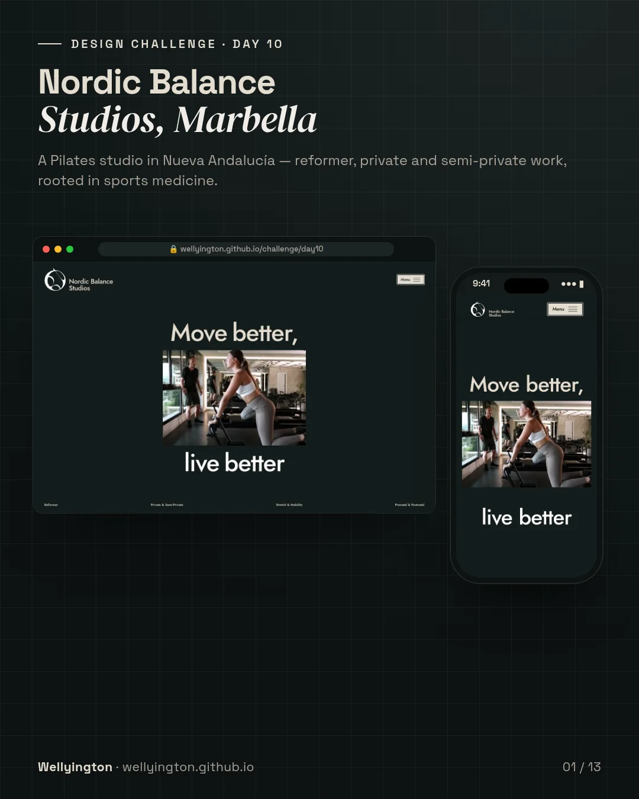
*Día diez: un estudio de Pilates en Nueva Andalucía, con Reformer, sesiones privadas y semiprivadas basadas en la medicina deportiva.*

## muévete mejor, vive mejor

La página de inicio se abre casi en negro. En el centro, en letra grande y clara, la frase del estudio: move better, live better, muévete mejor, vive mejor. Entre las dos mitades de la frase hay un vídeo corto del interior del estudio que se repite en bucle: una clienta en un Reformer, un instructor que pasa, la sala detrás. Tiene el tamaño de una foto en una revista y se acerca suavemente al empezar a bajar.

Al pie de la primera pantalla aparecen las cuatro cosas que hace el estudio, en palabras sencillas: Reformer, Private & Semi-Private, Stretch & Mobility, Prenatal & Postnatal. No hay más eslogan que el de arriba, ni ofertas, ni ventanas emergentes.

Elegí un vídeo en lugar de una foto porque el Pilates es movimiento, y una imagen fija de alguien en un Reformer puede parecer cualquier cosa. Unos segundos de movimiento lento y controlado dicen cómo son las clases mejor que cualquier párrafo.

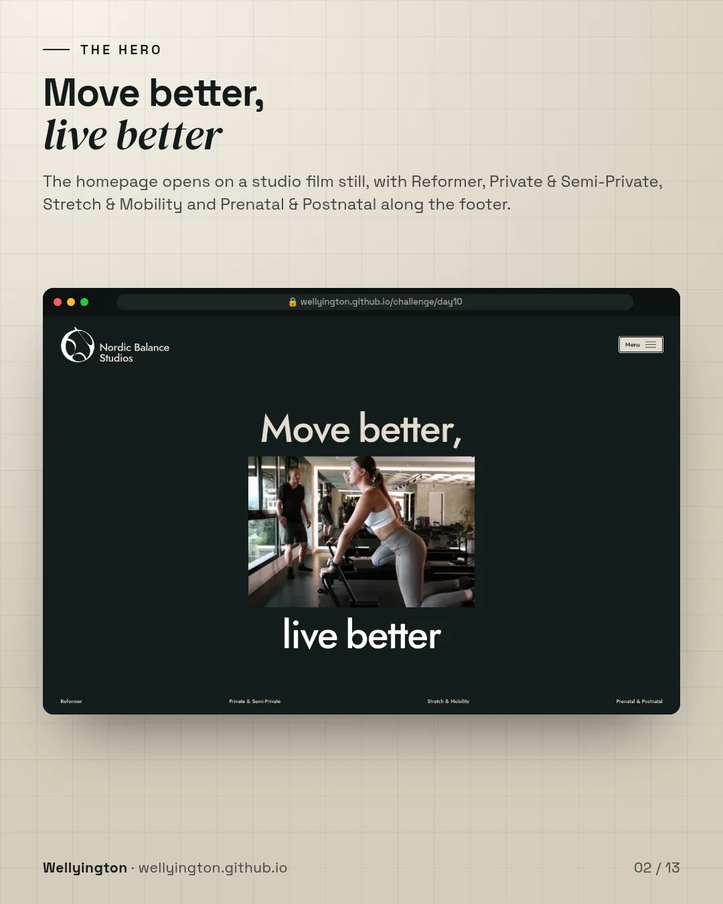
*La página de inicio se abre con un fotograma de un vídeo del estudio y los cuatro tipos de clase al pie.*

## un botón, un menú

La cabecera tiene dos cosas: el logotipo redondo y el nombre del estudio a la izquierda, y un pequeño botón Menu a la derecha. Al pulsarlo, las tres rayas se convierten en una cruz y aparece una lista a pantalla completa: Home, Classes, About, Schedule, Contact. Abajo, una línea sobre el estudio y la dirección de correo.

Es igual en el ordenador y en el móvil. Cinco palabras, lo bastante grandes para tocarlas sin apuntar, y nada más compitiendo con ellas. Para una web de este tamaño, basta.

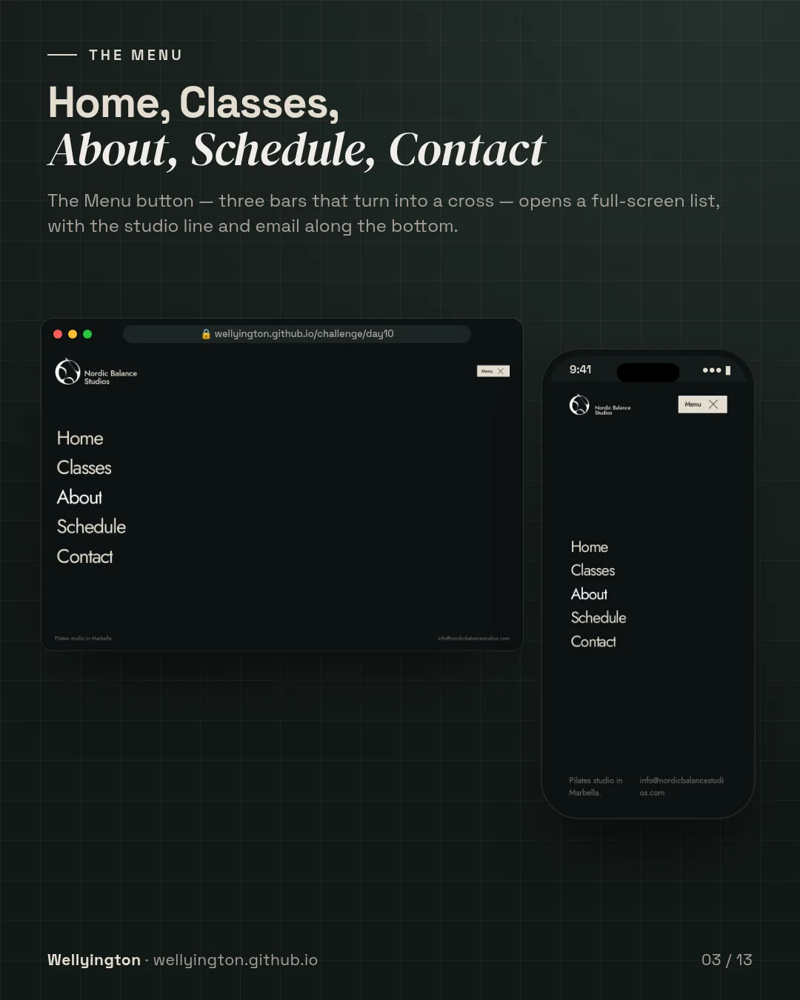
*El botón Menu abre una lista a pantalla completa, con la línea del estudio y el correo abajo.*

## calidad antes que modas

Al seguir bajando, la siguiente sección llena la pantalla con una fotografía: un hombre en un Reformer, en pleno estiramiento, junto a los ventanales del estudio y las colinas de fuera. Encima, la frase que resume el negocio, con las palabras del propio estudio: si valoras la calidad por encima de las modas, estás en el lugar adecuado. Combinamos movimiento basado en la ciencia con un entrenamiento personalizado, con base en la medicina deportiva, la rehabilitación y el Pilates.

Esa es toda la presentación. No enumera diez beneficios ni promete un cuerpo nuevo en treinta días. Dice qué tipo de estudio es y para quién, y deja que la fotografía enseñe el resto. Quien busque una clase ruidosa y de alta intensidad sabrá enseguida que no es aquí. Quien busque una enseñanza cuidadosa y experta sabrá que lo ha encontrado. Las dos cosas son buenas para el estudio.

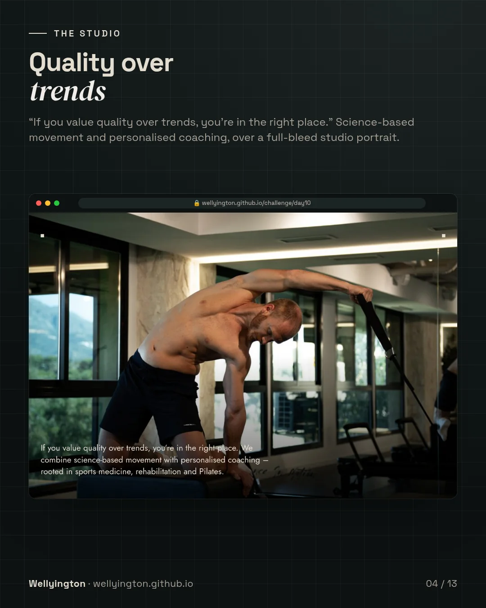
*Movimiento basado en la ciencia y entrenamiento personalizado, sobre un retrato del estudio a todo lo ancho.*

## cuatro puertas a las clases

La siguiente sección se llama classes for every stage, clases para cada etapa. Muestra cuatro grandes recuadros, colocados en forma de cruz y no en fila, cada uno con un número y un nombre: 01 Reformer, 02 Private, 03 Specialist, 04 First Visit. Un enlace a todas las clases está arriba a la derecha.

Los recuadros permanecen en silencio hasta que los necesitas. Señala uno en el ordenador, o tócalo en el móvil, y se vuelve crema y enumera lo que contiene. Reformer muestra Beginners, Intermediate y Advanced Reformer, sesiones semiprivadas y grupos reducidos con instructores certificados. Private enumera para qué sirve el trabajo individual: rendimiento deportivo, rehabilitación y recuperación de lesiones, corrección postural, salud de la columna y embarazo. Specialist reúne Stretch & Mobility, Posture para todos los niveles, Longevity 50+, Teen Girls Pilates y Outdoor Mat Pilates. Y First Visit explica qué pasa cuando empiezas: una Consultation Class individual, una evaluación del movimiento, una conversación sobre objetivos y lesiones previas, y las clases que te recomiendan.

Esa última puerta es la importante. Los clientes nuevos dudan a menudo porque no saben dónde encajan. Aquí, «soy nuevo» es una categoría en sí misma, con un primer paso claro.

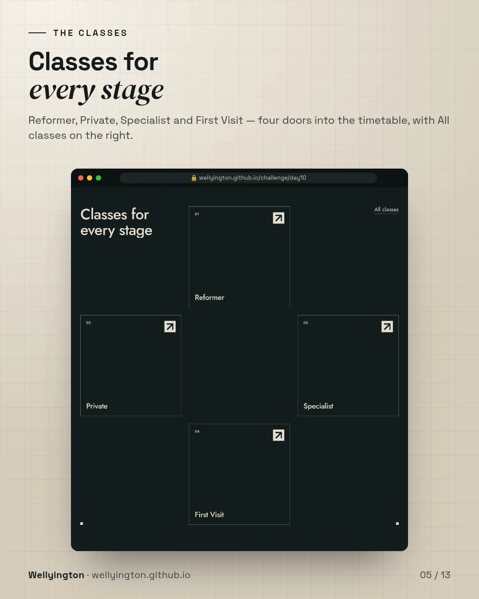
*Reformer, Private, Specialist y First Visit: cuatro puertas al horario.*

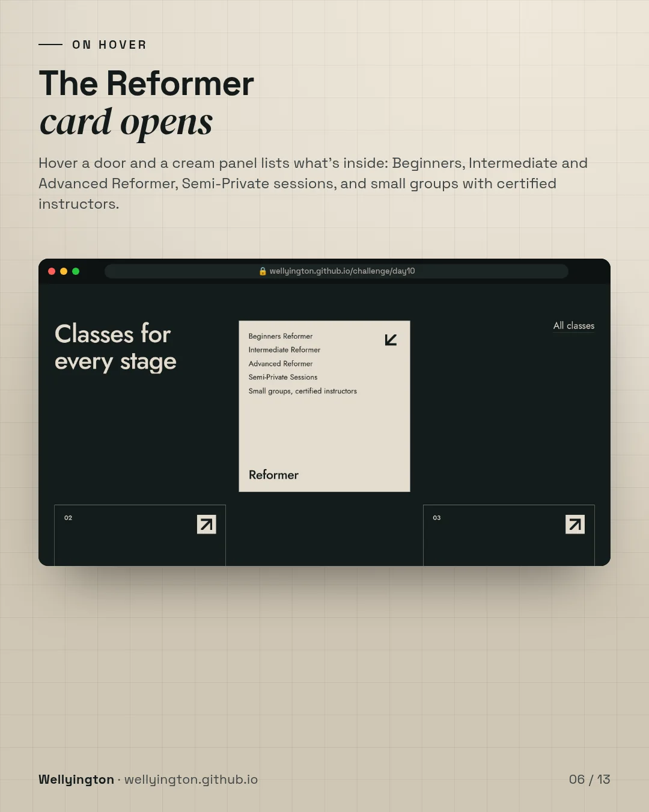
*Señala una puerta y un panel crema enumera lo que hay dentro.*

## tres formas de reservar

La mayoría de los estudios de fitness usan varios sistemas de reserva a la vez, y sus webs rara vez explican cuál es cuál. Nordic Balance no es una excepción: las clases en grupo y semiprivadas se reservan en la app del propio estudio, las sesiones privadas por WhatsApp, y los clientes nuevos empiezan con una consulta.

Así que la sección de reservas, book your session, lo explica tal cual, en tres columnas con una foto cada una. Reserva tu clase en grupo: Beginner, Intermediate y Advanced Reformer más las sesiones especializadas, reservadas directamente en la app de Nordic Balance Studios, también las semiprivadas. Reserva tu clase privada: por WhatsApp en el +34 648 876 173, para que el estudio te asigne el instructor más adecuado a tus objetivos. Y reserva tu primera Consultation Class: una sesión individual para evaluar tu movimiento, hablar de tus objetivos y posibles lesiones, y recomendarte las clases adecuadas.

Cada columna lleva arriba dos etiquetas pequeñas que dicen para quién es y dónde se hace: group classes y app, private classes y WhatsApp, new clients y start here. Nadie tiene que adivinar a dónde lleva cada botón.

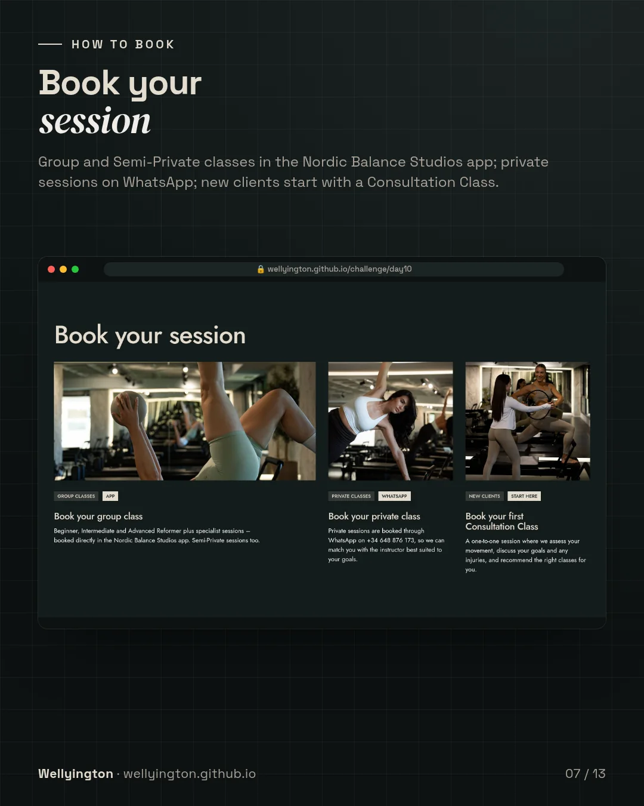
*Clases en grupo y semiprivadas en la app, sesiones privadas por WhatsApp y una Consultation Class para los nuevos.*

## los niveles, explicados en detalle

La página de clases responde a la pregunta que se hace todo principiante y que pocas webs de estudios contestan: ¿cuál es mi clase?

Cada nivel de Reformer tiene un párrafo breve en lenguaje sencillo. Beginners Reformer es el punto de partida si eres nuevo en el Pilates Reformer o vuelves después de un tiempo; en grupos reducidos, instructores certificados te ayudan a dominar lo esencial y te dicen cuándo estás listo para Intermediate. Intermediate es para clientes con una base sólida, preparados para movimientos más dinámicos y secuencias más largas; como dice la página, progresar no es moverse más rápido, es moverse mejor. Advanced es para clientes con al menos un año en el Reformer, con patrones complejos que ponen a prueba la fuerza, la estabilidad y el control. Y Private & Semi-Private, la especialidad del estudio, abarca el rendimiento deportivo, la rehabilitación, la postura, el embarazo, la salud de la columna y la recuperación de lesiones.

Más abajo, tres pasos numerados explican cómo empieza un cliente nuevo: 01, una Consultation Class; 02, un plan de clases que recomienda sesiones en grupo, semiprivadas o privadas; 03, progresar con control, con tu instructor diciéndote cuándo estás listo para subir de nivel. El buen movimiento empieza por dominar lo básico, dice la página, y la estructura de la página está de acuerdo.

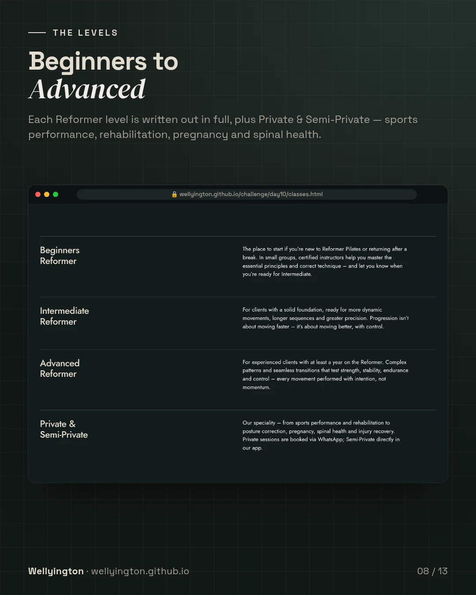
*Cada nivel de Reformer explicado en detalle, más Private & Semi-Private.*

## la semana de un vistazo

Bajo los niveles está el horario semanal, como una fila de tarjetas que se recorren, una por día, con flechas debajo. Cada tarjeta enumera las clases del día con sus horas, la franja de sesiones privadas en un gris más suave y, abajo, el día y el número de clases en grupo.

El lunes tiene cuatro clases en grupo, de Intermediate a las 09:15 a Prenatal & Postnatal a las 13:30, con sesiones privadas por la tarde. El jueves es el más completo, con siete, de Intermediate a las 09:15 a Stretch & Mobility a las 19:45, y Longevity 50+ a las 10:30. El sábado solo hay sesiones privadas. La fila da la vuelta, así que después del domingo vuelve el lunes, y en el móvil se ve una tarjeta cada vez.

Se trata de responder a «¿llego?» de un vistazo, sin descargar una app ni abrir un PDF. La app sigue siendo donde se reserva; la web es donde se decide.

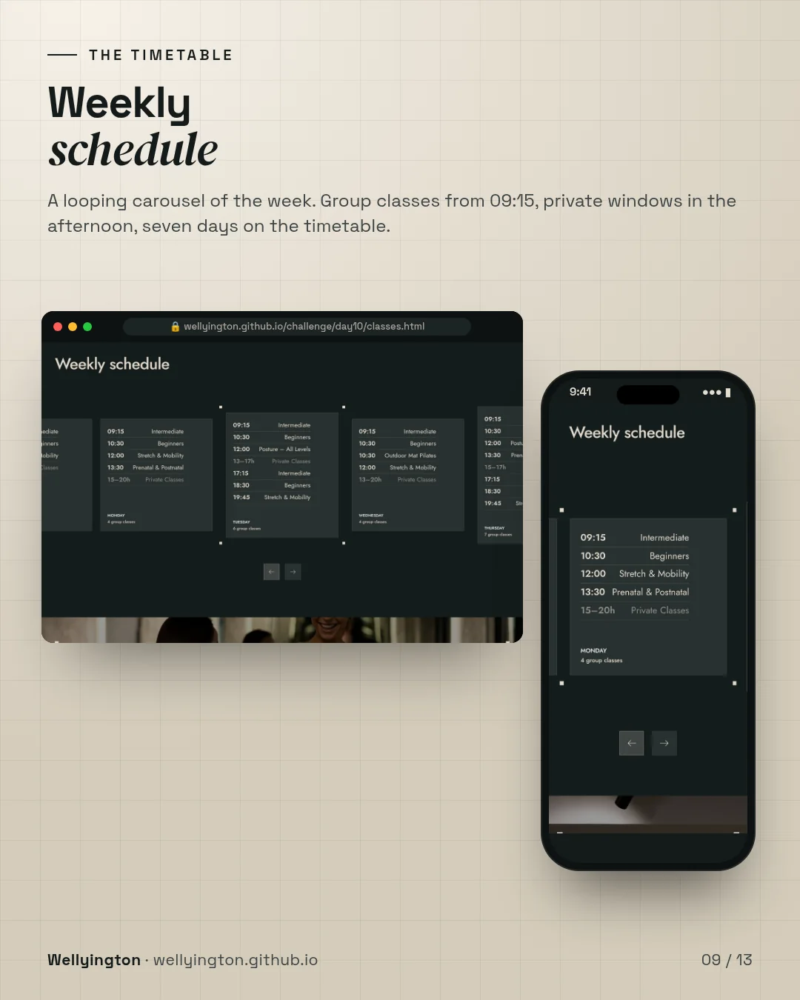
*Un carrusel de la semana: clases en grupo desde las 09:15 y franjas privadas por la tarde.*

## nuestro estudio

La página sobre el estudio vuelve a poner la fotografía en primer plano. Cuatro retratos del estudio, cada uno con el nombre de una clase: Reformer Pilates, grupos reducidos en tres niveles; Private sessions, adaptadas a tus objetivos; Posture para todos los niveles, alineación para el día a día; Stretch & Mobility, para moverse con más libertad. Al lado, una tarjeta crema que rompe a propósito la cuadrícula oscura: ¿eres nuevo? Empieza con una Consultation Class, con un enlace para reservarla.

Debajo, la filosofía del estudio en sus propias palabras: no seguimos las modas del fitness; nos centramos en la salud a largo plazo, el movimiento inteligente y los resultados duraderos. Y tres cifras: 5,0, la valoración del estudio en Google con 44 opiniones; 3, los niveles de Reformer; y 7, los días a la semana con clases en el horario.

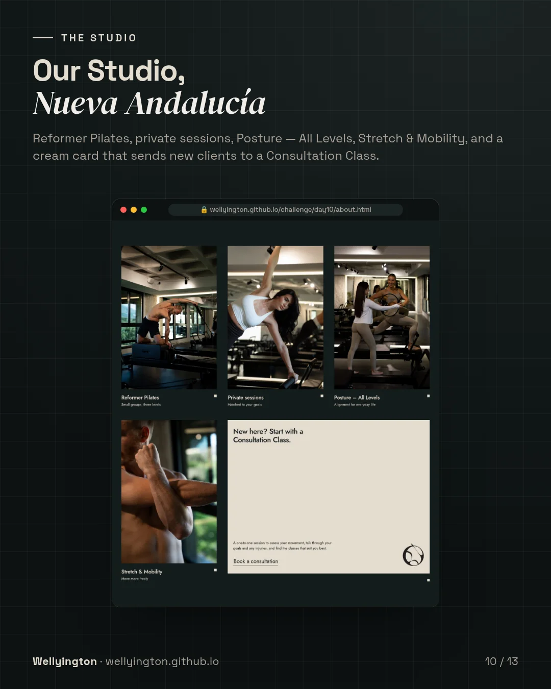
*Reformer, sesiones privadas, postura y estiramientos, y una tarjeta crema que envía a los nuevos a una Consultation Class.*

## abierto ahora

La página de contacto se llama get in touch, ponte en contacto, con las dos partes empujadas a extremos opuestos de la pantalla. Debajo, lo esencial: el correo, la dirección completa en Centro Plaza, el teléfono y el WhatsApp, y una línea que repite cómo se reserva cada tipo de clase.

Al lado está el horario de cada día de la semana. El día actual aparece resaltado, y la página dice si el estudio está abierto o cerrado en ese momento. Lo calcula con la hora de Marbella, no con la del dispositivo del visitante, así que acierta también para quien mira desde Londres o Estocolmo antes de unas vacaciones.

Debajo, las preguntas frecuentes: cinco, con la primera ya abierta, porque es la que más gente tiene. Soy nuevo, ¿por dónde empiezo? Con una Consultation Class. ¿Cómo reservo una sesión privada? Por WhatsApp. ¿El estudio es solo para mujeres? No, hombres y mujeres son bienvenidos, y además hay sesiones de Teen Girls y Longevity 50+. ¿Cuándo puedo subir de nivel? Cuando tu instructor te lo diga; Advanced requiere al menos un año en el Reformer. ¿Cómo reservo las clases en grupo y semiprivadas? En la app.

Cada una de esas respuestas es algo que, si no, el equipo del estudio tendría que explicar por teléfono una y otra vez.

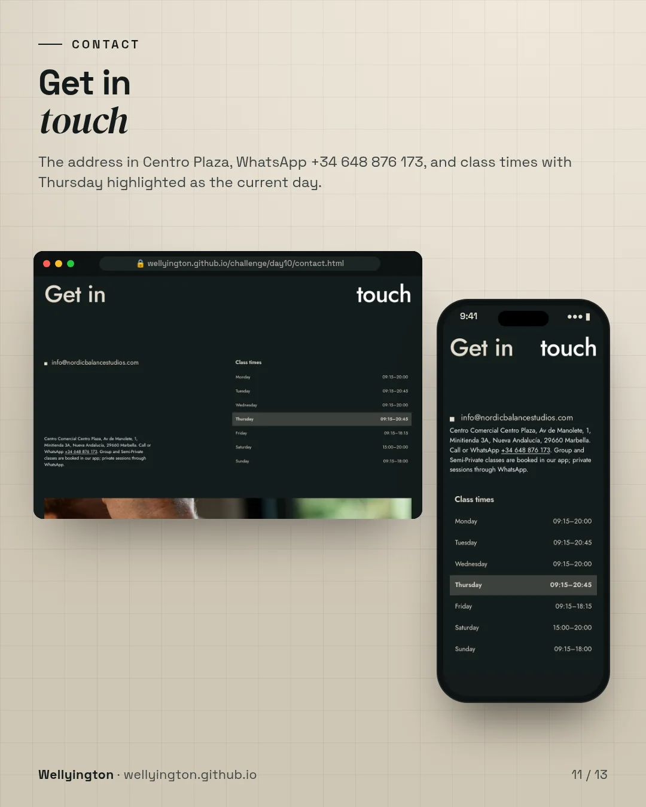
*La dirección en Centro Plaza, WhatsApp y el horario con el día actual resaltado.*

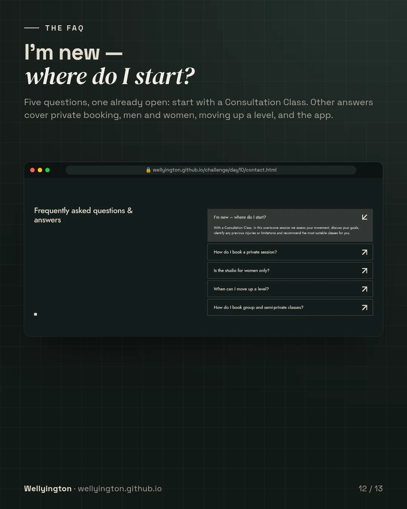
*Cinco preguntas, una ya abierta: empieza con una Consultation Class.*

## los detalles

Hay una sola tipografía, Jost, una palo seco geométrica y limpia, en pesos finos y normales para casi todo y algo más gruesos para las etiquetas pequeñas. Usar una sola familia mantiene las páginas tranquilas y deja que el tamaño y el espacio hagan el trabajo.

La paleta tiene tres colores: un casi negro con un toque de verde, un crema cálido y un gris suave entre los dos. Las secciones oscuras sostienen la fotografía; las cremas aparecen cuando algo necesita atención: el recuadro abierto, la tarjeta de la consulta, el día resaltado.

El movimiento es lento y contenido. Los titulares suben a su sitio, el vídeo de la portada se acerca suavemente al bajar y las páginas pasan con suavidad de una sección a otra. Una cosa que añadiría en una versión real: apagar el vídeo y los efectos de scroll para quien ha pedido a su dispositivo que reduzca las animaciones. Las fuentes se sirven desde mi propia web y no desde Google, así que abrir las páginas no entrega la dirección de nadie a un tercero.

## qué es el concepto, y qué viene después

Los datos de las páginas salen de la web actual del estudio y de sus perfiles públicos: las clases y los niveles, el horario, las formas de reservar, la dirección y el teléfono, las respuestas de las preguntas frecuentes y la valoración de Google tal como aparecía.

Lo nuevo es la estructura: una portada tranquila con vídeo, cuatro puertas a las clases con «First Visit» como una de ellas, la reserva explicada según el tipo de clase, los niveles explicados en detalle, la semana a la vista y un horario que sabe si el estudio está abierto ahora mismo.

No tengo cifras de reservas, y no me las voy a inventar. Convertir el concepto en una web que funcione requeriría los pasos prácticos: conectar el horario con la app de reservas del estudio para que se actualice solo, una versión en español junto a la inglesa, y los perfiles de los propios instructores, porque en un estudio así los profesores son buena parte del motivo por el que la gente viene.

## diez hechas

Con diez días hechos, se ve un patrón. Todos los negocios de esta serie ya tenían web. Muy pocas estaban rotas. La mayoría simplemente se hicieron para parecer terminadas, no para responder a lo que los clientes preguntan de verdad: qué es esto, es para mí, cuánto cuesta, cuándo puedo ir y cómo reservo. Las respuestas de Nordic Balance a esas preguntas ya existían: en la app, en WhatsApp, en la cabeza del equipo. El trabajo de la web es reunirlas en un sitio tranquilo.

Si llevas un estudio, una clínica o cualquier negocio donde la gente reserva una hora, vale lo mismo. Explica tus niveles o servicios con palabras sencillas. Enseña la semana. Di exactamente cómo se reserva cada cosa. Dale a la gente nueva su propio primer paso. Y deja que el lugar hable por sí solo.

Soy diseñador web en Estepona, en la Costa del Sol, y diseño y construyo webs para negocios de España y de fuera. Si esto se parece a tu negocio, escríbeme desde [la web principal](https://wellyington.github.io/es/). Cuéntame a qué te dedicas y dónde, y te contestaré en un lenguaje claro. El concepto está [aquí](https://wellyington.github.io/challenge/day10/), y la web actual de Nordic Balance Studios [aquí](https://www.nordicbalancestudios.com/), para que puedas compararlas. Diez hechas, quedan noventa.
