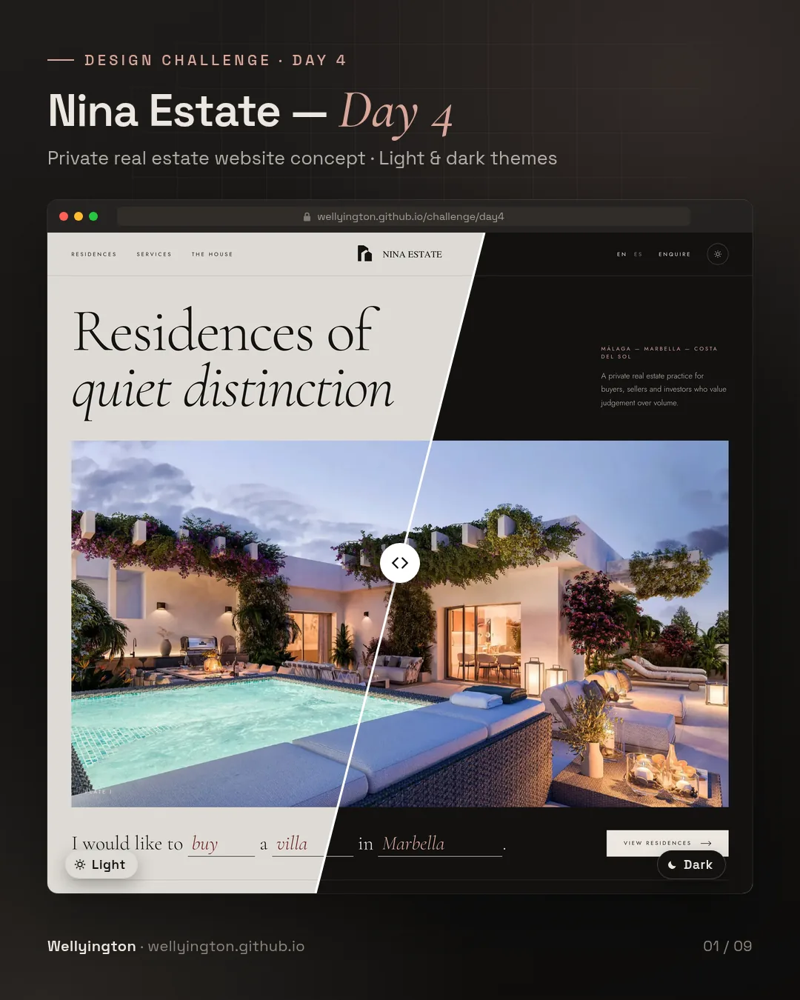
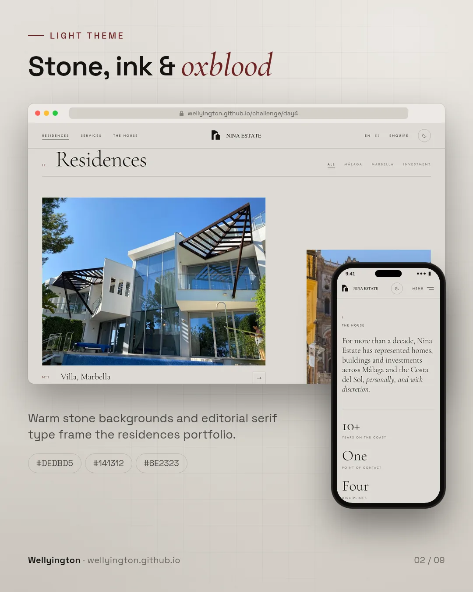
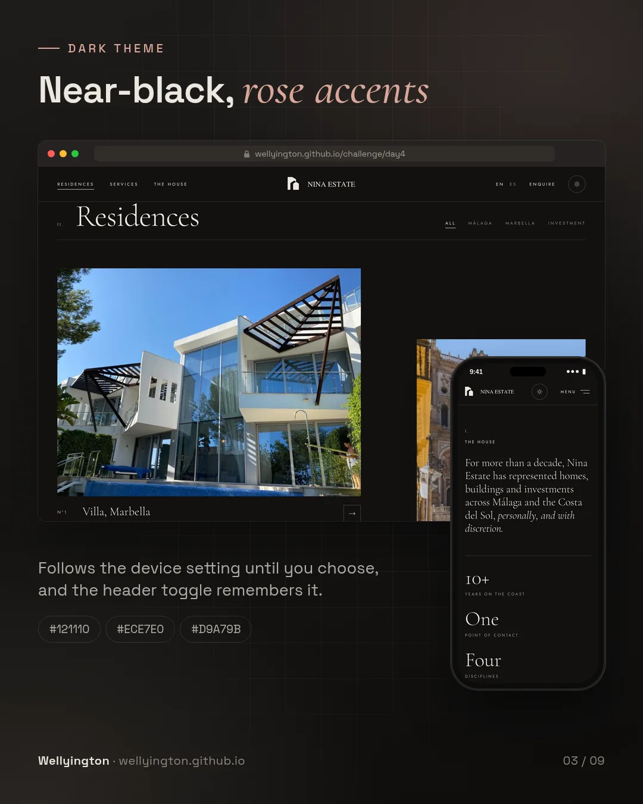
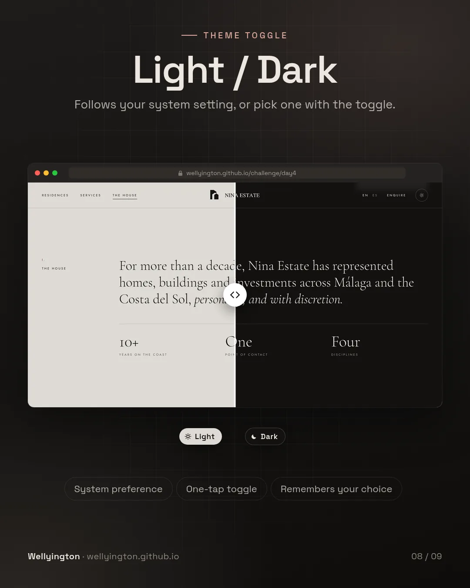
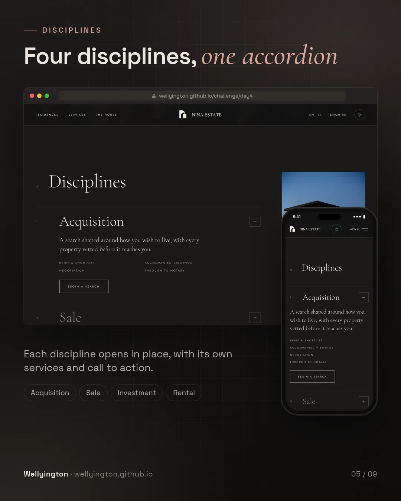
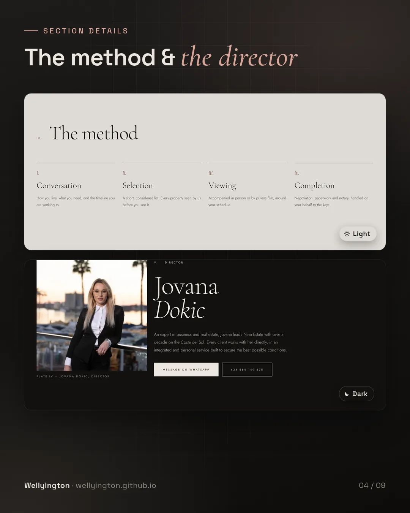
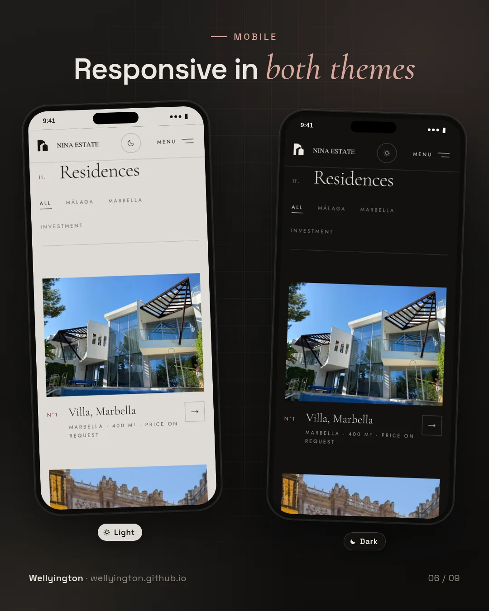
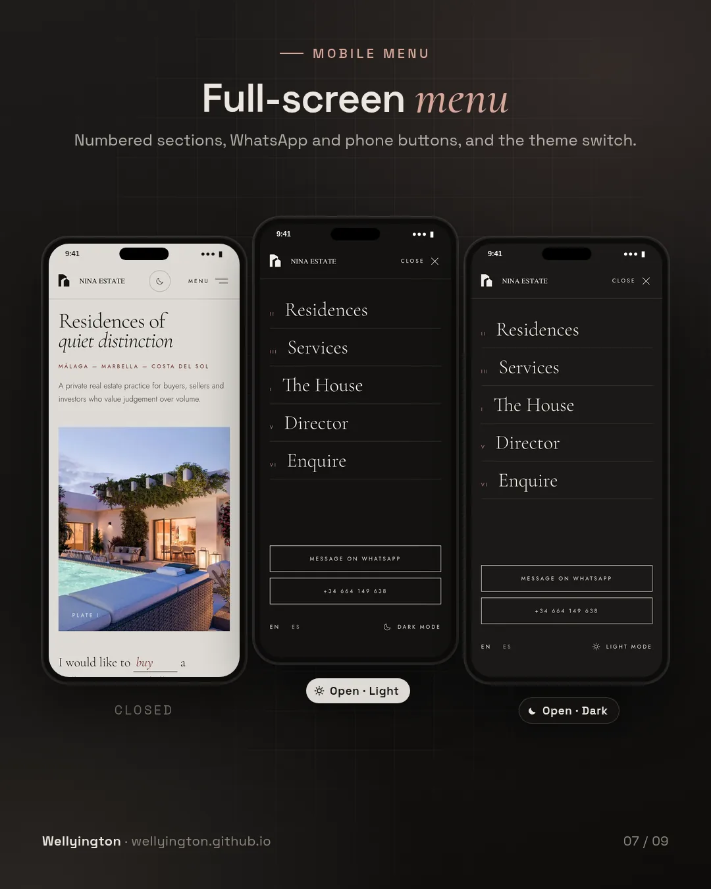

El 20 de noviembre publiqué la cuarta nota de esta serie, el reto que propuso Ramiah Trask: cien días, cien negocios, cien webs. El primer día fue una constructora familiar de la Marina Alta que necesitaba una primera página clara. [Esa página está aquí.](https://wellyington.github.io/journal/es/articles/la-web-antes-del-si/) El segundo, un teatro en Málaga con una temporada llena y sin orden. [Ese está aquí.](https://wellyington.github.io/journal/es/articles/sitio-para-toda-la-temporada/) El tercero, un restaurante familiar en mi propio pueblo, con muchos motivos para entrar. [Ese está aquí.](https://wellyington.github.io/journal/es/articles/un-sitio-en-la-mesa-larga/) Hoy el negocio vende algo que la gente tarda meses en decidir.

Nina Estate es una inmobiliaria de Málaga, con oficina en la avenida de Cánovas del Castillo. Trabaja en la ciudad y en la Costa del Sol: viviendas, edificios enteros, inversiones y alquileres de larga duración. Ya tiene web, en [ninaestate.com](https://ninaestate.com/), donde cuenta su experiencia, sus inmuebles y sus servicios. Mi concepto está aquí: [Nina Estate, día cuatro](https://wellyington.github.io/challenge/day4/).

Es un rediseño independiente. No es una colaboración con Nina Estate, nadie allí me lo ha pedido y nada en la página significa que lo aprueben. Por ahora vive en mi propia dirección, como los tres anteriores.

## otra forma de página inmobiliaria

La mayoría de las webs inmobiliarias están hechas como escaparates. Un buscador arriba, una rejilla de anuncios, un precio en cada tarjeta, un teléfono en una esquina. Funciona para una agencia que gana por volumen, con cientos de viviendas y un comprador que quiere ir pasando fotos.

Nina Estate tiene otra forma. Pocos inmuebles, varios de ellos edificios completos. Precios a consultar. Una persona, la directora, que atiende ella misma a cada cliente. Quien compra o vende a ese nivel del mercado de lujo no está eligiendo sobre todo un anuncio. Está eligiendo en quién confía para que elija por él.

Así que tomé un camino distinto al de la web actual. Menos agencia tradicional y más despacho privado, donde la forma de presentar las cosas, el trato personal y el cuidado en los detalles son parte de lo que recibe el cliente. La web actual empieza por la experiencia, los inmuebles y los servicios. El concepto empieza por la relación: con quién vas a tratar, cómo será la búsqueda y qué pasa desde la primera llamada hasta las llaves.

La idea se dice rápido. La web debería parecerse más al servicio que vende.

## residencias de discreta distinción

La apertura está casi vacía, a propósito. Un titular en una serif grande y fina: residences of quiet distinction, residencias de discreta distinción, con la segunda línea en cursiva. Debajo, una línea pequeña en granate: Málaga, Marbella, Costa del Sol. A la derecha, una sola frase que hace el trabajo de una declaración de intenciones: un despacho inmobiliario privado para compradores, vendedores e inversores que valoran el criterio antes que el volumen.

Después, una foto ancha, con el rótulo Plate I, lámina I, como en un libro: una villa al atardecer, la piscina iluminada, buganvillas sobre la terraza, farolillos en el murete. La página la mantiene a ese tamaño y no pone nada encima.

Bajo la foto, donde casi todas las inmobiliarias pondrían un buscador con doce campos, hay una frase para completar. I would like to buy a villa in Marbella: me gustaría comprar una villa en Marbella. Cada una de las tres palabras en cursiva es un desplegable. Comprar puede ser alquilar, invertir en o vender. Villa puede ser casa, piso o edificio. Marbella puede ser Málaga Centro, El Limonar o la Costa del Sol. Y un solo botón: ver residencias.

Es un detalle pequeño, y cambia el tono. Un buscador te pide que filtres. Una frase te pregunta qué quieres, como lo haría un agente por teléfono. En el concepto, la frase lleva a las residencias. No finge hacer una búsqueda que el negocio no necesita.

*La apertura, partida en dos. La misma bienvenida de día y de noche.*

## piedra, tinta y granate

Los colores salen de cómo se ve este mercado cuando se hace bien: yeso, papel antiguo, madera oscura, una copa de tinto en una mesa.

El tema claro es piedra cálida, #DEDBD5, con tinta casi negra, #141312, para el texto, y granate, #6E2323, para las cosas pequeñas que importan: los números, el filtro activo, las palabras en cursiva de la frase. El tema oscuro es casi negro, #121110, con texto blanco roto, #ECE7E0, y un rosa apagado, #D9A79B, donde antes estaba el granate. Ninguno es la versión principal. Son dos webs completas, y la misma residencia tiene que verse bien en las dos.

La tipografía hace casi todo el trabajo. Cormorant Garamond, una serif fina y de mucho contraste, para los titulares y los nombres de las propiedades. Jost, una sans sencilla, muy pequeña y espaciada, para las etiquetas. Las secciones van numeradas en romanos, de la I a la VI, y las fotos se llaman láminas. Se lee más como un catálogo impreso de galería que como una aplicación, y eso se parece más a cómo se venden estas casas en persona.

Como en los días anteriores, la página sigue a tu móvil o a tu ordenador. Si está en modo oscuro, la web se abre oscura. Un botón redondo en la cabecera lo cambia, y la web recuerda tu elección para la próxima vez.

*El tema claro: piedra cálida, tinta y granate, con una serif editorial.*

*El tema oscuro. Sigue al dispositivo hasta que eliges, y el botón de la cabecera lo recuerda.*

## la casa

La sección I se llama The House, la casa, y ocupa un párrafo. Desde hace más de una década, Nina Estate representa viviendas, edificios e inversiones en Málaga y la Costa del Sol, de forma personal y con discreción.

Debajo, tres cifras, cada una con una etiqueta pequeña. 10+, años en la costa. Una, persona de contacto. Cuatro, disciplinas. Quería cifras que un cliente pueda comprobar, no totales de metros vendidos ni un contador de familias felices. La segunda es la línea más importante de la página. A este nivel, un comprador quiere saber que la persona que contesta la primera llamada seguirá ahí en la notaría.

*Sigue la configuración de tu sistema, o eliges tú con el botón.*

## cuatro residencias, no cuatrocientas

La sección II es la cartera, con el título sencillo de Residences, residencias. A la derecha, cuatro filtros: todas, Málaga, Marbella, inversión. Al elegir uno, las tarjetas se reordenan sin recargar la página.

En el concepto hay cuatro inmuebles. N.º 1, una villa en Marbella, de 400 metros cuadrados. N.º 2, un edificio junto a la Catedral de Málaga, que se vende entero. N.º 3, otro edificio en el Centro Histórico. N.º 4, una residencia en El Limonar, de 329 metros cuadrados. Todos dicen precio a consultar. Las tarjetas son grandes, colocadas a alturas distintas en lugar de en una rejilla apretada, y cada una tiene una flechita para abrirla.

Cuatro no es mucho para una web inmobiliaria, y lo dejé en cuatro. Una rejilla larga haría que el negocio pareciera un portal, y no lo es. Bajo las tarjetas hay una línea en cursiva: some of our finest homes are never published, algunas de nuestras mejores casas nunca se publican. Al lado, un botón: solicitar acceso privado. En esta parte del mercado, buena parte de lo mejor cambia de manos fuera de mercado, sin anuncio público. La página lo dice con claridad y ofrece la forma de entrar.

Más abajo, una segunda foto a todo el ancho, la lámina II, con una frase sobre la parte tranquila de la imagen: la discreción no es un servicio, es el estándar.

## cuatro disciplinas, de una en una

La sección III ordena el trabajo en cuatro partes: compra, venta, inversión y alquiler. En la web actual, los servicios se leen como una lista. Aquí cada uno es una fila que se abre en su sitio, así que quien vende no tiene que leer el proceso del comprador para encontrar el suyo.

Compra: una búsqueda pensada según cómo quieres vivir, con cada inmueble revisado antes de que llegue a ti. Luego encargo y preselección, visitas acompañadas, negociación, hasta la notaría, y un botón, empezar una búsqueda. Venta: tu propiedad presentada como esperan los compradores de este nivel, y puesta delante de las personas adecuadas, con valoración, fotografía editorial, compradores cualificados y marketing discreto. Inversión: edificios, activos e inmuebles de renta en el centro histórico y en la costa, con edificios completos, análisis de rentabilidad, oportunidades fuera de los portales y gestión del activo. Alquiler: alquileres de larga duración gestionados para propietarios e inquilinos por igual, con selección de inquilinos, contratos e inventario, representación del propietario y reubicación.

Cada disciplina termina en su propio siguiente paso: empezar una búsqueda, pedir una valoración, hablar de una inversión, preguntar por alquileres. Quien solo viene a vender nunca tiene que leer sobre rentabilidades.

*Cada disciplina se abre en su sitio, con sus servicios y su siguiente paso.*

## el método

La sección IV responde a la pregunta que todo comprador que llega por primera vez a España acaba haciendo: ¿qué pasa exactamente, y en qué orden? Cuatro pasos, numerados en romanos pequeños y colocados uno al lado del otro.

Conversación: cómo vives, qué necesitas y con qué plazos trabajas. Selección: una lista corta y pensada, con cada inmueble visto por la agencia antes de que lo veas tú. Visita: acompañada en persona, o con un vídeo privado según tu agenda, algo que importa cuando el comprador vive en Londres o en Dubái. Cierre: negociación, papeleo y notaría, gestionados en tu nombre hasta la entrega de llaves.

Nada de esto es nuevo para quien ya ha comprado aquí. Escrito en cuatro líneas cortas, hace que el proceso se sienta conocido antes de empezar, y en una decisión cara y lenta eso es buena parte de lo que paga el cliente.

## la persona detrás del negocio

La sección V es el cambio que más me importa. En muchas webs inmobiliarias las personas son fotos pequeñas en una página de quiénes somos, si es que aparecen. Aquí la directora tiene una sección propia, al mismo tamaño que las propiedades.

Jovana Dokic. Su nombre va en grande, con el apellido en cursiva, junto a un retrato suyo en una terraza sobre el puerto al atardecer. El texto es corto: experta en negocios e inmobiliaria, dirige Nina Estate con más de una década en la Costa del Sol, y cada cliente trabaja directamente con ella, en un servicio integral y personal pensado para conseguir las mejores condiciones posibles. Debajo, dos botones: escribir por WhatsApp y el número de teléfono, +34 664 149 638.

El motivo es práctico. En una firma de este tamaño, la persona es el servicio. Los clientes hablarán con ella, visitarán con ella y firmarán con ella al lado. Una web que esconde eso detrás de fotos de banco de llaves y apretones de manos vende por debajo lo único que a una agencia grande le cuesta copiar.

*El método en cuatro pasos, y la directora, con línea directa con ella.*

## con cita previa

La última sección, la VI, se llama consultas privadas, y el titular dice by appointment, con cita previa. A la izquierda, tres formas de llegar: el teléfono, el correo, jovana@ninaestate.com, y la oficina, en la avenida de Cánovas del Castillo 8, Málaga.

A la derecha, un formulario corto. Nombre, correo, teléfono, una elección del motivo de la consulta, que coincide con las cuatro disciplinas, y un mensaje. Al enviarlo se abre la aplicación de correo de quien visita, con todo ya escrito y dirigido a Jovana. Una línea bajo el botón dice que cada consulta se contesta personalmente y con confidencialidad. No hay área de clientes ni respuesta automática que finja ser una persona. Un despacho privado contesta su propio correo.

## en el móvil

Muchos primeros contactos con una agencia así pasan en el móvil, a horas raras, desde otro país. Un comprador en el vestíbulo de un hotel busca a la agente que le recomendó un amigo. Un vendedor en el extranjero mira con quién está a punto de hablar.

En el móvil las residencias se apilan una debajo de otra, cada una con su número, nombre, zona, superficie y precio a consultar, y una flecha cuadrada para abrirla. Los filtros pasan a dos líneas en lugar de encogerse. Los dos temas funcionan igual.

El menú se abre a pantalla completa. Cinco secciones, numeradas como en la página: residencias, servicios, la casa, directora, contacto. Debajo, los dos botones que de verdad usa alguien con el móvil en la mano: escribir por WhatsApp y el número de teléfono, y después el idioma y el cambio de tema. Todo lo necesario para contactar cabe en la primera pantalla del menú.

*Las residencias en el móvil, con los dos temas.*

*El menú a pantalla completa: secciones numeradas, WhatsApp y teléfono, el idioma y el cambio de tema.*

## inglés y español

Quien compra en esta costa viene de todas partes, y quien vende muchas veces es de aquí. El concepto tiene EN y ES en la cabecera y en el menú del móvil desde el principio, porque un despacho así necesita los dos idiomas desde el primer día.

Para ser claro con lo que existe: el concepto está escrito en inglés, y el selector de español está en su sitio, pero las páginas en español todavía no están escritas. Prefiero escribirlas con el negocio que adivinar cómo habla Jovana con sus clientes españoles.

## un concepto independiente

Nina Estate no me ha contratado, y esta no es su web. Los inmuebles, el nombre y las palabras de la directora, el teléfono, el correo y la oficina salen de lo que Nina Estate ya publica. No he cambiado los datos. Lo que he cambiado es el orden, el tono y el aspecto: un despacho privado en lugar de un catálogo, la persona delante y el proceso por escrito.

No tengo cifras de consultas ni de ventas, y no me las voy a inventar. Si nadie en Nina Estate lo quiere, el concepto se queda donde está, como día cuatro. Si lo quieren, lo demás es práctico: sus propias palabras donde yo he rellenado, las páginas en español, una página para cada residencia, el formulario enviado adonde ellos digan y la web trasladada a ninaestate.com.

## si tus clientes tardan meses en decidir

Puede que tú no vendas casas. Muchos negocios venden algo que se decide despacio: un colegio, una clínica, un arquitecto, un abogado, un bróker de barcos. Y aun así la web suele estar hecha para decisiones rápidas, con rejillas, precios, contadores y prisa.

Para una decisión lenta ayuda hacer lo contrario. Di con quién va a tratar el cliente, y enséñalo. Escribe el proceso en unos pocos pasos. Enseña poco trabajo, a un tamaño en el que se pueda mirar bien. Da una forma directa de llegar a una persona. Y deja que el diseño sea lo bastante tranquilo como para que quien visita lea en lugar de pasar de largo.

Soy diseñador web en Estepona, en la Costa del Sol, y hago webs como esta para negocios de toda España. Si eso suena a tu negocio, escríbeme desde [la web principal](https://wellyington.github.io/es/). Dime a qué te dedicas y dónde, y te contestaré en lenguaje llano. El concepto está [aquí](https://wellyington.github.io/challenge/day4/), y la web de Nina Estate está [aquí](https://ninaestate.com/), por si quieres compararlas. Cuatro hechos, quedan noventa y seis.
