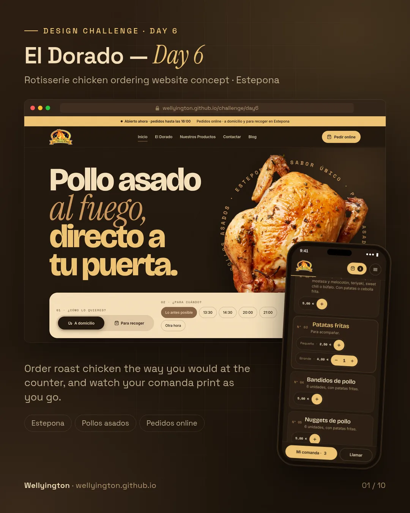
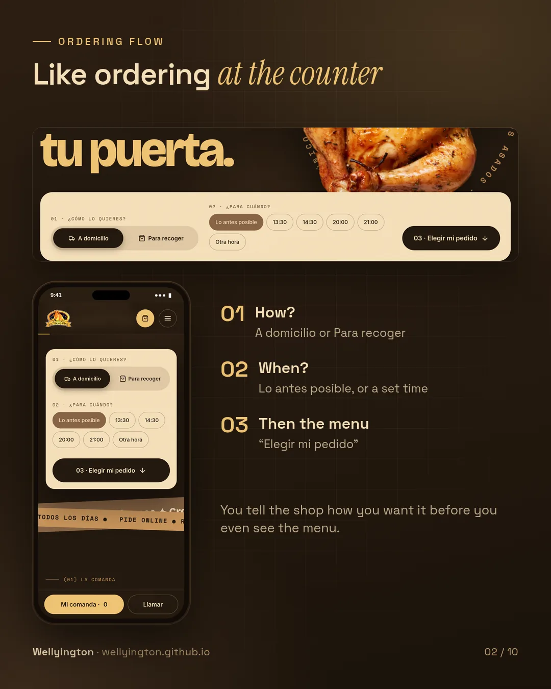
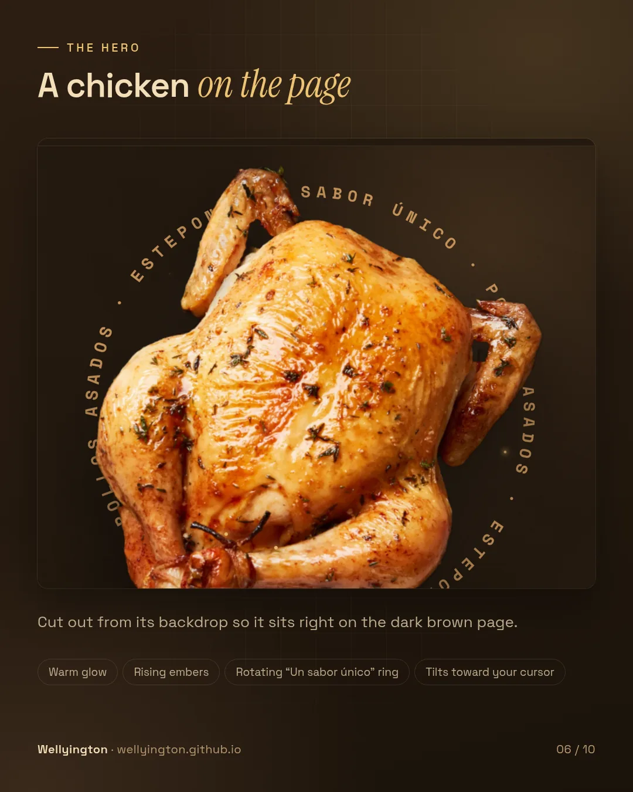
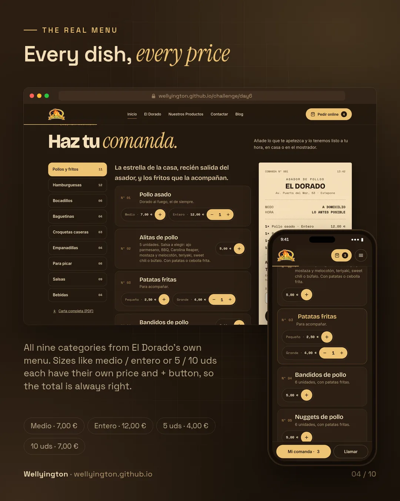
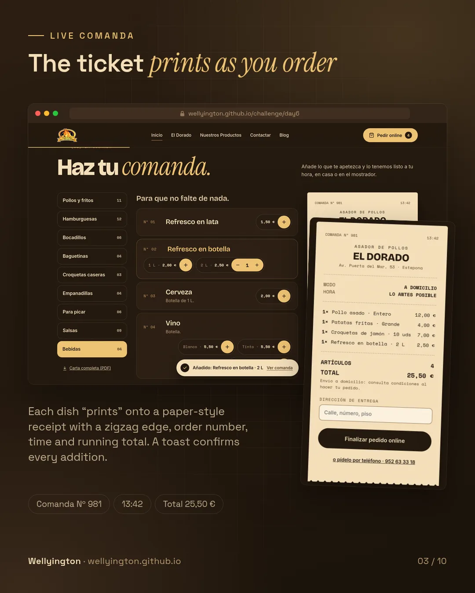
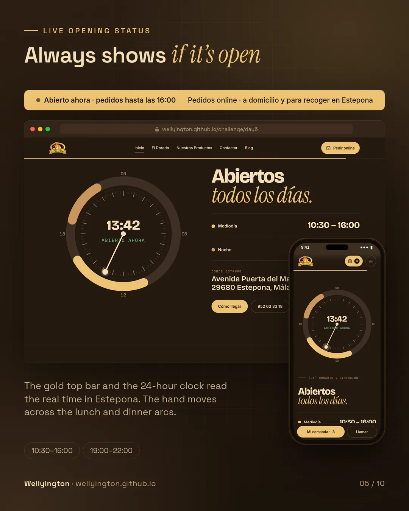
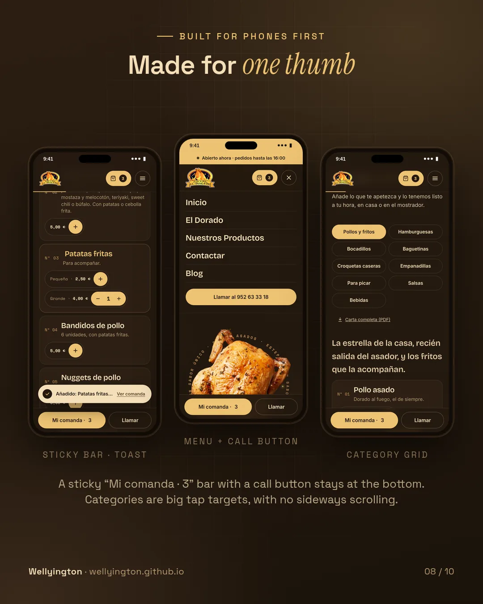
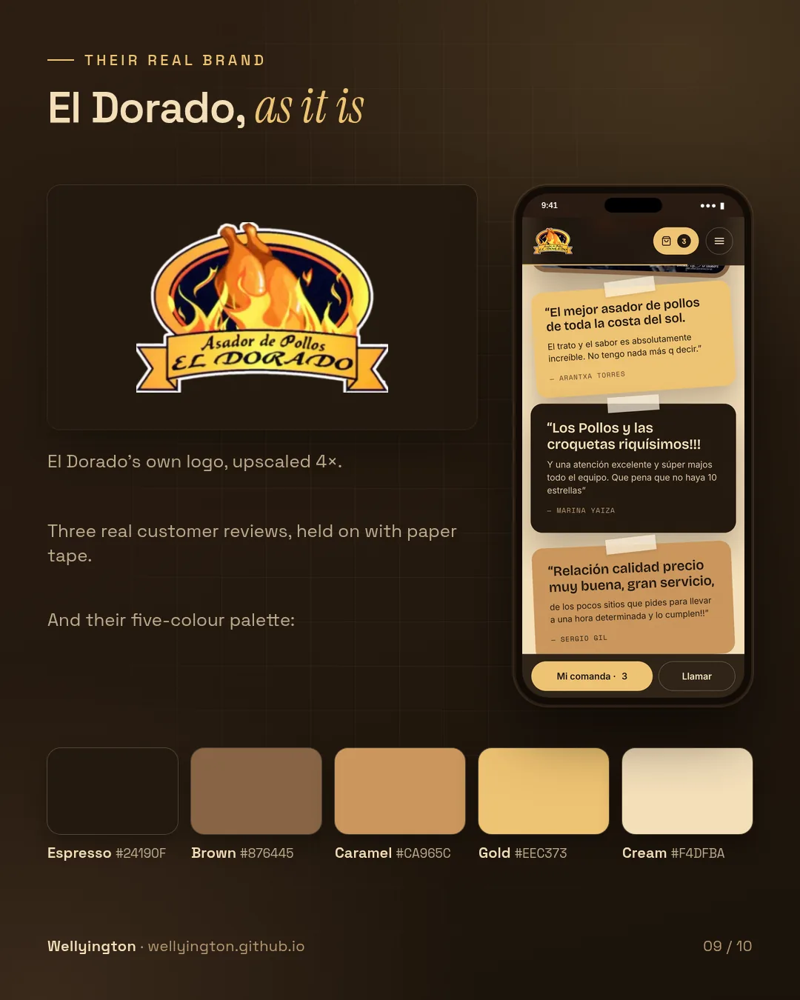
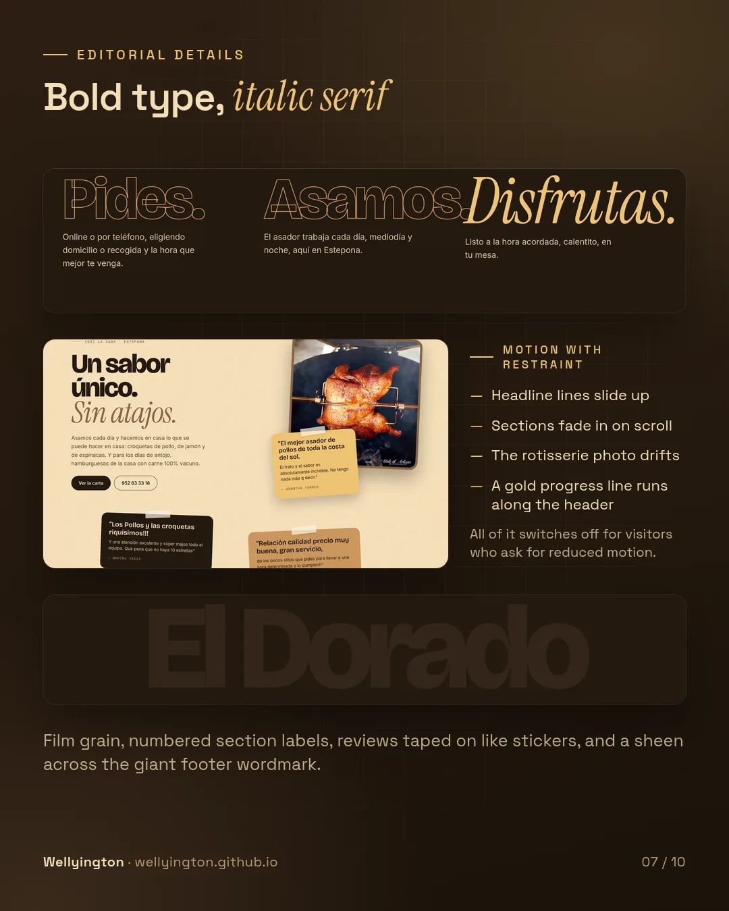

El 22 de noviembre publiqué la sexta nota de esta serie, el reto que planteó Ramiah Trask: cien días, cien negocios, cien webs. El día uno fue un constructor familiar de la Marina Alta. [Esa página está aquí.](https://wellyington.github.io/journal/es/articles/la-web-antes-del-si/) El día dos, un teatro de Málaga. [Esa está aquí.](https://wellyington.github.io/journal/es/articles/sitio-para-toda-la-temporada/) El día tres, un restaurante familiar de Estepona. [Esa está aquí.](https://wellyington.github.io/journal/es/articles/un-sitio-en-la-mesa-larga/) El día cuatro, una consultora inmobiliaria privada de Málaga. [Esa está aquí.](https://wellyington.github.io/journal/es/articles/criterio-antes-que-volumen/) El día cinco, un restaurante de menús degustación en Motril. [Esa está aquí.](https://wellyington.github.io/journal/es/articles/tan-cuidada-como-la-cocina/)

Hoy toca el negocio más cotidiano de los seis, y quizá aquel cuya web se usa más a menudo. El Dorado es un asador de pollos en la avenida Puerta del Mar de Estepona, mi propio pueblo. Pollo asado, patatas, croquetas caseras, hamburguesas, bocadillos, empanadillas argentinas, salsas y bebidas. Se puede pedir a domicilio o para recoger, todos los días, a mediodía y por la noche. Ya tiene web y tienda online, en [pollosasadosadomicilioestepona.es](https://pollosasadosadomicilioestepona.es/).

La web de un asador tiene dos trabajos. Tiene que abrirte el apetito, y tiene que hacer que pedir sea fácil. La mayoría de las webs de comida para llevar cumplen uno de los dos. El concepto está aquí: [El Dorado, día seis](https://wellyington.github.io/challenge/day6/).

## el mostrador, no el catálogo

Piensa en cómo se pide en el mostrador de un asador. No empiezas mirando productos. La persona que atiende te hace primero dos preguntas: ¿es para llevar o te lo llevamos a casa?, y ¿para cuándo? Solo después dices lo que quieres. Un pollo entero, unas patatas grandes, unas croquetas, una botella de cola. Lo apunta en la comanda, te lo repite y te dice el total.

La mayoría de los pedidos online lo hacen al revés. Te enseñan una tienda llena de productos, te dejan llenar la cesta, y solo al final, al pagar, te preguntan si lo quieres a domicilio y a qué hora. Ahí es donde la gente descubre que la hora que quería ya no está, o que el reparto no llega a su calle, y lo deja.

Así que el concepto copia el mostrador. Lo primero de la página, debajo del titular, es un pequeño panel con dos preguntas. 01: ¿cómo lo quieres?, a domicilio o para recoger. 02: ¿para cuándo?, lo antes posible o una hora concreta en una fila de botones, 13:30, 14:30, 20:00, 21:00, u otra hora. Después, un botón oscuro: 03, elegir mi pedido. Te lleva a la carta.

Le dices al asador cómo lo quieres antes de ver la carta. Es lo que haría la persona del mostrador, y significa que el resto de la página ya sabe lo que tienes en mente.

*La apertura: el titular, el pollo y las dos preguntas que haría primero el mostrador.*

*Cómo, cuándo y luego la carta. Como en el mostrador.*

## un pollo en la página

El titular es la frase más sencilla que pude escribir: pollo asado al fuego, directo a tu puerta. Va muy grande, en una palo seco gruesa y algo estrecha, en crema y dorado, con «al fuego» en una serifa cursiva fina en medio. Se lee como el rótulo de una fachada.

Al lado está lo que la gente viene a buscar: un pollo asado, dorado y brillante, con hierbas en la piel. Lo recorté de su fotografía para que quede directamente sobre la página marrón oscuro, sin caja alrededor. Un anillo de texto gira despacio a su alrededor, un sabor único, pollos asados, Estepona, que es la frase de El Dorado. Detrás hay un resplandor cálido, unas pocas brasas que suben, y en un ordenador se inclina muy ligeramente hacia el cursor.

Sé cómo suena eso escrito. En la pantalla es tranquilo. Se trata de que lo primero que veas sea la comida, a un tamaño en el que casi puedas olerla.

*Recortado de su fondo para que quede sobre la página. Un resplandor cálido, unas brasas y un anillo de texto que gira despacio.*

## la carta real, con todos los precios

La segunda sección se llama haz tu comanda. La comanda es el papel con el que trabaja la cocina, y toda la idea de este concepto descansa en ella.

A la izquierda están las nueve categorías de la carta de El Dorado, cada una con el número de platos que tiene: pollos y fritos, hamburguesas, bocadillos, baguetinas, croquetas caseras, empanadillas, para picar, salsas y bebidas. En el centro, los platos de la categoría elegida, numerados como en una pizarra, cada uno con una descripción breve y su precio. A la derecha, la comanda.

No simplifiqué la carta para facilitar el diseño. Un asador de verdad tiene tamaños, y los tamaños son donde suelen fallar los pedidos online. Medio pollo cuesta 7 euros y uno entero 12. Las patatas, 2,50 la pequeña y 4 la grande. Las croquetas van de cinco en cinco o de diez en diez. Una botella de cola, de un litro o de dos. Así que cada tamaño tiene su precio y su propio botón de sumar. No eliges un tamaño en un desplegable y luego pulsas añadir. Pulsas el más junto al tamaño que quieres. El total siempre cuadra, porque no hay un paso intermedio donde pueda equivocarse.

Las alitas enumeran sus nueve salsas, del ajo y parmesano a la Carolina Reaper. Las hamburguesas dicen de qué están hechas, 100% ternera. Y debajo de las categorías hay un enlace pequeño a la carta completa en PDF, la que El Dorado ya publica, para quien prefiera leerla entera de una vez.

*Las nueve categorías de la carta de El Dorado. Cada tamaño tiene su precio y su propio botón, así que el total siempre cuadra.*

## la comanda se imprime mientras pides

Esta es la parte que más disfruté. A medida que añades cosas, aparecen en una comanda a la derecha de la pantalla, dibujada como los papeles que salen de la impresora de una cocina: papel crema, letra de máquina de escribir y un borde rasgado en zigzag abajo.

Arriba pone comanda número 981, o el número que te toque, con la hora. Luego asador de pollos El Dorado y la dirección. Luego las dos respuestas que diste al principio: a domicilio, lo antes posible. Luego cada línea según la añades: 1 pollo asado, entero, 12 euros. 1 patatas, grande, 4 euros. 1 croquetas de jamón, 10, 7 euros. 1 botella de cola, 2 litros, 2,50. El número de artículos, y el total, 25,50 euros.

Cada vez que añades algo, aparece un pequeño aviso abajo para confirmarlo: añadido, botella de cola, 2 litros, con un enlace para ver la comanda. Si cambias de idea, el más se convierte en un menos y un número.

Bajo el total hay una línea sobre las condiciones de envío, un campo para la dirección de entrega y un botón: finalizar pedido online. Debajo, en letra pequeña, la alternativa: o pídelo por teléfono, 952 63 33 18.

Para ser claro sobre lo que hace el concepto en ese punto: el botón te lleva a la tienda online que El Dorado ya tiene para terminar el pedido allí. Los productos de la comanda no pasan de un sitio a otro en el concepto. En una versión real, la comanda es justo lo que recibiría la cocina, ya sea en la tienda que ya usan o directamente en una impresora detrás del mostrador. El diseño es la parte que le importa al cliente: ves tu pedido todo el tiempo, tal como lo verá la cocina.

*Cada plato se imprime en una comanda de papel, con borde en zigzag, número de pedido, la hora y el total que se va sumando.*

## siempre dice si está abierto

No hay nada más molesto que pedir a un sitio de comida para llevar y descubrir que está cerrado. El Dorado abre todos los días de 10:30 a 16:00 y de 19:00 a 22:00, y el concepto lo dice en todos los sitios donde importa.

Una barra dorada recorre la parte de arriba de la página. Cuando está abierto dice abierto ahora, pedidos hasta las 16:00, o hasta las 22:00 por la noche. Cuando está cerrado, dice cuándo vuelve a abrir, a las 10:30 o a las 19:00, y añade programa tu pedido. A nadie se le da con la puerta en las narices. Se le dice cuándo volver, y que puede pedir con antelación.

Más abajo, la sección de horarios tiene un reloj de 24 horas. Los dos turnos se dibujan como arcos en el borde, el mediodía en dorado y la noche en caramelo, y la aguja marca la hora real de Estepona. A las 13:42 está dentro del arco del mediodía y en el centro pone abierto ahora. Al lado: abiertos todos los días, los dos horarios, la dirección en la avenida Puerta del Mar, un botón para llegar y el teléfono.

El reloj lee la hora de Estepona, no la de tu móvil, así que acierta incluso para quien pide para sus padres desde Londres.

*La barra dorada y el reloj de 24 horas leen la hora real de Estepona. La aguja recorre los arcos del mediodía y la noche.*

## hecho para un pulgar

La mayoría de los pedidos a un sitio así se hacen desde el móvil, con una mano, muchas veces mientras haces otra cosa. Así que diseñé primero la versión para móvil y después la de pantalla grande.

Abajo de la pantalla hay una barra que no se mueve: mi comanda, con el número de artículos, y llamar. Toca la primera y saltas a tu comanda. Toca la segunda y el móvil llama al asador. Mires lo que mires, pedir o llamar está a un toque.

En el móvil, las categorías no son una fila que hay que deslizar de lado, que es fácil no ver. Son una cuadrícula de botones grandes, dos por fila, así que las nueve se ven a la vez y cada una es lo bastante grande para un pulgar. El aviso de confirmación aparece justo encima de la barra de abajo, donde ya están tus ojos.

El menú se abre a pantalla completa, con la barra dorada del horario arriba, las cinco secciones de la web, un botón grande para llamar al 952 63 33 18 y el pollo otra vez abajo.

*Una barra fija con la comanda y un botón de llamada. Categorías como botones grandes, sin deslizar de lado.*

## su marca, tal cual

Todos los conceptos de esta serie hasta ahora han tenido una imagen nueva. Este no, y a propósito.

El Dorado ya tiene una marca que la gente de Estepona conoce: un logotipo con un pollo delante de unas llamas y una cinta que dice asador de pollos El Dorado. No es un logotipo minimalista, ni tiene por qué serlo. Es el rótulo de la tienda. Así que lo mantuve, limpio y ampliado para que se vea nítido en las pantallas de hoy, y construí todo lo demás a su alrededor.

Los colores también salen del logotipo. Espresso, #24190F, para el fondo. Marrón, #876445. Caramelo, #CA965C. Dorado, #EEC373, para los botones y la barra de arriba. Crema, #F4DFBA, para la comanda y las secciones claras. Sobre una página oscura parecen el interior de un asador, que es justo la idea.

La tipografía sí es nueva. Bricolage Grotesque, gruesa y apretada, para los titulares grandes, para que se lean como un rótulo. Instrument Serif en cursiva para las palabras más cálidas. Space Mono, una letra de máquina de escribir, para la comanda y las etiquetas pequeñas. Inter para todo lo que hay que leer rápido.

Hay también una sección sobre la casa: un sabor único, sin atajos. Asan cada día y hacen en casa lo que se puede hacer en casa: croquetas de pollo, de jamón y de espinacas, y hamburguesas 100% de ternera. Al lado, tres opiniones reales de clientes, sujetas con tiras de cinta de papel como notas en la nevera. Una dice que El Dorado es el mejor asador de pollos de toda la Costa del Sol. Otra destaca que es de los pocos sitios donde pides para llevar a una hora determinada y la cumplen.

*El logotipo de El Dorado, tres opiniones reales de clientes y la paleta de cinco colores sacada de la marca.*

## movimiento con mesura

En esta página se mueven unas pocas cosas, y cada una tiene un motivo. Las líneas del titular suben una a una al cargar. Las secciones aparecen suavemente al llegar a ellas. La foto del asador en la sección de la casa se desplaza un poco. Una línea dorada fina en lo alto de la cabecera marca cuánto has bajado.

Entre secciones hay una historia corta en tres palabras, como la pintaría un negocio en la pared. Pides. Asamos. Disfrutas. Pides, online o por teléfono. Asamos, cada día, a mediodía y por la noche, aquí en Estepona. Disfrutas, listo a la hora acordada, todavía caliente. Al final de la página, El Dorado aparece escrito muy grande en el pie, con un brillo lento que lo recorre.

Todo el movimiento se apaga para quien ha pedido a su móvil u ordenador que reduzca las animaciones. La página funciona exactamente igual sin él.

*Tipografía gruesa, serifa cursiva, opiniones pegadas como notas y un movimiento que se apaga cuando se pide.*

## qué es el concepto, y qué viene después

El logotipo, los colores, la carta, los precios, el horario, la dirección, el teléfono y las opiniones de clientes que aparecen en la página son de El Dorado. No he cambiado ninguno. Lo nuevo es el orden de las cosas, la comanda, el reloj y cómo se comporta la página en el móvil.

Para convertir el concepto en una tienda que funcione harían falta dos cosas. Primero, que la comanda llegue a la cocina: a la tienda online que El Dorado ya tiene, o como un ticket impreso detrás del mostrador. Segundo, que las horas disponibles salgan de la propia cocina, para que un domingo a mediodía con mucho trabajo pueda cerrar una franja antes de que se llene. Ninguna de las dos es complicada. Las dos merecen hacerse bien.

No tengo cifras de pedidos ni de ventas, y no me las voy a inventar.

## si tus clientes te piden desde el móvil

Puede que no vendas pollos asados. Pero muchos negocios pequeños de esta costa reciben pedidos: una pastelería que hace tartas por encargo, una pizzería, una floristería, una lavandería, una carnicería que prepara packs de barbacoa para el fin de semana. Sus clientes suelen pedir desde el móvil, con prisa, y la web suele pedirles que piensen como un dependiente.

Lo que ayuda es lo mismo que aquí. Pregunta primero cómo y cuándo. Muestra cada opción con su propio precio. Deja que la gente vea su pedido todo el tiempo, tal como lo vas a recibir. Di claramente si estás abierto y, si no, cuándo. Y deja el teléfono a un toque, porque siempre habrá quien prefiera llamar.

Soy diseñador web en Estepona, en la Costa del Sol, y hago webs como esta para negocios de toda España. Si esto se parece a tu negocio, escríbeme desde [la web principal](https://wellyington.github.io/es/). Cuéntame a qué te dedicas y dónde, y te contestaré en un lenguaje claro. El concepto está [aquí](https://wellyington.github.io/challenge/day6/), y la web actual de El Dorado [aquí](https://pollosasadosadomicilioestepona.es/), para que puedas compararlas. Seis hechas, quedan noventa y cuatro.
