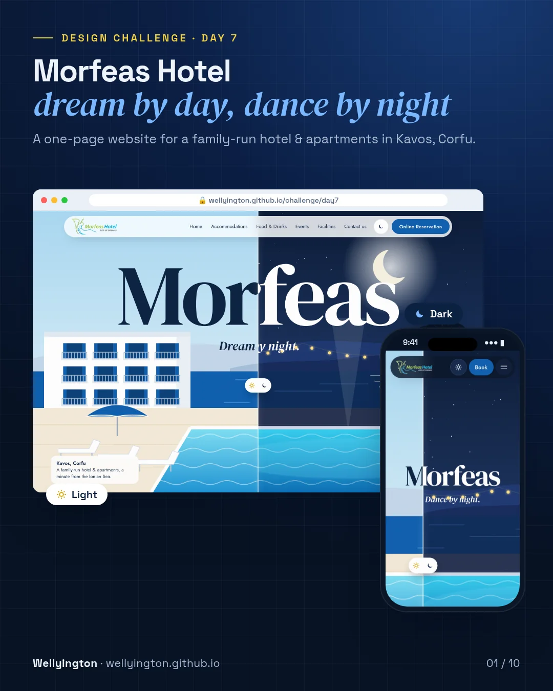
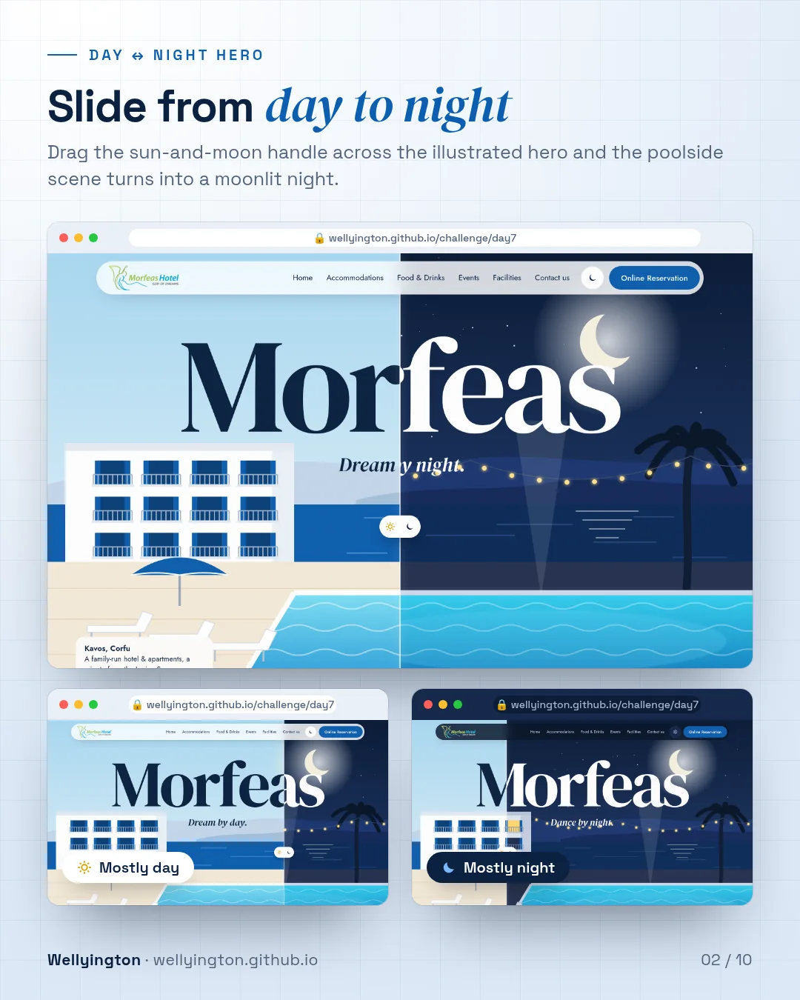
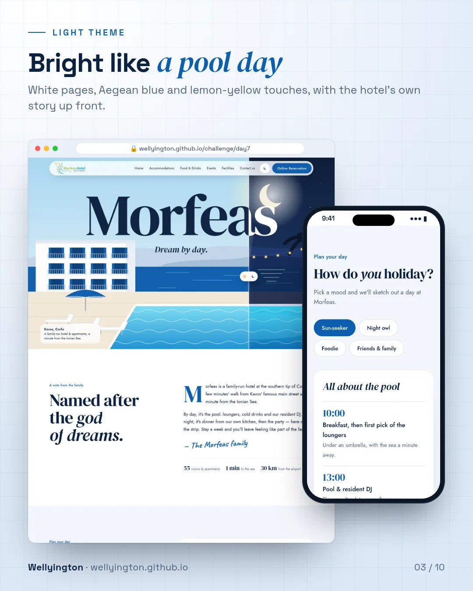
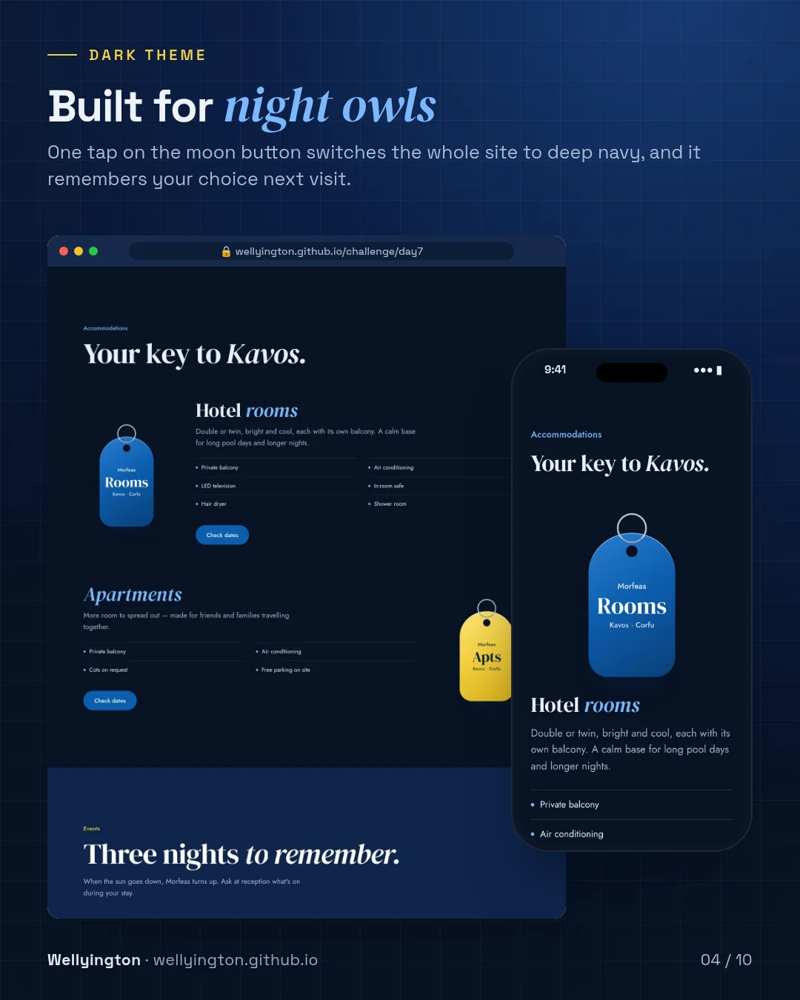
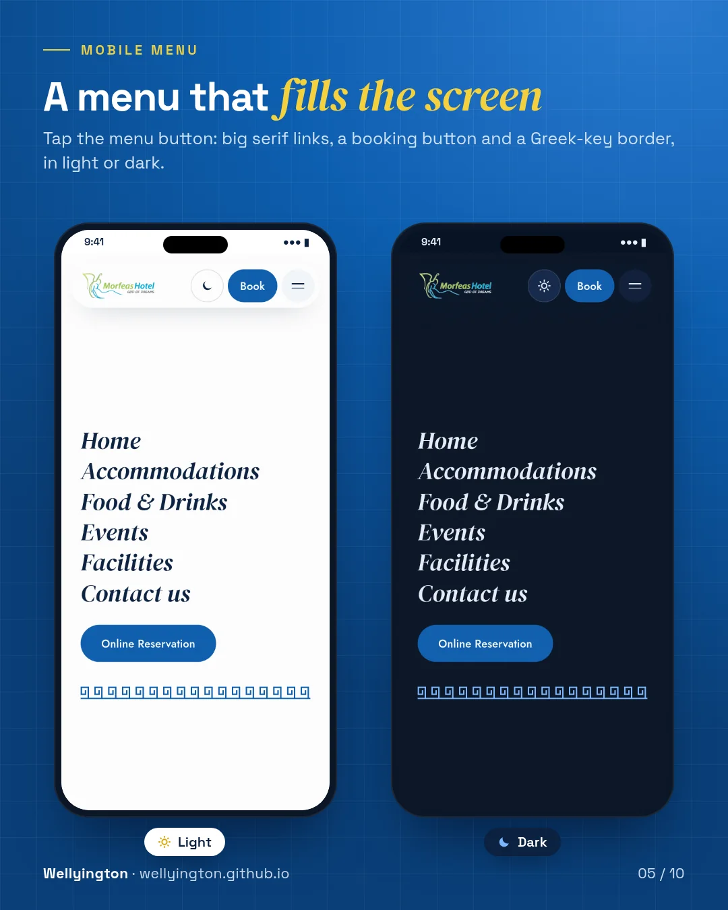
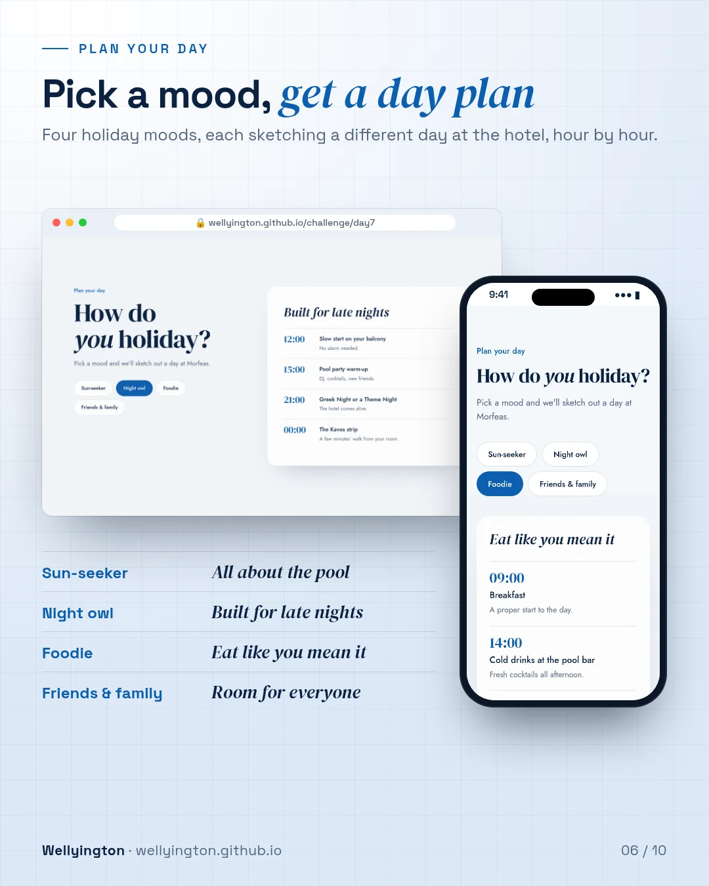
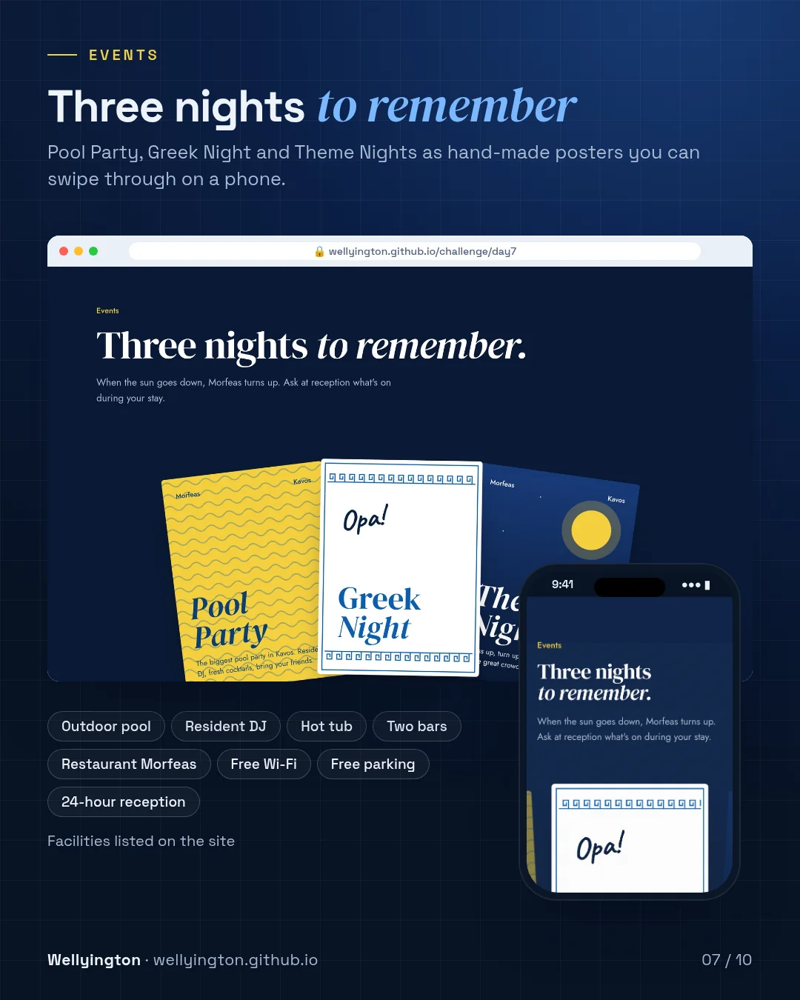
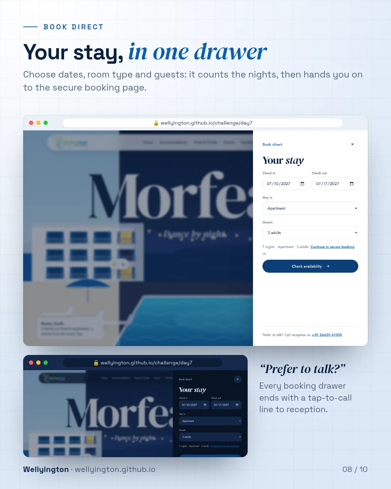
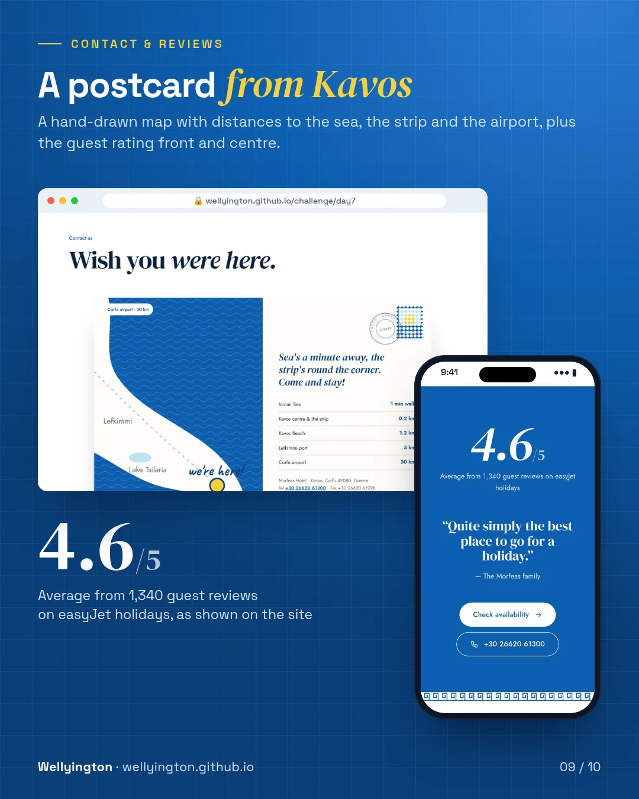

El 23 de noviembre publiqué la séptima nota de esta serie, el reto que planteó Ramiah Trask: cien días, cien negocios, cien webs. El día uno fue un constructor familiar de la Marina Alta. [Esa página está aquí.](https://wellyington.github.io/journal/es/articles/la-web-antes-del-si/) El día dos, un teatro de Málaga. [Esa está aquí.](https://wellyington.github.io/journal/es/articles/sitio-para-toda-la-temporada/) El día tres, un restaurante familiar de Estepona. [Esa está aquí.](https://wellyington.github.io/journal/es/articles/un-sitio-en-la-mesa-larga/) El día cuatro, una consultora inmobiliaria privada de Málaga. [Esa está aquí.](https://wellyington.github.io/journal/es/articles/criterio-antes-que-volumen/) El día cinco, un restaurante de menús degustación en Motril. [Esa está aquí.](https://wellyington.github.io/journal/es/articles/tan-cuidada-como-la-cocina/) El día seis, un asador de pollos de Estepona. [Esa está aquí.](https://wellyington.github.io/journal/es/articles/del-mostrador-a-la-comanda/)

Hoy toca el primer negocio de la serie fuera de España. Morfeas Hotel es un hotel familiar con habitaciones y apartamentos en Kavos, en la punta sur de Corfú. Está a un minuto del mar Jónico y a pocos minutos a pie de la calle principal de Kavos, famosa por una cosa: salir de fiesta. El hotel lleva el nombre de Morfeo, el dios griego de los sueños. Su web está en [morfeashotel.com](https://www.morfeashotel.com/).

El concepto está aquí: [Morfeas Hotel, día siete](https://wellyington.github.io/challenge/day7/).

Este es un concepto de rediseño independiente. No es una colaboración oficial con Morfeas Hotel, nadie allí me lo ha pedido y nada en la página significa que lo hayan aprobado. Como los seis anteriores, por ahora vive en mi propia dirección.

## un hotel, dos vacaciones

La mayoría de las webs de hotel describen unas vacaciones. Una piscina, una habitación, un desayuno, una puesta de sol. Eso funciona para un hotel tranquilo. No funciona para un hotel en Kavos.

Los huéspedes de Morfeas tienen dos vacaciones en la misma semana, a veces en el mismo día. De día es la piscina: tumbonas, bebidas frías, el DJ residente. De noche es la cena de la cocina del hotel y luego la fiesta, en el hotel o en la calle de al lado. La misma gente, la misma piscina, dos ambientes distintos. El hotel ya lo dice en una de sus frases: dream by day, dance by night. Sueña de día, baila de noche.

Así que, en lugar de elegir uno de los dos, el concepto enseña los dos, y deja que quien visita decida cuál está mirando.

*Día siete: un hotel, una piscina, dos ambientes.*

## deslizar del día a la noche

Lo alto de la página es un dibujo, no una fotografía: el edificio blanco del hotel con sus contraventanas azules, una sombrilla, dos tumbonas, el mar detrás y una piscina en primer plano. La palabra Morfeas lo cruza en una serifa grande, tan grande como permite la pantalla.

El dibujo existe dos veces, una de día y otra de noche, colocadas exactamente una encima de la otra. En el centro hay un pequeño tirador con un sol en un lado y una luna en el otro. Arrástralo y la línea entre los dos dibujos se mueve con tu dedo. A la izquierda, un cielo azul claro y la frase dream by day. A la derecha, un cielo azul marino, estrellas, una luna creciente, la silueta de una palmera, una guirnalda de luces de fiesta sobre el agua y un haz de luz que sube desde la piscina. Ahí la frase dice dance by night. Lleva el tirador hasta el final y todo el hotel pasa del mediodía a la medianoche.

Al abrir la página, el tirador no está en el centro. Se inclina hacia la hora que sea en Kavos. Quien llega por la tarde ve sobre todo el día. Quien mira a las once de la noche, hora de Corfú, ve sobre todo la noche. Un pequeño reloj en la cabecera muestra la hora de Kavos con un sol o una luna al lado, que es poca cosa pero resulta útil para quien planea las vacaciones desde otro huso horario.

Dibujé la escena en vez de usar fotografías por dos razones. Un dibujo puede pasar del día a la noche sin una segunda sesión de fotos. Y en tamaño pequeño, en un móvil, un dibujo sencillo se entiende antes que la foto recargada de una piscina llena de gente.

*Arrastra el tirador y la piscina pasa del mediodía a la medianoche. Al abrir la página, se inclina hacia la hora de Kavos.*

## un tema claro y uno oscuro

La portada no es lo único que cambia. Toda la web tiene un tema claro y uno oscuro.

El tema claro es un día de piscina: páginas blancas, el azul Egeo de las contraventanas y las puertas griegas, y toques de amarillo limón. El tema oscuro es la misma web después de la puesta de sol: páginas azul marino profundo, azul claro para los enlaces y los botones, el mismo amarillo limón. Ninguno de los dos es un añadido de última hora. Diseñé los dos, sección por sección, para que la versión oscura no sea solo la clara con los colores invertidos.

Un botón con una luna o un sol en la cabecera cambia de uno a otro. La web recuerda la elección para la siguiente visita. Si alguien no lo ha pulsado nunca, la web sigue lo que ya tenga configurado su móvil u ordenador. Al cambiar el tema también se mueve el tirador de la portada, para que el dibujo de arriba esté de acuerdo con el resto de la página.

*El tema claro: páginas blancas, azul Egeo y amarillo limón, con la nota de la propia familia cerca del principio.*

*El tema oscuro. Un toque en la luna y toda la web se vuelve azul marino, y así sigue la próxima vez.*

## una nota de la familia

Bajo la portada, lo primero que se lee no es una lista de servicios. Es una nota breve de la familia, firmada a mano: Morfeas es un hotel familiar en la punta sur de Corfú, a un minuto del mar y a pocos minutos a pie de la calle principal. De día, la piscina. De noche, la cena de su propia cocina y luego la fiesta. Quédate una semana y te irás sintiéndote parte de la familia.

Al lado, tres cifras en letra grande: 55 habitaciones y apartamentos, un minuto al mar, 30 kilómetros del aeropuerto. Responden a las tres preguntas que la gente hace sobre cualquier hotel de isla antes que nada: qué tamaño tiene, a qué distancia está el mar, a qué distancia está el aeropuerto.

## tu llave de Kavos

La sección de alojamiento se llama your key to Kavos, tu llave de Kavos, y cada tipo de estancia tiene su propio llavero, de los de antes, que cuelgan de la llave en recepción. Uno azul para las habitaciones del hotel. Uno amarillo para los apartamentos. Se balancean suavemente al aparecer.

Las habitaciones son dobles o twin, cada una con su balcón, aire acondicionado, televisión, caja fuerte, secador de pelo y ducha. Los apartamentos tienen más espacio, para grupos de amigos y familias que viajan juntos, con cunas bajo petición y aparcamiento gratuito. Cada tipo tiene un botón para consultar fechas, que abre el cajón de reserva con ese tipo ya seleccionado.

## un menú que llena la pantalla

En el móvil, la cabecera se reduce a tres cosas: el logotipo, un botón Book y el botón del menú. Toca el menú y llena toda la pantalla con las seis secciones de la web en letras grandes, en serifa cursiva, un botón de reserva online y una greca en la parte de abajo, el dibujo que se ve en platos y azulejos por todas las islas. Funciona igual en los dos temas.

En cuanto bajas un poco, se asienta abajo de la pantalla una barra con dos cosas: consultar disponibilidad y un botón que llama a recepción. En la web de un hotel, reservar nunca debería estar a más de un toque.

*El menú llena la pantalla: enlaces grandes en serifa, un botón de reserva y una greca, en claro o en oscuro.*

## elige tu estilo, recibe un plan

Esta es la parte que más me gustaría que un hotel copiara.

Nadie elige un hotel en Kavos por sus toallas. Lo elige por el tipo de vacaciones que quiere. Así que la sección pregunta: how do you holiday?, ¿cómo te gustan las vacaciones? Hay cuatro respuestas, en botones: sun-seeker, el que busca sol; night owl, el noctámbulo; foodie, el que viaja por la comida; y friends and family, amigos y familia. Elige una y la web te dibuja un día en Morfeas para ese tipo de huésped, hora a hora.

El día del que busca sol gira en torno a la piscina: desayuno a las diez y luego la primera elección de tumbona, el DJ a la una, el jacuzzi y un cóctel a las cuatro, un paseo hasta el mar antes de cenar. El día del noctámbulo empieza a mediodía en el balcón, sin despertador, se calienta en la fiesta de la piscina a las tres, sigue con la noche griega o una noche temática a las nueve y llega a la calle de fiesta a medianoche. El día del que viaja por la comida se organiza alrededor del desayuno, el bar de la piscina y la cena en el restaurante del hotel. El de amigos y familia termina con todos en el balcón, porque cada habitación y cada apartamento tiene uno.

Cada línea de esos planes sale de cosas que el hotel tiene de verdad. No hay nada inventado para que el día suene mejor. La idea es que quien visita se vea a sí mismo en él y, en cuatro líneas, sepa si este es su tipo de hotel. También puedes pasar de un estilo a otro con las flechas del teclado.

*Cuatro estilos de vacaciones. Cada uno dibuja un día distinto en el hotel, hora a hora.*

## tres noches para recordar

La noche en Morfeas tiene tres citas habituales: la fiesta de la piscina, la noche griega y las noches temáticas. En la mayoría de las webs de hotel serían tres líneas en una lista. Aquí son tres carteles, de los que verías pegados junto a recepción.

El cartel de la fiesta de la piscina es amarillo limón con líneas onduladas como el agua. El de la noche griega es blanco, con una greca azul y Opa! escrito a mano arriba. El de las noches temáticas es azul marino con una gran luna amarilla. En un ordenador se apoyan unos en otros como carteles en una pared. En un móvil pasas de uno a otro deslizando, con unos puntos pequeños que indican dónde estás. Encima, una frase honesta: pregunta en recepción qué hay durante tu estancia. Las fechas cambian cada temporada, y una web que promete una fecha que no puede cumplir es peor que una que te manda al mostrador.

Después viene la comida, con el restaurante del hotel, el desayuno, el bar de la piscina, la cena y el music lounge, y un enlace a las cartas. Luego las instalaciones: la piscina exterior, el DJ residente, el jacuzzi, dos bares, el restaurante, aire acondicionado, wifi gratis, aparcamiento gratuito y una recepción abierta 24 horas.

*Pool Party, Greek Night y Theme Nights como carteles hechos a mano que se pasan deslizando en el móvil.*

## tu estancia, en un cajón

Todos los botones de reserva de la página, ya estén en la cabecera, bajo un tipo de habitación o al final, abren lo mismo: un cajón que entra desde un lado, llamado your stay, tu estancia. Pide cuatro cosas: fecha de entrada, fecha de salida, habitación de hotel o apartamento, y cuántas personas, de un adulto a dos adultos y dos niños.

Cuenta las noches sobre la marcha y te lo devuelve en una línea: 7 noches, apartamento, 3 adultos. Luego te pasa a la página de reserva segura del hotel. Si falta una fecha, lo dice y pone el cursor en el campo correcto, en lugar de dejarte pulsar el botón y preguntarte por qué no pasa nada.

Al final del cajón hay una línea más: ¿prefieres hablar? Llama a recepción, con el número listo para tocar. Mucha gente sigue reservando las vacaciones en familia por teléfono, y el cajón lo trata como una respuesta perfectamente válida.

Para ser claro sobre lo que hace el concepto en ese punto: el cajón recoge los datos y lleva a quien visita a la web actual del hotel. En el concepto no pasa las fechas de un sitio a otro. En una versión real abriría el sistema de reservas del hotel con las fechas y el tipo de habitación ya rellenados.

*Elige fechas, tipo de habitación y personas. Cuenta las noches y luego te pasa. Cada cajón termina con un número al que llamar.*

## una postal desde Kavos

La sección de contacto es una postal. Se titula wish you were here, ojalá estuvieras aquí. En la mitad izquierda hay un mapa dibujado a mano del sur de Corfú en azul y blanco, con un alfiler amarillo y we're here, estamos aquí, escrito a mano al lado. A la derecha, donde escribirías el mensaje, hay una nota corta: el mar está a un minuto, la calle de fiesta a la vuelta de la esquina, ven a quedarte. Debajo, las distancias: el mar Jónico, a un minuto a pie; el centro de Kavos y la calle de fiesta, a 0,2 km; la playa de Kavos, a 1,2 km; el puerto de Lefkimmi, a 5 km; el aeropuerto de Corfú, a 30 km. En una esquina hay un sello, una baldosa con greca y un pequeño sol amarillo, y un matasellos.

Después, la valoración de los huéspedes, tan grande como el nombre del hotel arriba: 4,6 sobre 5, la media de 1.340 opiniones de huéspedes en easyJet holidays, tal como aparece en la propia web del hotel. Una frase de la familia, un botón para consultar disponibilidad y el teléfono. Una greca cierra la página.

*Una postal dibujada a mano con las distancias que importan, y la valoración de los huéspedes bien a la vista.*

## los detalles

La tipografía es DM Serif Display para los titulares, grande y apretada, con cursiva para las palabras más cálidas. Jost, una palo seco geométrica y limpia, para todo lo que se lee. Caveat, una letra manuscrita, para la firma de la familia, Opa! y we're here.

Los colores se quedan cerca de la isla: el azul Egeo de las contraventanas y las puertas, un azul marino de noche profundo, amarillo limón y mucho blanco. El logotipo es el del propio hotel.

Los titulares suben a su sitio palabra a palabra al hacer scroll, las secciones aparecen suavemente, los llaveros se balancean y las estrellas sobre la piscina nocturna titilan. Todo eso se apaga para quien ha pedido a su móvil u ordenador que reduzca las animaciones, y la página funciona exactamente igual sin ello. El tirador del día y la noche se puede mover también con el teclado, no solo con el ratón o el dedo.

## qué es el concepto, y qué no es

Los datos de la página salen de la web actual del hotel y de sus fichas públicas: las habitaciones y los apartamentos, las instalaciones, los eventos, la dirección, los teléfonos, las distancias y la valoración de los huéspedes. La nota de la familia y los planes del día los he escrito yo, solo a partir de esos datos. Si algún día la familia lo quisiera, cambiaría mis palabras por las suyas.

Lo nuevo es cómo encaja todo: un hotel mostrado en dos ambientes, una página que sabe qué hora es en Kavos, un planificador que habla del tipo de huésped y no del tipo de habitación, y un paso de reserva que no te hace salir de la página hasta que estás listo.

No tengo cifras de reservas, y no me las voy a inventar. Si nadie en Morfeas quiere esto, el concepto se queda donde está, como día siete. Si lo quieren, lo demás es práctico: sus palabras en lugar de las mías, sus fotografías junto a los dibujos, el cajón de reserva conectado a su sistema de reservas, una versión en griego y la web trasladada a morfeashotel.com.

## si tu negocio cambia con la hora

Puede que no lleves un hotel en Kavos. Pero muchos negocios tienen dos caras: un chiringuito que se convierte en coctelería, una cafetería que sirve cenas, un restaurante con un mediodía tranquilo y un sábado por la noche ruidoso, un espacio que acoge bodas de día y conciertos de noche. Sus webs suelen enseñar solo una de las dos, y la otra mitad de los clientes tiene que adivinar.

Lo que ayuda es lo mismo que aquí. Enseña los dos ambientes y deja que la gente elija. Usa la hora del día si importa. Describe la experiencia en el orden en que la vive el cliente, no en el orden de tu lista de precios. Mantén el botón de reserva a mano en cada pantalla. Y deja siempre un teléfono para quien prefiera hablar.

Soy diseñador web en Estepona, en la Costa del Sol, y diseño y construyo webs para negocios de España y de fuera. Si esto se parece a tu negocio, escríbeme desde [la web principal](https://wellyington.github.io/es/). Cuéntame a qué te dedicas y dónde, y te contestaré en un lenguaje claro. El concepto está [aquí](https://wellyington.github.io/challenge/day7/), y la web actual de Morfeas Hotel [aquí](https://www.morfeashotel.com/), para que puedas compararlas. Siete hechas, quedan noventa y tres.
