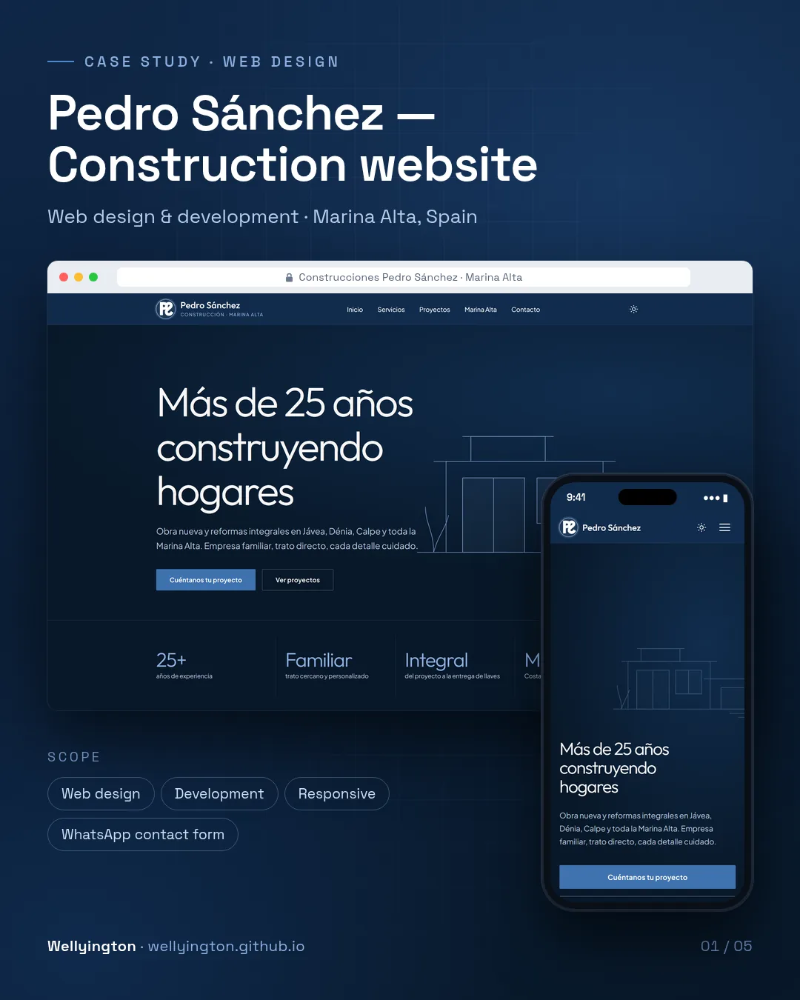
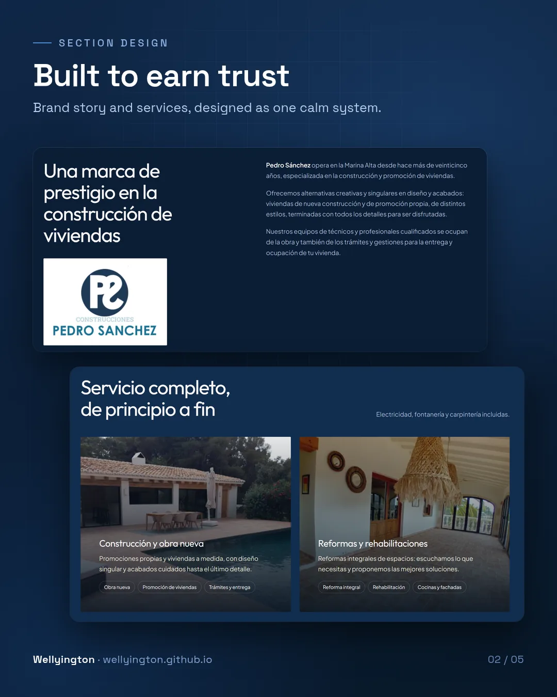
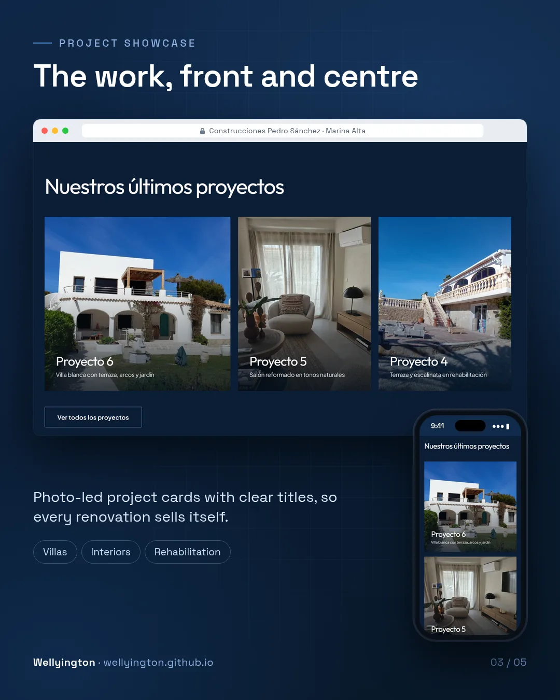
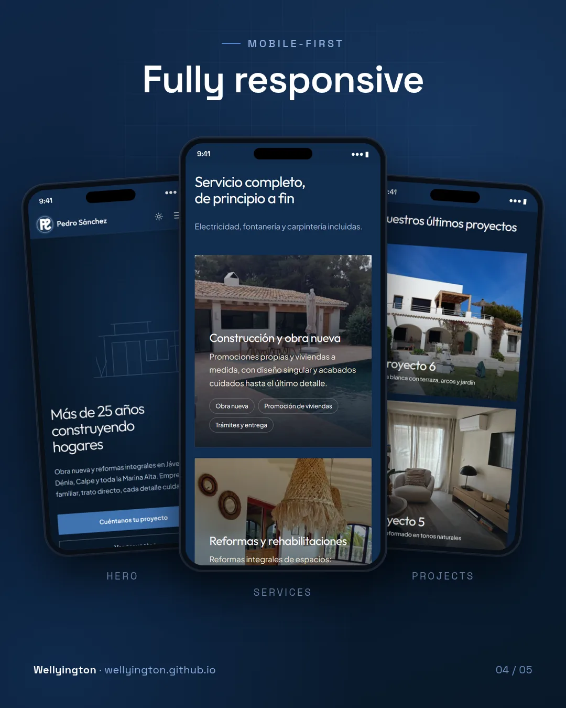

El 17 de noviembre publiqué una nota corta. Primer día de un reto que estoy haciendo a la vista de todos: cien días, cien negocios, cien webs. La primera es una sola página para Pedro Sánchez Construcción, una constructora familiar de la Marina Alta. Ya está publicada.

Trabajo desde Estepona. La semana normal es una web para una tienda, un estudio o un oficio, hecha para comportarse como el negocio: clara con lo que ofrece y fácil de encontrar una tarde cualquiera. Esta la construí antes de que nadie me contratara.

Se puede abrir aquí: [Pedro Sánchez Construcción, día uno](https://wellyington.github.io/challenge/day1/). De momento vive en mi propia dirección. Es el sitio honesto mientras el dueño no la recoja.

## cien días, un negocio cada vez

Un negocio al día, y cada vez una web de verdad, no un dibujo guardado para una reunión que a lo mejor no llega. Al cabo de cien días quiero cien páginas que una persona pueda abrir y reconocer. Esta constructora es la primera. Quedan noventa y nueve.

La idea es de Ramiah Trask. Cree que una racha de días así es una manera sólida de montar un negocio de diseño de webs, por lo que le cambia al cliente. Contratar a alguien suele significar imaginar una página que no existe: las webs de otros, una propuesta, tu nombre todavía en blanco. Una página terminada se decide con menos salto. La abres, ves tus pueblos y tu trabajo, y pasas el móvil por encima de la mesa. Sí, o no, o cambia esta parte.

No he hablado con Pedro. Que yo sepa, no ha visto la página, y no voy a escribir como si la hubiera visto. Está ahí para que mire algo acabado.

## lo que busca quien va a contratar una constructora

La página presenta una empresa familiar que lleva más de veinticinco años construyendo casas en la Marina Alta. Nombra Jávea, Dénia y Calpe, y la costa de alrededor, en la Costa Blanca, Alicante. La frase de arriba es la que ellos ponen por delante: más de veinticinco años construyendo hogares. Obra nueva, reformas integrales, un trato cercano y cuidado con el detalle.

Esa historia no me la inventé para que sonara antigua. Es lo que escucha un cliente. Veinticinco años en la misma costa quieren decir que la empresa estaba antes de las cocinas de moda de este año, y que es probable que siga cogiendo el teléfono si la obra se alarga. «Familiar», en la página, se escribe como trato directo. Hablas con ellos, no con una centralita.

El trabajo va en dos bloques, uno al lado del otro. Casas nuevas: unas las promueven ellos y otras se dibujan para un cliente concreto, terminadas para vivirlas. Reformas integrales, en las que escuchan y luego proponen un camino. Electricidad, fontanería y carpintería incluidas. Esa última frase pesa si alguna vez has reformado. Hay un tramo malo en esas obras, cuando la electricidad «es cosa de otro» y ese otro no está contratado. Cuento lo que dice la página. No he estado en sus obras.

El visitante que tenía en la cabeza está en una semana concreta. Un solar. Una casa que ya no cabe. Una cocina que lleva años sin gustarle. Compara dos o tres empresas y quiere respuestas sencillas. ¿Puedo fiarme de esta gente con una casa? ¿Puedo ver el trabajo? ¿Cómo les escribo esta semana, sin abrirme una cuenta?

## la primera pantalla

Las primeras palabras van grandes: «Más de 25 años construyendo hogares.» Detrás, un dibujo de líneas de una casa, claro sobre un azul oscuro. Debajo, obra nueva y reformas integrales en Jávea, Dénia, Calpe y el resto de la Marina Alta. Empresa familiar, trato directo, cada detalle cuidado.

Dos botones. Cuéntanos tu proyecto, o ver los proyectos. Hablar ahora, o mirar casas primero.

Abajo corren cuatro datos cortos. Más de veinticinco años. Una empresa familiar, cercana. El camino entero, del proyecto al día en que entregan las llaves. El lugar: Marina Alta, Costa Blanca, Alicante. Caen donde cae la vista, antes de bajar por la página.

En el móvil esa pantalla se apila. El titular, unas líneas, el botón. El dibujo se queda, más pequeño, y sigue siendo su página.

*El principio de la página, en pantalla grande y en el móvil.*

## la historia y los dos trabajos

Más abajo, unos párrafos dicen quiénes son. Más de veinticinco años construyendo y promoviendo viviendas en la Marina Alta. Promociones propias y casas nuevas de estilos distintos, terminadas para vivirlas. La gente que emplean se ocupa de la obra y también de los papeles de la entrega. El título los llama una marca de prestigio en la construcción de viviendas. Esa frase es suya. La página no la grita por encima.

La marca es un monograma PS, el nombre, y las palabras construcción y Marina Alta. Dice de quién es la página, arriba, y otra vez al pie.

Luego los servicios, bajo un título que promete el trabajo de principio a fin. Al lado: electricidad, fontanería y carpintería incluidas. Dos fotografías hacen la explicación. Una es una casa de una planta, tejado de teja, piscina y una mesa bajo los árboles: construcción y obra nueva, promociones propias y viviendas a medida. La otra es una estancia larga y cubierta, arcos a un lado, una lámpara grande de fibra, el jardín al fondo: reformas, donde escuchan y después proponen. Hay etiquetas pequeñas para quien va de prisa. Obra nueva, promoción de viviendas, trámites y entrega. Reforma integral, rehabilitación, cocinas y fachadas.

Debajo de las fotos, el orden en que lo vive un cliente. Primero escuchan, porque cada proyecto es el suyo. Después proponen. Al final ejecutan, de la planificación al último día de obra.

Sigue un pasaje corto sobre vivir en la Marina Alta. Calas, inviernos suaves, veranos cálidos, comida y algo de silencio. Dénia, Jávea y Calpe aparecen solos, con su nombre. Mucha gente que encarga una casa aquí está eligiendo el pueblo tanto como la empresa, así que la página lo dice, breve, y vuelve al trabajo.

*Quiénes son, y los dos trabajos: casas nuevas y reformas integrales.*

## las casas

Uno se fía de un constructor cuando puede ver casas. La página enseña tres proyectos recientes, cada uno una fotografía con un título y una línea.

Una villa blanca con terraza, arcos y jardín. Un salón reformado en tonos naturales: cortinas claras, una butaca baja, madera, una lámpara. Una terraza y una escalera exterior todavía a medias, con la costa detrás. Esa tercera importa. Una obra a medias dice que la reforma pertenece a la empresa, no solo las villas ya terminadas.

Hay un camino hacia todos los proyectos. En el móvil la fotografía va antes que el rótulo. No he recorrido estas habitaciones, así que no voy a inventar lo que se siente dentro. Se ven grandes, en un español normal. La palabra portfolio no sale. En la mesa de una cocina, el cliente ya dice «proyectos».

*Trabajo reciente, en fotografías con un título y una línea.*

## cómo se les escribe

El final de la página es lo que hace útil el resto. Puedes escribir por WhatsApp o rellenar un formulario corto: nombre, teléfono, correo y en qué consiste el proyecto. Marcas que has leído la nota de privacidad. El botón dice enviar por WhatsApp. Entonces se abre WhatsApp con el mensaje ya escrito, y le das a enviar tú. No se pierde en un buzón que nadie mira. Ves el paso siguiente.

Bajo el número, una línea: escríbenos por WhatsApp o rellena el formulario, y responden. El título de encima es «deja tu proyecto en manos de expertos». En esta costa, mucho de lo que de verdad se acuerda ya pasa por WhatsApp. Cambiar el número más adelante es un ajuste pequeño.

## la misma web en el móvil

Una pareja que sale de una visita. Alguien que manda la cocina que quiere tirar a la persona que tiene que estar de acuerdo. Un nombre oído en Dénia, abierto en un aparcamiento. La pantalla es estrecha y el momento, corto.

El móvil enseña la misma web. La frase de apertura, los dos trabajos con sus fotografías, la electricidad, la fontanería y la carpintería nombradas encima, los proyectos que siguen leyéndose como casas. El botón queda donde llega el pulgar. El menú se va en cuanto eliges. Sin pellizcar la pantalla. Sin girar el móvil para que quepa una frase.

*La misma web en el móvil: el principio, los servicios y los proyectos.*

## qué pasa ahora con esta web

Está lista para entregarla. Por eso la construí antes de la conversación. Alguien de la empresa puede abrirla hoy y decir que sí, que no, o que sí si se mueven unas cuantas cosas.

Si la quieren, lo que queda es práctico. Una dirección a su nombre, para que no siga colgada de la mía. Una frase que prefieran escribir ellos. Una fotografía que les guste más. Un proyecto que sumar, o quitar. Sus palabras y sus fotos, en los sitios donde esta página suple una conversación que no hemos tenido. Luego se publica con su nombre, en su teléfono, contestada a su manera.

Hasta entonces se queda donde la puse. Una dirección abierta, día uno del reto, sin fingir que han dicho que sí. No me han contado que la hayan mirado. Si eres Pedro, o trabajas allí, prefiero oír «cambia esa terraza» que no oír nada.

## si tienes un pequeño negocio

Puede que tú no construyas casas. Desde Estepona veo el mismo apuro casi todos los meses. Al negocio le hace falta una web, o una mejor que la página montada a toda prisa hace años. Te enseñan otros oficios y te piden que te imagines el tuyo. Muchas veces el precio llega antes que ninguna página, y la decisión se supone que sale de una reunión.

Se puede hacer al revés. La página existe primero: tu nombre, el trabajo que haces de verdad, los pueblos a los que llegas, una forma de escribirte que se parece a cómo ya hablas con la gente. La abres en tu móvil. Se la enseñas a tu pareja, a un hermano, a quien lleva el dinero. Luego decides.

Eso es lo útil de estos cien días, y es como prefiero trabajar cuando no hay ningún reto de por medio. Si quieres una página así, escríbeme desde [la web principal](https://wellyington.github.io/es/). Dime a qué te dedicas y dónde. Contestaré en lenguaje normal.

## un favor pequeño

Esta primera web es para una empresa con la que me gustaría trabajar, y no tengo una puerta lateral. Si conoces a Pedro Sánchez, o a alguien de la empresa, mándales la página. Era la petición de la nota, y sigue siéndolo: [el día uno, escrito en público](https://x.com/wellyington/status/2122700118528872815).

Sigo. Un negocio, una web, el día siguiente. Si la página encuentra a su dueño, bien. Si solo sirve para que la segunda quede más clara, también cuenta.
