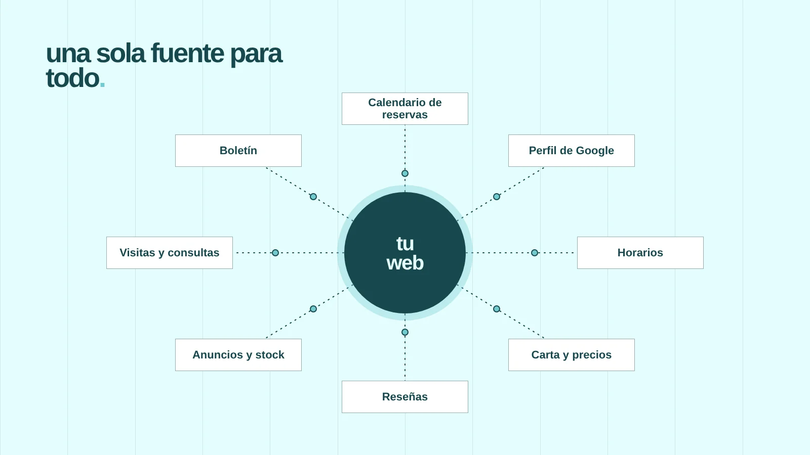
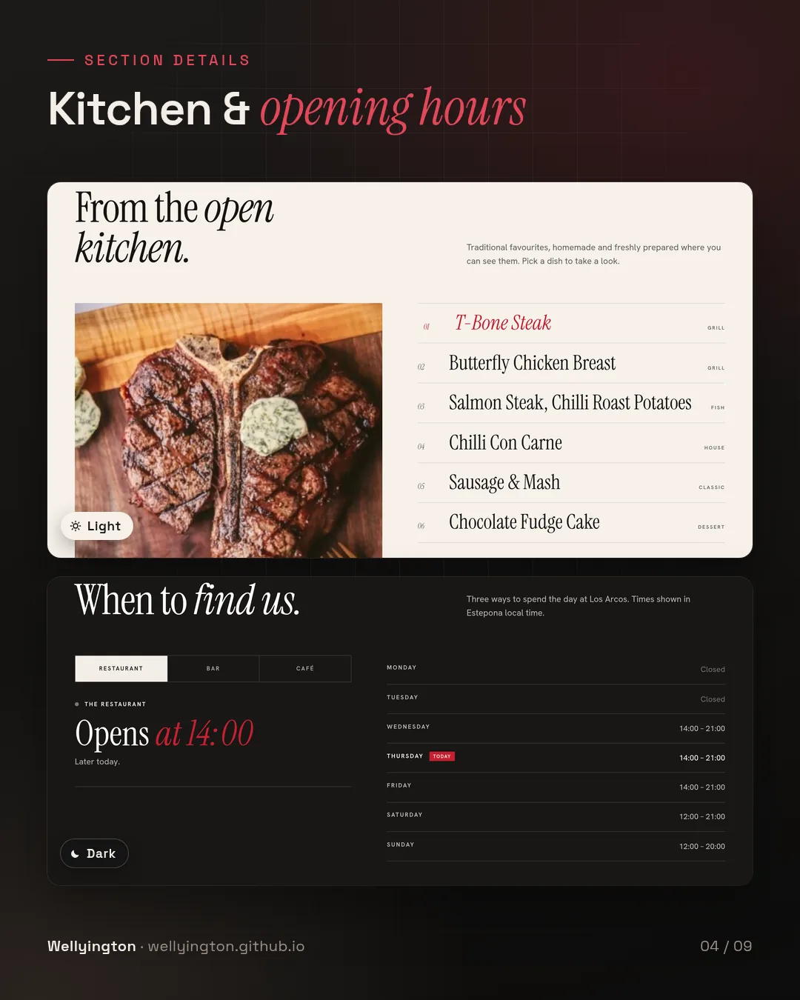
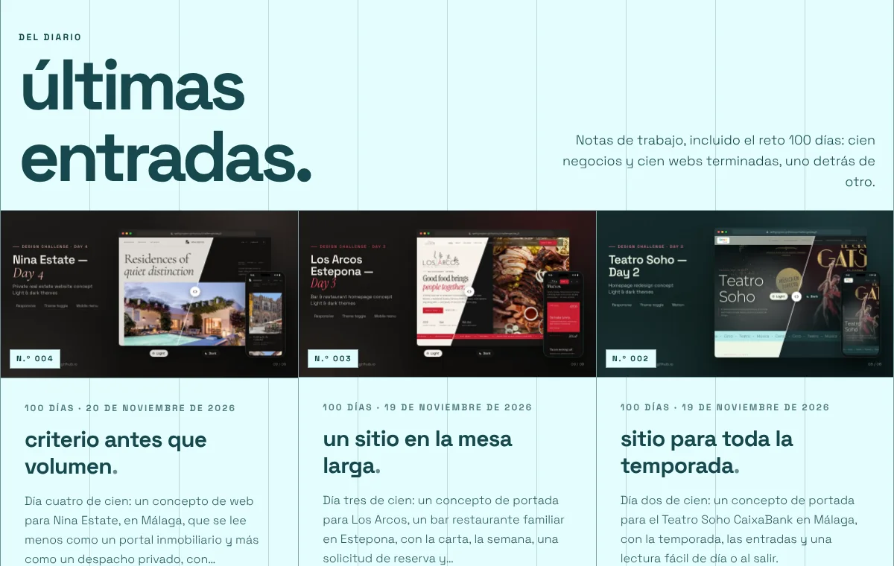
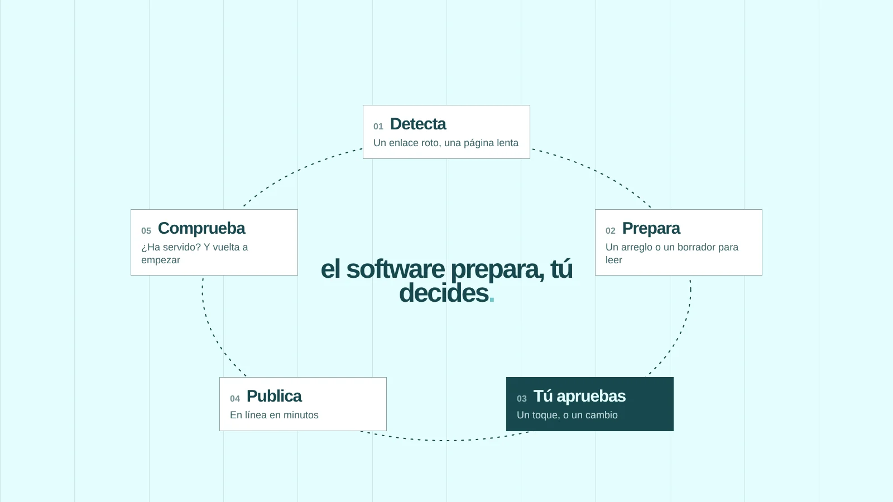
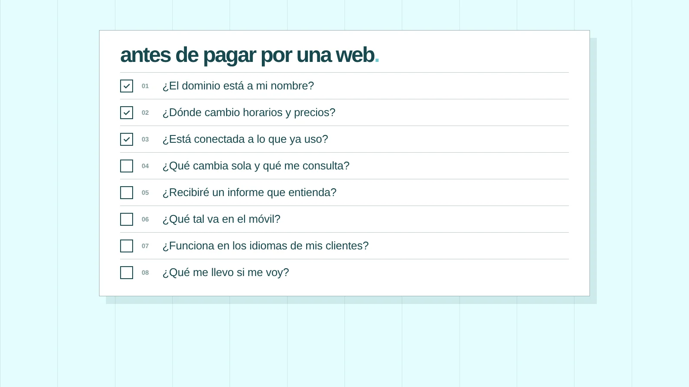

Una pregunta que me hace casi todo cliente, normalmente al final de la primera llamada: "Cuando la web esté terminada, ya está, ¿no? ¿No tengo que seguir pagando?"

Es una pregunta justa. Durante veinte años la respuesta fue, más o menos, que sí. Pagabas a alguien para que hiciera la web, te la entregaba y se quedaba ahí, como un folleto impreso. A veces alguien la actualizaba. Lo normal era que se olvidara.

Esta semana leí un artículo en DataDrivenInvestor titulado [The Slow Death of the Static Website](https://medium.datadriveninvestor.com/the-slow-death-of-the-static-website-why-autonomous-apis-are-finally-fixing-the-small-business-web-4b79db5da819), la lenta muerte de la web estática. Su idea, resumida, es que la web de un pequeño negocio está dejando de ser un folleto que necesita cuidados manuales constantes para parecerse más a un sistema capaz de mantenerse al día, porque ahora está conectada con las demás herramientas que el negocio ya usa. Está escrito para gente que hace webs y lleno de palabras como API, gestor de contenidos y agentes autónomos.

Esta nota es la versión que le daría a un cliente sentado a la mesa. Sin código, sin siglas sin explicar, y con una línea honesta entre lo que funciona hoy, lo que todavía es sobre todo un discurso de ventas y lo que te conviene seguir haciendo tú.

## el folleto en el cajón

Piensa en el último folleto impreso que hizo tu negocio. El día que llegó de la imprenta era perfecto. Los precios estaban bien, las fotos eran nuevas, el horario era el correcto.

Seis meses después, un precio había subido. Al año, en la foto del equipo salía alguien que ya no estaba. A los dos años, la caja de folletos estaba en un cajón y nadie los repartía, porque tenían tres errores pequeños y todo el mundo lo sabía.

La mayoría de las webs de pequeños negocios tienen la misma vida. La diferencia es que nadie guarda una web en un cajón. Sigue en internet, en público, contestando preguntas por ti a las tres de la mañana, con las respuestas equivocadas.

A una web hecha así, en mi oficio la llamamos estática. La palabra es técnica, y volveré a ella porque genera cierta confusión. De momento, piensa en estática en el sentido de todos los días: se queda como estaba el día que se terminó, hasta que una persona se sienta a cambiarla.

## cómo se va quedando vieja una web

Nadie decide dejar que su web se quede vieja. Pasa poco a poco, una cosa pequeña cada vez, y casi siempre los clientes se dan cuenta antes que el dueño.

En los primeros meses cambia el horario de verano y nadie lo actualiza en la web. Alguien se encuentra la puerta cerrada. Luego los precios de la carta o de la página de servicios se van separando de los de la caja. Después cambias de sistema de reservas y el viejo botón de "reservar" sigue llevando al anterior. Luego desaparece una foto, o se rompe el enlace a un colaborador porque ha cambiado su propia web.

Por debajo pasan otras cosas que no se ven. Las piezas de software de las que depende la web necesitan actualizaciones, y cuando no las reciben la web es más fácil de atacar. Se van acumulando añadidos: una burbuja de chat, un aviso de cookies, tres herramientas de seguimiento de tres personas de marketing distintas. Cada una hace la página un poco más lenta en el móvil, y las páginas lentas pierden visitas y pierden posiciones en Google. El artículo original lo llama podredumbre técnica silenciosa, y el nombre encaja. Ningún día concreto se rompe nada. Simplemente empeora un poco cada mes.

La búsqueda también forma parte de esto. La idea que tiene Google de una buena página cambia todo el tiempo. Una web que funcionaba bien el primer año puede ir bajando sin que nadie la toque, solo porque otras webs siguieron mejorando y esta no. El posicionamiento se trataba como una lista que se repasaba antes del lanzamiento. En la práctica, nunca se acaba.

Lo incómodo es que el dueño casi nunca ve su web como la ve un cliente. Tú sabes cuál es el horario correcto, así que la vista se te escapa por encima del que está mal en la página. El cliente solo tiene la página. Para él, lo que dice es la verdad sobre tu negocio, hasta que se encuentra delante de una puerta cerrada o discutiendo un precio en el mostrador. Para entonces la web ya te ha costado algo, y nadie sabe decir qué día empezó.

Nada de esto es culpa de nadie. Quien lleva un pequeño negocio está ocupado llevando el negocio. La web es el único empleado que nunca pide nada, así que es el que se olvida.

*Cómo se queda vieja una web: nunca de golpe, siempre poco a poco.*

## qué es una API, sin tecnicismos

Todo el artículo se apoya en una palabra que la mayoría de los dueños de negocio no necesitan aprender, así que aquí va la versión corta.

Una API es una forma de que dos programas hablen entre sí sin que una persona copie cosas de uno a otro. La imagen más fácil es un camarero. La cocina no sale a tu mesa y tú no entras en la cocina. El camarero lleva una petición clara en un sentido y trae una respuesta clara en el otro.

Ya usas servicios que tienen uno de estos camareros, aunque nunca lo hayas visto. Tu calendario de reservas tiene uno. Tu Perfil de Empresa de Google, el recuadro que sale en Google Maps con tu horario y tus reseñas, tiene uno. Las tiendas online, los listados de stock, las webs de reseñas, las herramientas de boletines y los sistemas de pago los tienen. Hasta el tiempo tiene uno.

Cuando una web está conectada a esos servicios, deja de ser una copia de tu información y empieza a leer de la fuente. Cambias el horario en un sitio y la web muestra el nuevo. Se ocupa la última mesa del sábado en tu sistema de reservas y la web deja de ofrecerla. Vendes el último piso de un edificio y desaparece de la lista.

Esa es la primera mitad del cambio que describe el artículo, y la más útil. No necesita inteligencia artificial. Es sobre todo fontanería bien hecha.

*La web lee de los sitios donde ya vive tu información, en lugar de guardar su propia copia.*

## un solo sitio para cambiar las cosas

El objetivo que persigo con los clientes se dice rápido: cada dato debería escribirse en un único sitio.

El tercer día de mi reto de cien días hice un concepto de portada para Los Arcos, un bar restaurante familiar aquí en Estepona. Un restaurante así tiene tres horarios distintos: el del restaurante, el del bar y el de la cafetería de la mañana. En la página están en pestañas, y la línea grande de la izquierda responde a la única pregunta que tiene casi todo el mundo: si ahora está abierto. Una pequeña marca verde en la navegación dice cafetería abierta cuando lo está.

Para ser honesto con dónde está ese concepto: allí el horario está escrito una vez en la página, y la página calcula el resto con el reloj. El siguiente paso, si Los Arcos lo quisiera, sería leer ese horario del mismo sitio donde ya lo tienen para Google, de modo que un cambio por Navidad se haga una vez y aparezca en todas partes. A ese tipo de conexión me refiero. No tiene nada de glamuroso, y le ahorra a gente de verdad un viaje en balde.

*Del concepto de Los Arcos: tres horarios y una respuesta clara a "¿está abierto ahora?".*

Hay un ejemplo más pequeño en esta misma web. La portada de wellyington.github.io muestra ahora las últimas entradas de este diario, en cada uno de sus cuatro idiomas. Nadie actualiza esa sección a mano. Cuando publico un artículo, la portada se reconstruye sola un minuto después y la nueva entrada aparece arriba. Es una cosa pequeña, pero es exactamente la idea: escribirlo una vez y que lo demás le siga.

*La portada de esta web muestra sola las entradas más nuevas del diario. Publicas una vez y aparece también allí.*

## de conectada a "autónoma"

La segunda mitad del artículo va más allá, y aquí es donde aparecen las palabras grandes. La idea es que un programa, normalmente basado en el mismo tipo de inteligencia artificial que las herramientas de chat que mucha gente usa ya, se coloca encima de todas esas conexiones y actúa. No solo lee tu horario: detecta problemas y los arregla, escribe páginas nuevas y las publica.

El artículo enumera a qué estaría conectado un sistema así: la parte de la web donde se edita el texto, Google Search Console, las estadísticas de visitas, el sistema de reservas o de stock, y un almacén con todo lo que el negocio sabe de sí mismo, su tono, sus productos, sus normas.

Google Search Console merece una frase, porque sale en todas las conversaciones sobre esto. Es un informe gratuito de Google que te dice en qué búsquedas aparece tu web, qué páginas puede leer Google y cuáles no, y qué está fallando. Piensa en él como las notas que tu web recibe de Google. La mayoría de los pequeños negocios nunca ha abierto el suyo, y muchos ni siquiera lo han configurado.

Un sistema con acceso a ese informe, a tus visitas y a tus reservas puede, en teoría, ver que una página dejó de aparecer en las búsquedas la semana pasada, averiguar por qué y proponer un arreglo antes de que tú te hubieras dado cuenta. Esa es la promesa. Una parte ya es real. Otra parte sigue siendo una demostración.

## lo que ya hace bien

Esto es lo que yo confiaría hoy a un programa en la web de un pequeño negocio, con muy poco riesgo.

Comprobar cada semana que todos los enlaces de la web siguen llevando a algún sitio, y avisarte con palabras normales cuando uno se rompe. Medir lo rápido que cargan las páginas principales en el móvil, y avisarte cuando un añadido nuevo las ha vuelto lentas. Vigilar el informe de Search Console y mandarte un resumen corto una vez al mes, escrito para una persona y no para un programador: qué búsquedas trajeron gente, qué páginas están bajando y qué merece la pena arreglar.

Mantener las listas al día con su fuente: eventos desde un calendario, habitaciones o mesas desde un sistema de reservas, inmuebles desde un archivo de anuncios, horarios desde tu perfil de Google. Preparar un primer borrador de una noticia o de la página de un evento a partir de tus propias notas, para que tú lo leas y lo corrijas. Hacer la primera versión de una traducción, para que tus visitantes ingleses, españoles o rusos no se queden fuera, de nuevo para que una persona la revise. Sugerir mejores títulos y descripciones para las páginas que la gente encuentra en Google pero en las que casi nunca hace clic.

Ninguno de estos trabajos es ingenioso. Todos son de los que se caen de la lista de una persona ocupada y, cuando se caen, cuestan dinero sin hacer ruido.

## lo que no debería hacer solo

El mismo programa que arregla un enlace roto puede publicar un precio equivocado para todos tus visitantes, en segundos y con total seguridad. Esa es la parte de la historia que los artículos entusiastas suelen saltarse.

Hay un buen relato de esto contado por quienes construyen estos sistemas. Una revista de diseño publicó hace poco un artículo de los creadores de una plataforma de webs autónomas. Se propusieron que las webs funcionaran completamente solas, dando por hecho que eso era lo que querían los dueños. Cuando dueños reales la usaron, dudaron. Resultó que casi nadie quiere una web que cambie del todo por su cuenta sin preguntar.

Coincide con lo que yo veo. A un dueño de negocio le parece bien que un programa arregle un enlace por la noche. No le parece bien despertarse y encontrarse un párrafo nuevo sobre sus precios, sus garantías o si abre un festivo, que él nunca escribió. Y tiene razón. Algunas cosas de una web son promesas, y las promesas deberían salir de una persona.

Así que mi regla es sencilla. El programa puede detectar, medir y preparar. Una persona aprueba todo lo que cambia lo que dice el negocio: precios, ofertas, promesas, aperturas en días especiales, cualquier cosa sobre salud, dinero o leyes, cualquier cosa sobre otra persona y cualquier cosa escrita con la voz del negocio. La aprobación puede ser un toque en el móvil. Lo importante es que esté.

*El programa detecta y prepara. Tú apruebas. Luego publica y comprueba si el cambio ha servido.*

## lo estático no es el enemigo

Ahora la palabra que prometí retomar. En mi oficio, estática tiene un sentido técnico además del de todos los días. Una web técnicamente estática es aquella en la que cada página se prepara de antemano y se entrega al visitante como un archivo terminado, en lugar de montarse desde una base de datos cada vez que alguien la abre.

Ese tipo de estática no se está muriendo. Es rápida, barata de alojar, difícil de atacar y amable con los móviles con poca cobertura. Este diario está hecho así. También los conceptos de los cien días. Ser estática en ese sentido y estar desactualizada son dos cosas distintas.

La web que se está muriendo es el folleto abandonado: hecho una vez, nunca más revisado, alejándose poco a poco de la verdad. Eso se evita con páginas sencillas y rápidas, conectadas a los sitios donde vive tu información, que se reconstruyen cada vez que algo cambia y que alguien, o algo, revisa con regularidad. La tecnología que hay detrás del telón importa mucho menos que el hecho de que alguien, o algo, esté prestando atención.

## qué significa esto para el dinero

Esta es la respuesta honesta a la pregunta del principio.

El modelo antiguo era una cantidad grande para hacer la web y después nada. O una cuota mensual que pagaba el alojamiento y muy poco más. Ninguno de los dos pagaba lo que de verdad mantiene útil una web: que alguien se dé cuenta cuando se ha desviado.

Lo que tiene sentido ahora suele ser una construcción más pequeña, porque unas páginas sencillas y rápidas no tienen por qué costar una fortuna, y después una cantidad mensual modesta que paga trabajo real que puedes ver. Las comprobaciones se hacen cada semana. Las conexiones con tu sistema de reservas, tu perfil de Google y tus listas se mantienen funcionando. Recibes un informe corto con palabras normales. Y hay una persona a la que llamar cuando necesitas un cambio que no conviene dejar en manos de una máquina.

Cuando alguien te ofrezca un plan mensual, pregúntale qué pasa en un mes normal. Si la respuesta es "la mantenemos en línea", estás pagando un folleto en un cajón. Si la respuesta es una lista de cosas que se comprueban, se actualizan y se te cuentan, estás pagando una web cuidada.

Una cosa más sobre el dinero: asegúrate de que lo que pagas es tuyo. La dirección web, los textos, las fotos y la lista de consultas de tus clientes deberían ser tuyos, y deberías poder llevártelos si te vas. Una web que se cuida sola solo es una buena noticia si sigue siendo tuya.

## qué preguntar antes de pagar a nadie

Si estás a punto de encargar una web, o no estás contento con la que tienes, estas preguntas te dirán casi todo lo que necesitas saber. No hace falta que entiendas las respuestas técnicas. Solo necesitas notar si son claras.

¿Quién es el dueño de la dirección web, y está a mi nombre? Cuando cambio el horario o los precios, ¿dónde lo cambio y en cuántos sitios? ¿La web está conectada al sistema de reservas, la tienda o el calendario que ya uso, o guarda su propia copia? ¿Qué hace la web por su cuenta y qué me pregunta antes de cambiarlo? ¿Recibiré un informe que entienda, y cada cuánto? ¿Qué tal va en un móvil con poca cobertura? ¿Funciona bien en los idiomas que hablan mis clientes? Y si dejo de trabajar contigo, ¿qué me llevo?

Una buena respuesta a la pregunta de la aprobación vale más que todo lo demás de la lista.

*Ocho preguntas. No hace falta seguir las respuestas técnicas, solo notar si son claras.*

## cómo lo hago yo

Para los negocios con los que trabajo en esta costa, la versión práctica es esta.

Las páginas son rápidas y sencillas, preparadas de antemano, para que carguen enseguida en un móvil en la parada del autobús. La información que cambia, como horarios, eventos, cartas, inmuebles y precios, sale de un único sitio, a ser posible uno que el negocio ya use. Cada cambio en esa información reconstruye la web en minutos. Cada semana se hacen pequeñas comprobaciones que me avisan a mí, y las importantes avisan también al dueño. Todo lo que cambia lo que el negocio promete se le enseña a una persona antes de publicarse.

Nada de eso necesita la palabra autónomo. Se parece más a una tienda bien llevada: las estanterías se reponen desde el almacén, alguien da una vuelta por la tienda cada mañana y el dueño da el visto bueno a los precios.

## entonces, ¿se está muriendo la web estática?

La web folleto, la que nadie cuida, se está quedando atrás, y no la voy a echar de menos. Manda clientes a puertas cerradas y da los precios del año pasado, y lo hace mientras al dueño, que casi nunca la visita, le parece que está perfecta.

Lo que la sustituye no tiene por qué ser un sistema misterioso que lleve tu negocio por ti. Para la mayoría de los pequeños negocios es algo más modesto y más útil: una web rápida que lee de los mismos sitios donde ya guardas tu información, te avisa cuando algo va mal, prepara el trabajo aburrido y espera tu sí antes de decir nada nuevo en tu nombre.

El software se ha vuelto bueno esperando y dándose cuenta de las cosas. Decir que sí sigue siendo cosa tuya, y creo que así debe seguir.

Soy diseñador web en Estepona, en la Costa del Sol, y hago webs como esta para negocios de toda España. Si quieres saber qué necesitaría tu web actual para dejar de quedarse vieja, escríbeme desde [la web principal](https://wellyington.github.io/es/). Dime a qué te dedicas y dónde, y te contestaré en lenguaje llano. El artículo que dio pie a esta nota es [The Slow Death of the Static Website](https://medium.datadriveninvestor.com/the-slow-death-of-the-static-website-why-autonomous-apis-are-finally-fixing-the-small-business-web-4b79db5da819), en DataDrivenInvestor, por si quieres la versión técnica, en inglés.
