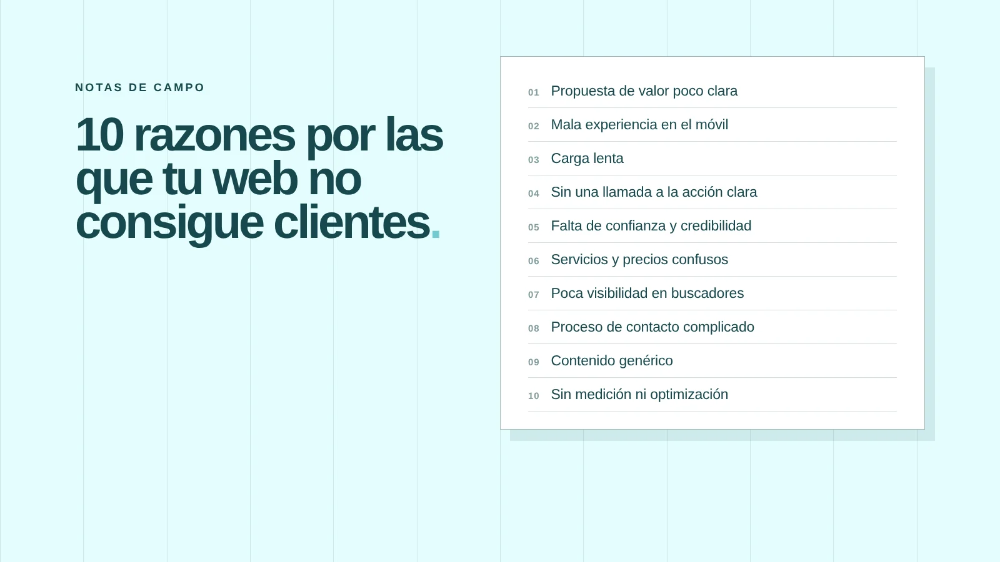
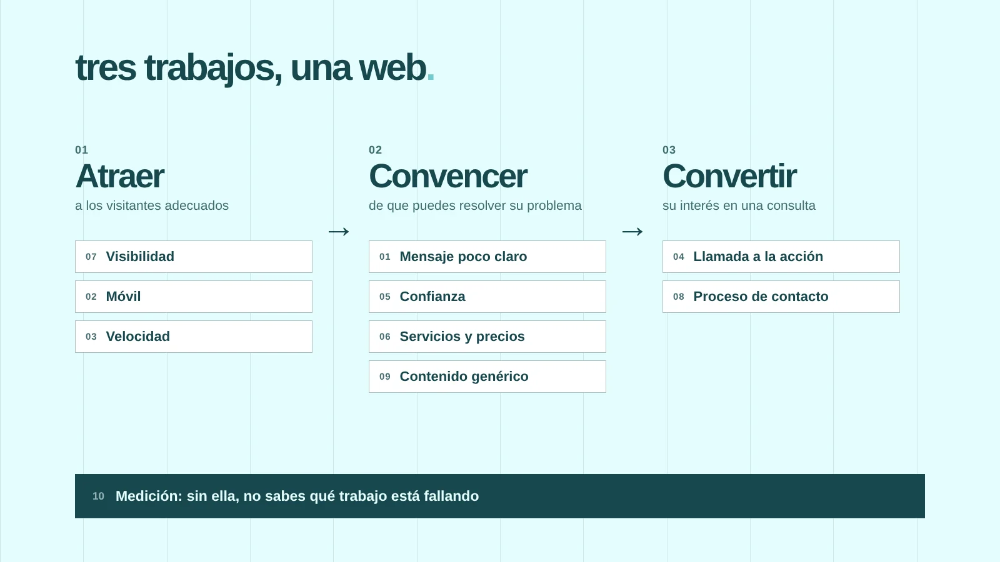
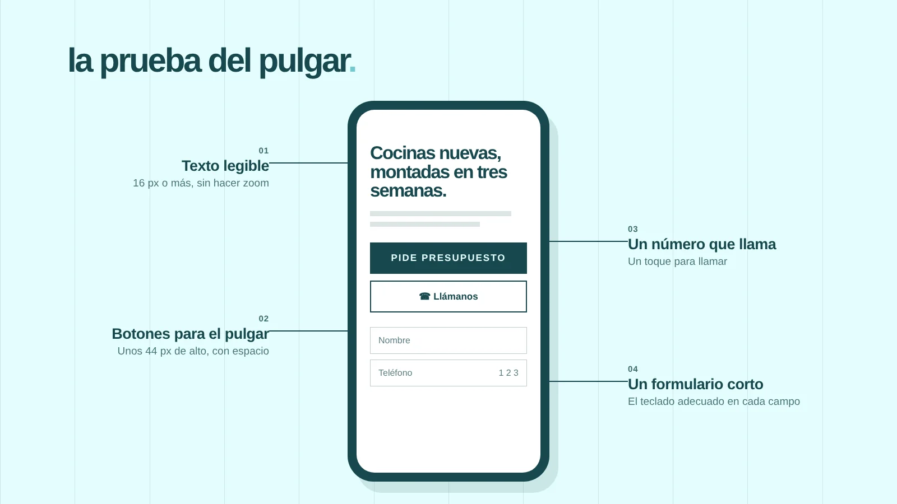
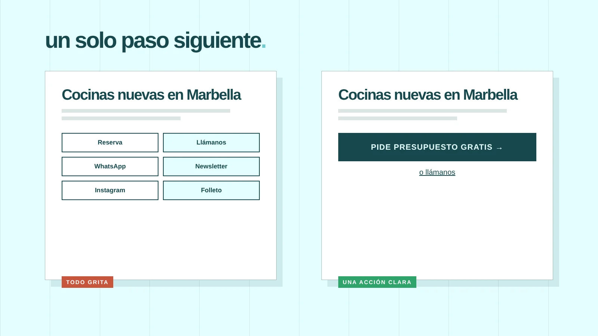
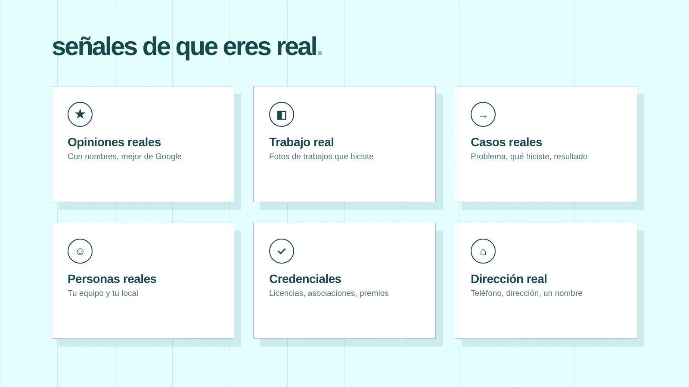
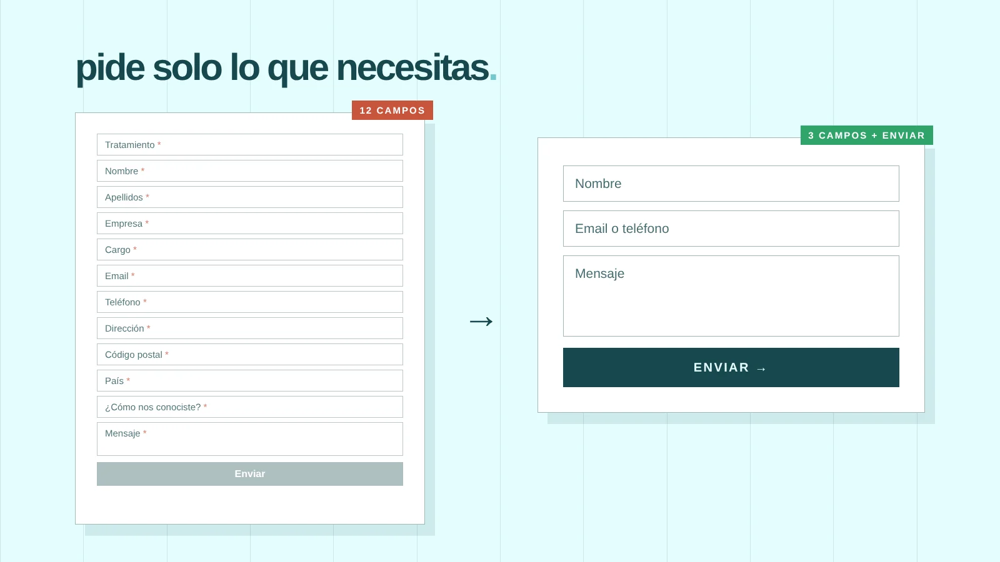
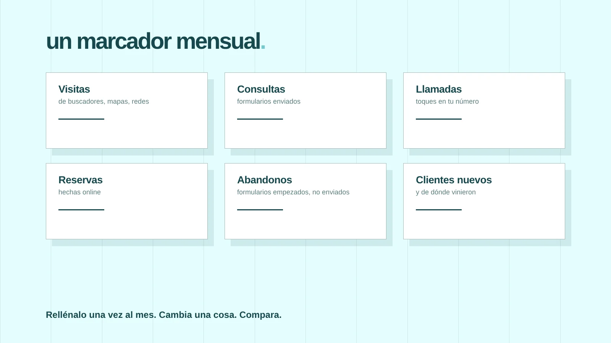

«La web queda genial. Todo el mundo lo dice. Lo que pasa es que no trae trabajo.»

Escucho alguna versión de esa frase cada pocas semanas, de restaurantes, constructores, clínicas, agencias y tiendas de la costa. La web costó un buen dinero, las fotos son bonitas, los amigos la han elogiado. Y el teléfono no suena gracias a ella.

Casi nunca hay nada roto que se pueda señalar. La web carga, las páginas están, el formulario envía. El problema es que una web tiene un trabajo que hacer, y muchas webs se construyeron para parecer terminadas, no para hacer ese trabajo.

Esta nota repasa las diez razones que veo más a menudo. Ninguna exige una web nueva para arreglarla. La mayoría necesita una tarde, la cabeza despejada y ganas de mirar tu propia web como la miraría un desconocido.

*Las diez razones, más o menos en el orden en que las encuentra un visitante.*

## primero, para qué sirve una web

Antes de la lista, conviene tener claro qué es el éxito. La web de un negocio tiene tres trabajos, uno detrás de otro:

1. Atraer a los visitantes adecuados.
2. Convencerlos de que el negocio puede resolver su problema.
3. Convertir su interés en una consulta, una reserva o una compra.

Un fallo en cualquiera de esas etapas estropea todo lo demás. Una web preciosa que nadie encuentra falla en el primer trabajo. Una web con muchas visitas que se van sin entender a qué te dedicas falla en el segundo. Una web que convence y luego pide rellenar un formulario de catorce campos falla en el tercero.

Las diez razones encajan en esas tres etapas, más una que corre por debajo de todas: no medir nada.

*Cada razón estropea uno de los tres trabajos. La medición está por debajo de todos.*

## 1. no se entiende a qué te dedicas

Un visitante nuevo le da a tu página de inicio unos segundos. En ese tiempo necesita respuesta a tres preguntas: qué haces, para quién es y por qué debería elegirte a ti y no al siguiente resultado.

La mayoría de las páginas de inicio responden a otra pregunta: quiénes somos. Bienvenido a nuestra web. Somos una empresa líder con más de veinte años de pasión y excelencia. Esa frase podría ser de un dentista, de un bufete o de una empresa de andamios. Habla del negocio, no del problema del cliente.

Compara dos titulares para el mismo montador de cocinas. «Bienvenido a Smith Interiores, tu socio de confianza desde 2004.» O bien: «Cocinas nuevas en Marbella y Estepona, montadas en tres semanas. Presupuesto gratis en 48 horas.» El segundo te dice qué, dónde, cuánto tarda y qué hacer después, en una sola frase.

**Cómo comprobarlo:** enseña tu página de inicio cinco segundos a alguien que no conozca tu negocio y ciérrala. Pregúntale qué haces, para quién y qué te diferencia. Si no sabe decirlo, tus clientes tampoco.

**Qué hacer:** reescribe la primera línea de la página para que diga el servicio, el cliente o el lugar, y un motivo concreto para elegirte. Lleva la historia y la misión más abajo, donde las encontrará quien las busque.

*El mismo negocio, dos primeras líneas. Solo una responde a las preguntas del visitante.*

## 2. no funciona en el móvil

La mayoría de la gente que busca un negocio local ve su web primero en el móvil, a menudo con una mano y en la calle. Una web diseñada en una pantalla grande y encogida después suele notarse: texto que hay que ampliar para leer, botones tan juntos que pulsas el que no es, menús que tapan la página, formularios donde el teclado oculta el campo en el que escribes.

Nada de eso se ve cuando el dueño revisa la web en el portátil. Se nota en la paciencia del cliente.

**Cómo comprobarlo:** usa tu propia web en tu propio móvil durante cinco minutos, como lo haría un cliente. Busca el precio de algo. Llámate. Envía el formulario. Hazlo con un solo pulgar.

**Qué hacer:** texto lo bastante grande para leer sin ampliar, unos 16 píxeles como mínimo. Botones y enlaces del tamaño de un pulgar, unos 44 píxeles de alto, con espacio entre ellos. El teléfono como un enlace que llama. Formularios con el teclado adecuado en cada campo, números para el teléfono, email para el email. Y diseña primero la versión móvil y después la de pantalla grande, no al revés.

*Cuatro cosas que comprobar en tu propio móvil, con un solo pulgar.*

## 3. tarda demasiado en cargar

La gente es impaciente, y tiene motivos. Si una página sigue en blanco al cabo de unos segundos, muchos visitantes vuelven atrás y pulsan el siguiente resultado antes de ver nada de lo que ofreces.

Google lo mide con tres números que llama Core Web Vitals: Largest Contentful Paint (LCP), Interaction to Next Paint (INP) y Cumulative Layout Shift (CLS). Dicho claro: cuánto tarda en aparecer el contenido principal, lo rápido que responde la página cuando tocas algo y cuánto salta el diseño mientras carga. Los objetivos que Google considera «buenos» son un LCP de 2,5 segundos o menos, un INP de 200 milisegundos o menos y un CLS de 0,1 o menos, medidos en visitas reales a la página.

Los sospechosos habituales son los mismos en casi todas las webs lentas que reviso. Fotos subidas tal cual salen de la cámara, de varios megas cada una, cuando unos cientos de kilobytes se verían igual en pantalla. Demasiados scripts: chats, carruseles, rastreadores y ventanas emergentes, cada uno cargando su propio código. Alojamiento compartido barato y lejos del cliente. Y, en webs hechas con maquetadores, una larga lista de plugins instalados una vez para una función pequeña y nunca quitados.

**Cómo comprobarlo:** pasa tu página de inicio por PageSpeed Insights, la herramienta gratuita de Google, y mira el resultado para móvil, no el de escritorio.

**Qué hacer:** redimensiona y comprime todas las imágenes y usa un formato moderno como WebP. Quita todos los plugins y scripts para los que no tengas un motivo claro. Después, revisa el alojamiento.

*Los tres objetivos de velocidad de Google y las cuatro cosas que suelen impedir cumplirlos.*

## 4. no hay un siguiente paso evidente

Alguien ha leído tu página y le gusta lo que ve. ¿Y ahora qué? ¿Debe llamar, reservar, pedir presupuesto, mandar un mensaje, pasarse por el local?

Muchas webs nunca lo dicen. Hay una página de contacto en algún lugar del menú, y ya está. Otras dicen demasiado: reserva ya, llámanos, escríbenos por WhatsApp, suscríbete a la newsletter, síguenos en Instagram, descarga el folleto, todo a la vez y todo del mismo tamaño. Cuando todo es un botón, nada lo es.

**Cómo comprobarlo:** en cada página importante, pregúntate qué única cosa quieres que haga el visitante después de leerla. Si no puedes responder en una frase, la página tampoco.

**Qué hacer:** elige una acción principal por página y conviértela en lo más visible de la pantalla, repetida al final de la página y, en el móvil, al alcance del pulgar. Usa palabras que digan lo que pasa: «Pide presupuesto gratis», «Reserva mesa para esta noche», «Llama a la clínica». Deja una alternativa más discreta para quien la prefiera, como el teléfono bajo el botón de reserva. Todo lo demás puede esperar en el pie de página.

*Seis botones del mismo peso, o un siguiente paso claro y una alternativa discreta.*

## 5. todavía no inspira confianza

A nadie le gusta contactar con un negocio del que no sabe nada. Antes de llamar, la gente busca señales de que eres real, de que haces bien tu trabajo y de que gente como ellos te ha contratado y ha quedado contenta.

Un número sorprendente de webs de empresa no ofrece nada de eso. Ni opiniones, ni nombres, ni ejemplos de trabajos, ni fotos del equipo o del local reales, solo imágenes de banco de personas dándose la mano en una oficina que podría estar en cualquier parte.

**Cómo comprobarlo:** imagina que nunca has oído hablar de tu negocio. ¿Qué hay en la página que te haría creer que es bueno? Cuenta las cosas que son específicas tuyas, no de tu sector.

**Qué hacer:** muestra opiniones reales, con nombres, mejor sacadas de Google para que se puedan comprobar. Enseña tu trabajo: fotos de trabajos reales y casos breves con el problema, lo que hiciste y el resultado. Enseña tu cara y tu local. Añade las asociaciones, licencias y certificados que le importan a tu cliente. Y pon una dirección, un teléfono y el nombre de una persona real donde se vean.

*Seis señales de que un negocio es real y bueno en lo que hace.*

## 6. no queda claro qué ofreces ni cuánto cuesta

La gente no quiere adivinar. Si tu web no le deja claro si ofreces exactamente lo que necesita, o si más o menos entra en su presupuesto, muchos elegirán el negocio de al lado que sí lo dejó claro.

Los culpables habituales son nombres de servicio vagos («soluciones», «packs», «servicios a medida»), descripciones que enumeran características en vez de resultados y precios que solo aparecen tras una llamada. Entiendo por qué muchos negocios no publican precios. Cada trabajo es distinto. Pero no dar ninguna información hace que la gente piense lo peor.

**Cómo comprobarlo:** ¿podría un visitante saber, solo con tu web, cuál de tus servicios le encaja y cuánto costaría más o menos?

**Qué hacer:** dale a cada servicio un nombre claro y una página corta que diga para quién es, qué incluye y qué pasa después. Muestra precios donde puedas, o al menos un precio desde o un rango habitual, por ejemplo «la mayoría de reformas de baño están entre 6.000 y 9.000 €». Explica qué hace variar el precio. La gente no necesita un presupuesto de la web. Necesita lo suficiente para decidir que merece la pena llamarte.

## 7. no te encuentran

Ni la mejor web del mundo trae clientes si quien te busca no la ve. Para la mayoría de los negocios locales eso significa dos sitios: los resultados de Google y Google Maps.

Los problemas habituales son sencillos. La web nunca dice con palabras qué haces y dónde: «montador de cocinas en Estepona» no aparece en ninguna parte de la página, así que Google no tiene con qué relacionarla. Las páginas no están indexadas por un ajuste que se quedó puesto desde la construcción. Todas las páginas tienen el mismo título. Y el perfil de empresa de Google, a menudo lo primero que ve un cliente local, tiene el horario mal, ni una foto, ningún servicio y ninguna respuesta a las opiniones.

**Cómo comprobarlo:** busca tu servicio principal y tu pueblo en el móvil, sin iniciar sesión, como lo haría un cliente. ¿Dónde apareces, en el mapa y en los resultados? Después mira tu perfil de empresa como lo vería un desconocido.

**Qué hacer:** di con palabras sencillas, en la página y en el título de la página, qué haces y dónde. Dale a cada servicio y a cada zona que cubres su propia página. Conecta la web a Google Search Console para ver si está indexada y qué busca la gente para encontrarte. Completa todos los campos de tu perfil de empresa, mantén el horario al día, añade fotos reales y responde a las opiniones.

## 8. contactar cuesta demasiado

Cada paso de más entre «me interesa» y «ya lo he enviado» es otra ocasión para abandonar. Todavía veo formularios de contacto con doce campos, la mitad obligatorios: tratamiento, nombre, apellidos, empresa, cargo, dirección, código postal, país, cómo nos conociste. Sistemas de reserva que piden crear una cuenta antes de ver un hueco libre. Formularios que no envían nada porque un ajuste se rompió hace meses y nadie se dio cuenta.

**Cómo comprobarlo:** envía hoy tu propio formulario desde el móvil y cronométralo. Después comprueba que el mensaje llegó, y a dónde.

**Qué hacer:** pide solo lo que necesitas para responder: un nombre, una forma de contacto y el mensaje. Lo demás puede salir en la conversación. Nunca pidas registrarse antes de consultar. Ofrece una alternativa rápida, un teléfono o WhatsApp, para quien la prefiera. Muestra una confirmación clara al enviar y di cuándo recibirán respuesta. Y prueba el formulario cada mes.

*Doce campos, o los cuatro que de verdad necesitas para responder.*

## 9. suena igual que todos

«Nos enorgullecemos de ofrecer un servicio de calidad.» «Tu satisfacción es nuestra prioridad.» «Profesionales apasionados comprometidos con la excelencia.» Estas frases están en miles de webs, y precisamente por eso no dicen nada. Un cliente que compara tres negocios no los distingue, así que elige por precio, o no elige.

Lo mismo pasa con las imágenes. Una foto de banco de una modelo sonriente con auriculares le dice al visitante que no tenías una foto propia.

**Cómo comprobarlo:** tapa tu logotipo y lee tu página de inicio. ¿Podría ser de un competidor? Si cambiaras los nombres, ¿se notaría?

**Qué hacer:** apunta las preguntas que te hacen de verdad tus clientes, por teléfono y en persona, y respóndelas en la web con tus propias palabras. ¿Cuánto se tarda? ¿Qué pasa si llueve? ¿Trabajáis los fines de semana? ¿Puedo ver uno que hayáis hecho? Usa detalles que solo tú puedes decir: las calles donde trabajas, los materiales que usas, cuántos trabajos hiciste el año pasado. Cambia las fotos de banco por fotos reales, aunque sean del móvil.

## 10. nadie mide nada

La última razón está por debajo de todas las demás. Muchos negocios lanzan una web y simplemente dan por hecho que funciona. Nadie cuenta las consultas que envía, las llamadas que genera ni las reservas que consigue. Nadie sabe cuánta gente empieza el formulario y lo deja a medias, ni desde qué página se va.

Sin datos, todos los problemas anteriores son invisibles. No sabes si la web tiene pocas visitas o pocas consultas, así que no sabes si gastar dinero en publicidad o en arreglar la página.

**Cómo comprobarlo:** ¿puedes decir cuántas consultas trajo tu web el mes pasado y cuántas acabaron siendo clientes? Si no, eso es lo primero que hay que arreglar.

**Qué hacer:** instala una analítica sencilla, con el consentimiento de los visitantes donde la ley lo exige, y cuenta lo que importa al negocio, no solo las visitas: formularios enviados, toques en el teléfono, reservas hechas, clics en WhatsApp. Pregunta a cada cliente nuevo cómo te encontró y apúntalo. Mira los números una vez al mes, cambia una cosa y vuelve a mirar.

*Un marcador mensual: seis números que te dicen dónde está el problema.*

## la foto completa: visitas no es lo mismo que clientes

En cuanto mides, los números empiezan a señalar el problema. Una guía aproximada que uso con mis clientes:

| Lo que ves | Dónde está probablemente el problema |
|---|---|
| Muy pocas visitas | Marketing y SEO |
| Muchas visitas, pocas consultas | El mensaje, la confianza o la oferta |
| Muchas consultas, pocos clientes | El proceso de venta, los precios o la calidad de los contactos |
| Muchos formularios empezados y abandonados | La experiencia de usuario o algo técnico |

Por eso «necesitamos más tráfico» suele ser la respuesta equivocada. Si cien personas visitan la web cada semana y nadie contacta, enviar doscientas sobre todo duplicará a quienes se van. Arregla la fuga antes de abrir más el grifo.

*Lo que dicen los números y dónde mirar primero.*

## por dónde empezar

Si te suenan las diez, no intentes arreglarlas a la vez. En mi experiencia, el orden que antes da resultado es:

1. Asegúrate de que el formulario y el enlace al teléfono funcionan, hoy.
2. Reescribe la primera línea de la página de inicio.
3. Elige una acción principal por página y hazla evidente.
4. Revisa la web en tu móvil, con un pulgar, y arregla lo que te moleste.
5. Instala la medición, para que la próxima decisión se base en números.

Todo lo demás, la velocidad, las opiniones, las páginas de servicios, la visibilidad en buscadores, resulta más fácil una vez hechas esas cinco cosas.

## mi principal recomendación

Deja de juzgar tu web solo por lo profesional que parece. Júzgala por lo bien que trae oportunidades reales para el negocio.

Una web bonita es un activo. Una web que trae consultas de calidad mes tras mes es una herramienta de negocio. Las dos pueden ser la misma web, pero solo si se construyó pensando en el segundo trabajo.

Soy diseñador web en Estepona, en la Costa del Sol, y a esto me dedico casi siempre: a mirar webs que deberían funcionar y averiguar por qué no lo hacen. Si tu web queda bien y aun así el teléfono no suena, escríbeme desde [la web principal](https://wellyington.github.io/es/). Cuéntame a qué te dedicas y dónde, y te diré en un lenguaje claro cuál de estas diez creo que te está costando más. También puedes ver cómo lo hago en la práctica en la [serie 100 días](https://wellyington.github.io/journal/es/archive/), donde rediseño cada día la web de un negocio real.
