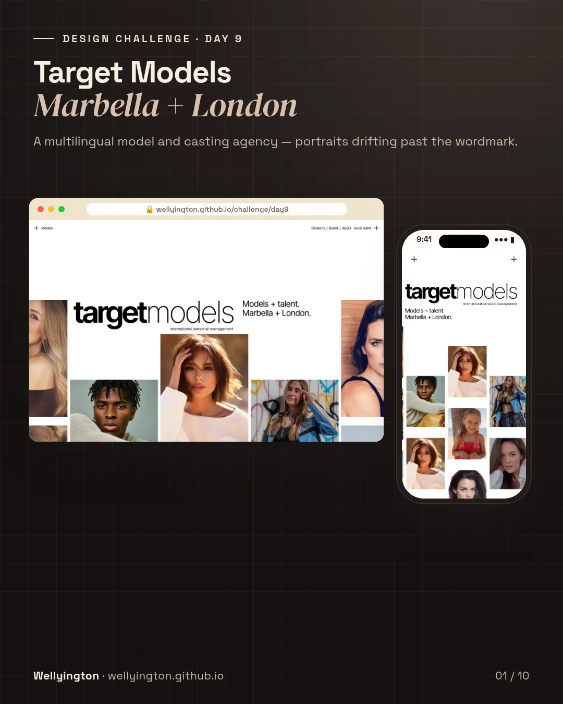
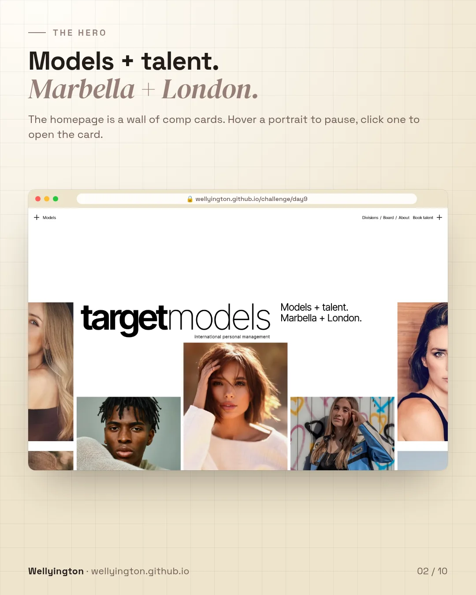
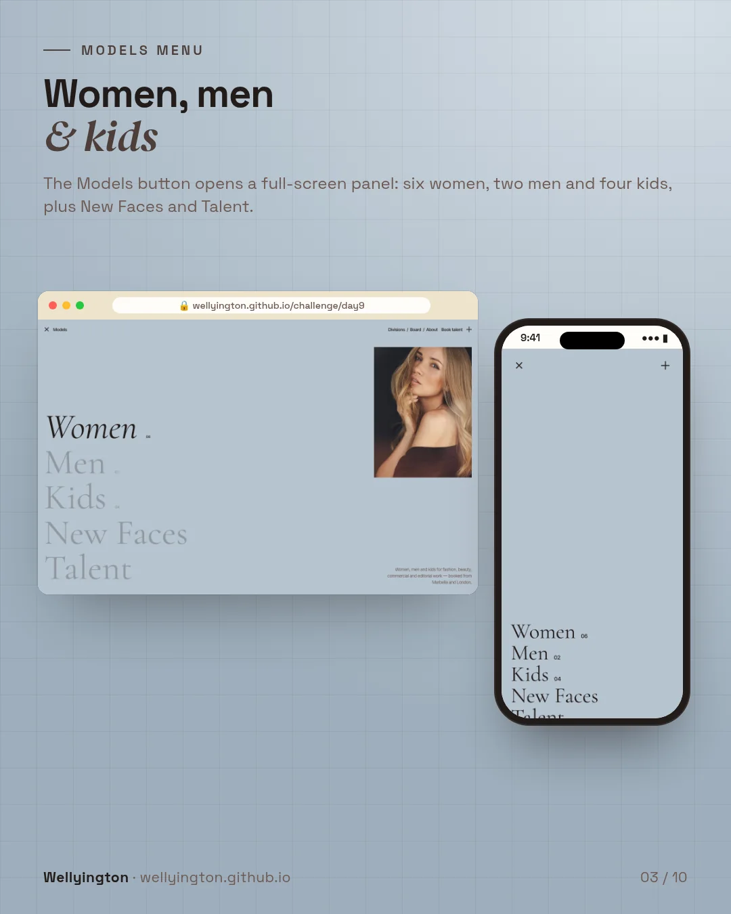
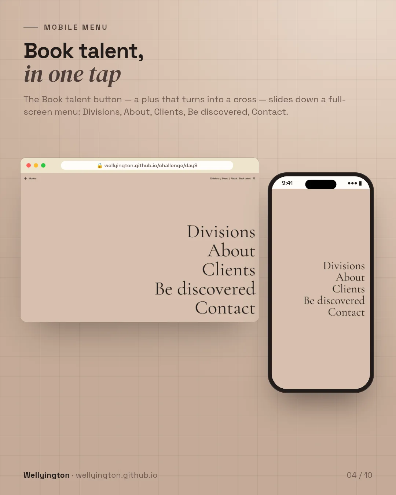
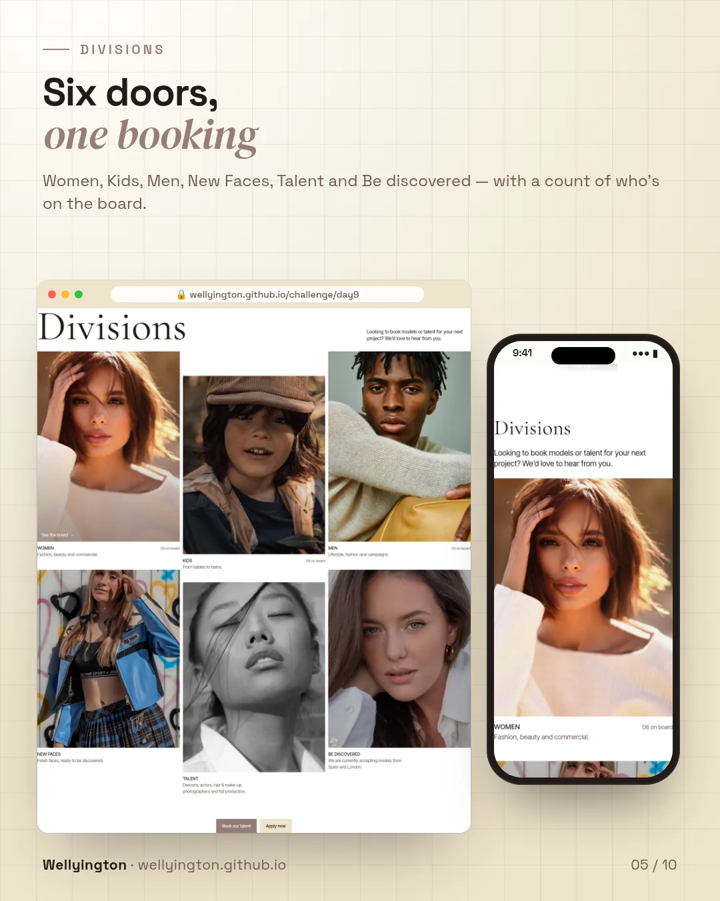
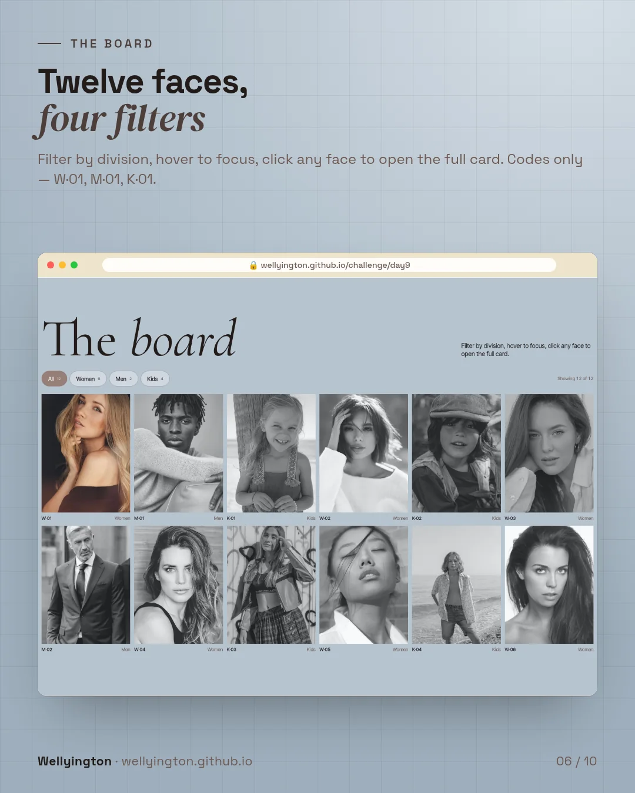
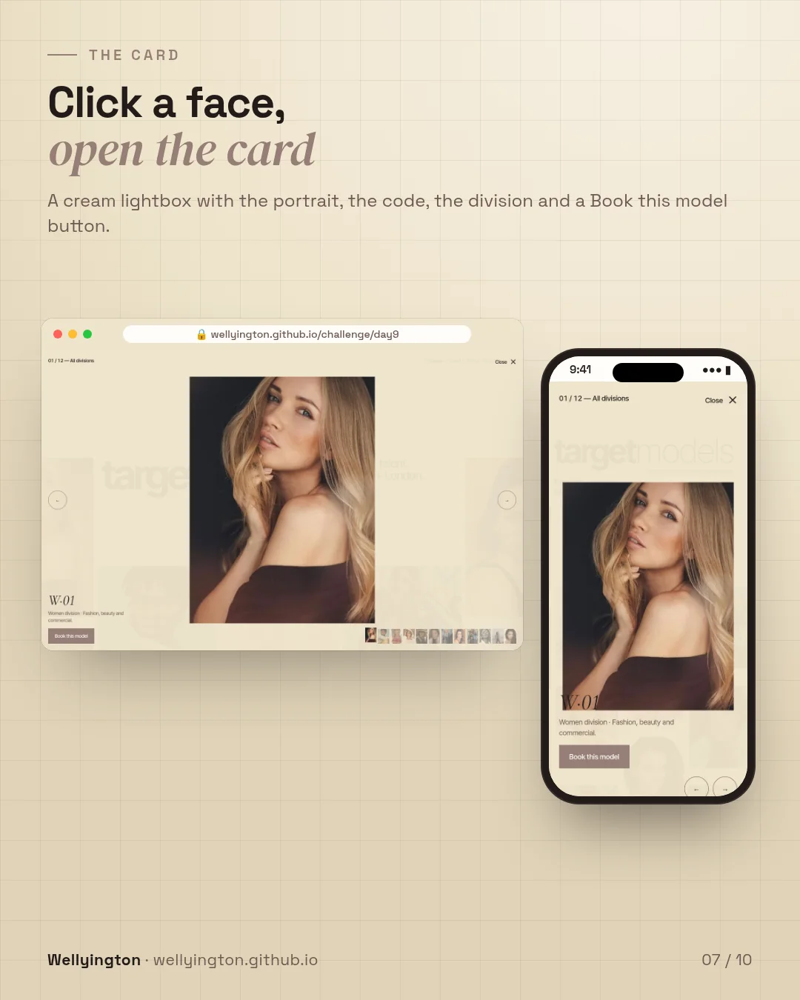
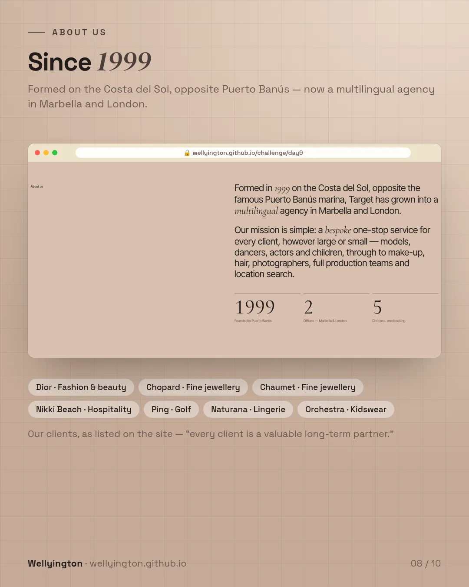
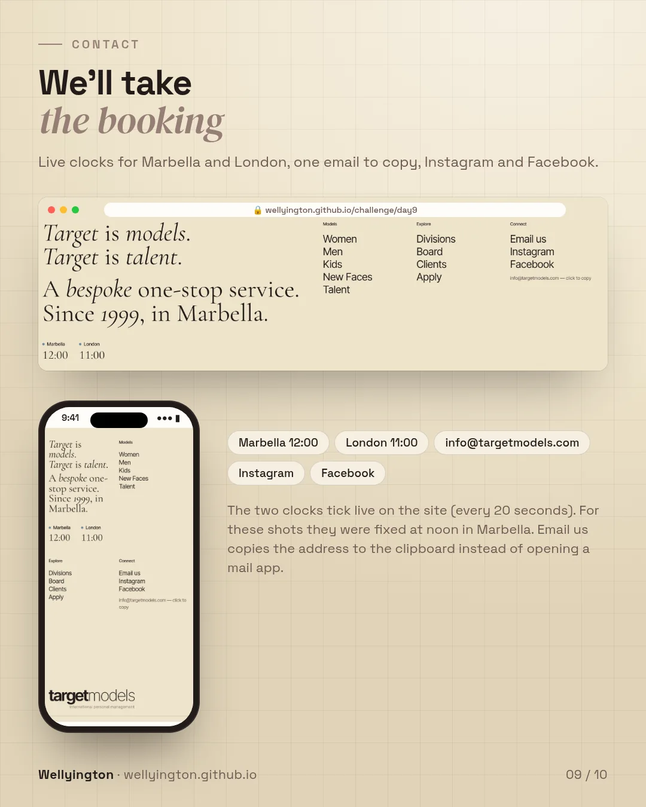

El 25 de noviembre publiqué la novena nota de esta serie, el reto que planteó Ramiah Trask: cien días, cien negocios, cien webs. Fue la segunda del día. El día uno fue un constructor familiar de la Marina Alta. [Esa página está aquí.](https://wellyington.github.io/journal/es/articles/la-web-antes-del-si/) El día dos, un teatro de Málaga. [Esa está aquí.](https://wellyington.github.io/journal/es/articles/sitio-para-toda-la-temporada/) El día tres, un restaurante familiar de Estepona. [Esa está aquí.](https://wellyington.github.io/journal/es/articles/un-sitio-en-la-mesa-larga/) El día cuatro, una consultora inmobiliaria privada de Málaga. [Esa está aquí.](https://wellyington.github.io/journal/es/articles/criterio-antes-que-volumen/) El día cinco, un restaurante de menús degustación en Motril. [Esa está aquí.](https://wellyington.github.io/journal/es/articles/tan-cuidada-como-la-cocina/) El día seis, un asador de pollos de Estepona. [Esa está aquí.](https://wellyington.github.io/journal/es/articles/del-mostrador-a-la-comanda/) El día siete, un hotel familiar en Kavos, Corfú. [Esa está aquí.](https://wellyington.github.io/journal/es/articles/la-misma-piscina-de-noche/) El día ocho, tres casas en el centro histórico de Málaga. [Esa está aquí.](https://wellyington.github.io/journal/es/articles/tres-casas-una-sola-puerta/)

Hoy toca otro tipo de negocio. Target Models es una agencia de modelos y casting fundada en 1999 en la Costa del Sol, frente al puerto deportivo de Puerto Banús. Hoy trabaja desde dos oficinas, Marbella y Londres, y en varios idiomas. Representa a mujeres, hombres y niños para moda, belleza, publicidad y trabajos editoriales, y también contrata bailarines, actores, maquilladores y peluqueros, fotógrafos y equipos de producción completos. Su web actual está en [targetmodels.eu](https://www.targetmodels.eu/).

El concepto está aquí: [Target Models, día nueve](https://wellyington.github.io/challenge/day9/).

## las caras son el producto

Casi todas las webs de esta serie han tenido que explicar algo. Cómo es una casa por dentro, por qué un menú degustación cuesta lo que cuesta, cómo se pide un pollo. Una agencia de modelos tiene un problema más sencillo, y más difícil. No necesita explicar mucho. Las caras son el producto. Si la web se interpone, ha fracasado, por muy ingeniosa que sea.

Así que la idea era dejar que la fotografía hable casi por sí sola. Mucho blanco, muy poco color, letra pequeña y retratos tan grandes como permita la pantalla. Todo lo demás, los menús, las divisiones, la reserva, se queda en segundo plano hasta que alguien lo pide.

El otro trabajo se ve menos. Quienes usan la web de una agencia de modelos casi nunca son modelos. Son directores de arte, fotógrafos, responsables de marca y productoras que buscan una cara para una sesión la semana que viene. Quieren ver quién hay en el book, acotar y ponerse en contacto. La web tiene que hacer eso rápido sin parecer nunca un catálogo.

*Día nueve: una agencia de modelos y casting multilingüe, con retratos que pasan junto al logotipo.*

## un muro de composites

Las agencias de modelos solían enviar composites: una tarjeta impresa con varias fotos de un modelo y sus datos, clavada en la pared de cada oficina de casting de la ciudad. La portada del concepto es esa pared.

Se abre en blanco. El nombre, targetmodels, cruza el centro en letra muy grande, target en negro grueso y models en un peso finísimo a su lado, con international personal management en letra pequeña debajo. A su derecha, dos líneas cortas: models and talent; Marbella and London, modelos y talento; Marbella y Londres. Esa es toda la presentación.

Alrededor y detrás del nombre, los retratos se mueven. Están colocados en columnas, cada una a una altura ligeramente distinta de la siguiente, y cada una sube o baja despacio a su propio ritmo, así que el muro nunca está quieto ni se repite igual. Pasa el ratón por una columna y se detiene, para que puedas mirar con calma. Haz clic en una cara y se abre su ficha.

En el móvil, el mismo muro se convierte en tres columnas estrechas bajo el nombre, que siguen moviéndose y se detienen al tocarlas.

No hay carrusel, ni un gran mensaje de bienvenida, ni un botón pidiendo que bajes. Lo primero que ves es el nombre y las personas, que es lo que es una agencia.

*La portada es un muro de composites. Pasa el ratón por un retrato para pararlo y haz clic para abrir su ficha.*

## dos botones, dos menús

La cabecera es casi nada: un signo más y la palabra Models a la izquierda, un signo más y Book talent a la derecha, y entre ellos, en el ordenador, una línea discreta de enlaces: Divisions, Board y About. Los dos signos más son toda la navegación, porque la web tiene dos tipos de visitante.

Pulsa Models y un panel azul cielo pálido se desliza sobre la página. A la izquierda, las divisiones en una serifa grande: Women, Men, Kids, New Faces y Talent, con un número pequeño junto a las tres primeras que indica cuántas caras hay en ese book. Al recorrer la lista, los nombres que no señalas se desvanecen y a la derecha aparece un retrato de esa división. Funciona como pasar las fichas de un montón.

Pulsa Book talent y entra otro panel, en un rosa empolvado suave: Divisions, About, Clients, Be discovered y Contact, en grande y alineados a la derecha. El signo más se convierte en una cruz, para que quede claro cómo cerrarlo. La tecla Escape también lo cierra.

En el móvil, los dos botones se quedan en las esquinas de la pantalla y los dos paneles la llenan. Un toque para ver a los modelos, un toque para reservar.

*El botón Models abre un panel a pantalla completa: mujeres, hombres y niños, además de New Faces y Talent.*

*Un signo más que se convierte en cruz y un menú a pantalla completa: Divisions, About, Clients, Be discovered, Contact.*

## seis puertas, una reserva

El negocio de Target es más amplio de lo que sugiere su nombre. Además de modelos, contrata talento y siempre busca gente nueva. La sección de divisiones lo enseña todo a la vez, como seis puertas.

Women, mujeres, para moda, belleza y publicidad. Kids, niños, de bebés a adolescentes. Men, hombres, para lifestyle, moda y campañas. New Faces, caras nuevas listas para ser descubiertas. Talent, para bailarines, actores, peluquería y maquillaje, fotógrafos y producción completa. Y Be discovered, para quien quiere unirse: la agencia acepta ahora modelos de España y de Londres.

Cada puerta es un retrato grande con una etiqueta debajo y, en las tres primeras, el número de personas que hay en el book. Los retratos están a alturas ligeramente distintas, como copias extendidas sobre una mesa más que baldosas en una cuadrícula. Encima, una frase sencilla: ¿buscas modelos o talento para tu próximo proyecto? Nos encantará saber de ti. Debajo, dos botones: book our talent y apply now, contrata a nuestro talento y preséntate.

Los dos botones dicen para quién es la sección. Los clientes reservan. Los futuros modelos se presentan. Ninguno tiene que leer la mitad del otro.

*Women, Kids, Men, New Faces, Talent y Be discovered, con el número de personas en el book.*

## el book

El book es donde trabaja de verdad un cliente. Se llama simplemente the board, en letra grande, mitad recta y mitad cursiva, con una sola instrucción al lado: filtra por división, pasa el ratón para enfocar, haz clic en cualquier cara para abrir la ficha completa.

Encima de las caras hay cuatro filtros, All, Women, Men y Kids, cada uno con su número. Elige uno y el book se reorganiza para mostrar solo esa división, con una línea pequeña a la derecha que dice cuántas ves, por ejemplo showing 6 of 12.

Las caras están en blanco y negro hasta que señalas una. Entonces ese retrato pasa a color y los demás se quedan en silencio. En una página llena de caras, ese único cambio basta para saber dónde está tu atención, sin marcos, sombras ni zooms.

Cada cara tiene un código en lugar de un nombre: W·01 para la primera mujer, M·01 para el primer hombre, K·01 para el primer niño. Es una decisión deliberada. Un book real llevaría a los modelos de la propia agencia, con sus nombres y medidas, y solo con su consentimiento. El concepto no necesita poner nombres reales en internet para enseñar cómo funciona el book, así que no lo hace.

*Filtra por división, pasa el ratón para enfocar y haz clic en cualquier cara para abrir su ficha. Solo códigos.*

## haz clic en una cara, abre su ficha

Al hacer clic en cualquier cara, en la portada, en las divisiones o en el book, se abre su ficha. La pantalla se funde a crema y el retrato aparece en el centro, en grande. En una esquina, un contador, 01 de 12, y la división que estás viendo. Debajo, el código en serifa cursiva, la división y lo que abarca, y un botón: book this model, reservar a este modelo.

Las flechas a los lados y una fila de miniaturas abajo permiten recorrer el resto sin cerrar nada. Con teclado, las flechas izquierda y derecha hacen lo mismo y Escape cierra la ficha. En el móvil, se desliza con el dedo.

Book this model cierra la ficha y te lleva a los datos de contacto. En una versión real, abriría una consulta ya marcada con el código del modelo, para que la agencia sepa exactamente por quién pregunta el cliente.

*Una ficha en crema con el retrato, el código, la división y un botón Book this model.*

## desde 1999

La sección sobre la agencia es breve. Fundada en 1999 en la Costa del Sol, frente al famoso puerto de Puerto Banús, Target se ha convertido en una agencia multilingüe en Marbella y Londres. Su misión es un servicio a medida y completo para cada cliente, grande o pequeño: modelos, bailarines, actores y niños, hasta maquillaje, peluquería, fotógrafos, equipos de producción completos y búsqueda de localizaciones.

Algunas de esas palabras van en serifa cursiva en medio del texto en palo seco, 1999, multilingual y bespoke, como cuando una revista destaca una palabra en una cita. Debajo, tres cifras: 1999, fundada en Puerto Banús; 2, oficinas en Marbella y Londres; 5, divisiones, una sola reserva.

Después, los clientes, tal como los enumera la agencia: Dior y Chopard, Chaumet, Nikki Beach, Ping, Naturana y Orchestra, de la moda y la alta joyería a la hostelería, el golf, la lencería y la ropa infantil. Bajo ellos, una frase de la agencia: creemos que cada cliente es un socio valioso a largo plazo.

*Fundada en la Costa del Sol, frente a Puerto Banús, y hoy una agencia multilingüe en Marbella y Londres.*

## nosotros nos encargamos de la reserva

El final de la página es la voz de la agencia, en una serifa cursiva grande: Target is models. Target is talent. A bespoke one-stop service. Since 1999, in Marbella. Target son modelos, Target es talento, un servicio completo a medida, desde 1999 en Marbella.

Debajo, dos relojes pequeños, Marbella y Londres, con la hora de cada oficina. Hay una hora de diferencia, y quien reserva una sesión desde fuera tiene que calcularlo cada vez. Los relojes se actualizan solos mientras la página está abierta.

Al lado, tres columnas cortas: las divisiones de modelos, el resto de la web y las formas de contactar. Email us copia la dirección de la agencia al portapapeles y lo dice, en lugar de abrir un programa de correo que quizá no uses. Hay enlaces a Instagram y Facebook, y el nombre otra vez al final del todo, con el mismo grosor y la misma línea finísima que arriba.

*Relojes en directo de Marbella y Londres, un correo para copiar, Instagram y Facebook.*

## los detalles

Solo hay dos tipografías. Inter Tight, una palo seco estrecha y precisa, para casi todo, desde el enorme nombre de arriba hasta la etiqueta más pequeña. Cormorant Garamond, una serifa clásica, en cursiva, para las divisiones, los menús, los títulos de las fichas y las palabras en las que merece la pena detenerse.

Los colores son la paleta de la propia agencia: un azul cielo pálido para el panel Models y el book, crema para las fichas y el pie de página, un rosa empolvado suave para el menú Book talent y la sección sobre la agencia, y un topo apagado para los botones, todo sobre blanco. Cada color marca una parte distinta de la agencia, así que siempre sabes si estás mirando caras, leyendo sobre el negocio o poniéndote en contacto.

El movimiento es lento a propósito. Las columnas se desplazan, los titulares suben a su sitio línea a línea, los menús se deslizan. Todo se detiene para quien ha pedido a su móvil u ordenador que reduzca las animaciones, y entonces los retratos simplemente se quedan quietos en sus columnas. Las fuentes se sirven desde mi propia web y no desde Google, así que abrir la página no entrega la dirección de nadie a un tercero.

## qué es el concepto, y qué viene después

Los datos de la agencia que aparecen en la página salen de su web actual: el año y el lugar de fundación, las dos oficinas, las divisiones, los servicios, los clientes que menciona, la página para presentarse, el correo y los perfiles sociales. Los retratos ocupan el lugar del book, con códigos en vez de nombres, para enseñar cómo funcionaría uno real.

Lo nuevo es la estructura: un muro de caras en lugar de una portada, dos botones para los dos tipos de visitante, las divisiones una al lado de otra, un book que filtra y enfoca, y una ficha para cada cara que lleva directamente a una reserva.

No tengo cifras de reservas ni de candidaturas, y no me las voy a inventar. Convertir el concepto en una web que funcione requeriría los pasos prácticos: el book propio de la agencia, con el nombre, las medidas y el portfolio de cada modelo, publicado con su acuerdo; un formulario de consulta que lleve el código del modelo; español junto al inglés; y una forma sencilla de que la agencia añada y quite caras sin depender de nadie.

## si tu trabajo es visual

Puede que no lleves una agencia de modelos. Pero muchos negocios venden algo que hay que ver: un fotógrafo, una floristería, un estudio de arquitectura, un estudio de tatuajes, una finca para bodas, un ebanista. Sus webs suelen enterrar las imágenes bajo párrafos sobre pasión y calidad.

Lo que ayuda es lo mismo que aquí. Pon el trabajo primero y deja todo lo demás en silencio. Usa una o dos tipografías y muy poco color. Deja que la gente acote, por tipo, estilo o tamaño, con un clic. Haz que cada imagen lleve a algún sitio, a más detalle y después a una forma de contactar. Y dale una puerta distinta a quien quiere trabajar contigo y a quien quiere comprarte.

Soy diseñador web en Estepona, en la Costa del Sol, y diseño y construyo webs para negocios de España y de fuera. Si esto se parece a tu negocio, escríbeme desde [la web principal](https://wellyington.github.io/es/). Cuéntame a qué te dedicas y dónde, y te contestaré en un lenguaje claro. El concepto está [aquí](https://wellyington.github.io/challenge/day9/), y la web actual de Target Models [aquí](https://www.targetmodels.eu/), para que puedas compararlas. Nueve hechas, quedan noventa y una.
