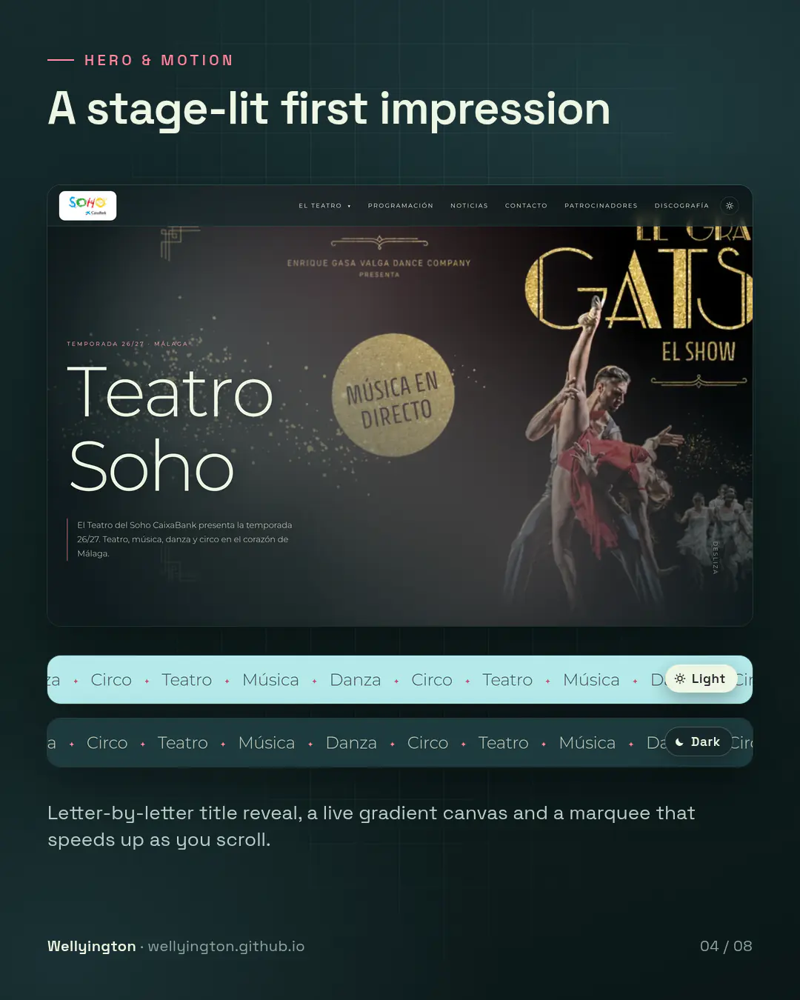
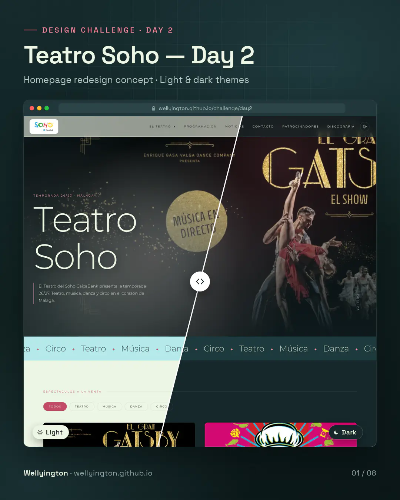
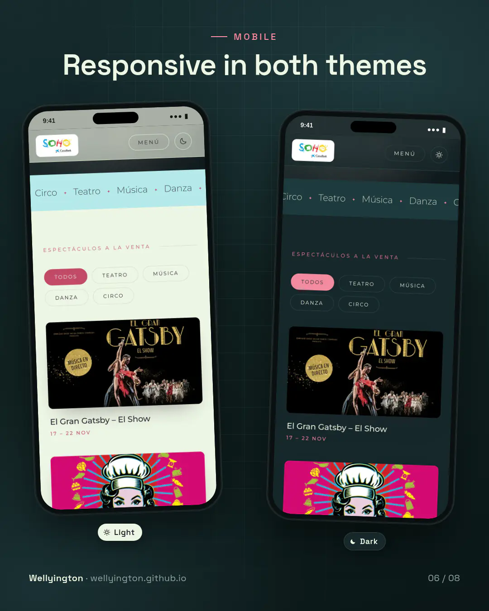
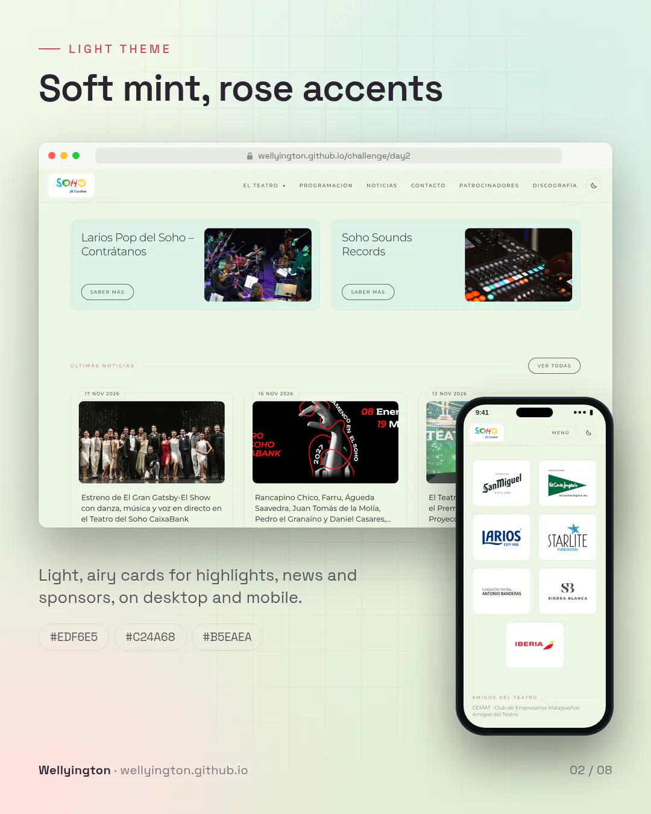
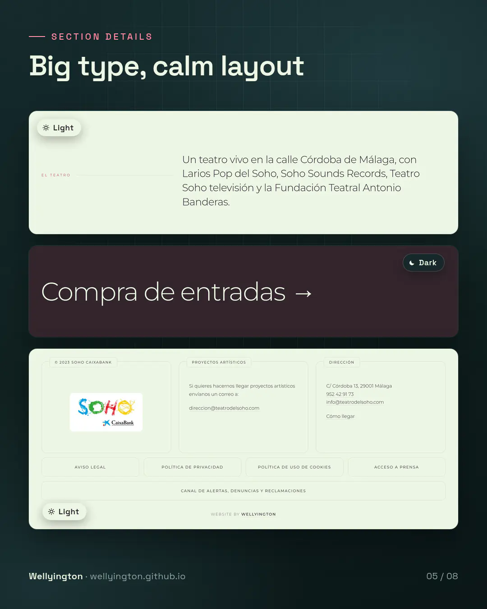
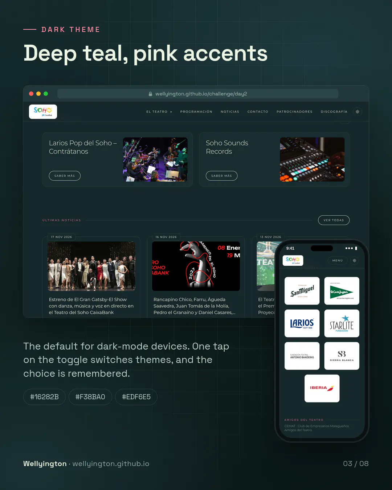

El 18 de noviembre publiqué la segunda nota de esta serie: cien días, cien negocios, cien webs, donde cualquiera puede abrirlas. El día anterior fue una constructora familiar de la Marina Alta que necesitaba una primera página clara, algo terminado que pudiera mirar antes de un contrato. [Esa página está aquí.](https://wellyington.github.io/journal/es/articles/la-web-antes-del-si/) Hoy el lugar es otro, y el trabajo cambia con él.

El Teatro Soho CaixaBank está en la calle Córdoba, en Málaga. Yo trabajo desde Estepona, en la misma costa, lo bastante cerca como para no tener que presentar Málaga como si hubiera venido de viaje. El teatro ya tiene temporada, un edificio al que la gente va andando, un nombre que pesa y varias cosas viviendo bajo el mismo techo. No está esperando su primera frase en internet. Lo que he hecho es una portada para la vida que ya tiene. El concepto se abre aquí: [Teatro Soho, día dos](https://wellyington.github.io/challenge/day2/).

Nadie del teatro me lo pidió. No es un encargo, y no tiene vínculo con el teatro ni con CaixaBank. El nombre de la página es suyo. El concepto es mío, y de momento vive en mi propia dirección, que es el sitio honesto para un trabajo que nadie ha recogido. No me han dicho que alguien de allí lo haya mirado, y no voy a escribir como si lo hubiera hecho.

## una casa que ya está llena

Quien visitaba la página del día anterior quería saber si podía fiarse de una empresa para una casa. Quien abre la de un teatro suele querer una respuesta más pequeña, y la quiere pronto: qué hay este sábado, si hay danza, si queda alguna butaca y quién está en el escenario. La temporada es lo que se ofrece, y se mueve mientras la persona todavía está decidiendo.

El edificio guarda más que un calendario. Junto al teatro están Larios Pop del Soho, Soho Sounds Records, Teatro Soho televisión y la Fundación Teatral Antonio Banderas, y además los patrocinadores, las noticias de la semana, un teléfono y una calle a la que llega un taxi. Si todo eso se amontona en una sola pantalla, nadie termina de leer. Si se esconde, el cartel no lleva a ninguna parte. El trabajo es un orden que una persona pueda usar, y un primer minuto que se parezca a llegar. Después, la página tiene que decir qué hay y cómo se saca una entrada.

Los nombres, las fechas y los socios no me los he inventado. Son públicos, y son lo que enseña el concepto. No he visto estos espectáculos desde una butaca, así que esto es un relato de la página, no de la noche.

## el primer minuto

La apertura es esta temporada. Arriba, en pequeño, se lee Temporada 26/27 · Málaga. Debajo, el nombre va grande, Teatro Soho, y las letras llegan una a una, como llega un título cuando la sala ya se ha quedado en silencio. Detrás está el cartel de El Gran Gatsby – El Show: letras doradas, dos bailarines, una línea en la que Enrique Gasa Valga Dance Company presenta la noche, y un sello redondo en oro que dice música en directo. Junto a una línea fina de color rosa, un párrafo corto dice que la casa presenta la temporada 26/27: teatro, música, danza y circo, en el corazón de Málaga.

Debajo corre una cinta de palabras: Circo, Teatro, Música, Danza, y otra vez las mismas cuatro. Si bajas por la página, la cinta se anima un poco. Si te paras, se serena. Lo entiendo como el telón que sube, un cambio pequeño en la sala. También hay una luz lenta detrás del cartel, más cerca de la luz de un escenario que de una fila de diapositivas.

*La primera pantalla. La temporada, el cartel y el nombre de la casa.*

Esa misma apertura existe en dos luces, porque no todo el mundo lee en el mismo sitio. Una es un verde menta suave, con el rosa reservado para los acentos pequeños, cómoda en una cafetería luminosa o en una acera al sol. La otra es un verde oscuro, más cerca de un patio de butacas a oscuras, con el rosa usado como se usa la luz de sala. Si el móvil ya está en oscuro, la página abre en oscuro. Un toque la cambia, y la elección se queda guardada. El cartel y el nombre no se mueven. De noche la página no deslumbra, y a la hora de comer no te pone delante una pantalla negra con la que pelearte.

*Una portada, dos luces. La temporada se queda, y cambia la sala que la rodea.*

## encontrar el sábado

Bajo la cinta, el título es llano a propósito: Espectáculos a la venta. Debajo hay cinco pastillas: Todos, Teatro, Música, Danza, Circo. Si quieres danza el sábado, pulsas Danza y el resto se aparta. Esa es toda la maniobra, dos toques, en lugar de rebuscar en una lista pensada para la taquilla y no para quien lleva el móvil en la mano.

Cada espectáculo es un cartel, luego el nombre, luego las fechas. El Gran Gatsby – El Show va del 17 al 22 de noviembre, archivado en danza y música, que concuerda con el sello de oro. La Cubana, La cuisine de ma cousine, va del 25 de noviembre al 15 de diciembre, en teatro, sobre una ficha rosa fuerte con un gorro de cocinera que es de esa compañía y no del cartel de Gatsby. Los dos pueden estar juntos. Una casa que programa circo, flamenco, musicales y teatro de texto queda descuidada si todas las fichas se meten en el mismo marco.

Alrededor de esos dos, la parrilla sostiene una temporada. Navidad en el Soho, con Antonio Banderas, está del 25 al 28 de diciembre. Duck Pond, de Circa, cae el 19 y el 20 de diciembre. Enero trae Mujer en cinta de correr sobre fondo negro, Hija de la Luna, y Flamenco en el Soho 2027 del 8 de enero al 19 de marzo, con Rancapino Chico y, a la noche siguiente, Farru con Duquende en Natural. Estoy enumerando lo que enumera la página. Aquí no hay crítica, ni una cifra de ventas, porque no tengo ninguna de las dos cosas.

*Espectáculos a la venta, en el móvil. Eliges danza, y las otras fichas se apartan.*

Al abrir una ficha, el espectáculo pasa delante con dos caminos: comprar entrada o saber más. Más abajo, en un cuerpo de letra que no se puede pasar por alto, la línea dice Compra de entradas. A mitad de página, quien visita no debería tener que adivinar si ahí se venden entradas. Comprar lleva a los canales que la casa ya usa. Saber más lleva a la página del propio teatro para ese espectáculo. No estoy abriendo una segunda taquilla.

En el móvil, la misma visita ocurre en un momento corto. Alguien en la cena está mirando el sábado, o alguien a unas calles de Córdoba le manda un cartel a la persona que tiene que decir que sí. El menú se recoge en un solo control: programación, noticias, contacto, patrocinadores, discografía. Los filtros siguen siendo lo bastante grandes para el pulgar, y los carteles se apilan en imagen, nombre y fechas. No hace falta pellizcar la pantalla, ni girar el móvil para leer el nombre de la casa. El teléfono además se mueve, de una calle luminosa a mediodía a una butaca a oscuras después del telón, y por eso las dos luces tienen sentido aquí.

## el resto de la casa

La calle Córdoba guarda más que fechas. Una fila llamada Destacados recorre tres fichas. Larios Pop del Soho, con Contrátanos y una fotografía de una orquesta bajo luz de colores. Soho Sounds Records, una mesa de mezclas, bastante para decir que en el edificio vive un sello. La Fundación Teatral Antonio Banderas, en una ficha propia. Cada una dice saber más y enlaza con las páginas del teatro. Dejé los nombres separados, porque un único rótulo blando habría hecho la casa más pequeña de lo que es.

Después van las noticias, bajo Últimas noticias, con un camino hacia el resto. Tres notas, con fecha y con fotografía. El 17 de noviembre, el estreno de El Gran Gatsby – El Show, danza, música y voz en directo. El 16 de noviembre, flamenco: Rancapino Chico, Farru, Águeda Saavedra, Juan Tomás de la Molía, Pedro el Granaíno y Daniel Casares. El 13 de noviembre, el Premio Andalucía Excelente, por la proyección cultural del teatro. Estoy repitiendo la página, no una noche a la que yo haya ido. Una noticia con fecha es la manera de que la portada enseñe que la semana está pasando, en vez de dejar el lugar aparcado en un logo de una temporada ya cerrada.

*Destacados y últimas noticias, en el tema menta. El fondo se queda quieto para que se lean las fotos.*

Luego la página baja el ritmo a propósito. El teatro es una sola frase, en grande: un teatro vivo en la calle Córdoba de Málaga, con Larios Pop del Soho, Soho Sounds Records, Teatro Soho televisión y la Fundación Teatral Antonio Banderas. Las palabras se adelantan según llegas a ellas. Es corta porque la temporada de arriba ya ha presentado la casa, y sirve tanto a quien no conoce el lugar como a quien sí lo conoce.

El pie es donde la visita se vuelve práctica. C/ Córdoba 13, 29001 Málaga, el teléfono 952 42 91 73, info@teatrodelsoho.com, y un enlace para llegar. Los proyectos artísticos escriben a direccion@teatrodelsoho.com. El aviso legal, la privacidad, las cookies, el acceso a prensa y un canal de alertas, denuncias y reclamaciones quedan en una fila que se puede recorrer con la vista. Una línea pequeña dice que la web es mía. La dejé a la vista para que la página no tome prestada la autoridad de una casa que no ha pedido el trabajo.

*La casa en una frase, las entradas en grande y una dirección a la que puede ir un taxi.*

## un sitio digno para quien sostiene la casa

Un local así vive con quienes lo sostienen. Los patrocinadores tienen una parrilla propia: logotipos en fichas blancas, con aire suficiente para distinguirlos, no una tira gris debajo del texto legal. Entre ellos están San Miguel, El Corte Inglés, Larios, Fundación Starlite, la fundación, Sierra Blanca e Iberia. Bajo Amigos del teatro, la línea nombra a CEMAT, el club de empresarios malagueños amigos del teatro, y las fichas siguen con nombres de la ciudad: un hotel, El Pimpi, un grupo hospitalario, el parque tecnológico.

No conozco los acuerdos que hay detrás de esas marcas, y no voy a inventarlos. Un sitio digno, en esta página, quiere decir lo bastante grande para leerse, todavía pulsable cuando los logotipos caen en dos columnas en el móvil, y sin quedarse con la temporada. Los espectáculos siguen arriba. En el tema oscuro, ese mismo tramo se apoya en un verde profundo, con el rosa reservado a las etiquetas pequeñas. Un móvil que ya está en oscuro lo abre así. Un toque devuelve el menta, y la elección se recuerda.

*El tema oscuro. Un toque lo cambia, y la elección se guarda para la próxima visita.*

## una oferta, no un anuncio

El teatro no me contrató, y CaixaBank tampoco. Esto no es una página oficial, y nada de lo que hay aquí significa que la casa haya aprobado el trabajo. La gente ya compra entradas por los caminos que usa la casa. He trabajado con nombres públicos, fechas públicas y la manera en que el teatro se describe, una casa viva en la calle Córdoba con esas cuatro actividades al lado, para que alguien de Málaga pudiera reconocer el lugar.

No hay ninguna cita, porque nadie de allí me la dio, y no me han dicho que lo hayan visto. No hay una cifra de butacas ni de taquilla. Si abren el concepto y no quieren nada de mí, ese es un final completo. La página del día anterior existía para que un constructor pudiera decir que sí, que no, o que cambiara una parte. Esta es la misma clase de oferta, hecha a una casa que ya tiene público.

## si tu sitio ya va lleno

Puede que tú no lleves un teatro. Desde Estepona, la mayoría de los meses se parecen más a este día que al primero. Aquella constructora necesitaba una página clara que todavía no existía: el nombre, el trabajo, los pueblos, una forma de escribirle que se pareciera a cómo la gente ya se pone en contacto. Muchos negocios ya han pasado de ahí. La gente ya viene. La temporada, la carta o la lista de trabajos es real, y la web ha crecido por acumulación: un bloque nuevo cada vez que empezaba algo, una tira para cada socio, y el motivo de la visita debajo de todo eso.

Un rediseño puede conservar lo que a la gente ya le gusta: el nombre de la puerta, el trabajo en sí, y los socios en un sitio decente, sin tapar lo que vendes. La dirección y el teléfono se quedan donde una persona puede usarlos. Lo que cambia es el orden. El sábado cabe en dos toques, la entrada queda donde ya está la mano, y la luz sigue al móvil, fácil después de una función y fácil a mediodía. Una página nueva puede hacer más fácil recorrer un negocio que ya está lleno, y dejar el carácter donde la gente ya lo encontró.

Si ese es tu caso, escríbeme desde [la web principal](https://wellyington.github.io/es/). Dime a qué te dedicas y dónde, y contestaré en lenguaje llano. La versión corta de hoy es la nota del día 18: día dos de cien, una portada para este teatro, claro u oscuro, elige quien visita. [La nota está aquí.](https://x.com/wellyington/status/2123056661220733019) Mañana es otro negocio, y otra página terminada.
