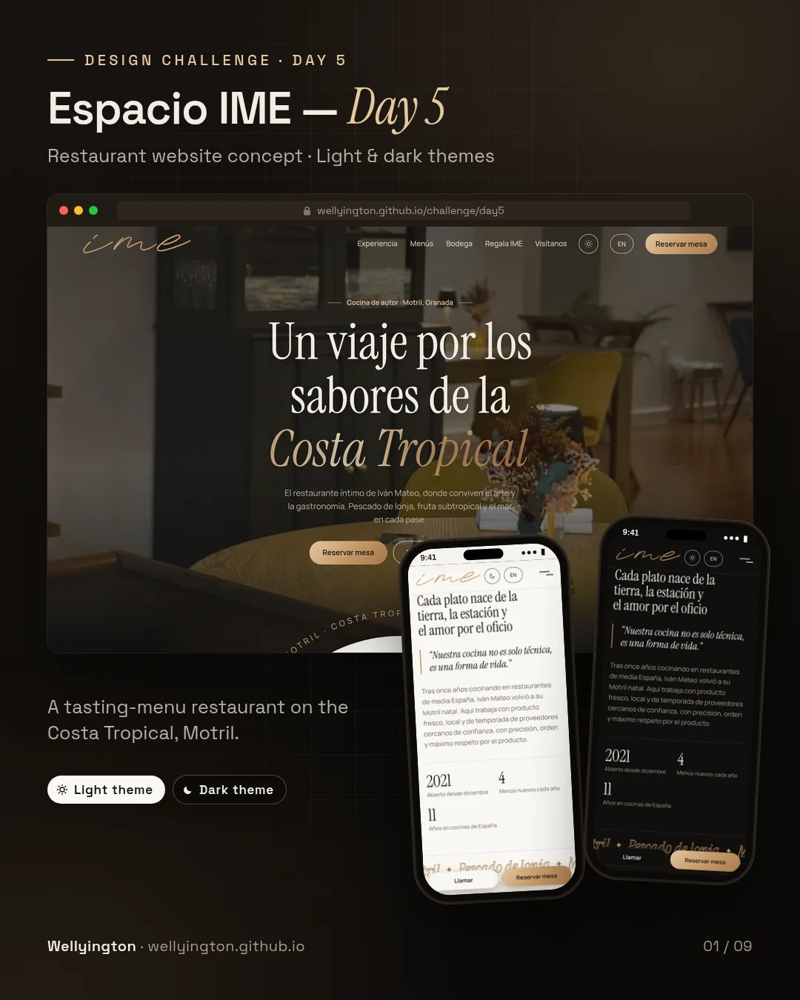
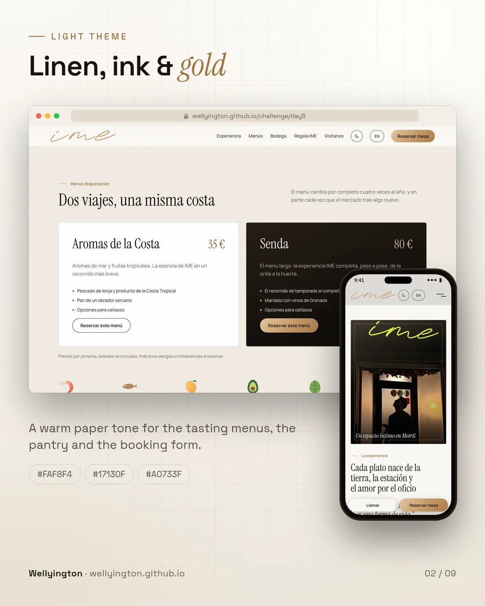
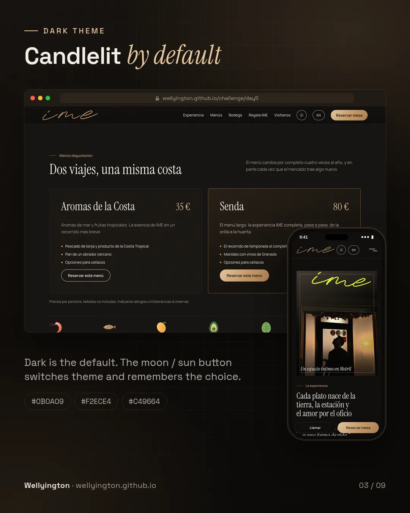
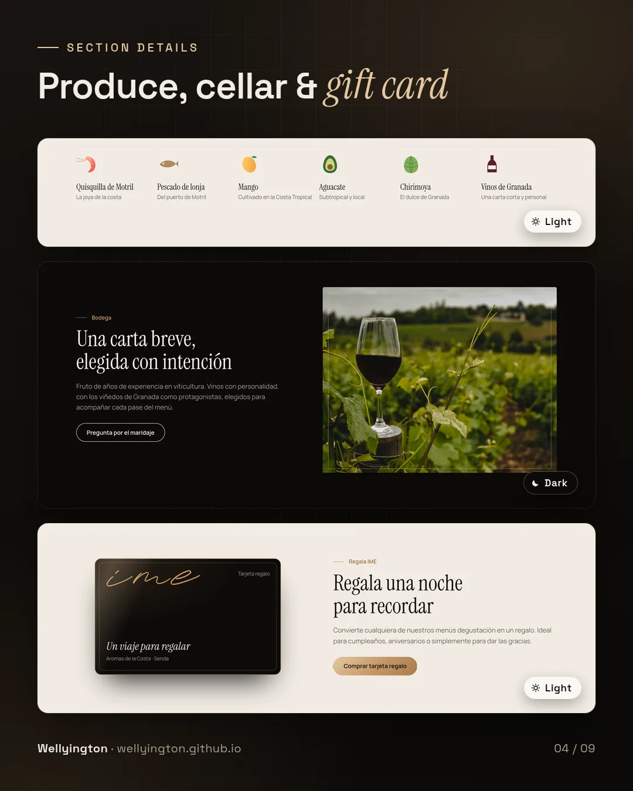
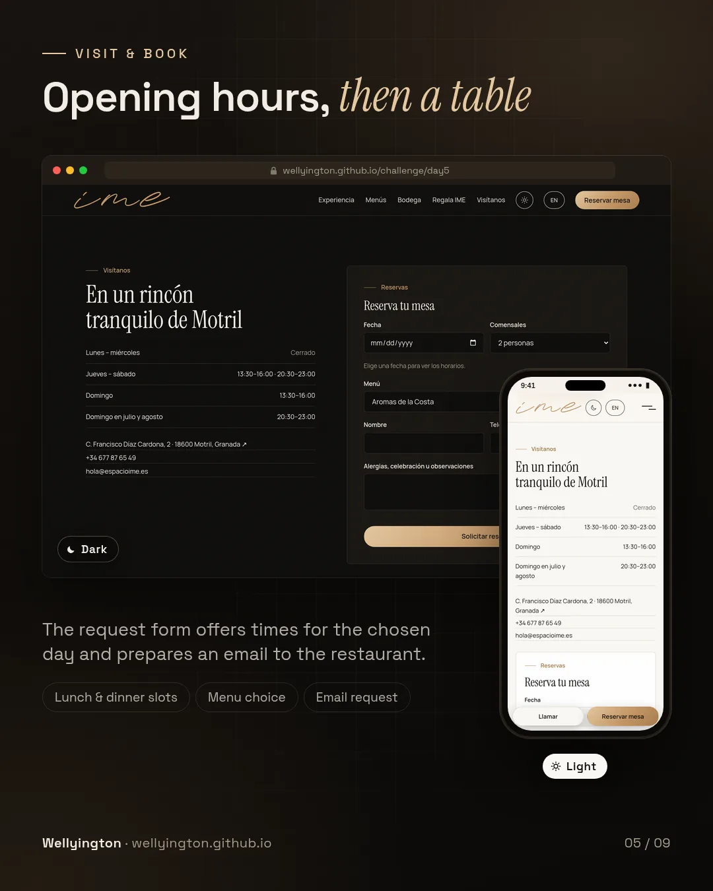
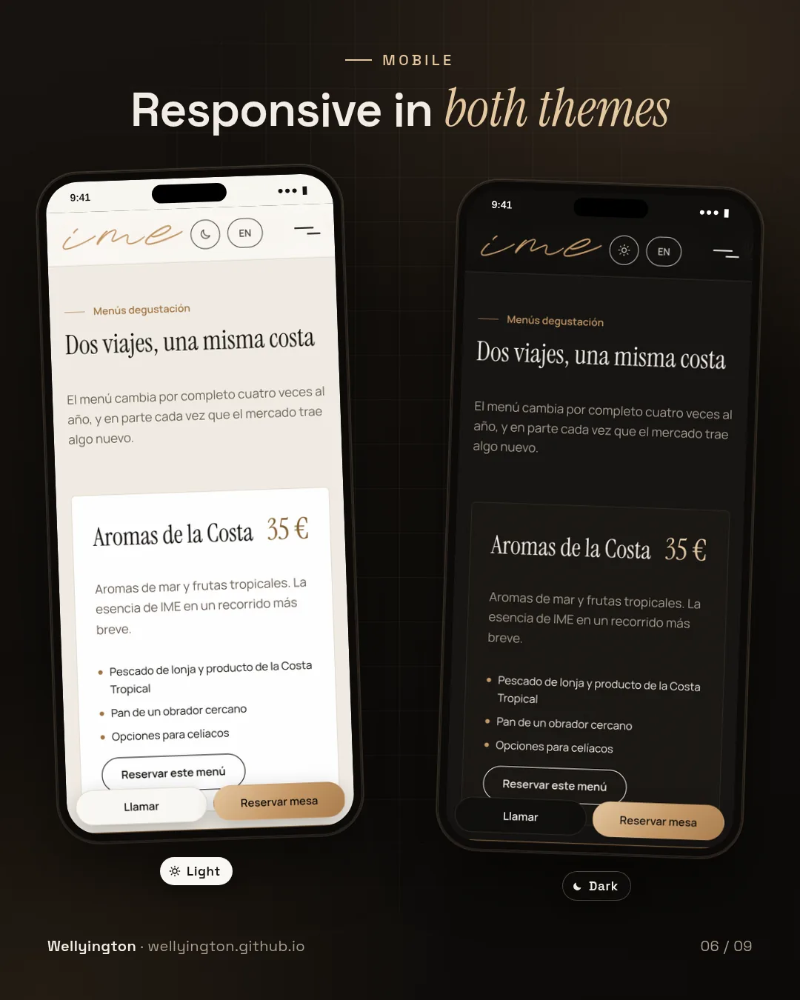
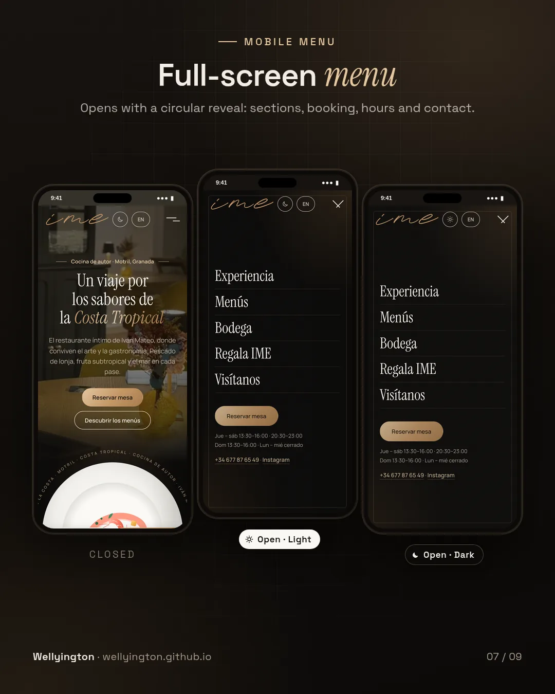
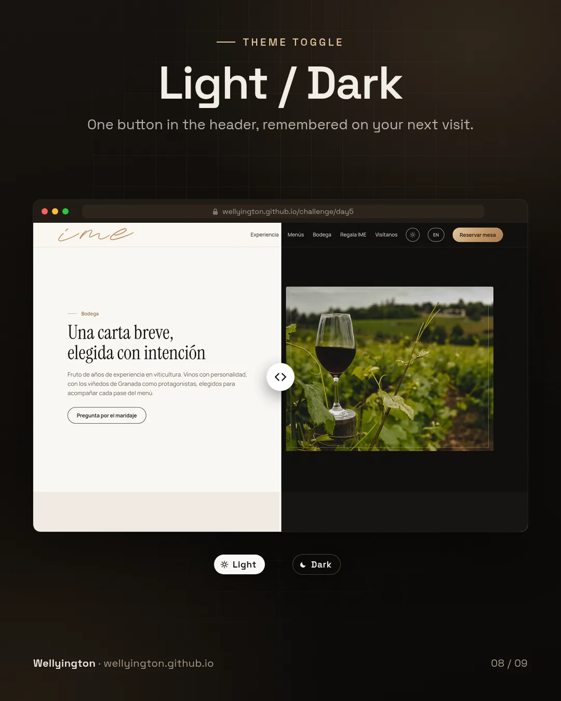

El 21 de noviembre publiqué la quinta nota de esta serie, el reto que propuso Ramiah Trask: cien días, cien negocios, cien webs. El primer día fue una constructora familiar de la Marina Alta. [Esa página está aquí.](https://wellyington.github.io/journal/es/articles/la-web-antes-del-si/) El segundo, un teatro en Málaga. [Ese está aquí.](https://wellyington.github.io/journal/es/articles/sitio-para-toda-la-temporada/) El tercero, un restaurante familiar en mi propio pueblo, Estepona. [Ese está aquí.](https://wellyington.github.io/journal/es/articles/un-sitio-en-la-mesa-larga/) El cuarto, un despacho inmobiliario privado en Málaga. [Ese está aquí.](https://wellyington.github.io/journal/es/articles/criterio-antes-que-volumen/) Hoy toca otra vez un restaurante, pero uno muy distinto.

Espacio IME es un pequeño restaurante de menús degustación en Motril, en la Costa Tropical, ese trozo de la costa de Granada donde los mangos, los aguacates y las chirimoyas crecen a pocos minutos del mar. El cocinero es Iván Mateo. Volvió a Motril después de once años cocinando en restaurantes de media España, y lleva IME desde diciembre de 2021. Su cocina se apoya en el producto local: pescado de la lonja de Motril, la fruta subtropical de la costa, vinos de Granada.

Las guías se han fijado. Espacio IME es restaurante recomendado de la Guía Repsol 2026. Está seleccionado en la Guía Michelin. Macarfi, la guía que puntúa cocina, decoración y servicio, le dedica una ficha propia y destaca un arroz con quisquilla de Motril como motivo suficiente para el viaje.

Hay restaurantes que se merecen una web tan buena como su comida. El concepto está aquí: [Espacio IME, día cinco](https://wellyington.github.io/challenge/day5/). La web del restaurante está en [espacioime.es](https://www.espacioime.es/), y su Instagram es [@espacioime](https://www.instagram.com/espacioime/).

Es un concepto de diseño independiente. No es una colaboración con Espacio IME, nadie allí me lo ha pedido y nada en la página significa que lo hayan aprobado. Como los cuatro anteriores, por ahora vive en mi propia dirección.

## una web a la altura de los reconocimientos

Piensa en cómo llega la gente a un restaurante así. Casi nadie descubre un menú degustación en Motril pasando por la puerta. Lo leen en una guía, ven un plato en Instagram, se lo cuenta un amigo que bajó desde Granada. Luego lo buscan. La web es la segunda impresión, y llega justo después de que una guía les haya dicho que el sitio merece un viaje.

Si entonces la web parece una plantilla, con fotos de banco y un formulario de contacto en una esquina, quien visita nota el salto. No porque una plantilla sea un delito, sino porque todo lo demás del lugar habla de cuidado: el producto, el emplatado, la carta corta de vinos, la sala pequeña. La web es la única parte de la experiencia que el restaurante regala, a todo el mundo, antes de que nadie haya probado nada.

Así que me puse un encargo sencillo. La web debía tener el mismo cuidado por el detalle que la cocina. Un orden claro, el producto delante, los menús con sus precios, el vino, el regalo y una forma tranquila de pedir mesa. Nada que grite.

## un viaje por los sabores de la costa

La web se abre en la sala. Una foto ancha del comedor ocupa la pantalla, oscurecida para que el texto descanse bien encima: mesas de madera, sillas color mostaza, un jarrón de flores secas.

El titular va en una serif alta y estrecha: un viaje por los sabores de la Costa Tropical. Las dos últimas palabras, en cursiva y en un dorado suave. Encima, una línea pequeña, cocina de autor, Motril, Granada, que es como lo describiría una guía. Debajo, una frase: el restaurante íntimo de Iván Mateo, donde conviven el arte y la gastronomía, con pescado de lonja, fruta subtropical y el mar en cada pase.

Después, dos botones: reservar mesa o descubrir los menús. Al pie de la pantalla asoma un plato blanco, con una línea de texto que recorre su borde como el sello de una cerámica: Costa Tropical, Motril, cocina de autor, Iván Mateo.

Justo debajo de la apertura hay una fila discreta con los tres reconocimientos: Guía Michelin 2026, Guía Repsol 2026 y Macarfi. Son pequeños y van en la misma tipografía que todo lo demás, y el pie de la página enlaza a las fichas del restaurante en las guías Michelin y Repsol. Los premios funcionan mejor cuando son fáciles de comprobar y no se gritan.

*La apertura en pantalla grande, y la sección de la experiencia en dos móviles.*

## cada plato nace de la tierra

La primera sección después de la apertura habla del cocinero, no del menú. Su titular dice: cada plato nace de la tierra, la estación y el amor por el oficio.

A su lado, una sola cita de la cocina, en grande, en cursiva y con una fina línea dorada al lado: nuestra cocina no es solo técnica, es una forma de vida. Luego un párrafo corto. Tras once años cocinando en restaurantes de media España, Iván Mateo volvió a su Motril natal. Aquí trabaja con producto fresco, local y de temporada de proveedores cercanos de confianza, con precisión, orden y máximo respeto por el producto.

Tres cifras cierran la sección. 2021, abierto desde diciembre. 4, menús nuevos cada año. 11, años en cocinas de España. Prefiero cifras así a los adjetivos. Un cliente puede comprobar cada una, y juntas dicen más del sitio de lo que nunca diría "excepcional".

## el producto, por su nombre

Un menú degustación es difícil de describir por adelantado, porque cambia. Lo que no cambia es de dónde viene. Por eso, entre la historia y los menús hay una franja de ingredientes, con un pequeño dibujo para cada uno y una línea debajo.

Quisquilla de Motril, la joya de la costa. Pescado de lonja, del puerto de Motril. Mango, cultivado en la Costa Tropical. Aguacate, subtropical y local. Chirimoya, el dulce de Granada. Y vinos de Granada, una carta corta y personal.

Los mismos nombres pasan por la pantalla más arriba, como una cinta lenta, en cursiva dorada, uno detrás de otro. Puede que alguien de Madrid o de Londres no sepa qué es una quisquilla. Después de esta página, querrá probarla.

## dos viajes, una misma costa

Después vienen los menús, bajo el titular dos viajes, una misma costa. Una línea explica cómo trabaja la cocina: el menú cambia por completo cuatro veces al año, y en parte cada vez que el mercado trae algo nuevo.

Hay dos menús, uno al lado del otro, cada uno en su tarjeta, con el precio en grande en la esquina, como lo pondría una carta impresa.

Aromas de la Costa, por 35 euros, es el recorrido corto: aromas de mar y frutas tropicales, la esencia de IME en un recorrido más breve. Incluye pescado de lonja y producto de la Costa Tropical, pan de un obrador cercano y opciones para celíacos.

Senda, por 80 euros, es el menú largo: la experiencia IME completa, pase a pase, de la orilla a la huerta. Cubre el recorrido de temporada al completo, un maridaje con vinos de Granada y el mismo cuidado con los celíacos. En el tema claro esta tarjeta es oscura, y en el oscuro tiene un borde dorado, así que la vista sabe cuál es la experiencia completa sin que nadie se lo diga.

Cada tarjeta termina con un solo botón: reservar este menú. Una línea bajo las dos dice que los precios son por persona, que las bebidas no están incluidas y que conviene indicar alergias o intolerancias al reservar.

Mostrar los precios fue una decisión. Algunos restaurantes de este nivel los esconden, y hay que escribir para saberlos. Eso echa para atrás justo a quien está pensando en un cumpleaños o un aniversario y quiere saber qué esperar. Unos precios claros también son hospitalidad.

*El tema claro: lino, tinta y oro, para los menús, el producto y el formulario de reserva.*

## a la luz de las velas por defecto

Todas las webs de esta serie han tenido un tema claro y otro oscuro. Esta es la primera en la que el oscuro es el punto de partida.

Un menú degustación es sobre todo una cena, y la sala tiene la luz baja. Por eso la web se abre en su versión oscura: casi negro, #0B0A09, texto blanco cálido, #F2ECE4, y un dorado apagado, #C49664, para todo lo que se puede pulsar. El tema claro es lino y tinta, #FAF8F4 y #17130F, con un dorado más profundo, #A0733F. Un pequeño botón de sol y luna en la cabecera cambia entre los dos, y la web recuerda tu elección la próxima vez.

La tipografía es una pareja que tenía ganas de usar: Instrument Serif, una serif estrecha con una cursiva preciosa, para titulares, menús y precios, y Manrope, una sans limpia, para todo lo demás. El logotipo es un ime fino escrito a mano, en dorado.

*El oscuro es el tema por defecto. El botón de luna y sol lo cambia y recuerda la elección.*

## la bodega y el regalo

Vienen después dos secciones más pequeñas, y las dos importan más de lo que su tamaño sugiere.

La primera es la bodega. Titular: una carta breve, elegida con intención. El texto cuenta que la carta es fruto de años de experiencia en viticultura: vinos con personalidad, con los viñedos de Granada como protagonistas, elegidos para acompañar cada pase del menú. Al lado, una foto de una copa de tinto entre las vides. No hay una tabla larga de botellas y añadas. La carta corta es la idea, y el botón dice simplemente pregunta por el maridaje.

La segunda es el regalo. Regala IME. El titular es regala una noche para recordar. Cualquiera de los menús degustación puede convertirse en un regalo, para cumpleaños, aniversarios o simplemente para dar las gracias. A la izquierda, una tarjeta regalo dibujada como un objeto, oscura, con la firma dorada de IME y las palabras un viaje para regalar. El botón, comprar tarjeta regalo, lleva directamente a la página de regalos que el restaurante ya tiene. No construí una tienda nueva. La que hay funciona, y el trabajo del concepto es que se encuentre más fácil.

Las tarjetas regalo son una parte callada del negocio de muchos buenos restaurantes. Quien ha comido en un sitio especial quiere mandar a sus padres, a sus amigos, a su mejor cliente. Una sección de regalo visible y bien presentada les da un motivo para hacerlo.

*El producto, la bodega y la tarjeta regalo, cada uno con su propio espacio.*

## primero el horario, después la mesa

La última sección de la página se llama visítanos, y pone el horario primero. De lunes a miércoles, cerrado. De jueves a sábado, comidas de 13:30 a 16:00 y cenas de 20:30 a 23:00. Domingo, solo comidas, de 13:30 a 16:00. Domingo en julio y agosto, cenas de 20:30 a 23:00. Debajo, la dirección, calle Francisco Díaz Cardona 2, en Motril, que se abre en el mapa, el teléfono y el correo.

Junto al horario está la solicitud de reserva, reserva tu mesa. Primero la fecha y el número de comensales. Cuando eliges una fecha, el formulario solo ofrece las horas en las que la cocina sirve ese día, de media en media hora, para comidas, cenas o las dos. Si eliges un lunes, un martes o un miércoles, te dice con amabilidad que el restaurante está cerrado y te propone de jueves a domingo. Si eliges un domingo de agosto, te ofrece cena en lugar de comida. Después, el menú: Aromas de la Costa, Senda o lo decidimos en mesa. Luego nombre, teléfono y un campo para alergias, celebraciones o cualquier cosa que la cocina deba saber.

El botón dice solicitar reserva, y eso es exactamente lo que hace. Prepara un correo al restaurante con todo rellenado, listo para enviar. El restaurante confirma. No quise fingir que el concepto fuera un sistema de reservas completo. Un restaurante pequeño, con pocas mesas, suele preferir ver cada petición y contestarla en persona, y la página lo respeta.

*El horario va primero. El formulario solo ofrece horas en las que la cocina abre el día elegido.*

## en el móvil

La mayoría de la gente verá esta web en el móvil, muchas veces el mismo día que quiere reservar. En una pantalla pequeña todo se apila en el mismo orden: la historia, el producto, los menús, la bodega, el regalo, el horario.

Dos botones se quedan fijos en la parte de abajo todo el tiempo: llamar y reservar mesa. Están al alcance del pulgar en cualquier punto de la página. Quien ya se ha decidido no necesita bajar hasta el final para encontrar el formulario.

El menú se abre a pantalla completa con un círculo que se expande desde el botón de la esquina, como una cortina que se corre desde un lado. Dentro están las cinco secciones, en grande, en la serif: experiencia, menús, bodega, regala IME, visítanos. Debajo, el botón de reservar mesa, el horario en una línea corta, el teléfono e Instagram. Todo lo que alguien necesita para decidirse cabe en esa pantalla.

*Los menús en el móvil, con los dos temas, y llamar y reservar siempre a mano.*

*El menú a pantalla completa se abre con un círculo: secciones, reserva, horario y contacto.*

## primero en español, el inglés a un toque

La web del propio IME está en español, y el concepto también, en primer lugar. Pero la Costa Tropical recibe también visitantes de fuera, y mucha gente que vive en esta costa lee el inglés con más comodidad que el español.

Por eso hay un botón EN en la cabecera. Lo pulsas y todo el texto de la página pasa al inglés: los titulares, los menús, el horario, las etiquetas del formulario, los botones. No es una traducción automática puesta encima. Cada línea tiene su versión en inglés escrita junto a la española, para que las dos se lean bien.

## por qué creo que esta merece una mirada

Cada día de esta serie tiene su propio trabajo. Una constructora necesitaba una primera página clara. Un teatro necesitaba un orden. Un restaurante familiar necesitaba enseñar muchos motivos para entrar. Un despacho inmobiliario necesitaba poner a una persona delante.

Espacio IME necesitaba algo más cercano a su propia cocina: contención, buenos materiales y atención a las cosas pequeñas. Una línea dorada junto a una cita. Un plato que asoma al pie de la primera pantalla. Precios compuestos como en una carta impresa. Un formulario de reserva que sabe que la cocina cierra los martes.

Lo digo claro: creo que esta merece una mirada de Awwwards. Si llega, bien. Si no, la página sigue haciendo aquello para lo que se hizo, que es estar al lado de una ficha de la Guía Michelin sin desentonar.

*Un botón en la cabecera, y la web lo recuerda en tu próxima visita.*

## un concepto independiente

Espacio IME no me ha contratado, y esta no es su web. La historia del cocinero, los menús y precios, el producto, el horario, la dirección y las fichas de las guías salen de lo que el restaurante y las guías ya publican. No he cambiado ningún dato. Lo que he cambiado es el orden, la tipografía, el tono y cómo se comporta la página en el móvil.

No tengo cifras de reservas ni de visitas, y no me las voy a inventar. Si nadie en IME lo quiere, el concepto se queda donde está, como día cinco. Si lo quieren, lo demás es práctico: sus palabras donde yo he rellenado, fotos nuevas para el menú de cada temporada, las solicitudes de reserva enviadas adonde ellos digan y la web trasladada a espacioime.es.

## si tu cocina es mejor que tu web

Puede que tú no lleves un restaurante de menú degustación. Pero muchos pequeños negocios de esta costa están en la misma situación: lo que hacen es mejor que cómo aparecen en internet. Un obrador con premios y una web de dos líneas. Una bodega con una sala preciosa y una página que es casi solo un teléfono. Un hotel con diez habitaciones perfectas y un motor de reservas de 2015.

Lo que ayuda es lo mismo que aquí. Pon delante a las personas y el producto. Enseña los precios si puedes. Dale al cliente una forma tranquila de pedir lo que quiere. Y deja que el diseño sea tan cuidadoso como el trabajo.

Soy diseñador web en Estepona, en la Costa del Sol, y hago webs como esta para negocios de toda España. Si eso suena a tu negocio, escríbeme desde [la web principal](https://wellyington.github.io/es/). Dime a qué te dedicas y dónde, y te contestaré en lenguaje llano. El concepto está [aquí](https://wellyington.github.io/challenge/day5/), y la web de Espacio IME está [aquí](https://www.espacioime.es/), por si quieres compararlas. Cinco hechos, quedan noventa y cinco.
