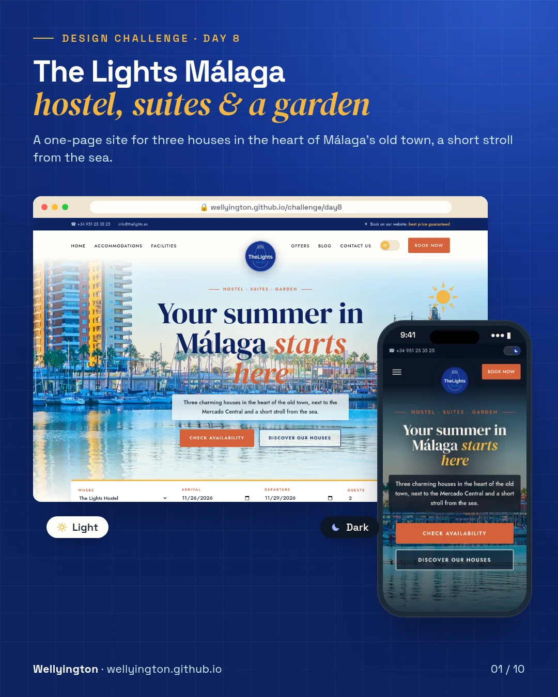
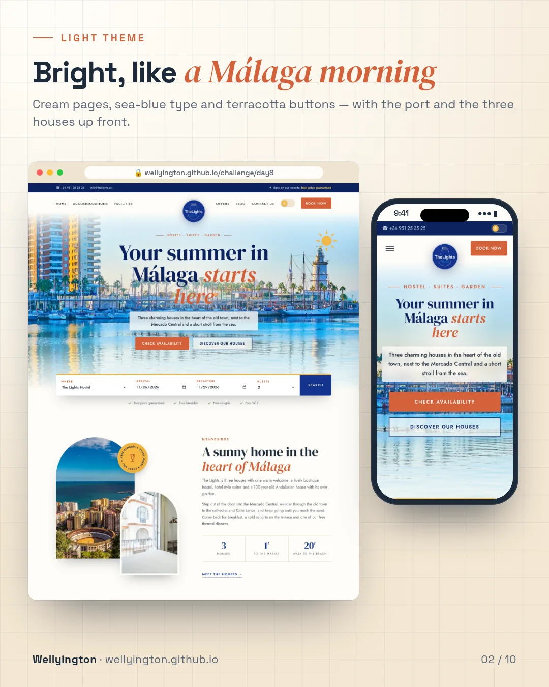
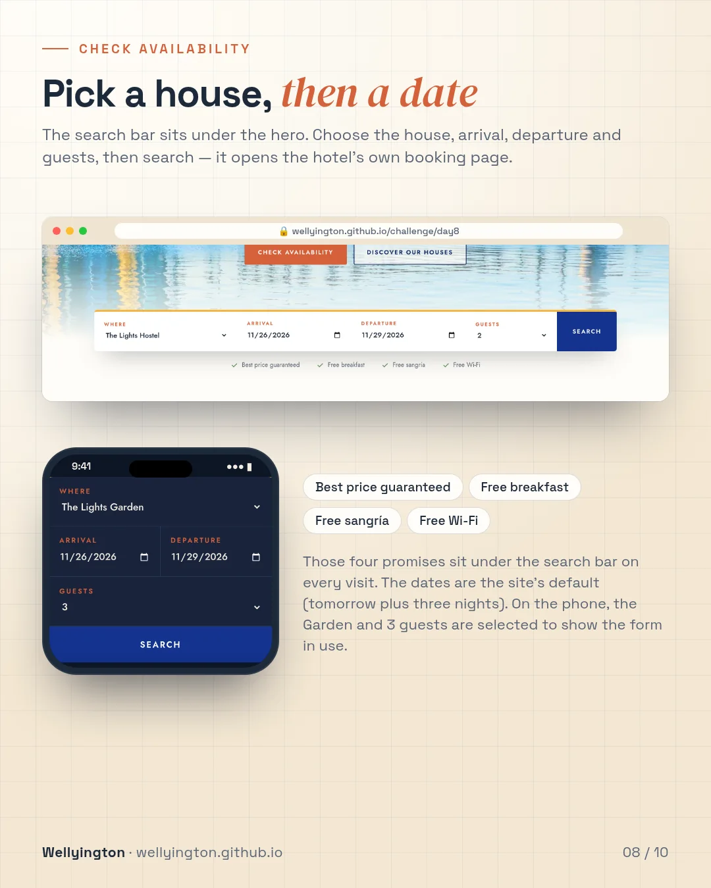
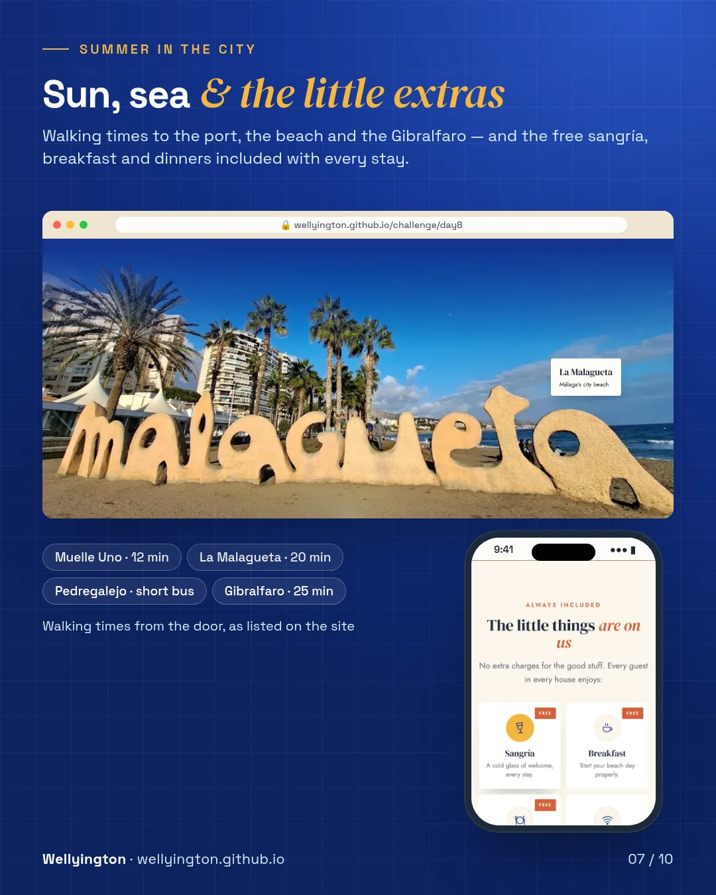
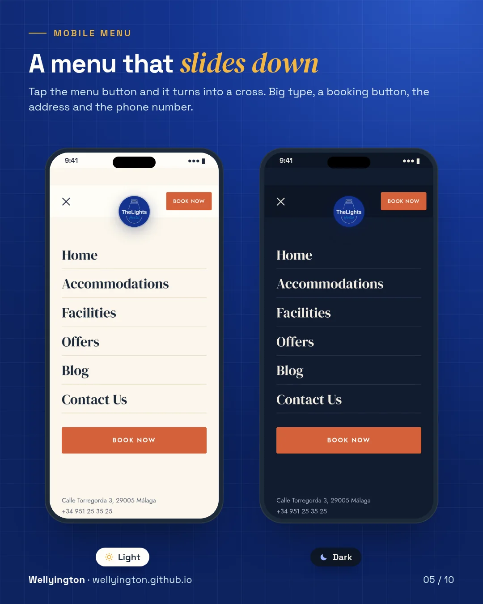
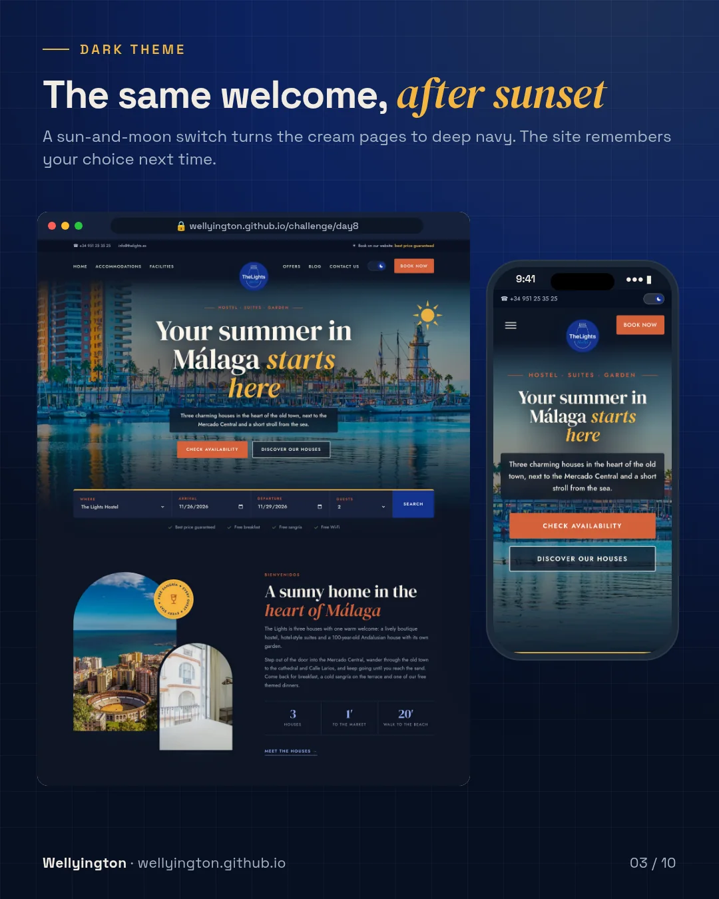
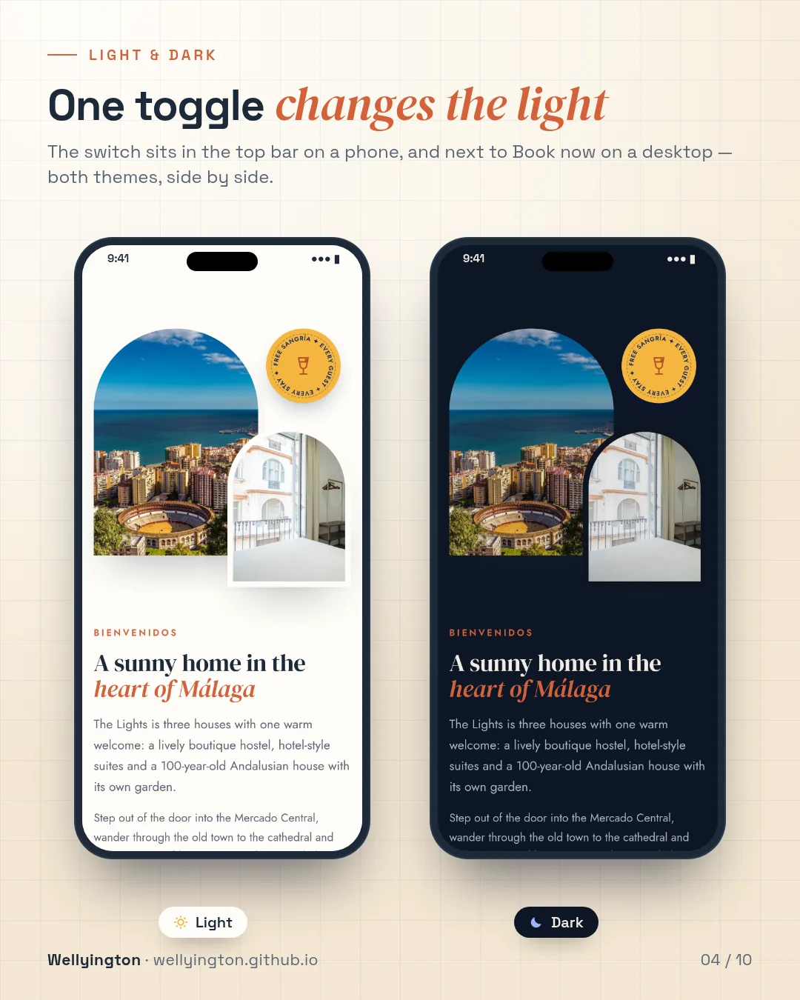

El 25 de noviembre publiqué la octava nota de esta serie, el reto que planteó Ramiah Trask: cien días, cien negocios, cien webs. El día uno fue un constructor familiar de la Marina Alta. [Esa página está aquí.](https://wellyington.github.io/journal/es/articles/la-web-antes-del-si/) El día dos, un teatro de Málaga. [Esa está aquí.](https://wellyington.github.io/journal/es/articles/sitio-para-toda-la-temporada/) El día tres, un restaurante familiar de Estepona. [Esa está aquí.](https://wellyington.github.io/journal/es/articles/un-sitio-en-la-mesa-larga/) El día cuatro, una consultora inmobiliaria privada de Málaga. [Esa está aquí.](https://wellyington.github.io/journal/es/articles/criterio-antes-que-volumen/) El día cinco, un restaurante de menús degustación en Motril. [Esa está aquí.](https://wellyington.github.io/journal/es/articles/tan-cuidada-como-la-cocina/) El día seis, un asador de pollos de Estepona. [Esa está aquí.](https://wellyington.github.io/journal/es/articles/del-mostrador-a-la-comanda/) El día siete, un hotel familiar en Kavos, Corfú. [Esa está aquí.](https://wellyington.github.io/journal/es/articles/la-misma-piscina-de-noche/)

Hoy volvemos a la Costa del Sol, a la propia Málaga. The Lights son tres alojamientos en el centro histórico con un solo nombre. The Lights Hostel es un hostel boutique en un edificio andaluz histórico. The Lights Suites son habitaciones privadas de estilo hotel en el mismo edificio, algunas con balcón al Mercado Central. The Lights Garden es una casa andaluza tradicional de más de cien años, a unas calles, con su propio jardín. Su web actual está en [thelights.es](https://www.thelights.es/).

El concepto está aquí: [The Lights Málaga, día ocho](https://wellyington.github.io/challenge/day8/).

## tres casas, tres huéspedes

Lo difícil aquí no es el diseño. Es el encargo que se esconde dentro del negocio.

Un hostel, unas suites y una casa tranquila son tres productos distintos para tres personas distintas. El hostel es para quien viaja solo y para grupos de amigos que quieren una terraza, una cena compartida y alguien con quien ir a la playa. Las suites son para parejas y familias que quieren una habitación privada y un balcón, a mejor precio que un hotel. La casa con jardín es para quien busca calma después de un largo día de sol, y a menudo para estancias más largas.

Pon los tres en una misma web y lo habitual es una página que no le habla a nadie. Quien busca el hostel lee sobre jardines tranquilos. La familia lee sobre literas y fiestas. Y nadie encuentra el botón de reservar, porque hay tres en tres sitios distintos.

Así que el reto era reunirlos bajo una sola identidad, el mismo nombre, el mismo equipo y los mismos extras gratis, dejando que cada casa conserve su carácter. Y hacer que tres cosas sean imposibles de pasar por alto en cada pantalla: dónde está, qué tipo de habitación te llevas y cómo reservarla directamente.

*Día ocho: tres casas en el corazón del centro histórico de Málaga, a un paseo del mar.*

## una portada de verano

Málaga vende verano. La mayoría de quienes reservan una cama en el centro vienen por el sol, el mar y las noches largas, así que la primera pantalla dice exactamente eso.

El fondo es una fotografía del puerto en el Muelle Uno: palmeras, la Farola, veleros y el agua. Encima, en una serifa grande en azul mar profundo, la frase your summer in Málaga starts here, tu verano en Málaga empieza aquí, con las dos últimas palabras en cursiva terracota. Un pequeño sol dibujado gira despacio en una esquina. Sobre el titular, tres palabras en versalitas: hostel, suites, garden. Es todo el negocio en tres palabras, antes de que nadie haya bajado.

Bajo el titular, una frase: tres casas con encanto en el corazón del centro histórico, junto al Mercado Central y a un paseo del mar. Después, dos botones: consultar disponibilidad y descubrir nuestras casas.

El logotipo es el que The Lights ya usa, una insignia azul redonda con un farolillo, en el centro de la cabecera. No lo he redibujado. Alrededor, la cabecera recoge las seis secciones que el negocio ya utiliza, Home, Accommodations, Facilities, Offers, Blog y Contact Us, y un botón terracota Book now a la derecha.

*El tema claro: páginas crema, letras azul mar y botones terracota, con el puerto y las tres casas por delante.*

## primero, el buscador de reservas

Justo debajo de la portada, montada sobre el borde inferior de la fotografía, hay una barra de reservas. Dónde, llegada, salida, huéspedes, buscar. Es lo primero de la página que se puede usar de verdad.

Dónde es una elección entre las tres casas. Las fechas ya vienen con valores sensatos, mañana y tres noches después, para que solo haya que cambiar lo que sea distinto. Los huéspedes van de uno a seis, y luego siete o más, un grupo. En el móvil la barra se convierte en un formulario ordenado, un campo debajo de otro, con un botón de búsqueda grande al final.

Bajo la barra, cuatro promesas cortas, cada una con un check: mejor precio garantizado, desayuno gratis, sangría gratis, wifi gratis. Son las cuatro cosas que un huésped compara entre plataformas de reserva, y aquí están escritas antes de que tenga que ir a buscarlas.

Para ser claro sobre lo que hace el concepto en ese punto: el botón de búsqueda envía las fechas, la casa y el número de huéspedes a la web actual de The Lights. Cada casa tiene su propio sistema de reservas, y en una versión real el botón abriría el que corresponde, con las fechas ya rellenadas. Esa conexión es lo primero de la lista si el concepto sigue adelante.

*Elige la casa y luego la fecha. Las cuatro promesas están bajo el buscador en cada visita.*

## tres casas, una Málaga

El corazón de la página es una sección llamada three houses, one Málaga, tres casas, una Málaga. Su primera línea dice lo que las tres tienen en común: el mismo equipo amable y los mismos extras gratis. Elige el estilo que mejor va con tu verano.

Después, tres tarjetas, una al lado de otra en el ordenador y una tras otra en el móvil. Cada una tiene una fotografía en un marco con forma de arco, un guiño a las puertas y ventanas de las casas andaluzas antiguas, un color propio y una línea que dice para quién es.

The Lights Hostel es azul, para quien viaja solo y para grupos de amigos: un hostel boutique en un edificio andaluz histórico y emblemático, social, céntrico y fácil de querer, con una terraza hecha para conocer gente. Terraza, cenas temáticas, consigna de equipaje.

The Lights Suites son terracota, para parejas y familias: comodidad de hotel a precio de hostel, con habitaciones superiores cuyos balcones dan directamente al Mercado Central. Habitaciones privadas, balcones con vistas al mercado, desayuno.

The Lights Garden es verde oliva, para estancias tranquilas: una casa andaluza tradicional de más de cien años en el centro histórico, un refugio verde y silencioso después de un largo día de sol. Casa centenaria, jardín, estancias largas.

Cada tarjeta termina con su propio botón, book the hostel, book the suites, book the garden, que te devuelve al buscador de reservas con esa casa ya elegida. Y debajo de cada botón, la dirección, porque dos de las casas comparten una y el jardín tiene otra. Quien reserva el jardín nunca debería presentarse en el hostel.

Esos tres colores, azul, terracota y oliva, recorren toda la página. Una vez vistos en las tarjetas, sabes de qué casa habla un botón o una línea de texto sin leer la etiqueta.

*Un hostel para amigos, suites para parejas y familias, y una casa andaluza centenaria con jardín.*

## los detalles corren de nuestra cuenta

Los hostels de Málaga compiten en precio, y en una plataforma de reservas los precios siempre se parecen. Lo que cambia es lo que va incluido. The Lights incluye mucho, y su web actual lo menciona solo de pasada.

Así que tiene su propia sección, llamada the little things are on us, los detalles corren de nuestra cuenta, con una frase sencilla debajo: sin cargos extra por lo bueno. Siguen ocho tarjetas pequeñas. Sangría gratis, una copa fría de bienvenida en cada estancia. Desayuno gratis, para empezar bien el día de playa. Cenas temáticas gratis, mesas compartidas y nuevos amigos. Wifi rápido, gratis en toda la casa. Una terraza soleada, sol de día y sangría de noche. Consigna de equipaje, para el vuelo temprano o la llegada tardía. Mapas y consejos del equipo. Y grupos bienvenidos, con ofertas a medida para grupos grandes. Las tres primeras llevan una pequeña etiqueta terracota de free, gratis, porque son las que nadie espera.

También hay una pegatina redonda amarilla en la sección de bienvenida que dice free sangría, every guest, every stay, sangría gratis para cada huésped en cada estancia, y gira despacio como una etiqueta en una maleta. Es la frase más simpática de la página, así que le toca moverse.

## sol, mar y ciudad

Antes de los extras hay una fotografía a todo lo ancho del letrero de La Malagueta, la playa de la ciudad, y una invitación breve: deja el coche en casa. Desde la puerta, los mejores días de verano de Málaga están a un paseo.

Al lado, los tiempos a pie, escritos como planificarías un día. El Muelle Uno y el puerto, unos doce minutos. La playa de La Malagueta, unos veinte. Las playas de Pedregalejo y El Palo, un trayecto corto en autobús. El atardecer en el Gibralfaro, unos veinticinco minutos andando. Son las preguntas que la gente hace en recepción la primera mañana, respondidas antes de llegar.

*Tiempos a pie al puerto, a la playa y al Gibralfaro, y la sangría, el desayuno y las cenas gratis que vienen con cada estancia.*

## la mejor dirección de la ciudad

El argumento más fuerte a favor de The Lights es dónde está, así que la ubicación no se esconde en el pie de página. Tiene su propia sección, llamada the best address in town, la mejor dirección de la ciudad.

A un lado, una fotografía de la catedral, a la que los malagueños llaman La Manquita porque su segunda torre nunca se terminó. Al otro, una lista numerada de tiempos a pie desde la puerta en la calle Torregorda, cada uno en una insignia redonda. Un minuto al Mercado Central de Atarazanas, para pescado fresco, fruta y bares de tapas. Cinco minutos a la calle Larios, la principal calle comercial. Ocho minutos a la catedral y las plazas del centro. Diez minutos al Museo Picasso y la Alcazaba. Veinte minutos a la playa de La Malagueta. Una nota pequeña al final dice que son aproximados, y lo son.

Los números hacen el trabajo de vender. Un minuto al mercado dice más de la ubicación que cualquier adjetivo.

*Una guía de tiempos a pie al mercado, a la calle Larios y a la playa, con las dos direcciones, teléfonos y correos.*

## reserva directa y ahorra

Cada reserva que un hostel recibe a través de una gran plataforma le cuesta una comisión. The Lights ya promete su mejor precio en su propia web, y lo dice en letra pequeña en su cabecera. El concepto lo dice en letra grande.

Hay una sección llamada always the best price here, aquí siempre el mejor precio, con una frase honesta: olvídate de las plataformas de reserva; cuando reservas en nuestra propia web siempre tienes nuestra tarifa más baja, además de algunos extras que solo nosotros podemos ofrecer. Después, cuatro razones. Mejor precio garantizado. Un descuento para seguidores, con un código exclusivo para quien los sigue en redes sociales. Ofertas para grupos, un precio a medida para cuando viajas con mucha gente. Y tarifas especiales para estancias largas en Málaga. Un botón, consultar disponibilidad, te lleva de vuelta al buscador.

La misma promesa recorre la barra superior de cada pantalla, book on our website, best price guaranteed, en dorado. Y en el móvil, en cuanto pasas el buscador, aparece abajo una barra fina con el nombre, la frase best price, booked direct, y un botón book now. Se queda ahí hasta que te vas.

## te dejamos una luz encendida

La sección de contacto toma su título del nombre del negocio: we'll leave a light on for you, te dejamos una luz encendida. Es el tipo de frase que un hotel pequeño escribiría en una nota a mano.

Debajo hay dos tarjetas, una por dirección, porque The Lights está en dos sitios. Hostel y suites en la calle Torregorda 3, con su teléfono, su correo, un botón para llegar y otro para WhatsApp. The Garden en la calle Molinillo del Aceite 5, con su propio teléfono, su propio correo y su propio botón para llegar. Cada tarjeta lleva el borde del color de su casa, azul para el hostel y las suites, verde para el jardín, para que nunca se confundan.

## un menú que baja

En el móvil, la cabecera se queda con tres cosas: el botón de menú, el logotipo en el centro y book now. Encima, una barra fina con el teléfono y el interruptor de modo claro y oscuro.

Toca el menú y baja hasta ocupar toda la pantalla, mientras las tres líneas del botón se convierten en una cruz. Las seis secciones aparecen en una serifa grande, con un botón book now a todo lo ancho debajo, y la dirección y el teléfono al final, donde llega el pulgar. Funciona igual en los dos temas.

*Letra grande, un botón de reserva, la dirección y el teléfono.*

## la misma bienvenida al anochecer

Como el hotel de Corfú de ayer, The Lights tiene un tema claro y uno oscuro. Un pequeño interruptor con un sol y una luna está junto a book now en el ordenador y en la barra superior en el móvil.

El tema claro es una mañana en Málaga: páginas crema y arena, letras en azul mar profundo, botones terracota y toques de amarillo sol. El tema oscuro es la misma ciudad al anochecer: páginas azul marino profundo, letras crema, la misma terracota y el amarillo convertido en dorado. Los dos se diseñaron sección por sección, no invirtiendo colores. La web recuerda la elección para la próxima visita y, si alguien nunca ha tocado el interruptor, sigue lo que ya tenga configurado su móvil u ordenador.

*Un interruptor con sol y luna convierte las páginas crema en azul marino, y la web recuerda la elección.*

*Un interruptor cambia la luz: los dos temas, uno al lado del otro.*

## los detalles

La tipografía es DM Serif Display para los titulares, en grande, con cursiva terracota para las palabras más cálidas: starts here, one Málaga, light on. Jost, una palo seco geométrica y limpia, para todo lo que se lee, en versalitas espaciadas para las etiquetas pequeñas y los botones.

Los colores son los de la ciudad: el azul profundo del mar y del propio logotipo de The Lights, la terracota de los tejados, la arena y la crema de los muros del centro, el amarillo sol y el verde oliva para el jardín. Una línea fina discontinua en azul y amarillo, como el borde de una toalla de playa, separa algunas secciones.

Las cosas aparecen suavemente al bajar, la foto de la portada se desplaza muy despacio y el sol y la pegatina de sangría giran. Todo eso se detiene para quien ha pedido a su móvil u ordenador que reduzca las animaciones, y la página funciona exactamente igual sin ello. Las fuentes se sirven desde mi propia web y no desde Google, así que cargar la página no entrega la dirección de nadie a un tercero.

## qué es el concepto, y qué viene después

Los datos de la página, las tres casas, sus direcciones, teléfonos y correos, los extras gratis, las ofertas y la promesa de mejor precio, salen de la web actual de The Lights. Su logotipo y las secciones de su menú se mantienen tal cual. Los tiempos a pie son aproximados, y la página lo dice.

Lo nuevo es la estructura: una identidad que sostiene tres casas distintas, un buscador de reservas antes que todo lo demás, un color para cada casa, los extras convertidos en un motivo para reservar directo y una sección de ubicación que deja hablar a los números.

No tengo cifras de reservas, y no me las voy a inventar. Convertir el concepto en una web que funcione requeriría los pasos prácticos: conectar cada casa a su propio sistema de reservas para que las fechas pasen de un sitio a otro, una versión en español junto a la inglesa, las páginas del blog y de ofertas, y las fotografías del propio equipo allí donde las tengan.

## si tienes más de un local

Puede que no lleves un hostel. Pero muchos negocios de esta costa tienen más de un local con un mismo nombre: un grupo de restauración con un chiringuito y un restaurante en el centro, una empresa de alquiler vacacional con apartamentos en tres pueblos, un gimnasio con dos sedes, una escuela de idiomas con un campus de verano.

Lo que ayuda es lo mismo que aquí. Di primero lo que tienen en común y luego deja que cada sitio conserve su carácter. Dale a cada uno un color y mantenlo. Pon cada dirección junto a lo que le corresponde, nunca solo en el pie de página. Convierte la ubicación en un motivo para elegirte, con distancias reales en lugar de adjetivos. Y coloca el botón de reserva donde la gente mira primero, no donde quedaba sitio.

Soy diseñador web en Estepona, en la Costa del Sol, y diseño y construyo webs para negocios de España y de fuera. Si esto se parece a tu negocio, escríbeme desde [la web principal](https://wellyington.github.io/es/). Cuéntame a qué te dedicas y dónde, y te contestaré en un lenguaje claro. El concepto está [aquí](https://wellyington.github.io/challenge/day8/), y la web actual de The Lights [aquí](https://www.thelights.es/), para que puedas compararlas. Ocho hechas, quedan noventa y dos.
