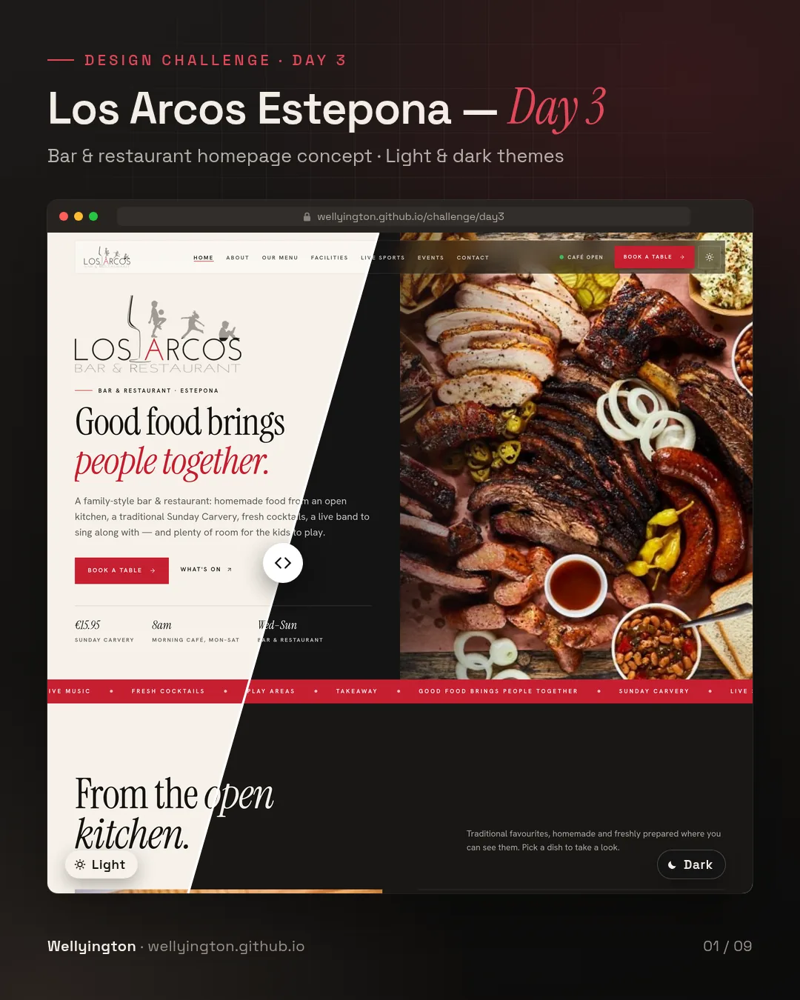
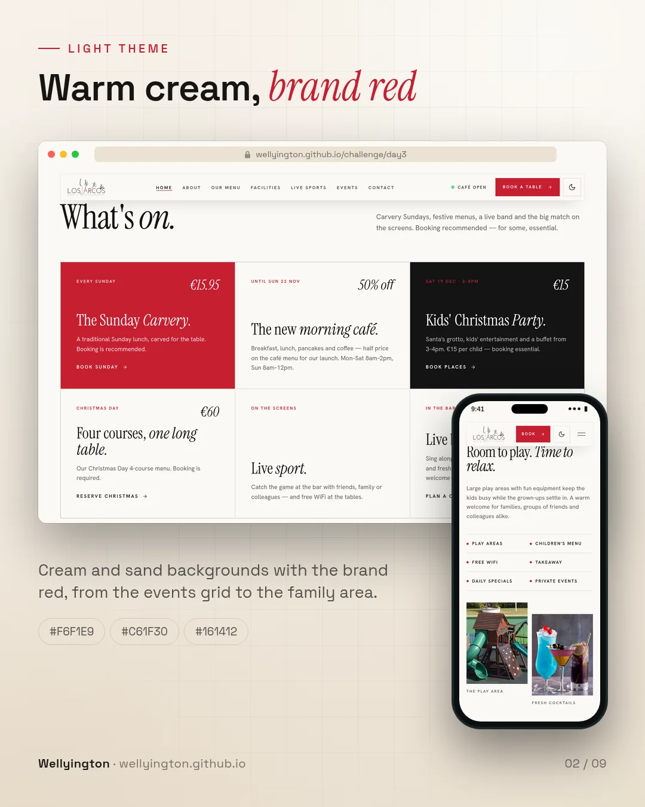
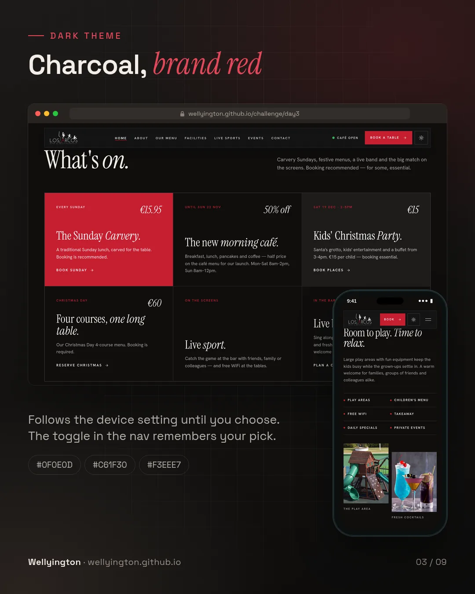
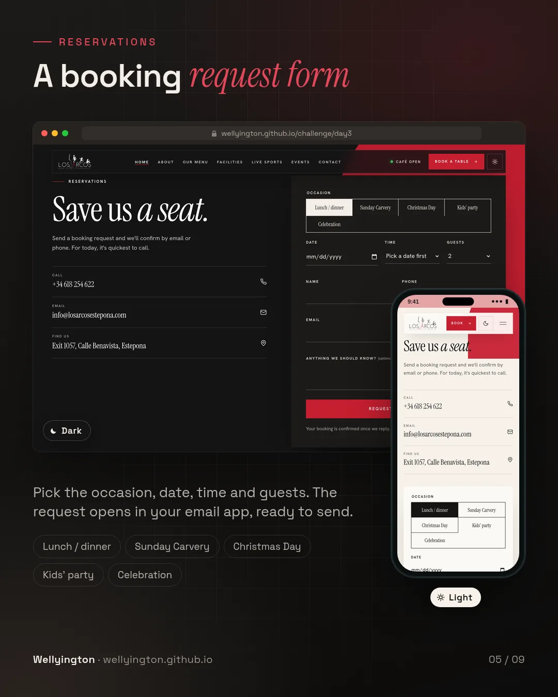
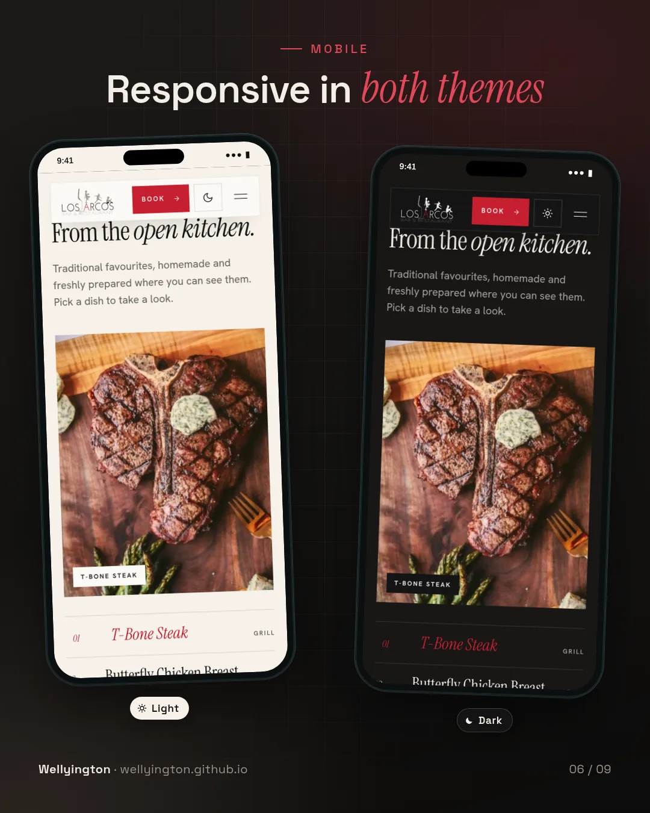
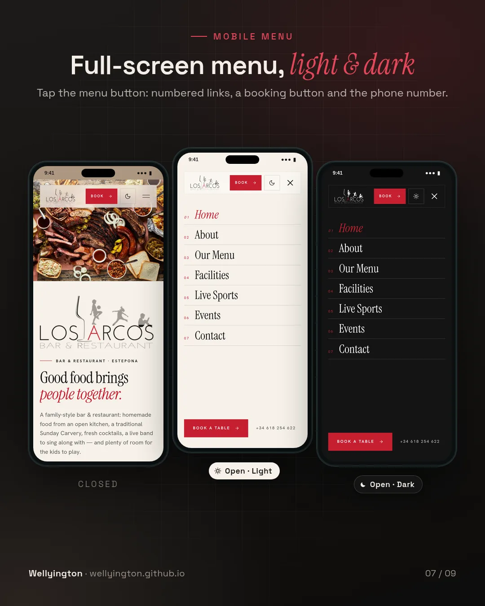
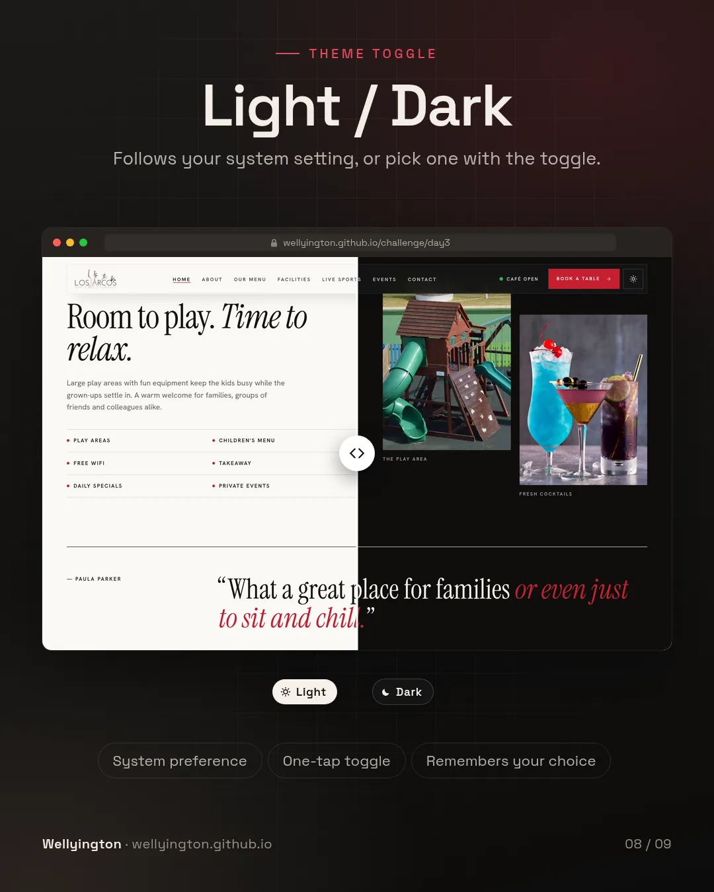

El 19 de noviembre publiqué la tercera nota de esta serie: cien días, cien negocios, cien webs, cada una abierta a quien quiera verla. El primer día fue una constructora familiar de la Marina Alta que necesitaba una primera página clara, algo que pudiera mirar antes de un contrato. [Esa página está aquí.](https://wellyington.github.io/journal/es/articles/la-web-antes-del-si/) El segundo, un teatro en Málaga que ya tenía una temporada llena y necesitaba un orden que una persona pudiera usar. [Ese está aquí.](https://wellyington.github.io/journal/es/articles/sitio-para-toda-la-temporada/) Hoy el paseo es más corto.

Los Arcos es un bar restaurante en la calle Benavista, junto a la salida 1057, en Estepona. Yo trabajo desde Estepona, así que es el primer negocio de la serie en mi propio pueblo. Eso cambia muy poco el trabajo y bastante el cuidado. Aquí la gente abrirá la página y sabrá enseguida si suena al sitio o no. El concepto se abre aquí: [Los Arcos, día tres](https://wellyington.github.io/challenge/day3/).

Nadie en Los Arcos me lo ha pedido. No es un encargo y no es su web oficial. En la página están su nombre, sus platos y su semana. El concepto es mío, y por ahora vive en mi propia dirección, que es el sitio honesto para un trabajo que nadie ha adoptado todavía. No me han dicho que nadie de allí lo haya visto.

## un sitio con más de un motivo para ir

La constructora tenía un solo trabajo que explicar, y el teatro tenía una temporada. Un bar restaurante familiar tiene algo menos ordenado. La gente viene por motivos distintos, a horas distintas, y muchas veces en el mismo grupo.

Uno quiere el asado del domingo. Otro quiere ver el partido en una pantalla grande. Una pareja quiere un cóctel y la banda. Un padre quiere sentarse una hora mientras los niños corren por un sitio seguro. Un día entre semana, por la mañana, alguien solo quiere café y tortitas antes de trabajar. Los Arcos hace todo eso bajo el mismo techo: cocina abierta, el Sunday Carvery, cafetería por la mañana, deporte en directo, música en directo, zonas de juego y comida para llevar.

Una portada que lo cuenta todo al mismo volumen no dice nada. Una que elige un solo motivo deja fuera a la mitad de la gente que ya va. Así que el trabajo era un orden. Primero, qué clase de sitio es. Después, qué se come. Luego, qué hay esta semana. Luego, cuándo está abierto, por qué funciona para familias y cómo conseguir mesa. Todo lo que un cliente habitual ya sabe, en el orden en que lo necesita alguien que llega por primera vez.

## la buena comida une a la gente

La apertura conserva su propia frase, porque es buena: good food brings people together, la buena comida une a la gente. Está compuesta en una serif alta y estrecha, con la segunda mitad en cursiva y en el rojo de la casa. Encima va el logotipo, los arcos con las figuritas jugando. Debajo, un solo párrafo: un bar restaurante de estilo familiar, comida casera de una cocina abierta, un Sunday Carvery tradicional, cócteles recién hechos, una banda en directo para cantar con ella y mucho sitio para que jueguen los niños.

Después, dos botones: reservar mesa o ver qué hay. Debajo, tres datos que de otro modo habría que preguntar: el Sunday Carvery a 15,95 €, la cafetería desde las 8 de lunes a sábado, y el bar restaurante de miércoles a domingo. Una franja roja cruza el pie de la pantalla con los motivos por los que la gente va, uno detrás de otro: música en directo, cócteles, zonas de juego, comida para llevar y la frase sobre la buena comida.

A la derecha, una foto grande de una fuente: pollo trinchado, costillas, salchichas, aros de cebolla, un cuenco de alubias, un platito de salsa. Quería que la primera pantalla pareciera una mesa, no un folleto.

*La primera pantalla, partida en dos. La misma apertura de día y de noche.*

## dos luces, un restaurante

Ese corte en diagonal es el centro del concepto. La página tiene dos temas, y el mismo restaurante tiene que sentirse bien en los dos.

El claro es color crema cálido, como un mantel, con el rojo de la marca para todo lo que se puede pulsar y para las palabras en cursiva. Se lee bien a mediodía en una terraza, con el sol en la pantalla. El oscuro es carbón, casi negro, con el mismo rojo. Es más cómodo a las diez de la noche, cuando alguien mira si la cocina sigue abierta o le pasa la página a un amigo desde el sofá.

Si tu móvil ya está en modo oscuro, la página se abre oscura. Si está en claro, se abre clara. Un botoncito en la navegación lo cambia, y la página recuerda tu elección para la próxima vez. Las tarjetas, las fotos y el rojo no se mueven. Solo cambia la sala alrededor.

*El tema claro: crema cálido, rojo de marca y la semana en una rejilla.*

*El tema oscuro. Sigue al dispositivo hasta que eliges, y el botón recuerda la elección.*

## desde la cocina abierta

Una web de restaurante se abre para ver la comida, así que la comida va segunda, justo después de la bienvenida. El título lo dice claro: from the open kitchen, desde la cocina abierta. Una línea debajo explica que son platos de siempre, caseros y preparados al momento donde puedes verlos.

Luego, una lista corta de seis platos, numerados como en una carta: T-Bone Steak, pechuga de pollo en mariposa, salmón con patatas asadas al chili, chili con carne, salchichas con puré y tarta de chocolate. Cada uno lleva una etiqueta pequeña: parrilla, pescado, de la casa, clásico, postre. Eliges uno y su foto aparece al lado de la lista. El T-Bone llega en una tabla de madera, con una rodaja de mantequilla de hierbas derritiéndose encima.

Bajo la lista, una frase nombra el resto de la carta para que nadie piense que esos seis son todo: las costillas legendarias, el bacalao rebozado en cerveza, el solomillo, hamburguesas, pizza, ensaladas César y de la casa, un menú infantil, una pizarra de sugerencias en el bar y comida para llevar. No me he comido la carta entera, así que no voy a describir sabores. La página cuenta los platos como los cuenta Los Arcos, y pone las fotos donde mira alguien con hambre.

## qué hay, y cuándo encontrarnos

Después viene la semana, porque un bar así vive de ella. El título es What's on, qué hay, y la rejilla es sincera con las reservas: recomendables para unas cosas, imprescindibles para otras.

El Sunday Carvery se lleva la tarjeta roja: todos los domingos, 15,95 €, una comida de domingo tradicional, trinchada en la mesa. A su lado, la nueva cafetería de la mañana, a mitad de precio en la carta de café hasta el domingo 22 de noviembre por la inauguración, de lunes a sábado de 8 a 14 y los domingos de 8 a 12. La fiesta de Navidad para niños, el sábado 19 de diciembre de 14 a 17, tiene la gruta de Papá Noel, animación y un bufé de 15 a 16, a 15 € por niño, con reserva imprescindible. El día de Navidad, cuatro platos por 60 €, una mesa larga, con reserva obligatoria. Después, las pantallas, para ver el partido con amigos, familia o compañeros, y wifi gratis en las mesas. Después, el bar, con banda en directo, cócteles recién hechos y una nota de que bodas, cumpleaños y reencuentros son bienvenidos.

Cada tarjeta termina en una sola acción: reservar el domingo, reservar plazas, reservar Navidad, organizar una celebración. Nadie tiene que adivinar qué hacer después.

Los horarios vienen a continuación, bajo When to find us, cuándo encontrarnos. Tres pestañas, porque Los Arcos tiene tres horarios: restaurante, bar y cafetería. Eliges una y la línea grande de la izquierda te dice lo que importa ahora mismo, en hora de Estepona: abierto, o abre a las 14:00, más tarde hoy. A la derecha, la semana completa, con el día de hoy marcado en rojo. El restaurante cierra lunes y martes, abre de 14:00 a 21:00 de miércoles a viernes, de 12:00 a 21:00 el sábado y de 12:00 a 20:00 el domingo. El puntito verde de la navegación hace lo mismo de un vistazo: dice café abierto cuando la cafetería está abierta.

*Elige un plato para verlo. Elige restaurante, bar o cafetería para saber si abre hoy.*

## sitio para jugar, tiempo para descansar

Hay una sección para familias, porque es buena parte de la razón por la que la gente elige Los Arcos y no el sitio de al lado. Room to play. Time to relax. Sitio para jugar, tiempo para descansar. Zonas de juego grandes, con columpios y toboganes, mantienen ocupados a los niños mientras los mayores se acomodan. Seis puntos cortos en dos columnas: zonas de juego, menú infantil, wifi gratis, comida para llevar, sugerencias del día y eventos privados. Dos fotos cuentan el resto: la estructura de juegos con sus toboganes verdes y una fila de cócteles, uno azul intenso. Es la misma tarde vista por dos generaciones.

Debajo, una frase de una clienta, Paula Parker: qué sitio tan bueno para familias, o simplemente para sentarse y relajarse. La dejé en una sola cita, en grande, sin estrellas y sin contador. Una frase real hace más que un carrusel.

## guárdanos un sitio

La sección de reservas se llama Save us a seat, guárdanos un sitio. A la izquierda, las tres formas de contactar con el restaurante, todas pulsables: el teléfono, +34 618 254 622; el correo, info@losarcosestepona.com; y la dirección, salida 1057, calle Benavista. Una línea corta dice lo que te diría cualquiera que lleve un restaurante: para hoy, lo más rápido es llamar.

A la derecha, el formulario de solicitud. Primero la ocasión, en cinco botones: comida o cena, Sunday Carvery, día de Navidad, fiesta infantil, celebración. Luego la fecha, una hora que solo se ofrece cuando ya hay fecha, y el número de comensales. Después nombre, teléfono, correo y cualquier cosa que la cocina deba saber. Pulsas el botón y se abre tu aplicación de correo con la solicitud ya escrita, lista para enviar.

El concepto no finge ser un sistema de reservas. No hay cuenta que crear, y el formulario dice claramente que la reserva está confirmada cuando el restaurante contesta. En esta costa, una mesa todavía se cierra muchas veces por teléfono o con una respuesta del dueño, y una página que prometiera más estaría mintiendo.

*Elige la ocasión, la fecha, la hora y los comensales. La solicitud se abre en tu correo, lista para enviar.*

## la misma noche en el móvil

La mayoría de la gente conocerá esta página en el móvil. Alguien aparcado en la puerta quiere saber si la cocina está abierta. Un grupo de WhatsApp está decidiendo dónde ver el partido. Una madre reserva la fiesta de Navidad de los niños en los cinco minutos que tiene entre dos cosas.

En el móvil todo se apila en el mismo orden. El título, la frase, la foto, y el nombre del plato en una etiqueta pequeña sobre la imagen. El botón de reservar se queda en la barra de arriba, al lado del cambio de tema, donde el pulgar llega desde cualquier punto de la página.

El menú se abre a pantalla completa. Siete enlaces, numerados como los platos: inicio, sobre nosotros, la carta, instalaciones, deporte en directo, eventos, contacto. Abajo, las dos cosas que quiere alguien con prisa: un botón de reservar mesa y el número de teléfono. Funciona igual con las dos luces.

*La cocina abierta en el móvil, con los dos temas.*

*El menú a pantalla completa: siete enlaces numerados, un botón de reserva y el teléfono, claro u oscuro.*

## una propuesta, no una toma de control

Los Arcos no me ha contratado. Esta no es su web, y nada de lo que hay aquí significa que la hayan aprobado. Ya tienen una web, un teléfono que suena, clientes de siempre y un domingo que se llena. Los platos, los precios, las fechas y las palabras de la clienta son suyos, no míos. Lo que yo he añadido es un orden, dos luces y una solicitud de reserva que dice la verdad sobre cómo se confirma una mesa.

No tengo cifras de cubiertos ni de caja, y no me las voy a inventar. Si alguien en Los Arcos abre el concepto y no quiere nada de mí, ese es un final completo. Si lo quieren, lo demás es práctico: sus propias fotos, sus palabras donde ahora están las mías, los horarios al día, el formulario enviado a quien conteste las reservas y un dominio a su nombre.

*Sigue la configuración de tu sistema, o eliges tú. Un toque, y la elección queda guardada.*

## si tu negocio tiene muchas puertas

Puede que tú no lleves un restaurante. Muchos negocios de esta costa se parecen más a Los Arcos que a una empresa de una sola frase. Un gimnasio con cafetería. Un beach club con tienda. Un colegio con campamentos de verano. La gente entra por puertas distintas, a horas distintas, por motivos distintos, y la web suele intentar mantener todas las puertas abiertas a la vez.

Lo que ayuda es un orden, no más bloques. Di qué es el sitio en una línea. Enseña aquello por lo que la gente viene de verdad. Pon la semana donde se pueda leer y el horario donde responda a la pregunta de "¿ahora?". Haz que la forma de entrar, un teléfono, un formulario, una mesa, sea honesta sobre lo que pasa después. Y deja que la página siga la luz en la que está la persona.

Soy diseñador web en Estepona, en la Costa del Sol, y hago webs como esta para negocios de toda España. Si eso suena a tu negocio, escríbeme desde [la web principal](https://wellyington.github.io/es/). Dime a qué te dedicas y dónde, y contestaré en lenguaje llano. La versión corta de hoy es la nota: día tres de cien, una portada para un restaurante familiar de mi propio pueblo, claro u oscuro, elige quien visita. [La nota está aquí.](https://x.com/wellyington/status/2123056661220733019) Mañana es otro negocio, y otra página terminada.
