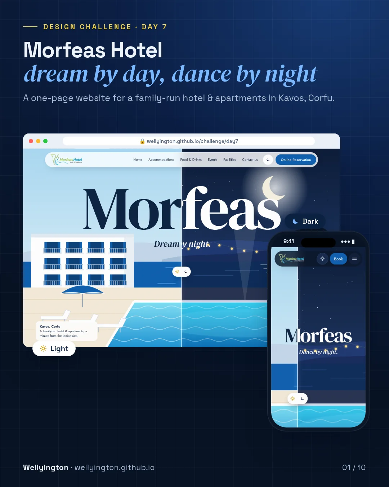
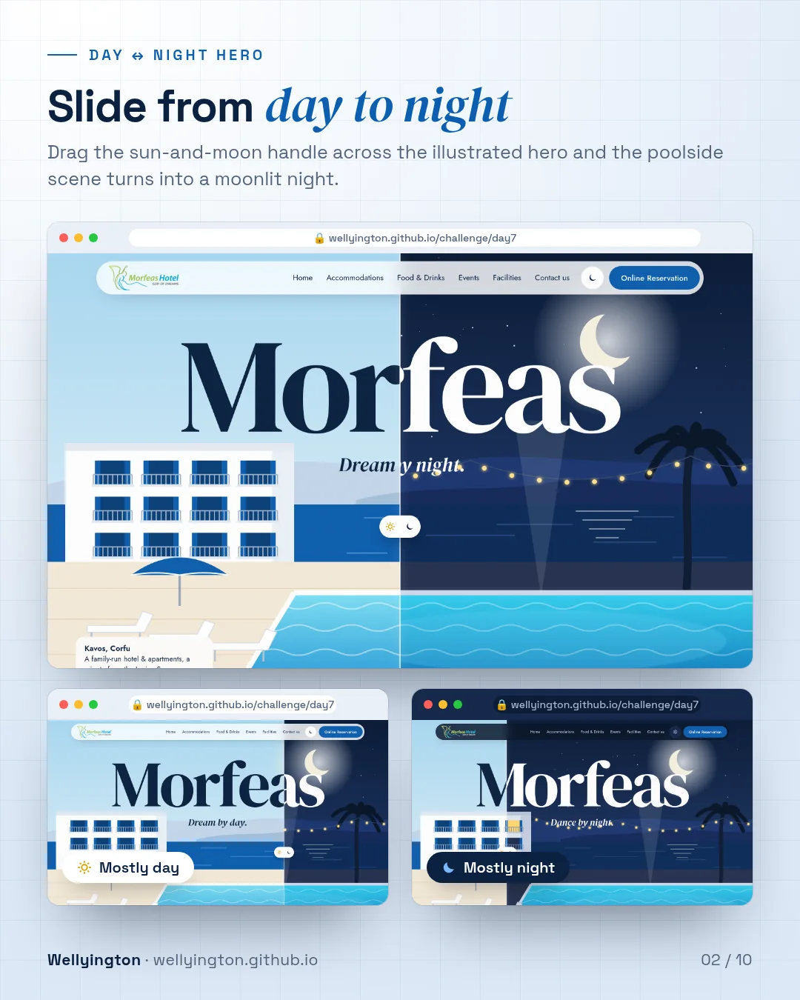
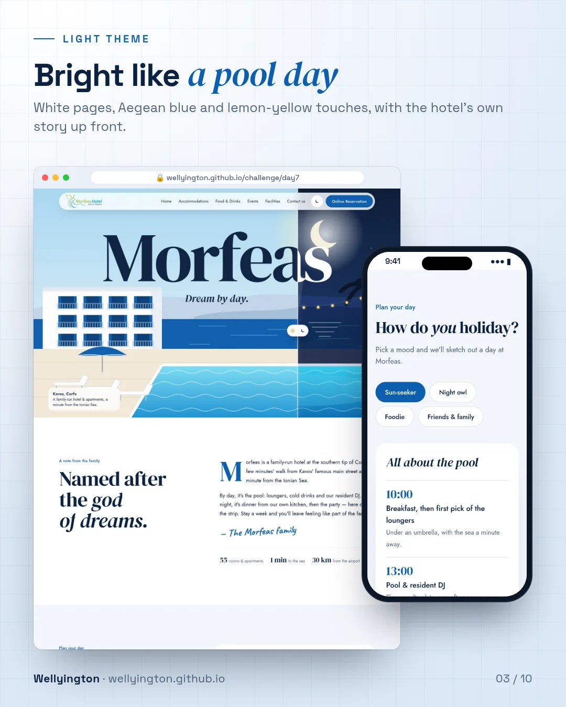
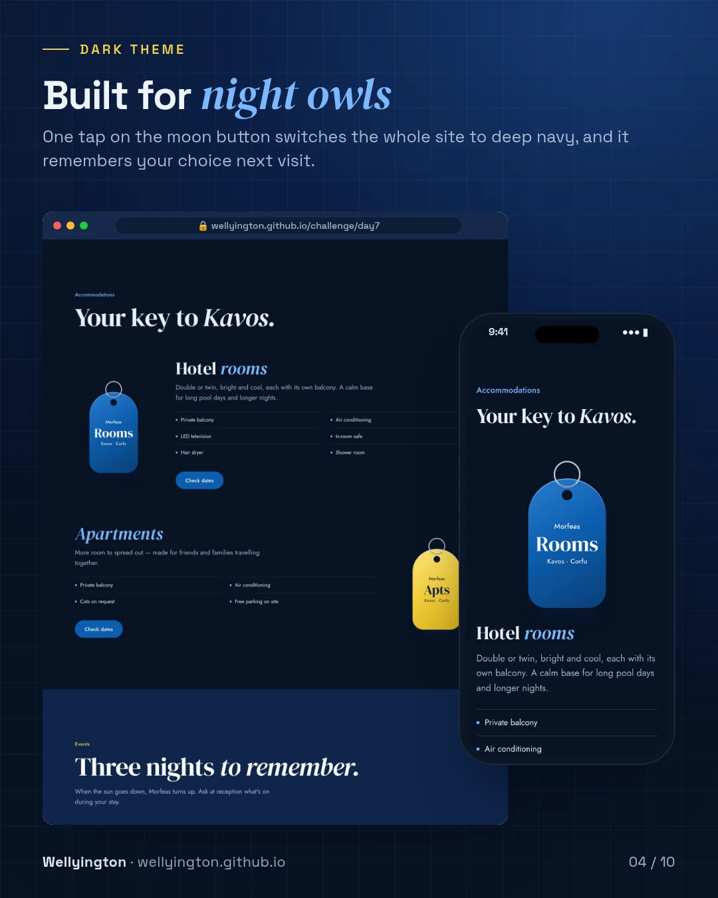
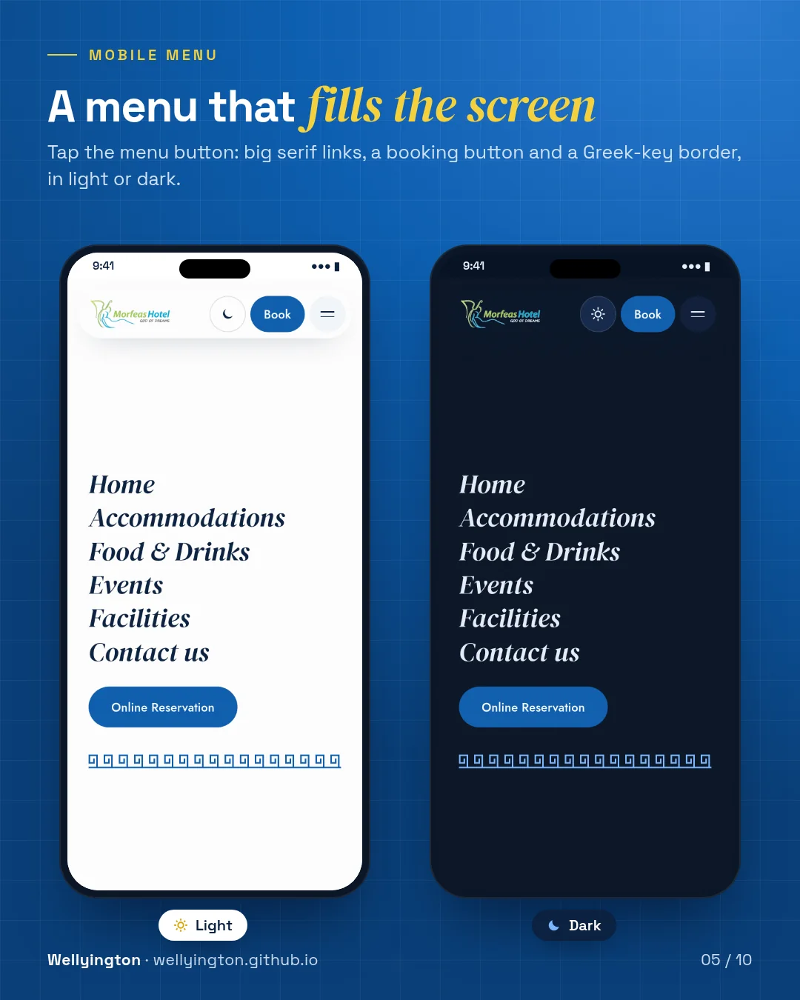
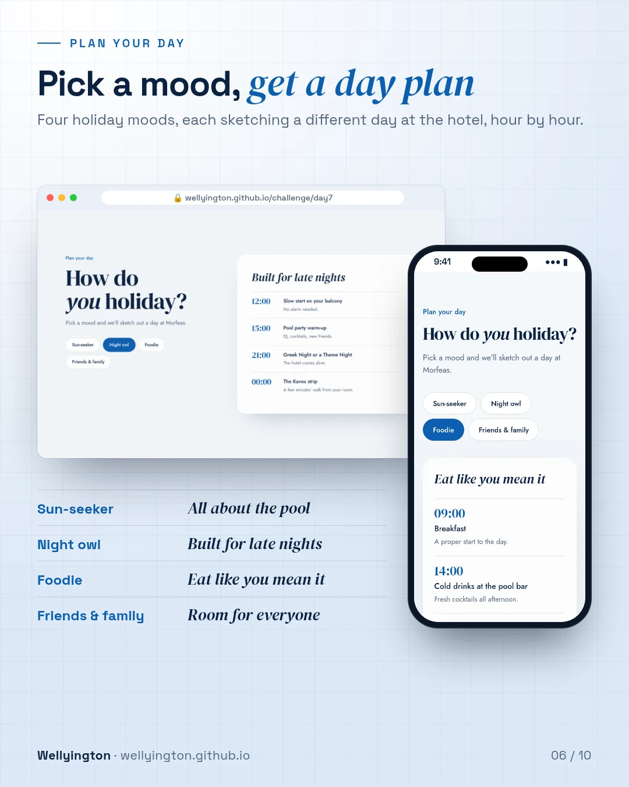
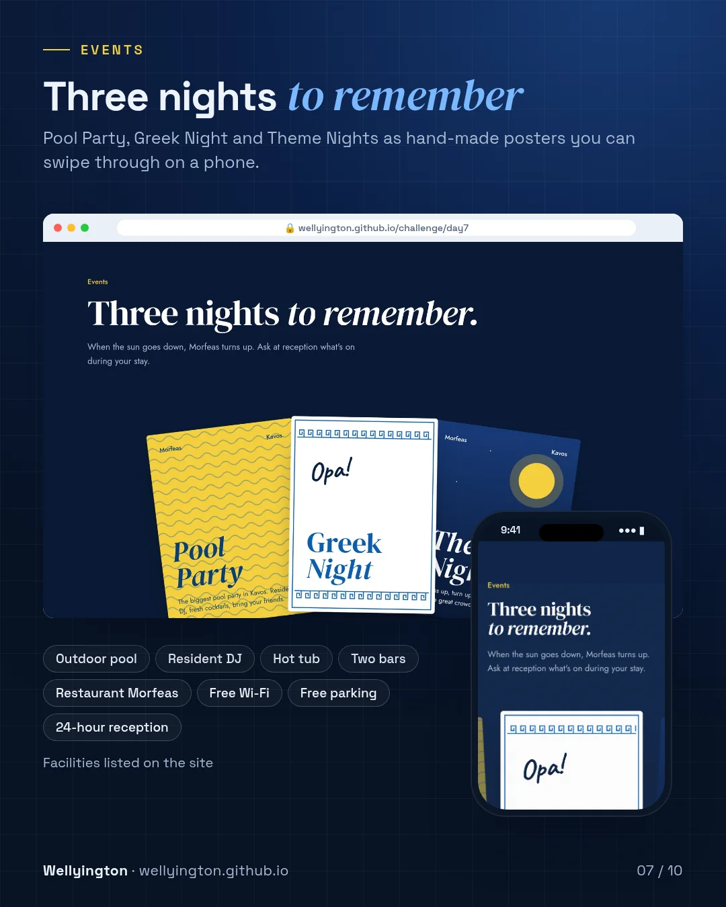
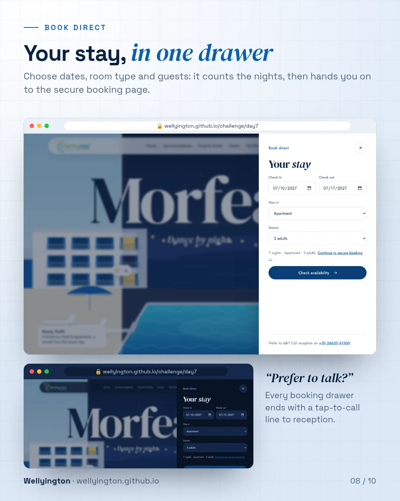
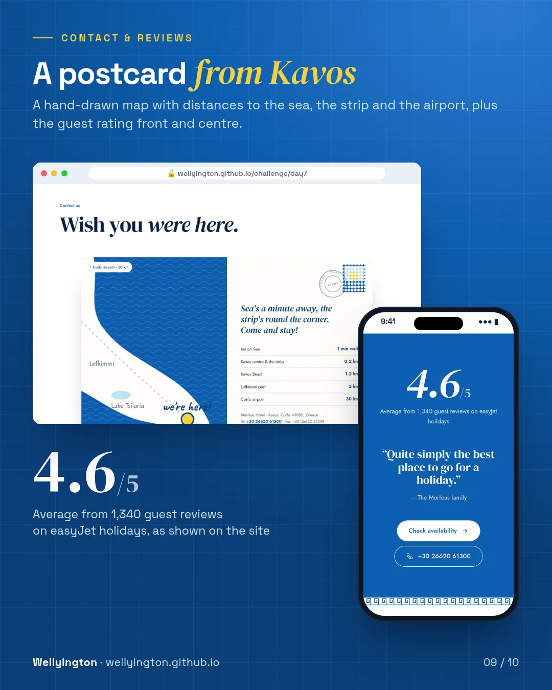

Em 23 de novembro publiquei a sétima nota desta série, o desafio que Ramiah Trask lançou: cem dias, cem negócios, cem sites. O dia um foi uma construtora familiar da Marina Alta. [Essa página está aqui.](https://wellyington.github.io/journal/pt/articles/o-site-antes-do-sim/) O dia dois, um teatro de Málaga. [Essa está aqui.](https://wellyington.github.io/journal/pt/articles/espaco-para-a-temporada-inteira/) O dia três, um restaurante familiar de Estepona. [Essa está aqui.](https://wellyington.github.io/journal/pt/articles/um-lugar-na-mesa-comprida/) O dia quatro, uma consultoria imobiliária privada de Málaga. [Essa está aqui.](https://wellyington.github.io/journal/pt/articles/criterio-antes-de-volume/) O dia cinco, um restaurante de menu degustação em Motril. [Essa está aqui.](https://wellyington.github.io/journal/pt/articles/tao-cuidadoso-quanto-a-cozinha/) O dia seis, uma casa de frango assado em Estepona. [Essa está aqui.](https://wellyington.github.io/journal/pt/articles/do-balcao-a-comanda/)

Hoje é o primeiro negócio da série fora da Espanha. O Morfeas Hotel é um hotel familiar com quartos e apartamentos em Kavos, na ponta sul de Corfu. Fica a um minuto do mar Jônico e a poucos minutos a pé da rua principal de Kavos, famosa por uma coisa: a vida noturna. O hotel leva o nome de Morfeu, o deus grego dos sonhos. O site dele está em [morfeashotel.com](https://www.morfeashotel.com/).

O conceito está aqui: [Morfeas Hotel, dia sete](https://wellyington.github.io/challenge/day7/).

Este é um conceito de redesign independente. Não é uma colaboração oficial com o Morfeas Hotel, ninguém lá me pediu isso e nada na página significa que eles aprovaram. Como os seis anteriores, por enquanto ele mora no meu próprio endereço.

## um hotel, duas férias

A maioria dos sites de hotel descreve um tipo de férias. Uma piscina, um quarto, um café da manhã, um pôr do sol. Isso funciona para um hotel tranquilo. Não funciona para um hotel em Kavos.

Os hóspedes do Morfeas têm duas férias na mesma semana, às vezes no mesmo dia. De dia é a piscina: espreguiçadeiras, bebidas geladas, o DJ residente. À noite é o jantar da cozinha do hotel e depois a festa, no hotel ou na rua logo ali. As mesmas pessoas, a mesma piscina, dois climas diferentes. O hotel já diz isso numa das suas frases: dream by day, dance by night. Sonhe de dia, dance à noite.

Então, em vez de escolher um dos dois, o conceito mostra os dois, e deixa quem visita decidir qual está vendo.

*Dia sete: um hotel, uma piscina, dois climas.*

## deslize do dia para a noite

O topo da página é um desenho, não uma fotografia: o prédio branco do hotel com as suas janelas azuis, um guarda-sol, duas espreguiçadeiras, o mar atrás e uma piscina em primeiro plano. A palavra Morfeas atravessa tudo numa serifa grande, do tamanho que a tela permitir.

O desenho existe duas vezes, uma de dia e outra de noite, colocadas exatamente uma sobre a outra. No meio há uma pequena alça com um sol de um lado e uma lua do outro. Arraste-a, e a linha entre os dois desenhos acompanha o seu dedo. À esquerda, um céu azul-claro e a frase dream by day. À direita, um céu azul-marinho, estrelas, uma lua crescente, a silhueta de uma palmeira, um varal de luzes de festa sobre a água e um feixe de luz subindo da piscina. Ali a frase diz dance by night. Leve a alça até o fim e o hotel inteiro passa do meio-dia à meia-noite.

Quando a página abre, a alça não está no meio. Ela pende para a hora que for em Kavos. Quem chega à tarde vê quase só o dia. Quem olha às onze da noite, horário de Corfu, vê quase só a noite. Um pequeno relógio no cabeçalho mostra a hora em Kavos com um sol ou uma lua ao lado, o que é pouca coisa, mas útil para quem planeja as férias de outro fuso horário.

Desenhei a cena em vez de usar fotografias por dois motivos. Um desenho pode passar do dia para a noite sem uma segunda sessão de fotos. E, pequeno, num celular, um desenho simples se entende mais rápido do que a foto cheia de detalhes de uma piscina lotada.

*Arraste a alça e a beira da piscina passa do meio-dia à meia-noite. Quando a página abre, ela pende para a hora em Kavos.*

## um tema claro e um escuro

A abertura não é a única coisa que muda. O site inteiro tem um tema claro e um escuro.

O tema claro é um dia de piscina: páginas brancas, o azul Egeu das janelas e portas gregas, e toques de amarelo-limão. O tema escuro é o mesmo site depois do pôr do sol: páginas azul-marinho profundo, azul-claro para links e botões, o mesmo amarelo-limão. Nenhum dos dois foi feito de última hora. Desenhei os dois, seção por seção, para que a versão escura não seja só a clara com as cores invertidas.

Um botão com uma lua ou um sol no cabeçalho alterna entre eles. O site lembra a escolha na próxima visita. Se a pessoa nunca apertou o botão, o site segue o que o celular ou o computador dela já estiver usando. Trocar o tema também move a alça da abertura, para que o desenho do topo combine com o resto da página.

*O tema claro: páginas brancas, azul Egeu e amarelo-limão, com o recado da própria família logo no começo.*

*O tema escuro. Um toque na lua e o site inteiro fica azul-marinho, e continua assim na próxima vez.*

## um recado da família

Abaixo da abertura, a primeira coisa para ler não é uma lista de serviços. É um recado curto da família, assinado à mão: o Morfeas é um hotel familiar na ponta sul de Corfu, a um minuto do mar e a poucos minutos a pé da rua principal. De dia, a piscina. À noite, o jantar da própria cozinha e depois a festa. Fique uma semana e você vai embora se sentindo parte da família.

Ao lado, três números em letra grande: 55 quartos e apartamentos, um minuto até o mar, 30 quilômetros do aeroporto. Eles respondem às três perguntas que as pessoas fazem sobre qualquer hotel de ilha antes de qualquer outra: qual o tamanho, a que distância fica o mar, a que distância fica o aeroporto.

## a sua chave de Kavos

A seção de hospedagem se chama your key to Kavos, a sua chave de Kavos, e cada tipo de estadia tem o seu próprio chaveiro, daqueles antigos que ficam pendurados na chave da recepção. Um azul para os quartos do hotel. Um amarelo para os apartamentos. Eles balançam de leve quando aparecem na tela.

Os quartos são de casal ou com duas camas, cada um com a sua varanda, ar-condicionado, televisão, cofre, secador de cabelo e banheiro com chuveiro. Os apartamentos têm mais espaço, para amigos e famílias que viajam juntos, com berço sob pedido e estacionamento gratuito. Cada tipo tem um botão para ver datas, que abre a gaveta de reserva com esse tipo já escolhido.

## um menu que ocupa a tela

No celular, o cabeçalho se reduz a três coisas: o logotipo, um botão Book e o botão do menu. Toque no menu e ele ocupa a tela inteira com as seis seções do site em letras grandes, em serifa itálica, um botão de reserva online e uma grega na parte de baixo, o desenho que se vê em pratos e azulejos por todas as ilhas. Funciona igual nos dois temas.

Assim que você desce um pouco, uma barra se acomoda na parte de baixo da tela com duas coisas: ver disponibilidade e um botão que liga para a recepção. Num site de hotel, reservar nunca deveria estar a mais de um toque.

*O menu ocupa a tela: links grandes em serifa, um botão de reserva e uma grega, no claro ou no escuro.*

## escolha um estilo, ganhe um roteiro

Esta é a parte que eu mais gostaria que um hotel copiasse.

Ninguém escolhe um hotel em Kavos pelas toalhas. Escolhe pelo tipo de férias que quer. Então a seção pergunta: how do you holiday?, como você gosta de passar as férias? Há quatro respostas, em botões: sun-seeker, quem busca sol; night owl, a coruja da noite; foodie, quem viaja pela comida; e friends and family, amigos e família. Escolha uma, e o site desenha um dia no Morfeas para esse tipo de hóspede, hora a hora.

O dia de quem busca sol gira em torno da piscina: café da manhã às dez e depois a primeira escolha de espreguiçadeira, o DJ à uma, a hidromassagem e um coquetel às quatro, uma caminhada até o mar antes do jantar. O dia da coruja da noite começa ao meio-dia na varanda, sem despertador, esquenta na festa da piscina às três, segue para a noite grega ou uma noite temática às nove e chega à rua da festa à meia-noite. O dia de quem viaja pela comida gira em torno do café da manhã, do bar da piscina e do jantar no restaurante do hotel. O de amigos e família termina com todo mundo na varanda, porque cada quarto e cada apartamento tem uma.

Cada linha desses roteiros vem de coisas que o hotel realmente tem. Nada foi inventado para o dia parecer melhor. A ideia é que quem visita se veja ali e, em quatro linhas, saiba se esse é o seu tipo de hotel. Também dá para passar de um estilo a outro com as setas do teclado.

*Quatro estilos de férias. Cada um desenha um dia diferente no hotel, hora a hora.*

## três noites para lembrar

A noite no Morfeas tem três programas regulares: a festa na piscina, a noite grega e as noites temáticas. Na maioria dos sites de hotel seriam três linhas numa lista. Aqui são três cartazes, daqueles que você veria colados perto da recepção.

O cartaz da festa na piscina é amarelo-limão com linhas onduladas como a água. O da noite grega é branco, com uma grega azul e Opa! escrito à mão no alto. O das noites temáticas é azul-marinho com uma grande lua amarela. No computador eles se apoiam uns nos outros como cartazes numa parede. No celular você passa de um para o outro deslizando, com pontinhos que mostram onde você está. Acima deles, uma frase honesta: pergunte na recepção o que vai ter durante a sua estadia. As datas mudam a cada temporada, e um site que promete uma data que não pode cumprir é pior do que um que manda você ao balcão.

Depois vem a comida, com o restaurante do hotel, o café da manhã, o bar da piscina, o jantar e o music lounge, e um link para os cardápios. Em seguida, a estrutura: a piscina ao ar livre, o DJ residente, a hidromassagem, dois bares, o restaurante, ar-condicionado, Wi-Fi grátis, estacionamento gratuito e uma recepção aberta 24 horas.

*Pool Party, Greek Night e Theme Nights como cartazes feitos à mão, que se passam deslizando no celular.*

## a sua estadia, numa gaveta

Todos os botões de reserva da página, seja no cabeçalho, embaixo de um tipo de quarto ou no fim, abrem a mesma coisa: uma gaveta que desliza de lado, chamada your stay, a sua estadia. Ela pede quatro coisas: data de entrada, data de saída, quarto de hotel ou apartamento, e quantas pessoas, de um adulto até dois adultos e duas crianças.

Ela conta as noites enquanto você preenche e devolve tudo numa linha: 7 noites, apartamento, 3 adultos. Depois leva você à página de reserva segura do hotel. Se faltar uma data, ela avisa e coloca o cursor no campo certo, em vez de deixar você apertar o botão e ficar sem saber por que nada aconteceu.

No fim da gaveta há mais uma linha: prefere conversar? Ligue para a recepção, com o número pronto para tocar. Muita gente ainda reserva as férias da família por telefone, e a gaveta trata isso como uma resposta perfeitamente boa.

Para deixar claro o que o conceito faz nesse ponto: a gaveta reúne os dados e leva quem visita ao site atual do hotel. No conceito, as datas não são passadas de um lado para o outro. Numa versão real, ela abriria o sistema de reservas do hotel com as datas e o tipo de quarto já preenchidos.

*Escolha datas, tipo de quarto e pessoas. Ela conta as noites e depois leva você adiante. Toda gaveta termina com um número para ligar.*

## um cartão-postal de Kavos

A seção de contato é um cartão-postal. O título é wish you were here, queria que você estivesse aqui. Na metade esquerda há um mapa desenhado à mão do sul de Corfu em azul e branco, com um alfinete amarelo e we're here, estamos aqui, escrito à mão ao lado. À direita, onde você escreveria a mensagem, há um recado curto: o mar está a um minuto, a rua da festa logo ali na esquina, venha ficar. Embaixo, as distâncias: o mar Jônico, a um minuto a pé; o centro de Kavos e a rua da festa, a 0,2 km; a praia de Kavos, a 1,2 km; o porto de Lefkimmi, a 5 km; o aeroporto de Corfu, a 30 km. Num canto há um selo, um azulejo com uma grega e um pequeno sol amarelo, e um carimbo.

Depois, a avaliação dos hóspedes, tão grande quanto o nome do hotel no topo: 4,6 de 5, a média de 1.340 avaliações de hóspedes no easyJet holidays, como aparece no próprio site do hotel. Uma frase da família, um botão para ver disponibilidade e o telefone. Uma grega fecha a página.

*Um cartão-postal desenhado à mão com as distâncias que importam, e a avaliação dos hóspedes em destaque.*

## os detalhes

A tipografia é DM Serif Display nos títulos, grande e apertada, com itálico nas palavras mais calorosas. Jost, uma sem serifa geométrica e limpa, em tudo o que se lê. Caveat, uma letra manuscrita, na assinatura da família, no Opa! e no we're here.

As cores ficam perto da ilha: o azul Egeu das janelas e portas, um azul-marinho profundo de noite, amarelo-limão e muito branco. O logotipo é o do próprio hotel.

Os títulos sobem para o lugar palavra por palavra enquanto você rola, as seções aparecem suavemente, os chaveiros balançam e as estrelas sobre a piscina à noite piscam. Tudo isso se desliga para quem pediu ao celular ou ao computador que reduza as animações, e a página funciona exatamente igual sem isso. A alça do dia e da noite também pode ser movida pelo teclado, não só pelo mouse ou pelo dedo.

## o que o conceito é, e o que não é

Os dados da página vêm do site atual do hotel e das suas páginas públicas: os quartos e apartamentos, a estrutura, os eventos, o endereço, os telefones, as distâncias e a avaliação dos hóspedes. O recado da família e os roteiros do dia foram escritos por mim, só a partir desses dados. Se um dia a família quisesse, trocaria as minhas palavras pelas dela.

O que é novo é o jeito como tudo se encaixa: um hotel mostrado em dois climas, uma página que sabe que horas são em Kavos, um roteiro que fala do tipo de hóspede e não do tipo de quarto, e uma etapa de reserva que não tira você da página até que esteja pronto.

Não tenho números de reservas, e não vou inventar nenhum. Se ninguém no Morfeas quiser isso, o conceito fica onde está, como dia sete. Se quiserem, o resto é prático: as palavras deles no lugar das minhas, as fotografias deles ao lado dos desenhos, a gaveta de reserva ligada ao sistema de reservas deles, uma versão em grego e o site levado para morfeashotel.com.

## se o seu negócio muda com a hora

Talvez você não tenha um hotel em Kavos. Mas muitos negócios têm duas caras: um quiosque de praia que vira bar de coquetéis, uma cafeteria que serve jantar, um restaurante com um almoço tranquilo e um sábado à noite barulhento, um espaço que recebe casamentos de dia e shows à noite. Os sites deles costumam mostrar só uma das duas, e a outra metade dos clientes precisa adivinhar.

O que ajuda é o mesmo que aqui. Mostre os dois climas, e deixe as pessoas escolherem. Use a hora do dia, se ela importa. Descreva a experiência na ordem em que o cliente a vive, não na ordem da sua tabela de preços. Mantenha o botão de reserva ao alcance em todas as telas. E deixe sempre um telefone para quem prefere conversar.

Sou web designer em Estepona, na Costa del Sol, e desenho e construo sites para negócios na Espanha e fora dela. Se isto parece com o seu negócio, escreva para mim pelo [site principal](https://wellyington.github.io/pt/). Conte o que você faz e onde, e eu respondo em linguagem simples. O conceito está [aqui](https://wellyington.github.io/challenge/day7/), e o site atual do Morfeas Hotel [aqui](https://www.morfeashotel.com/), para você comparar os dois. Sete feitos, faltam noventa e três.
