No dia 27 de novembro publiquei a décima primeira nota desta série, o desafio que Ramiah Trask lançou: cem dias, cem negócios, cem sites. O dia um foi uma construtora familiar da Marina Alta. [Essa página está aqui.](https://wellyington.github.io/journal/pt/articles/o-site-antes-do-sim/) O dia dois, um teatro em Málaga. [Essa está aqui.](https://wellyington.github.io/journal/pt/articles/espaco-para-a-temporada-inteira/) O dia três, um restaurante familiar em Estepona. [Essa está aqui.](https://wellyington.github.io/journal/pt/articles/um-lugar-na-mesa-comprida/) O dia quatro, uma consultoria imobiliária privada em Málaga. [Essa está aqui.](https://wellyington.github.io/journal/pt/articles/criterio-antes-de-volume/) O dia cinco, um restaurante de menus degustação em Motril. [Essa está aqui.](https://wellyington.github.io/journal/pt/articles/tao-cuidadoso-quanto-a-cozinha/) O dia seis, uma casa de frango assado em Estepona. [Essa está aqui.](https://wellyington.github.io/journal/pt/articles/do-balcao-a-comanda/) O dia sete, um hotel familiar em Kavos, Corfu. [Essa está aqui.](https://wellyington.github.io/journal/pt/articles/a-mesma-piscina-a-noite/) O dia oito, três casas no centro histórico de Málaga. [Essa está aqui.](https://wellyington.github.io/journal/pt/articles/tres-casas-uma-so-porta/) O dia nove, uma agência de modelos de Marbella e Londres. [Essa está aqui.](https://wellyington.github.io/journal/pt/articles/deixe-as-fotos-falarem/) O dia dez, um estúdio de Pilates em Marbella. [Essa está aqui.](https://wellyington.github.io/journal/pt/articles/qualidade-acima-de-modismos/)

Hoje é uma assistente virtual. O Elevate Admin Studio é o negócio de Charlotte, com base em Leeds e clientes em todo o Reino Unido. Ela traz mais de 22 anos em cargos seniores de apoio administrativo e de projetos, cinco deles no NHS, o sistema público de saúde britânico, em nível nacional, e agora oferece essa experiência a coaches, consultores, criativos, pequenas empresas e equipes em crescimento que precisam de ajuda nos bastidores mas não estão prontos para contratar alguém fixo. O trabalho abrange administração, e-mail e agenda, redes sociais, administração financeira, eventos, projetos, e documentos e dados. O site atual dela está em [elevateadminstudio.co.uk](https://elevateadminstudio.co.uk/).

O conceito está aqui: [Elevate Admin Studio, dia onze](https://wellyington.github.io/challenge/day11/).

## o site é o primeiro trabalho

Uma assistente virtual vende algo difícil de mostrar: ordem. Ninguém vê de fora uma caixa de entrada bem cuidada, uma agenda que nunca se sobrepõe ou o e-mail de acompanhamento que saiu na hora certa. O que um possível cliente vê, antes de falar com ela, é o site. E vai lê-lo, sabendo ou não, como uma amostra do trabalho.

Esse é o briefing. Se o site está bagunçado, o visitante se pergunta se a administração também vai estar. Se os preços estão escondidos atrás de um «entre em contato para um orçamento», ele se pergunta o que mais vai ser vago. Se o próximo passo não está claro, ele se pergunta quão claros vão ser os relatórios semanais. Um site para uma assistente tem de ser o contrário de tudo isso: arrumado, honesto sobre dinheiro e claro sobre o que acontece depois.

Por isso a direção foi um site de uma página, calmo e ordenado. Uma paleta azul-marinho, creme e dourado, maiúsculas clássicas para os títulos, uma sem serifa leve para a leitura, linhas finas dividindo a página em seções claras, e tudo o que um cliente precisa num só percurso, na ordem em que precisa.

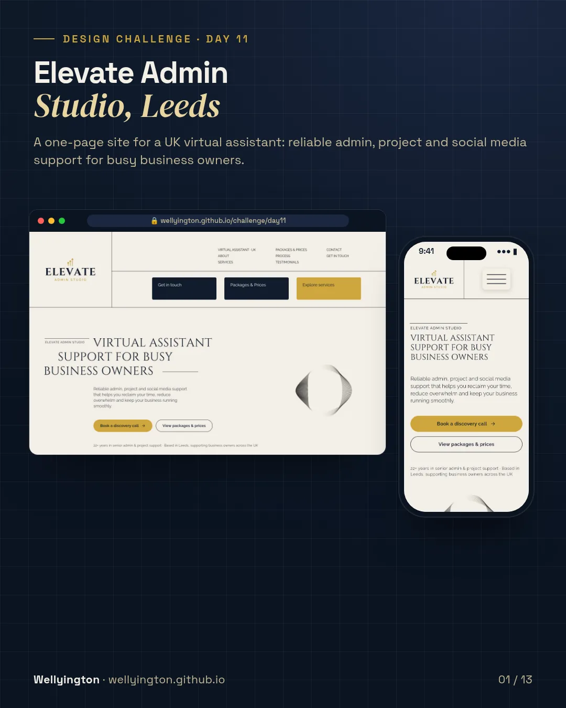
*Dia onze: um site de uma página para uma assistente virtual do Reino Unido, com apoio administrativo, de projetos e de redes sociais.*

## apoio para empresários ocupados

A página abre com uma curta tela de carregamento. Um contador vai até cem enquanto passam quatro palavras: organising, scheduling, delegating, ready, organizar, agendar, delegar, pronto. Depois, um botão Enter site. É um pequeno gesto teatral, e diz o que o serviço faz antes de qualquer frase ser lida.

Por trás está a abertura. À esquerda, o título em maiúsculas altas e espaçadas: virtual assistant support for busy business owners, apoio de assistente virtual para empresários ocupados. Embaixo, uma frase: apoio administrativo, de projetos e de redes sociais confiável, que ajuda você a recuperar seu tempo, reduzir a sobrecarga e manter o negócio funcionando sem tropeços. Depois dois botões, um dourado para marcar uma conversa inicial e um contornado para ver pacotes e preços. À direita, um vídeo curto em loop de uma forma desenhada em linhas finas, girando devagar.

E embaixo, uma linha discreta que trabalha muito: mais de 22 anos em apoio administrativo e de projetos sênior, com base em Leeds e clientes em todo o Reino Unido. Experiência, lugar e alcance, antes de alguém rolar a página.

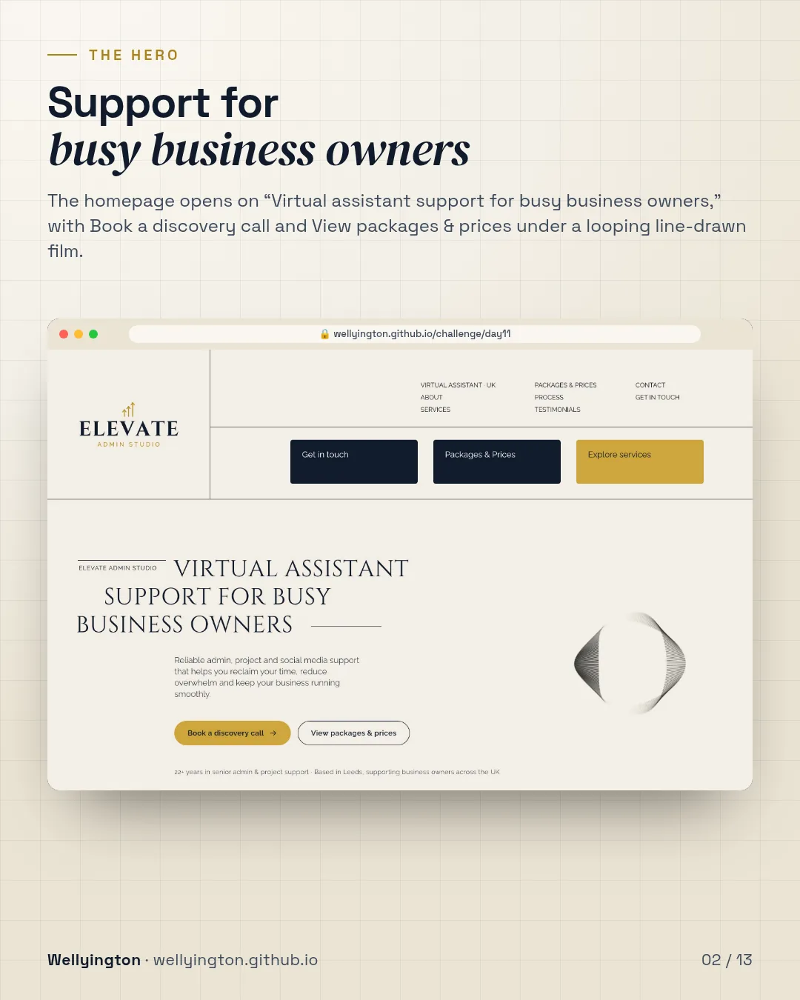
*A abertura: um título, dois botões, um vídeo de linhas e a frase sobre os 22 anos de experiência.*

## um cabeçalho que funciona como um arquivo

O cabeçalho é organizado como um índice. O logotipo ocupa seu próprio painel à esquerda. À direita, as seções aparecem em três colunas pequenas, como se etiquetam gavetas: assistente virtual, sobre, serviços; pacotes e preços, processo, depoimentos; contato e fale comigo. Embaixo, três blocos servem de atalho: Get in touch e Packages & Prices em azul-marinho, Explore services em dourado.

No celular, e em qualquer tela com menos de 1.025 pixels, esse cabeçalho vira o logotipo e um botão de três linhas. Ao tocar, um painel azul-marinho desliza em 0,8 segundo e enche a tela, com as sete seções numa só coluna, cada uma na sua própria linha: Home, About, Services, Packages & Prices, Process, Testimonials, Contact. As linhas são grandes o bastante para tocar sem mirar, e o X para fechar fica onde estava o botão.

Num site de uma página só, o menu é na verdade um sumário. Deve ser lido como tal.

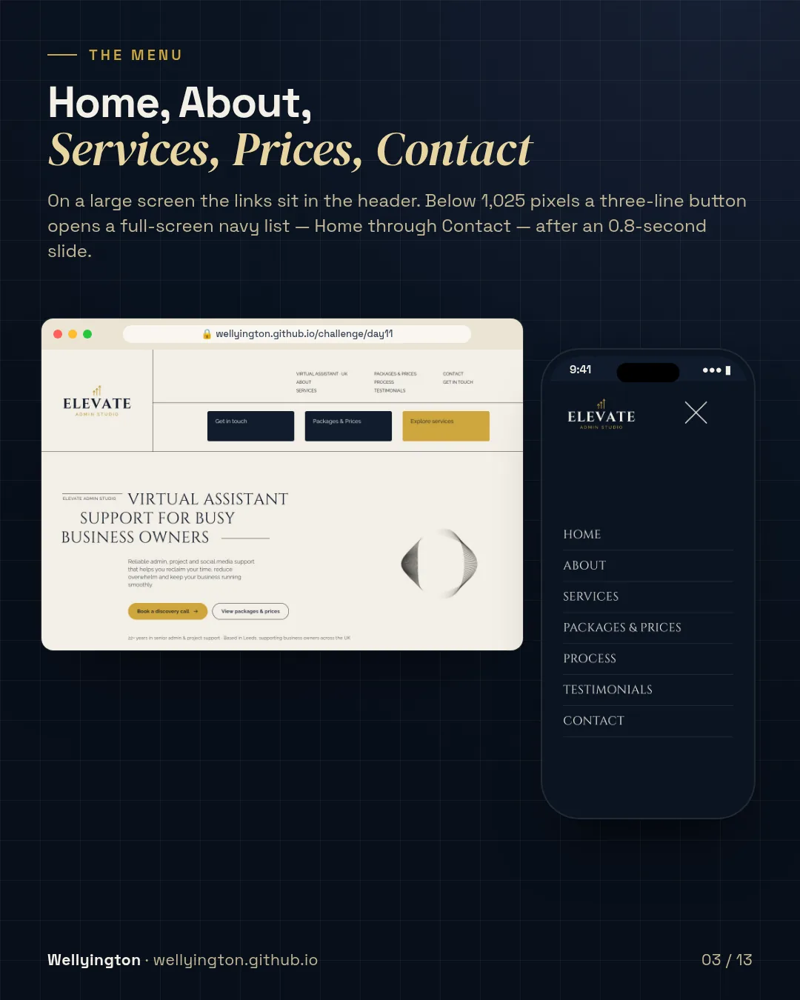
*Em tela grande, os links no cabeçalho; no celular, uma lista azul-marinho em tela cheia.*

## oi, eu sou a Charlotte

Num negócio de uma pessoa só, a pessoa é o produto. Por isso a primeira seção depois da abertura apresenta ela, com a própria voz: oi, eu sou a Charlotte, fundadora do Elevate. Ao lado, um retrato.

O texto é curto e concreto. Ela oferece apoio virtual calmo, organizado e confiável para empresários ocupados que precisam de ajuda nos bastidores. Trabalha com pessoas que estão fazendo malabarismo com coisas demais e precisam de um apoio confiável para manter tudo em ordem. Seja administração, redes sociais, coordenação de projetos ou organização do dia a dia, ela pode trazer mais calma, clareza e estrutura. Algumas dessas frases estão num peso mais forte, para que uma leitura rápida pegue a promessa sem ler cada palavra.

Embaixo vem uma lista de com quem ela trabalha: coaches e consultores, criativos e prestadores de serviços, pequenos empresários, equipes em crescimento e empresários prontos para delegar. E um convite: pronto para entregar sua administração com confiança? Essa lista importa mais do que parece. Quem se vê nela para de se perguntar se isso é para si.

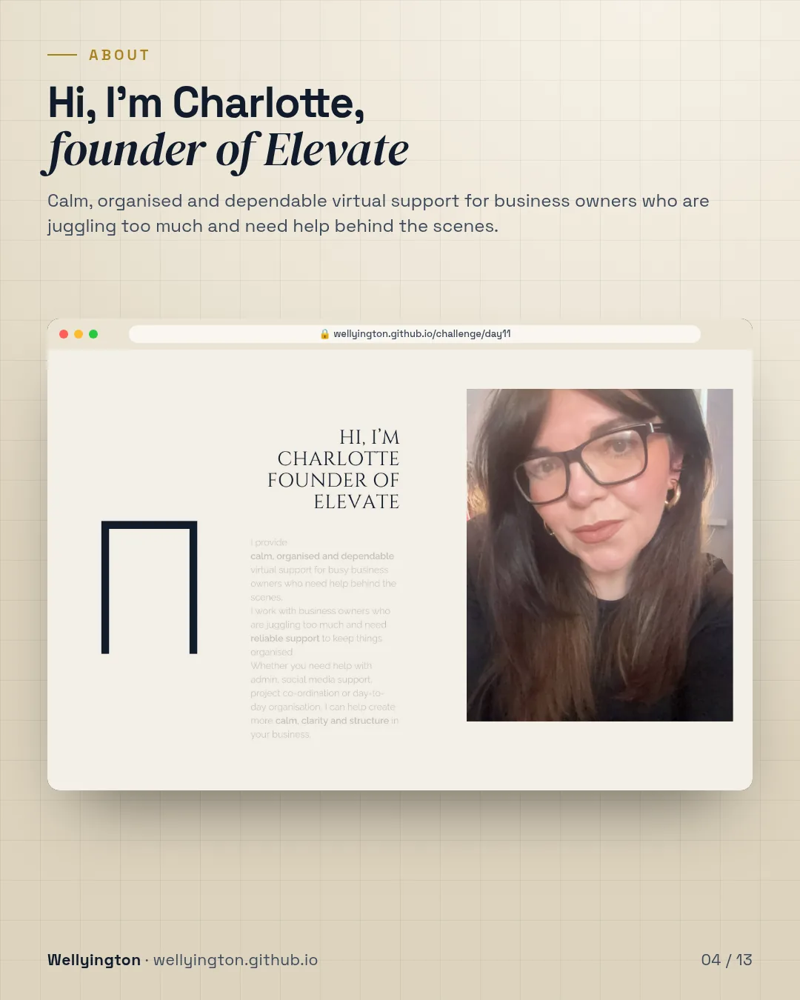
*Oi, eu sou a Charlotte: uma apresentação curta nas palavras dela, ao lado de um retrato.*

## duas décadas, em números e em valores

A seção seguinte, meet Charlotte, conheça a Charlotte, traz a experiência. Mais de duas décadas de apoio calmo e competente. Dois parágrafos explicam de onde vem: cargos seniores administrativos e de projetos, cinco anos no NHS em nível nacional, apoiando equipes, líderes e programas na gestão de prioridades, coordenação de reuniões, preparação de documentos e acompanhamento de ações. E depois o agora: levar essa experiência a empresários que precisam de apoio de confiança sem o compromisso de contratar alguém fixo.

Abaixo do texto há três números, que sobem ao aparecer na tela: mais de 22 anos em apoio administrativo e de projetos sênior, 5 anos no NHS em nível nacional, e Leeds, onde ela tem base, com clientes em todo o Reino Unido. À direita, um cartão azul-marinho descreve como é trabalhar com ela e o que um cliente pode esperar: comunicação clara, cumprimento confiável, sistemas organizados, uma abordagem calma e profissional, um apoio que parece uma extensão do próprio negócio, e cuidado, discrição e atenção aos detalhes.

Mais abaixo, cinco cartões de valores, cada um com um pequeno ícone dourado e algumas linhas: confiabilidade, cuidado e profissionalismo, organização e clareza, confiança e confidencialidade, e parceria. Seções de valores costumam ser enchimento. Aqui elas merecem o lugar, porque para uma assistente que vai ver seu e-mail, suas faturas e os dados dos seus clientes, confiança e confidencialidade não são palavras abstratas. São a pergunta que todo cliente faz em silêncio.

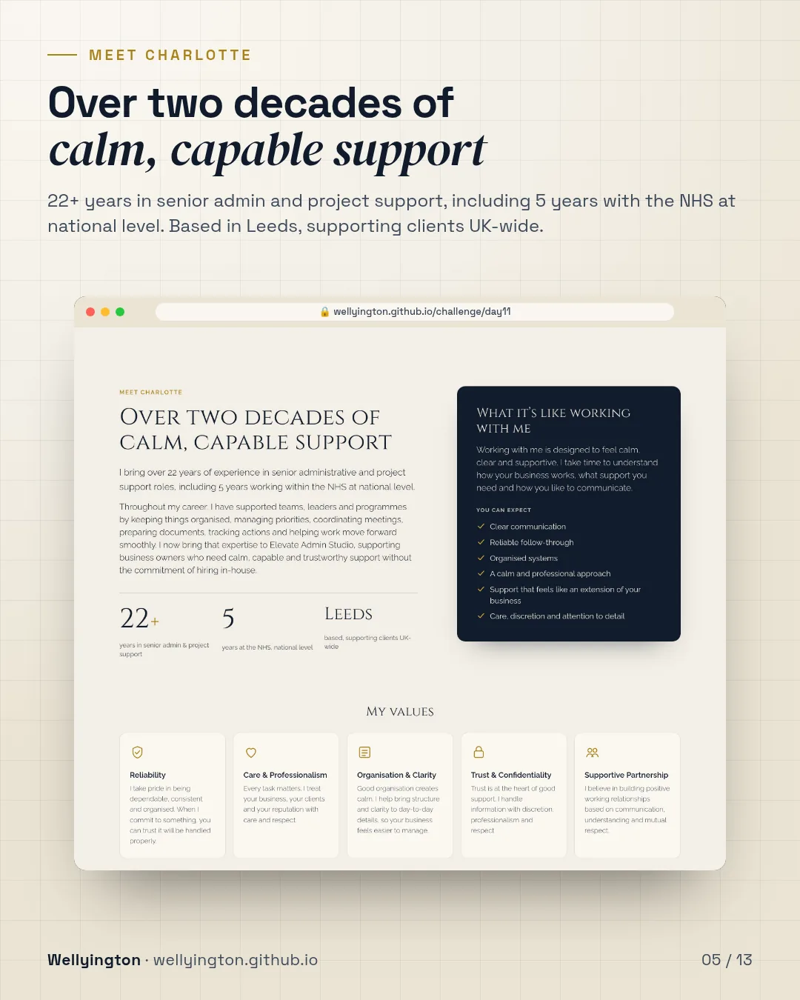
*22 anos, 5 no NHS, base em Leeds e cinco valores que respondem à pergunta da confiança.*

## seis serviços, um aberto de cada vez

A seção de serviços fica escura. Abre com uma fotografia de uma agenda mensal e canetas, e uma breve introdução: apoio flexível pensado para você se sentir mais organizado, menos sobrecarregado e com mais controle da sua carga de trabalho, seja de forma contínua ou para tarefas específicas.

Depois, os seis serviços, num acordeão com um só aberto de cada vez: Social Media Admin Support, Finance Admin Support, Event Admin Support, Project Support, Traditional PA/EA Support e Documents & Data Support. Cada um, ao abrir, segue o mesmo padrão: uma descrição de uma linha, as tarefas que pode incluir como pequenas etiquetas contornadas, para quem é ideal e um link para perguntar sobre aquele serviço especificamente.

O de redes sociais começa aberto. As etiquetas cobrem o acompanhamento de comentários, a gestão das mensagens, as respostas seguindo suas orientações, o apoio na criação de conteúdo, modelos e artes no Canva, a formatação de legendas, o agendamento e os relatórios semanais. O de administração financeira cobre faturas, cobrança de pagamentos, acompanhamento de orçamentos, controle de despesas e atualização de planilhas, e diz com clareza que apoia sua administração financeira mas não substitui um contador. Essa linha é o tipo de honestidade que gera confiança, e poupa todo mundo de uma conversa incômoda mais tarde.

O acordeão impede que uma lista longa de serviços vire um muro. O visitante abre o que veio procurar, lê e fecha. E cada link de consulta abre um e-mail com o serviço já escrito no assunto, então Charlotte sabe do que se trata antes de abrir a mensagem.

No fim da seção, uma linha para os indecisos: não sabe de que apoio precisa? Tudo bem. Podemos conversar sobre sua carga de trabalho atual. E um botão para marcar uma conversa inicial.

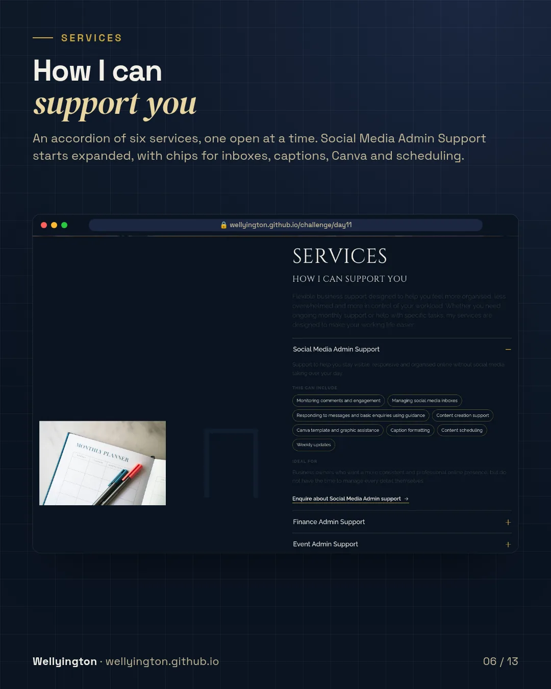
*Seis serviços em acordeão. O de redes sociais abre primeiro, com as tarefas como etiquetas.*

## o que acontece quando você escreve

Um dos motivos silenciosos pelos quais as pessoas adiam contratar ajuda é não saber como será o processo. Vai ter pressão para vender? Um formulário longo? Um contrato na primeira conversa? A seção how it works, como funciona, tira essa preocupação em seis passos, dispostos numa linha vertical com círculos numerados.

Passo um, escrever, por e-mail ou redes sociais, com um pouco sobre o negócio. Não é preciso saber exatamente de que apoio você precisa. Passo dois, uma conversa inicial: curta e informal, sem pressão nem obrigação de seguir. Um pequeno link abre a lista do que vai ser conversado, das prioridades atuais a qual pacote pode servir. Passo três, uma proposta, enviada depois da conversa, com tempo para analisar. Passo quatro, o formulário de reserva, o contrato e a fatura, para que tudo esteja combinado antes de começar. Passo cinco, a integração: acesso a sistemas, pastas compartilhadas, um quadro no Trello ou um gerenciador de tarefas, preferências de comunicação e orientações sobre o tom de voz. Passo seis, o apoio começa, com comunicação clara e atualizações regulares.

Seis passos parecem muito. Apresentados assim, leem-se ao contrário: como alguém que já fez isso antes e tem um sistema. Que é exatamente o que o cliente está pagando.

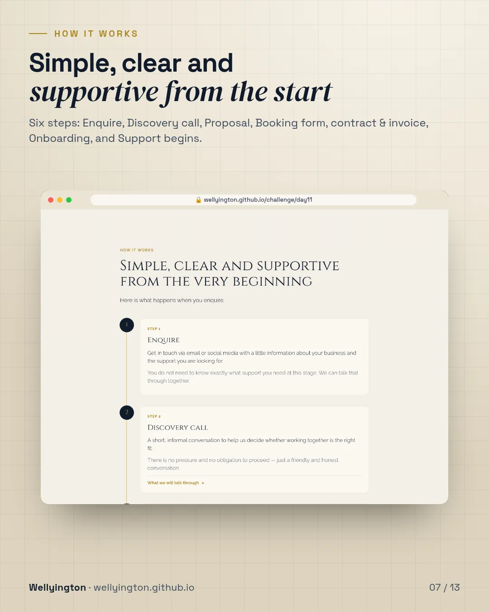
*Seis passos do primeiro contato ao início do apoio, cada um numa linha numerada.*

## os preços, em voz alta

Esta é a parte que eu mais queria acertar. Muitos negócios de serviços escondem os preços, com a ideia de que uma ligação vende melhor do que um número. Para uma assistente virtual, acho que é o contrário. As pessoas com quem ela trabalha são ocupadas por definição. Um visitante que vê o preço decide em um minuto se marca a conversa. Um que não vê tem de gastar tempo para descobrir, e gente ocupada muitas vezes não gasta.

A seção abre com o argumento a favor de uma assistente virtual numa frase: apoio confiável e profissional sem os custos extras de um funcionário, como férias pagas, impostos, contribuições sociais, previdência, escritório, equipamento ou treinamento. Depois três abas: mensalidades, pacotes e por hora ou sob medida.

A aba de mensalidades é a parte interativa. Em vez de seis cartões lado a lado, há um controle deslizante: quantas horas de apoio por mês? Vai de 12 a 60 horas em seis paradas. Ao mover, o cartão ao lado muda: The Assistant, 12 horas, £420 por mês; The Coordinator, 20 horas, £700; The Senior Support, 30 horas, £1.050; The Operations Partner, 40 horas, £1.400; The Executive Support, 50 horas, £1.750; e The Strategic Support, 60 horas, £2.100. Cada um traz uma linha sobre para quem serve e um botão para perguntar, que abre um e-mail com o nome daquela mensalidade já no assunto. Começa em The Coordinator.

O controle deslizante faz algo que uma tabela não faria. Deixa o visitante começar pela própria pergunta, quanta ajuda eu preciso, e ver a resposta, em vez de ler seis opções e fazer o caminho de volta. Embaixo, as condições estão escritas: o tempo é registrado e arredondado para os 15 minutos mais próximos, horas não usadas não passam para o mês seguinte, as horas incluem o tempo de briefing e comunicação, recomenda-se um compromisso de três meses e a disponibilidade é limitada. São condições que normalmente só aparecem num contrato. Aqui aparecem antes do primeiro e-mail.

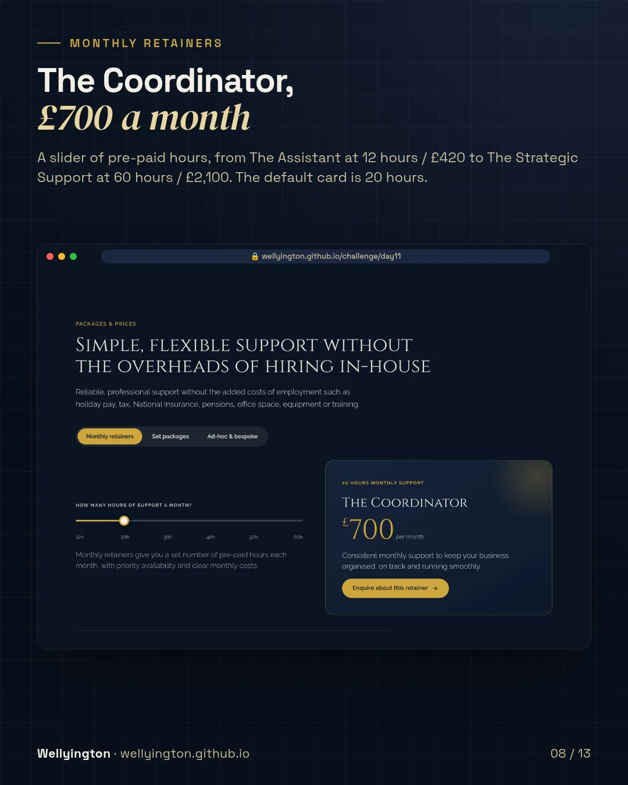
*Deslize de 12 a 60 horas e o cartão muda. Em 20 horas, The Coordinator, £700 por mês.*

## pacotes, horas e projetos

A segunda aba é para quem quer ajuda com uma coisa só. Três pacotes, cada um no seu cartão: Elevate Social Support a £450 por mês, que inclui 10 conteúdos em até duas plataformas; Executive Support & Project Coordination a £700 por mês, que combina a gestão de e-mail e agenda com reuniões, pautas, atas e acompanhamento de ações; e Elevate Inbox Management a £450 por mês, de organizar e sinalizar prioridades a redigir respostas para aprovação e um resumo semanal da caixa de entrada. Cada cartão tem um link what's included que abre a lista completa, e o seu próprio link de consulta.

A terceira aba é para todo o resto. Ad-Hoc Support custa £35 por hora, com reserva mínima de cinco horas, para tarefas pontuais, documentos, planilhas, limpezas de caixa de entrada e projetos curtos. Bespoke Project Support tem preço sob consulta, para trabalhos que não cabem num formato por hora ou mensal, com o preço baseado no tamanho do projeto, na duração e no briefing combinado.

Embaixo das abas há uma frase: não sabe qual opção é a sua? Podemos conversar numa conversa inicial. Os preços dão às pessoas um ponto de partida. A conversa continua sendo onde se decide.

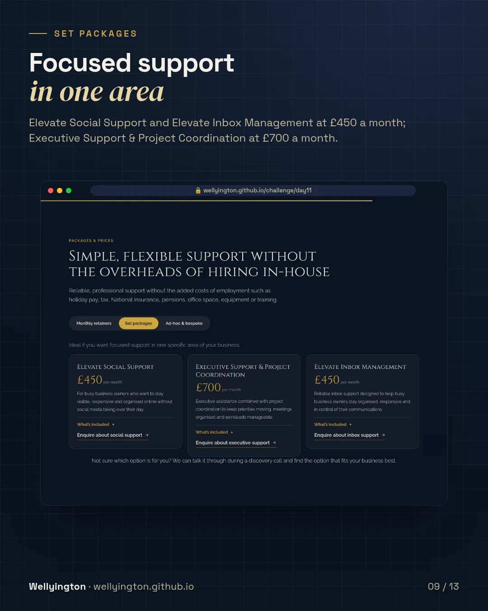
*Três pacotes para um apoio focado numa área.*

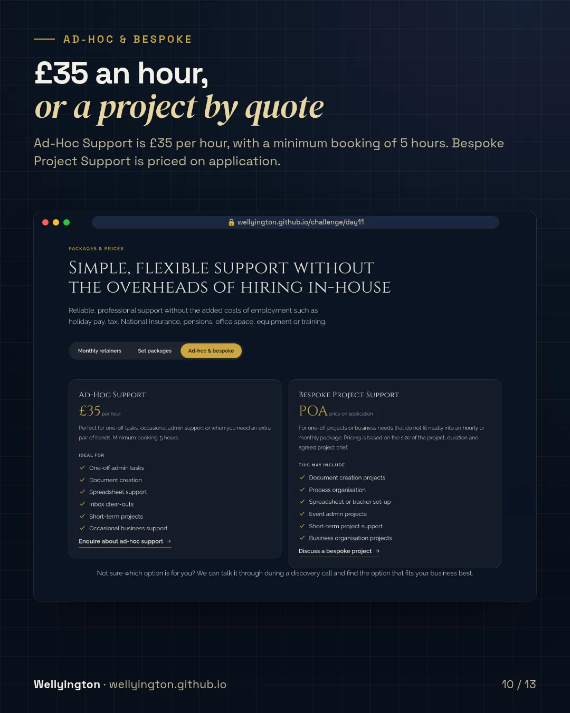
*£35 por hora para tarefas pontuais, ou um projeto sob medida com orçamento.*

## um apoio em que se pode confiar

A seção de depoimentos é curta, e deve ser. São duas citações, num único cartão com setas para passar de uma à outra, de duas pessoas seniores que trabalharam com Charlotte por vários anos.

Ellie Gordon, que foi Senior Nurse de saúde mental e deficiência intelectual no NHS England, a descreve como «calorosa, solidária e adaptável». David Harling, BEM, National Deputy Director for Learning Disability Nursing, fala de projetos nacionais, prazos apertados e relatórios escritos de alto nível.

Dois depoimentos podem parecer pouco em alguns sites. Aqui eles pesam por quem assina e pelo que descrevem: anos de trabalho, cargos com nome, coisas concretas feitas. Prefiro duas citações reais e concretas com nome completo a dez anônimas.

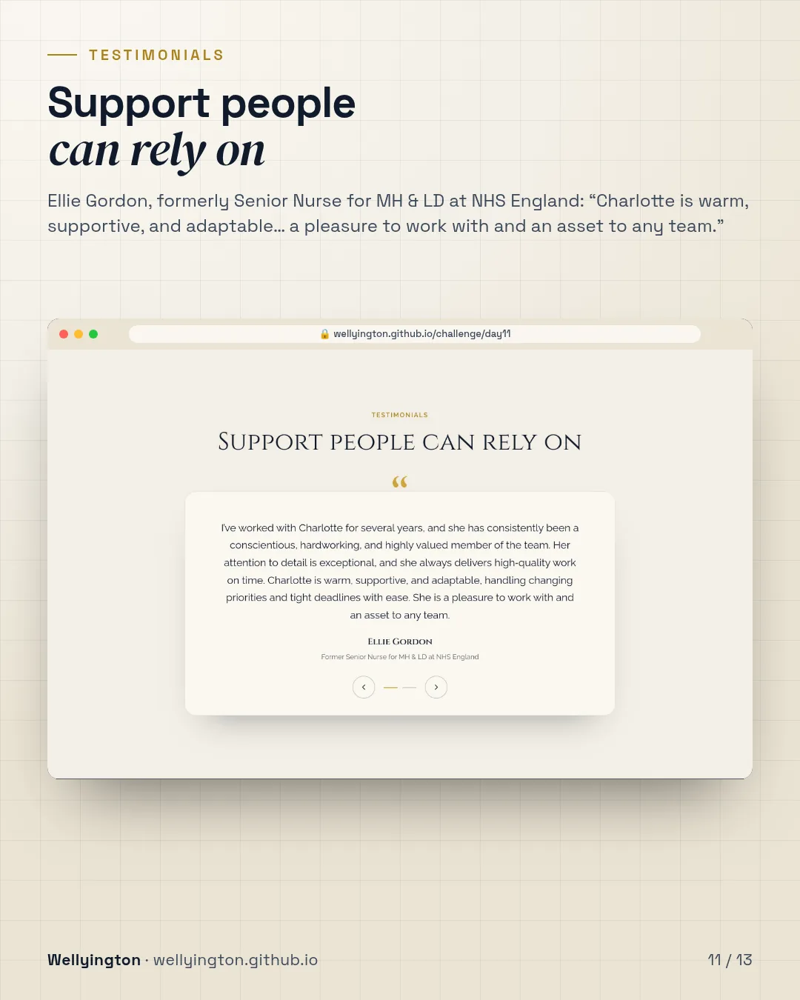
*Dois depoimentos com nome, de colegas seniores, um de cada vez.*

## um endereço, dois botões

A página termina onde cada seção apontava. Get in touch: vamos deixar sua carga de trabalho mais leve. Um parágrafo curto convida a contar um pouco sobre o negócio e o apoio de que se precisa, e promete uma resposta com os próximos passos.

Não há formulário. Há dois botões: Email Charlotte, que abre um e-mail novo já endereçado a ela, e Copy email address, que copia o endereço e mostra uma pequena confirmação, para quem usa e-mail no navegador ou prefere escrever de outro aparelho. O endereço está impresso embaixo, charlotte@elevateadminstudio.co.uk, em texto simples.

Para um negócio baseado numa pessoa que responde bem a e-mails, pareceu o certo. Um formulário acrescenta um passo e uma camada entre o cliente e ela. Um e-mail vai direto para a caixa de entrada que ela administra por profissão.

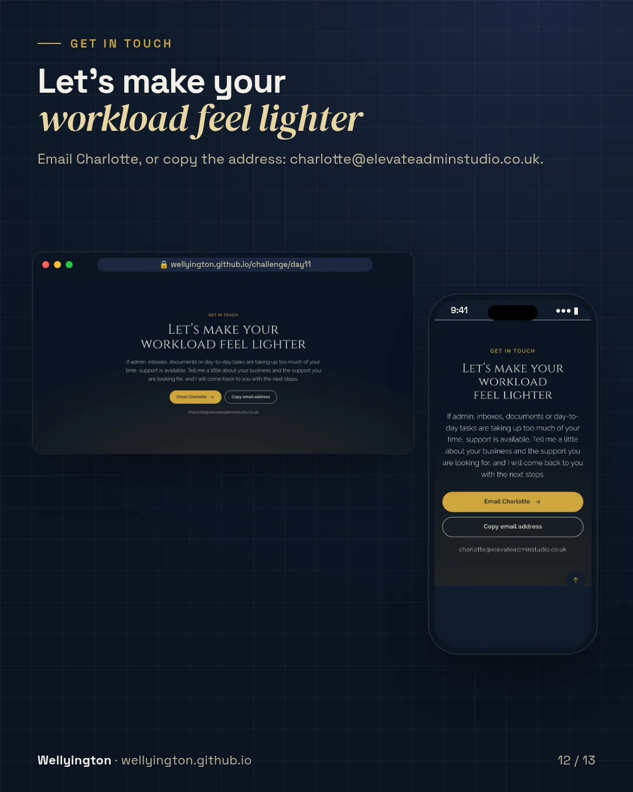
*Escreva para a Charlotte ou copie o endereço. Sem formulário no meio.*

## os detalhes

A paleta tem três cores: um azul-marinho profundo, um creme quente e um dourado discreto. O azul-marinho leva as partes sérias, o menu, os serviços e os preços. O creme leva as partes pessoais, a apresentação, os valores e os depoimentos. O dourado fica para o que se deve tocar: os botões principais, a aba ativa, o controle deslizante.

Os títulos usam Cinzel, maiúsculas clássicas com ar de inscrição gravada, que dão a um negócio pequeno uma tranquila sensação de permanência. O texto de leitura usa Raleway, leve e aberta. As duas fontes são servidas do próprio site e não do Google, então abrir a página não entrega o endereço de ninguém a terceiros.

O movimento é suave. As seções aparecem e sobem para o lugar ao rolar, um item um pouco depois do outro, e a própria rolagem é suavizada. Para quem pediu ao aparelho que reduza as animações, os efeitos de aparição são desligados e o conteúdo simplesmente está lá. O site inteiro é só em inglês, porque os clientes dela estão no Reino Unido.

## o que é o conceito, e o que vem depois

Os dados do conceito vêm do Elevate Admin Studio: os serviços e o que cada um inclui, o processo, as mensalidades, pacotes e valores, a trajetória de Charlotte e os dois depoimentos.

O que é novo é a estrutura: uma página só, ordenada, um menu que se lê como um sumário, os serviços em acordeão com links de consulta que nomeiam o serviço, um processo explicado passo a passo e preços que se podem explorar com um controle deslizante em vez de ter de pedir.

Não tenho números de consultas, e não vou inventá-los. Transformar o conceito num site funcionando exigiria os passos práticos: os termos de uso e as políticas de privacidade e de cookies para os quais o rodapé aponta, escritos segundo as regras britânicas; links para as redes sociais que o primeiro passo do processo menciona, que a página ainda não tem; e uma forma de Charlotte atualizar ela mesma os preços quando mudarem, para que a página nunca mostre o valor do ano passado.

## onze feitos

O site de uma assistente virtual tem um trabalho acima de todos: ser a primeira prova de que ela é organizada. A melhor forma de fazer isso não é escrever «organizada» no título. É ser: dizer para quem é, dizer o que inclui, dizer quanto custa, dizer o que acontece depois, e pôr cada uma dessas coisas no seu próprio lugar, bem claro.

Se você vende um serviço e não um produto, vale o mesmo. Mostre a pessoa por trás. Diga o que está incluído e o que não está. Coloque um preço na página, nem que seja um ponto de partida. Explique os passos da primeira mensagem ao primeiro trabalho. E faça da forma de contato a coisa mais simples da página.

Sou web designer em Estepona, na Costa del Sol, e desenho e construo sites para negócios na Espanha e fora dela. Se isto se parece com o seu negócio, escreva-me pelo [site principal](https://wellyington.github.io/pt/). Conte o que você faz e onde, e eu respondo em linguagem clara. O conceito está [aqui](https://wellyington.github.io/challenge/day11/), e o site atual do Elevate Admin Studio [aqui](https://elevateadminstudio.co.uk/), para você comparar. Onze feitos, faltam oitenta e nove.
