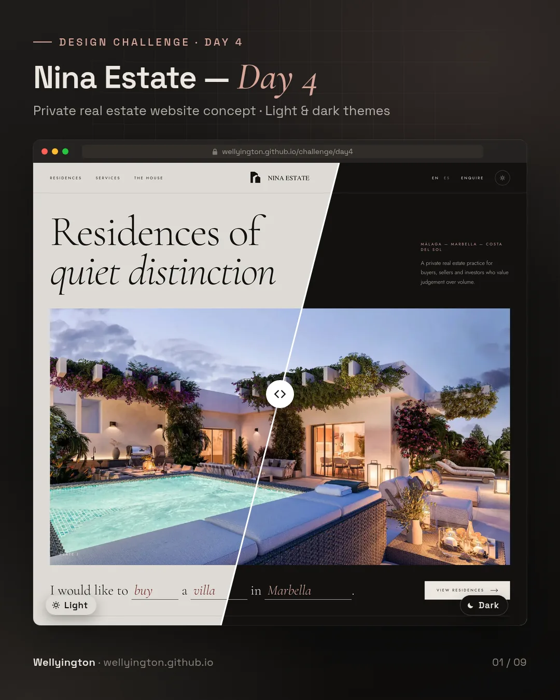
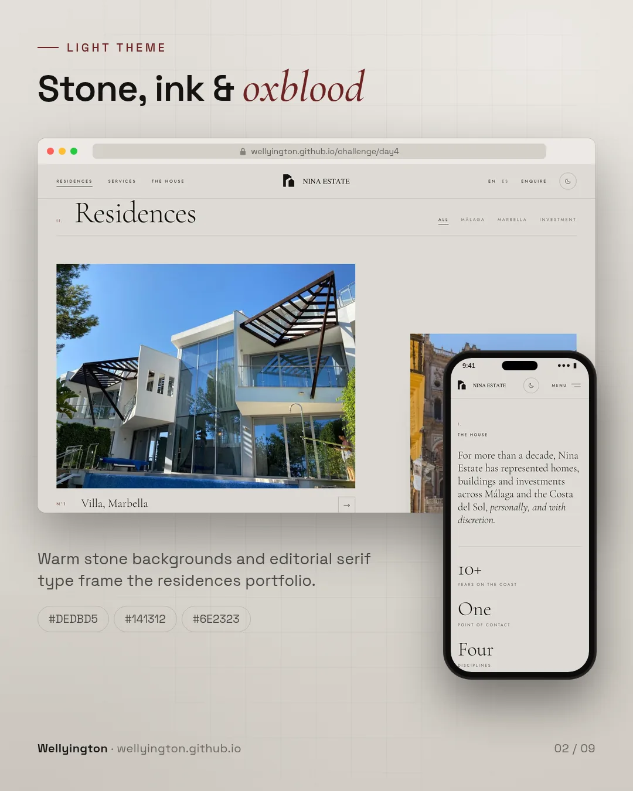
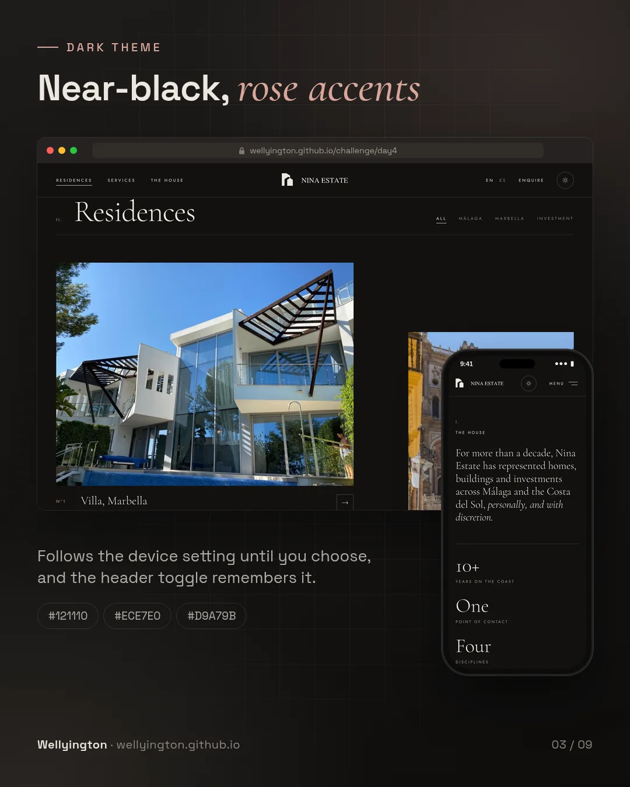
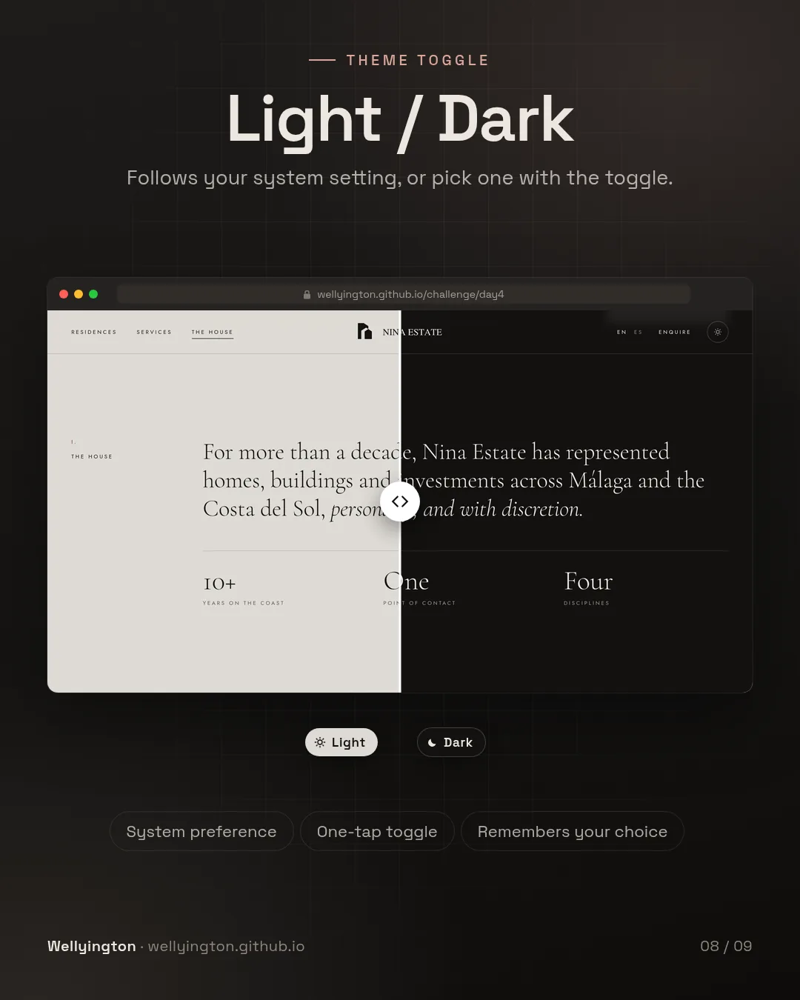
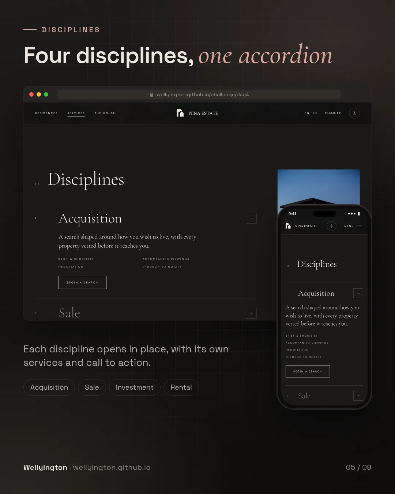
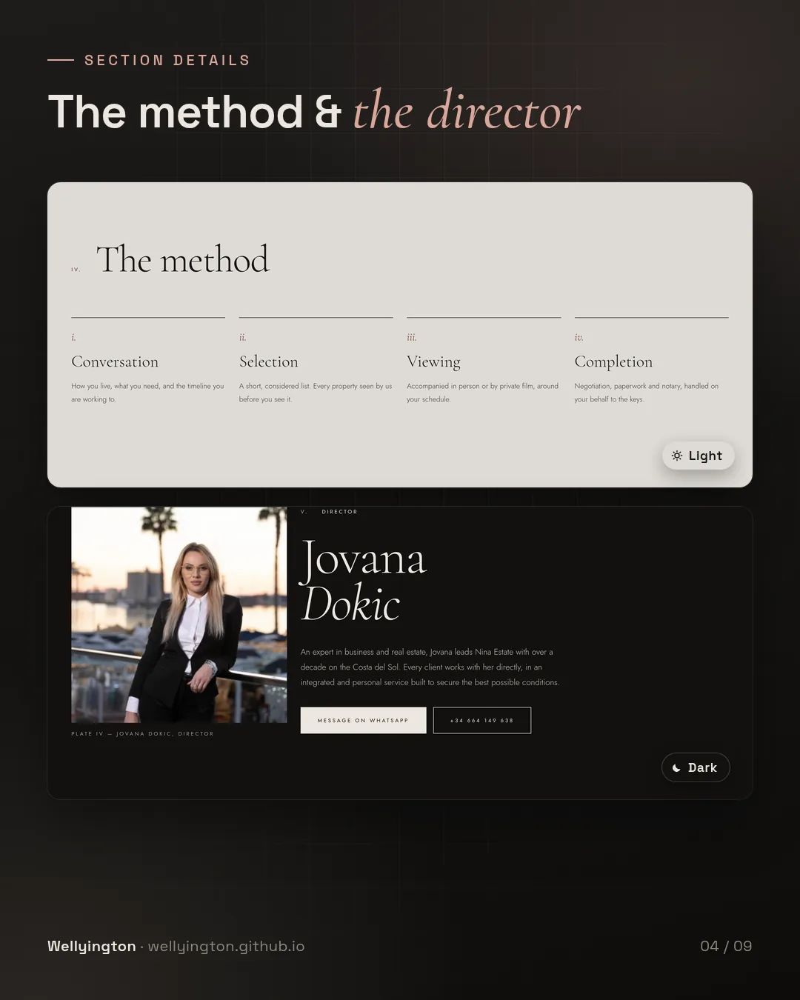
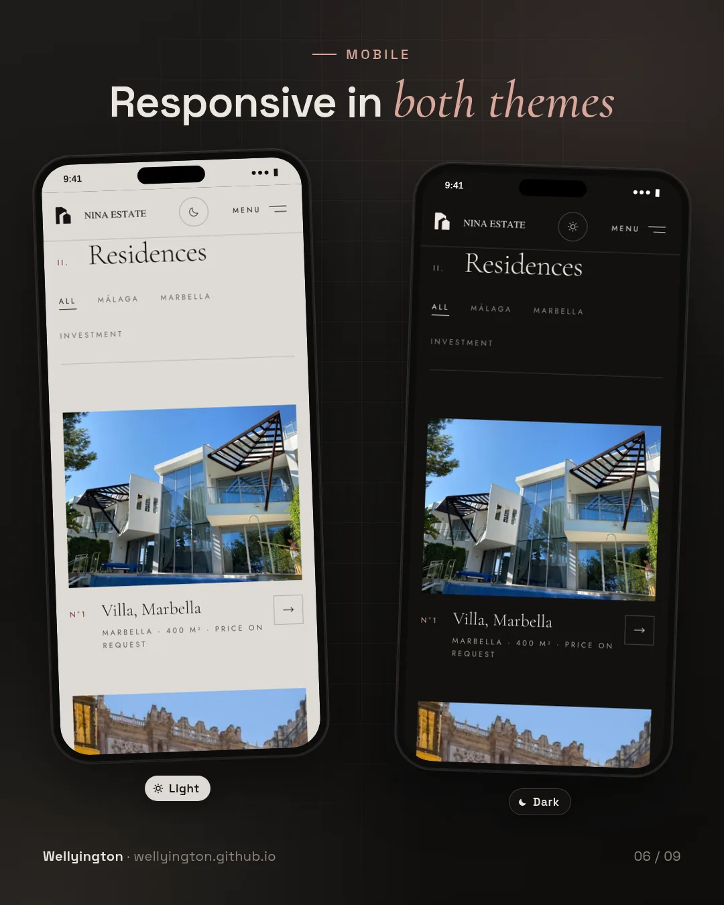
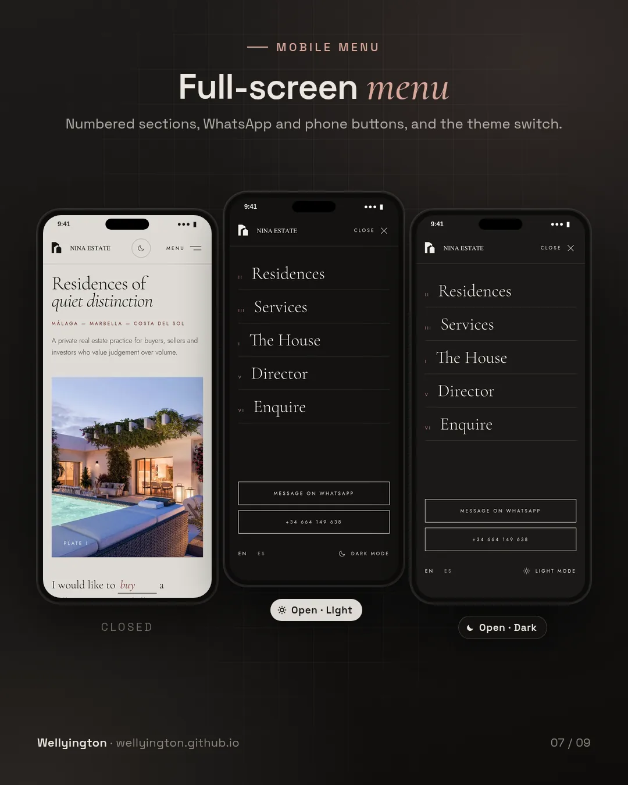

No dia 20 de novembro publiquei a quarta nota desta série, o desafio proposto por Ramiah Trask: cem dias, cem negócios, cem sites. O primeiro dia foi uma construtora familiar da Marina Alta que precisava de uma primeira página clara. [Essa página está aqui.](https://wellyington.github.io/journal/pt/articles/o-site-antes-do-sim/) O segundo, um teatro em Málaga com uma temporada cheia e nenhuma ordem. [Esse está aqui.](https://wellyington.github.io/journal/pt/articles/espaco-para-a-temporada-inteira/) O terceiro, um restaurante familiar na minha própria cidade, com muitos motivos para entrar. [Esse está aqui.](https://wellyington.github.io/journal/pt/articles/um-lugar-na-mesa-comprida/) Hoje o negócio vende uma coisa que as pessoas levam meses para decidir.

A Nina Estate é uma imobiliária de Málaga, com escritório na Avenida de Cánovas del Castillo. Ela atua na cidade e na Costa del Sol: casas, prédios inteiros, investimentos e aluguéis de longo prazo. Já tem site, em [ninaestate.com](https://ninaestate.com/), que apresenta a experiência, os imóveis e os serviços. O meu conceito está aqui: [Nina Estate, dia quatro](https://wellyington.github.io/challenge/day4/).

É um redesenho independente. Não é uma colaboração com a Nina Estate, ninguém de lá me pediu e nada na página quer dizer que eles aprovam. Por enquanto ele mora no meu próprio endereço, como os três anteriores.

## outro tipo de página imobiliária

A maioria dos sites imobiliários é feita como vitrine. Uma busca no topo, uma grade de anúncios, um preço em cada cartão, um telefone num canto. Isso funciona para uma imobiliária que ganha no volume, com centenas de imóveis e um comprador que quer ir rolando a tela.

A Nina Estate tem outro formato. Poucos imóveis, vários deles prédios inteiros. Preço sob consulta. Uma pessoa, a diretora, que atende cada cliente pessoalmente. Quem compra ou vende nesse nível do mercado de luxo não está escolhendo principalmente um anúncio. Está escolhendo em quem confia para escolher por ele.

Por isso tomei um caminho diferente do site atual. Menos imobiliária tradicional e mais escritório particular, onde a forma de apresentar, o atendimento pessoal e o cuidado com os detalhes fazem parte do que o cliente recebe. O site atual começa pela experiência, pelos imóveis e pelos serviços. O conceito começa pela relação: com quem você vai tratar, como vai ser a busca e o que acontece da primeira ligação até as chaves.

A ideia cabe numa frase. O site deveria parecer mais com o serviço que ele vende.

## residências de discreta distinção

A abertura está quase vazia, de propósito. Um título numa serifa grande e fina: residences of quiet distinction, residências de discreta distinção, com a segunda linha em itálico. Embaixo, uma linha pequena em vinho: Málaga, Marbella, Costa del Sol. À direita, uma única frase faz o papel de declaração de propósito: um escritório imobiliário particular para compradores, vendedores e investidores que valorizam critério mais do que volume.

Depois, uma foto larga, com o rótulo Plate I, prancha I, como num livro: uma villa ao entardecer, a piscina acesa, buganvílias sobre o terraço, lanternas na mureta. A página mantém a foto nesse tamanho e não coloca nada por cima.

Embaixo da foto, onde quase todo site imobiliário colocaria uma busca com doze campos, há uma frase para completar. I would like to buy a villa in Marbella: eu gostaria de comprar uma villa em Marbella. Cada uma das três palavras em itálico é um menu. Comprar pode virar alugar, investir em ou vender. Villa pode virar casa, apartamento ou prédio. Marbella pode virar Málaga Centro, El Limonar ou a Costa del Sol. E um botão só: ver residências.

É um detalhe pequeno, e muda o tom. Uma busca pede que você filtre. Uma frase pergunta o que você quer, do jeito que um corretor perguntaria ao telefone. No conceito, a frase leva às residências. Ela não finge fazer uma busca de que o negócio não precisa.

*A abertura, cortada em duas. As mesmas boas-vindas de dia e à noite.*

## pedra, tinta e vinho

As cores vêm de como esse mercado se parece quando é bem feito: gesso, papel antigo, madeira escura, uma taça de tinto numa mesa.

O tema claro é pedra quente, #DEDBD5, com tinta quase preta, #141312, para o texto, e vinho, #6E2323, para as coisas pequenas que importam: os números, o filtro ativo, as palavras em itálico da frase. O tema escuro é quase preto, #121110, com texto off-white, #ECE7E0, e um rosa apagado, #D9A79B, no lugar do vinho. Nenhum dos dois é a versão principal. São dois sites completos, e a mesma residência precisa ficar bem nos dois.

A tipografia faz quase todo o trabalho. Cormorant Garamond, uma serifa fina e de alto contraste, para os títulos e os nomes dos imóveis. Jost, uma sem serifa simples, bem pequena e espaçada, para as etiquetas. As seções são numeradas em algarismos romanos, de I a VI, e as fotos se chamam pranchas. A leitura lembra mais um catálogo impresso de galeria do que um aplicativo, e isso está mais perto de como essas casas são vendidas pessoalmente.

Como nos dias anteriores, a página segue o seu celular ou computador. Se ele está no modo escuro, o site abre escuro. Um botão redondo no cabeçalho troca o tema, e o site lembra da sua escolha na próxima vez.

*O tema claro: pedra quente, tinta e vinho, com uma serifa editorial.*

*O tema escuro. Ele segue o aparelho até você escolher, e o botão do cabeçalho lembra da escolha.*

## a casa

A seção I se chama The House, a casa, e tem um parágrafo. Há mais de uma década, a Nina Estate representa casas, prédios e investimentos em Málaga e na Costa del Sol, de forma pessoal e com discrição.

Embaixo, três números, cada um com uma etiqueta pequena. 10+, anos na costa. Uma, pessoa de contato. Quatro, áreas de atuação. Eu queria números que um cliente consiga conferir, não totais de metros vendidos nem um contador de famílias felizes. O segundo é a linha mais importante da página. Nesse nível, o comprador quer saber que a pessoa que atende a primeira ligação ainda vai estar lá no cartório.

*Segue a configuração do seu sistema, ou você escolhe com o botão.*

## quatro residências, não quatrocentas

A seção II é o portfólio, com o título simples de Residences, residências. À direita, quatro filtros: todas, Málaga, Marbella, investimento. Ao escolher um, os cartões se reorganizam sem recarregar a página.

O conceito tem quatro imóveis. Nº 1, uma villa em Marbella, com 400 metros quadrados. Nº 2, um prédio ao lado da Catedral de Málaga, vendido inteiro. Nº 3, outro prédio no Centro Histórico. Nº 4, uma residência em El Limonar, com 329 metros quadrados. Todos dizem preço sob consulta. Os cartões são grandes, colocados em alturas diferentes em vez de numa grade apertada, e cada um tem uma setinha para abrir.

Quatro é pouco para um site imobiliário, e eu deixei em quatro. Uma grade comprida faria o negócio parecer um portal, e ele não é. Embaixo dos cartões há uma linha em itálico: some of our finest homes are never published, algumas das nossas melhores casas nunca são anunciadas. Ao lado, um botão: pedir acesso particular. Nessa faixa do mercado, boa parte dos melhores imóveis troca de mãos fora do mercado, sem anúncio público. A página diz isso com clareza e mostra como entrar.

Mais abaixo vem uma segunda foto na largura toda, a prancha II, com uma frase sobre a parte tranquila da imagem: discrição não é um serviço, é o padrão.

## quatro áreas, uma de cada vez

A seção III organiza o trabalho em quatro partes: compra, venda, investimento e aluguel. No site atual, os serviços aparecem como uma lista. Aqui cada um é uma linha que abre no próprio lugar, então quem quer vender não precisa ler o processo do comprador para achar o seu.

Compra: uma busca pensada a partir de como você quer viver, com cada imóvel avaliado antes de chegar até você. Depois briefing e pré-seleção, visitas acompanhadas, negociação, até o cartório, e um botão, começar uma busca. Venda: o seu imóvel apresentado do jeito que os compradores desse nível esperam, e colocado diante das pessoas certas, com avaliação, fotografia editorial, compradores qualificados e divulgação discreta. Investimento: prédios, ativos e imóveis de renda no centro histórico e no litoral, com prédios inteiros, análise de rentabilidade, oportunidades fora dos portais e gestão do ativo. Aluguel: aluguéis de longo prazo cuidados tanto para proprietários quanto para inquilinos, com seleção de inquilinos, contratos e vistoria, representação do proprietário e mudança.

Cada área termina no seu próprio próximo passo: começar uma busca, pedir uma avaliação, conversar sobre um investimento, perguntar sobre aluguéis. Quem só veio vender nunca precisa ler sobre rentabilidade.

*Cada área abre no próprio lugar, com seus serviços e o próximo passo.*

## o método

A seção IV responde à pergunta que todo comprador de primeira viagem na Espanha acaba fazendo: o que acontece, exatamente, e em que ordem? Quatro passos, numerados em romanos pequenos e colocados lado a lado.

Conversa: como você vive, do que precisa e qual é o seu prazo. Seleção: uma lista curta e pensada, com cada imóvel visto pela imobiliária antes de você ver. Visita: acompanhada pessoalmente, ou por vídeo particular no horário que for melhor para você, o que faz diferença quando o comprador mora em Londres ou em Dubai. Fechamento: negociação, papelada e cartório, cuidados em seu nome até a entrega das chaves.

Nada disso é novidade para quem já comprou imóvel aqui. Escrito em quatro linhas curtas, o processo parece conhecido antes de começar, e numa decisão cara e lenta isso é boa parte do que o cliente está pagando.

## a pessoa por trás do negócio

A seção V é a mudança que mais me importa. Em muitos sites imobiliários as pessoas são fotos pequenas numa página de quem somos, quando aparecem. Aqui a diretora ganha uma seção só dela, do mesmo tamanho que os imóveis.

Jovana Dokic. O nome aparece grande, com o sobrenome em itálico, ao lado de um retrato dela num terraço acima do porto ao entardecer. O texto é curto: especialista em negócios e no mercado imobiliário, ela comanda a Nina Estate com mais de uma década na Costa del Sol, e cada cliente trabalha diretamente com ela, num atendimento completo e pessoal pensado para garantir as melhores condições possíveis. Embaixo, dois botões: mandar mensagem no WhatsApp e o número de telefone, +34 664 149 638.

O motivo é prático. Numa empresa desse tamanho, a pessoa é o serviço. Os clientes vão falar com ela, visitar com ela e assinar com ela do lado. Um site que esconde isso atrás de fotos de banco de chaves e apertos de mão vende por menos a única coisa que uma imobiliária grande tem dificuldade de copiar.

*O método em quatro passos, e a diretora, com uma linha direta até ela.*

## com hora marcada

A última seção, a VI, se chama consultas particulares, e o título diz by appointment, com hora marcada. À esquerda, três caminhos: o telefone, o e-mail, jovana@ninaestate.com, e o escritório, na Avenida de Cánovas del Castillo 8, Málaga.

À direita, um formulário curto. Nome, e-mail, telefone, uma escolha do assunto, que corresponde às quatro áreas, e uma mensagem. Ao enviar, o aplicativo de e-mail de quem visita abre com tudo já escrito e endereçado à Jovana. Uma linha embaixo do botão diz que cada consulta é respondida pessoalmente e com sigilo. Não tem área do cliente nem resposta automática fingindo ser gente. Um escritório particular responde a própria correspondência.

## no celular

Muitos primeiros contatos com uma imobiliária assim acontecem no celular, em horários estranhos, de outro país. Um comprador no saguão de um hotel procura a corretora que um amigo indicou. Um vendedor no exterior confere com quem está prestes a falar.

No celular as residências se empilham uma embaixo da outra, cada uma com número, nome, região, área e preço sob consulta, e uma seta quadrada para abrir. Os filtros quebram em duas linhas em vez de encolher. Os dois temas funcionam do mesmo jeito.

O menu abre em tela cheia. Cinco seções, numeradas como na página: residências, serviços, a casa, diretora, contato. Embaixo, os dois botões que alguém com o celular na mão realmente usa, mensagem no WhatsApp e o número de telefone, e depois a escolha de idioma e a troca de tema. Tudo o que é preciso para entrar em contato cabe na primeira tela do menu.

*As residências no celular, nos dois temas.*

*O menu em tela cheia: seções numeradas, WhatsApp e telefone, o idioma e a troca de tema.*

## inglês e espanhol

Quem compra neste litoral vem de toda parte, e quem vende muitas vezes é espanhol. O conceito tem EN e ES no cabeçalho e no menu do celular desde o começo, porque um escritório assim precisa dos dois idiomas desde o primeiro dia.

Para ser claro sobre o que existe: o conceito está escrito em inglês, e o seletor de espanhol já está no lugar, mas as páginas em espanhol ainda não foram escritas. Prefiro escrevê-las junto com o negócio a adivinhar como a Jovana fala com os clientes espanhóis dela.

## um conceito independente

A Nina Estate não me contratou, e este não é o site deles. Os imóveis, o nome e as palavras da diretora, o telefone, o e-mail e o escritório vêm do que a Nina Estate já publica. Eu não mudei os fatos. O que mudei foi a ordem, o tom e a aparência: um escritório particular no lugar de um catálogo, a pessoa na frente e o processo por escrito.

Não tenho números de consultas nem de vendas, e não vou inventar nenhum. Se ninguém na Nina Estate quiser, o conceito fica onde está, como dia quatro. Se quiserem, o resto é prático: as palavras deles onde eu preenchi, as páginas em espanhol, uma página para cada residência, o formulário enviado para onde eles quiserem e o site levado para ninaestate.com.

## se os seus clientes levam meses para decidir

Pode ser que você não venda imóveis. Muitos negócios vendem algo que se decide devagar: uma escola, uma clínica, um arquiteto, um advogado, um corretor de barcos. Mesmo assim, o site costuma ser feito para decisões rápidas, com grades, preços, contadores e pressa.

Para uma decisão lenta, ajuda fazer o contrário. Diga com quem o cliente vai tratar, e mostre. Escreva o processo em poucos passos. Mostre pouco trabalho, num tamanho em que dê para olhar direito. Dê um jeito direto de chegar a uma pessoa. E deixe o design calmo o bastante para que quem visita leia em vez de passar reto.

Sou web designer em Estepona, na Costa del Sol, e faço sites como este para negócios de toda a Espanha. Se isso parece com o seu negócio, escreva para mim pelo [site principal](https://wellyington.github.io/pt/). Diga o que você faz e onde, e eu respondo em linguagem comum. O conceito está [aqui](https://wellyington.github.io/challenge/day4/), e o site da Nina Estate está [aqui](https://ninaestate.com/), se você quiser comparar os dois. Quatro feitos, faltam noventa e seis.
