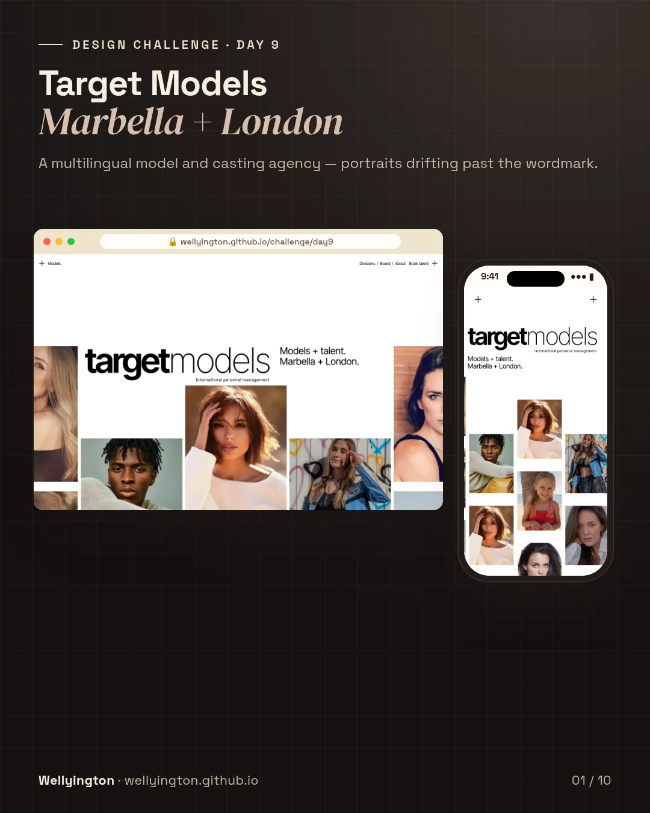
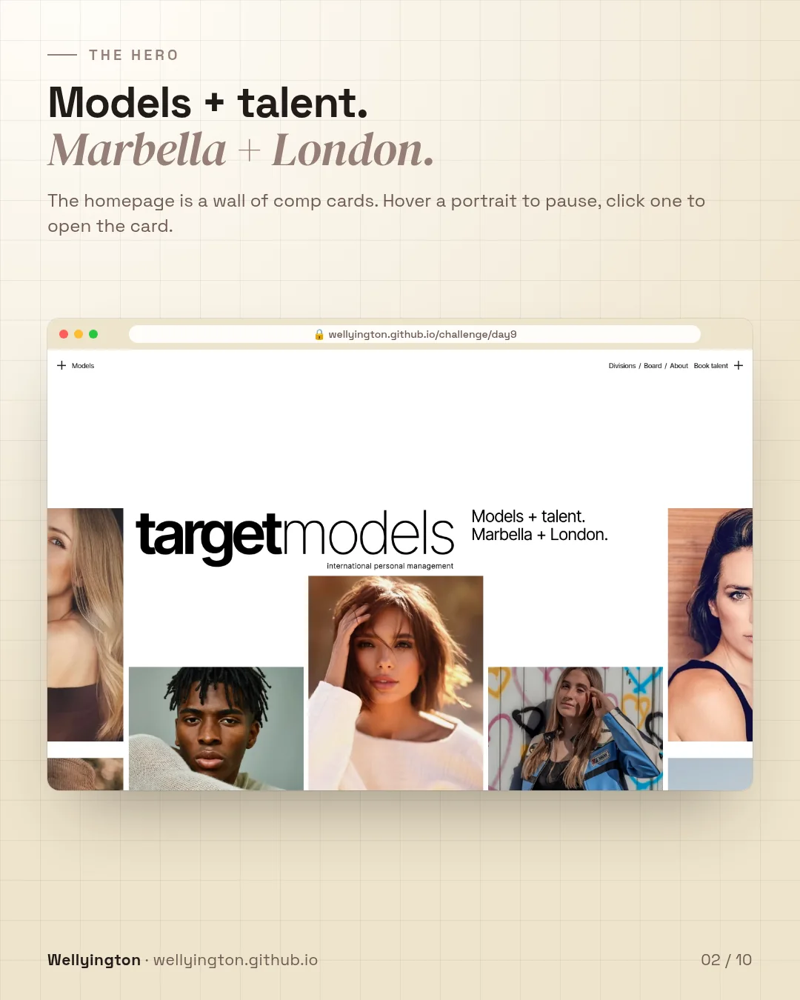
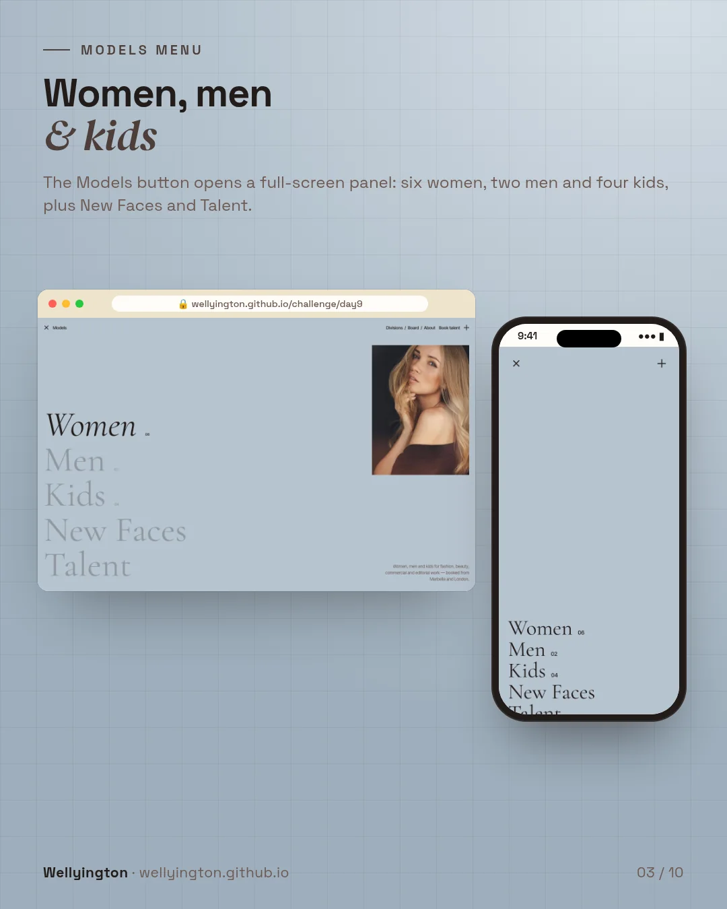
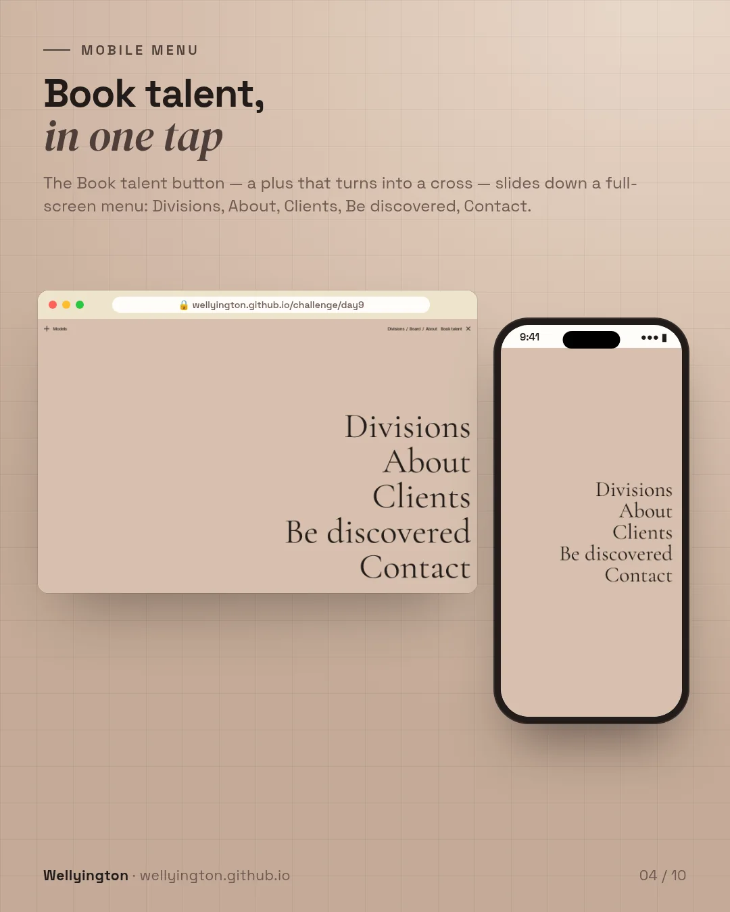
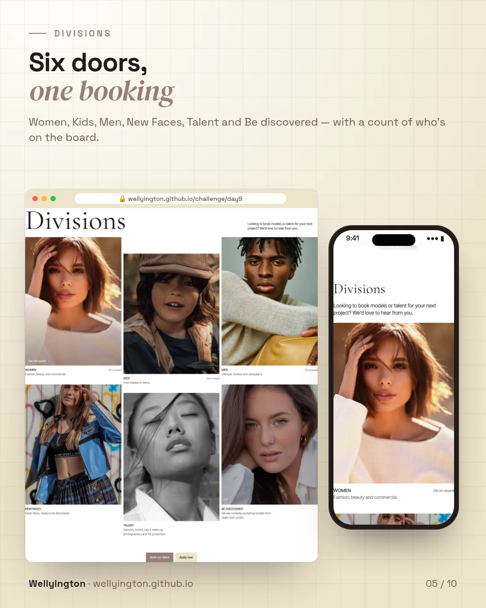
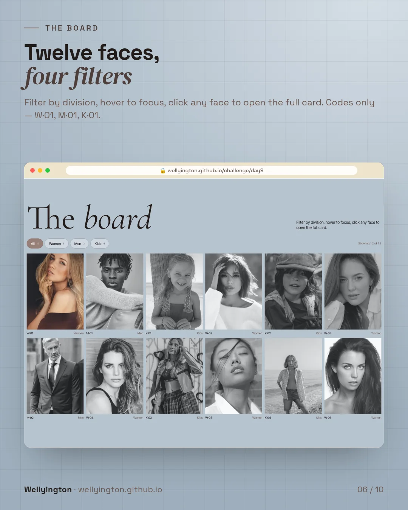
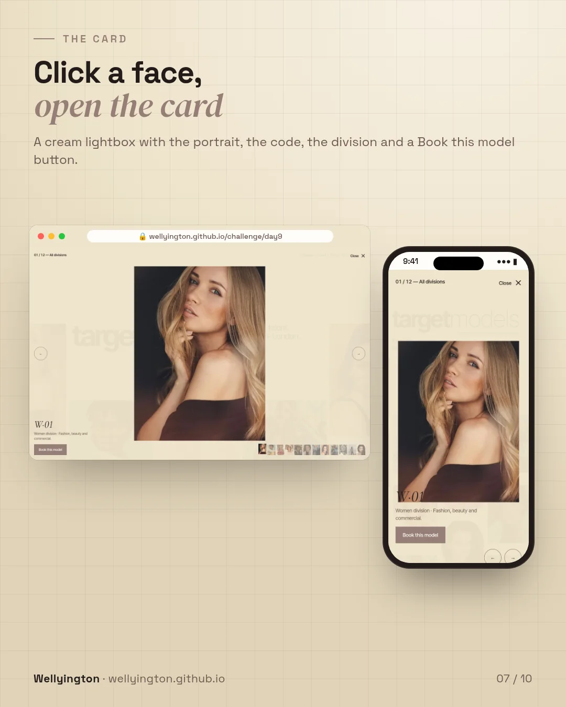
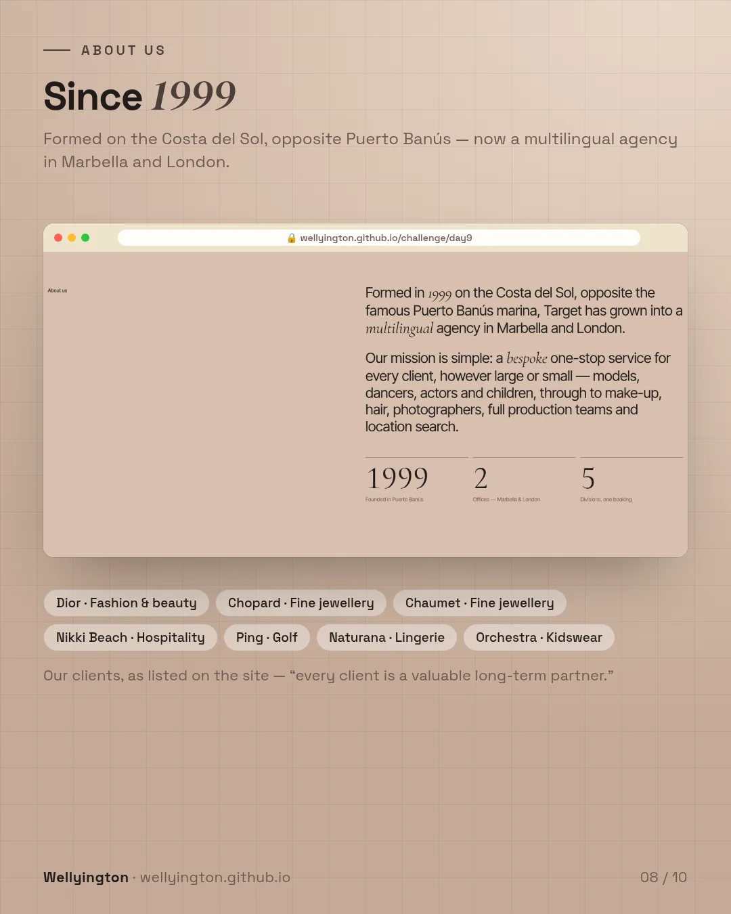
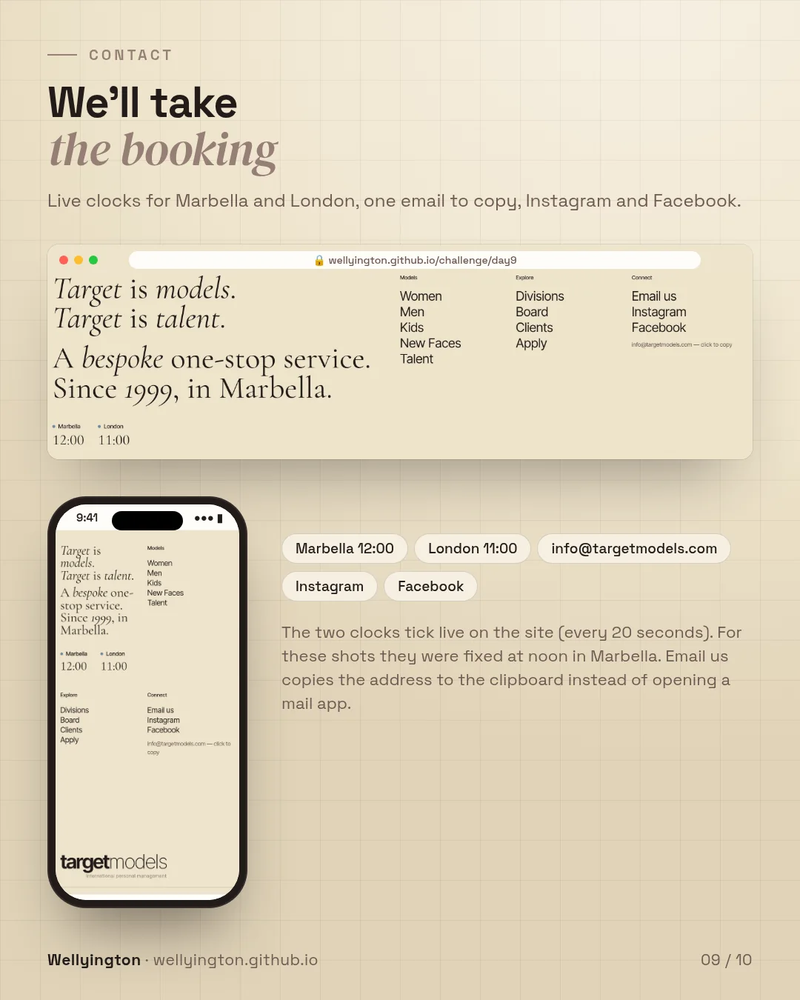

Em 25 de novembro publiquei a nona nota desta série, o desafio que Ramiah Trask lançou: cem dias, cem negócios, cem sites. Foi a segunda do dia. O dia um foi uma construtora familiar da Marina Alta. [Essa página está aqui.](https://wellyington.github.io/journal/pt/articles/o-site-antes-do-sim/) O dia dois, um teatro de Málaga. [Essa está aqui.](https://wellyington.github.io/journal/pt/articles/espaco-para-a-temporada-inteira/) O dia três, um restaurante familiar de Estepona. [Essa está aqui.](https://wellyington.github.io/journal/pt/articles/um-lugar-na-mesa-comprida/) O dia quatro, uma consultoria imobiliária privada de Málaga. [Essa está aqui.](https://wellyington.github.io/journal/pt/articles/criterio-antes-de-volume/) O dia cinco, um restaurante de menu degustação em Motril. [Essa está aqui.](https://wellyington.github.io/journal/pt/articles/tao-cuidadoso-quanto-a-cozinha/) O dia seis, uma casa de frango assado em Estepona. [Essa está aqui.](https://wellyington.github.io/journal/pt/articles/do-balcao-a-comanda/) O dia sete, um hotel familiar em Kavos, Corfu. [Essa está aqui.](https://wellyington.github.io/journal/pt/articles/a-mesma-piscina-a-noite/) O dia oito, três casas no centro histórico de Málaga. [Essa está aqui.](https://wellyington.github.io/journal/pt/articles/tres-casas-uma-so-porta/)

Hoje é outro tipo de negócio. A Target Models é uma agência de modelos e casting fundada em 1999 na Costa del Sol, em frente à marina de Puerto Banús. Hoje trabalha a partir de dois escritórios, Marbella e Londres, em vários idiomas. Representa mulheres, homens e crianças para moda, beleza, publicidade e trabalhos editoriais, e também contrata dançarinos, atores, cabeleireiros e maquiadores, fotógrafos e equipes de produção completas. O site atual deles está em [targetmodels.eu](https://www.targetmodels.eu/).

O conceito está aqui: [Target Models, dia nove](https://wellyington.github.io/challenge/day9/).

## os rostos são o produto

Quase todos os sites desta série precisaram explicar alguma coisa. Como é uma casa por dentro, por que um menu degustação custa o que custa, como se pede um frango. Uma agência de modelos tem um problema mais simples, e mais difícil. Não precisa explicar muito. Os rostos são o produto. Se o site atrapalhar, ele falhou, por mais esperto que seja.

Então a ideia foi deixar a fotografia falar quase sozinha. Muito branco, muito pouca cor, letra pequena e retratos tão grandes quanto a tela permitir. Todo o resto, os menus, as divisões, a reserva, fica em segundo plano até alguém pedir.

O outro trabalho aparece menos. Quem usa o site de uma agência de modelos quase nunca é modelo. São diretores de arte, fotógrafos, gerentes de marca e produtoras procurando um rosto para um ensaio na semana que vem. Querem ver quem está no book, filtrar e entrar em contato. O site precisa tornar isso rápido sem nunca parecer um catálogo.

*Dia nove: uma agência de modelos e casting multilíngue, com retratos passando pelo logotipo.*

## um mural de composites

As agências de modelos costumavam mandar composites: um cartão impresso com algumas fotos de um modelo e os seus dados, preso na parede de cada escritório de casting da cidade. A abertura do conceito é essa parede.

Ela começa em branco. O nome, targetmodels, atravessa o meio em letra enorme, target em preto pesado e models num peso finíssimo ao lado, com international personal management em letra pequena embaixo. À direita, duas linhas curtas: models and talent; Marbella and London, modelos e talentos; Marbella e Londres. Essa é toda a apresentação.

Em volta e atrás do nome, os retratos se movem. Estão arrumados em colunas, cada uma numa altura um pouco diferente da seguinte, e cada uma sobe ou desce devagar no seu próprio ritmo, então o mural nunca fica parado e nunca se repete do mesmo jeito. Passe o mouse sobre uma coluna e ela para, para você olhar com calma. Clique num rosto e a ficha dele abre.

No celular, o mesmo mural vira três colunas estreitas embaixo do nome, ainda se movendo, ainda parando quando você toca.

Não há carrossel, nem uma grande mensagem de boas-vindas, nem um botão pedindo para você rolar. A primeira coisa que você vê é o nome e as pessoas, que é o que uma agência é.

*A abertura é um mural de composites. Passe o mouse num retrato para pausar, clique para abrir a ficha.*

## dois botões, dois menus

O cabeçalho é quase nada: um sinal de mais e a palavra Models à esquerda, um sinal de mais e Book talent à direita, e entre eles, no computador, uma linha discreta de links: Divisions, Board e About. Os dois sinais de mais são toda a navegação, porque o site tem dois tipos de visitante.

Clique em Models e um painel azul-céu claro desliza sobre a página. À esquerda, as divisões numa serifa grande: Women, Men, Kids, New Faces e Talent, com um número pequeno ao lado das três primeiras mostrando quantos rostos há naquele book. Conforme você desce a lista, os nomes que você não está apontando esmaecem e um retrato daquela divisão aparece à direita. Funciona como folhear uma pilha de fichas.

Clique em Book talent e entra outro painel, num rosa-claro suave: Divisions, About, Clients, Be discovered e Contact, grandes e alinhados à direita. O sinal de mais vira um X, para ficar claro como fechar. A tecla Escape também fecha.

No celular, os dois botões ficam nos cantos da tela e os dois painéis ocupam a tela toda. Um toque para ver os modelos, um toque para reservar.

*O botão Models abre um painel em tela cheia: mulheres, homens e crianças, além de New Faces e Talent.*

*Um sinal de mais que vira X e um menu em tela cheia: Divisions, About, Clients, Be discovered, Contact.*

## seis portas, uma reserva

O negócio da Target é mais amplo do que o nome sugere. Além de modelos, contrata talentos e está sempre procurando gente nova. A seção de divisões mostra tudo de uma vez, como seis portas.

Women, mulheres, para moda, beleza e publicidade. Kids, crianças, de bebês a adolescentes. Men, homens, para lifestyle, moda e campanhas. New Faces, rostos novos prontos para serem descobertos. Talent, para dançarinos, atores, cabelo e maquiagem, fotógrafos e produção completa. E Be discovered, para quem quer entrar: a agência está aceitando modelos da Espanha e de Londres.

Cada porta é um retrato grande com uma legenda embaixo e, nas três primeiras, quantas pessoas há no book. Os retratos ficam em alturas um pouco diferentes, como cópias espalhadas numa mesa mais do que azulejos numa grade. Acima, uma frase simples: procurando modelos ou talentos para o seu próximo projeto? Vamos adorar ter notícias suas. Abaixo, dois botões: book our talent e apply now, contrate os nossos talentos e candidate-se.

Os dois botões dizem para quem é a seção. Clientes reservam. Futuros modelos se candidatam. Nenhum precisa ler a metade do outro.

*Women, Kids, Men, New Faces, Talent e Be discovered, com quantas pessoas há no book.*

## o book

O book é onde o cliente trabalha de verdade. Chama-se simplesmente the board, em letra grande, metade reta e metade itálica, com uma única instrução ao lado: filtre por divisão, passe o mouse para destacar, clique em qualquer rosto para abrir a ficha completa.

Acima dos rostos há quatro filtros, All, Women, Men e Kids, cada um com o seu número. Escolha um e o book se reorganiza para mostrar só aquela divisão, com uma linha pequena à direita dizendo quantos você está vendo, por exemplo showing 6 of 12.

Os rostos ficam em preto e branco até você apontar para um. Então aquele retrato ganha cor e os outros ficam quietos. Numa página cheia de rostos, essa única mudança basta para mostrar onde está a sua atenção, sem molduras, sombras ou zoom.

Cada rosto tem um código em vez de um nome: W·01 para a primeira mulher, M·01 para o primeiro homem, K·01 para a primeira criança. É uma escolha deliberada. Um book real traria os modelos da própria agência, com nomes e medidas, e só com o consentimento deles. O conceito não precisa pôr nomes reais na internet para mostrar como o book funciona, então não põe.

*Filtre por divisão, passe o mouse para destacar, clique em qualquer rosto para abrir a ficha. Só códigos.*

## clique num rosto, abra a ficha

Clicar em qualquer rosto, na abertura, nas divisões ou no book, abre a ficha dele. A tela se funde em creme e o retrato aparece no meio, grande. Num canto, um contador, 01 de 12, e a divisão que você está vendo. Embaixo, o código em serifa itálica, a divisão e o que ela cobre, e um botão: book this model, reservar este modelo.

Setas dos dois lados e uma fileira de miniaturas embaixo deixam você passar pelos outros sem fechar nada. No teclado, as setas para a esquerda e para a direita fazem o mesmo e o Escape fecha a ficha. No celular, você desliza o dedo.

Book this model fecha a ficha e leva aos dados de contato. Numa versão real, abriria um pedido já marcado com o código do modelo, para que a agência saiba exatamente sobre quem o cliente está perguntando.

*Uma ficha em creme com o retrato, o código, a divisão e um botão Book this model.*

## desde 1999

A seção sobre a agência é curta. Fundada em 1999 na Costa del Sol, em frente à famosa marina de Puerto Banús, a Target se tornou uma agência multilíngue em Marbella e Londres. A missão dela é um serviço sob medida e completo para cada cliente, grande ou pequeno: modelos, dançarinos, atores e crianças, até maquiagem, cabelo, fotógrafos, equipes de produção completas e busca de locações.

Algumas dessas palavras aparecem em serifa itálica no meio do texto sem serifa, 1999, multilingual e bespoke, como uma revista destacaria uma palavra numa citação. Embaixo, três números: 1999, fundada em Puerto Banús; 2, escritórios em Marbella e Londres; 5, divisões, uma só reserva.

Depois, os clientes, como a agência os lista: Dior e Chopard, Chaumet, Nikki Beach, Ping, Naturana e Orchestra, da moda e alta joalheria à hotelaria, ao golfe, à lingerie e à moda infantil. Embaixo deles, uma frase da agência: acreditamos que todo cliente é um parceiro valioso de longo prazo.

*Fundada na Costa del Sol, em frente a Puerto Banús, e hoje uma agência multilíngue em Marbella e Londres.*

## nós cuidamos da reserva

O fim da página é a voz da agência, numa serifa itálica grande: Target is models. Target is talent. A bespoke one-stop service. Since 1999, in Marbella. Target é modelos, Target é talento, um serviço completo sob medida, desde 1999, em Marbella.

Embaixo, dois relógios pequenos, Marbella e Londres, com a hora de cada escritório. A diferença é de uma hora, e quem reserva um ensaio de fora precisa fazer essa conta toda vez. Os relógios se atualizam sozinhos enquanto a página está aberta.

Ao lado, três colunas curtas: as divisões de modelos, o resto do site e as formas de contato. Email us copia o endereço da agência para a área de transferência e avisa, em vez de abrir um programa de e-mail que você talvez nem use. Há links para Instagram e Facebook, e o nome de novo bem no fim, com o mesmo peso e o mesmo traço finíssimo do topo.

*Relógios ao vivo de Marbella e Londres, um e-mail para copiar, Instagram e Facebook.*

## os detalhes

Há só duas fontes. Inter Tight, uma sem serifa estreita e precisa, para quase tudo, do nome enorme no topo à menor etiqueta. Cormorant Garamond, uma serifa clássica, em itálico, para as divisões, os menus, os títulos das fichas e as palavras que merecem uma pausa.

As cores são a paleta da própria agência: um azul-céu claro para o painel Models e o book, creme para as fichas e o rodapé, um rosa-claro suave para o menu Book talent e a seção sobre a agência, e um cinza-taupe apagado para os botões, tudo sobre branco. Cada cor marca uma parte diferente da agência, então você sempre sabe se está vendo rostos, lendo sobre o negócio ou entrando em contato.

O movimento é lento de propósito. As colunas deslizam, os títulos sobem para o lugar linha por linha, os menus deslizam. Tudo para para quem pediu ao celular ou ao computador que reduza as animações, e então os retratos simplesmente ficam parados nas suas colunas. As fontes vêm do meu próprio site, e não do Google, então abrir a página não entrega o endereço de ninguém a terceiros.

## o que o conceito é, e o que vem depois

Os dados da agência na página vêm do site atual dela: o ano e o lugar de fundação, os dois escritórios, as divisões, os serviços, os clientes que ela lista, a página de candidatura, o e-mail e os perfis nas redes. Os retratos fazem o papel do book, com códigos em vez de nomes, para mostrar como um book real funcionaria.

O que é novo é a estrutura: um mural de rostos no lugar de uma página inicial, dois botões para os dois tipos de visitante, as divisões lado a lado, um book que filtra e destaca, e uma ficha para cada rosto que leva direto a uma reserva.

Não tenho números de reservas nem de candidaturas, e não vou inventar nenhum. Transformar o conceito num site funcionando exigiria os passos práticos: o book da própria agência, com o nome, as medidas e o portfólio de cada modelo, publicado com o acordo deles; um formulário de pedido que leve o código do modelo; espanhol ao lado do inglês; e um jeito simples de a agência incluir e retirar rostos sem depender de ninguém.

## se o seu trabalho é visual

Talvez você não tenha uma agência de modelos. Mas muitos negócios vendem algo que precisa ser visto: um fotógrafo, uma floricultura, um escritório de arquitetura, um estúdio de tatuagem, um espaço para casamentos, um marceneiro. Os sites deles costumam enterrar as imagens embaixo de parágrafos sobre paixão e qualidade.

O que ajuda é o mesmo que aqui. Coloque o trabalho primeiro e deixe todo o resto em silêncio. Use uma ou duas fontes e muito pouca cor. Deixe as pessoas filtrarem, por tipo, estilo ou tamanho, com um clique. Faça cada imagem levar a algum lugar, a mais detalhes e depois a um jeito de entrar em contato. E dê uma porta diferente para quem quer trabalhar com você e para quem quer comprar de você.

Sou web designer em Estepona, na Costa del Sol, e desenho e construo sites para negócios na Espanha e fora dela. Se isto parece com o seu negócio, escreva para mim pelo [site principal](https://wellyington.github.io/pt/). Conte o que você faz e onde, e eu respondo em linguagem simples. O conceito está [aqui](https://wellyington.github.io/challenge/day9/), e o site atual da Target Models [aqui](https://www.targetmodels.eu/), para você comparar os dois. Nove feitos, faltam noventa e um.
