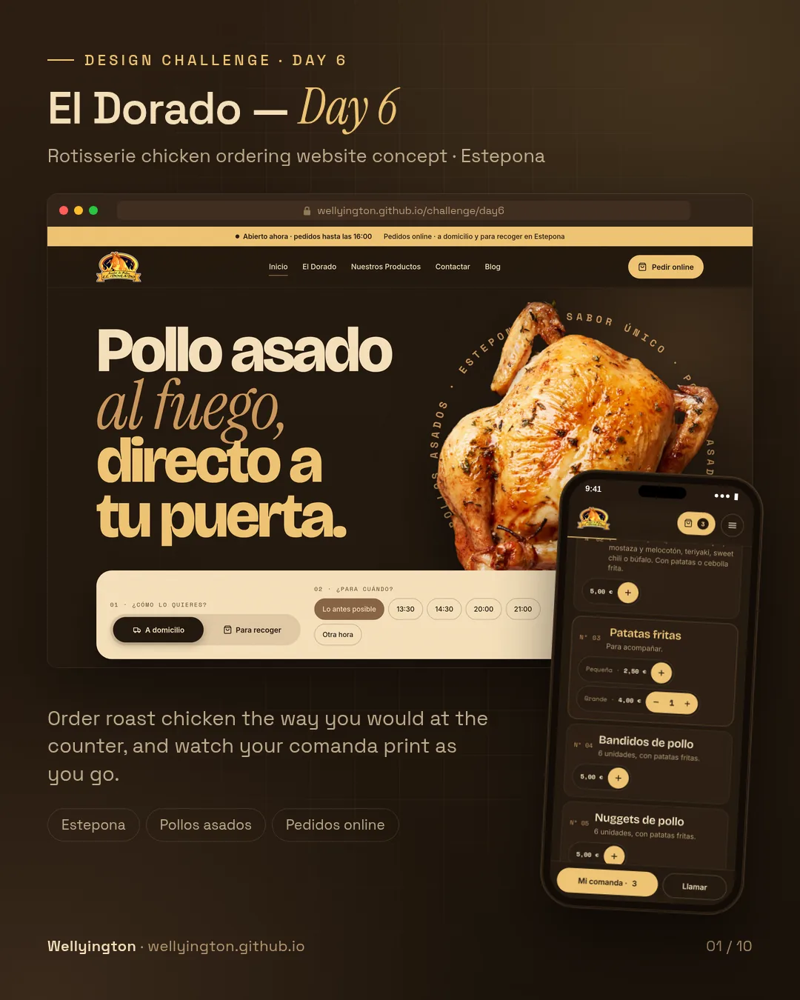
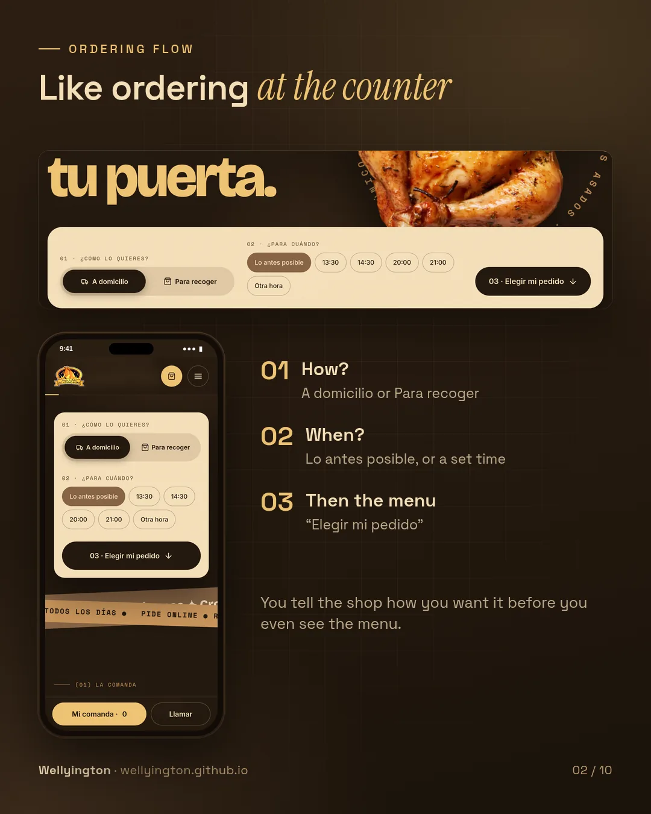
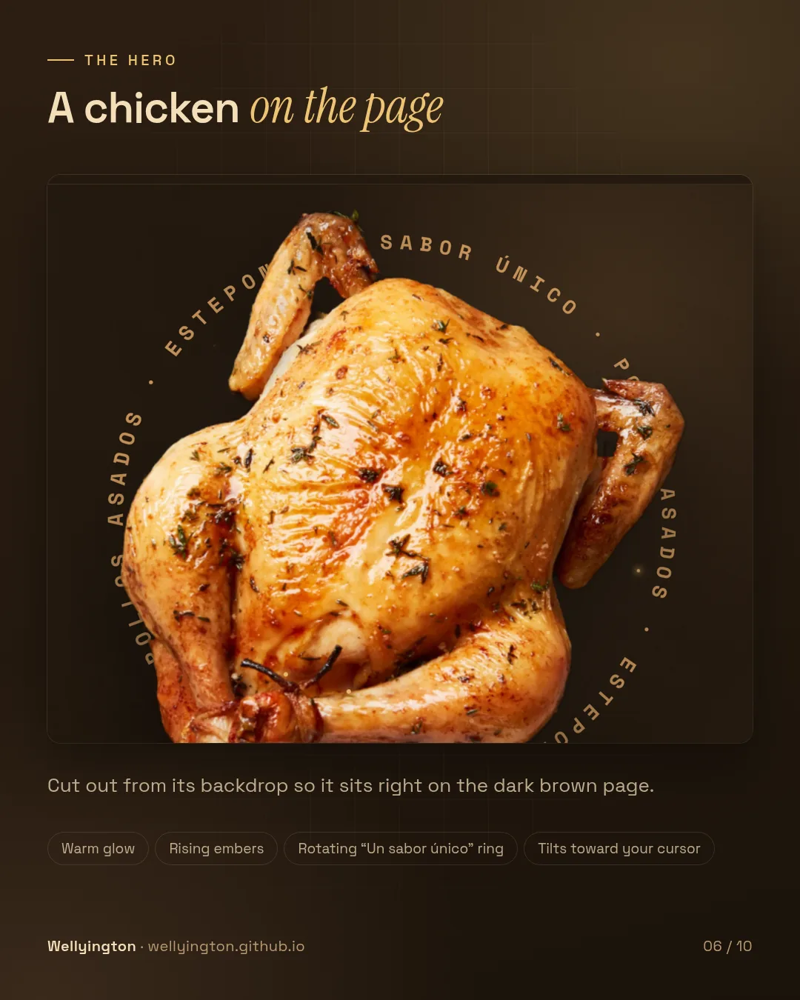
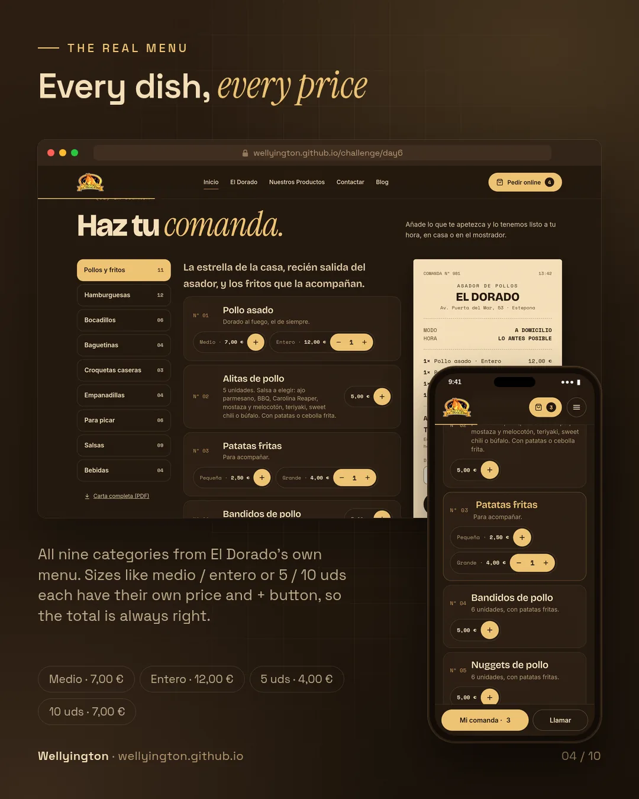
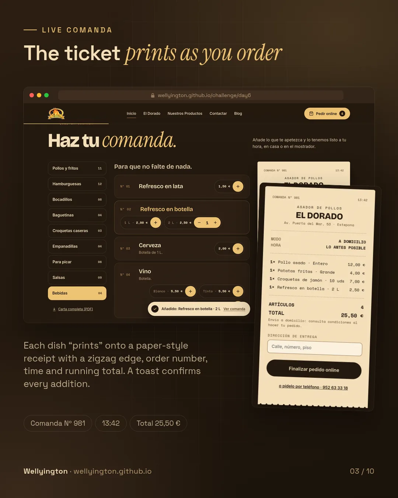
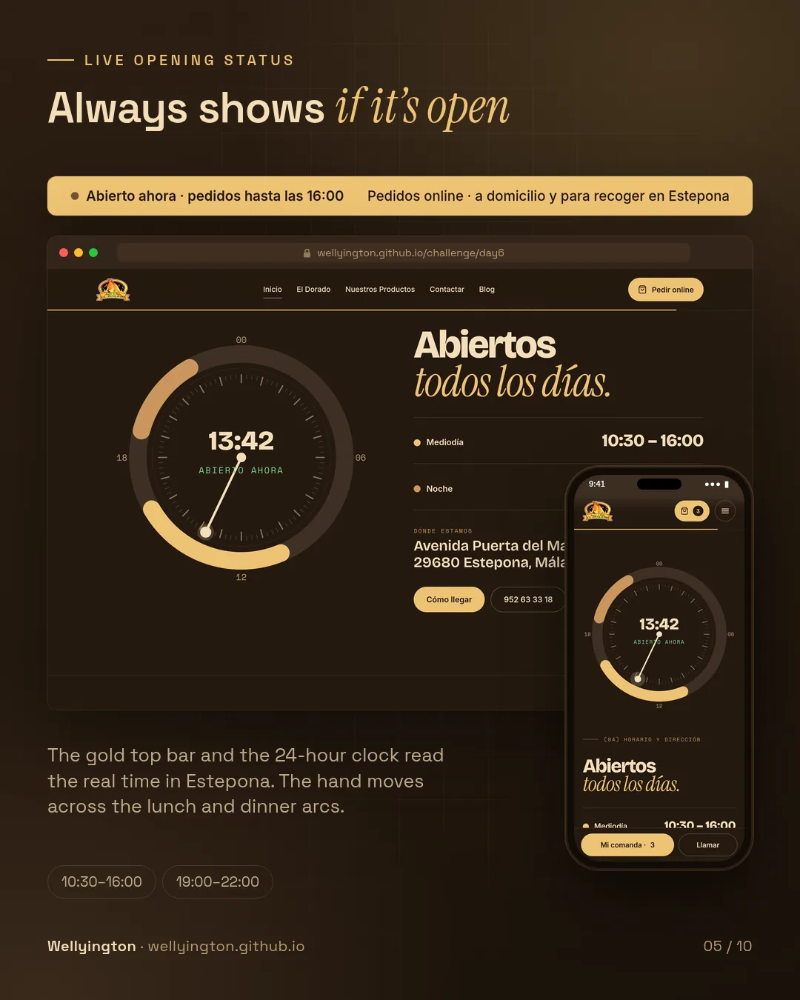
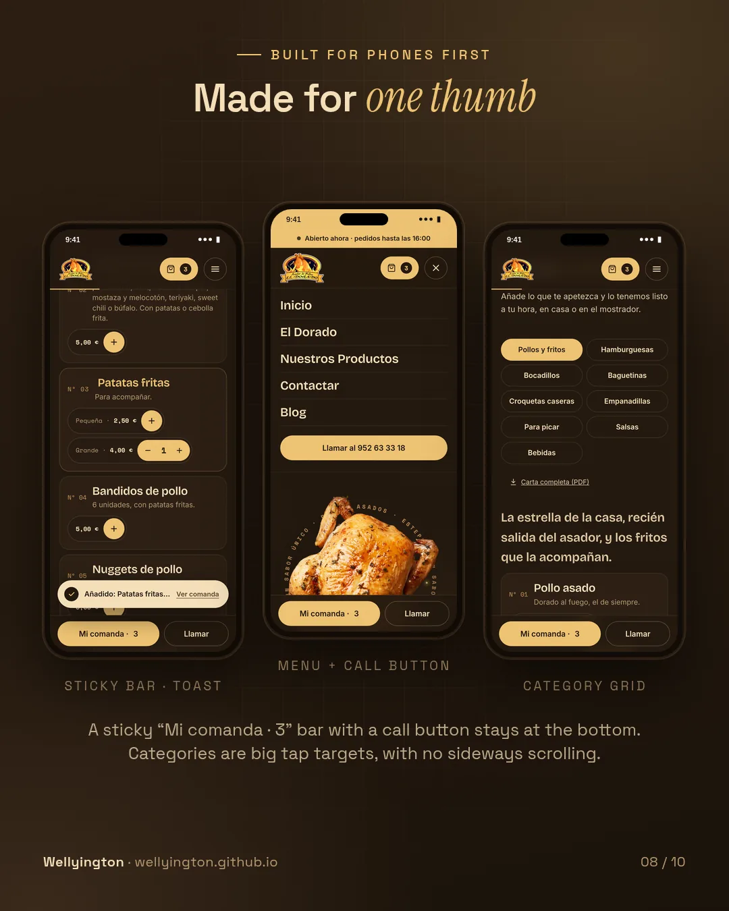
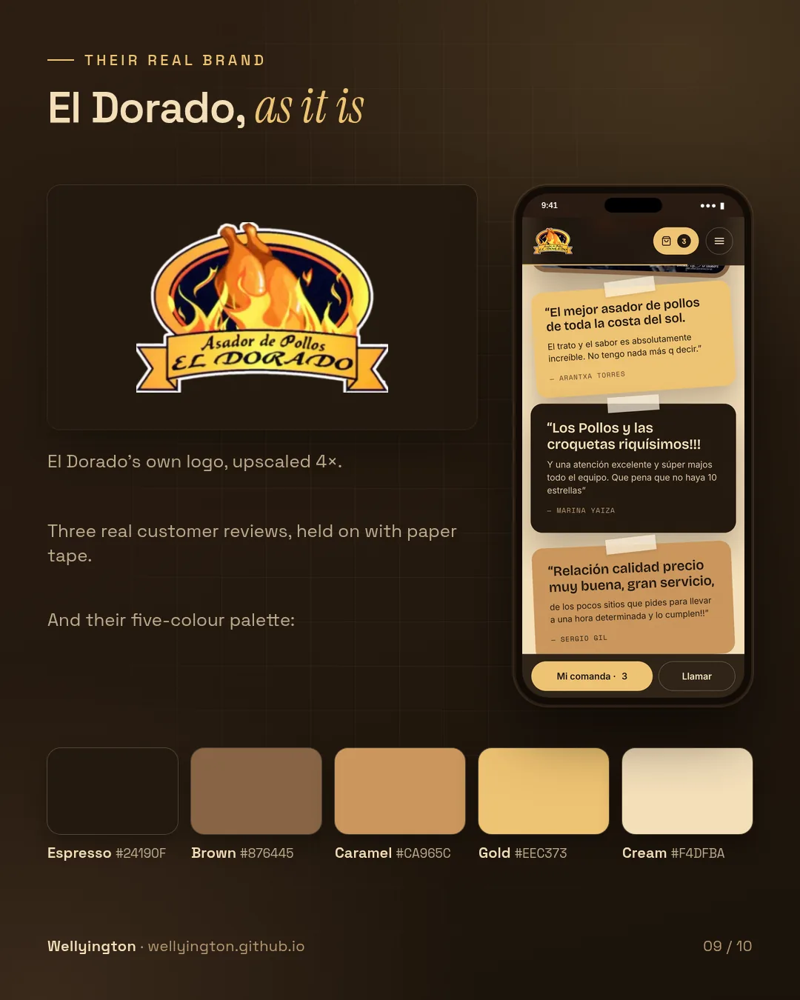
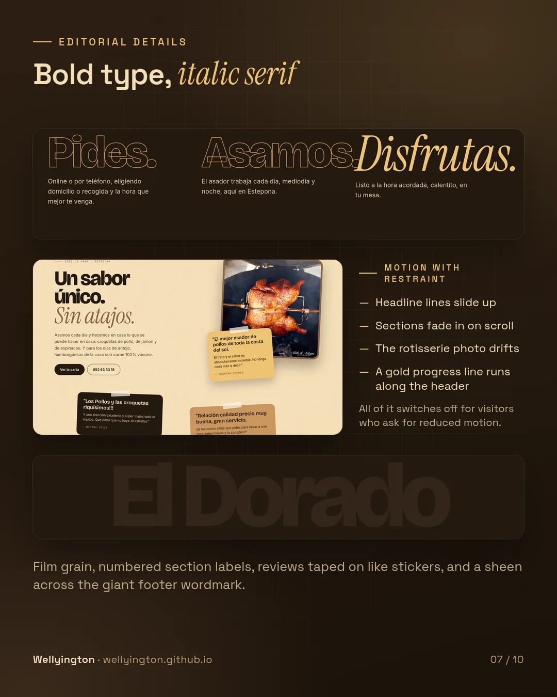

Em 22 de novembro publiquei a sexta nota desta série, o desafio que Ramiah Trask lançou: cem dias, cem negócios, cem sites. O dia um foi uma construtora familiar da Marina Alta. [Essa página está aqui.](https://wellyington.github.io/journal/pt/articles/o-site-antes-do-sim/) O dia dois, um teatro de Málaga. [Essa está aqui.](https://wellyington.github.io/journal/pt/articles/espaco-para-a-temporada-inteira/) O dia três, um restaurante familiar de Estepona. [Essa está aqui.](https://wellyington.github.io/journal/pt/articles/um-lugar-na-mesa-comprida/) O dia quatro, uma consultoria imobiliária privada de Málaga. [Essa está aqui.](https://wellyington.github.io/journal/pt/articles/criterio-antes-de-volume/) O dia cinco, um restaurante de menu degustação em Motril. [Essa está aqui.](https://wellyington.github.io/journal/pt/articles/tao-cuidadoso-quanto-a-cozinha/)

Hoje é o negócio mais cotidiano dos seis, e talvez aquele cujo site é usado com mais frequência. O El Dorado é uma casa de frango assado na avenida Puerta del Mar, em Estepona, a minha cidade. Frango assado, batata frita, croquetes caseiros, hambúrgueres, sanduíches, empanadas argentinas, molhos e bebidas. Dá para pedir com entrega ou para retirar, todos os dias, no almoço e à noite. Já tem site e loja online, em [pollosasadosadomicilioestepona.es](https://pollosasadosadomicilioestepona.es/).

O site de uma casa de frango assado tem duas tarefas. Precisa dar fome, e precisa tornar o pedido fácil. A maioria dos sites de comida para viagem cumpre uma das duas. O conceito está aqui: [El Dorado, dia seis](https://wellyington.github.io/challenge/day6/).

## o balcão, não o catálogo

Pense em como se pede no balcão de uma casa de frango. Você não começa olhando produtos. Quem atende faz primeiro duas perguntas: é para levar ou para entregar em casa? E para quando? Só depois você diz o que quer. Um frango inteiro, uma batata grande, uns croquetes, uma garrafa de refrigerante. A pessoa anota na comanda, repete o pedido e diz o total.

A maioria dos pedidos online faz o contrário. Mostra uma loja cheia de produtos, deixa você encher o carrinho, e só no fim, no pagamento, pergunta se é para entrega e a que horas. É aí que as pessoas descobrem que o horário que queriam já não existe, ou que a entrega não chega à rua delas, e desistem.

Então o conceito copia o balcão. A primeira coisa da página, abaixo do título, é um pequeno painel com duas perguntas. 01: como você quer?, a domicilio ou para recoger, entrega ou retirada. 02: para quando?, lo antes posible, o quanto antes, ou um horário numa fileira de botões, 13:30, 14:30, 20:00, 21:00, ou outro horário. Depois, um botão escuro: 03, elegir mi pedido, escolher meu pedido. Ele leva ao cardápio.

Você diz à casa como quer o pedido antes mesmo de ver o cardápio. É o que faria a pessoa do balcão, e significa que o resto da página já sabe o que você tem em mente.

*A abertura: o título, o frango e as duas perguntas que o balcão faria primeiro.*

*Como, quando, e depois o cardápio. Como no balcão.*

## um frango na página

O título é a frase mais simples que consegui escrever: pollo asado al fuego, directo a tu puerta. Frango assado na brasa, direto à sua porta. Vem muito grande, numa sem serifa pesada e um pouco estreita, em creme e dourado, com «al fuego» numa serifa itálica fina no meio. Lê-se como o letreiro de uma fachada.

Ao lado está o que as pessoas vêm buscar: um frango assado, dourado e brilhante, com ervas na pele. Recortei-o da fotografia para que fique direto sobre a página marrom-escura, sem caixa em volta. Um anel de texto gira devagar à sua volta, un sabor único, pollos asados, Estepona, que é a frase do próprio El Dorado. Atrás há um brilho quente, algumas brasas subindo, e no computador ele se inclina muito de leve em direção ao cursor.

Sei como isso soa no papel. Na tela é tranquilo. A ideia é que a primeira coisa que você vê seja a comida, num tamanho em que quase dá para sentir o cheiro.

*Recortado do fundo, para ficar sobre a página. Um brilho quente, algumas brasas e um anel de texto girando devagar.*

## o cardápio de verdade, com todos os preços

A segunda seção se chama haz tu comanda, faça a sua comanda. Comanda é o papel com que a cozinha trabalha, e toda a ideia deste conceito se apoia nela.

À esquerda estão as nove categorias do cardápio do El Dorado, cada uma com o número de pratos: frangos e fritos, hambúrgueres, sanduíches, baguetinhas, croquetes caseiros, empanadas, petiscos, molhos e bebidas. No meio, os pratos da categoria escolhida, numerados como num quadro de cardápio, cada um com uma descrição curta e o preço. À direita, a comanda.

Não simplifiquei o cardápio para facilitar o design. Uma casa de frango de verdade tem tamanhos, e os tamanhos são onde os pedidos online costumam dar errado. Meio frango custa 7 euros e um inteiro, 12. A batata, 2,50 a pequena e 4 a grande. Os croquetes vêm em cinco ou em dez. Uma garrafa de refrigerante, de um ou de dois litros. Por isso cada tamanho tem o seu preço e o seu próprio botão de somar. Você não escolhe um tamanho numa lista e depois aperta adicionar. Aperta o mais ao lado do tamanho que quer. O total sempre fecha, porque não há um passo no meio onde possa dar errado.

As asinhas listam os nove molhos, do alho com parmesão à Carolina Reaper. Os hambúrgueres dizem do que são feitos, 100% carne bovina. E abaixo das categorias há um link pequeno para o cardápio completo em PDF, o que o El Dorado já publica, para quem prefere ler tudo de uma vez.

*As nove categorias do cardápio do El Dorado. Cada tamanho tem o seu preço e o seu botão, então o total sempre fecha.*

## a comanda imprime enquanto você pede

Esta é a parte de que mais gostei. À medida que você adiciona coisas, elas aparecem numa comanda à direita da tela, desenhada como os papéis que saem da impressora de uma cozinha: papel creme, letra de máquina de escrever e uma borda rasgada em zigue-zague embaixo.

No alto diz comanda número 981, ou o número que você receber, com a hora. Depois asador de pollos El Dorado e o endereço. Depois as duas respostas que você deu no início: a domicilio, lo antes posible. Depois cada linha conforme você adiciona: 1 frango assado, inteiro, 12 euros. 1 batata, grande, 4 euros. 1 croquetes de presunto, 10, 7 euros. 1 garrafa de refrigerante, 2 litros, 2,50. A contagem de itens, e o total, 25,50 euros.

Cada vez que você adiciona algo, um pequeno aviso aparece embaixo para confirmar: añadido, garrafa de refrigerante, 2 litros, com um link para ver a comanda. Se mudar de ideia, o mais vira um menos e um número.

Abaixo do total há uma linha sobre as condições de entrega, um campo para o endereço e um botão: finalizar pedido online. Embaixo, em letra pequena, a alternativa: o pídelo por teléfono, ou peça por telefone, 952 63 33 18.

Para deixar claro o que o conceito faz nesse ponto: o botão leva à loja online que o El Dorado já tem, para concluir o pedido lá. Os itens da comanda não são passados de um lado para o outro no conceito. Numa versão real, a comanda é exatamente o que a cozinha receberia, seja na loja que eles já usam, seja direto numa impressora atrás do balcão. O design é a parte que importa para o cliente: você vê o seu pedido o tempo todo, na mesma forma em que a cozinha vai ver.

*Cada prato é impresso numa comanda de papel, com borda em zigue-zague, número do pedido, a hora e o total somando.*

## sempre mostra se está aberto

Nada é mais irritante do que pedir comida e descobrir que o lugar está fechado. O El Dorado abre todos os dias das 10:30 às 16:00 e das 19:00 às 22:00, e o conceito diz isso em todos os lugares onde importa.

Uma barra dourada atravessa o topo da página. Quando está aberto, ela diz abierto ahora, pedidos hasta las 16:00, aberto agora, pedidos até as 16:00, ou até as 22:00 à noite. Quando está fechado, diz quando abre de novo, às 10:30 ou às 19:00, e acrescenta programa tu pedido, agende o seu pedido. Ninguém fica sem resposta. A pessoa sabe quando voltar, e que pode pedir com antecedência.

Mais abaixo, a seção de horários tem um relógio de 24 horas. Os dois turnos aparecem como arcos na borda, o almoço em dourado e a noite em caramelo, e o ponteiro marca a hora real em Estepona. Às 13:42 ele está dentro do arco do almoço e no centro aparece abierto ahora. Ao lado: abertos todos os dias, os dois horários, o endereço na avenida Puerta del Mar, um botão de como chegar e o telefone.

O relógio lê a hora de Estepona, não a do seu celular, então acerta até para quem pede para os pais lá de Londres.

*A barra dourada e o relógio de 24 horas leem a hora real de Estepona. O ponteiro percorre os arcos do almoço e da noite.*

## feito para um polegar

A maioria dos pedidos a um lugar assim é feita pelo celular, com uma mão, muitas vezes enquanto se faz outra coisa. Por isso desenhei primeiro a versão para celular e depois a de tela grande.

Na parte de baixo da tela há uma barra que não sai do lugar: mi comanda, com o número de itens, e llamar, ligar. Toque na primeira e você vai para a sua comanda. Toque na segunda e o celular liga para a casa. Seja o que for que você esteja vendo, pedir ou ligar está a um toque.

No celular, as categorias não são uma fileira para deslizar de lado, que é fácil de não ver. São uma grade de botões grandes, dois por linha, então as nove aparecem ao mesmo tempo e cada uma é grande o bastante para um polegar. O aviso de confirmação aparece logo acima da barra de baixo, onde os seus olhos já estão.

O menu abre em tela cheia, com a barra dourada do horário no topo, as cinco seções do site, um botão grande para ligar para o 952 63 33 18 e o frango de novo embaixo.

*Uma barra fixa com a comanda e um botão de ligar. Categorias como botões grandes, sem deslizar de lado.*

## a marca deles, como é

Todos os conceitos desta série até agora tiveram uma identidade nova. Este não, e de propósito.

O El Dorado já tem uma marca que as pessoas de Estepona conhecem: um logotipo com um frango diante de chamas e uma faixa que diz asador de pollos El Dorado. Não é um logotipo minimalista, e não precisa ser. É o letreiro da loja. Então eu o mantive, limpo e ampliado para ficar nítido nas telas de hoje, e construí todo o resto em volta dele.

As cores também saem do logotipo. Espresso, #24190F, para o fundo. Marrom, #876445. Caramelo, #CA965C. Dourado, #EEC373, para os botões e a barra do topo. Creme, #F4DFBA, para a comanda e as seções claras. Sobre uma página escura, parecem o interior de um forno de frango, que é exatamente a ideia.

A tipografia, sim, é nova. Bricolage Grotesque, pesada e apertada, para os títulos grandes, para que se leiam como um letreiro. Instrument Serif em itálico para as palavras mais calorosas. Space Mono, uma letra de máquina de escrever, para a comanda e as etiquetas pequenas. Inter para tudo o que precisa ser lido rápido.

Há também uma seção sobre a casa: un sabor único, sin atajos, um sabor único, sem atalhos. Eles assam todos os dias e fazem em casa o que dá para fazer em casa: croquetes de frango, de presunto e de espinafre, e hambúrgueres 100% de carne bovina. Ao lado, três avaliações reais de clientes, presas com tiras de fita de papel como bilhetes na geladeira. Uma diz que o El Dorado é a melhor casa de frango assado de toda a Costa del Sol. Outra destaca que é um dos poucos lugares onde você pede para um horário marcado e eles cumprem.

*O logotipo do El Dorado, três avaliações reais de clientes e a paleta de cinco cores tirada da marca.*

## movimento com moderação

Poucas coisas se movem nesta página, e cada uma tem um motivo. As linhas do título sobem uma a uma quando a página carrega. As seções aparecem suavemente quando você chega a elas. A foto do forno na seção da casa se desloca um pouco. Uma linha dourada fina no alto do cabeçalho mostra quanto você já desceu.

Entre as seções há uma história curta em três palavras, do jeito que um comércio pintaria na parede. Pides. Asamos. Disfrutas. Você pede, online ou por telefone. A gente assa, todos os dias, no almoço e à noite, aqui em Estepona. Você aproveita, pronto no horário combinado, ainda quente. No fim da página, El Dorado aparece escrito bem grande no rodapé, com um brilho lento passando por ele.

Todo o movimento se desliga para quem pediu ao celular ou ao computador que reduza as animações. A página funciona exatamente igual sem ele.

*Tipografia pesada, serifa itálica, avaliações coladas como bilhetes e um movimento que se desliga quando pedido.*

## o que é o conceito, e o que vem depois

O logotipo, as cores, o cardápio, os preços, o horário, o endereço, o telefone e as avaliações de clientes que aparecem na página são do El Dorado. Não mudei nenhum deles. O que é novo é a ordem das coisas, a comanda, o relógio e o jeito como a página se comporta no celular.

Para transformar o conceito numa loja funcionando, seriam precisas duas coisas. Primeiro, que a comanda chegue à cozinha: na loja online que o El Dorado já tem, ou como um papel impresso atrás do balcão. Segundo, que os horários disponíveis venham da própria cozinha, para que um domingo cheio no almoço possa fechar um horário antes de lotar. Nenhuma das duas é complicada. As duas merecem ser bem feitas.

Não tenho números de pedidos nem de faturamento, e não vou inventar nenhum.

## se os seus clientes pedem pelo celular

Talvez você não venda frango assado. Mas muitos negócios pequenos desta costa recebem pedidos: uma confeitaria que faz bolos por encomenda, uma pizzaria, uma floricultura, uma lavanderia, um açougue que prepara kits de churrasco para o fim de semana. Os clientes costumam pedir pelo celular, com pressa, e o site costuma pedir que pensem como um atendente.

O que ajuda é o mesmo que aqui. Pergunte primeiro como e quando. Mostre cada opção com o seu próprio preço. Deixe as pessoas verem o pedido o tempo todo, na forma em que você vai recebê-lo. Diga com clareza se está aberto e, se não, quando abre. E deixe o telefone a um toque, porque sempre vai haver quem prefira ligar.

Sou web designer em Estepona, na Costa del Sol, e faço sites como este para negócios de toda a Espanha. Se isto parece com o seu negócio, escreva para mim pelo [site principal](https://wellyington.github.io/pt/). Conte o que você faz e onde, e eu respondo em linguagem simples. O conceito está [aqui](https://wellyington.github.io/challenge/day6/), e o site atual do El Dorado [aqui](https://pollosasadosadomicilioestepona.es/), para você comparar os dois. Seis feitos, faltam noventa e quatro.
