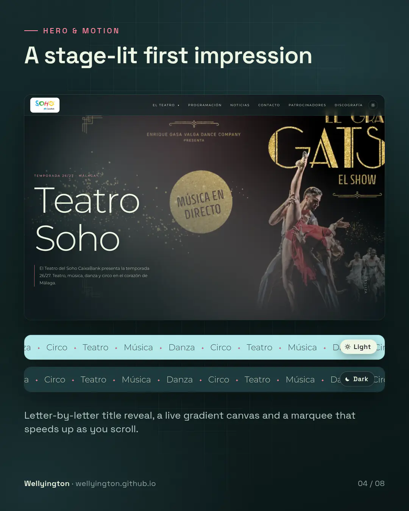
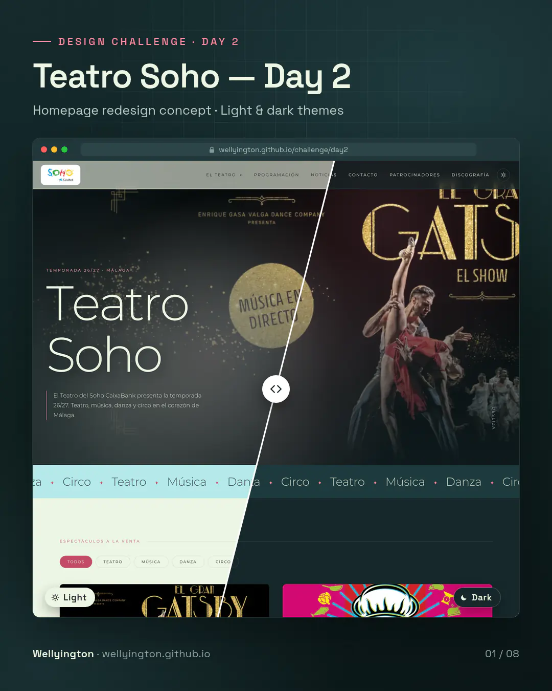
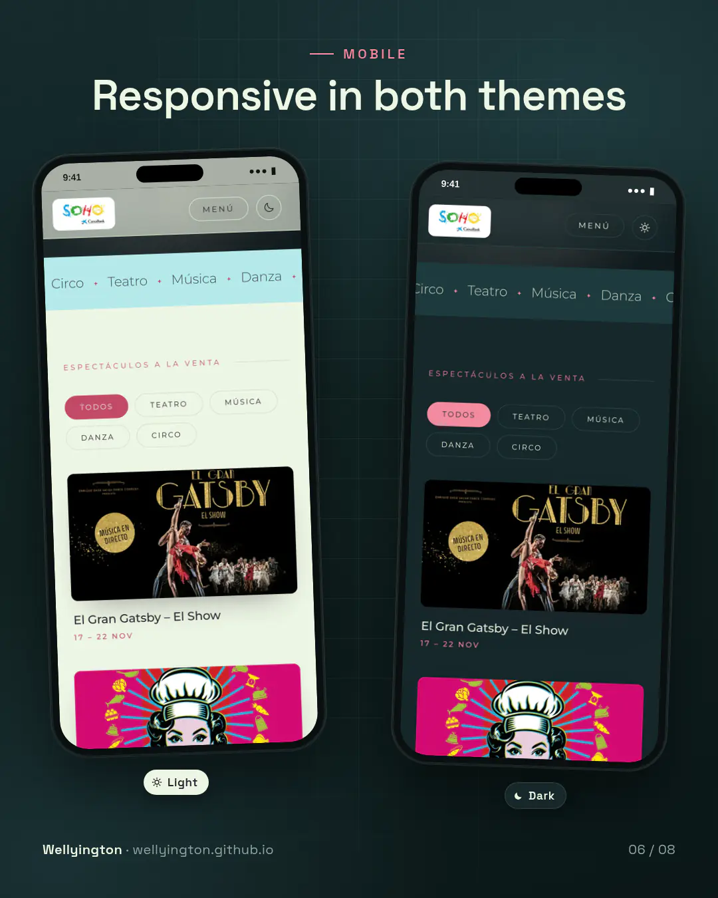
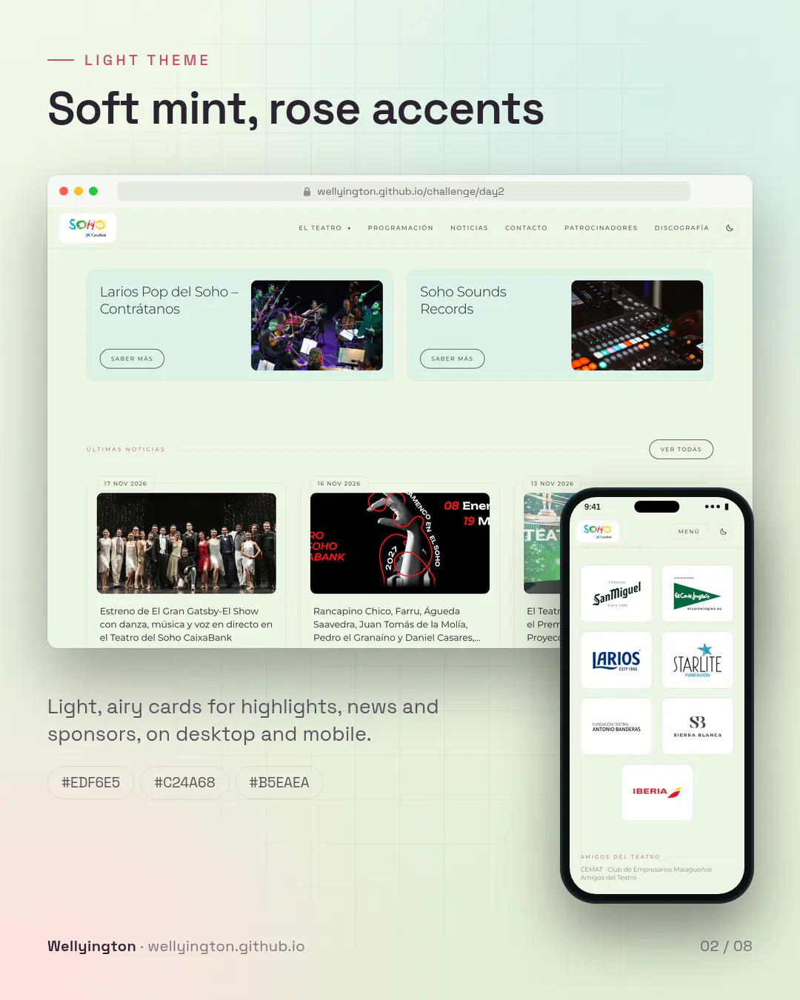
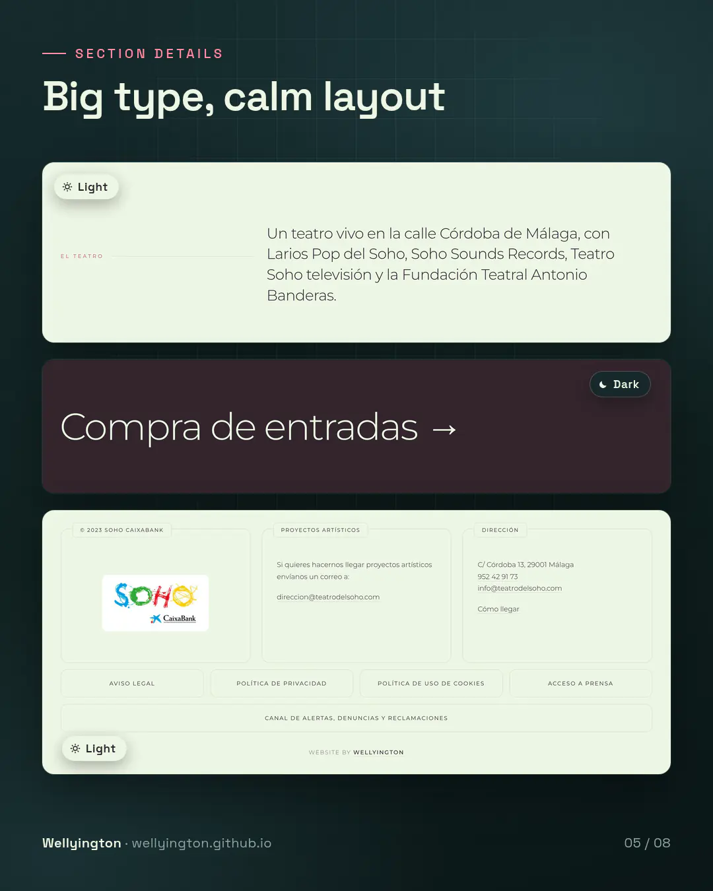
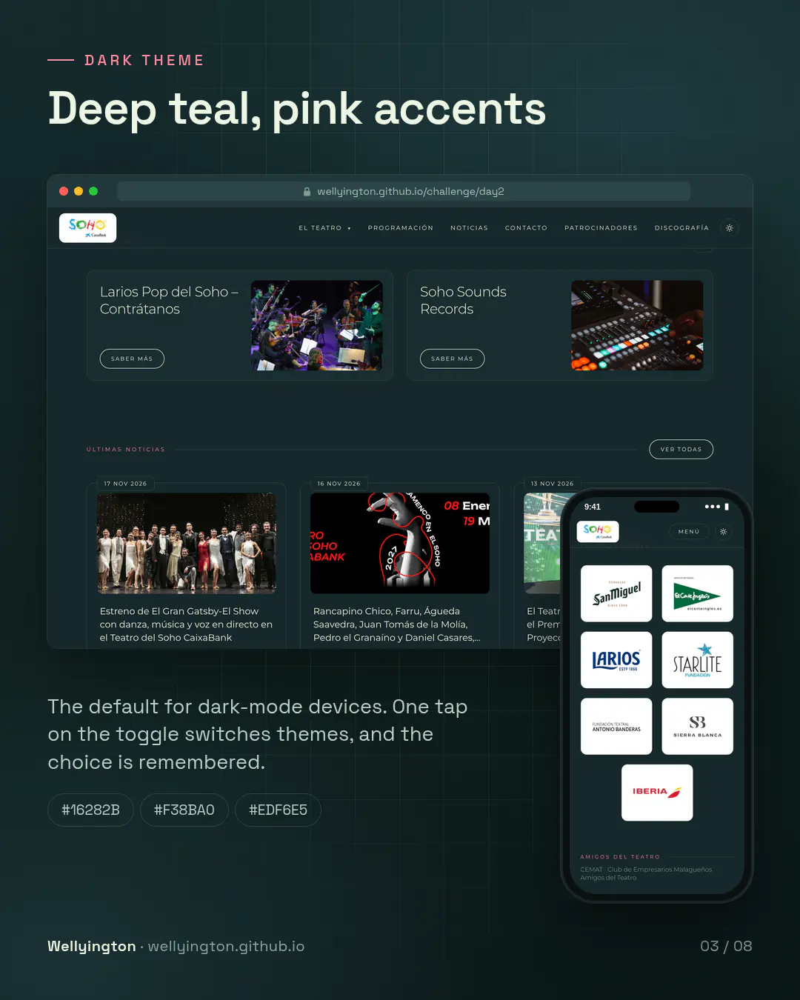

No dia 18 de novembro publiquei a segunda nota desta série: cem dias, cem negócios, cem sites, num endereço que qualquer pessoa pode abrir. O dia anterior foi uma construtora familiar da Marina Alta que precisava de uma primeira página clara, alguma coisa pronta para olhar antes de um contrato. [Essa página está aqui.](https://wellyington.github.io/journal/pt/articles/o-site-antes-do-sim/) Hoje o lugar é outro, e o trabalho muda junto.

O Teatro Soho CaixaBank fica na calle Córdoba, em Málaga. Eu trabalho em Estepona, na mesma costa, perto o bastante para não precisar apresentar Málaga como se tivesse vindo de viagem. O teatro já tem temporada, um prédio aonde as pessoas vão a pé, um nome que pesa e várias atividades debaixo do mesmo teto. Não está esperando a primeira frase na internet. O que eu fiz foi uma página inicial para a vida que ele já tem. O conceito abre aqui: [Teatro Soho, dia dois](https://wellyington.github.io/challenge/day2/).

Ninguém do teatro me pediu isso. Não foi um trabalho contratado, e não tem ligação com o teatro nem com o CaixaBank. O nome na página é deles. O conceito é meu e, por enquanto, mora no meu próprio endereço, que é o lugar honesto para um trabalho que ninguém adotou. Não me disseram que alguém de lá tenha olhado, e não vou escrever como se tivessem olhado.

## uma casa que já está cheia

Quem visitava a página do dia anterior queria saber se dava para confiar numa empresa com uma casa. Quem abre a página de um teatro costuma querer uma resposta menor, e quer logo: o que tem neste sábado, se tem dança, se ainda há lugar e quem está no palco. A temporada é o que está à venda, e ela se mexe enquanto a pessoa ainda decide.

O prédio guarda mais do que um calendário. Ao lado do teatro estão Larios Pop del Soho, Soho Sounds Records, Teatro Soho televisión e a Fundación Teatral Antonio Banderas, e ainda os patrocinadores, as notícias da semana, um telefone e uma rua que um táxi encontra. Se tudo isso se amontoa numa tela só, ninguém termina de ler. Se some, o cartaz não leva a lugar nenhum. O trabalho é uma ordem que uma pessoa consiga usar, e um primeiro minuto que pareça chegada. Depois disso, a página precisa dizer o que está em cartaz e como se compra o ingresso.

Não inventei os nomes, as datas nem os parceiros. São públicos, e são o que o conceito mostra. Não assisti a esses espetáculos da plateia, então isto é um relato da página, não da noite.

## o primeiro minuto

A abertura é esta temporada. Em cima, miúdo, se lê Temporada 26/27 · Málaga. Embaixo o nome vai grande, Teatro Soho, e as letras chegam uma a uma, do jeito que um título chega quando a sala já ficou quieta. Atrás está o cartaz de El Gran Gatsby – El Show: letras douradas, dois dançarinos, uma linha em que a Enrique Gasa Valga Dance Company apresenta a noite, e um selo redondo em ouro que diz música en directo. Ao lado de uma linha fina cor-de-rosa, um parágrafo curto diz que a casa apresenta a temporada 26/27: teatro, música, dança e circo, no coração de Málaga.

Debaixo disso corre uma faixa de palavras: Circo, Teatro, Música, Danza, e de novo as mesmas quatro. Se você desce a página, a faixa acelera um pouco. Se para, ela assenta. Eu quero dizer com isso a cortina subindo, uma mudança pequena na sala. Também há uma luz lenta atrás do cartaz, mais perto da luz de um palco do que de uma fileira de slides.

*A primeira tela. A temporada, o cartaz e o nome da casa.*

A mesma abertura existe em duas luzes, porque nem todo mundo lê no mesmo lugar. Uma é um verde-menta suave, com o rosa guardado para os acentos pequenos, confortável num café claro ou na calçada no sol. A outra é um verde-escuro fundo, mais perto de uma plateia apagada, com o rosa usado do jeito que se usa a luz da sala. Se o celular já está no escuro, a página abre no escuro. Um toque troca, e a escolha fica guardada. O cartaz e o nome não saem do lugar. De noite a página não ofusca, e na hora do almoço ela não entrega uma tela preta para você brigar com ela.

*Uma página inicial, duas luzes. A temporada fica, e muda a sala em volta.*

## achar o sábado

Sob a faixa, o título é simples de propósito: Espectáculos a la venta, espetáculos à venda. Embaixo ficam cinco pastilhas: Todos, Teatro, Música, Danza, Circo. Tudo, teatro, música, dança, circo. Se você quer dança no sábado, toca em Danza e o resto se afasta. A manobra inteira é essa, dois toques, em vez de uma busca numa lista desenhada para a bilheteria e não para quem está com o celular na mão.

Cada espetáculo é um cartaz, depois o nome, depois as datas. El Gran Gatsby – El Show vai de 17 a 22 de novembro, arquivado em dança e música, o que combina com o selo de ouro. La Cubana, La cuisine de ma cousine, vai de 25 de novembro a 15 de dezembro, em teatro, num cartão rosa forte com um chapéu de cozinheira que é daquela companhia e não do cartaz do Gatsby. Os dois podem ficar lado a lado. Uma casa que programa circo, flamenco, musicais e teatro de texto fica descuidada se todo cartão for espremido no mesmo quadro.

Em volta desses dois, a grade segura uma temporada. O Natal no Soho, com Antonio Banderas, está de 25 a 28 de dezembro. Duck Pond, da Circa, cai em 19 e 20 de dezembro. Janeiro traz Mujer en cinta de correr sobre fondo negro, Hija de la Luna, e Flamenco en el Soho 2027 de 8 de janeiro a 19 de março, com Rancapino Chico e, na noite seguinte, Farru com Duquende em Natural. Estou listando o que a página lista. Não há crítica aqui, nem número de vendas, porque não tenho nenhum dos dois.

*Espetáculos à venda, no celular. Escolha dança, e os outros cartões se afastam.*

Abrir um cartão traz o espetáculo para a frente, com dois caminhos: comprar ingresso ou ler mais. Mais abaixo, num tipo que não dá para ignorar, a linha diz Compra de entradas, compra de ingressos. No meio da página, quem visita não deveria ter de adivinhar se os ingressos se vendem ali. Comprar aponta para os canais que a casa já usa. Ler mais aponta para a página do próprio teatro sobre aquele espetáculo. Não estou abrindo uma segunda bilheteria.

No celular, a mesma visita acontece num momento curto. Alguém no jantar está olhando o sábado, ou alguém a poucas ruas da Córdoba manda um cartaz para a pessoa que precisa concordar. O menu se recolhe num controle só: programação, notícias, contato, patrocinadores, discografia. Os filtros continuam grandes o bastante para o polegar, e os cartazes se empilham em imagem, nome e datas. Não é preciso pinçar a tela, nem virar o celular para ler o nome da casa. O telefone também se move, de uma rua clara ao meio-dia a uma poltrona escura depois da cortina, e é por isso que as duas luzes cabem aqui.

## o resto da casa

A calle Córdoba guarda mais do que datas. Uma fileira chamada Destacados percorre três cartões. Larios Pop del Soho, com Contrátanos, contrate-nos, e uma fotografia de uma orquestra sob luz colorida. Soho Sounds Records, uma mesa de mixagem, o bastante para dizer que uma gravadora mora no prédio. A Fundación Teatral Antonio Banderas, num cartão próprio. Cada um diz saber más e liga para as páginas do teatro. Deixei os nomes separados, porque um único título vago teria feito a casa parecer menor do que é.

Depois vêm as notícias, sob Últimas noticias, com um caminho para o restante. Três notas, com data e com fotografia. Em 17 de novembro, a estreia de El Gran Gatsby – El Show, dança, música e voz ao vivo. Em 16 de novembro, flamenco: Rancapino Chico, Farru, Águeda Saavedra, Juan Tomás de la Molía, Pedro el Granaíno e Daniel Casares. Em 13 de novembro, o Premio Andalucía Excelente, pela projeção cultural do teatro. Estou repetindo a página, não uma noite em que eu estive. Notícia com data é o jeito de a página inicial mostrar que a semana está acontecendo, em vez de deixar o lugar parado num logo de uma temporada já encerrada.

*Destaques e as últimas notícias, no tema menta. O fundo fica quieto para as fotos serem lidas.*

Aí a página desacelera de propósito. El teatro é uma frase só, em tipo grande: um teatro vivo na calle Córdoba de Málaga, com Larios Pop del Soho, Soho Sounds Records, Teatro Soho televisión e a Fundación Teatral Antonio Banderas. As palavras vêm à frente conforme você chega nelas. É curta porque a temporada acima já apresentou a casa, e serve tanto para quem não conhece o lugar quanto para quem conhece.

O rodapé é onde a visita fica prática. C/ Córdoba 13, 29001 Málaga, o telefone 952 42 91 73, info@teatrodelsoho.com, e um link de como chegar. Projetos artísticos escrevem para direccion@teatrodelsoho.com. O aviso legal, a privacidade, os cookies, o acesso à imprensa e um canal de alertas, denúncias e reclamações ficam numa fileira que dá para percorrer com o olho. Uma linha pequena diz que o site é meu. Deixei à vista para a página não tomar emprestada a autoridade de uma casa que não pediu o trabalho.

*A casa numa frase, os ingressos em tipo grande e um endereço aonde um táxi pode ir.*

## um lugar digno para quem sustenta a casa

Um espaço assim vive com quem o sustenta. Os patrocinadores têm uma grade própria: logotipos em cartões brancos, com ar suficiente para distinguí-los, não uma faixa cinza debaixo do texto legal. Entre eles estão San Miguel, El Corte Inglés, Larios, Fundación Starlite, a fundação, Sierra Blanca e Iberia. Sob Amigos del teatro, a linha nomeia o CEMAT, o clube de empresários de Málaga amigos do teatro, e os cartões seguem com nomes da cidade: um hotel, El Pimpi, um grupo hospitalar, o parque tecnológico.

Não conheço os acordos por trás dessas marcas, e não vou inventá-los. Um lugar digno, nesta página, quer dizer grande o bastante para ser lido, ainda tocável quando os logotipos caem em duas colunas no celular, e sem tomar conta da temporada. Os espetáculos ficam acima. No tema escuro, esse mesmo trecho se apoia num verde profundo, com o rosa reservado aos rótulos pequenos. Um celular que já está no escuro abre assim. Um toque devolve o menta, e a escolha é lembrada.

*O tema escuro. Um toque troca, e a escolha fica guardada para a próxima visita.*

## uma oferta, não um anúncio

O teatro não me contratou, e o CaixaBank também não. Isto não é uma página oficial, e nada aqui significa que a casa tenha aprovado o trabalho. As pessoas já compram ingressos pelos caminhos que a casa usa. Trabalhei com nomes públicos, datas públicas e o modo como o teatro se descreve, uma casa viva na calle Córdoba com aquelas quatro atividades ao lado, para que alguém de Málaga pudesse reconhecer o lugar.

Não há citação, porque ninguém de lá me deu uma, e não me disseram que tenham visto. Não há número de lugares nem de bilheteria. Se abrirem o conceito e não quiserem nada de mim, esse é um fim completo. A página do dia anterior existia para um construtor poder dizer sim, ou não, ou mudar uma parte. Esta é a mesma espécie de oferta, feita a uma casa que já tem público.

## se o seu lugar já está cheio

Pode ser que você não dirija um teatro. De Estepona, a maior parte dos meses se parece mais com este dia do que com o primeiro. Aquela construtora precisava de uma página clara que ainda não existia: o nome, o trabalho, as cidades, um jeito de ser encontrado que combinasse com o modo como as pessoas já entram em contato. Muitos negócios já passaram disso. As pessoas já vêm. A temporada, o cardápio ou a lista de trabalhos é real, e o site cresceu por acréscimo: um bloco novo cada vez que alguma coisa começava, uma faixa para cada parceiro, e o motivo da visita embaixo de tudo.

Um redesenho pode guardar o que as pessoas já gostam: o nome na porta, o trabalho em si, e os parceiros num lugar decente, sem cobrir o que você vende. O endereço e o telefone ficam onde uma pessoa pode usá-los. O que muda é a ordem. O sábado cabe em dois toques, o ingresso fica onde a mão já está, e a luz segue o celular, fácil depois do espetáculo e fácil ao meio-dia. Uma página nova pode tornar mais simples percorrer um negócio que já está cheio, e deixar o caráter onde as pessoas já o encontraram.

Se esse é o seu caso, escreva para mim pelo [site principal](https://wellyington.github.io/pt/). Diga o que você faz e onde, e eu respondo em linguagem comum. A versão curta de hoje é a nota do dia 18: dia dois de cem, uma página inicial para este teatro, claro ou escuro, quem visita é que escolhe. [A nota está aqui.](https://x.com/wellyington/status/2123056661220733019) Amanhã é outro negócio, e outra página pronta.
