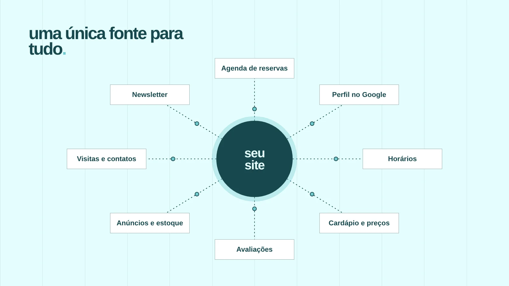
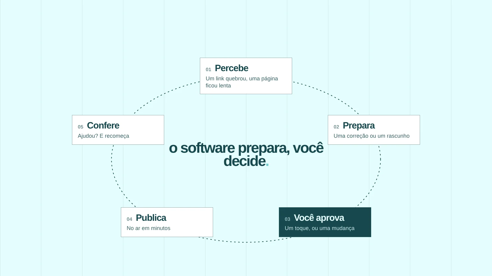
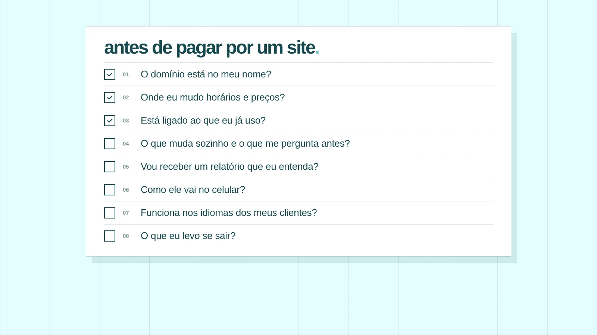

Uma pergunta que quase todo cliente me faz, normalmente no fim da primeira conversa: "Quando o site estiver pronto, acabou, né? Não preciso continuar pagando?"

É uma pergunta justa. Durante vinte anos a resposta foi, mais ou menos, sim. Você pagava alguém para fazer o site, recebia o trabalho e ele ficava lá, como um folheto impresso. Às vezes alguém atualizava. O mais comum era ser esquecido.

Nesta semana li um artigo no DataDrivenInvestor chamado [The Slow Death of the Static Website](https://medium.datadriveninvestor.com/the-slow-death-of-the-static-website-why-autonomous-apis-are-finally-fixing-the-small-business-web-4b79db5da819), a morte lenta do site estático. A ideia, em resumo, é que o site de um pequeno negócio está deixando de ser um folheto que precisa de cuidado manual o tempo todo para virar algo mais parecido com um sistema capaz de se manter em dia, porque agora ele está ligado às outras ferramentas que o negócio já usa. O texto foi escrito para quem faz sites e está cheio de palavras como API, gerenciador de conteúdo e agentes autônomos.

Esta nota é a versão que eu daria a um cliente sentado à mesa. Sem código, sem siglas sem explicação, e com uma linha honesta entre o que funciona hoje, o que ainda é sobretudo conversa de vendedor e o que vale a pena você continuar fazendo.

## o folheto na gaveta

Pense no último folheto impresso que o seu negócio fez. No dia em que chegou da gráfica, estava perfeito. Os preços estavam certos, as fotos eram novas, o horário estava correto.

Seis meses depois, um preço tinha subido. Um ano depois, a foto da equipe mostrava alguém que já tinha saído. Dois anos depois, a caixa de folhetos estava numa gaveta e ninguém distribuía mais, porque eles tinham três errinhos e todo mundo sabia.

A maioria dos sites de pequenos negócios tem a mesma vida. A diferença é que ninguém guarda um site na gaveta. Ele continua na internet, em público, respondendo perguntas por você às três da manhã, com as respostas erradas.

No meu ofício, um site feito assim é chamado de estático. A palavra é técnica, e vou voltar a ela, porque causa alguma confusão. Por enquanto, pense em estático no sentido do dia a dia: ele fica do jeito que estava no dia em que ficou pronto, até que uma pessoa sente e mude alguma coisa.

## como um site vai ficando desatualizado

Ninguém decide deixar o próprio site envelhecer. Acontece aos poucos, uma coisinha de cada vez, e quase sempre os clientes percebem antes do dono.

Nos primeiros meses, o horário muda no verão e ninguém atualiza o site. Alguém dá com a porta fechada. Depois, os preços do cardápio ou da página de serviços vão se afastando dos preços do caixa. Aí você troca de sistema de reservas e o botão antigo de "reservar" continua apontando para o anterior. Depois some uma foto, ou quebra o link para um parceiro porque ele mudou o próprio site.

Por baixo, acontecem outras coisas que não aparecem. As peças de software das quais o site depende precisam de atualização, e quando não recebem o site fica mais fácil de invadir. Os penduricalhos vão se acumulando: um balão de chat, um aviso de cookies, três ferramentas de rastreamento de três pessoas diferentes de marketing. Cada uma deixa a página um pouco mais lenta no celular, e páginas lentas perdem visitantes e perdem posição no Google. O artigo original chama isso de deterioração técnica silenciosa, e o nome combina. Em nenhum dia específico algo quebra. Só piora um pouco a cada mês.

A busca também entra nessa história. A ideia que o Google tem de uma boa página muda o tempo todo. Um site que ia bem no primeiro ano pode ir caindo sem que ninguém mexa nele, só porque outros sites continuaram melhorando e ele não. O cuidado com a busca era tratado como uma lista que se conferia antes do lançamento. Na prática, nunca termina.

O incômodo é que o dono quase nunca vê o site do jeito que um cliente vê. Você sabe qual é o horário certo, então o olho passa direto pelo errado na página. O cliente só tem a página. Para ele, o que está escrito ali é a verdade sobre o seu negócio, até ele parar diante de uma porta fechada ou discutir um preço no balcão. A essa altura o site já custou alguma coisa, e ninguém sabe dizer em que dia isso começou.

Nada disso é culpa de ninguém. Quem tem um pequeno negócio está ocupado tocando o negócio. O site é o único funcionário que nunca pede nada, então é o que acaba esquecido.

*Como um site fica desatualizado: nunca de uma vez, sempre aos poucos.*

## o que é uma API, sem termos técnicos

O artigo inteiro se apoia numa palavra que a maioria dos donos de negócio nunca precisa aprender, então aqui vai a versão curta.

Uma API é um jeito de dois programas conversarem sem que uma pessoa fique copiando coisas de um para o outro. A imagem mais fácil é a de um garçom. A cozinha não vem até a sua mesa e você não entra na cozinha. O garçom leva um pedido claro num sentido e traz uma resposta clara no outro.

Você já usa serviços que têm um desses garçons, mesmo que nunca tenha visto. A sua agenda de reservas tem um. O seu Perfil da Empresa no Google, aquele quadro que aparece no Google Maps com o horário e as avaliações, tem um. Lojas online, listas de estoque, sites de avaliação, ferramentas de newsletter e meios de pagamento têm. Até a previsão do tempo tem um.

Quando um site está ligado a esses serviços, ele deixa de ser uma cópia das suas informações e passa a ler direto da fonte. Você muda o horário num lugar e o site mostra o novo. A última mesa de sábado é ocupada no seu sistema de reservas e o site para de oferecê-la. O último apartamento de um prédio é vendido e sai da lista.

Essa é a primeira metade da mudança que o artigo descreve, e a mais útil. Ela não precisa de inteligência artificial nenhuma. É principalmente um encanamento bem feito.

*O site lê dos lugares onde as suas informações já estão, em vez de guardar uma cópia própria.*

## um único lugar para mudar as coisas

O objetivo que busco com os clientes cabe numa frase: cada informação deveria ser digitada em um único lugar.

No terceiro dia do meu desafio de cem dias, fiz um conceito de página inicial para o Los Arcos, um bar e restaurante familiar aqui em Estepona. Um restaurante assim tem três horários diferentes: o do restaurante, o do bar e o do café da manhã. Na página eles ficam em abas, e a linha grande à esquerda responde à única pergunta que quase todo mundo tem: se está aberto agora. Uma pequena marca verde na navegação diz café aberto quando o café está aberto.

Para ser honesto sobre onde esse conceito está: lá o horário está escrito uma vez na própria página, e a página calcula o resto pelo relógio. O próximo passo, se o Los Arcos quisesse, seria ler esse horário do mesmo lugar onde eles já o mantêm para o Google, de modo que uma mudança no Natal seja feita uma vez e apareça em todo lugar. É esse tipo de ligação que eu quero dizer. Não tem nada de glamoroso, e poupa pessoas de verdade de uma viagem perdida.

*Do conceito do Los Arcos: três horários e uma resposta direta para "está aberto agora?".*

Há um exemplo menor aqui mesmo. A página inicial de wellyington.github.io agora mostra as últimas entradas deste diário, em cada um dos seus quatro idiomas. Ninguém atualiza essa seção à mão. Quando publico um artigo, a página inicial se refaz sozinha um minuto depois e a entrada nova aparece no topo. É uma coisa pequena, mas é exatamente a ideia: escrever uma vez e deixar o resto acompanhar.

*A página inicial deste site lista sozinha as entradas mais novas do diário. Publique uma vez, e aparece lá também.*

## de conectado a "autônomo"

A segunda metade do artigo vai além, e é aí que entram as palavras grandes. A ideia é que um programa, normalmente baseado no mesmo tipo de inteligência artificial das ferramentas de chat que muita gente já usa, fique por cima de todas essas ligações e aja. Não só lê o seu horário: percebe problemas e corrige, escreve páginas novas e as publica.

O artigo lista a que um sistema assim estaria ligado: a parte do site onde o texto é editado, o Google Search Console, as estatísticas de visitas, o sistema de reservas ou de estoque e um arquivo com tudo o que o negócio sabe sobre si mesmo, o tom, os produtos, as regras.

O Google Search Console merece uma frase, porque aparece em toda conversa sobre isso. É um relatório gratuito do Google que mostra em quais buscas o seu site aparece, quais páginas o Google consegue ler e quais não, e o que está dando errado. Pense nele como o boletim que o seu site recebe do Google. A maioria dos pequenos negócios nunca abriu o seu, e muitos nunca nem configuraram.

Um sistema com acesso a esse relatório, às suas visitas e às suas reservas pode, em princípio, ver que uma página parou de aparecer nas buscas na semana passada, descobrir o motivo e sugerir uma correção antes que você tivesse percebido. Essa é a promessa. Uma parte já é real. Outra parte ainda é demonstração.

## o que ele já faz bem

Isto é o que eu confiaria hoje a um programa no site de um pequeno negócio, com pouquíssimo risco.

Conferir toda semana se todos os links do site ainda levam a algum lugar, e avisar você em palavras normais quando um quebra. Medir a velocidade das páginas principais no celular, e avisar quando um penduricalho novo as deixou lentas. Acompanhar o relatório do Search Console e mandar um resumo curto uma vez por mês, escrito para uma pessoa e não para um programador: que buscas trouxeram gente, que páginas estão caindo, o que vale a pena corrigir.

Manter as listas em dia com a fonte: eventos a partir de uma agenda, quartos ou mesas a partir de um sistema de reservas, imóveis a partir de um arquivo de anúncios, horários a partir do seu perfil no Google. Preparar um primeiro rascunho de uma notícia ou da página de um evento a partir das suas próprias anotações, para você ler e corrigir. Fazer a primeira versão de uma tradução, para que visitantes que falam inglês, espanhol ou russo não fiquem de fora, de novo para uma pessoa revisar. Sugerir títulos e descrições melhores para páginas que as pessoas encontram na busca mas quase não clicam.

Nenhuma dessas tarefas é genial. Todas são do tipo que cai da lista de uma pessoa ocupada e, quando cai, custa dinheiro sem fazer barulho.

## o que ele não deveria fazer sozinho

O mesmo programa que corrige um link quebrado pode publicar um preço errado para todos os seus visitantes, em segundos e com total confiança. Essa é a parte da história que os artigos empolgados costumam pular.

Existe um bom relato disso contado por quem constrói esses sistemas. Uma revista de design publicou há pouco um texto dos criadores de uma plataforma de sites autônomos. Eles quiseram que os sites funcionassem totalmente sozinhos, achando que era isso que os donos queriam. Quando donos de verdade usaram, eles hesitaram. No fim, quase ninguém quer um site que mude completamente por conta própria sem perguntar.

Isso bate com o que eu vejo. Um dono de negócio acha ótimo que um programa corrija um link durante a noite. Não acha nada bom acordar e encontrar um parágrafo novo sobre os seus preços, as suas garantias ou se abre num feriado, que ele nunca escreveu. E ele está certo. Algumas coisas num site são promessas, e promessas deveriam vir de uma pessoa.

Então a minha regra é simples. O programa pode perceber, medir e preparar. Uma pessoa aprova tudo o que muda o que o negócio diz: preços, ofertas, promessas, abertura em datas especiais, qualquer coisa sobre saúde, dinheiro ou lei, qualquer coisa sobre outra pessoa e qualquer coisa escrita com a voz do negócio. A aprovação pode ser um toque no celular. O importante é que ela exista.

*O programa percebe e prepara. Você aprova. Depois ele publica e confere se a mudança ajudou.*

## estático não é o inimigo

Agora a palavra que prometi retomar. No meu ofício, estático tem um sentido técnico além do sentido do dia a dia. Um site tecnicamente estático é aquele em que cada página é preparada antes e entregue ao visitante como um arquivo pronto, em vez de ser montada a partir de um banco de dados toda vez que alguém a abre.

Esse tipo de estático não está morrendo. É rápido, barato de hospedar, difícil de invadir e gentil com celulares de sinal fraco. Este diário é feito assim. Os conceitos dos cem dias também. Ser estático nesse sentido e estar desatualizado são duas coisas diferentes.

O site que está morrendo é o folheto abandonado: feito uma vez, nunca mais revisado, se afastando pouco a pouco da verdade. Dá para evitar isso com páginas simples e rápidas, ligadas aos lugares onde as suas informações estão, refeitas sempre que algo muda e conferidas com regularidade por alguém ou por alguma coisa. A tecnologia atrás da cortina importa muito menos do que o fato de alguém, ou alguma coisa, estar prestando atenção.

## o que isso significa para o dinheiro

Esta é a resposta honesta à pergunta do começo.

O modelo antigo era um valor alto para construir e depois nada. Ou uma mensalidade que pagava a hospedagem e muito pouco além disso. Nenhum dos dois pagava o que realmente mantém um site útil, que é alguém perceber quando ele saiu do rumo.

O que faz sentido agora costuma ser uma construção menor, porque páginas simples e rápidas não precisam custar uma fortuna, seguida de uma mensalidade modesta que paga um trabalho real que você consegue ver. As verificações rodam toda semana. As ligações com o seu sistema de reservas, o seu perfil no Google e as suas listas continuam funcionando. Você recebe um relatório curto em palavras normais. E existe uma pessoa para quem ligar quando você precisa de uma mudança que não deveria ficar nas mãos de uma máquina.

Quando alguém oferecer um plano mensal, pergunte o que acontece num mês normal. Se a resposta for "mantemos o site no ar", você está pagando por um folheto na gaveta. Se a resposta for uma lista de coisas que são conferidas, atualizadas e relatadas a você, está pagando por um site bem cuidado.

Mais uma coisa sobre dinheiro: garanta que o que você paga é seu. O endereço do site, os textos, as fotos e a lista de contatos dos seus clientes deveriam ser seus, e você deveria poder levá-los se sair. Um site que cuida de si mesmo só é uma boa notícia se continuar sendo seu.

## o que perguntar antes de pagar alguém

Se você está prestes a encomendar um site, ou não está satisfeito com o que tem, estas perguntas vão dizer quase tudo o que você precisa saber. Não é preciso entender as respostas técnicas. Só é preciso perceber se elas são claras.

Quem é o dono do endereço do site, e ele está no meu nome? Quando eu mudo o horário ou os preços, onde eu mudo, e em quantos lugares? O site está ligado ao sistema de reservas, à loja ou à agenda que eu já uso, ou guarda uma cópia própria? O que o site faz sozinho, e o que ele me pergunta antes de mudar? Vou receber um relatório que eu entenda, e com que frequência? Como ele funciona num celular com sinal fraco? Funciona direito nos idiomas que os meus clientes falam? E se eu parar de trabalhar com você, o que eu levo comigo?

Uma boa resposta à pergunta da aprovação vale mais do que todo o resto da lista.

*Oito perguntas. Você não precisa acompanhar as respostas técnicas, só perceber se elas são claras.*

## como eu trabalho com isso

Para os negócios com que trabalho neste litoral, a versão prática é esta.

As páginas são rápidas e simples, preparadas antes, para carregar logo num celular no ponto de ônibus. As informações que mudam, como horários, eventos, cardápios, imóveis e preços, vêm de um único lugar, de preferência um que o negócio já usa. Cada mudança nessas informações refaz o site em minutos. Pequenas verificações rodam toda semana e me avisam, e as importantes avisam também o dono. Tudo o que muda o que o negócio promete é mostrado a uma pessoa antes de ir ao ar.

Nada disso precisa da palavra autônomo. Parece mais uma loja bem administrada: as prateleiras são repostas a partir do estoque, alguém dá uma volta pela loja toda manhã e o dono dá o aval aos preços.

## então, o site estático está morrendo?

O site folheto, aquele de que ninguém cuida, está ficando para trás, e não vou sentir falta dele. Ele manda clientes para portas fechadas e informa os preços do ano passado, e faz isso enquanto parece perfeito para o dono, que quase nunca o visita.

O que vem no lugar não precisa ser um sistema misterioso que toca o seu negócio por você. Para a maioria dos pequenos negócios é algo mais modesto e mais útil: um site rápido que lê dos mesmos lugares onde você já guarda as suas informações, avisa quando algo está errado, prepara o trabalho chato e espera o seu sim antes de dizer qualquer coisa nova em seu nome.

O software ficou bom em esperar e em perceber. Dizer sim ainda é trabalho seu, e acho que deve continuar assim.

Sou web designer em Estepona, na Costa del Sol, e faço sites como este para negócios de toda a Espanha. Se quiser saber o que o seu site atual precisaria para parar de ficar desatualizado, escreva para mim pelo [site principal](https://wellyington.github.io/pt/). Diga o que você faz e onde, e eu respondo em linguagem comum. O artigo que deu origem a esta nota é [The Slow Death of the Static Website](https://medium.datadriveninvestor.com/the-slow-death-of-the-static-website-why-autonomous-apis-are-finally-fixing-the-small-business-web-4b79db5da819), no DataDrivenInvestor, se você quiser a versão técnica, em inglês.
