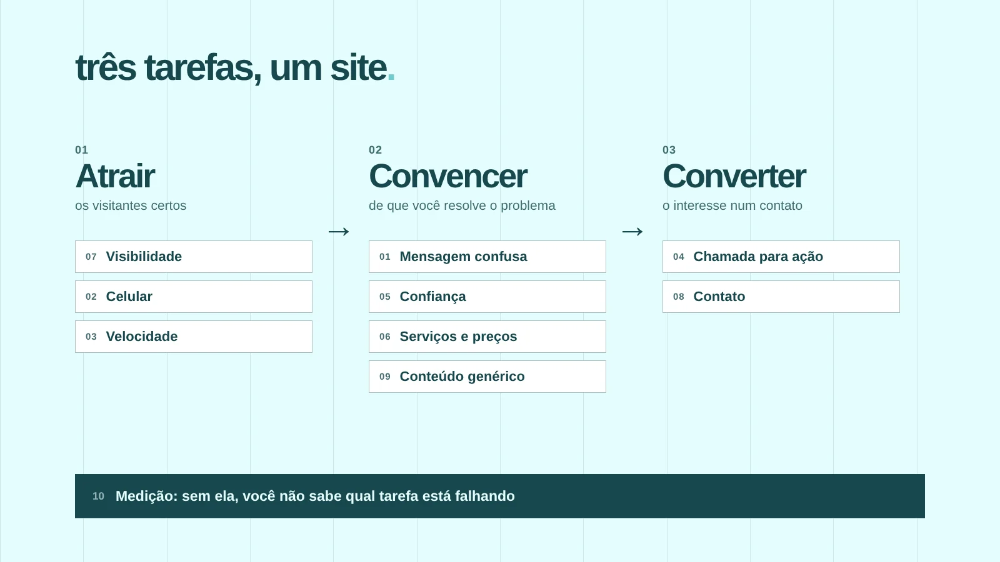
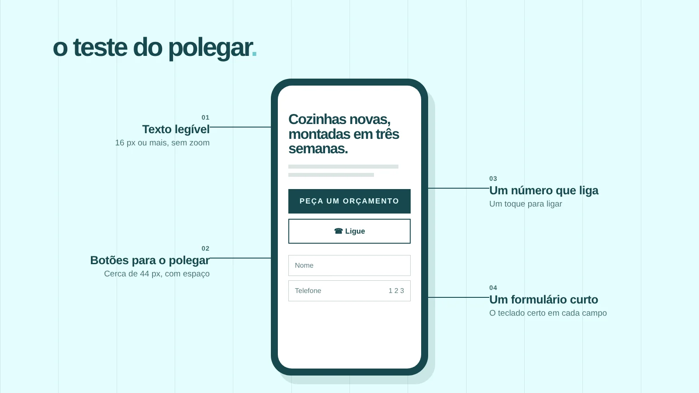
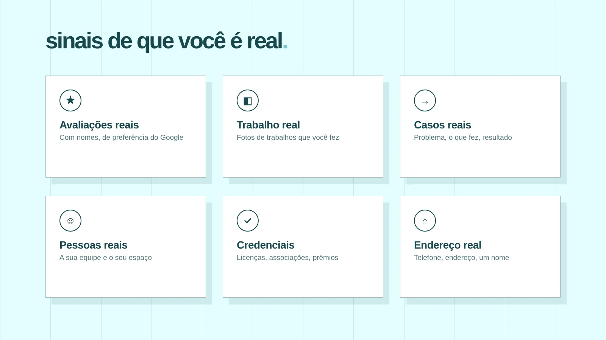
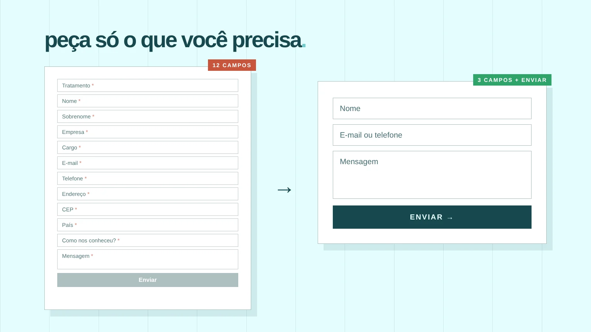
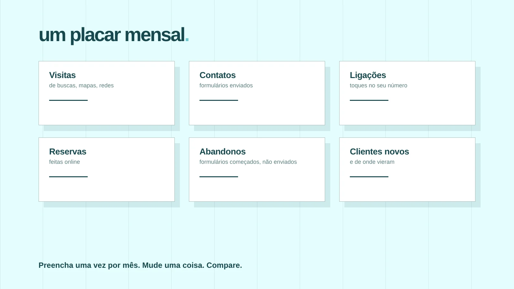

"O site ficou ótimo. Todo mundo diz isso. Só que ele não traz trabalho."

Ouço alguma versão dessa frase a cada poucas semanas, de restaurantes, construtoras, clínicas, agências e lojas da costa. O site custou um bom dinheiro, as fotos são lindas, os amigos elogiaram. E o telefone não toca por causa dele.

Quase nunca há algo quebrado que dê para apontar. O site carrega, as páginas estão lá, o formulário envia. O problema é que um site tem um trabalho a fazer, e muitos sites foram feitos para parecer prontos, não para fazer esse trabalho.

Esta nota passa pelos dez motivos que eu mais vejo. Nenhum exige um site novo para ser corrigido. A maioria pede uma tarde, a cabeça fresca e a disposição de olhar o próprio site como um estranho olharia.

*Os dez motivos, mais ou menos na ordem em que um visitante os encontra.*

## antes, para que serve um site

Antes da lista, vale ter claro o que é sucesso. O site de uma empresa tem três tarefas, uma depois da outra:

1. Atrair os visitantes certos.
2. Convencê-los de que a empresa pode resolver o problema deles.
3. Transformar o interesse num contato, numa reserva ou numa compra.

Uma falha em qualquer uma dessas etapas compromete todo o resto. Um site lindo que ninguém encontra falha na primeira tarefa. Um site com muitas visitas que vão embora sem entender o que você faz falha na segunda. Um site que convence e depois pede para preencher um formulário com catorze campos falha na terceira.

Os dez motivos se encaixam nessas três etapas, mais um que corre por baixo de todas: não medir nada.

*Cada motivo quebra uma das três tarefas. A medição corre por baixo de todas.*

## 1. não dá para entender o que você faz

Um visitante novo dá à sua página inicial alguns segundos. Nesse tempo, ele precisa de resposta para três perguntas: o que você faz, para quem é e por que ele deveria escolher você e não o próximo resultado.

A maioria das páginas iniciais responde a outra pergunta: quem somos nós. Bem-vindo ao nosso site. Somos uma empresa líder com mais de vinte anos de paixão e excelência. Essa frase poderia ser de um dentista, de um escritório de advocacia ou de uma empresa de andaimes. Fala da empresa, não do problema do cliente.

Compare dois títulos para o mesmo montador de cozinhas. "Bem-vindo à Smith Interiores, o seu parceiro de confiança desde 2004." Ou: "Cozinhas novas em Marbella e Estepona, montadas em três semanas. Orçamento grátis em 48 horas." O segundo diz o quê, onde, em quanto tempo e o que fazer em seguida, numa frase só.

**Como verificar:** mostre a sua página inicial por cinco segundos a alguém que não conhece o seu negócio e feche. Pergunte o que você faz, para quem e o que te diferencia. Se a pessoa não souber dizer, os seus clientes também não sabem.

**O que fazer:** reescreva a primeira linha da página para que ela diga o serviço, o cliente ou o lugar, e um motivo concreto para escolher você. Leve a história e a missão para mais abaixo, onde quem quiser vai encontrá-las.

*A mesma empresa, duas primeiras linhas. Só uma responde às perguntas do visitante.*

## 2. não funciona no celular

A maioria das pessoas que procura um negócio local vê o site primeiro no celular, muitas vezes com uma mão e na rua. Um site desenhado numa tela grande e espremido depois costuma mostrar isso: texto que é preciso ampliar para ler, botões tão juntos que você toca no errado, menus que cobrem a página, formulários em que o teclado esconde o campo onde você está digitando.

Nada disso aparece quando o dono confere o site no notebook. Aparece na paciência do cliente.

**Como verificar:** use o seu próprio site no seu próprio celular por cinco minutos, como um cliente faria. Procure o preço de alguma coisa. Ligue para você. Envie o formulário. Faça tudo com um polegar só.

**O que fazer:** texto grande o bastante para ler sem zoom, uns 16 pixels no mínimo. Botões e links do tamanho de um polegar, uns 44 pixels de altura, com espaço entre eles. O telefone como um link que liga. Formulários com o teclado certo em cada campo, números para o telefone, e-mail para o e-mail. E desenhe primeiro a versão para celular, depois a de tela grande, não o contrário.

*Quatro coisas para verificar no seu próprio celular, com um polegar só.*

## 3. demora demais para carregar

As pessoas são impacientes, e com razão. Se uma página continua em branco depois de alguns segundos, muitos visitantes voltam e tocam no próximo resultado antes de ver qualquer coisa que você oferece.

O Google mede isso com três números que chama de Core Web Vitals: Largest Contentful Paint (LCP), Interaction to Next Paint (INP) e Cumulative Layout Shift (CLS). Em palavras simples: quanto tempo até o conteúdo principal aparecer, quão rápido a página responde quando você toca em algo e quanto o layout pula enquanto carrega. As metas que o Google considera "boas" são um LCP de 2,5 segundos ou menos, um INP de 200 milissegundos ou menos e um CLS de 0,1 ou menos, medidos em visitas reais à página.

Os suspeitos de sempre são os mesmos em quase todo site lento que eu analiso. Fotos enviadas direto da câmera, com vários megabytes cada, quando algumas centenas de kilobytes ficariam iguais na tela. Scripts demais: chats, carrosséis, rastreadores e pop-ups, cada um carregando o próprio código. Hospedagem compartilhada barata e longe do cliente. E, em sites feitos com construtores de página, uma longa lista de plugins instalados uma vez para um recurso pequeno e nunca removidos.

**Como verificar:** passe a sua página inicial pelo PageSpeed Insights, a ferramenta gratuita do Google, e olhe o resultado para celular, não o de desktop.

**O que fazer:** redimensione e comprima todas as imagens e use um formato moderno como WebP. Remova todo plugin e script para o qual você não tenha um motivo claro. Depois, olhe a hospedagem.

*As três metas de velocidade do Google e as quatro coisas que costumam impedir que sejam atingidas.*

## 4. não há um próximo passo óbvio

Alguém leu a sua página e gostou do que viu. E agora? Deve ligar, reservar, pedir orçamento, mandar mensagem, passar na loja?

Muitos sites nunca dizem. Há uma página de contato em algum lugar do menu, e só. Outros dizem demais: reserve já, ligue, chame no WhatsApp, assine a newsletter, siga no Instagram, baixe o folheto, tudo ao mesmo tempo e tudo do mesmo tamanho. Quando tudo é botão, nada é.

**Como verificar:** em cada página importante, pergunte qual é a única coisa que você quer que o visitante faça depois de ler. Se você não consegue responder numa frase, a página também não consegue.

**O que fazer:** escolha uma ação principal por página e faça dela a coisa mais visível da tela, repetida no fim da página e, no celular, ao alcance do polegar. Use palavras que digam o que acontece: "Peça um orçamento grátis", "Reserve uma mesa para hoje", "Ligue para a clínica". Deixe uma alternativa mais discreta para quem preferir, como o telefone embaixo do botão de reserva. Todo o resto pode esperar no rodapé.

*Seis botões do mesmo peso, ou um próximo passo claro e uma alternativa discreta.*

## 5. ainda não passa confiança

Ninguém gosta de entrar em contato com uma empresa sobre a qual não sabe nada. Antes de ligar, as pessoas procuram sinais de que você é real, de que faz bem o que faz e de que gente como elas já contratou você e ficou satisfeita.

Um número surpreendente de sites de empresas não oferece nada disso. Nada de avaliações, nomes, exemplos de trabalho, fotos da equipe ou do espaço de verdade, só imagens de banco de pessoas apertando as mãos num escritório que poderia estar em qualquer lugar.

**Como verificar:** imagine que você nunca ouviu falar da sua empresa. O que na página faria você acreditar que ela é boa? Conte as coisas que são específicas suas, e não do seu setor.

**O que fazer:** mostre avaliações reais, com nomes, de preferência tiradas do Google para que possam ser conferidas. Mostre o seu trabalho: fotos de trabalhos reais e casos curtos com o problema, o que você fez e o resultado. Mostre o seu rosto e o seu espaço. Inclua as associações, licenças e certificações que importam para o seu cliente. E coloque um endereço, um telefone e o nome de uma pessoa real onde dê para ver.

*Seis sinais de que uma empresa é real e boa no que faz.*

## 6. não fica claro o que você oferece nem quanto custa

As pessoas não querem adivinhar. Se o seu site não deixa claro se você oferece exatamente o que elas precisam, ou se cabe mais ou menos no orçamento, muitas vão escolher a empresa ao lado que deixou isso claro.

Os culpados de sempre são nomes de serviço vagos ("soluções", "pacotes", "serviços personalizados"), descrições que listam características em vez de resultados e preços que só aparecem depois de uma ligação. Entendo por que muitas empresas não publicam preços. Cada trabalho é diferente. Mas nenhuma informação faz as pessoas pensarem o pior.

**Como verificar:** um visitante conseguiria saber, só pelo seu site, qual dos seus serviços serve para ele e quanto custaria mais ou menos?

**O que fazer:** dê a cada serviço um nome claro e uma página curta dizendo para quem é, o que está incluído e o que acontece depois. Mostre preços onde puder, ou pelo menos um preço a partir de ou uma faixa comum, por exemplo "a maioria das reformas de banheiro fica entre 6.000 e 9.000 €". Diga o que faz o preço variar. As pessoas não precisam de um orçamento do site. Precisam do suficiente para decidir que vale a pena ligar para você.

## 7. as pessoas não encontram você

Nem o melhor site do mundo traz clientes se quem procura por você nunca o vê. Para a maioria dos negócios locais, isso quer dizer dois lugares: os resultados do Google e o Google Maps.

Os problemas comuns são simples. O site nunca diz, com palavras, o que você faz e onde: "montador de cozinhas em Estepona" não aparece em lugar nenhum da página, então o Google não tem com o que relacioná-la. As páginas não estão indexadas por causa de uma configuração esquecida desde a construção. Todas as páginas têm o mesmo título. E o Perfil da Empresa no Google, muitas vezes a primeira coisa que um cliente local vê, tem o horário errado, nenhuma foto, nenhum serviço e nenhuma resposta às avaliações.

**Como verificar:** procure o seu serviço principal e a sua cidade no celular, sem estar logado, como um cliente faria. Onde você aparece, no mapa e nos resultados? Depois olhe o seu Perfil da Empresa como um estranho olharia.

**O que fazer:** diga em palavras simples, na página e no título da página, o que você faz e onde. Dê a cada serviço e a cada região que você atende uma página própria. Conecte o site ao Google Search Console para ver se ele está indexado e o que as pessoas pesquisam para encontrar você. Preencha todos os campos do seu Perfil da Empresa, mantenha o horário certo, inclua fotos reais e responda às avaliações.

## 8. entrar em contato dá trabalho demais

Cada passo a mais entre "tenho interesse" e "já enviei" é mais uma chance de desistir. Ainda vejo formulários de contato com doze campos, metade obrigatórios: tratamento, nome, sobrenome, empresa, cargo, endereço, CEP, país, como nos conheceu. Sistemas de reserva que pedem para criar uma conta antes de mostrar um horário livre. Formulários que não enviam nada porque uma configuração quebrou meses atrás e ninguém percebeu.

**Como verificar:** envie hoje o seu próprio formulário pelo celular e cronometre. Depois confira se a mensagem chegou, e onde.

**O que fazer:** peça só o que você precisa para responder: um nome, uma forma de contato e a mensagem. O resto pode vir na conversa. Nunca peça cadastro antes do contato. Ofereça uma alternativa rápida, telefone ou WhatsApp, para quem preferir. Mostre uma confirmação clara depois do envio e diga quando a pessoa vai ter resposta. E teste o formulário todo mês.

*Doze campos, ou os quatro de que você realmente precisa para responder.*

## 9. parece igual a todo mundo

"Temos orgulho de oferecer um serviço de qualidade." "A sua satisfação é a nossa prioridade." "Profissionais apaixonados e comprometidos com a excelência." Essas frases estão em milhares de sites, e é exatamente por isso que não dizem nada. Um cliente que compara três empresas não consegue diferenciá-las, então escolhe pelo preço, ou não escolhe.

O mesmo vale para as imagens. Uma foto de banco de uma atendente sorridente de headset diz ao visitante que você não tinha uma foto sua.

**Como verificar:** cubra o seu logotipo e leia a sua página inicial. Ela poderia ser de um concorrente? Se você trocasse os nomes, alguém perceberia?

**O que fazer:** anote as perguntas que os seus clientes realmente fazem, por telefone e pessoalmente, e responda no site com as suas próprias palavras. Quanto tempo leva? E se chover? Vocês trabalham no fim de semana? Posso ver um que vocês fizeram? Use detalhes que só você pode dizer: as ruas onde você trabalha, os materiais que usa, quantos trabalhos fez no ano passado. Troque as fotos de banco por fotos reais, mesmo que sejam do celular.

## 10. ninguém mede nada

O último motivo fica por baixo de todos os outros. Muitas empresas lançam um site e simplesmente supõem que ele está funcionando. Ninguém conta os contatos que ele gera, as ligações que produz ou as reservas que traz. Ninguém sabe quantas pessoas começam o formulário e desistem no meio, nem de que página elas saem.

Sem dados, todos os problemas acima ficam invisíveis. Você não sabe se o site tem poucas visitas ou poucos contatos, então não sabe se deve gastar com publicidade ou com a correção da página.

**Como verificar:** você consegue dizer quantos contatos o seu site trouxe no mês passado e quantos viraram clientes? Se não, é a primeira coisa a corrigir.

**O que fazer:** instale uma análise simples, com o consentimento dos visitantes onde a lei exige, e conte o que importa para o negócio, não só as visitas: formulários enviados, toques no telefone, reservas feitas, cliques no WhatsApp. Pergunte a cada cliente novo como encontrou você e anote. Olhe os números uma vez por mês, mude uma coisa e olhe de novo.

*Um placar mensal: seis números que mostram onde está o problema.*

## o quadro geral: visitas não são clientes

Quando você mede, os números começam a apontar o problema. Um guia aproximado que uso com os meus clientes:

| O que você vê | Onde provavelmente está o problema |
|---|---|
| Pouquíssimas visitas | Marketing e SEO |
| Muitas visitas, poucos contatos | A mensagem, a confiança ou a oferta |
| Muitos contatos, poucos clientes | O processo de venda, os preços ou a qualidade dos contatos |
| Muitos formulários começados e abandonados | A experiência do usuário ou algo técnico |

É por isso que "precisamos de mais tráfego" costuma ser a resposta errada. Se cem pessoas visitam o site por semana e ninguém entra em contato, mandar duzentas vai sobretudo dobrar o número de pessoas que vão embora. Conserte o vazamento antes de abrir mais a torneira.

*O que os números dizem e onde olhar primeiro.*

## por onde começar

Se os dez parecem familiares, não tente corrigir tudo de uma vez. Na minha experiência, a ordem que dá resultado mais rápido é:

1. Garanta que o formulário e o link do telefone funcionam, hoje.
2. Reescreva a primeira linha da página inicial.
3. Escolha uma ação principal por página e deixe-a óbvia.
4. Confira o site no seu celular, com um polegar, e corrija o que incomodar.
5. Instale a medição, para que a próxima decisão seja baseada em números.

Todo o resto, a velocidade, as avaliações, as páginas de serviços, a visibilidade nas buscas, fica mais fácil depois dessas cinco.

## a minha principal recomendação

Pare de julgar o seu site só por quão profissional ele parece. Julgue-o por quão bem ele traz oportunidades reais para o negócio.

Um site bonito é um ativo. Um site que traz contatos qualificados mês após mês é uma ferramenta de negócio. Os dois podem ser o mesmo site, mas só se ele foi feito pensando na segunda tarefa.

Sou web designer em Estepona, na Costa del Sol, e é isso que eu faço na maior parte do tempo: olhar sites que deveriam funcionar e descobrir por que não funcionam. Se o seu site está bonito e o telefone mesmo assim não toca, escreva para mim pelo [site principal](https://wellyington.github.io/pt/). Conte o que você faz e onde, e eu digo em linguagem simples qual desses dez eu acho que está custando mais para você. Você também pode ver como eu faço isso na prática na [série 100 dias](https://wellyington.github.io/journal/pt/archive/), em que redesenho todos os dias o site de um negócio real.
