No dia 26 de novembro publiquei a décima nota desta série, o desafio que Ramiah Trask lançou: cem dias, cem negócios, cem sites. Dez é um pequeno marco, então primeiro um olhar para trás. O dia um foi uma construtora familiar da Marina Alta. [Essa página está aqui.](https://wellyington.github.io/journal/pt/articles/o-site-antes-do-sim/) O dia dois, um teatro em Málaga. [Essa está aqui.](https://wellyington.github.io/journal/pt/articles/espaco-para-a-temporada-inteira/) O dia três, um restaurante familiar em Estepona. [Essa está aqui.](https://wellyington.github.io/journal/pt/articles/um-lugar-na-mesa-comprida/) O dia quatro, uma consultoria imobiliária privada em Málaga. [Essa está aqui.](https://wellyington.github.io/journal/pt/articles/criterio-antes-de-volume/) O dia cinco, um restaurante de menus degustação em Motril. [Essa está aqui.](https://wellyington.github.io/journal/pt/articles/tao-cuidadoso-quanto-a-cozinha/) O dia seis, uma casa de frango assado em Estepona. [Essa está aqui.](https://wellyington.github.io/journal/pt/articles/do-balcao-a-comanda/) O dia sete, um hotel familiar em Kavos, Corfu. [Essa está aqui.](https://wellyington.github.io/journal/pt/articles/a-mesma-piscina-a-noite/) O dia oito, três casas no centro histórico de Málaga. [Essa está aqui.](https://wellyington.github.io/journal/pt/articles/tres-casas-uma-so-porta/) O dia nove, uma agência de modelos de Marbella e Londres. [Essa está aqui.](https://wellyington.github.io/journal/pt/articles/deixe-as-fotos-falarem/)

Hoje é um estúdio de Pilates. O Nordic Balance Studios fica em Nueva Andalucía, Marbella, no centro comercial Centro Plaza, na avenida de Manolete. Oferece aulas de Pilates Reformer em grupos pequenos e em três níveis, sessões privadas e semiprivadas, e algumas aulas especializadas, de Stretch & Mobility a Prenatal & Postnatal. Foi fundado com base em medicina esportiva, reabilitação e Pilates, e recebe homens e mulheres. O site atual está em [nordicbalancestudios.com](https://www.nordicbalancestudios.com/).

O conceito está aqui: [Nordic Balance Studios, dia dez](https://wellyington.github.io/challenge/day10/).

## o espaço é o argumento

As pessoas escolhem um estúdio de Pilates por três motivos, mais ou menos nesta ordem: se parece um lugar onde querem estar, se o ensino é bom e se as aulas cabem na semana delas.

O primeiro é o mais difícil de levar para um site, e o mais esquecido. Muitos sites de estúdios são claros, cheios e lotados de ofertas: primeira aula pela metade do preço, pacote de cinco aulas, desafio de ano novo. Parecem academias. O Nordic Balance não é. O estúdio em si é calmo: piso escuro, madeira e pedra quentes, grandes janelas para as colinas verdes, fileiras de Reformers sob uma luz suave. Um site que grita estaria descrevendo outro lugar.

Por isso a direção foi minimalista e de inspiração nórdica, combinando com o nome. Tons escuros, neutros quentes, tipografia editorial e muito espaço para a fotografia. E então, dentro dessa calma, as outras duas coisas de que as pessoas precisam: o que são as aulas e como reservá-las, sem procurar nenhuma das duas.

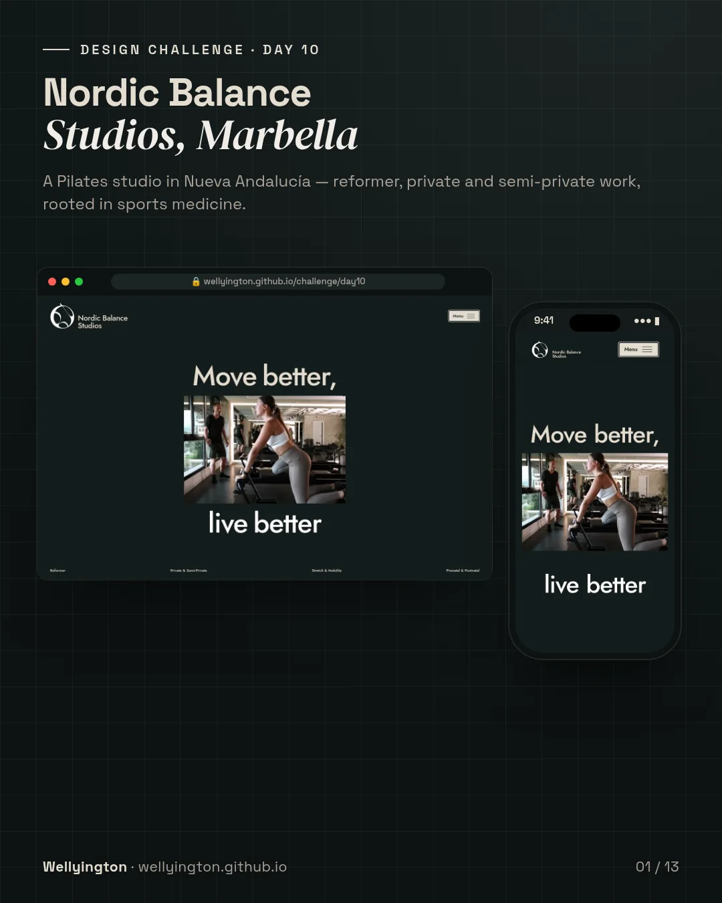
*Dia dez: um estúdio de Pilates em Nueva Andalucía, com Reformer, sessões privadas e semiprivadas baseadas na medicina esportiva.*

## mova-se melhor, viva melhor

A página inicial abre quase preta. No centro, em letras grandes e leves, a frase do estúdio: move better, live better, mova-se melhor, viva melhor. Entre as duas metades da frase há um vídeo curto do interior do estúdio, em loop: uma cliente num Reformer, um instrutor passando, a sala atrás. Tem o tamanho de uma foto numa revista e se aproxima suavemente quando você começa a rolar.

No pé da primeira tela aparecem as quatro coisas que o estúdio faz, em palavras simples: Reformer, Private & Semi-Private, Stretch & Mobility, Prenatal & Postnatal. Não há outro slogan além do de cima, nem ofertas, nem pop-ups.

Escolhi um vídeo em vez de uma foto porque Pilates é movimento, e uma imagem parada de alguém num Reformer pode parecer qualquer coisa. Alguns segundos de movimento lento e controlado dizem como são as aulas melhor do que qualquer parágrafo.

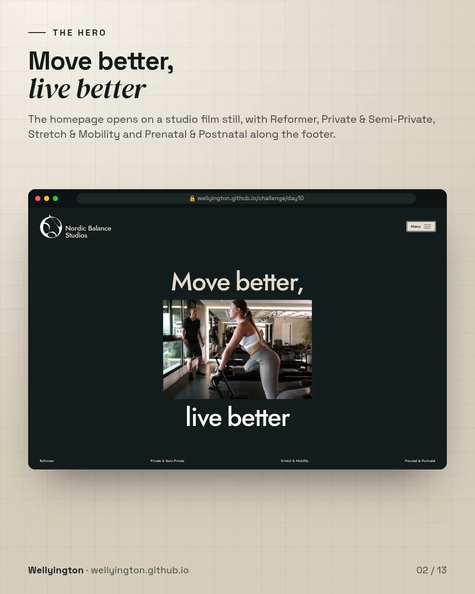
*A página inicial abre com um quadro de um vídeo do estúdio e os quatro tipos de aula no pé.*

## um botão, um menu

O cabeçalho tem duas coisas: o logotipo redondo e o nome do estúdio à esquerda, e um pequeno botão Menu à direita. Ao tocar nele, as três linhas viram uma cruz e surge uma lista em tela cheia: Home, Classes, About, Schedule, Contact. Embaixo, uma linha sobre o estúdio e o endereço de e-mail.

É igual no computador e no celular. Cinco palavras, grandes o bastante para tocar sem mirar, e nada mais competindo com elas. Para um site deste tamanho, é suficiente.

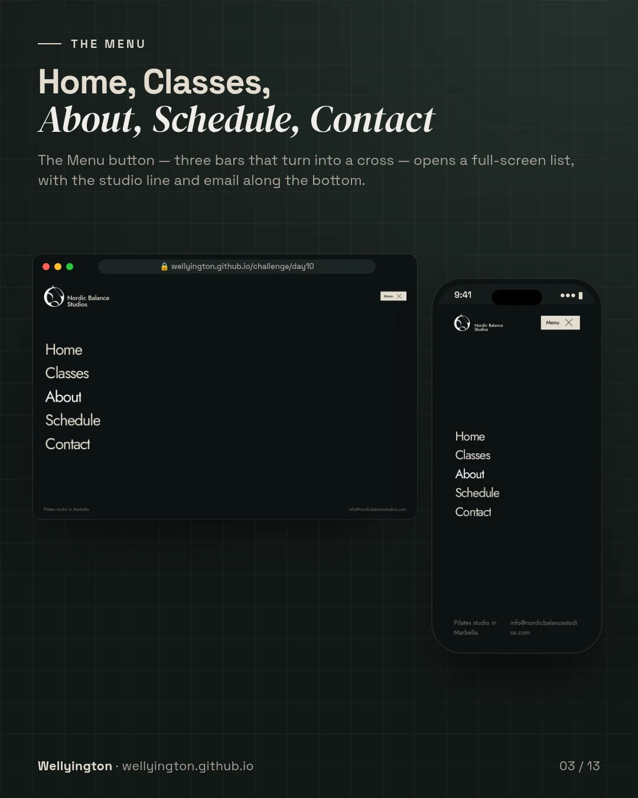
*O botão Menu abre uma lista em tela cheia, com a linha do estúdio e o e-mail embaixo.*

## qualidade acima de modismos

Rolando mais, a seção seguinte enche a tela com uma fotografia: um homem num Reformer, no meio de um alongamento, junto às janelas do estúdio e às colinas lá fora. Por cima, a frase que resume o negócio, nas palavras do próprio estúdio: se você valoriza a qualidade acima dos modismos, está no lugar certo. Unimos movimento baseado na ciência a um treino personalizado, com base em medicina esportiva, reabilitação e Pilates.

Essa é toda a apresentação. Não lista dez benefícios nem promete um corpo novo em trinta dias. Diz que tipo de estúdio é e para quem, e deixa a fotografia mostrar o resto. Quem procura uma aula barulhenta e de alta intensidade sabe logo que não é aqui. Quem procura um ensino cuidadoso e especializado sabe que encontrou. As duas coisas são boas para o estúdio.

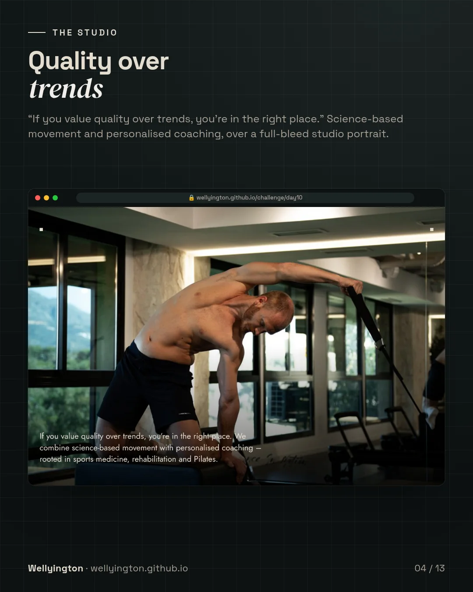
*Movimento baseado na ciência e treino personalizado, sobre um retrato do estúdio de ponta a ponta.*

## quatro portas para as aulas

A seção seguinte se chama classes for every stage, aulas para cada fase. Mostra quatro grandes blocos, dispostos em cruz e não em fila, cada um com um número e um nome: 01 Reformer, 02 Private, 03 Specialist, 04 First Visit. Um link para todas as aulas fica no canto superior direito.

Os blocos ficam em silêncio até você precisar deles. Aponte para um no computador, ou toque nele no celular, e ele fica creme e lista o que contém. Reformer mostra Beginners, Intermediate e Advanced Reformer, sessões semiprivadas e grupos pequenos com instrutores certificados. Private lista para que serve o trabalho individual: desempenho esportivo, reabilitação e recuperação de lesões, correção postural, saúde da coluna e gravidez. Specialist reúne Stretch & Mobility, Posture para todos os níveis, Longevity 50+, Teen Girls Pilates e Outdoor Mat Pilates. E First Visit explica o que acontece quando você começa: uma Consultation Class individual, uma avaliação do movimento, uma conversa sobre objetivos e lesões anteriores, e as aulas que recomendam para você.

Essa última porta é a que importa. Clientes novos muitas vezes hesitam porque não sabem onde se encaixam. Aqui, «sou novo» é uma categoria em si, com um primeiro passo claro.

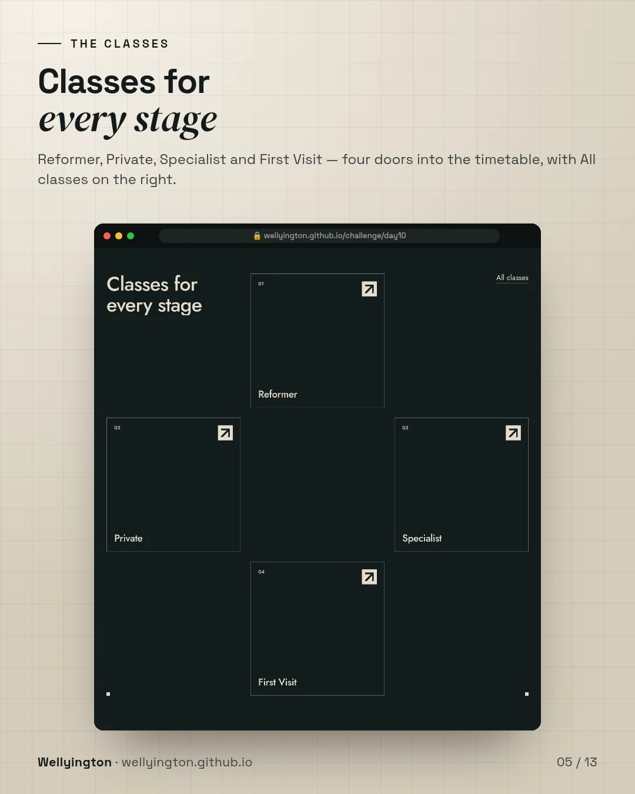
*Reformer, Private, Specialist e First Visit: quatro portas para o horário.*

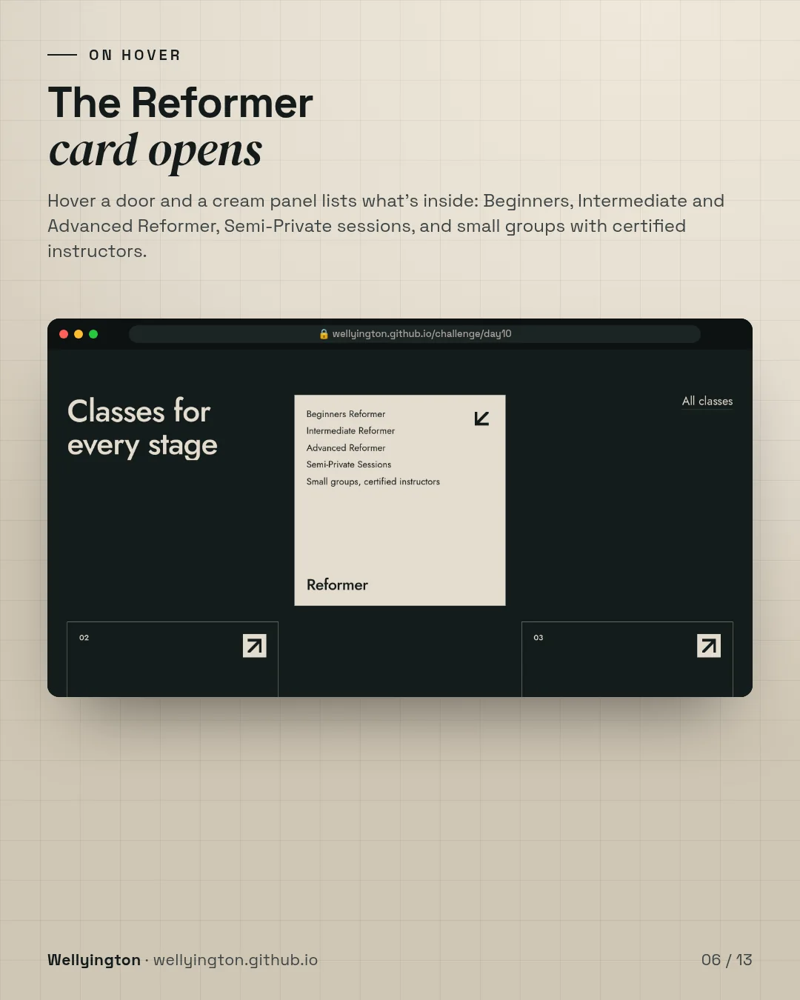
*Aponte para uma porta e um painel creme lista o que há dentro.*

## três formas de reservar

A maioria dos estúdios de fitness usa vários sistemas de reserva ao mesmo tempo, e os sites raramente explicam qual é qual. O Nordic Balance não é exceção: as aulas em grupo e semiprivadas são reservadas no app do próprio estúdio, as sessões privadas pelo WhatsApp, e os clientes novos começam com uma consulta.

Então a seção de reservas, book your session, explica exatamente isso, em três colunas com uma foto cada. Reserve sua aula em grupo: Beginner, Intermediate e Advanced Reformer mais as sessões especializadas, reservadas diretamente no app do Nordic Balance Studios, incluindo as semiprivadas. Reserve sua aula privada: pelo WhatsApp no +34 648 876 173, para que o estúdio indique o instrutor mais adequado aos seus objetivos. E reserve sua primeira Consultation Class: uma sessão individual para avaliar seu movimento, conversar sobre seus objetivos e possíveis lesões, e recomendar as aulas certas.

Cada coluna tem em cima duas etiquetas pequenas que dizem para quem é e onde acontece: group classes e app, private classes e WhatsApp, new clients e start here. Ninguém precisa adivinhar para onde cada botão leva.

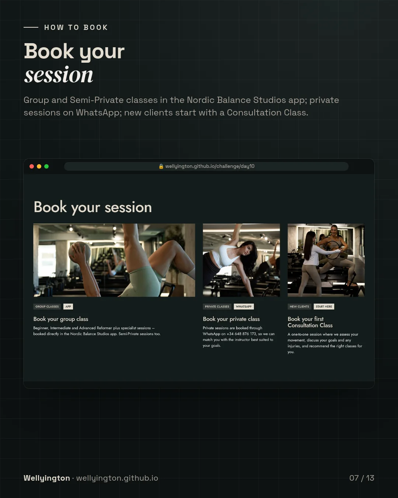
*Aulas em grupo e semiprivadas no app, sessões privadas pelo WhatsApp e uma Consultation Class para quem é novo.*

## os níveis, explicados por inteiro

A página de aulas responde à pergunta que todo iniciante faz e que poucos sites de estúdios respondem: qual é a minha aula?

Cada nível de Reformer tem um parágrafo curto em linguagem simples. Beginners Reformer é o ponto de partida se você é novo no Pilates Reformer ou está voltando depois de um tempo; em grupos pequenos, instrutores certificados ajudam você a dominar o essencial e dizem quando está pronto para o Intermediate. Intermediate é para clientes com uma base sólida, prontos para movimentos mais dinâmicos e sequências mais longas; como diz a página, progredir não é se mover mais rápido, é se mover melhor. Advanced é para clientes com pelo menos um ano no Reformer, com padrões complexos que testam força, estabilidade e controle. E Private & Semi-Private, a especialidade do estúdio, abrange desempenho esportivo, reabilitação, postura, gravidez, saúde da coluna e recuperação de lesões.

Mais abaixo, três passos numerados explicam como um cliente novo começa: 01, uma Consultation Class; 02, um plano de aulas que recomenda sessões em grupo, semiprivadas ou privadas; 03, progredir com controle, com seu instrutor dizendo quando você está pronto para subir de nível. O bom movimento começa por dominar o básico, diz a página, e a estrutura da página concorda.

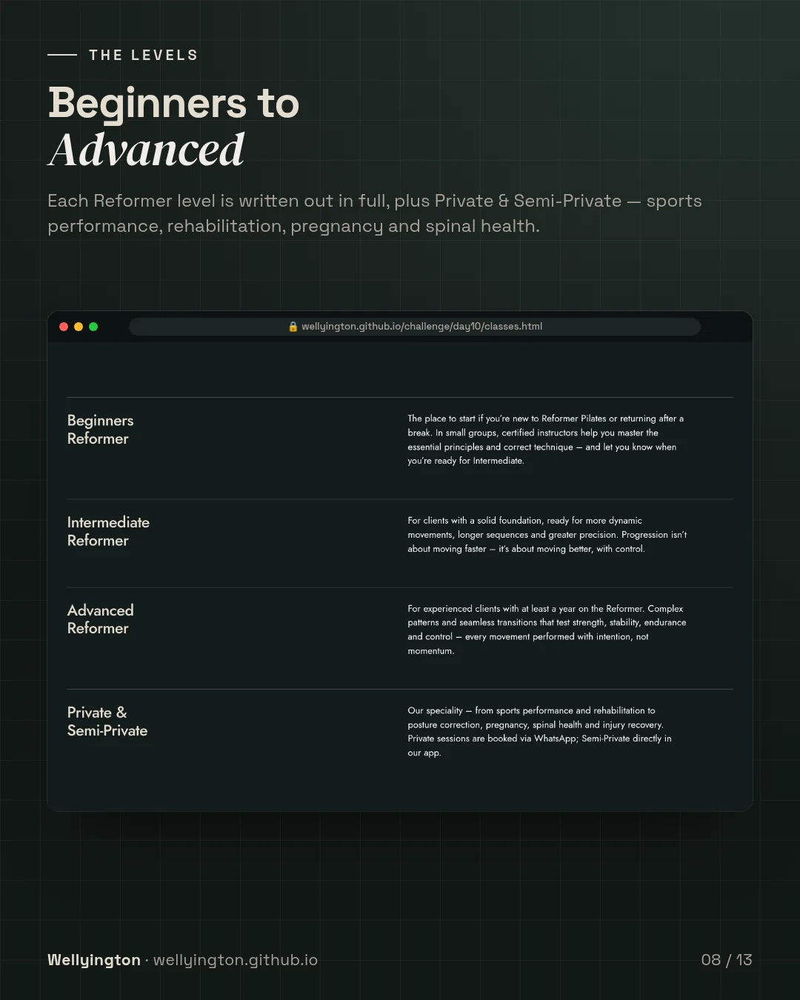
*Cada nível de Reformer explicado por inteiro, mais Private & Semi-Private.*

## a semana num relance

Abaixo dos níveis está o horário semanal, como uma fileira de cartões que se percorre, um por dia, com setas embaixo. Cada cartão lista as aulas do dia com os horários, a faixa de sessões privadas num cinza mais suave e, no pé, o dia e o número de aulas em grupo.

A segunda-feira tem quatro aulas em grupo, de Intermediate às 09:15 a Prenatal & Postnatal às 13:30, com sessões privadas à tarde. A quinta-feira é a mais cheia, com sete, de Intermediate às 09:15 a Stretch & Mobility às 19:45, e Longevity 50+ às 10:30. O sábado tem só sessões privadas. A fileira dá a volta, então depois do domingo vem de novo a segunda, e no celular aparece um cartão de cada vez.

A ideia é responder «dá para eu ir?» num relance, sem baixar um app nem abrir um PDF. O app continua sendo onde se reserva; o site é onde se decide.

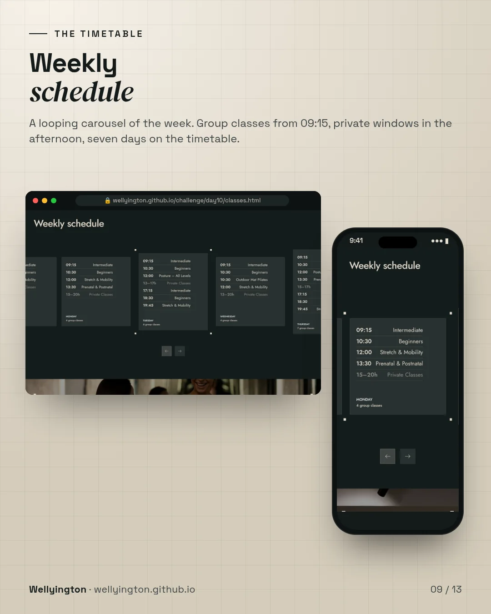
*Um carrossel da semana: aulas em grupo a partir das 09:15 e faixas privadas à tarde.*

## nosso estúdio

A página sobre o estúdio volta a colocar a fotografia em primeiro plano. Quatro retratos do estúdio, cada um com o nome de uma aula: Reformer Pilates, grupos pequenos em três níveis; Private sessions, adaptadas aos seus objetivos; Posture para todos os níveis, alinhamento para o dia a dia; Stretch & Mobility, para se mover com mais liberdade. Ao lado, um cartão creme que quebra de propósito a grade escura: é novo por aqui? Comece com uma Consultation Class, com um link para reservá-la.

Abaixo, a filosofia do estúdio nas palavras dele: não seguimos modismos do fitness; focamos na saúde a longo prazo, no movimento inteligente e em resultados duradouros. E três números: 5,0, a nota do estúdio no Google com 44 avaliações; 3, os níveis de Reformer; e 7, os dias da semana com aulas no horário.

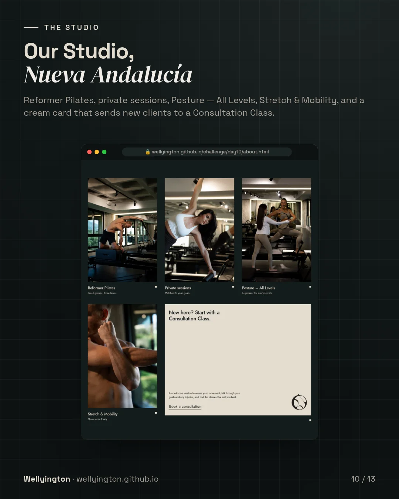
*Reformer, sessões privadas, postura e alongamento, e um cartão creme que manda quem é novo para uma Consultation Class.*

## aberto agora

A página de contato se chama get in touch, entre em contato, com as duas partes empurradas para extremos opostos da tela. Embaixo, o essencial: o e-mail, o endereço completo no Centro Plaza, o telefone e o WhatsApp, e uma linha que repete como se reserva cada tipo de aula.

Ao lado está o horário de cada dia da semana. O dia atual aparece destacado, e a página diz se o estúdio está aberto ou fechado naquele momento. Ela calcula isso com a hora de Marbella, não com a do aparelho do visitante, então acerta também para quem olha de Londres ou de Estocolmo antes das férias.

Abaixo, as perguntas frequentes: cinco, com a primeira já aberta, porque é a que mais gente tem. Sou novo, por onde começo? Com uma Consultation Class. Como reservo uma sessão privada? Pelo WhatsApp. O estúdio é só para mulheres? Não, homens e mulheres são bem-vindos, e há também sessões de Teen Girls e Longevity 50+. Quando posso subir de nível? Quando seu instrutor disser; o Advanced exige pelo menos um ano no Reformer. Como reservo as aulas em grupo e semiprivadas? No app.

Cada uma dessas respostas é algo que, de outro modo, a equipe do estúdio teria de explicar por telefone, de novo e de novo.

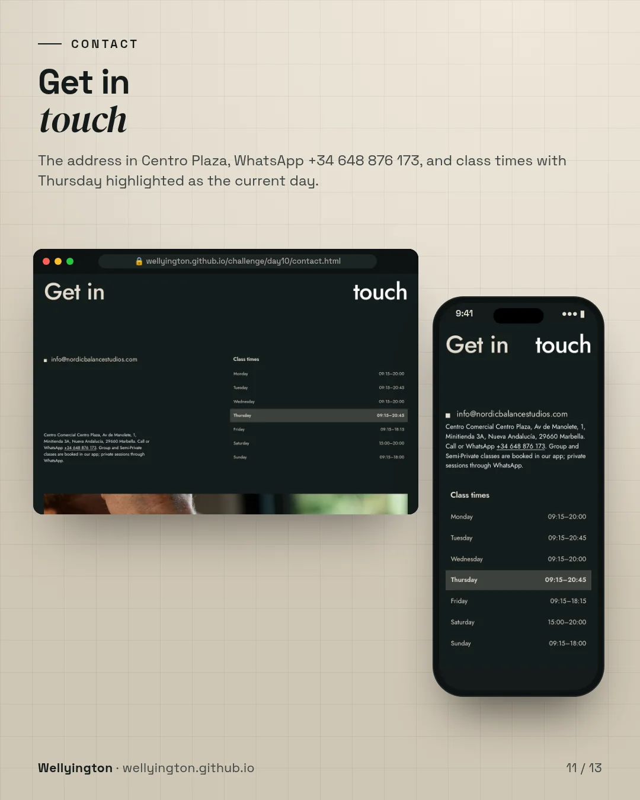
*O endereço no Centro Plaza, WhatsApp e o horário com o dia atual destacado.*

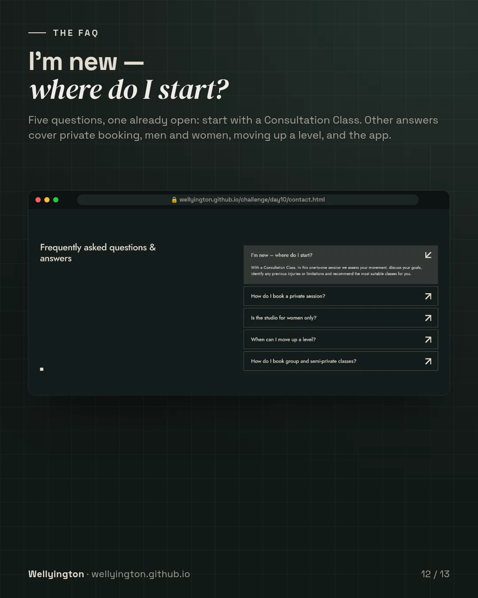
*Cinco perguntas, uma já aberta: comece com uma Consultation Class.*

## os detalhes

Há uma única fonte, Jost, uma sem serifa geométrica e limpa, em pesos finos e normais para quase tudo e um pouco mais fortes para as etiquetas pequenas. Usar uma só família mantém as páginas calmas e deixa o tamanho e o espaço fazerem o trabalho.

A paleta tem três cores: um quase preto com um toque de verde, um creme quente e um cinza suave entre os dois. As seções escuras sustentam a fotografia; as cremes aparecem quando algo precisa de atenção: o bloco aberto, o cartão da consulta, o dia destacado.

O movimento é lento e contido. Os títulos sobem para o lugar, o vídeo da abertura se aproxima suavemente ao rolar e as páginas passam com suavidade de uma seção para outra. Uma coisa que eu acrescentaria numa versão real: desligar o vídeo e os efeitos de rolagem para quem pediu ao aparelho que reduza as animações. As fontes são servidas do meu próprio site e não do Google, então abrir as páginas não entrega o endereço de ninguém a terceiros.

## o que é o conceito, e o que vem depois

Os dados das páginas vêm do site atual do estúdio e dos seus perfis públicos: as aulas e os níveis, o horário, as formas de reservar, o endereço e o telefone, as respostas das perguntas frequentes e a nota do Google tal como aparecia.

O que é novo é a estrutura: uma abertura calma com vídeo, quatro portas para as aulas com «First Visit» como uma delas, a reserva explicada por tipo de aula, os níveis explicados por inteiro, a semana à vista e um horário que sabe se o estúdio está aberto agora.

Não tenho números de reservas, e não vou inventá-los. Transformar o conceito num site funcionando exigiria os passos práticos: ligar o horário ao app de reservas do estúdio para que se atualize sozinho, uma versão em espanhol ao lado da inglesa, e perfis dos próprios instrutores, porque num estúdio assim os professores são boa parte do motivo pelo qual as pessoas vêm.

## dez feitos

Com dez dias feitos, aparece um padrão. Todos os negócios desta série já tinham site. Muito poucos estavam quebrados. A maioria simplesmente foi feita para parecer pronta, não para responder ao que os clientes realmente perguntam: o que é isto, é para mim, quanto custa, quando posso ir e como reservo. As respostas do Nordic Balance a essas perguntas já existiam: no app, no WhatsApp, na cabeça da equipe. O trabalho do site é reuni-las num lugar calmo.

Se você tem um estúdio, uma clínica ou qualquer negócio em que as pessoas reservam um horário, vale o mesmo. Explique seus níveis ou serviços em palavras simples. Mostre a semana. Diga exatamente como se reserva cada coisa. Dê às pessoas novas o seu próprio primeiro passo. E deixe o lugar falar por si.

Sou web designer em Estepona, na Costa del Sol, e desenho e construo sites para negócios na Espanha e fora dela. Se isto se parece com o seu negócio, escreva-me pelo [site principal](https://wellyington.github.io/pt/). Conte o que você faz e onde, e eu respondo em linguagem clara. O conceito está [aqui](https://wellyington.github.io/challenge/day10/), e o site atual do Nordic Balance Studios [aqui](https://www.nordicbalancestudios.com/), para você comparar. Dez feitos, faltam noventa.
