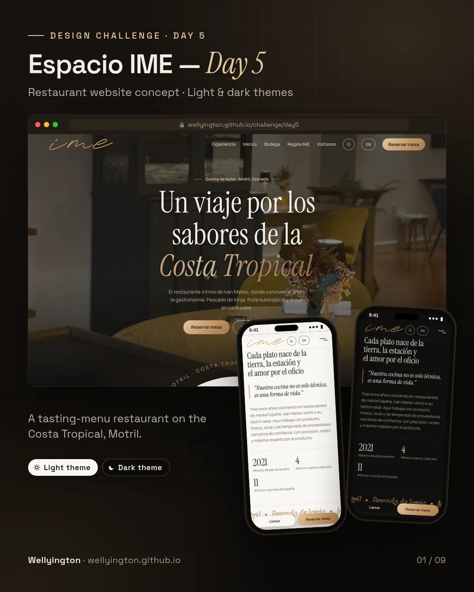
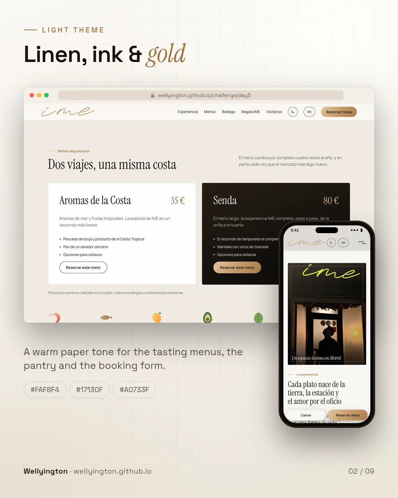
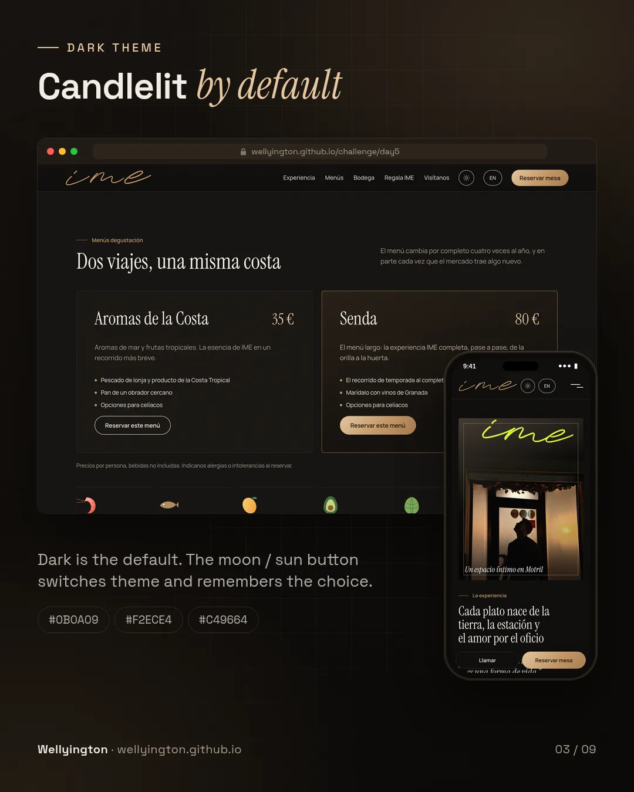
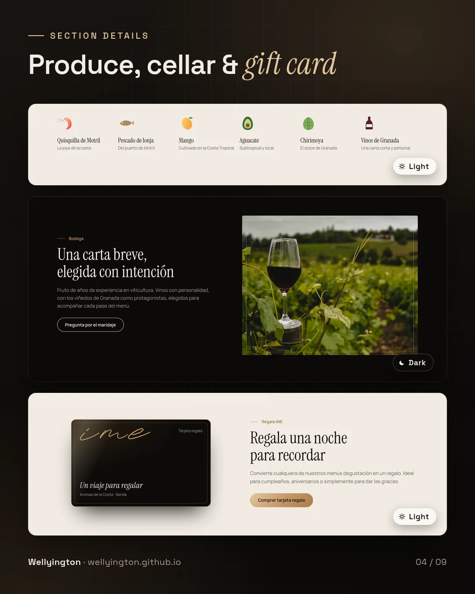
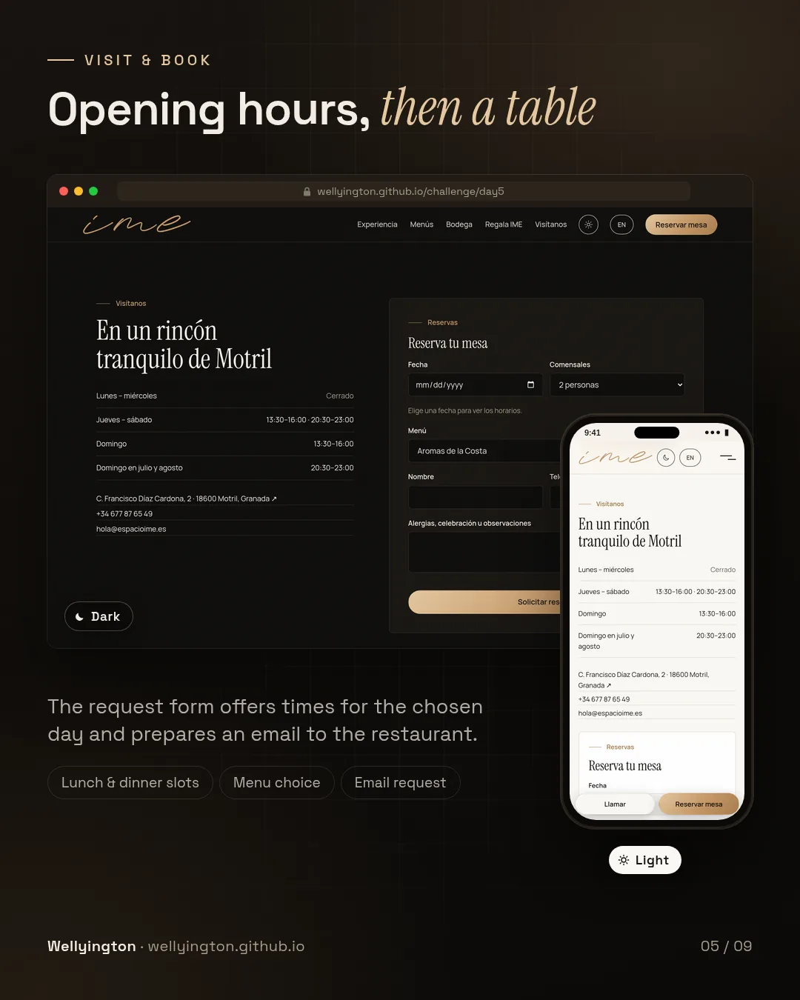
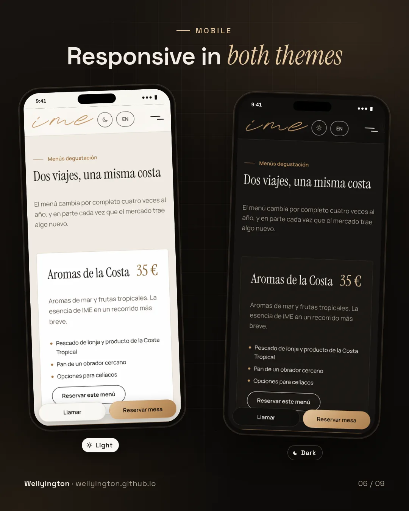
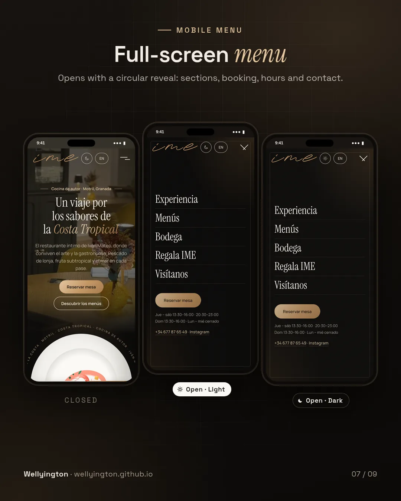
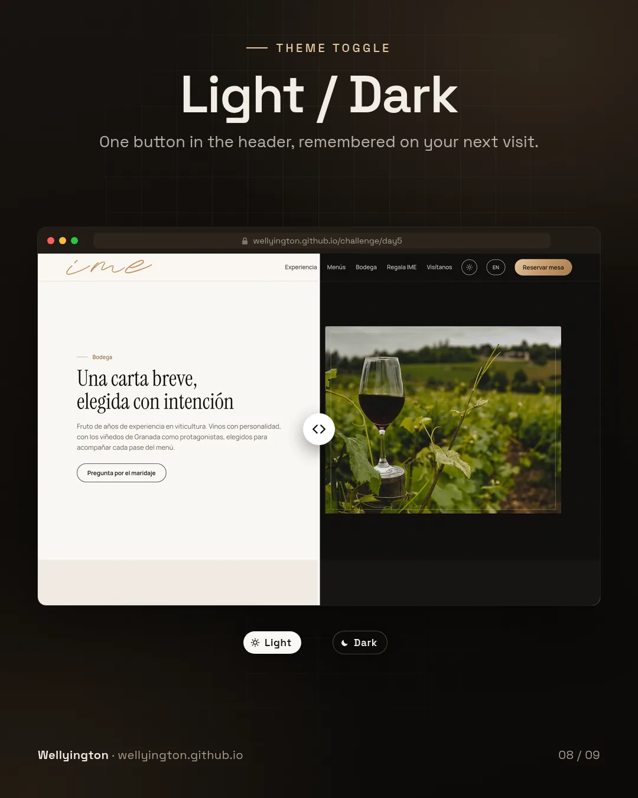

No dia 21 de novembro publiquei a quinta nota desta série, o desafio proposto por Ramiah Trask: cem dias, cem negócios, cem sites. O primeiro dia foi uma construtora familiar da Marina Alta. [Essa página está aqui.](https://wellyington.github.io/journal/pt/articles/o-site-antes-do-sim/) O segundo, um teatro em Málaga. [Esse está aqui.](https://wellyington.github.io/journal/pt/articles/espaco-para-a-temporada-inteira/) O terceiro, um restaurante familiar na minha própria cidade, Estepona. [Esse está aqui.](https://wellyington.github.io/journal/pt/articles/um-lugar-na-mesa-comprida/) O quarto, um escritório imobiliário particular em Málaga. [Esse está aqui.](https://wellyington.github.io/journal/pt/articles/criterio-antes-de-volume/) Hoje é de novo um restaurante, mas bem diferente.

O Espacio IME é um pequeno restaurante de menu degustação em Motril, na Costa Tropical, o trecho do litoral de Granada onde mangas, abacates e cherimólias crescem a poucos minutos do mar. O chef é Iván Mateo. Ele voltou para Motril depois de onze anos cozinhando em restaurantes por toda a Espanha, e comanda o IME desde dezembro de 2021. A cozinha dele se apoia no produto local: peixe do mercado de Motril, as frutas subtropicais da costa, vinhos de Granada.

Os guias perceberam. O Espacio IME é restaurante recomendado do Guia Repsol 2026. Está selecionado no Guia Michelin. A Macarfi, o guia que dá notas para cozinha, ambiente e serviço, dedica a ele uma ficha própria e destaca um arroz com quisquilla de Motril, o camarão da região, como motivo suficiente para a viagem.

Alguns restaurantes merecem um site tão bom quanto a comida que servem. O conceito está aqui: [Espacio IME, dia cinco](https://wellyington.github.io/challenge/day5/). O site do restaurante está em [espacioime.es](https://www.espacioime.es/), e o Instagram é [@espacioime](https://www.instagram.com/espacioime/).

É um conceito de design independente. Não é uma colaboração com o Espacio IME, ninguém de lá me pediu e nada na página quer dizer que eles aprovam. Como os quatro anteriores, por enquanto ele mora no meu próprio endereço.

## um site à altura dos reconhecimentos

Pense em como as pessoas chegam a um restaurante assim. Quase ninguém descobre um menu degustação em Motril passando na frente. Leem num guia, veem um prato no Instagram, ouvem de um amigo que desceu de Granada. Depois pesquisam. O site é a segunda impressão, e ela vem logo depois de um guia dizer que o lugar vale uma viagem especial.

Se aí o site parece um modelo pronto, com fotos de banco de imagens e um formulário de contato num canto, quem visita sente o descompasso. Não porque um modelo seja um crime, mas porque todo o resto do lugar fala de cuidado: o produto, a montagem dos pratos, a carta curta de vinhos, o salão pequeno. O site é a única parte da experiência que o restaurante oferece de graça, para todo mundo, antes de alguém provar qualquer coisa.

Então me dei uma tarefa simples. O site deveria ter o mesmo cuidado com os detalhes que a cozinha. Uma ordem clara, o produto na frente, os menus com os preços, o vinho, o presente e um jeito tranquilo de pedir uma mesa. Nada que grite.

## uma viagem pelos sabores da costa

O site abre no salão. Uma foto larga do salão ocupa a tela, escurecida para o texto ficar confortável por cima: mesas de madeira, cadeiras cor de mostarda, um vaso de flores secas.

O título está numa serifa alta e estreita: un viaje por los sabores de la Costa Tropical, uma viagem pelos sabores da Costa Tropical. As duas últimas palavras ficam em itálico e num dourado suave. Em cima, uma linha pequena, cocina de autor, Motril, Granada, que é como um guia descreveria o lugar. Embaixo, uma frase: o restaurante intimista de Iván Mateo, onde convivem a arte e a gastronomia, com peixe do mercado, fruta subtropical e o mar em cada etapa.

Depois, dois botões: reservar mesa ou conhecer os menus. No pé da tela aparece um prato branco, com uma linha de texto correndo pela borda como o carimbo de uma cerâmica: Costa Tropical, Motril, cozinha autoral, Iván Mateo.

Logo abaixo da abertura há uma fileira discreta com os três reconhecimentos: Guia Michelin 2026, Guia Repsol 2026 e Macarfi. Eles são pequenos e usam a mesma tipografia de todo o resto, e o rodapé leva às páginas do restaurante nos guias Michelin e Repsol. Prêmios funcionam melhor quando são fáceis de conferir e não são gritados.

*A abertura em tela grande, e a seção da experiência em dois celulares.*

## cada prato nasce da terra

A primeira seção depois da abertura fala do cozinheiro, não do menu. O título diz: cada plato nace de la tierra, la estación y el amor por el oficio. Cada prato nasce da terra, da estação e do amor pelo ofício.

Ao lado, uma única citação da cozinha, grande, em itálico, com uma linha dourada fina do lado: a nossa cozinha não é só técnica, é um jeito de viver. Depois, um parágrafo curto. Depois de onze anos cozinhando em restaurantes pela Espanha, Iván Mateo voltou para a sua Motril natal. Aqui ele trabalha com produto fresco, local e da estação, de fornecedores próximos e de confiança, com precisão, ordem e o máximo respeito pelo ingrediente.

Três números fecham a seção. 2021, aberto desde dezembro. 4, menus novos a cada ano. 11, anos em cozinhas da Espanha. Prefiro números assim a adjetivos. Um cliente pode conferir cada um, e juntos eles dizem mais sobre o lugar do que "excepcional" jamais diria.

## o produto, pelo nome

Um menu degustação é difícil de descrever com antecedência, porque ele muda. O que não muda é de onde ele vem. Por isso, entre a história e os menus há uma faixa de ingredientes, com um pequeno desenho para cada um e uma linha embaixo.

Quisquilla de Motril, o camarão local, a joia da costa. Peixe do mercado, do porto de Motril. Manga, cultivada na Costa Tropical. Abacate, subtropical e local. Cherimólia, a fruta doce de Granada. E os vinhos de Granada, uma carta curta e pessoal.

Os mesmos nomes passam pela tela mais acima, como uma faixa lenta, em itálico dourado, um atrás do outro. Pode ser que um visitante de Madri ou de Londres não saiba o que é uma quisquilla. Depois dessa página, vai querer provar.

## duas viagens, uma mesma costa

Depois vêm os menus, sob o título dos viajes, una misma costa: duas viagens, uma mesma costa. Uma linha explica como a cozinha funciona. O menu muda completamente quatro vezes por ano, e em parte toda vez que o mercado traz alguma novidade.

São dois menus, lado a lado, cada um no seu cartão, com o preço grande no canto, do jeito que um cardápio impresso mostraria.

Aromas de la Costa, por 35 euros, é o percurso curto: aromas de mar e frutas tropicais, a essência do IME num percurso mais breve. Inclui peixe do mercado e produto da Costa Tropical, pão de uma padaria próxima e opções para celíacos.

Senda, por 80 euros, é o menu longo: a experiência IME completa, etapa por etapa, da beira do mar à horta. Cobre todo o percurso da estação, uma harmonização com vinhos de Granada e o mesmo cuidado com os celíacos. No tema claro, esse cartão é escuro, e no tema escuro ele ganha uma borda dourada, então o olho sabe qual é a experiência completa sem precisar de aviso.

Cada cartão termina com um único botão: reservar este menu. Uma linha embaixo dos dois diz que os preços são por pessoa, que as bebidas não estão incluídas e que alergias ou intolerâncias devem ser informadas na reserva.

Mostrar os preços foi uma escolha. Alguns restaurantes desse nível escondem os valores, e é preciso mandar mensagem para descobrir. Isso afasta justamente quem está planejando um aniversário ou uma data especial e quer saber o que esperar. Preço claro também é hospitalidade.

*O tema claro: linho, tinta e dourado, para os menus, o produto e o formulário de reserva.*

## à luz de velas por padrão

Todos os sites desta série até agora tiveram um tema claro e um escuro. Este é o primeiro em que o escuro é o ponto de partida.

Um menu degustação é, na maior parte das vezes, um jantar, e o salão tem luz baixa. Por isso o site abre na versão escura: quase preto, #0B0A09, texto off-white quente, #F2ECE4, e um dourado discreto, #C49664, para tudo o que dá para tocar. O tema claro é linho e tinta, #FAF8F4 e #17130F, com um dourado mais fechado, #A0733F. Um botãozinho de sol e lua no cabeçalho troca entre os dois, e o site lembra da sua escolha na próxima visita.

A tipografia é uma dupla que eu queria usar havia tempo: Instrument Serif, uma serifa estreita com um itálico lindo, para títulos, menus e preços, e Manrope, uma sem serifa limpa, para todo o resto. O logotipo é um ime fino, escrito à mão, em dourado.

*O escuro é o padrão. O botão de lua e sol troca o tema e lembra da escolha.*

## a adega e o presente

Depois vêm duas seções menores, e as duas importam mais do que o tamanho sugere.

A primeira é a adega, a bodega. Título: una carta breve, elegida con intención, uma carta curta, escolhida com intenção. O texto conta que a carta vem de anos de experiência em viticultura: vinhos com personalidade, com os vinhedos de Granada como protagonistas, escolhidos para acompanhar cada etapa do menu. Ao lado, uma foto de uma taça de tinto entre as videiras. Não há uma tabela longa de garrafas e safras. A carta curta é a ideia, e o botão diz simplesmente pergunte pela harmonização.

A segunda é o presente. Regala IME, presenteie IME. O título é regala una noche para recordar, dê de presente uma noite para lembrar. Qualquer um dos menus degustação pode virar presente, para aniversários, datas especiais ou simplesmente para agradecer. À esquerda, um vale-presente desenhado como um objeto, escuro, com a assinatura dourada do IME e as palavras un viaje para regalar, uma viagem para presentear. O botão, comprar vale-presente, leva direto à página de presentes que o restaurante já tem. Não construí uma loja nova. A que existe funciona, e o trabalho do conceito é fazer com que seja mais fácil de achar.

Vales-presente são uma parte silenciosa do negócio de muitos bons restaurantes. Quem comeu num lugar especial quer mandar os pais, os amigos, o melhor cliente. Uma seção de presente visível e bem apresentada dá a essas pessoas um motivo.

*O produto, a adega e o vale-presente, cada um com o seu espaço.*

## primeiro o horário, depois a mesa

A última seção da página se chama visítanos, visite-nos, e coloca o horário primeiro. De segunda a quarta, fechado. De quinta a sábado, almoço das 13:30 às 16:00 e jantar das 20:30 às 23:00. Domingo, só almoço, das 13:30 às 16:00. Domingo em julho e agosto, jantar das 20:30 às 23:00. Embaixo do horário, o endereço, Calle Francisco Díaz Cardona 2, em Motril, que abre no mapa, o telefone e o e-mail.

Ao lado do horário fica o pedido de reserva, reserva tu mesa. Primeiro a data e o número de pessoas. Depois que você escolhe a data, o formulário só oferece os horários em que a cozinha serve naquele dia, de meia em meia hora, para almoço, jantar ou os dois. Se você escolher uma segunda, terça ou quarta, ele avisa com gentileza que o restaurante está fechado e sugere de quinta a domingo. Se escolher um domingo de agosto, ele oferece jantar em vez de almoço. Depois vem o menu: Aromas de la Costa, Senda ou decidimos na mesa. Depois nome, telefone e um campo para alergias, comemorações ou qualquer coisa que a cozinha precise saber.

O botão diz solicitar reserva, e é exatamente isso que ele faz. Ele prepara um e-mail para o restaurante com tudo preenchido, pronto para enviar. O restaurante confirma. Não quis fingir que o conceito fosse um sistema completo de reservas. Um restaurante pequeno, com poucas mesas, costuma preferir ver cada pedido e responder pessoalmente, e a página respeita isso.

*O horário vem primeiro. O formulário só oferece horários em que a cozinha abre no dia escolhido.*

## no celular

A maioria das pessoas vai ver este site no celular, muitas vezes no mesmo dia em que quer reservar. Numa tela pequena, tudo se empilha na mesma ordem: a história, o produto, os menus, a adega, o presente, o horário.

Dois botões ficam fixos na parte de baixo o tempo todo: ligar e reservar mesa. Eles ficam ao alcance do polegar em qualquer ponto da página. Quem já se decidiu não precisa descer até o fim para achar o formulário.

O menu abre em tela cheia com um círculo que se expande a partir do botão no canto, como uma cortina puxada de um lado. Dentro estão as cinco seções, grandes, na serifa: experiência, menus, adega, presenteie IME, visite-nos. Embaixo, o botão de reservar mesa, o horário numa linha curta, o telefone e o Instagram. Tudo o que alguém precisa para se decidir cabe nessa tela.

*Os menus no celular, nos dois temas, com ligar e reservar sempre à mão.*

*O menu em tela cheia abre com um círculo: seções, reserva, horário e contato.*

## espanhol primeiro, inglês a um toque

O site do próprio IME é em espanhol, e o conceito também, em primeiro lugar. Mas a Costa Tropical recebe visitantes de fora, e muita gente que mora neste litoral lê inglês com mais facilidade do que espanhol.

Por isso há um botão EN no cabeçalho. Você toca e todo o texto da página passa para o inglês: os títulos, os menus, o horário, os rótulos do formulário, os botões. Não é uma tradução automática colocada por cima. Cada linha tem a sua versão em inglês escrita ao lado da espanhola, para que as duas se leiam bem.

## por que acho que este merece uma olhada

Cada dia desta série tem o seu próprio trabalho. Uma construtora precisava de uma primeira página clara. Um teatro precisava de ordem. Um restaurante familiar precisava mostrar muitos motivos para entrar. Um escritório imobiliário precisava colocar uma pessoa na frente.

O Espacio IME precisava de algo mais perto da própria cozinha: contenção, bons materiais e atenção às pequenas coisas. Uma linha dourada ao lado de uma citação. Um prato surgindo no pé da primeira tela. Preços compostos como num cardápio impresso. Um formulário de reserva que sabe que a cozinha fecha às terças.

Vou dizer com todas as letras: acho que este merece uma olhada do Awwwards. Se ela vier, ótimo. Se não vier, a página continua fazendo aquilo para que foi feita, que é ficar ao lado de uma ficha do Guia Michelin sem destoar.

*Um botão no cabeçalho, lembrado na sua próxima visita.*

## um conceito independente

O Espacio IME não me contratou, e este não é o site deles. A história do chef, os menus e preços, o produto, o horário, o endereço e as fichas dos guias vêm do que o restaurante e os guias já publicam. Não mudei nenhum fato. O que mudei foi a ordem, a tipografia, o tom e o jeito como a página se comporta no celular.

Não tenho números de reservas nem de visitas, e não vou inventar nenhum. Se ninguém no IME quiser, o conceito fica onde está, como dia cinco. Se quiserem, o resto é prático: as palavras deles onde eu preenchi, fotos novas para o menu de cada estação, os pedidos de reserva enviados para onde eles quiserem e o site levado para espacioime.es.

## se a sua cozinha é melhor que o seu site

Pode ser que você não tenha um restaurante de menu degustação. Mas muitos pequenos negócios deste litoral estão na mesma situação: o que eles fazem é melhor do que a forma como aparecem na internet. Uma padaria premiada com um site de duas linhas. Uma vinícola com uma adega linda e uma página que é quase só um telefone. Um hotel com dez quartos perfeitos e um sistema de reservas de 2015.

O que ajuda é o mesmo que aqui. Coloque as pessoas e o produto na frente. Mostre os preços, se puder. Dê ao cliente um jeito tranquilo de pedir o que ele quer. E deixe o design ser tão cuidadoso quanto o trabalho.

Sou web designer em Estepona, na Costa del Sol, e faço sites como este para negócios de toda a Espanha. Se isso parece com o seu negócio, escreva para mim pelo [site principal](https://wellyington.github.io/pt/). Diga o que você faz e onde, e eu respondo em linguagem comum. O conceito está [aqui](https://wellyington.github.io/challenge/day5/), e o site do Espacio IME está [aqui](https://www.espacioime.es/), se você quiser comparar os dois. Cinco feitos, faltam noventa e cinco.
