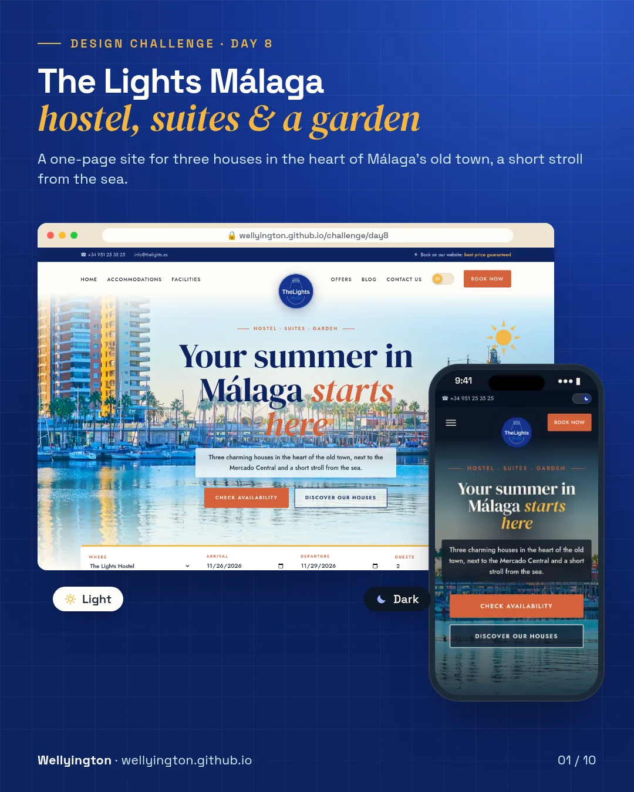
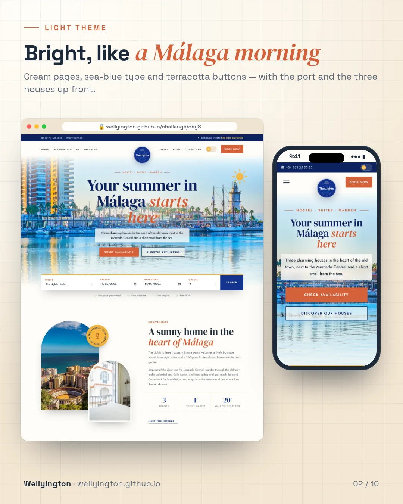
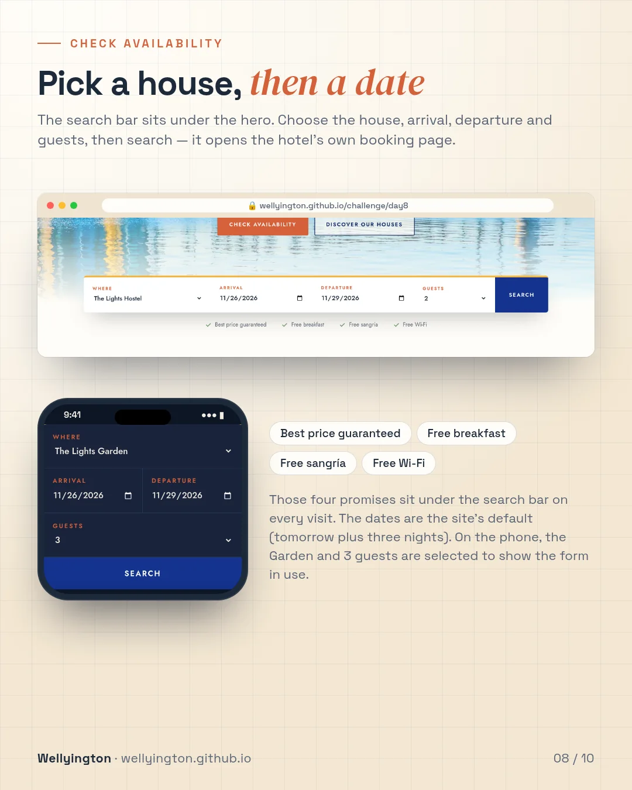
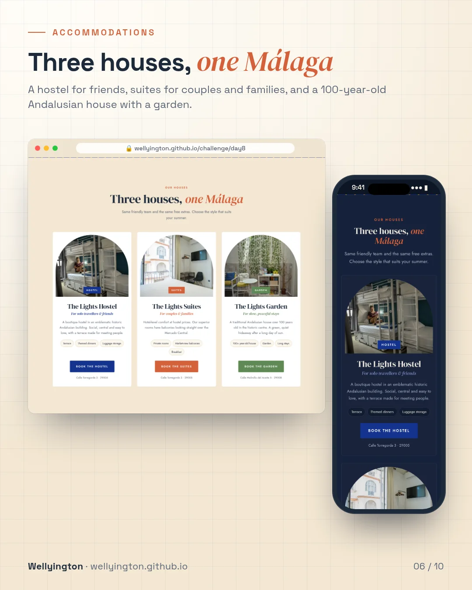
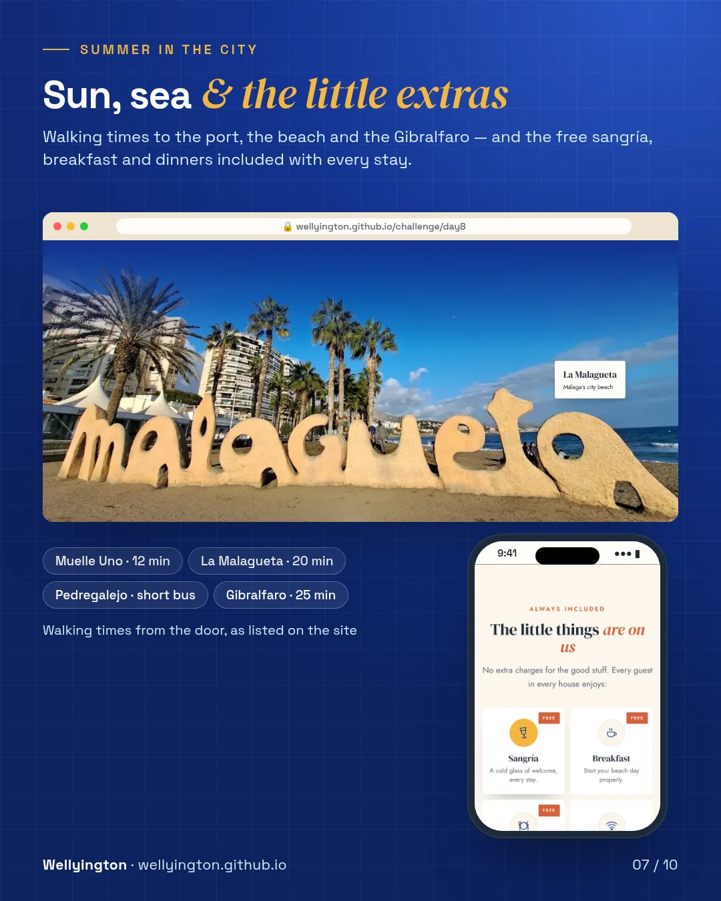
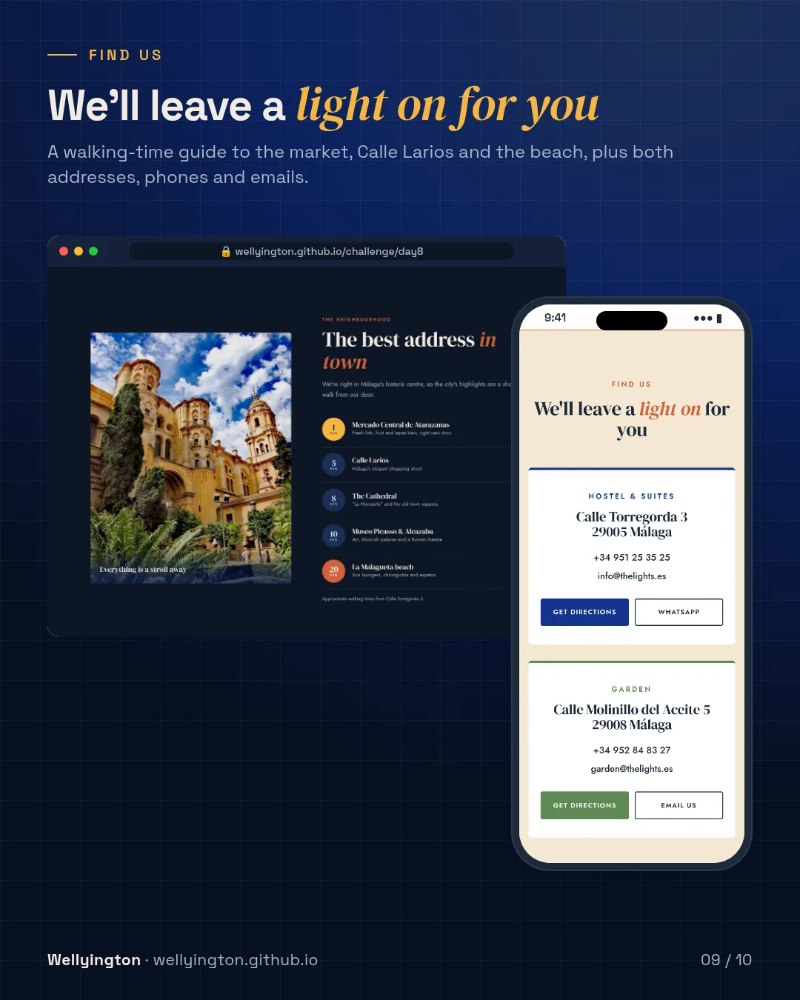
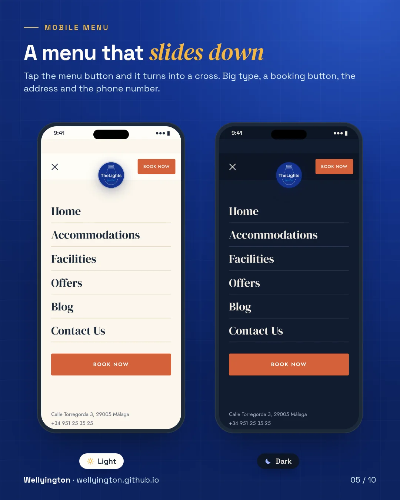
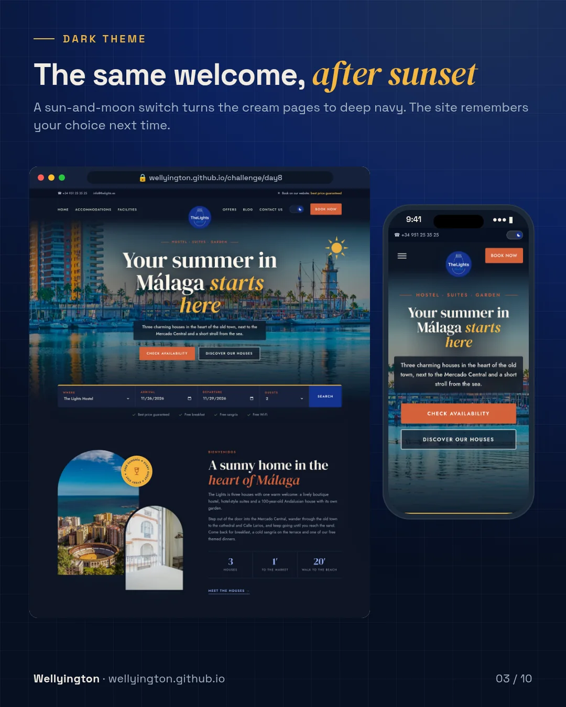
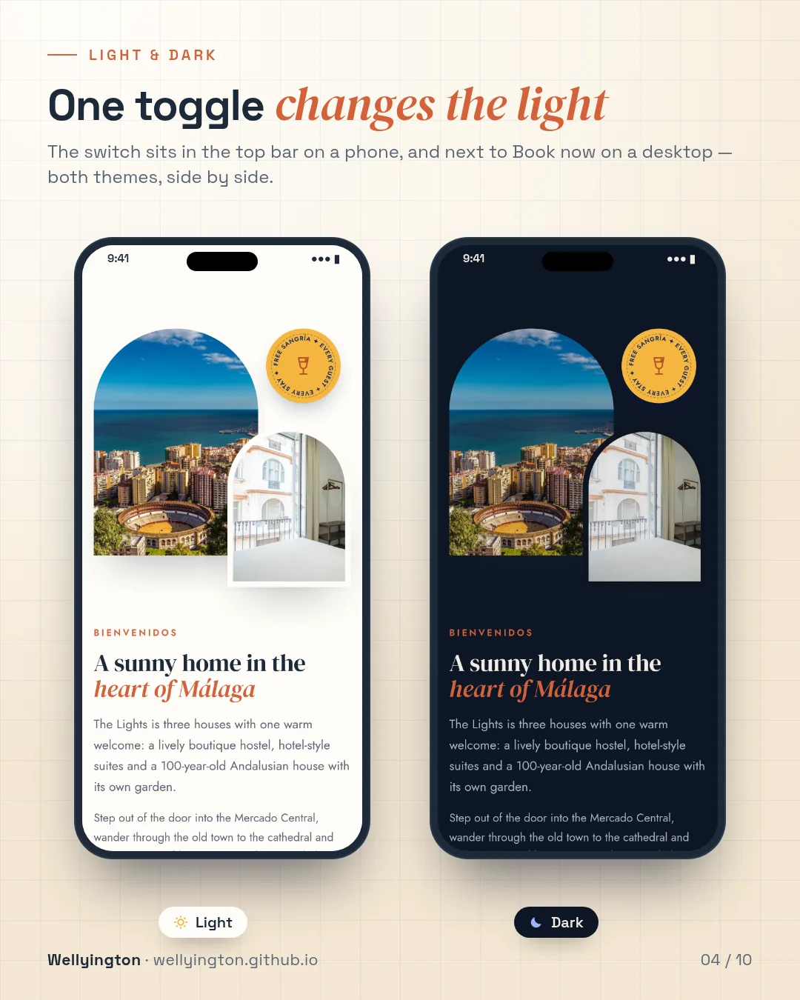

Em 25 de novembro publiquei a oitava nota desta série, o desafio que Ramiah Trask lançou: cem dias, cem negócios, cem sites. O dia um foi uma construtora familiar da Marina Alta. [Essa página está aqui.](https://wellyington.github.io/journal/pt/articles/o-site-antes-do-sim/) O dia dois, um teatro de Málaga. [Essa está aqui.](https://wellyington.github.io/journal/pt/articles/espaco-para-a-temporada-inteira/) O dia três, um restaurante familiar de Estepona. [Essa está aqui.](https://wellyington.github.io/journal/pt/articles/um-lugar-na-mesa-comprida/) O dia quatro, uma consultoria imobiliária privada de Málaga. [Essa está aqui.](https://wellyington.github.io/journal/pt/articles/criterio-antes-de-volume/) O dia cinco, um restaurante de menu degustação em Motril. [Essa está aqui.](https://wellyington.github.io/journal/pt/articles/tao-cuidadoso-quanto-a-cozinha/) O dia seis, uma casa de frango assado em Estepona. [Essa está aqui.](https://wellyington.github.io/journal/pt/articles/do-balcao-a-comanda/) O dia sete, um hotel familiar em Kavos, Corfu. [Essa está aqui.](https://wellyington.github.io/journal/pt/articles/a-mesma-piscina-a-noite/)

Hoje voltamos à Costa del Sol, à própria Málaga. O The Lights são três hospedagens no centro histórico com um só nome. O The Lights Hostel é um hostel boutique num prédio andaluz histórico. As The Lights Suites são quartos privados no estilo de hotel no mesmo prédio, alguns com varanda para o Mercado Central. O The Lights Garden é uma casa andaluza tradicional com mais de cem anos, a algumas ruas dali, com o seu próprio jardim. O site atual deles está em [thelights.es](https://www.thelights.es/).

O conceito está aqui: [The Lights Málaga, dia oito](https://wellyington.github.io/challenge/day8/).

## três casas, três hóspedes

O difícil aqui não é o design. É o briefing escondido dentro do negócio.

Um hostel, umas suítes e uma casa tranquila são três produtos diferentes para três pessoas diferentes. O hostel é para quem viaja sozinho e para grupos de amigos que querem um terraço, um jantar compartilhado e alguém para ir à praia. As suítes são para casais e famílias que querem um quarto privado e uma varanda, por um preço melhor que o de um hotel. A casa com jardim é para quem quer sossego depois de um longo dia de sol, e muitas vezes para estadias mais longas.

Coloque os três no mesmo site e o resultado de sempre é uma página que não fala com ninguém. Quem procura o hostel lê sobre jardins tranquilos. A família lê sobre beliches e festas. E ninguém acha o botão de reservar, porque há três deles em três lugares diferentes.

Então o desafio era reunir as três sob uma só identidade, o mesmo nome, a mesma equipe e os mesmos extras grátis, deixando cada casa manter o seu caráter. E tornar três coisas impossíveis de não ver em todas as telas: onde fica, que tipo de quarto você vai ter e como reservar direto.

*Dia oito: três casas no coração do centro histórico de Málaga, a uma caminhada do mar.*

## uma abertura de verão

Málaga vende verão. A maioria das pessoas que reservam uma cama no centro vem pelo sol, pelo mar e pelas noites longas, então a primeira tela diz exatamente isso.

O fundo é uma fotografia do porto no Muelle Uno: palmeiras, o farol, veleiros e a água. Por cima, numa serifa grande em azul-mar profundo, a frase your summer in Málaga starts here, o seu verão em Málaga começa aqui, com as duas últimas palavras em itálico terracota. Um pequeno sol desenhado gira devagar num canto. Acima do título, três palavras em letras pequenas e espaçadas: hostel, suites, garden. É o negócio inteiro em três palavras, antes de alguém rolar a página.

Abaixo do título, uma frase: três casas charmosas no coração do centro histórico, ao lado do Mercado Central e a uma caminhada do mar. Depois, dois botões: ver disponibilidade e conhecer as nossas casas.

O logotipo é o que o The Lights já usa, um selo azul redondo com uma lamparina, no meio do cabeçalho. Não redesenhei. Em volta dele, o cabeçalho traz as seis seções que o negócio já usa, Home, Accommodations, Facilities, Offers, Blog e Contact Us, e um botão terracota Book now à direita.

*O tema claro: páginas creme, letras azul-mar e botões terracota, com o porto e as três casas logo na frente.*

## primeiro, a barra de reservas

Logo abaixo da abertura, sobre a borda de baixo da fotografia, há uma barra de reservas. Onde, chegada, saída, hóspedes, buscar. É a primeira coisa da página que dá para usar de verdade.

Onde é uma escolha entre as três casas. As datas já vêm com valores sensatos, amanhã e três noites depois, para que só seja preciso mudar o que for diferente. Os hóspedes vão de um a seis, e depois sete ou mais, um grupo. No celular a barra vira um formulário organizado, um campo embaixo do outro, com um botão de busca grande no fim.

Abaixo da barra, quatro promessas curtas, cada uma com um tique: melhor preço garantido, café da manhã grátis, sangria grátis, Wi-Fi grátis. São as quatro coisas que um hóspede compara entre os sites de reserva, e aqui estão escritas antes que ele precise ir procurá-las.

Para deixar claro o que o conceito faz nesse ponto: o botão de busca envia as datas, a casa e o número de hóspedes ao site atual do The Lights. Cada casa tem o seu próprio sistema de reservas, e numa versão real o botão abriria o certo, com as datas já preenchidas. Essa ligação é a primeira tarefa da lista se o conceito seguir adiante.

*Escolha a casa, depois a data. As quatro promessas ficam embaixo da busca em todas as visitas.*

## três casas, uma Málaga

O coração da página é uma seção chamada three houses, one Málaga, três casas, uma Málaga. A primeira linha diz o que as três têm em comum: a mesma equipe simpática e os mesmos extras grátis. Escolha o estilo que combina com o seu verão.

Depois, três cartões, lado a lado no computador e um depois do outro no celular. Cada um tem uma fotografia numa moldura em arco, uma referência às portas e janelas das casas andaluzas antigas, uma cor própria e uma linha dizendo para quem é.

O The Lights Hostel é azul, para quem viaja sozinho e para amigos: um hostel boutique num prédio andaluz histórico e emblemático, social, central e fácil de gostar, com um terraço feito para conhecer gente. Terraço, jantares temáticos, guarda-volumes.

As The Lights Suites são terracota, para casais e famílias: conforto de hotel a preço de hostel, com quartos superiores cujas varandas dão direto para o Mercado Central. Quartos privados, varandas com vista para o mercado, café da manhã.

O The Lights Garden é verde-oliva, para estadias calmas: uma casa andaluza tradicional com mais de cem anos no centro histórico, um refúgio verde e silencioso depois de um longo dia de sol. Casa centenária, jardim, estadias longas.

Cada cartão termina com o seu próprio botão, book the hostel, book the suites, book the garden, que leva você de volta à barra de reservas com aquela casa já escolhida. E embaixo de cada botão, o endereço, porque duas das casas dividem o mesmo e o jardim tem outro. Quem reserva o jardim nunca deveria aparecer no hostel.

Essas três cores, azul, terracota e oliva, atravessam a página inteira. Depois de vê-las nos cartões, você sabe de qual casa um botão ou uma linha de texto está falando sem ler a etiqueta.

*Um hostel para amigos, suítes para casais e famílias, e uma casa andaluza centenária com jardim.*

## os detalhes são por nossa conta

Os hostels de Málaga competem no preço, e num site de reservas os preços sempre parecem iguais. O que muda é o que está incluído. O The Lights inclui muita coisa, e o site atual só menciona isso de passagem.

Então há uma seção para isso, chamada the little things are on us, os detalhes são por nossa conta, com uma frase simples embaixo: sem cobranças extras pelo que é bom. Seguem oito cartões pequenos. Sangria grátis, um copo gelado de boas-vindas em toda estadia. Café da manhã grátis, para começar bem o dia de praia. Jantares temáticos grátis, mesas compartilhadas e novos amigos. Wi-Fi rápido, grátis na casa toda. Um terraço ensolarado, sol de dia e sangria à noite. Guarda-volumes, para o voo cedo ou o check-in tarde. Mapas e dicas da equipe. E grupos são bem-vindos, com ofertas sob medida para grupos grandes. Os três primeiros levam uma pequena etiqueta terracota de free, grátis, porque são os que ninguém espera.

Há também um adesivo redondo amarelo na seção de boas-vindas que diz free sangría, every guest, every stay, sangria grátis para todo hóspede em toda estadia, e gira devagar como uma etiqueta numa mala. É a frase mais simpática da página, então ela ganha o direito de se mexer.

## sol, mar e cidade

Antes dos extras há uma fotografia de largura total do letreiro de La Malagueta, a praia da cidade, e um convite curto: deixe o carro em casa. Da porta, os melhores dias de verão de Málaga estão a uma caminhada.

Ao lado, os tempos a pé, escritos do jeito que você planejaria um dia. O Muelle Uno e o porto, cerca de doze minutos. A praia de La Malagueta, cerca de vinte. As praias de Pedregalejo e El Palo, um trajeto curto de ônibus. O pôr do sol no Gibralfaro, cerca de vinte e cinco minutos a pé. São as perguntas que as pessoas fazem na recepção na primeira manhã, respondidas antes de chegarem.

*Tempos a pé até o porto, a praia e o Gibralfaro, e a sangria, o café da manhã e os jantares grátis que vêm com cada estadia.*

## o melhor endereço da cidade

O argumento mais forte a favor do The Lights é onde ele fica, então a localização não está escondida no rodapé. Tem uma seção só para ela, chamada the best address in town, o melhor endereço da cidade.

De um lado, uma fotografia da catedral, que os malaguenhos chamam de La Manquita, a manetinha, porque a sua segunda torre nunca foi terminada. Do outro, uma lista numerada de tempos a pé a partir da porta na rua Torregorda, cada um num selo redondo. Um minuto até o Mercado Central de Atarazanas, para peixe fresco, frutas e bares de tapas. Cinco minutos até a rua Larios, a principal rua de compras. Oito minutos até a catedral e as praças do centro. Dez minutos até o Museu Picasso e a Alcazaba. Vinte minutos até a praia de La Malagueta. Uma nota pequena no fim diz que são aproximados, e são.

Os números fazem o trabalho de vender. Um minuto até o mercado diz mais sobre a localização do que qualquer adjetivo.

*Um guia de tempos a pé até o mercado, a rua Larios e a praia, com os dois endereços, telefones e e-mails.*

## reserve direto e economize

Cada reserva que um hostel recebe por uma grande plataforma custa uma comissão. O The Lights já promete o melhor preço no seu próprio site, e diz isso em letra pequena no cabeçalho. O conceito diz em letra grande.

Há uma seção chamada always the best price here, aqui sempre o melhor preço, com uma frase honesta: deixe as plataformas de reserva de lado; quando você reserva no nosso próprio site, sempre tem a nossa tarifa mais baixa, além de alguns extras que só nós podemos oferecer. Depois, quatro motivos. Melhor preço garantido. Um desconto para seguidores, com um código exclusivo para quem os segue nas redes sociais. Ofertas para grupos, um preço sob medida para quem viaja com muita gente. E tarifas especiais para estadias longas em Málaga. Um botão, ver disponibilidade, leva de volta à barra de reservas.

A mesma promessa corre pela barra do topo de todas as telas, book on our website, best price guaranteed, em dourado. E no celular, assim que você passa da barra de reservas, aparece embaixo uma barra fina com o nome, a frase best price, booked direct, e um botão book now. Ela fica ali até você sair.

## vamos deixar uma luz acesa para você

A seção de contato tira o título do nome do negócio: we'll leave a light on for you, vamos deixar uma luz acesa para você. É o tipo de frase que um hotel pequeno escreveria num bilhete à mão.

Embaixo há dois cartões, um por endereço, porque o The Lights fica em dois lugares. Hostel e suítes na rua Torregorda 3, com o telefone, o e-mail, um botão de como chegar e outro para o WhatsApp. O Garden na rua Molinillo del Aceite 5, com o seu próprio telefone, o seu próprio e-mail e o seu próprio botão de como chegar. Cada cartão tem a borda na cor da sua casa, azul para o hostel e as suítes, verde para o jardim, para que nunca se confundam.

## um menu que desce

No celular, o cabeçalho fica com três coisas: o botão do menu, o logotipo no meio e book now. Acima dele, uma barra fina com o telefone e o interruptor de tema claro e escuro.

Toque no menu e ele desce até ocupar a tela inteira, enquanto as três linhas do botão viram um X. As seis seções aparecem numa serifa grande, com um botão book now de largura total embaixo, e o endereço e o telefone no fim, onde o polegar alcança. Funciona igual nos dois temas.

*Letra grande, um botão de reserva, o endereço e o telefone.*

## a mesma acolhida depois do pôr do sol

Como o hotel de Corfu de ontem, o The Lights tem um tema claro e um escuro. Um pequeno interruptor com um sol e uma lua fica ao lado do book now no computador e na barra do topo no celular.

O tema claro é uma manhã em Málaga: páginas creme e areia, letras em azul-mar profundo, botões terracota e toques de amarelo-sol. O tema escuro é a mesma cidade depois do pôr do sol: páginas azul-marinho profundo, letras creme, a mesma terracota e o amarelo virando dourado. Os dois foram desenhados seção por seção, não invertendo cores. O site lembra a escolha na próxima visita e, se a pessoa nunca mexeu no interruptor, segue o que o celular ou o computador dela já estiver usando.

*Um interruptor com sol e lua transforma as páginas creme em azul-marinho, e o site lembra a escolha.*

*Um interruptor muda a luz: os dois temas, lado a lado.*

## os detalhes

A tipografia é DM Serif Display nos títulos, em tamanho grande, com itálico terracota nas palavras mais calorosas: starts here, one Málaga, light on. Jost, uma sem serifa geométrica e limpa, em tudo o que se lê, em maiúsculas espaçadas nas etiquetas pequenas e nos botões.

As cores são as da cidade: o azul profundo do mar e do próprio logotipo do The Lights, a terracota dos telhados, a areia e o creme dos muros do centro, o amarelo-sol e o verde-oliva para o jardim. Uma linha fina tracejada em azul e amarelo, como a borda de uma toalha de praia, separa algumas seções.

As coisas aparecem suavemente quando você rola, a foto da abertura se desloca bem devagar e o sol e o adesivo de sangria giram. Tudo isso para para quem pediu ao celular ou ao computador que reduza as animações, e a página funciona exatamente igual sem isso. As fontes vêm do meu próprio site, e não do Google, então abrir a página não entrega o endereço de ninguém a terceiros.

## o que o conceito é, e o que vem depois

Os dados da página, as três casas, os seus endereços, telefones e e-mails, os extras grátis, as ofertas e a promessa de melhor preço, vêm do site atual do The Lights. O logotipo e as seções do menu ficam como estão. Os tempos a pé são aproximados, e a página diz isso.

O que é novo é a estrutura: uma identidade que segura três casas diferentes, uma barra de reservas antes de tudo, uma cor para cada casa, os extras transformados num motivo para reservar direto e uma seção de localização que deixa os números falarem.

Não tenho números de reservas, e não vou inventar nenhum. Transformar o conceito num site funcionando exigiria os passos práticos: ligar cada casa ao seu próprio sistema de reservas para que as datas passem de um lado para o outro, uma versão em espanhol ao lado da inglesa, as páginas do blog e das ofertas, e as fotografias da própria equipe onde houver.

## se você tem mais de um endereço

Talvez você não tenha um hostel. Mas muitos negócios desta costa têm mais de um endereço sob o mesmo nome: um grupo de restaurantes com um quiosque de praia e um restaurante no centro, uma empresa de aluguel de temporada com apartamentos em três vilas, uma academia com duas unidades, uma escola de idiomas com um campus de verão.

O que ajuda é o mesmo que aqui. Diga primeiro o que eles têm em comum, depois deixe cada lugar manter o seu caráter. Dê a cada um uma cor e mantenha. Coloque cada endereço ao lado do que lhe pertence, nunca só no rodapé. Faça da localização um motivo para escolher você, com distâncias reais em vez de adjetivos. E coloque o botão de reserva onde as pessoas olham primeiro, não onde sobrou espaço.

Sou web designer em Estepona, na Costa del Sol, e desenho e construo sites para negócios na Espanha e fora dela. Se isto parece com o seu negócio, escreva para mim pelo [site principal](https://wellyington.github.io/pt/). Conte o que você faz e onde, e eu respondo em linguagem simples. O conceito está [aqui](https://wellyington.github.io/challenge/day8/), e o site atual do The Lights [aqui](https://www.thelights.es/), para você comparar os dois. Oito feitos, faltam noventa e dois.
