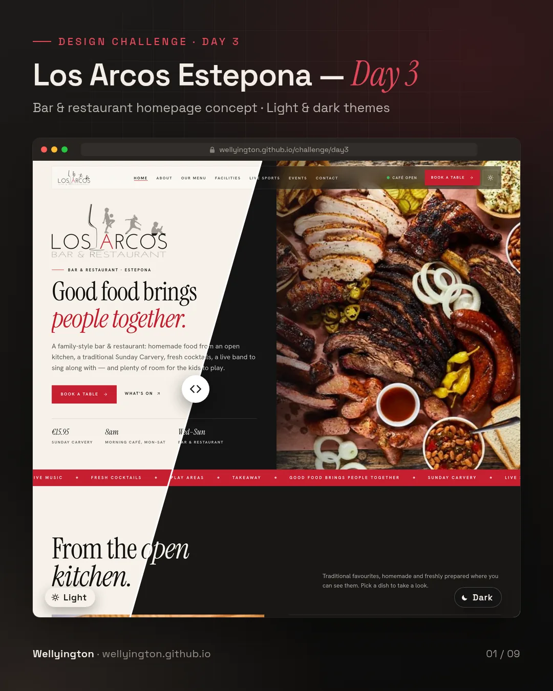
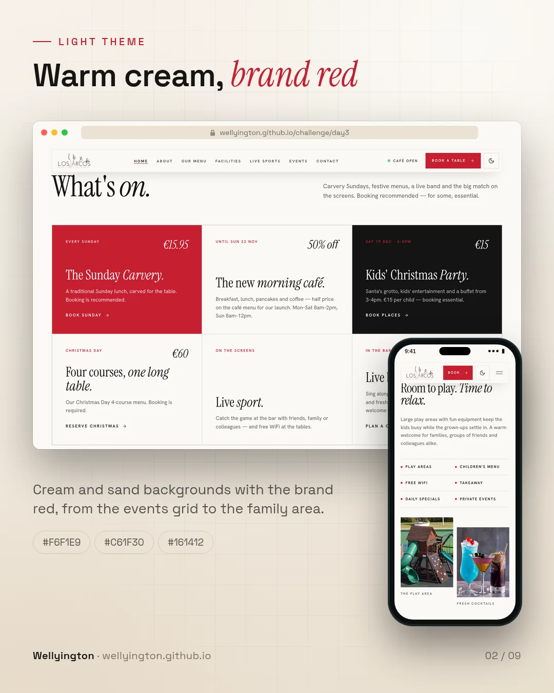
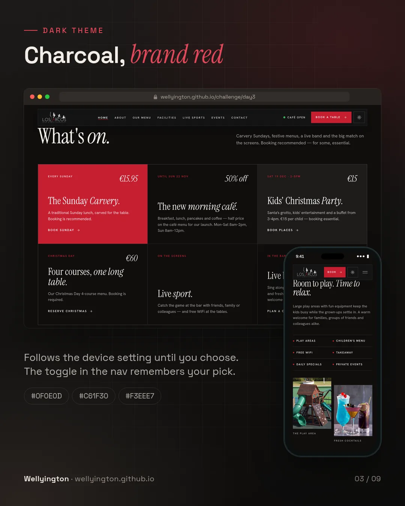
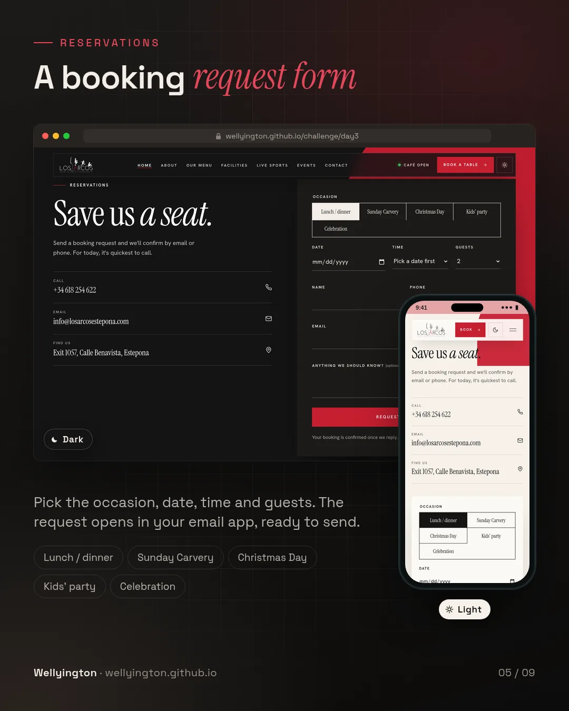
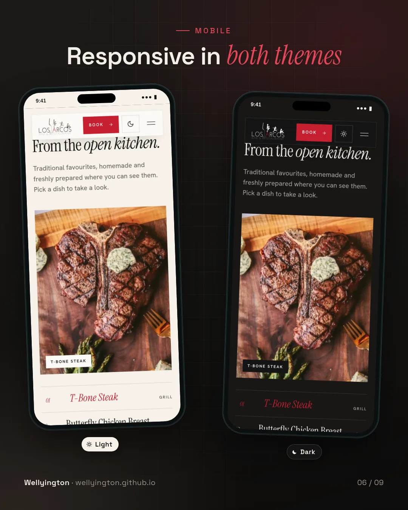
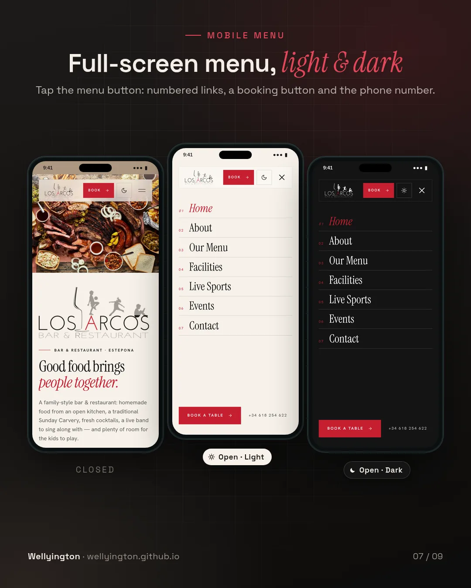
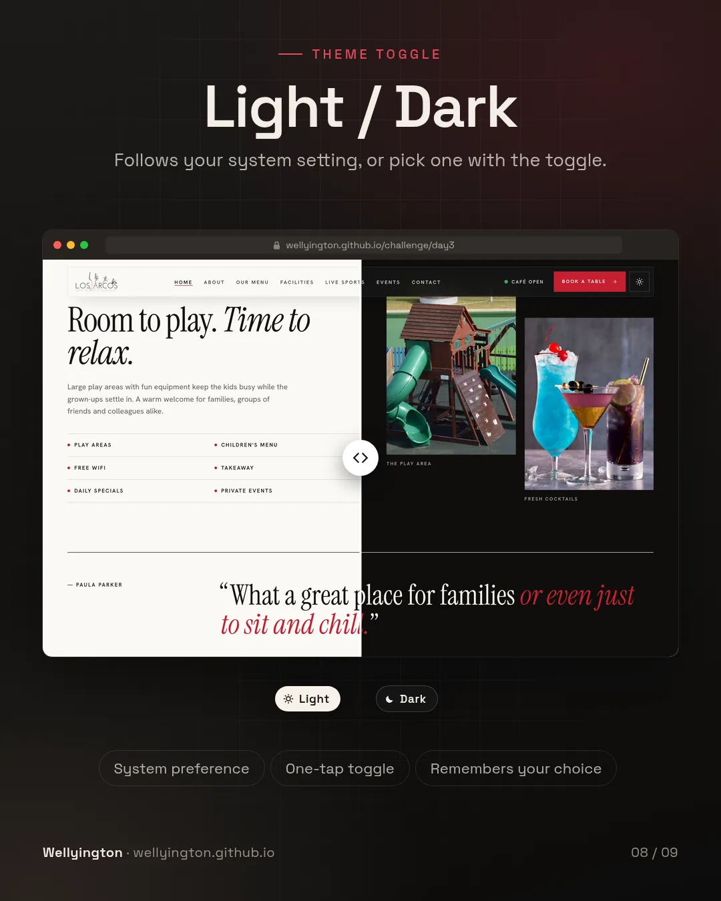

No dia 19 de novembro publiquei a terceira nota desta série: cem dias, cem negócios, cem sites, cada um aberto para quem quiser ver. O primeiro dia foi uma construtora familiar da Marina Alta que precisava de uma primeira página clara, alguma coisa para olhar antes de um contrato. [Essa página está aqui.](https://wellyington.github.io/journal/pt/articles/o-site-antes-do-sim/) O segundo, um teatro em Málaga que já tinha uma temporada cheia e precisava de uma ordem que uma pessoa conseguisse usar. [Esse está aqui.](https://wellyington.github.io/journal/pt/articles/espaco-para-a-temporada-inteira/) Hoje a caminhada é mais curta.

O Los Arcos é um bar e restaurante na Calle Benavista, perto da saída 1057, em Estepona. Eu trabalho em Estepona, então este é o primeiro negócio da série na minha própria cidade. Isso muda muito pouco o trabalho e bastante o cuidado. Aqui as pessoas vão abrir a página e saber na hora se ela soa como o lugar. O conceito abre aqui: [Los Arcos, dia três](https://wellyington.github.io/challenge/day3/).

Ninguém no Los Arcos me pediu isso. Não é uma encomenda e não é o site oficial deles. Na página estão o nome, os pratos e a semana deles. O conceito é meu, e por enquanto mora no meu próprio endereço, que é o lugar honesto para um trabalho que ninguém adotou ainda. Ninguém me disse que alguém de lá já viu.

## um lugar com mais de um motivo para ir

A construtora tinha um único trabalho para explicar, e o teatro tinha uma temporada. Um bar e restaurante familiar tem algo menos arrumado. As pessoas vêm por motivos diferentes, em horários diferentes, muitas vezes no mesmo grupo.

Alguém quer o assado de domingo. Outra pessoa quer ver o jogo numa tela grande. Um casal quer um coquetel e a banda. Um pai quer sentar por uma hora enquanto as crianças correm num lugar seguro. Numa manhã de semana, alguém só quer café e panquecas antes do trabalho. O Los Arcos faz tudo isso debaixo do mesmo teto: cozinha aberta, o Sunday Carvery, café da manhã, esporte ao vivo, música ao vivo, áreas de brincar e comida para viagem.

Uma página inicial que fala de tudo no mesmo volume não diz nada. Uma que escolhe um único motivo deixa de fora metade das pessoas que já frequentam. Então o trabalho era uma ordem. Primeiro, que tipo de lugar é. Depois, o que se come. Em seguida, o que tem nesta semana. Depois, quando está aberto, por que funciona para famílias e como conseguir uma mesa. Tudo o que um cliente fiel já sabe, na ordem em que alguém que chega pela primeira vez precisa.

## comida boa junta as pessoas

A abertura mantém a frase da casa, porque é boa: good food brings people together, comida boa junta as pessoas. Ela aparece numa serifa alta e estreita, com a segunda metade em itálico e no vermelho da casa. Em cima fica o logotipo, os arcos com as figurinhas brincando. Embaixo, um único parágrafo: um bar e restaurante de estilo familiar, comida caseira de uma cozinha aberta, um Sunday Carvery tradicional, coquetéis feitos na hora, uma banda ao vivo para cantar junto e muito espaço para as crianças brincarem.

Depois, dois botões: reservar uma mesa ou ver a programação. Abaixo deles, três informações que de outro jeito você teria que perguntar: o Sunday Carvery a € 15,95, o café da manhã a partir das 8h de segunda a sábado, e o bar e restaurante de quarta a domingo. Uma faixa vermelha atravessa o pé da tela com os motivos que levam as pessoas até lá, um depois do outro: música ao vivo, coquetéis, áreas de brincar, comida para viagem e a frase sobre comida boa.

À direita, uma foto grande de uma travessa: frango fatiado, costela, linguiças, anéis de cebola, um pote de feijão, um potinho de molho. Eu queria que a primeira tela parecesse uma mesa, não um folheto.

*A primeira tela, cortada em duas. A mesma abertura de dia e de noite.*

## duas luzes, um restaurante

Esse corte na diagonal é o centro do conceito. A página tem dois temas, e o mesmo restaurante precisa parecer certo nos dois.

O claro é creme quente, parecido com uma toalha de mesa, com o vermelho da marca para tudo o que dá para tocar e para as palavras em itálico. Ele se lê fácil ao meio-dia num terraço, com sol na tela. O escuro é carvão, quase preto, com o mesmo vermelho. Fica mais confortável às dez da noite, quando alguém confere se a cozinha ainda está aberta ou manda a página para um amigo do sofá.

Se o seu celular já está no modo escuro, a página abre escura. Se está no claro, abre clara. Um botãozinho na navegação troca o tema, e a página lembra da sua escolha na próxima visita. Os cartões, as fotos e o vermelho não mudam. Só muda a sala em volta.

*O tema claro: creme quente, vermelho da marca e a semana numa grade.*

*O tema escuro. Ele segue o aparelho até você escolher, e o botão lembra da escolha.*

## direto da cozinha aberta

Um site de restaurante é aberto para ver a comida, então a comida vem em segundo lugar, logo depois das boas-vindas. O título diz isso sem rodeio: from the open kitchen, direto da cozinha aberta. Uma linha embaixo explica que são pratos tradicionais, caseiros e preparados na hora, onde dá para ver.

Depois, uma lista curta de seis pratos, numerados como num cardápio: T-Bone Steak, peito de frango aberto, salmão com batatas assadas com pimenta, chili com carne, linguiça com purê e bolo de chocolate. Cada um tem uma etiqueta pequena: grelha, peixe, da casa, clássico, sobremesa. Você escolhe um e a foto aparece ao lado da lista. O T-Bone chega numa tábua de madeira, com uma rodela de manteiga de ervas derretendo por cima.

Embaixo da lista, uma frase cita o resto do cardápio, para ninguém achar que esses seis são tudo: as costelas lendárias, o bacalhau empanado na cerveja, o contrafilé, hambúrgueres, pizza, saladas da casa e Caesar, um cardápio infantil, um quadro de sugestões no bar e comida para viagem. Eu não comi o cardápio inteiro, então não vou descrever sabores. A página descreve os pratos do jeito que o Los Arcos descreve, e coloca as fotos onde uma pessoa com fome vai olhar.

## a programação, e quando nos encontrar

Depois vem a semana, porque um bar assim vive dela. O título é What's on, a programação, e a grade é sincera sobre reservas: recomendadas para algumas coisas, indispensáveis para outras.

O Sunday Carvery fica com o cartão vermelho: todo domingo, € 15,95, um almoço de domingo tradicional, fatiado para a mesa. Ao lado, o novo café da manhã, com metade do preço no cardápio do café até domingo, 22 de novembro, por causa da inauguração, de segunda a sábado das 8h às 14h e aos domingos das 8h ao meio-dia. A festa de Natal das crianças, no sábado, 19 de dezembro, das 14h às 17h, tem a gruta do Papai Noel, recreação e um bufê das 15h às 16h, a € 15 por criança, com reserva indispensável. O dia de Natal tem quatro pratos por € 60, uma mesa comprida, com reserva obrigatória. Depois, as telas, para ver o jogo com amigos, família ou colegas, e wi-fi grátis nas mesas. Depois, o bar, com banda ao vivo, coquetéis feitos na hora e um aviso de que casamentos, aniversários e reencontros são bem-vindos.

Cada cartão termina numa única ação: reservar o domingo, reservar vagas, reservar o Natal, planejar uma comemoração. Ninguém precisa adivinhar o que fazer em seguida.

O horário vem logo depois, sob When to find us, quando nos encontrar. Três abas, porque o Los Arcos tem três horários: restaurante, bar e café. Você escolhe uma e a linha grande à esquerda diz o que importa agora, no horário de Estepona: aberto, ou abre às 14:00, mais tarde hoje. À direita fica a semana inteira, com o dia de hoje marcado em vermelho. O restaurante fecha segunda e terça, abre das 14:00 às 21:00 de quarta a sexta, das 12:00 às 21:00 no sábado e das 12:00 às 20:00 no domingo. O pontinho verde na navegação faz o mesmo num relance: diz café aberto quando o café está aberto.

*Escolha um prato para ver. Escolha restaurante, bar ou café para saber se abre hoje.*

## espaço para brincar, tempo para relaxar

Tem uma seção para famílias, porque esse é um bom pedaço do motivo pelo qual as pessoas escolhem o Los Arcos e não o lugar ao lado. Room to play. Time to relax. Espaço para brincar, tempo para relaxar. Áreas de brincar grandes, com brinquedos, mantêm as crianças ocupadas enquanto os adultos se acomodam. Seis pontos curtos em duas colunas: áreas de brincar, cardápio infantil, wi-fi grátis, comida para viagem, sugestões do dia e eventos privados. Duas fotos contam o resto: o parquinho com seus escorregadores verdes e uma fileira de coquetéis, um deles azul forte. É a mesma tarde vista por duas gerações.

Embaixo, uma frase de uma cliente, Paula Parker: que lugar ótimo para famílias, ou até só para sentar e relaxar. Deixei uma única citação, grande, sem estrelas e sem contador. Uma frase de verdade faz mais do que um carrossel.

## guarde um lugar para nós

A seção de reservas se chama Save us a seat, guarde um lugar para nós. À esquerda, os três jeitos de falar com o restaurante, todos tocáveis: o telefone, +34 618 254 622; o e-mail, info@losarcosestepona.com; e o endereço, saída 1057, Calle Benavista. Uma linha curta diz o que qualquer pessoa que tem restaurante diria: para hoje, o mais rápido é ligar.

À direita, o formulário de pedido. Primeiro a ocasião, em cinco botões: almoço ou jantar, Sunday Carvery, dia de Natal, festa infantil, comemoração. Depois a data, um horário que só aparece quando já existe uma data, e o número de pessoas. Depois nome, telefone, e-mail e qualquer coisa que a cozinha precise saber. Você toca no botão e o seu aplicativo de e-mail abre com o pedido já escrito, pronto para enviar.

O conceito não finge ser um sistema de reservas. Não tem conta para criar, e o formulário diz com todas as letras que a reserva está confirmada quando o restaurante responde. Nesta costa, uma mesa ainda é combinada muitas vezes por telefone ou por uma resposta do dono, e uma página que prometesse mais do que isso estaria mentindo.

*Escolha a ocasião, a data, o horário e o número de pessoas. O pedido abre no seu e-mail, pronto para enviar.*

## a mesma noite no celular

A maioria das pessoas vai conhecer esta página pelo celular. Alguém estacionado na porta quer saber se a cozinha está aberta. Um grupo de WhatsApp está decidindo onde assistir ao jogo. Uma mãe reserva a festa de Natal das crianças nos cinco minutos que tem entre duas outras coisas.

No celular tudo se empilha na mesma ordem. O título, a frase, a foto, e o nome do prato numa etiqueta pequena sobre a imagem. O botão de reservar fica na barra de cima, ao lado da troca de tema, onde o polegar alcança de qualquer ponto da página.

O menu abre em tela cheia. Sete links, numerados como os pratos: início, sobre, cardápio, estrutura, esporte ao vivo, eventos, contato. Embaixo, as duas coisas que alguém com pressa quer: um botão de reservar mesa e o número de telefone. Funciona igual nas duas luzes.

*A cozinha aberta no celular, nos dois temas.*

*O menu em tela cheia: sete links numerados, um botão de reserva e o telefone, claro ou escuro.*

## uma proposta, não uma tomada de controle

O Los Arcos não me contratou. Este não é o site deles, e nada aqui quer dizer que eles aprovaram. Eles já têm um site, um telefone que toca, clientes fiéis e um domingo que lota. Os pratos, os preços, as datas e as palavras da cliente são deles, não meus. O que eu acrescentei foi uma ordem, duas luzes e um pedido de reserva que diz a verdade sobre como uma mesa é confirmada.

Não tenho números de couverts nem de faturamento, e não vou inventar nenhum. Se alguém do Los Arcos abrir o conceito e não quiser nada de mim, esse é um final completo. Se quiserem, o resto é prático: as fotos deles, as palavras deles onde hoje estão as minhas, o horário sempre atualizado, o formulário enviado para quem cuida das reservas e um domínio no nome deles.

*Segue a configuração do seu sistema, ou você escolhe. Um toque, e a escolha fica guardada.*

## se o seu negócio tem muitas portas

Pode ser que você não tenha um restaurante. Muitos negócios desta costa se parecem mais com o Los Arcos do que com uma empresa de uma frase só. Uma academia com café. Um beach club com loja. Uma escola com colônia de férias. As pessoas entram por portas diferentes, em horários diferentes, por motivos diferentes, e o site normalmente tenta manter todas as portas abertas ao mesmo tempo.

O que ajuda é uma ordem, não mais blocos. Diga o que o lugar é numa linha. Mostre aquilo que faz as pessoas virem de verdade. Coloque a semana onde dá para ler e o horário onde ele responde "agora?". Faça com que o jeito de entrar, um telefone, um formulário, uma mesa, seja honesto sobre o que acontece depois. E deixe a página seguir a luz em que a pessoa está.

Sou web designer em Estepona, na Costa del Sol, e faço sites como este para negócios de toda a Espanha. Se isso parece com o seu negócio, escreva para mim pelo [site principal](https://wellyington.github.io/pt/). Diga o que você faz e onde, e eu respondo em linguagem comum. A versão curta de hoje é a nota: dia três de cem, uma página inicial para um restaurante familiar na minha própria cidade, claro ou escuro, quem visita é que escolhe. [A nota está aqui.](https://x.com/wellyington/status/2123056661220733019) Amanhã é outro negócio, e outra página pronta.
