26 ноября я опубликовал десятую заметку этой серии — челленджа, который придумал Рамайя Траск: сто дней, сто бизнесов, сто сайтов. Десять — небольшая веха, поэтому сначала оглянусь назад. День первый — семейная строительная компания с Марина-Альты. [Эта страница здесь.](https://wellyington.github.io/journal/ru/articles/sait-do-slova-da/) День второй — театр в Малаге. [Она здесь.](https://wellyington.github.io/journal/ru/articles/mesto-dlya-tselogo-sezona/) День третий — семейный ресторан в Эстепоне. [Она здесь.](https://wellyington.github.io/journal/ru/articles/mesto-za-dlinnym-stolom/) День четвёртый — частная консалтинговая компания по недвижимости в Малаге. [Она здесь.](https://wellyington.github.io/journal/ru/articles/suzhdenie-vazhnee-obema/) День пятый — ресторан дегустационных меню в Мотриле. [Она здесь.](https://wellyington.github.io/journal/ru/articles/tak-zhe-tshchatelno-kak-na-kukhne/) День шестой — заведение с курицей-гриль в Эстепоне. [Она здесь.](https://wellyington.github.io/journal/ru/articles/ot-prilavka-do-cheka/) День седьмой — семейный отель в Кавосе на Корфу. [Она здесь.](https://wellyington.github.io/journal/ru/articles/tot-zhe-bassein-nochyu/) День восьмой — три дома в историческом центре Малаги. [Она здесь.](https://wellyington.github.io/journal/ru/articles/tri-doma-odna-dver/) День девятый — модельное агентство из Марбельи и Лондона. [Она здесь.](https://wellyington.github.io/journal/ru/articles/pust-govoryat-fotografii/)

Сегодня — студия пилатеса. Nordic Balance Studios находится в Нуэва-Андалусии, Марбелья, в торговом центре Centro Plaza на проспекте Манолете. Здесь проходят занятия пилатесом на реформере в небольших группах и на трёх уровнях, индивидуальные и полуиндивидуальные сессии и несколько специальных классов — от Stretch & Mobility до Prenatal & Postnatal. Студия основана на опыте спортивной медицины, реабилитации и пилатеса и принимает и мужчин, и женщин. Её нынешний сайт — [nordicbalancestudios.com](https://www.nordicbalancestudios.com/).

Концепция здесь: [Nordic Balance Studios, день десятый](https://wellyington.github.io/challenge/day10/).

## пространство и есть аргумент

Студию пилатеса выбирают по трём причинам, примерно в таком порядке: хочется ли там находиться, хорошо ли там учат и вписываются ли занятия в твою неделю.

Первую сложнее всего перенести на сайт, и о ней чаще всего забывают. Многие сайты студий яркие, перегруженные и полны акций: первое занятие за полцены, абонемент на пять занятий, новогодний марафон. Они похожи на спортзал. Nordic Balance — не спортзал. Сама студия спокойная: тёмный пол, тёплое дерево и камень, большие окна с видом на зелёные холмы, ряды реформеров в мягком свете. Сайт, который кричит, описывал бы другое место.

Поэтому направление — минималистичное и северное, под стать названию. Тёмные тона, тёплые нейтральные оттенки, журнальная типографика и много места для фотографий. А уже внутри этого спокойствия — две другие вещи, которые нужны людям: что за занятия и как на них записаться, причём ни то ни другое не приходится искать.

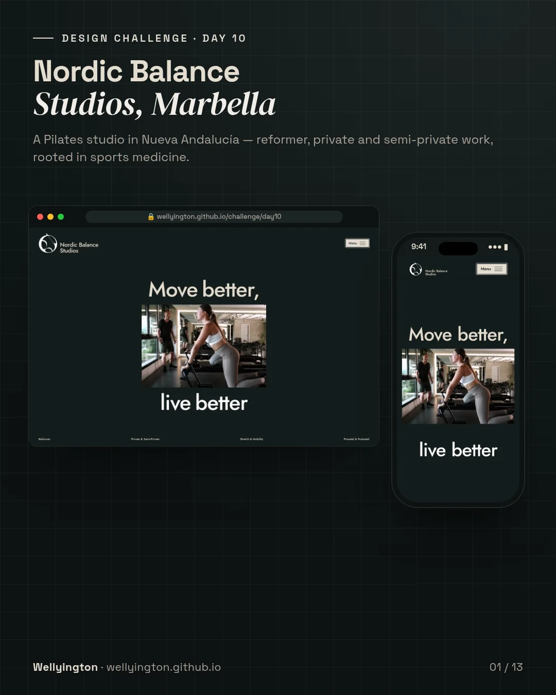
*День десятый: студия пилатеса в Нуэва-Андалусии — реформер, индивидуальные и полуиндивидуальные сессии на основе спортивной медицины.*

## двигайся лучше, живи лучше

Главная страница открывается почти чёрной. В центре крупными лёгкими буквами — фраза студии: move better, live better, двигайся лучше, живи лучше. Между двумя половинами фразы — короткое зацикленное видео из студии: клиентка на реформере, проходящий мимо инструктор, зал за ними. Оно размером с фотографию в журнале и плавно приближается, когда начинаешь прокручивать.

Внизу первого экрана — четыре направления студии простыми словами: Reformer, Private & Semi-Private, Stretch & Mobility, Prenatal & Postnatal. Других слоганов, кроме верхнего, нет — ни акций, ни всплывающих окон.

Я выбрал видео, а не фотографию, потому что пилатес — это движение, а неподвижный кадр человека на реформере может выглядеть как угодно. Несколько секунд медленного, контролируемого движения рассказывают о занятиях лучше любого абзаца.

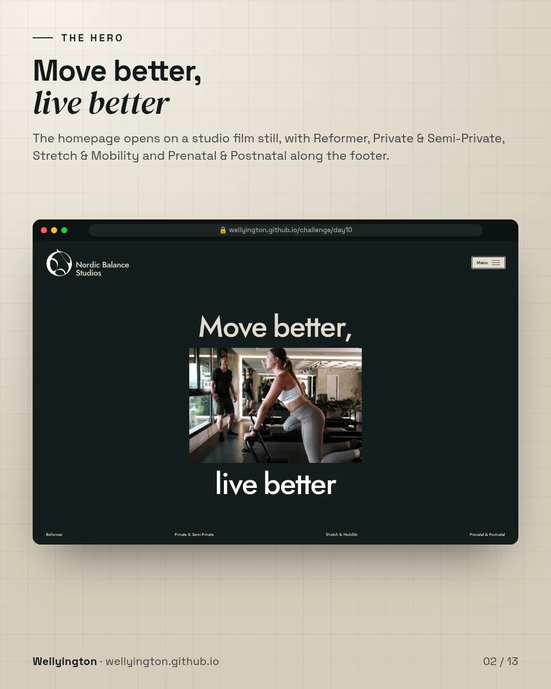
*Главная открывается кадром из видео студии, а внизу — четыре вида занятий.*

## одна кнопка, одно меню

В шапке две вещи: круглый логотип и название студии слева и маленькая кнопка Menu справа. Нажмёшь — три полоски превращаются в крестик, и появляется полноэкранный список: Home, Classes, About, Schedule, Contact. Внизу — строка о студии и адрес почты.

На компьютере и на телефоне всё одинаково. Пять слов, достаточно крупных, чтобы попасть пальцем не целясь, и больше ничего, что с ними спорит. Для сайта такого размера этого хватает.

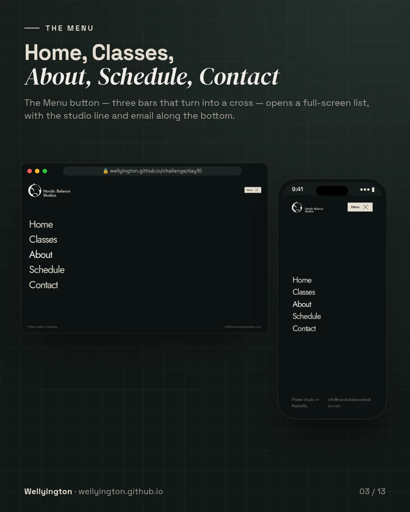
*Кнопка Menu открывает полноэкранный список, внизу — строка о студии и почта.*

## качество важнее моды

Дальше следующий раздел заполняет экран фотографией: мужчина на реформере в растяжке у окон студии, за окнами — холмы. Поверх — фраза, которая подытоживает весь бизнес, словами самой студии: если для вас качество важнее модных трендов, вы пришли по адресу. Мы соединяем научно обоснованное движение и персональные тренировки на основе спортивной медицины, реабилитации и пилатеса.

Вот и вся презентация. Здесь нет списка из десяти преимуществ и обещания нового тела за тридцать дней. Сказано, что это за студия и для кого, а остальное показывает фотография. Тот, кто ищет шумное интенсивное занятие, сразу поймёт, что ему не сюда. Тот, кто ищет внимательное и профессиональное обучение, поймёт, что нашёл. И то и другое хорошо для студии.

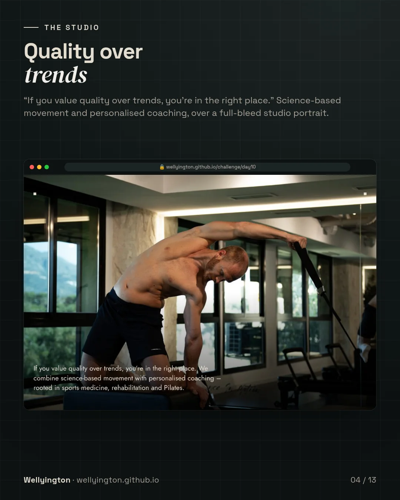
*Научно обоснованное движение и персональные тренировки поверх портрета студии во всю ширину.*

## четыре двери к занятиям

Следующий раздел называется classes for every stage — занятия для каждого этапа. В нём четыре больших блока, расставленных крестом, а не в ряд, у каждого номер и название: 01 Reformer, 02 Private, 03 Specialist, 04 First Visit. Ссылка на все занятия — в правом верхнем углу.

Блоки молчат, пока они не нужны. Наведите курсор на компьютере или коснитесь на телефоне — блок становится кремовым и показывает, что внутри. Reformer — Beginners, Intermediate и Advanced Reformer, полуиндивидуальные сессии и небольшие группы с сертифицированными инструкторами. Private — для чего нужна индивидуальная работа: спортивные результаты, реабилитация и восстановление после травм, коррекция осанки, здоровье позвоночника и беременность. Specialist собирает Stretch & Mobility, Posture для всех уровней, Longevity 50+, Teen Girls Pilates и Outdoor Mat Pilates. А First Visit объясняет, что происходит в начале: индивидуальное занятие Consultation Class, оценка движения, разговор о целях и прошлых травмах и рекомендованные вам занятия.

Эта последняя дверь — главная. Новые клиенты часто сомневаются, потому что не знают, куда им. Здесь «я новенький» — отдельная категория с понятным первым шагом.

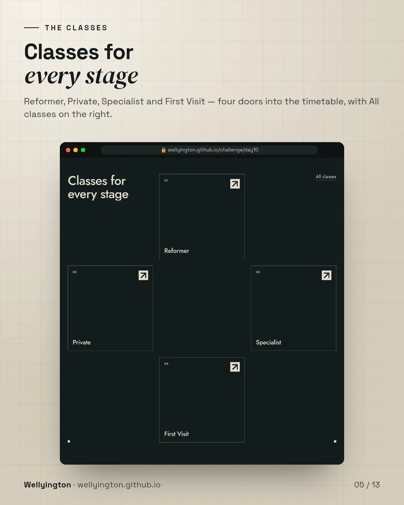
*Reformer, Private, Specialist и First Visit — четыре двери в расписание.*

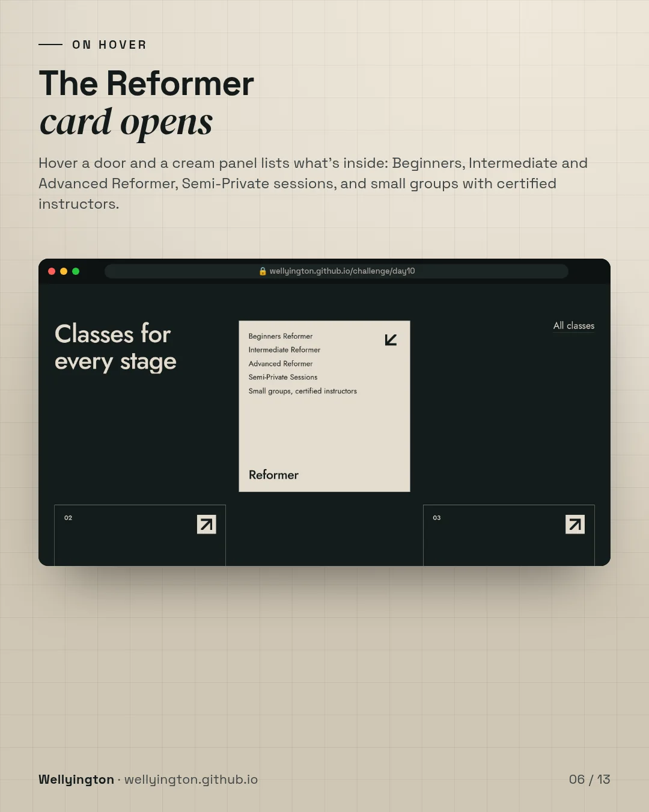
*Наведите на дверь — и кремовая панель покажет, что за ней.*

## три способа записаться

Большинство фитнес-студий пользуются сразу несколькими системами записи, и их сайты редко объясняют, какая для чего. Nordic Balance — не исключение: на групповые и полуиндивидуальные занятия записываются в приложении студии, на индивидуальные — через WhatsApp, а новые клиенты начинают с консультации.

Поэтому раздел записи, book your session, объясняет ровно это — в трёх колонках, у каждой своя фотография. Запишитесь на групповое занятие: Beginner, Intermediate и Advanced Reformer плюс специальные классы, запись прямо в приложении Nordic Balance Studios, включая полуиндивидуальные сессии. Запишитесь на индивидуальное занятие: через WhatsApp по номеру +34 648 876 173, чтобы студия подобрала инструктора под ваши цели. И запишитесь на первую Consultation Class: индивидуальную сессию, где оценят ваше движение, обсудят цели и возможные травмы и порекомендуют подходящие занятия.

Над каждой колонкой — две маленькие метки: для кого это и где проходит запись. Group classes и app, private classes и WhatsApp, new clients и start here. Никому не нужно гадать, куда ведёт кнопка.

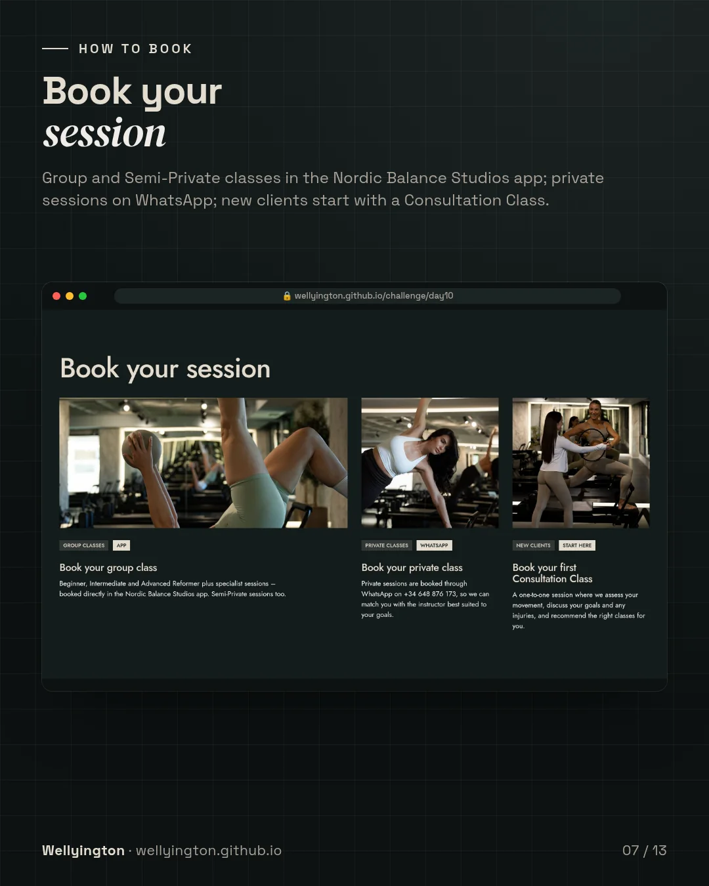
*Групповые и полуиндивидуальные занятия — в приложении, индивидуальные — через WhatsApp, а для новичков — Consultation Class.*

## уровни, расписанные полностью

Страница занятий отвечает на вопрос, который задаёт каждый новичок и на который отвечают немногие сайты студий: какое занятие моё?

У каждого уровня реформера — короткий абзац простым языком. Beginners Reformer — отправная точка, если вы впервые занимаетесь пилатесом на реформере или возвращаетесь после перерыва; в небольших группах сертифицированные инструкторы помогают освоить основы и подскажут, когда вы готовы к Intermediate. Intermediate — для клиентов с крепкой базой, готовых к более динамичным движениям и длинным последовательностям; как сказано на странице, прогресс — это не двигаться быстрее, а двигаться лучше. Advanced — для тех, кто занимается на реформере не меньше года: сложные связки, которые проверяют силу, стабильность и контроль. А Private & Semi-Private, специализация студии, охватывает спортивные результаты, реабилитацию, осанку, беременность, здоровье позвоночника и восстановление после травм.

Ниже три пронумерованных шага объясняют, как начинает новый клиент: 01 — Consultation Class; 02 — план занятий с рекомендацией групповых, полуиндивидуальных или индивидуальных сессий; 03 — прогресс под контролем, когда инструктор сам скажет, что вы готовы к следующему уровню. Хорошее движение начинается с освоения основ, говорит страница, и её структура с этим согласна.

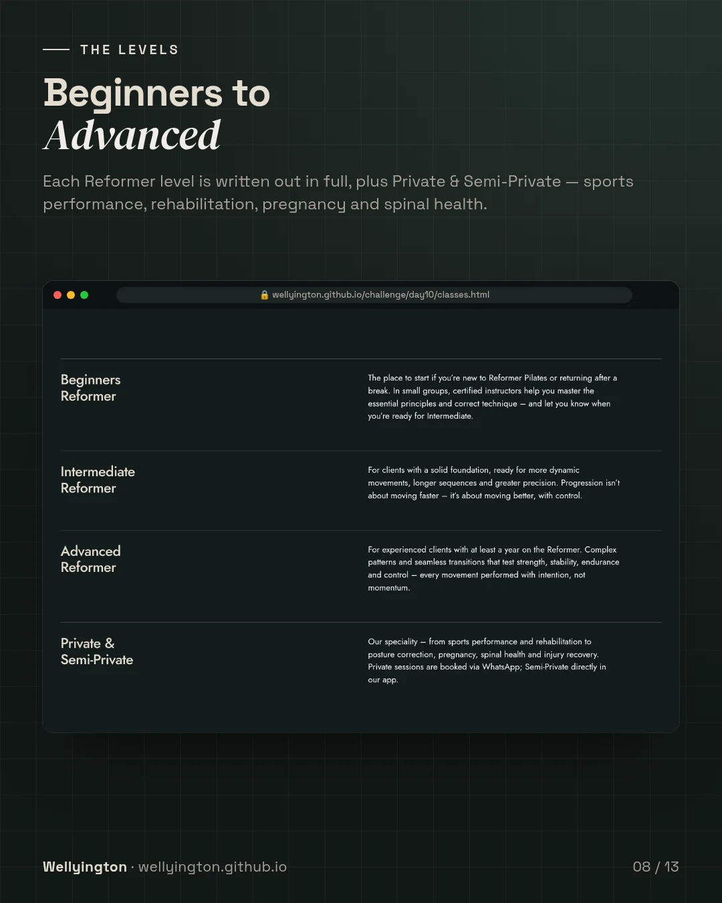
*Каждый уровень реформера расписан полностью, плюс Private & Semi-Private.*

## неделя одним взглядом

Под уровнями — недельное расписание: ряд карточек, по одной на день, которые листаются стрелками снизу. На каждой карточке — занятия дня со временем, окно индивидуальных сессий более мягким серым, а внизу — день и число групповых занятий.

В понедельник четыре групповых занятия, от Intermediate в 09:15 до Prenatal & Postnatal в 13:30, а после обеда — индивидуальные сессии. Четверг самый насыщенный: семь занятий, от Intermediate в 09:15 до Stretch & Mobility в 19:45, и Longevity 50+ в 10:30. В субботу — только индивидуальные сессии. Ряд закольцован: после воскресенья снова идёт понедельник, а на телефоне видна одна карточка за раз.

Смысл в том, чтобы одним взглядом ответить на вопрос «успеваю ли я?» — не скачивая приложение и не открывая PDF. Записываются по-прежнему в приложении; решают — на сайте.

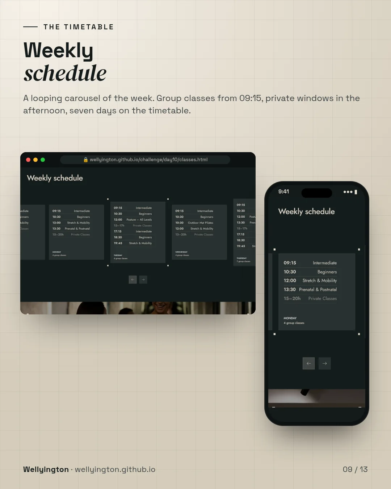
*Карусель недели: групповые занятия с 09:15 и индивидуальные окна после обеда.*

## наша студия

Страница о студии снова выводит фотографию на первый план. Четыре снимка студии, у каждого название занятия: Reformer Pilates — небольшие группы на трёх уровнях; Private sessions — под ваши цели; Posture для всех уровней — выравнивание для повседневной жизни; Stretch & Mobility — чтобы двигаться свободнее. Рядом — кремовая карточка, которая намеренно нарушает тёмную сетку: вы здесь впервые? Начните с Consultation Class — и ссылка на запись.

Ниже — философия студии её собственными словами: мы не гонимся за фитнес-трендами; мы сосредоточены на долгосрочном здоровье, осмысленном движении и стойких результатах. И три цифры: 5,0 — оценка студии в Google по 44 отзывам; 3 — уровня реформера; 7 — дней в неделю с занятиями в расписании.

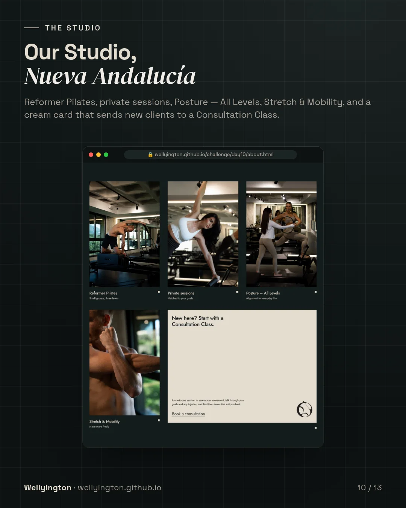
*Реформер, индивидуальные сессии, осанка и растяжка — и кремовая карточка, которая отправляет новичков на Consultation Class.*

## открыто сейчас

Страница контактов называется get in touch — свяжитесь с нами, и две части фразы разнесены к противоположным краям экрана. Под ней — главное: почта, полный адрес в Centro Plaza, телефон и WhatsApp и строка, которая ещё раз напоминает, как записаться на каждый вид занятий.

Рядом — часы работы на каждый день недели. Сегодняшний день выделен, а страница говорит, открыта ли студия прямо сейчас. Она считает это по времени Марбельи, а не по часам устройства посетителя, поэтому ответ верен и для того, кто смотрит из Лондона или Стокгольма перед отпуском.

Ниже — частые вопросы: пять, и первый уже раскрыт, потому что его задают чаще всего. Я новичок — с чего начать? С Consultation Class. Как записаться на индивидуальную сессию? Через WhatsApp. Студия только для женщин? Нет, рады и мужчинам, и женщинам, а ещё есть занятия Teen Girls и Longevity 50+. Когда можно перейти на следующий уровень? Когда скажет инструктор; для Advanced нужно не меньше года на реформере. Как записаться на групповые и полуиндивидуальные занятия? В приложении.

Каждый из этих ответов иначе команде студии пришлось бы объяснять по телефону снова и снова.

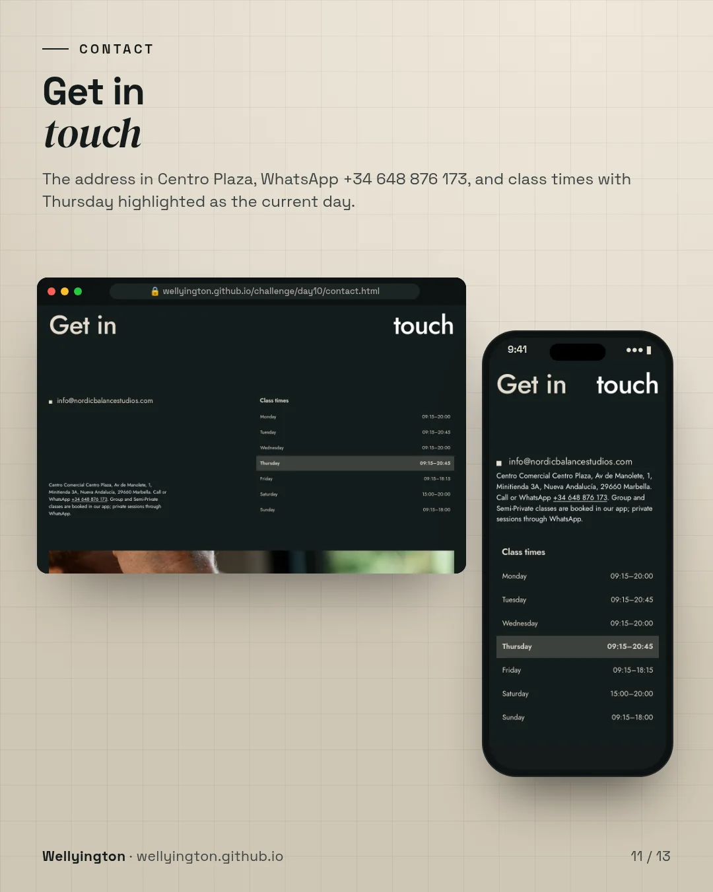
*Адрес в Centro Plaza, WhatsApp и часы работы с выделенным сегодняшним днём.*

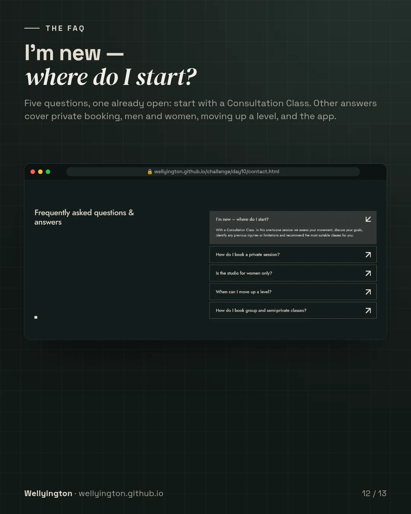
*Пять вопросов, один уже раскрыт: начните с Consultation Class.*

## детали

Шрифт один — Jost, чистый геометрический гротеск, в тонком и обычном начертании почти для всего и чуть плотнее для маленьких меток. Одно семейство держит страницы спокойными и оставляет работу размеру и пространству.

В палитре три цвета: почти чёрный с оттенком зелёного, тёплый кремовый и мягкий серый между ними. Тёмные разделы держат фотографию; кремовые появляются там, где нужно внимание: открытый блок, карточка консультации, выделенный день.

Движение медленное и сдержанное. Заголовки поднимаются на место, видео на первом экране плавно приближается при прокрутке, а страницы мягко переходят от раздела к разделу. Что я добавил бы в настоящей версии: отключение видео и эффектов прокрутки для тех, кто попросил своё устройство уменьшить анимацию. Шрифты загружаются с моего собственного сайта, а не из Google, так что, открывая страницы, никто не передаёт свой адрес третьей стороне.

## что это за концепция и что дальше

Факты на страницах взяты с нынешнего сайта студии и её публичных профилей: занятия и уровни, расписание, способы записи, адрес и телефон, ответы на частые вопросы и оценка в Google в том виде, в каком она была.

Новое — это структура: спокойный первый экран с видео, четыре двери к занятиям, одна из которых — «First Visit», запись, объяснённая по видам занятий, уровни, расписанные полностью, неделя на виду и часы работы, которые знают, открыта ли студия прямо сейчас.

Цифр по записям у меня нет, и выдумывать их я не буду. Чтобы превратить концепцию в работающий сайт, нужны практические шаги: связать расписание с приложением студии, чтобы оно обновлялось само, сделать испанскую версию рядом с английской и добавить профили самих инструкторов, потому что в такой студии преподаватели — во многом причина, по которой люди приходят.

## десять готово

После десяти дней виден закономерный рисунок. У всех бизнесов этой серии уже был сайт. Сломанных было очень мало. Большинство просто сделаны так, чтобы выглядеть законченными, а не отвечать на то, о чём клиенты действительно спрашивают: что это, подходит ли мне, сколько стоит, когда можно прийти и как записаться. Ответы Nordic Balance на эти вопросы уже существовали — в приложении, в WhatsApp, в головах команды. Задача сайта — собрать их в одном спокойном месте.

Если у вас студия, клиника или любой бизнес, где люди записываются на время, всё то же самое. Объясните уровни или услуги простыми словами. Покажите неделю. Скажите точно, как записаться на каждое. Дайте новичкам их собственный первый шаг. И позвольте месту говорить за себя.

Я веб-дизайнер из Эстепоны на Коста-дель-Соль, проектирую и делаю сайты для бизнеса в Испании и за её пределами. Если это похоже на ваш бизнес, напишите мне через [основной сайт](https://wellyington.github.io/ru/). Расскажите, чем вы занимаетесь и где, и я отвечу понятным языком. Концепция [здесь](https://wellyington.github.io/challenge/day10/), а нынешний сайт Nordic Balance Studios — [здесь](https://www.nordicbalancestudios.com/), чтобы вы могли сравнить. Десять готово, осталось девяносто.
