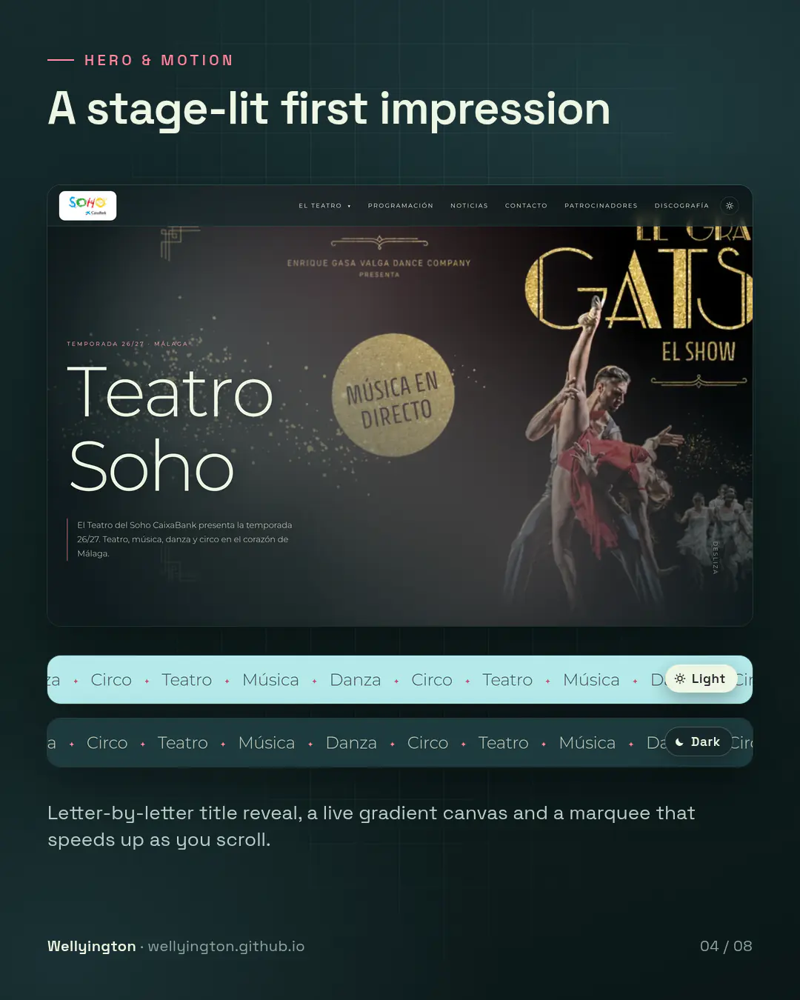
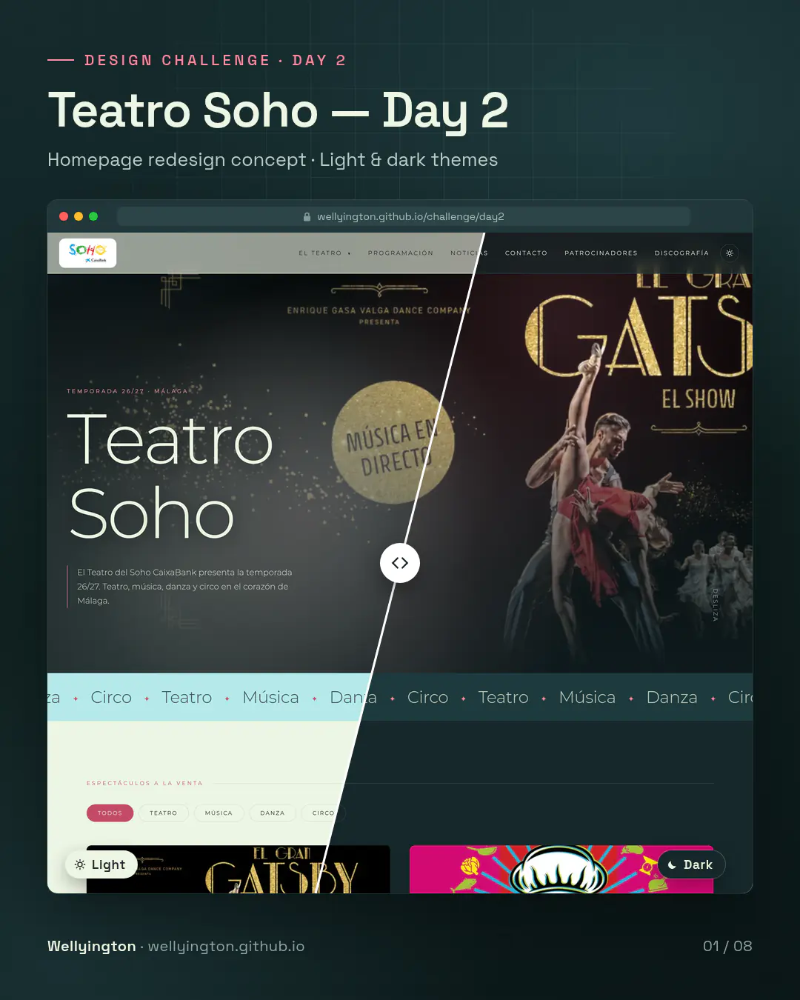
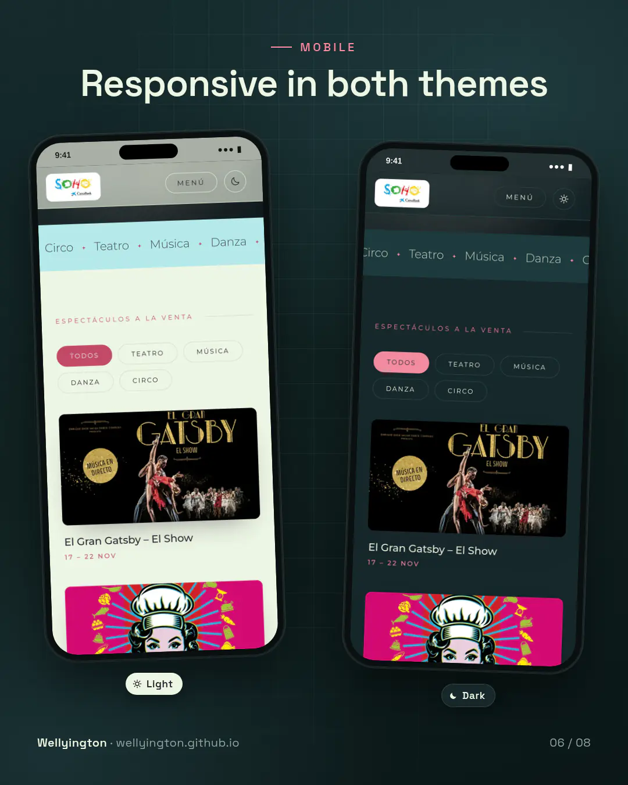
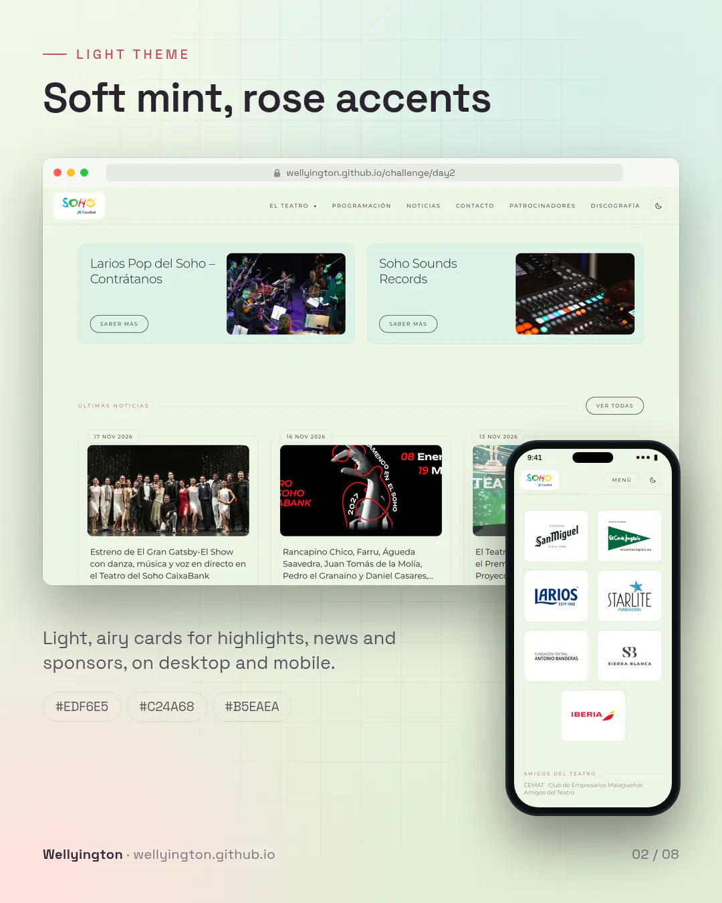
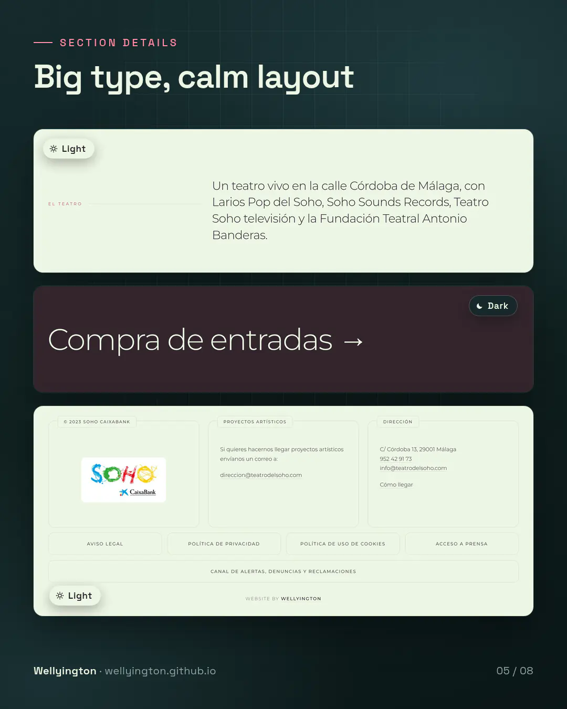
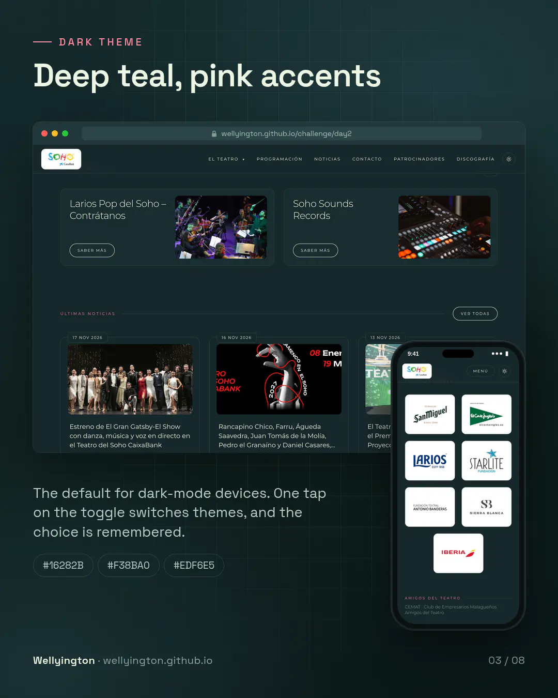

18 ноября я выложил вторую заметку этого ряда: сто дней, сто дел, сто сайтов, по адресу, который может открыть любой. Предыдущий день был семейной строительной фирмой в Марина-Альте: ей нужна была первая ясная страница, готовая вещь, на которую можно посмотреть до договора. [Та страница здесь.](https://wellyington.github.io/journal/ru/articles/sait-do-slova-da/) Сегодня место другое, и работа другая вместе с ним.

Teatro Soho CaixaBank стоит на улице Кордова, в Малаге. Я работаю из Эстепоны, на том же берегу, достаточно близко, чтобы не представлять Малагу так, будто я приехал сюда ради статьи. У театра уже есть сезон, здание, к которому люди приходят пешком, имя, которое что-то значит, и несколько дел под одной крышей. Он не ждёт первой фразы в интернете. Я сделал главную страницу для жизни, которая у него уже есть. Концепт открывается здесь: [Teatro Soho, день второй](https://wellyington.github.io/challenge/day2/).

Никто в театре меня об этом не просил. Это не заказ, и страница не связана ни с театром, ни с CaixaBank. Имя на ней их. Концепт мой, и пока он лежит на моём адресе: так честнее для работы, которую никто не забрал. Мне не сказали, что кто-то там её смотрел, и я не стану писать так, будто смотрели.

## дом, который уже полон

Посетителю вчерашней страницы нужно было понять, можно ли доверить фирме дом. Человек, который открывает страницу театра, обычно хочет ответ поменьше и хочет его сразу: что идёт в эту субботу, есть ли танцы, осталось ли место и кто на сцене. Сезон и есть то, что предлагают, и он двигается, пока человек ещё решает.

В здании больше, чем календарь. Рядом с театром живут Larios Pop del Soho, Soho Sounds Records, Teatro Soho televisión и Fundación Teatral Antonio Banderas, а ещё спонсоры, новости недели, телефон и улица, которую найдёт такси. Если сложить всё это на один экран, никто не дочитает. Если спрятать, афише некуда вести. Работа в том, чтобы дать сезону порядок, которым человек может пользоваться, и первую минуту, похожую на приход в здание. Дальше страница должна сказать, что идёт и как взять билет.

Имена, даты и партнёров я не выдумывал. Они публичные, и концепт показывает именно их. Этих спектаклей я из зала не видел, поэтому здесь рассказ о странице, а не о вечере.

## первая минута

Открытие посвящено этому сезону. Сверху мелким написано Temporada 26/27 · Málaga: сезон 26/27, Малага. Ниже имя крупно, Teatro Soho, и буквы приходят по одной, как название, когда в зале уже стало тихо. За именем афиша El Gran Gatsby – El Show: золотые буквы, двое танцующих, строка о том, что вечер представляет Enrique Gasa Valga Dance Company, и круглый золотой знак música en directo, музыка вживую. Рядом с тонкой розовой чертой короткий абзац: дом представляет сезон 26/27, театр, музыку, танец и цирк, в сердце Малаги.

Под этим идёт лента слов: Circo, Teatro, Música, Danza, цирк, театр, музыка, танец, и снова те же четыре. Если спускаться по странице, лента чуть ускоряется. Если остановиться, она успокаивается. Я имею в виду чувство поднимающегося занавеса, небольшую перемену в зале. За афишей ещё медленно смещается свет, ближе к свету сцены, чем к ряду слайдов.

*Первый экран. Сезон, афиша и имя дома.*

То же открытие существует в двух светах, потому что люди читают не в одной и той же комнате. Один вариант мягкий мятный, розовый оставлен для мелких акцентов: так спокойно в светлом кафе или на солнечном тротуаре. Другой глубокий тёмно-зелёный, ближе к тёмному залу, розовый используется так, как используют дежурный свет. Если телефон уже стоит в тёмном режиме, страница открывается тёмной. Одно касание её меняет, и выбор запоминается. Афиша и имя остаются на месте. Поздним вечером страница не бьёт в глаза, а в обед вам не подсовывают чёрный экран, с которым надо бороться.

*Одна главная, два света. Сезон остаётся, меняется зал вокруг него.*

## найти субботу

Под лентой заголовок нарочно простой: Espectáculos a la venta, спектакли в продаже. Под ним пять меток: Todos, Teatro, Música, Danza, Circo. Все, театр, музыка, танец, цирк. Если в субботу нужен танец, нажимаете Danza, и остальное отступает. Вся задача в этом, два касания, а не поиск по списку, который собран для кассы, а не для человека с телефоном в руке.

Каждый спектакль — это афиша, потом имя, потом даты. El Gran Gatsby – El Show идёт с 17 по 22 ноября и лежит в танце и музыке, что совпадает с золотым знаком. La Cubana, La cuisine de ma cousine, идёт с 25 ноября по 15 декабря, в разделе театра, на ярко-розовой карточке с поварским колпаком, который принадлежит этой труппе, а не афише Гэтсби. Они могут стоять рядом. Дом, где в афише цирк, фламенко, мюзиклы и драма, выглядит небрежно, если каждую карточку загоняют в одну и ту же рамку.

Вокруг этих двух на сетке лежит сезон. Рождество в Soho, с Антонио Бандерасом, стоит с 25 по 28 декабря. Duck Pond труппы Circa приходится на 19 и 20 декабря. В январе идут Mujer en cinta de correr sobre fondo negro, Hija de la Luna и Flamenco en el Soho 2027, с 8 января по 19 марта, в том числе Rancapino Chico и на следующий вечер Farru с Duquende в программе Natural. Я перечисляю то, что перечисляет страница. Рецензии здесь нет, и цифры продаж нет, потому что ни того ни другого у меня нет.

*Спектакли в продаже, на телефоне. Выберите танец, и остальные карточки отойдут.*

Открытая карточка выводит спектакль вперёд, и от него два хода: купить билет или прочитать ещё. Ниже, буквами, которые нельзя не заметить, стоит строка Compra de entradas, покупка билетов. На середине страницы гостю не приходится гадать, продаются ли билеты здесь. Покупка ведёт туда, где дом и так продаёт билеты. «Узнать больше» ведёт на собственную страницу театра об этом спектакле. Вторую кассу я не открываю.

На телефоне тот же визит умещается в короткий миг. Кто-то за ужином проверяет субботу, или кто-то в нескольких улицах от Кордовы посылает афишу человеку, без чьего согласия нельзя. Меню складывается в одну кнопку: программа, новости, контакт, спонсоры, дискография. Метки остаются достаточно крупными для большого пальца, афиши стоят стопкой: картинка, имя, даты. Экран не нужно щипать и не нужно поворачивать телефон, чтобы прочитать имя дома. Телефон ещё и переезжает, с яркой улицы в полдень в тёмное кресло после занавеса, и поэтому два света здесь уместны.

## остальное, что живёт в доме

На улице Кордова больше, чем даты. Ряд под названием Destacados, избранное, проходит три карточки. Larios Pop del Soho, со строкой Contrátanos, «пригласите нас», и фотографией оркестра в цветном свете. Soho Sounds Records, микшерный пульт: этого хватает, чтобы сказать, что в здании живёт лейбл. Fundación Teatral Antonio Banderas на своей карточке. На каждой написано saber más, узнать больше, и ссылка ведёт на страницы театра. Имена я оставил раздельными. Один мягкий общий заголовок сделал бы дом меньше, чем он есть.

Дальше новости, под Últimas noticias, последние новости, и ход ко всем остальным. Три заметки, с датой и с фотографией. 17 ноября, премьера El Gran Gatsby – El Show: танец, музыка и живой голос. 16 ноября, фламенко: Rancapino Chico, Farru, Águeda Saavedra, Juan Tomás de la Molía, Pedro el Granaíno и Daniel Casares. 13 ноября, Premio Andalucía Excelente, премия театру за культурный размах. Я повторяю страницу, а не вечер, на котором был. Новость с датой показывает, что неделя идёт, и дом не стоит на логотипе уже закрытого сезона.

*Избранное и последние новости, в мятной теме. Фон спокоен, чтобы читались фотографии.*

Потом страница нарочно замедляется. Блок El teatro — одно предложение, крупно: живой театр на улице Кордова в Малаге, с Larios Pop del Soho, Soho Sounds Records, Teatro Soho televisión и Fundación Teatral Antonio Banderas. Слова выходят вперёд, когда вы до них доходите. Фраза короткая, потому что сезон выше уже представил дом, и она нужна и тому, кто места не знает, и тому, кто знает.

Подвал страницы делает визит практическим. C/ Córdoba 13, 29001 Málaga, телефон 952 42 91 73, info@teatrodelsoho.com и ссылка, как добраться. Художественные проекты пишут на direccion@teatrodelsoho.com. Юридическая заметка, конфиденциальность, правила о файлах cookie, доступ для прессы и канал для предупреждений, жалоб и претензий стоят в ряд, который можно пробежать глазом. Мелкая строка говорит, что сайт сделал я. Я оставил её видимой, чтобы страница не брала взаймы авторитет дома, который работу не просил.

*Дом в одной фразе, билеты крупным шрифтом и адрес, по которому поедет такси.*

## достойное место тем, кто держит дом

Такая площадка живёт с теми, кто её держит. У спонсоров своя сетка: логотипы на белых карточках, с воздухом, чтобы их можно было различить, а не серая полоска под юридическим текстом. Среди них San Miguel, El Corte Inglés, Larios, Fundación Starlite, сам фонд, Sierra Blanca и Iberia. Под заголовком Amigos del teatro, друзья театра, строка называет CEMAT, клуб малагских предпринимателей, друзей театра, и карточки идут дальше городскими именами: отель, El Pimpi, больничная группа, технопарк.

Договоров за этими знаками я не знаю и выдумывать их не стану. Достойное место на этой странице значит: достаточно крупно, чтобы прочитать, по-прежнему можно нажать, когда на телефоне логотипы встают в два столбца, и сезон при этом не отдан им. Спектакли остаются выше. В тёмной теме тот же кусок лежит на глубоком тёмно-зелёном, розовый оставлен мелким подписям. Телефон, который уже тёмный, откроет страницу так. Одно касание возвращает мяту, и выбор запоминается.

*Тёмная тема. Одно касание её меняет, и выбор сохраняется до следующего визита.*

## предложение, не объявление

Театр меня не нанимал, и CaixaBank тоже. Это не официальная страница, и ничто на ней не значит, что дом работу одобрил. Билеты люди уже покупают теми путями, которыми пользуется дом. Я брал публичные имена, публичные даты и то, как театр рассказывает о себе сам: живой дом на улице Кордова, рядом четыре этих дела, чтобы человек из Малаги узнал место.

Цитаты нет, потому что мне её никто там не дал, и мне не сказали, что страницу видели. Нет цифры по местам и по сборам. Если они откроют концепт и ничего от меня не захотят, это законченный итог. Страница предыдущего дня была для того, чтобы строитель мог сказать да, или нет, или поменять одну часть. Здесь предложение того же рода, дому, у которого публика уже есть.

## если ваше дело уже полное

Вы можете не держать театр. Из Эстепоны большинство месяцев похожи скорее на этот день, чем на первый. Тому строителю нужна была ясная страница, которой ещё не было: имя, работа, города и способ до него достучаться, похожий на то, как люди и так с ним говорят. Многие дела этот порог уже прошли. Люди уже приходят. Сезон, меню или список работ настоящие, а сайт рос прибавлением: новый блок каждый раз, когда что-то начиналось, полоска на каждого партнёра, а причина визита под всем этим.

Новая страница может оставить то, что людям уже нравится: имя на двери, саму работу и партнёров на приличном месте, не закрывая то, что вы продаёте. Адрес и телефон остаются там, где человек может ими воспользоваться. Меняется порядок. Суббота укладывается в два касания, билет оказывается там, где рука уже есть, а свет следует за телефоном: удобно после спектакля и удобно в полдень. Новая страница может сделать полное дело проще в движении и оставить характер там, где люди его уже нашли.

Если это про вас, напишите мне с [основного сайта](https://wellyington.github.io/ru/). Скажите, что вы делаете и где, и я отвечу обычным языком. Короткая публичная версия сегодняшней заметки от 18-го: день второй из ста, главная для этого театра, светлая или тёмная, выбирает гость. [Заметка здесь.](https://x.com/wellyington/status/2123056661220733019) Завтра другое дело и другая готовая страница.
