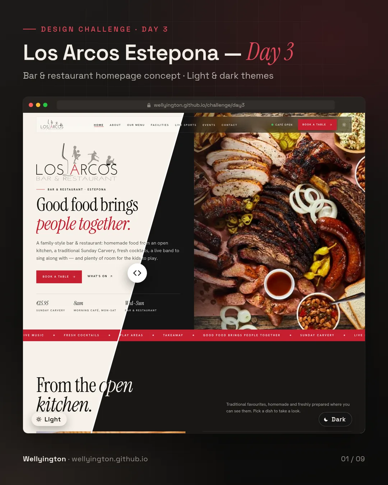
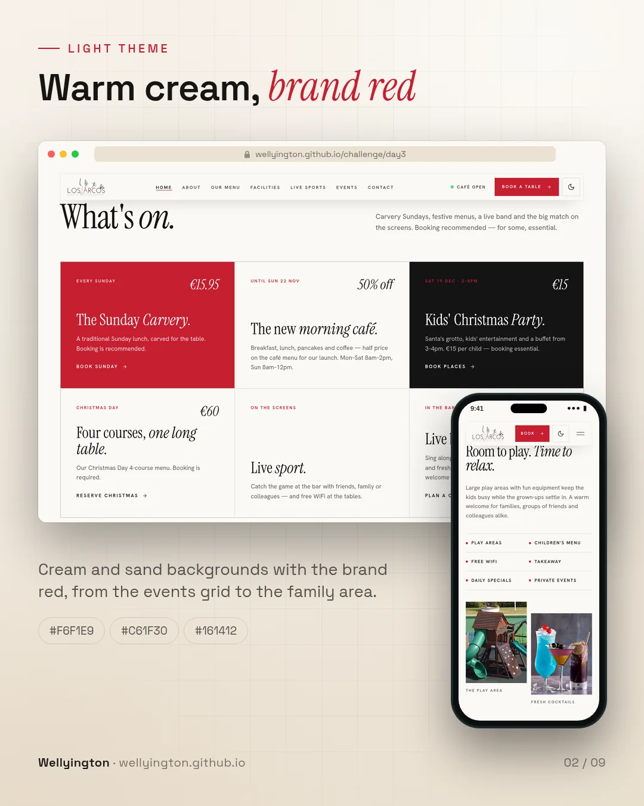
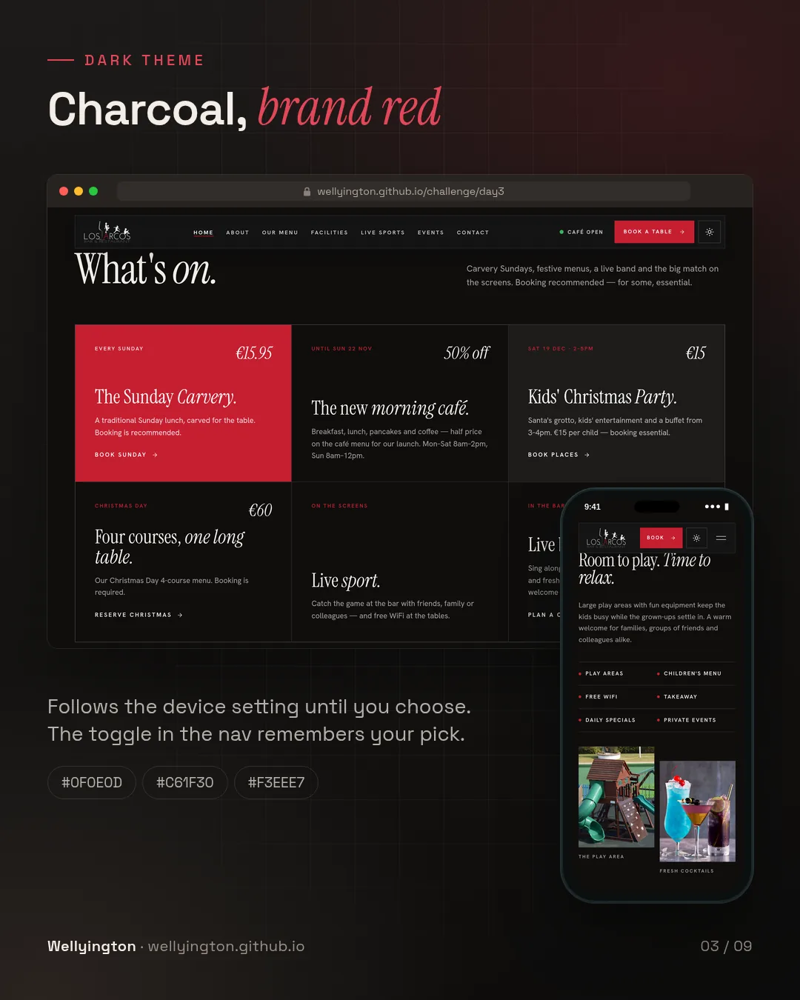
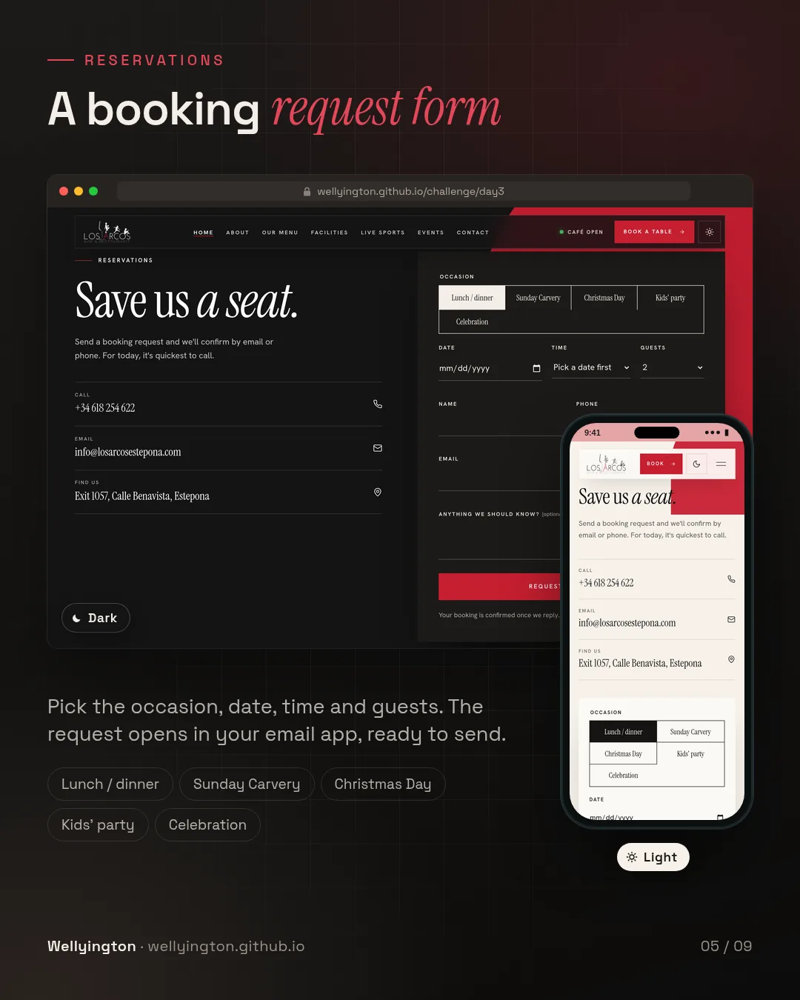
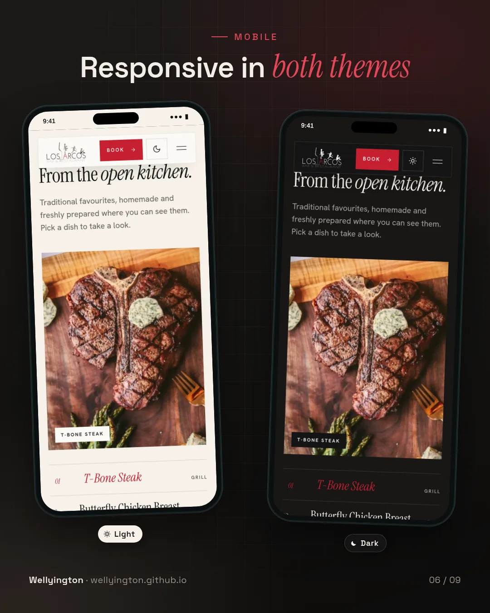
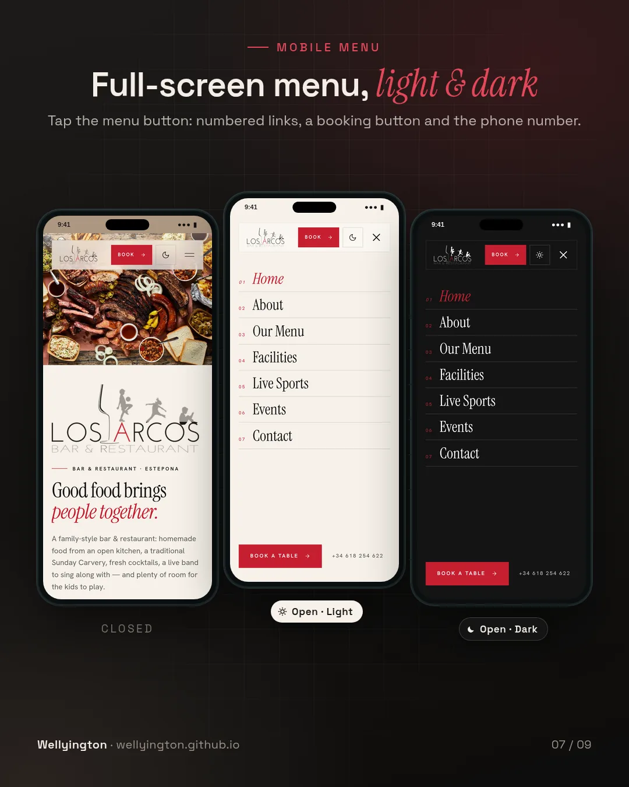
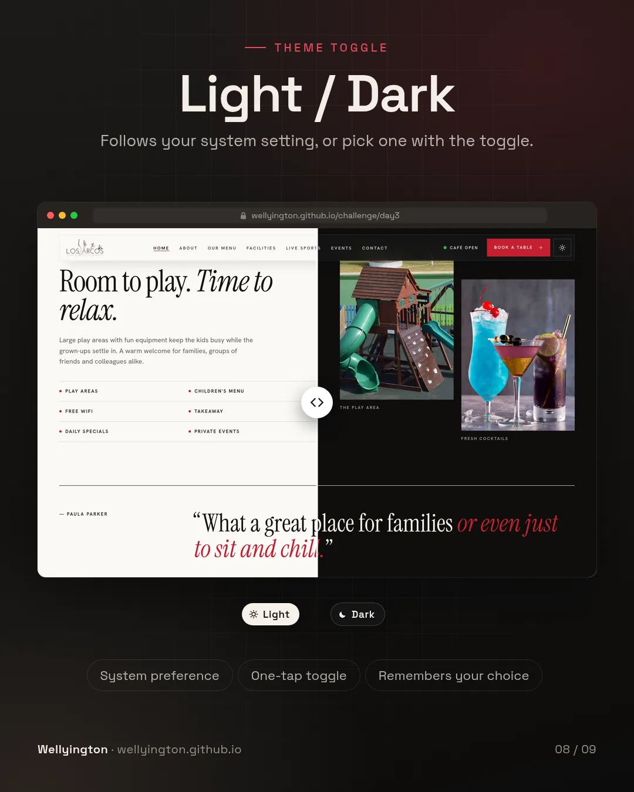

19 ноября я выложил третью заметку этого ряда: сто дней, сто дел, сто сайтов, и каждый открыт для любого. Первым днём была семейная строительная фирма в Марина-Альте: ей нужна была первая ясная страница, на которую можно посмотреть до договора. [Та страница здесь.](https://wellyington.github.io/journal/ru/articles/sait-do-slova-da/) Вторым был театр в Малаге, у которого уже есть полный сезон, и ему нужен был порядок, которым человеку удобно пользоваться. [Он здесь.](https://wellyington.github.io/journal/ru/articles/mesto-dlya-tselogo-sezona/) Сегодня идти ближе.

Los Arcos — бар и ресторан на улице Бенависта, у съезда 1057, в Эстепоне. Я работаю из Эстепоны, так что это первое дело в ряду в моём собственном городе. Для работы это почти ничего не меняет, а для внимания к деталям меняет многое. Здесь люди откроют страницу и сразу поймут, похожа она на это место или нет. Концепт открывается здесь: [Los Arcos, день третий](https://wellyington.github.io/challenge/day3/).

Никто в Los Arcos меня об этом не просил. Это не заказ и не их официальный сайт. На странице их имя, их блюда и их неделя. Концепт мой, и пока он живёт на моём собственном адресе: это честное место для работы, которую ещё никто не принял. Мне никто не говорил, что там его уже видели.

## место, куда ходят по разным причинам

У строителя была одна работа, которую нужно объяснить, у театра был сезон. У семейного бара-ресторана всё не так аккуратно. Люди приходят по разным причинам, в разное время и часто одной компанией.

Кто-то хочет воскресное жаркое. Кто-то хочет посмотреть матч на большом экране. Пара хочет коктейль и живую группу. Родитель хочет час посидеть, пока дети бегают там, где безопасно. В будний день утром кому-то нужны просто кофе и панкейки перед работой. Los Arcos делает всё это под одной крышей: открытая кухня, Sunday Carvery, утреннее кафе, спорт в прямом эфире, живая музыка, игровые площадки и еда навынос.

Главная, где обо всём говорится одинаково громко, не говорит ничего. Главная, которая выбирает одну причину, теряет половину людей, которые уже сюда ходят. Поэтому работа была в порядке. Сначала, что это за место. Потом, что здесь едят. Потом, что происходит на этой неделе. Потом, когда открыто, почему здесь хорошо с детьми и как получить столик. Всё, что постоянный гость уже знает, в том порядке, в каком это нужно тому, кто пришёл впервые.

## хорошая еда собирает людей вместе

Первый экран сохраняет их собственную фразу, потому что она хорошая: good food brings people together, хорошая еда собирает людей вместе. Она набрана высокой узкой антиквой, вторая половина курсивом и в фирменном красном. Над ней логотип, арки с маленькими играющими фигурками. Под ней один абзац: семейный бар-ресторан, домашняя еда с открытой кухни, традиционный Sunday Carvery, свежие коктейли, живая группа, под которую можно петь, и много места, где играть детям.

Дальше две кнопки: забронировать столик или посмотреть, что происходит. Под ними три факта, о которых иначе пришлось бы спрашивать: Sunday Carvery за 15,95 €, утреннее кафе с 8 утра с понедельника по субботу и бар-ресторан со среды по воскресенье. Внизу экрана идёт красная лента с причинами, по которым сюда приходят, одна за другой: живая музыка, свежие коктейли, игровые площадки, еда навынос и та самая фраза про хорошую еду.

Справа большая фотография блюда: нарезанная курица, рёбрышки, колбаски, луковые кольца, горшочек фасоли, соусник. Мне хотелось, чтобы первый экран выглядел как стол, а не как буклет.

*Первый экран, разрезанный надвое. Одно и то же начало днём и вечером.*

## два света, один ресторан

Этот диагональный разрез и есть суть концепта. У страницы две темы, и один и тот же ресторан должен хорошо выглядеть в обеих.

Светлая тема тёплого кремового цвета, как скатерть, с фирменным красным для всего, на что можно нажать, и для слов курсивом. Её легко читать в полдень на террасе, когда на экран падает солнце. Тёмная угольная, почти чёрная, с тем же красным. Она удобнее в десять вечера, когда кто-то проверяет, работает ли ещё кухня, или отправляет страницу другу с дивана.

Если телефон уже в тёмном режиме, страница открывается тёмной. Если в светлом, то светлой. Маленькая кнопка в навигации переключает тему, и страница запоминает выбор до следующего раза. Карточки, фотографии и красный цвет остаются на месте. Меняется только комната вокруг них.

*Светлая тема: тёплый крем, фирменный красный и неделя в сетке.*

*Тёмная тема. Она следует настройке устройства, пока вы не выберете сами, и кнопка запоминает выбор.*

## с открытой кухни

Сайт ресторана открывают, чтобы посмотреть на еду, поэтому еда идёт второй, сразу после приветствия. Заголовок говорит прямо: from the open kitchen, с открытой кухни. Строка под ним объясняет, что это традиционные любимые блюда, домашние и приготовленные свежими там, где их видно.

Потом короткий список из шести блюд, пронумерованных, как в меню: стейк T-Bone, куриная грудка «бабочкой», стейк из лосося с острым запечённым картофелем, чили кон карне, колбаски с пюре и шоколадный торт. У каждого маленькая подпись: гриль, рыба, фирменное, классика, десерт. Выбираешь блюдо, и его фотография появляется рядом со списком. T-Bone приезжает на деревянной доске, с кружком тающего травяного масла сверху.

Под списком одна фраза называет остальное меню, чтобы никто не подумал, что эти шесть блюд и есть всё: легендарные рёбрышки, треска в пивном кляре, стейк из филейной части, бургеры, пицца, салаты, включая «Цезарь», детское меню, доска с блюдами дня в баре и еда навынос. Я не перепробовал всё меню, поэтому не буду описывать вкус. Страница рассказывает о блюдах так, как рассказывает о них сам Los Arcos, и ставит фотографии туда, куда смотрит голодный человек.

## что происходит и когда нас найти

Дальше идёт неделя, потому что такой бар ею и живёт. Заголовок What's on, что происходит, и сетка честно говорит о бронировании: где-то оно желательно, а где-то обязательно.

Sunday Carvery получает красную карточку: каждое воскресенье, 15,95 €, традиционный воскресный обед, нарезанный прямо для стола. Рядом новое утреннее кафе: к открытию меню кафе за полцены до воскресенья, 22 ноября, с понедельника по субботу с 8 до 14, по воскресеньям с 8 до 12. Детская рождественская вечеринка в субботу, 19 декабря, с 14 до 17: грот Санты, аниматоры и шведский стол с 15 до 16, 15 € за ребёнка, бронь обязательна. На Рождество четыре блюда за 60 €, один длинный стол, бронь обязательна. Потом экраны: матч с друзьями, семьёй или коллегами и бесплатный Wi-Fi за столиками. Потом бар: живая группа, свежие коктейли и приписка, что свадьбы, дни рождения и встречи старых друзей здесь тоже рады принять.

Каждая карточка заканчивается одним действием: забронировать воскресенье, забронировать места, зарезервировать Рождество, спланировать праздник. Никому не нужно гадать, что делать дальше.

Следом часы работы, под заголовком When to find us, когда нас найти. Три вкладки, потому что у Los Arcos три расписания: ресторан, бар и кафе. Выбираешь одну, и крупная строка слева говорит то, что важно прямо сейчас, по времени Эстепоны: открыто или откроется в 14:00, сегодня позже. Справа вся неделя, сегодняшний день отмечен красным. Ресторан закрыт в понедельник и вторник, работает с 14:00 до 21:00 со среды по пятницу, с 12:00 до 21:00 в субботу и с 12:00 до 20:00 в воскресенье. Маленькая зелёная точка в навигации делает то же самое с одного взгляда: пишет «кафе открыто», когда кафе открыто.

*Выберите блюдо, чтобы его увидеть. Выберите ресторан, бар или кафе, чтобы узнать, открыто ли сегодня.*

## место для игр, время для отдыха

Есть раздел для семей, потому что это немалая часть причины, по которой люди выбирают Los Arcos, а не соседнее заведение. Room to play. Time to relax. Место для игр, время для отдыха. Большие игровые площадки с горками и лазалками занимают детей, пока взрослые устраиваются поудобнее. Шесть коротких пунктов в две колонки: игровые площадки, детское меню, бесплатный Wi-Fi, еда навынос, блюда дня и частные мероприятия. Остальное рассказывают две фотографии: игровой комплекс с зелёными горками и ряд коктейлей, один ярко-голубой. Один и тот же день глазами двух поколений.

Ниже одна фраза гостьи, Паулы Паркер: какое отличное место для семей или просто чтобы посидеть и отдохнуть. Я оставил одну цитату, крупно, без звёзд и без счётчика. Одна настоящая фраза работает лучше карусели.

## оставьте нам место

Раздел бронирования называется Save us a seat, оставьте нам место. Слева три способа связаться с рестораном, и каждый нажимается: телефон +34 618 254 622, почта info@losarcosestepona.com и адрес, съезд 1057, улица Бенависта. Короткая строка говорит то, что сказал бы любой, кто держит ресторан: если нужно сегодня, быстрее всего позвонить.

Справа форма заявки. Сначала повод, пятью кнопками: обед или ужин, Sunday Carvery, Рождество, детский праздник, торжество. Потом дата, время, которое предлагается только после выбора даты, и число гостей. Потом имя, телефон, почта и всё, что стоит знать кухне. Нажимаете кнопку, и открывается ваше почтовое приложение с уже написанной заявкой, остаётся только отправить.

Концепт не притворяется системой бронирования. Аккаунт создавать не нужно, и форма прямо говорит, что бронь подтверждена, когда ресторан ответит. На этом побережье о столике до сих пор часто договариваются по телефону или ответом хозяина, и страница, которая обещала бы больше, говорила бы неправду.

*Выберите повод, дату, время и число гостей. Заявка открывается в вашей почте, готовая к отправке.*

## тот же вечер на телефоне

Большинство людей встретит эту страницу на телефоне. Кто-то припарковался у входа и хочет знать, работает ли кухня. Общий чат решает, где смотреть матч. Мама бронирует детскую рождественскую вечеринку за те пять минут, что у неё есть между двумя другими делами.

На телефоне всё выстраивается в том же порядке. Заголовок, строка, фотография и название блюда на маленькой плашке поверх снимка. Кнопка бронирования остаётся в верхней панели, рядом с переключателем темы, там, куда большой палец дотягивается из любого места страницы.

Меню открывается на весь экран. Семь ссылок, пронумерованных, как блюда: главная, о нас, меню, удобства, спорт в эфире, события, контакты. Внизу две вещи, которые нужны спешащему человеку: кнопка «забронировать столик» и номер телефона. В обоих светах всё работает одинаково.

*Открытая кухня на телефоне, в обеих темах.*

*Меню на весь экран: семь пронумерованных ссылок, кнопка бронирования и телефон, светлое или тёмное.*

## предложение, а не захват

Los Arcos меня не нанимал. Это не их сайт, и ничто здесь не значит, что они его одобрили. У них уже есть сайт, телефон, который звонит, постоянные гости и воскресенье, когда всё занято. Блюда, цены, даты и слова гостьи на странице принадлежат им, а не мне. Я добавил порядок, два света и заявку на бронь, которая честно говорит, как подтверждается столик.

У меня нет цифр ни по гостям, ни по выручке, и я не стану их выдумывать. Если кто-то в Los Arcos откроет концепт и ничего от меня не захочет, это полноценный финал. Если захотят, остальное практично: их собственные фотографии, их слова там, где сейчас стоят мои, актуальные часы работы, форма, которая уходит тому, кто отвечает за брони, и домен на их имя.

*Следует настройке системы, или выбираете вы. Одно касание, и выбор запоминается.*

## если у вашего дела много дверей

Вы можете не держать ресторан. Многие дела на этом побережье больше похожи на Los Arcos, чем на компанию, которую можно описать одной фразой. Спортзал с кафе. Пляжный клуб с магазином. Школа с летними лагерями. Люди входят через разные двери, в разное время, по разным причинам, а сайт обычно пытается держать открытыми все двери сразу.

Помогает порядок, а не новые блоки. Скажите в одной строке, что это за место. Покажите то, ради чего люди на самом деле приходят. Поставьте неделю туда, где её можно прочитать, а часы туда, где они отвечают на вопрос «а сейчас?». Пусть способ попасть к вам, телефон, форма, столик, честно говорит, что будет дальше. И пусть страница следует тому свету, в котором находится человек.

Если это похоже на ваше дело, напишите мне с [основного сайта](https://wellyington.github.io/ru/). Скажите, что вы делаете и где, и я отвечу обычным языком. Короткая публичная версия сегодняшнего дня — это заметка: день третий из ста, главная для семейного ресторана в моём собственном городе, светлая или тёмная, выбирает гость. [Заметка здесь.](https://x.com/wellyington/status/2123056661220733019) Завтра другое дело и ещё одна готовая страница.
