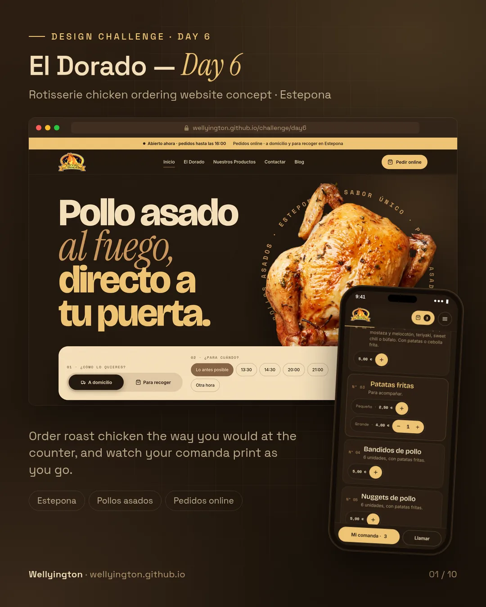
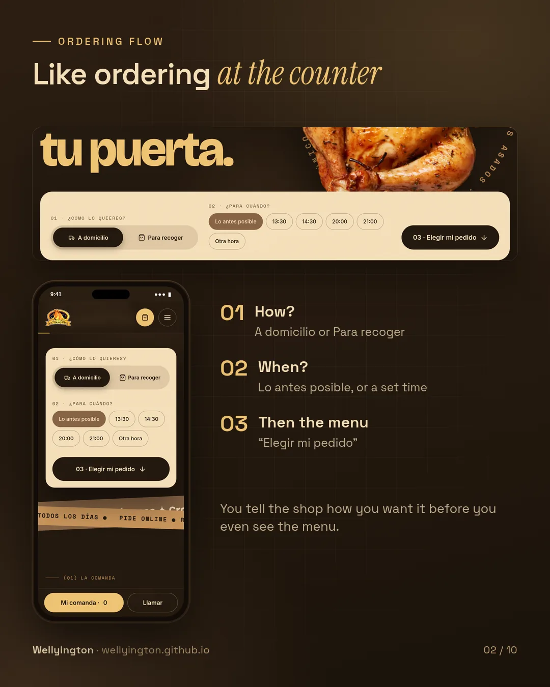
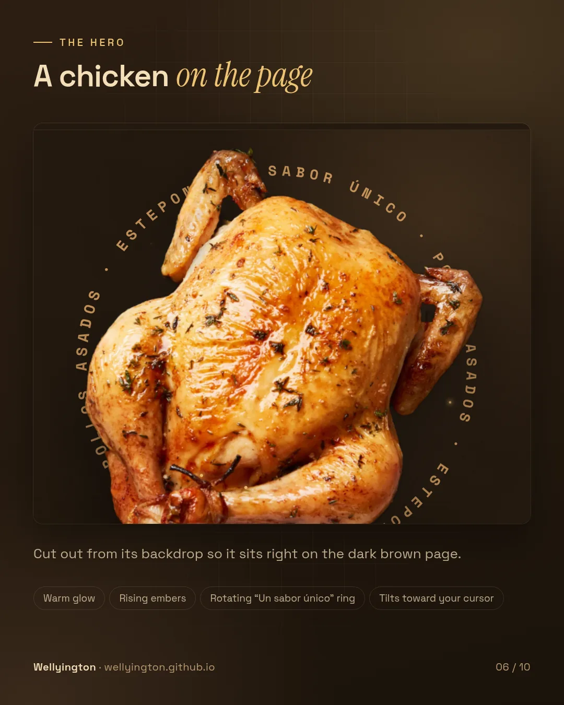
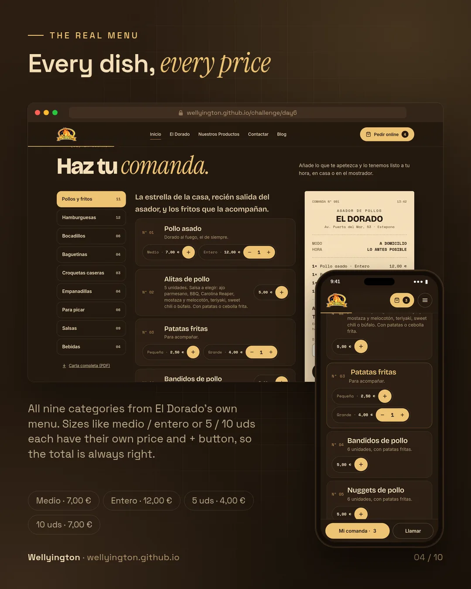
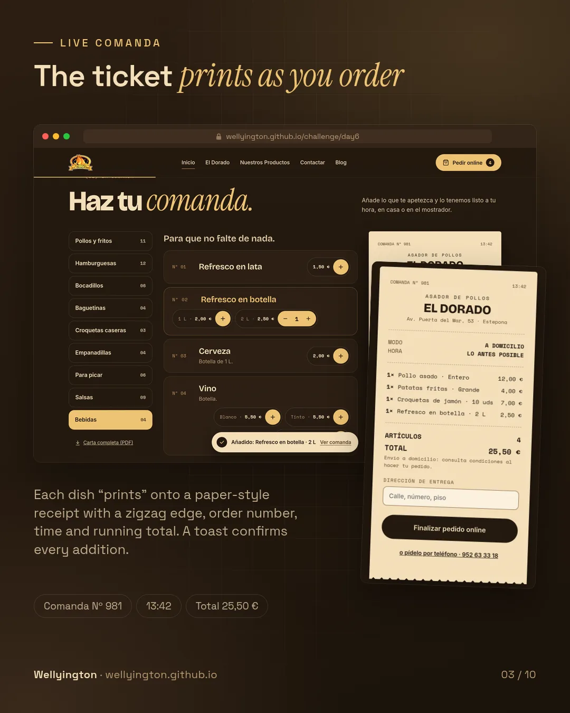
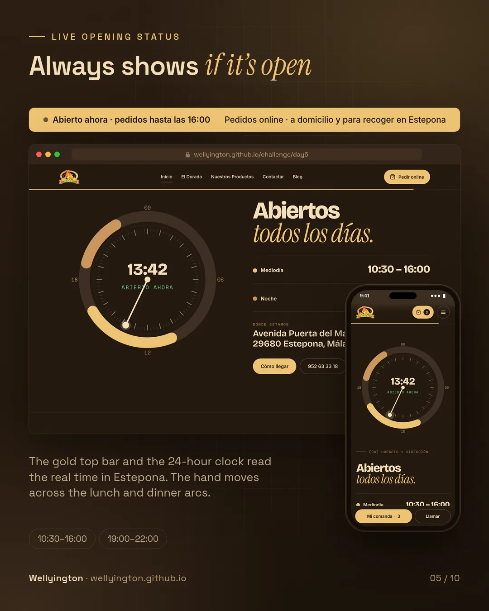
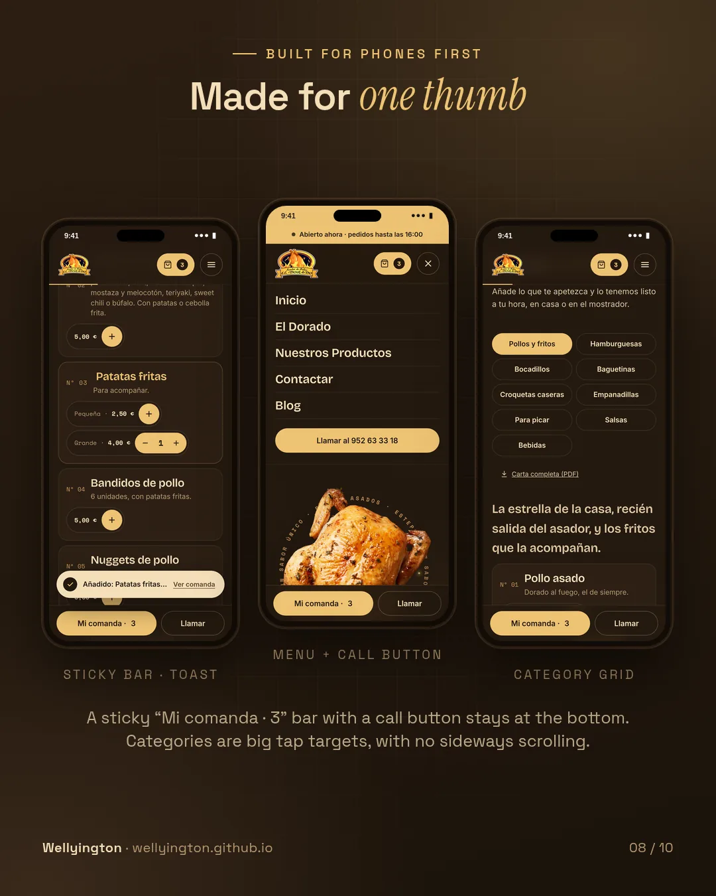
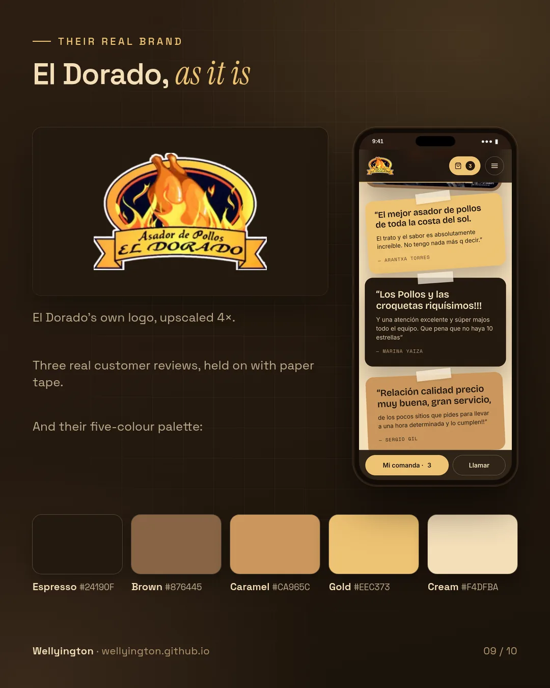
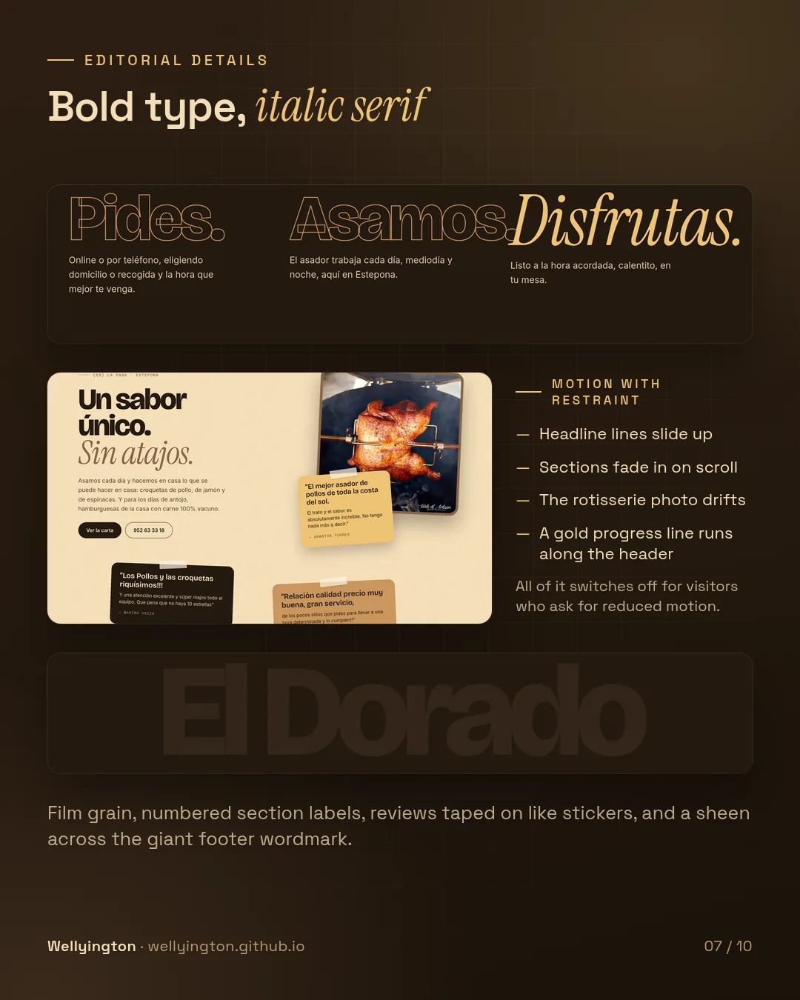

22 ноября я опубликовал шестую заметку этой серии, челленджа, который придумал Рамайя Траск: сто дней, сто компаний, сто сайтов. Первым днём была семейная строительная компания в Марина-Альте. [Та страница здесь.](https://wellyington.github.io/journal/ru/articles/sait-do-slova-da/) Вторым — театр в Малаге. [Она здесь.](https://wellyington.github.io/journal/ru/articles/mesto-dlya-tselogo-sezona/) Третьим — семейный ресторан в Эстепоне. [Она здесь.](https://wellyington.github.io/journal/ru/articles/mesto-za-dlinnym-stolom/) Четвёртым — частная консалтинговая практика по недвижимости в Малаге. [Она здесь.](https://wellyington.github.io/journal/ru/articles/suzhdenie-vazhnee-obema/) Пятым — ресторан дегустационных сетов в Мотриле. [Она здесь.](https://wellyington.github.io/journal/ru/articles/tak-zhe-tshchatelno-kak-na-kukhne/)

Сегодня самое будничное дело из шести, и, может быть, то, чьим сайтом пользуются чаще всего. El Dorado — это заведение с курицей-гриль на авениде Пуэрта-дель-Мар в Эстепоне, моём родном городе. Курица-гриль, картошка фри, домашние крокеты, бургеры, бутерброды, аргентинские эмпанадас, соусы и напитки. Заказать можно с доставкой или на самовывоз, каждый день, днём и вечером. Сайт и интернет-магазин у них уже есть, на [pollosasadosadomicilioestepona.es](https://pollosasadosadomicilioestepona.es/).

У сайта такого заведения две задачи. Он должен вызывать аппетит, и он должен делать заказ простым. Большинство сайтов еды навынос справляются с одной из двух. Концепт здесь: [El Dorado, шестой день](https://wellyington.github.io/challenge/day6/).

## прилавок, а не каталог

Вспомните, как заказывают у прилавка в таком месте. Вы не начинаете с разглядывания товаров. Человек за прилавком сначала задаёт два вопроса: с собой или доставить домой? И к какому времени? Только потом вы говорите, что хотите. Целую курицу, большую картошку, крокеты, бутылку колы. Он записывает это в чек, повторяет вам и называет сумму.

Большинство онлайн-заказов устроены наоборот. Вам показывают магазин, полный товаров, дают наполнить корзину, и только в самом конце, при оплате, спрашивают, нужна ли доставка и к какому часу. Именно там люди узнают, что нужного времени уже нет или что доставка не доходит до их улицы, и бросают заказ.

Поэтому концепт повторяет прилавок. Первое на странице, под заголовком, — небольшая панель с двумя вопросами. 01: как вы хотите?, a domicilio или para recoger, доставка или самовывоз. 02: к какому времени?, lo antes posible, как можно скорее, или конкретный час из ряда кнопок, 13:30, 14:30, 20:00, 21:00, или другое время. Затем одна тёмная кнопка: 03, elegir mi pedido, выбрать заказ. Она ведёт к меню.

Вы говорите заведению, как хотите получить заказ, ещё до того, как увидели меню. Так поступил бы человек за прилавком, и это значит, что остальная страница уже знает, что вы задумали.

*Начало: заголовок, курица и два вопроса, которые первым делом задали бы у прилавка.*

*Как, когда, а потом меню. Как у прилавка.*

## курица на странице

Заголовок — самая простая фраза, какую я смог написать: pollo asado al fuego, directo a tu puerta. Курица, запечённая на огне, прямо к вашей двери. Он набран очень крупно, тяжёлым, слегка сжатым гротеском, кремовым и золотым, а «al fuego» посередине — тонкой курсивной антиквой. Читается как вывеска на фасаде.

Рядом — то, ради чего сюда приходят: курица-гриль, золотистая, блестящая, с травами на коже. Я вырезал её из фотографии, чтобы она лежала прямо на тёмно-коричневой странице, без рамки. Вокруг неё медленно вращается кольцо текста, un sabor único, pollos asados, Estepona — собственная фраза El Dorado. Сзади тёплое свечение, несколько поднимающихся искр, а на компьютере она едва заметно наклоняется к курсору.

Я понимаю, как это звучит на бумаге. На экране это спокойно. Смысл в том, чтобы первым, что вы видите, была еда, причём такого размера, что почти чувствуешь запах.

*Вырезана из фона, чтобы лежать прямо на странице. Тёплое свечение, несколько искр и медленно вращающееся кольцо текста.*

## настоящее меню, все цены

Второй раздел называется haz tu comanda, составь свой заказ. Comanda по-испански — это бумажный чек, по которому работает кухня, и вся идея концепта держится на нём.

Слева девять категорий из меню El Dorado, у каждой — число блюд: курица и жареное, бургеры, бутерброды, багеты, домашние крокеты, эмпанадас, закуски, соусы и напитки. В центре — блюда выбранной категории, пронумерованные, как на меловой доске, у каждого короткое описание и цена. Справа — чек.

Я не упрощал меню ради удобства дизайна. У настоящего заведения есть размеры порций, и именно на размерах онлайн-заказы обычно ломаются. Половина курицы стоит 7 евро, целая — 12. Картошка — 2,50 маленькая и 4 большая. Крокеты — по пять или по десять. Бутылка колы — литр или два. Поэтому у каждого размера своя цена и своя кнопка «плюс». Вы не выбираете размер в выпадающем списке, чтобы потом нажать «добавить». Вы нажимаете плюс рядом с нужным размером. Сумма всегда сходится, потому что нет промежуточного шага, где можно ошибиться.

У крылышек перечислены девять соусов, от чеснока с пармезаном до Carolina Reaper. У бургеров написано, из чего они: 100% говядина. А под категориями — небольшая ссылка на полное меню в PDF, которое El Dorado уже публикует, для тех, кто предпочитает прочитать всё сразу.

*Все девять категорий из меню El Dorado. У каждого размера своя цена и своя кнопка, поэтому сумма всегда сходится.*

## чек печатается, пока вы заказываете

Эта часть понравилась мне больше всего. Когда вы что-то добавляете, оно появляется в чеке справа на экране, нарисованном как бумажки из кухонного принтера: кремовая бумага, шрифт пишущей машинки, зубчатый оторванный край внизу.

Сверху написано: comanda номер 981, или какой номер вам выпадет, и время. Затем asador de pollos El Dorado и адрес. Затем два ответа, которые вы дали в начале: a domicilio, lo antes posible. Затем каждая строка по мере добавления: 1 курица-гриль, целая, 12 евро. 1 картошка, большая, 4 евро. 1 крокеты с хамоном, 10 штук, 7 евро. 1 бутылка колы, 2 литра, 2,50. Число позиций и итог — 25,50 евро.

Каждый раз, когда вы что-то добавляете, внизу всплывает короткое подтверждение: añadido, бутылка колы, 2 литра, со ссылкой на чек. Передумали — плюс превращается в минус и цифру.

Под итогом — строка об условиях доставки, поле для адреса и кнопка finalizar pedido online, оформить заказ онлайн. Ниже мелким шрифтом альтернатива: o pídelo por teléfono, или закажите по телефону, 952 63 33 18.

Чтобы было ясно, что концепт делает в этот момент: кнопка ведёт в уже существующий интернет-магазин El Dorado, где заказ и оформляется. Позиции из чека в концепте туда не передаются. В настоящей версии чек — это ровно то, что получит кухня: либо в магазин, которым они уже пользуются, либо прямо на принтер за прилавком. Дизайн — это та часть, которая важна клиенту: вы всё время видите свой заказ в том виде, в каком его увидит кухня.

*Каждое блюдо печатается в бумажном чеке с зубчатым краем, номером заказа, временем и нарастающей суммой.*

## всегда видно, открыто ли

Нет ничего досаднее, чем заказать еду и узнать, что заведение закрыто. El Dorado работает каждый день с 10:30 до 16:00 и с 19:00 до 22:00, и концепт говорит об этом везде, где это важно.

По самому верху страницы идёт золотая полоса. Когда открыто, на ней написано abierto ahora, pedidos hasta las 16:00, открыто сейчас, заказы до 16:00, или до 22:00 вечером. Когда закрыто, она говорит, когда откроются снова, в 10:30 или в 19:00, и добавляет programa tu pedido, запланируйте заказ. Никому не отказывают. Человеку говорят, когда вернуться, и что можно заказать заранее.

Ниже, в разделе с часами работы, — 24-часовой циферблат. Две смены нарисованы дугами по краю, обед — золотом, вечер — карамельным, а стрелка показывает реальное время в Эстепоне. В 13:42 она внутри обеденной дуги, а в центре написано abierto ahora. Рядом: открыты каждый день, два промежутка времени, адрес на авениде Пуэрта-дель-Мар, кнопка «как добраться» и телефон.

Часы читают время Эстепоны, а не вашего телефона, поэтому они верны даже для того, кто заказывает родителям из Лондона.

*Золотая полоса и 24-часовые часы читают реальное время Эстепоны. Стрелка проходит по дугам обеда и вечера.*

## сделано для одного большого пальца

Большинство заказов в такое место делают с телефона, одной рукой, часто между делом. Поэтому сначала я сделал версию для телефона, а уже потом для большого экрана.

Внизу экрана — неподвижная панель: mi comanda, с числом позиций, и llamar, позвонить. Нажмёте первую — перейдёте к своему чеку. Нажмёте вторую — телефон наберёт заведение. Что бы вы ни смотрели, заказ или звонок — в одном касании.

На телефоне категории — это не ряд, который нужно листать вбок и который легко не заметить. Это сетка крупных кнопок, по две в ряд, так что все девять видны сразу, и каждая достаточно большая для пальца. Подтверждение появляется прямо над нижней панелью, там, где уже ваш взгляд.

Меню открывается на весь экран: золотая полоса со статусом сверху, пять разделов сайта, большая кнопка звонка на 952 63 33 18 и снова курица внизу.

*Закреплённая панель с чеком и кнопкой звонка. Категории — крупные кнопки, без листания вбок.*

## их бренд, как есть

У всех концептов этой серии до сих пор был новый облик. У этого — нет, и это сознательно.

У El Dorado уже есть бренд, который в Эстепоне знают: логотип с курицей на фоне пламени и лентой с надписью asador de pollos El Dorado. Это не минималистичный логотип, и он не обязан им быть. Это вывеска над входом. Поэтому я его сохранил, очистив и увеличив, чтобы он оставался чётким на современных экранах, и построил всё остальное вокруг него.

Цвета тоже взяты из логотипа. Эспрессо, #24190F, для фона. Коричневый, #876445. Карамельный, #CA965C. Золотой, #EEC373, для кнопок и верхней полосы. Кремовый, #F4DFBA, для чека и светлых разделов. На тёмной странице они выглядят как внутренность гриля, в этом и смысл.

Шрифты новые. Bricolage Grotesque, тяжёлый и плотный, для больших заголовков, чтобы они читались как вывеска. Instrument Serif курсивом для более тёплых слов. Space Mono, шрифт пишущей машинки, для чека и мелких подписей. Inter для всего, что нужно прочитать быстро.

Есть и раздел о заведении: un sabor único, sin atajos, неповторимый вкус, без коротких путей. Здесь жарят каждый день и делают сами то, что можно сделать самим: крокеты с курицей, хамоном и шпинатом и бургеры из 100% говядины. Рядом три настоящих отзыва клиентов, приклеенных полосками бумажного скотча, как записки на холодильнике. В одном El Dorado называют лучшим местом с курицей-гриль на всём Коста-дель-Соль. В другом отмечают, что это одно из немногих мест, где заказываешь навынос к определённому часу и его соблюдают.

*Собственный логотип El Dorado, три настоящих отзыва клиентов и палитра из пяти цветов, взятая из бренда.*

## движение в меру

На этой странице двигается немного, и у каждого движения есть задача. Строки заголовка поднимаются одна за другой при загрузке. Разделы плавно появляются, когда вы до них доходите. Фото гриля в разделе о заведении слегка смещается. Тонкая золотая линия вверху шапки показывает, насколько далеко вы прокрутили.

Между разделами — короткая история в трёх словах, так, как заведение написало бы на стене. Pides. Asamos. Disfrutas. Вы заказываете, онлайн или по телефону. Мы жарим, каждый день, днём и вечером, здесь, в Эстепоне. Вы наслаждаетесь, готово к условленному времени, ещё горячее. В самом низу страницы, в подвале, очень крупно написано El Dorado, и по надписи медленно проходит блик.

Всё движение отключается для тех, кто попросил свой телефон или компьютер уменьшить анимацию. Без него страница работает точно так же.

*Жирный шрифт, курсивная антиква, отзывы, приклеенные как записки, и движение, которое отключается по просьбе.*

## что такое этот концепт и что дальше

Логотип, цвета, меню, цены, часы работы, адрес, телефон и отзывы клиентов на странице принадлежат El Dorado. Ничего из этого я не менял. Новое — порядок вещей, чек, часы и то, как страница ведёт себя на телефоне.

Чтобы превратить концепт в работающий магазин, нужно две вещи. Во-первых, чек должен доходить до кухни: в интернет-магазин, который у El Dorado уже есть, или в виде распечатки за прилавком. Во-вторых, доступное время должно приходить от самой кухни, чтобы в загруженный воскресный обед можно было закрыть слот до того, как он переполнится. Ни то ни другое не сложно. И то и другое стоит сделать как следует.

Цифр по заказам и выручке у меня нет, и придумывать их я не буду.

## если клиенты заказывают у вас с телефона

Возможно, вы не продаёте курицу-гриль. Но многие небольшие компании на этом побережье принимают заказы: кондитерская, которая печёт торты на заказ, пиццерия, цветочный магазин, прачечная, мясная лавка, которая собирает наборы для барбекю на выходные. Их клиенты обычно заказывают с телефона, на бегу, а сайт обычно требует от них думать как продавец.

Помогает то же, что и здесь. Сначала спросите, как и когда. Покажите каждый вариант с его собственной ценой. Дайте людям всё время видеть свой заказ в том виде, в каком вы его получите. Ясно скажите, открыты ли вы, а если нет — когда откроетесь. И держите телефон в одном касании, потому что всегда найдётся тот, кто предпочтёт позвонить.

Я веб-дизайнер в Эстепоне, на Коста-дель-Соль, и делаю такие сайты для компаний по всей Испании. Если это похоже на ваш бизнес, напишите мне через [основной сайт](https://wellyington.github.io/ru/). Расскажите, чем вы занимаетесь и где, и я отвечу простым языком. Концепт [здесь](https://wellyington.github.io/challenge/day6/), а нынешний сайт El Dorado [здесь](https://pollosasadosadomicilioestepona.es/), чтобы вы могли их сравнить. Шесть готово, осталось девяносто четыре.
