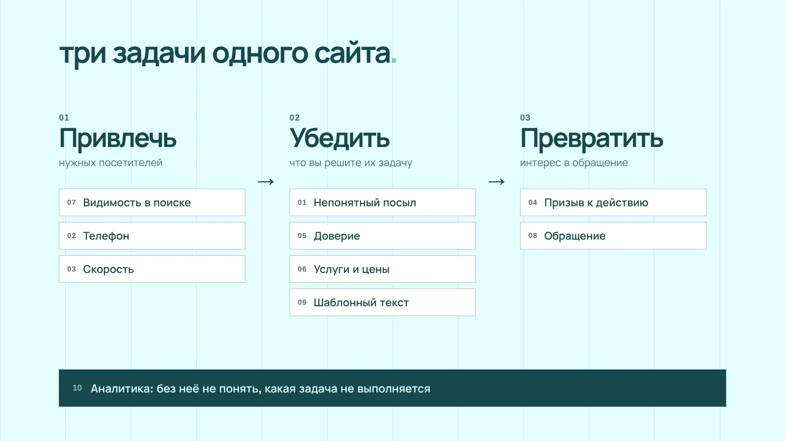
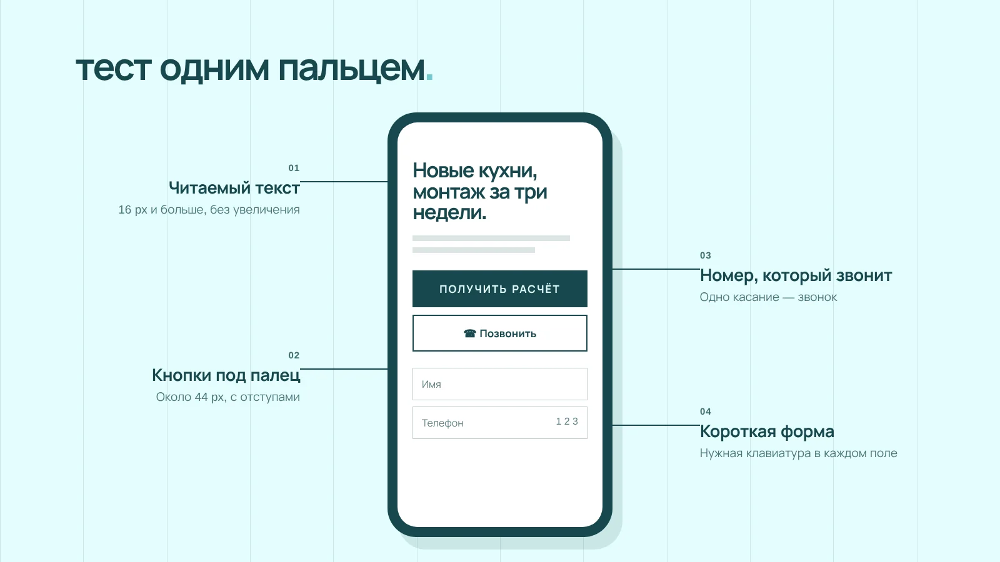
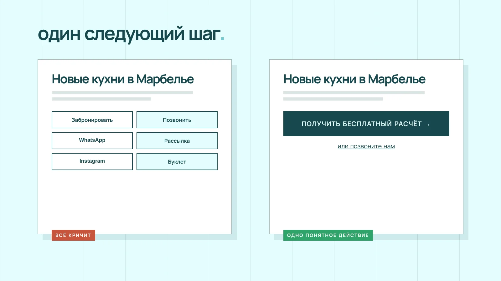
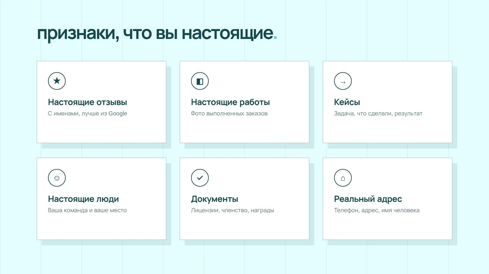
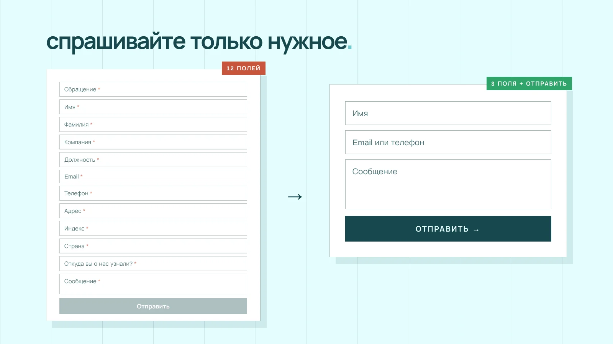
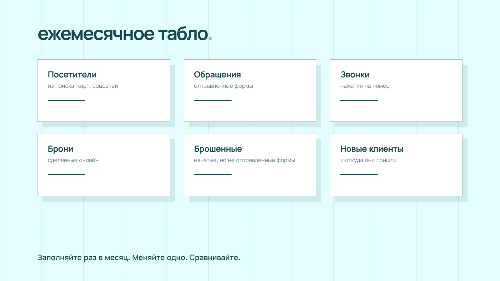

«Сайт отличный. Все так говорят. Только работы он не приносит».

Какой-то вариант этой фразы я слышу каждые несколько недель — от ресторанов, строителей, клиник, агентств и магазинов на побережье. Сайт стоил хороших денег, фотографии красивые, друзья хвалили. А телефон из-за него не звонит.

Почти никогда нет ничего сломанного, на что можно было бы указать пальцем. Сайт загружается, страницы на месте, форма отправляется. Проблема в том, что у сайта есть работа, а многие сайты делали так, чтобы они выглядели законченными, а не чтобы они эту работу выполняли.

В этой заметке — десять причин, которые я вижу чаще всего. Ни одна не требует нового сайта. Большинству нужен один вечер, свежая голова и готовность посмотреть на собственный сайт глазами незнакомого человека.

*Десять причин — примерно в том порядке, в каком с ними сталкивается посетитель.*

## сначала — зачем вообще нужен сайт

Прежде чем переходить к списку, полезно понять, что такое успех. У сайта компании три задачи, одна за другой:

1. Привлечь нужных посетителей.
2. Убедить их, что компания может решить их задачу.
3. Превратить их интерес в обращение, бронь или покупку.

Сбой на любом из этих этапов портит всё остальное. Красивый сайт, который никто не находит, не справляется с первой задачей. Сайт, с которого уходит много посетителей, так и не поняв, чем вы занимаетесь, не справляется со второй. Сайт, который убеждает, а потом просит заполнить форму из четырнадцати полей, не справляется с третьей.

Десять причин аккуратно раскладываются по этим трём этапам, плюс одна проходит под всеми: ничего не измеряется.

*Каждая причина ломает одну из трёх задач. Аналитика проходит под всеми.*

## 1. непонятно, чем вы занимаетесь

Новый посетитель даёт вашей главной странице несколько секунд. За это время ему нужны ответы на три вопроса: что вы делаете, для кого и почему выбрать вас, а не следующий результат в поиске.

Большинство главных страниц отвечают на другой вопрос: кто мы такие. Добро пожаловать на наш сайт. Мы ведущая компания с более чем двадцатилетним опытом, страстью и стремлением к совершенству. Эта фраза может принадлежать стоматологу, юридической фирме или компании по аренде строительных лесов. Она говорит о компании, а не о задаче клиента.

Сравните два заголовка для одного и того же мастера по кухням. «Добро пожаловать в Smith Interiors — ваш надёжный партнёр с 2004 года». Или: «Новые кухни в Марбелье и Эстепоне — монтаж за три недели. Бесплатный расчёт за 48 часов». Второй за одну фразу говорит, что, где, за сколько времени и что делать дальше.

**Как проверить:** покажите главную страницу на пять секунд человеку, который не знает ваш бизнес, и закройте её. Спросите, чем вы занимаетесь, для кого и чем отличаетесь. Если он не может ответить, ваши клиенты тоже не могут.

**Что делать:** перепишите первую строку страницы так, чтобы в ней были услуга, клиент или место и одна конкретная причина выбрать вас. Историю компании и миссию перенесите ниже — кому нужно, тот их найдёт.

*Одна и та же компания, две первые строки. Только одна отвечает на вопросы посетителя.*

## 2. на телефоне неудобно

Большинство людей, которые ищут местный бизнес, впервые видят его сайт на телефоне — часто одной рукой и на улице. Сайт, который рисовали на большом экране, а потом сжали, обычно это выдаёт: текст приходится увеличивать, кнопки стоят так тесно, что попадаешь не в ту, меню закрывает страницу, а клавиатура в форме скрывает поле, в котором вы печатаете.

Ничего этого не видно, когда владелец проверяет сайт на ноутбуке. Это видно по терпению клиента.

**Как проверить:** пять минут пользуйтесь своим сайтом на своём телефоне, как клиент. Найдите цену чего-нибудь. Позвоните себе. Отправьте форму. Всё — одним большим пальцем.

**Что делать:** текст такого размера, чтобы читать без увеличения, — не меньше 16 пикселей. Кнопки и ссылки размером с палец, около 44 пикселей в высоту, с промежутками. Номер телефона — ссылкой, по которой можно позвонить. В формах — нужная клавиатура для каждого поля: цифры для телефона, email для почты. И проектируйте сначала мобильную версию, а потом версию для большого экрана, а не наоборот.

*Четыре вещи, которые стоит проверить на своём телефоне одним пальцем.*

## 3. сайт долго грузится

Люди нетерпеливы, и у них есть на то причины. Если страница через несколько секунд всё ещё пустая, многие посетители возвращаются назад и нажимают на следующий результат, так и не увидев, что вы предлагаете.

Google измеряет это тремя показателями, которые называет Core Web Vitals: Largest Contentful Paint (LCP), Interaction to Next Paint (INP) и Cumulative Layout Shift (CLS). Проще говоря: сколько времени проходит до появления основного содержимого, как быстро страница реагирует на нажатие и насколько макет прыгает во время загрузки. Цели, которые Google считает «хорошими»: LCP не больше 2,5 секунды, INP не больше 200 миллисекунд и CLS не больше 0,1, по реальным посещениям страницы.

Обычные виновники одни и те же почти на каждом медленном сайте, который я смотрю. Фотографии, загруженные прямо с камеры, по несколько мегабайт каждая, хотя несколько сотен килобайт выглядели бы на экране так же. Слишком много скриптов: чаты, слайдеры, трекеры и всплывающие окна, каждый со своим кодом. Дешёвый общий хостинг далеко от клиента. И на сайтах, собранных в конструкторах, — длинный список плагинов, установленных однажды ради одной мелкой функции и так и не удалённых.

**Как проверить:** проверьте главную страницу в бесплатном сервисе Google PageSpeed Insights и смотрите на результат для мобильных, а не для компьютера.

**Что делать:** уменьшите и сожмите все изображения и используйте современный формат, например WebP. Удалите все плагины и скрипты, для которых не можете назвать причину. Потом посмотрите на хостинг.

*Три цели Google по скорости и четыре вещи, из-за которых их обычно не достигают.*

## 4. нет очевидного следующего шага

Человек прочитал вашу страницу, и ему понравилось. Что дальше? Позвонить, забронировать, запросить расчёт, написать, прийти?

Многие сайты этого так и не говорят. Где-то в меню есть страница контактов, и всё. Другие говорят слишком много: забронируйте, позвоните, напишите в WhatsApp, подпишитесь на рассылку, подпишитесь в Instagram, скачайте буклет — всё сразу и всё одного размера. Когда всё — кнопка, кнопок нет.

**Как проверить:** для каждой важной страницы спросите себя, какое одно действие вы хотите от посетителя после прочтения. Если не можете ответить одной фразой, страница тоже не может.

**Что делать:** выберите одно главное действие на страницу и сделайте его самым заметным на экране, повторите в конце страницы, а на телефоне — в зоне досягаемости большого пальца. Используйте слова, которые говорят, что произойдёт: «Получить бесплатный расчёт», «Забронировать столик на сегодня», «Позвонить в клинику». Оставьте одну более скромную альтернативу для тех, кто её предпочитает, например номер телефона под кнопкой бронирования. Всё остальное может подождать в подвале сайта.

*Шесть одинаковых кнопок — или один понятный следующий шаг и скромная альтернатива.*

## 5. сайту пока не доверяют

Никто не любит обращаться в компанию, о которой ничего не знает. Прежде чем позвонить, люди ищут признаки того, что вы настоящие, что вы хорошо делаете своё дело и что такие же люди, как они, к вам уже обращались и остались довольны.

Удивительно много сайтов компаний не дают ничего из этого. Ни отзывов, ни имён, ни примеров работ, ни фотографий настоящей команды или помещения — только стоковые снимки людей, пожимающих руки в офисе, который может быть где угодно.

**Как проверить:** представьте, что вы никогда не слышали о своей компании. Что на странице заставило бы вас поверить, что она хорошая? Посчитайте то, что относится именно к вам, а не к вашей отрасли.

**Что делать:** показывайте настоящие отзывы с именами, лучше взятые из Google, чтобы их можно было проверить. Показывайте свою работу: фотографии реальных заказов и короткие кейсы — задача, что вы сделали, результат. Покажите своё лицо и своё помещение. Добавьте членство в ассоциациях, лицензии и сертификаты, которые важны вашим клиентам. И разместите на видном месте адрес, телефон и имя живого человека.

*Шесть признаков того, что компания настоящая и хорошо делает своё дело.*

## 6. непонятно, что вы предлагаете и сколько это стоит

Люди не хотят гадать. Если по вашему сайту не понять, предлагаете ли вы именно то, что им нужно, и укладывается ли это примерно в их бюджет, многие выберут компанию по соседству, у которой это понятно.

Обычные виновники — расплывчатые названия услуг («решения», «пакеты», «индивидуальные услуги»), описания, которые перечисляют функции, а не результат, и цены, которые появляются только после звонка. Я понимаю, почему многие компании не публикуют цены. Каждый заказ разный. Но полное отсутствие информации заставляет людей думать о худшем.

**Как проверить:** мог бы посетитель только по вашему сайту понять, какая из ваших услуг ему подходит и сколько она примерно стоит?

**Что делать:** дайте каждой услуге понятное название и короткую страницу: для кого она, что входит и что происходит дальше. Показывайте цены, где можете, или хотя бы цену «от» или обычный диапазон, например «большинство ремонтов ванных стоят от 6 000 до 9 000 €». Объясните, от чего зависит цена. Людям не нужен расчёт на сайте. Им нужно достаточно, чтобы решить, что вам стоит позвонить.

## 7. вас не находят

Даже лучший сайт не приведёт клиентов, если те, кто вас ищет, его не видят. Для большинства местных компаний это два места: результаты поиска Google и Google Карты.

Обычные проблемы простые. На сайте нигде не сказано словами, что вы делаете и где: фразы «кухни на заказ в Эстепоне» на странице нет, и Google не с чем её сопоставить. Страницы не проиндексированы из-за настройки, оставшейся со времён разработки. У всех страниц одинаковый заголовок. А в профиле компании в Google, который местный клиент часто видит первым, неправильные часы работы, нет фотографий, нет услуг и нет ответов на отзывы.

**Как проверить:** поищите свою основную услугу и свой город на телефоне, не входя в аккаунт, как это сделал бы клиент. Где вы появляетесь — на карте и в результатах? Потом посмотрите на свой профиль компании глазами незнакомого человека.

**Что делать:** простыми словами напишите на странице и в её заголовке, что вы делаете и где. Дайте каждой услуге и каждому району, где вы работаете, отдельную страницу. Подключите сайт к Google Search Console, чтобы видеть, проиндексирован ли он и что люди ищут, чтобы вас найти. Заполните все поля профиля компании, следите за актуальностью часов работы, добавьте настоящие фотографии и отвечайте на отзывы.

## 8. связаться слишком сложно

Каждый лишний шаг между «мне интересно» и «я отправил» — ещё один шанс бросить. Я до сих пор вижу формы обратной связи на двенадцать полей, половина из них обязательные: обращение, имя, фамилия, компания, должность, адрес, индекс, страна, откуда вы о нас узнали. Системы бронирования, которые требуют создать аккаунт, прежде чем показать свободное время. Формы, которые ничего не отправляют, потому что настройка сломалась несколько месяцев назад и никто не заметил.

**Как проверить:** отправьте сегодня свою форму с телефона и засеките время. Потом проверьте, дошло ли сообщение и куда.

**Что делать:** спрашивайте только то, что нужно для ответа: имя, способ связи и сообщение. Остальное выяснится в разговоре. Никогда не требуйте регистрации перед обращением. Предложите быструю альтернативу — телефон или WhatsApp — для тех, кто её предпочитает. После отправки покажите понятное подтверждение и скажите, когда человек получит ответ. И проверяйте форму каждый месяц.

*Двенадцать полей — или четыре, которые действительно нужны для ответа.*

## 9. звучит как у всех

«Мы гордимся качеством нашего обслуживания». «Ваше удовлетворение — наш приоритет». «Увлечённые профессионалы, стремящиеся к совершенству». Эти фразы есть на тысячах сайтов, и именно поэтому они ничего не говорят. Клиент, сравнивающий три компании, не может их различить, поэтому выбирает по цене — или не выбирает вообще.

С картинками то же самое. Стоковое фото улыбающейся девушки с гарнитурой говорит посетителю, что своей фотографии у вас не нашлось.

**Как проверить:** закройте свой логотип и прочитайте главную страницу. Мог бы это быть сайт конкурента? Если поменять названия, кто-нибудь заметил бы?

**Что делать:** запишите вопросы, которые клиенты задают вам на самом деле, по телефону и лично, и ответьте на них на сайте своими словами. Сколько это займёт? Что, если пойдёт дождь? Вы работаете по выходным? Можно посмотреть, что вы уже делали? Используйте подробности, которые можете назвать только вы: улицы, где вы работаете, материалы, которые используете, сколько заказов выполнили в прошлом году. Замените стоковые фото настоящими, пусть даже снятыми на телефон.

## 10. никто ничего не измеряет

Последняя причина лежит под всеми остальными. Многие компании запускают сайт и просто считают, что он работает. Никто не считает, сколько обращений он приносит, сколько звонков и бронирований. Никто не знает, сколько людей начинают заполнять форму и бросают на полпути и с какой страницы они уходят.

Без данных все проблемы выше остаются невидимыми. Вы не знаете, мало ли у сайта посетителей или мало обращений, а значит, не знаете, тратить ли деньги на рекламу или на исправление страницы.

**Как проверить:** можете ли вы сказать, сколько обращений принёс сайт в прошлом месяце и сколько из них стали клиентами? Если нет, это первое, что нужно исправить.

**Что делать:** подключите простую аналитику — с согласия посетителей там, где этого требует закон, — и считайте то, что важно для бизнеса, а не только просмотры: отправленные формы, нажатия на телефон, бронирования, клики по WhatsApp. Спрашивайте каждого нового клиента, как он вас нашёл, и записывайте. Раз в месяц смотрите на цифры, меняйте что-то одно и смотрите снова.

*Ежемесячное табло: шесть цифр, которые показывают, где проблема.*

## общая картина: посетители — ещё не клиенты

Когда вы начинаете измерять, цифры сами указывают на проблему. Примерная схема, которой я пользуюсь с клиентами:

| Что вы видите | Где, скорее всего, проблема |
|---|---|
| Очень мало посетителей | Маркетинг и SEO |
| Много посетителей, мало обращений | Посыл, доверие или предложение |
| Много обращений, мало клиентов | Процесс продаж, цены или качество заявок |
| Много начатых и брошенных форм | Удобство сайта или технические сбои |

Вот почему «нам нужно больше трафика» часто оказывается неверным ответом. Если сайт посещают сто человек в неделю и никто не пишет, двести посетителей в основном удвоят число тех, кто уходит. Сначала заделайте течь, а потом открывайте кран сильнее.

*Что говорят цифры и куда смотреть в первую очередь.*

## с чего начать

Если знакомы все десять, не пытайтесь исправить их разом. По моему опыту, быстрее всего окупается такой порядок:

1. Убедитесь, что форма и ссылка на телефон работают, — сегодня.
2. Перепишите первую строку главной страницы.
3. Выберите одно главное действие на каждой странице и сделайте его очевидным.
4. Проверьте сайт на телефоне одним пальцем и исправьте то, что раздражает.
5. Подключите аналитику, чтобы следующее решение принималось по цифрам.

Всё остальное — скорость, отзывы, страницы услуг, видимость в поиске — становится проще, когда эти пять пунктов сделаны.

## моя главная рекомендация

Перестаньте оценивать сайт только по тому, насколько профессионально он выглядит. Оценивайте его по тому, насколько хорошо он приносит бизнесу реальные возможности.

Красивый сайт — это актив. Сайт, который месяц за месяцем приносит качественные обращения, — это инструмент бизнеса. Это может быть один и тот же сайт, но только если его делали с прицелом на вторую задачу.

Я веб-дизайнер из Эстепоны, на Коста-дель-Соль, и чаще всего занимаюсь именно этим: смотрю на сайты, которые должны работать, и выясняю, почему они не работают. Если ваш сайт выглядит хорошо, а телефон всё равно молчит, напишите мне через [основной сайт](https://wellyington.github.io/ru/). Расскажите, чем вы занимаетесь и где, и я простым языком скажу, какая из этих десяти причин, по-моему, обходится вам дороже всего. А как я подхожу к этому на практике, можно посмотреть в [серии «100 дней»](https://wellyington.github.io/journal/ru/archive/), где я каждый день заново проектирую сайт реального бизнеса.
