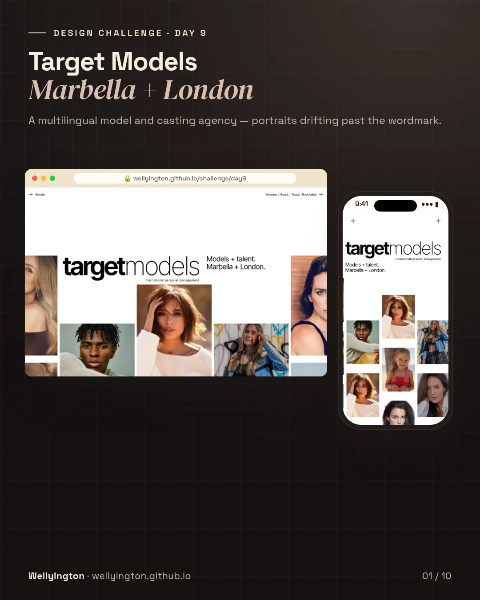
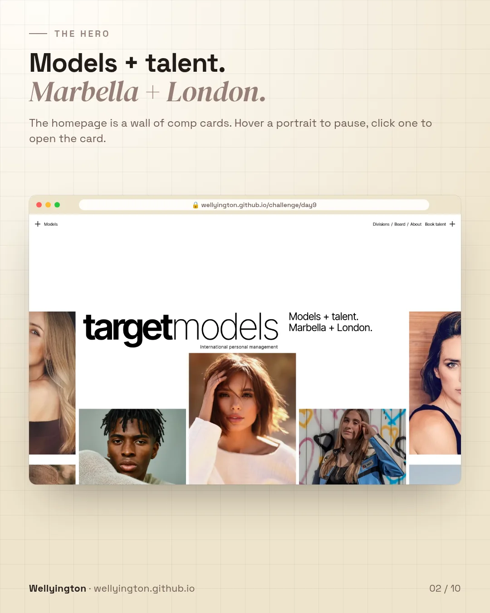
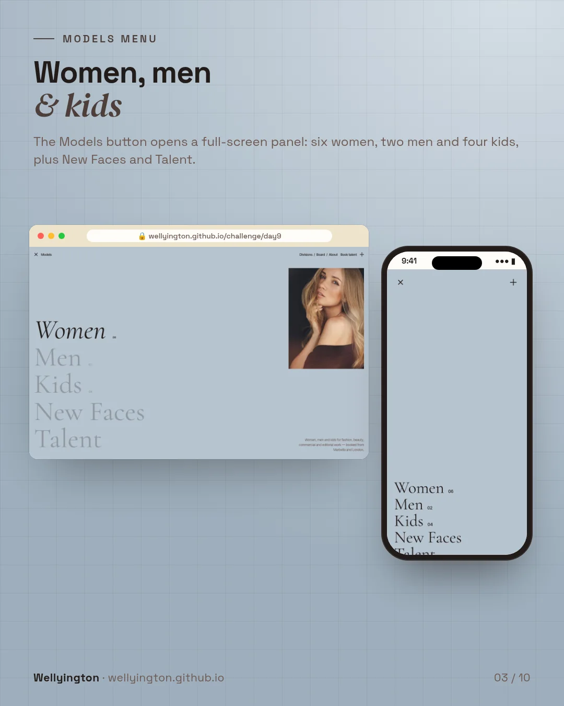
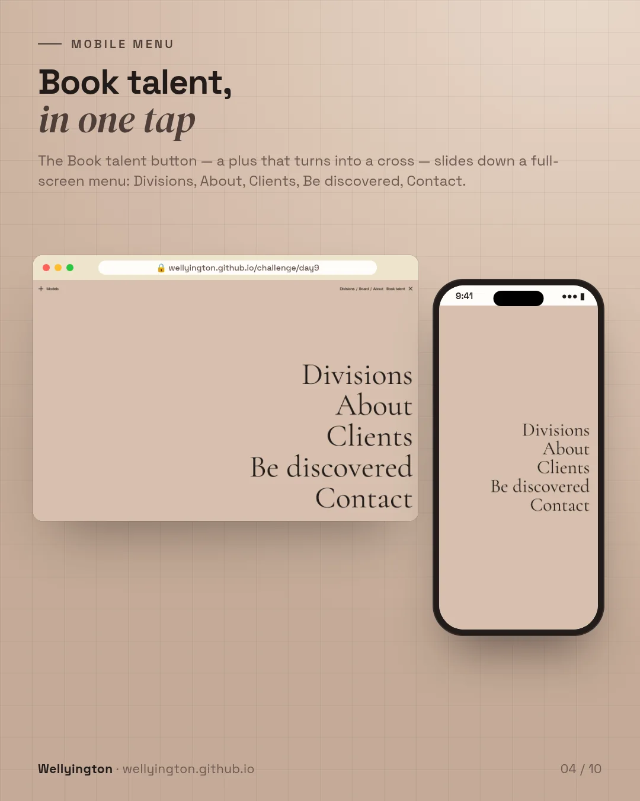
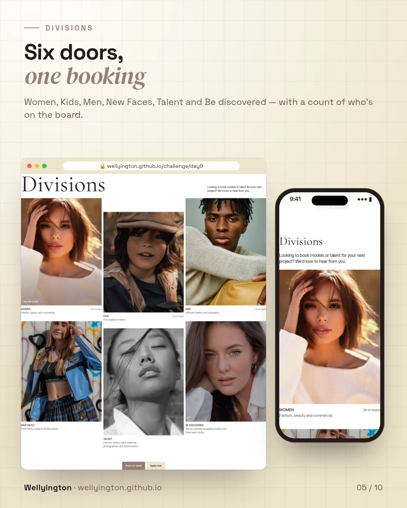
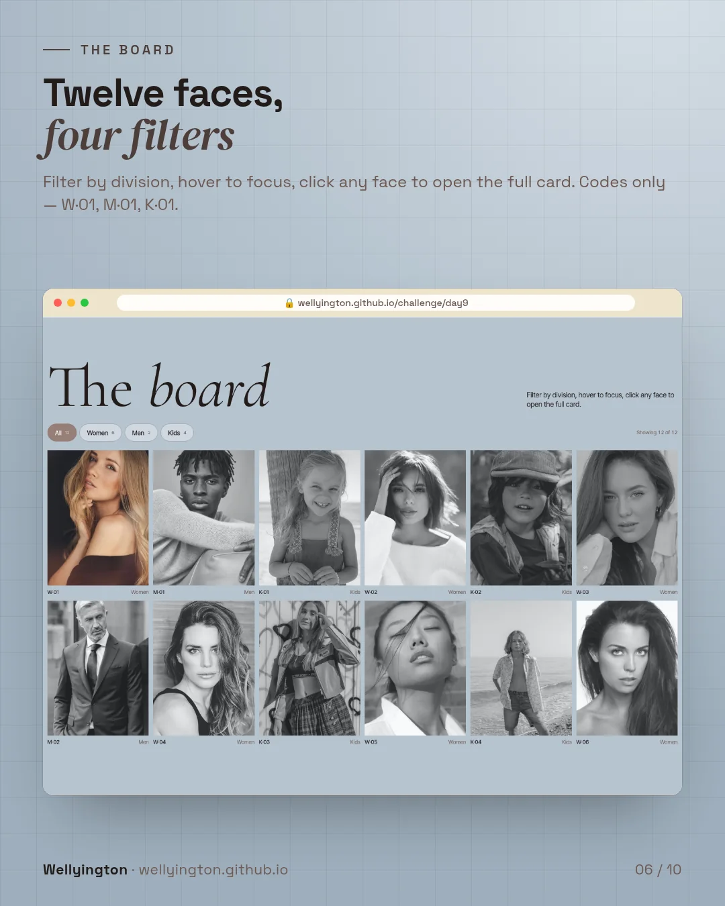
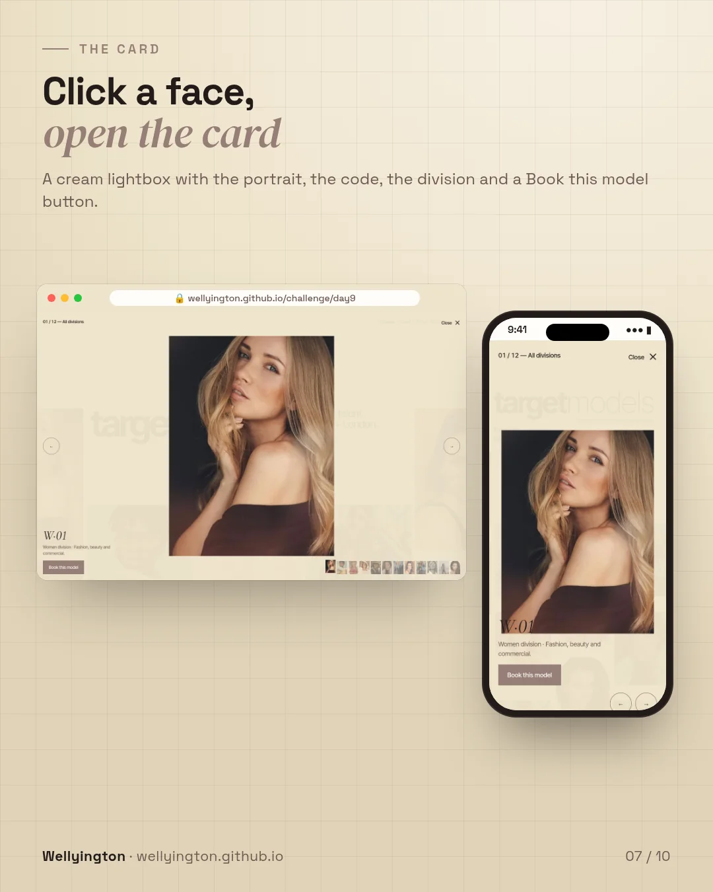
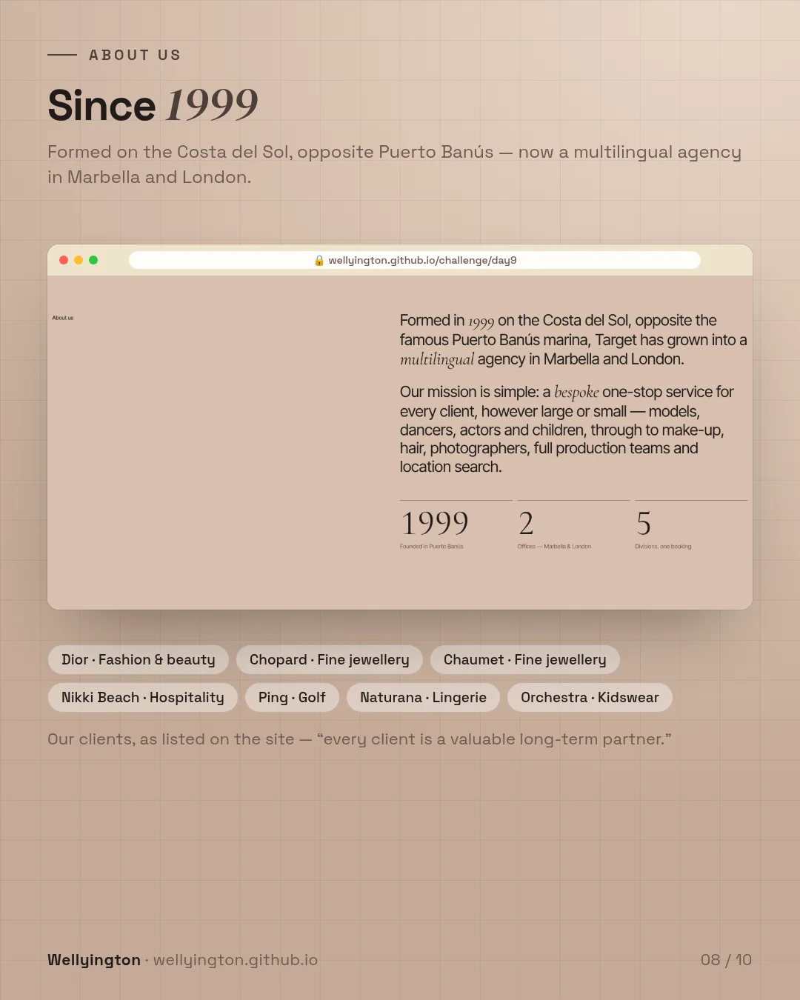
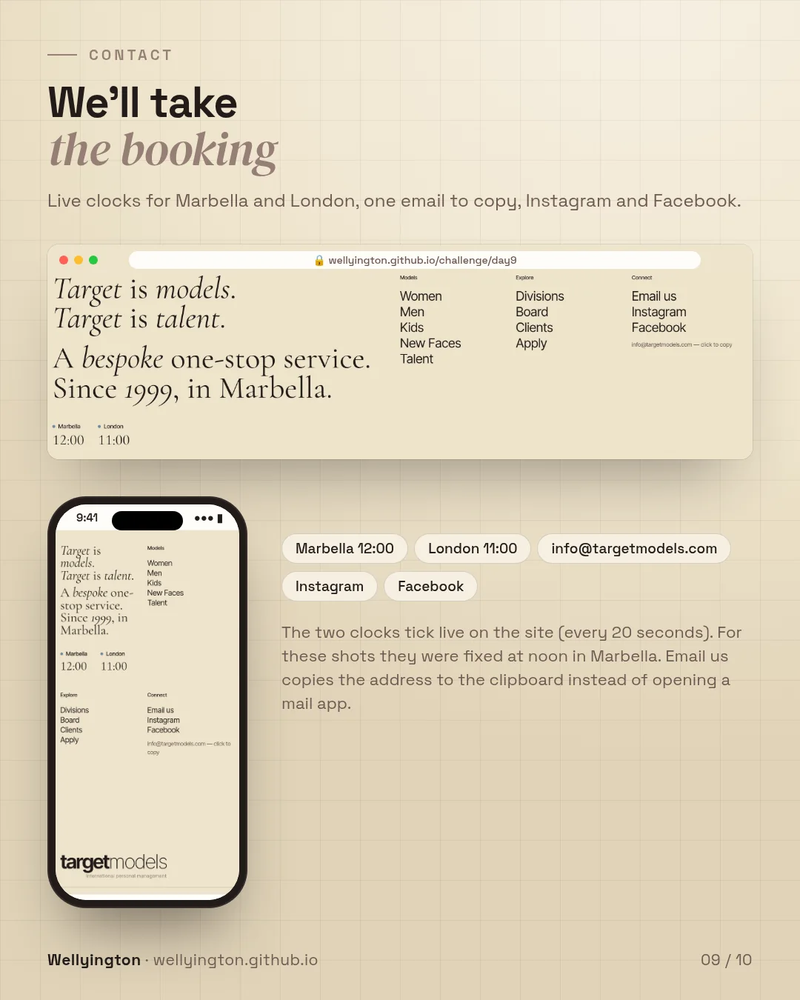

25 ноября я опубликовал девятую заметку этой серии, челленджа, который придумал Рамайя Траск: сто дней, сто компаний, сто сайтов. Она стала второй за день. Первым днём была семейная строительная компания в Марина-Альте. [Та страница здесь.](https://wellyington.github.io/journal/ru/articles/sait-do-slova-da/) Вторым — театр в Малаге. [Она здесь.](https://wellyington.github.io/journal/ru/articles/mesto-dlya-tselogo-sezona/) Третьим — семейный ресторан в Эстепоне. [Она здесь.](https://wellyington.github.io/journal/ru/articles/mesto-za-dlinnym-stolom/) Четвёртым — частная консалтинговая практика по недвижимости в Малаге. [Она здесь.](https://wellyington.github.io/journal/ru/articles/suzhdenie-vazhnee-obema/) Пятым — ресторан дегустационных сетов в Мотриле. [Она здесь.](https://wellyington.github.io/journal/ru/articles/tak-zhe-tshchatelno-kak-na-kukhne/) Шестым — заведение с курицей-гриль в Эстепоне. [Она здесь.](https://wellyington.github.io/journal/ru/articles/ot-prilavka-do-cheka/) Седьмым — семейный отель в Кавосе на Корфу. [Она здесь.](https://wellyington.github.io/journal/ru/articles/tot-zhe-bassein-nochyu/) Восьмым — три дома в историческом центре Малаги. [Она здесь.](https://wellyington.github.io/journal/ru/articles/tri-doma-odna-dver/)

Сегодня — другой род бизнеса. Target Models — модельное и кастинговое агентство, основанное в 1999 году на Коста-дель-Соль, напротив яхтенной гавани Пуэрто-Банус. Сейчас оно работает из двух офисов, в Марбелье и Лондоне, на нескольких языках. Агентство представляет женщин, мужчин и детей для моды, бьюти, рекламы и редакционных съёмок, а также подбирает танцоров, актёров, визажистов и стилистов, фотографов и целые продакшн-команды. Их нынешний сайт — [targetmodels.eu](https://www.targetmodels.eu/).

Концепт здесь: [Target Models, девятый день](https://wellyington.github.io/challenge/day9/).

## лица — это и есть продукт

Почти каждому сайту в этой серии приходилось что-то объяснять. Каков дом внутри, почему дегустационный сет стоит своих денег, как заказать курицу. У модельного агентства задача проще — и сложнее. Объяснять почти нечего. Лица — это и есть продукт. Если сайт встаёт между ними и зрителем, он провалился, каким бы остроумным он ни был.

Поэтому идея была в том, чтобы дать фотографиям говорить почти самим за себя. Много белого, очень мало цвета, мелкий шрифт и портреты настолько крупные, насколько позволяет экран. Всё остальное — меню, направления, бронирование — отходит на второй план, пока о нём не попросят.

Вторая задача менее заметна. Сайтом модельного агентства пользуются в основном не модели. Это арт-директоры, фотографы, бренд-менеджеры и продакшн-компании, которые ищут лицо для съёмки на следующей неделе. Им нужно увидеть, кто есть на борде, сузить выбор и связаться с агентством. Сайт должен делать это быстро и при этом никогда не выглядеть каталогом.

*Девятый день: многоязычное модельное и кастинговое агентство, портреты плывут мимо логотипа.*

## стена композиток

Раньше модельные агентства рассылали композитки — напечатанные карточки с несколькими фотографиями модели и её данными, которые висели на стене каждого кастингового офиса в городе. Главный экран концепта — это та самая стена.

Он открывается белым. Название, targetmodels, проходит через середину очень крупным шрифтом: target — жирным чёрным, models — тончайшим начертанием рядом, а под ним мелко — international personal management. Справа две короткие строки: models and talent; Marbella and London — модели и таланты; Марбелья и Лондон. Вот и всё представление.

Вокруг названия и за ним движутся портреты. Они собраны в колонки, каждая чуть выше или ниже соседней, и каждая медленно ползёт вверх или вниз в своём темпе, так что стена никогда не стоит на месте и не повторяется одинаково. Наведите мышь на колонку, и она остановится, чтобы можно было рассмотреть. Нажмите на лицо — откроется его карточка.

На телефоне та же стена превращается в три узкие колонки под названием: они всё так же плывут и останавливаются от касания.

Здесь нет слайдшоу, нет большого приветствия, нет кнопки «листайте вниз». Первое, что вы видите, — название и люди, а это и есть агентство.

*Главная страница — стена композиток. Наведите на портрет, чтобы остановить, нажмите, чтобы открыть карточку.*

## две кнопки, два меню

Шапки почти нет: плюс и слово Models слева, плюс и Book talent справа, а между ними на компьютере — тихая строка ссылок: Divisions, Board и About. Два плюса — вся навигация, потому что у сайта два типа посетителей.

Нажмите Models, и поверх страницы выезжает панель бледного небесно-голубого цвета. Слева — направления крупной антиквой: Women, Men, Kids, New Faces и Talent, а рядом с первыми тремя маленькая цифра — сколько лиц на этом борде. Когда вы ведёте вниз по списку, названия, на которые вы не указываете, бледнеют, а справа появляется портрет из этого направления. Как будто перебираешь стопку карточек.

Нажмите Book talent, и выезжает другая панель, нежно-пудрового цвета: Divisions, About, Clients, Be discovered и Contact, крупно и по правому краю. Плюс превращается в крестик, чтобы было понятно, как закрыть. Клавиша Escape тоже закрывает.

На телефоне обе кнопки остаются в углах экрана, а обе панели заполняют его целиком. Одно касание — посмотреть моделей, одно — забронировать.

*Кнопка Models открывает полноэкранную панель: женщины, мужчины и дети, а также New Faces и Talent.*

*Плюс, который становится крестиком, и полноэкранное меню: Divisions, About, Clients, Be discovered, Contact.*

## шесть дверей, одно бронирование

Бизнес Target шире, чем подсказывает название. Кроме моделей, агентство подбирает таланты и постоянно ищет новых людей. Раздел направлений показывает всё сразу — как шесть дверей.

Women — женщины, для моды, бьюти и рекламы. Kids — дети, от младенцев до подростков. Men — мужчины, для лайфстайла, моды и кампаний. New Faces — новые лица, готовые к открытию. Talent — танцоры, актёры, стилисты и визажисты, фотографы и полный продакшн. И Be discovered — для тех, кто хочет присоединиться: сейчас агентство принимает моделей из Испании и Лондона.

Каждая дверь — большой портрет с подписью, а у первых трёх — число людей на борде. Портреты стоят на немного разной высоте, как отпечатки, разложенные на столе, а не плитки в сетке. Над ними одна простая строка: ищете моделей или таланты для следующего проекта? Будем рады услышать вас. Под ними две кнопки: book our talent и apply now — забронировать таланты и подать заявку.

Две кнопки говорят, для кого этот раздел. Клиенты бронируют. Будущие модели подают заявки. Никому не нужно читать чужую половину страницы.

*Women, Kids, Men, New Faces, Talent и Be discovered — с числом тех, кто на борде.*

## борд

Борд — то место, где клиент действительно работает. Он называется просто the board, крупно, наполовину прямым шрифтом, наполовину курсивом, и рядом единственная подсказка: фильтруйте по направлению, наводите, чтобы выделить, нажмите на любое лицо, чтобы открыть полную карточку.

Над лицами четыре фильтра — All, Women, Men и Kids, — у каждого своё число. Выберите один, и борд перестроится, показывая только это направление, а справа маленькая строка скажет, сколько вы видите, например showing 6 of 12.

Лица чёрно-белые, пока вы не наведёте на одно из них. Тогда этот портрет становится цветным, а остальные остаются приглушёнными. На странице, полной лиц, одного этого изменения достаточно, чтобы показать, куда направлено ваше внимание, — без рамок, теней и увеличения.

У каждого лица код вместо имени: W·01 — первая женщина, M·01 — первый мужчина, K·01 — первый ребёнок. Это сознательное решение. Настоящий борд показывал бы моделей самого агентства, с именами и параметрами, и только с их согласия. Концепту не нужно выкладывать в интернет настоящие имена, чтобы показать, как работает борд, поэтому он этого не делает.

*Фильтр по направлению, наведение для фокуса, нажатие на любое лицо открывает карточку. Только коды.*

## нажмите на лицо — откройте карточку

Нажатие на любое лицо — на главном экране, в направлениях или на борде — открывает его карточку. Экран заливается кремовым, а портрет появляется в центре, крупно. В углу счётчик, 01 из 12, и направление, которое вы просматриваете. Ниже — код курсивной антиквой, направление и что оно охватывает, и одна кнопка: book this model, забронировать эту модель.

Стрелки по бокам и ряд миниатюр внизу позволяют листать остальных, ничего не закрывая. На клавиатуре то же делают стрелки влево и вправо, а Escape закрывает карточку. На телефоне — свайп.

Book this model закрывает карточку и ведёт к контактам. В настоящей версии кнопка открывала бы запрос, уже помеченный кодом модели, чтобы агентство точно знало, о ком спрашивает клиент.

*Кремовая карточка с портретом, кодом, направлением и кнопкой Book this model.*

## с 1999 года

Раздел об агентстве короткий. Основанное в 1999 году на Коста-дель-Соль, напротив знаменитой гавани Пуэрто-Банус, Target выросло в многоязычное агентство в Марбелье и Лондоне. Его миссия — индивидуальный сервис «всё в одном» для каждого клиента, большого или маленького: модели, танцоры, актёры и дети, а также визажисты, стилисты, фотографы, полные продакшн-команды и поиск локаций.

Несколько слов в этом тексте набраны курсивной антиквой посреди гротеска — 1999, multilingual и bespoke, — так журнал выделяет слово в цитате. Ниже три числа: 1999 — год основания в Пуэрто-Банусе; 2 — офиса, в Марбелье и Лондоне; 5 — направлений, одно бронирование.

Затем клиенты, в том виде, в каком их перечисляет агентство: Dior и Chopard, Chaumet, Nikki Beach, Ping, Naturana и Orchestra — от моды и ювелирных украшений до гостеприимства, гольфа, белья и детской одежды. Под ними одна фраза агентства: мы считаем каждого клиента ценным долгосрочным партнёром.

*Основано на Коста-дель-Соль напротив Пуэрто-Бануса, а теперь — многоязычное агентство в Марбелье и Лондоне.*

## бронирование берём на себя

Внизу страницы — голос агентства, крупной курсивной антиквой: Target is models. Target is talent. A bespoke one-stop service. Since 1999, in Marbella. Target — это модели, Target — это таланты, индивидуальный сервис «всё в одном», с 1999 года в Марбелье.

Под этим двое маленьких часов, Марбелья и Лондон, со временем в каждом офисе. Разница — час, и тому, кто бронирует съёмку из другой страны, приходится каждый раз её высчитывать. Часы обновляются сами, пока страница открыта.

Рядом три короткие колонки: направления моделей, остальной сайт и способы связаться. Email us копирует адрес агентства в буфер обмена и сообщает об этом, вместо того чтобы открывать почтовую программу, которой вы, может быть, не пользуетесь. Есть ссылки на Instagram и Facebook, а в самом низу снова название — тем же жирным и тончайшим начертанием, что и наверху.

*Живые часы Марбельи и Лондона, один адрес для копирования, Instagram и Facebook.*

## детали

Шрифтов всего два. Inter Tight, узкий и точный гротеск, — почти для всего, от огромного названия наверху до самой мелкой подписи. Cormorant Garamond, классическая антиква, курсивом — для направлений, меню, заголовков карточек и слов, на которых стоит задержаться.

Цвета — собственная палитра агентства: бледно-голубой для панели Models и борда, кремовый для карточек и подвала, нежно-пудровый для меню Book talent и раздела об агентстве и приглушённый серо-коричневый для кнопок, всё на белом. Каждый цвет обозначает свою часть агентства, так что всегда понятно, смотрите ли вы на лица, читаете о бизнесе или связываетесь с агентством.

Движение здесь нарочно медленное. Колонки плывут, заголовки поднимаются на место строка за строкой, меню выезжают. Всё это останавливается для тех, кто попросил свой телефон или компьютер уменьшить анимацию, и тогда портреты просто стоят в своих колонках. Шрифты загружаются с моего собственного сайта, а не из Google, поэтому открытие страницы не передаёт ничей адрес третьим лицам.

## что такое этот концепт и что дальше

Сведения об агентстве на странице взяты с его нынешнего сайта: год и место основания, два офиса, направления, услуги, перечисленные клиенты, страница для заявок, адрес почты и профили в соцсетях. Портреты стоят на месте борда, с кодами вместо имён, чтобы показать, как работал бы настоящий.

Новое — это структура: стена лиц вместо главной страницы, две кнопки для двух типов посетителей, направления рядом друг с другом, борд, который фильтрует и выделяет, и карточка для каждого лица, ведущая прямо к бронированию.

Цифр по бронированиям и заявкам у меня нет, и придумывать их я не буду. Чтобы превратить концепт в работающий сайт, нужны практические шаги: собственный борд агентства с именем, параметрами и портфолио каждой модели, опубликованный с их согласия; форма запроса, которая передаёт код модели; испанская версия рядом с английской; и простой способ для агентства добавлять и убирать лица, ни от кого не завися.

## если ваша работа — визуальная

Возможно, у вас нет модельного агентства. Но многие компании продают то, что нужно увидеть: фотограф, флорист, архитектурное бюро, тату-студия, площадка для свадеб, столяр. Их сайты часто прячут изображения под абзацами о страсти и качестве.

Помогает то же, что и здесь. Поставьте работу на первое место, а всё остальное пусть молчит. Используйте один-два шрифта и совсем немного цвета. Дайте людям сузить выбор — по типу, стилю или размеру — одним нажатием. Пусть каждое изображение куда-то ведёт: к подробностям, а затем к способу связаться. И дайте разные двери тем, кто хочет работать с вами, и тем, кто хочет у вас купить.

Я веб-дизайнер из Эстепоны, на Коста-дель-Соль, и проектирую и делаю сайты для компаний в Испании и за её пределами. Если это похоже на ваш бизнес, напишите мне через [основной сайт](https://wellyington.github.io/ru/). Расскажите, чем вы занимаетесь и где, и я отвечу простым языком. Концепт [здесь](https://wellyington.github.io/challenge/day9/), а нынешний сайт Target Models [здесь](https://www.targetmodels.eu/), чтобы вы могли их сравнить. Девять готово, осталось девяносто один.
