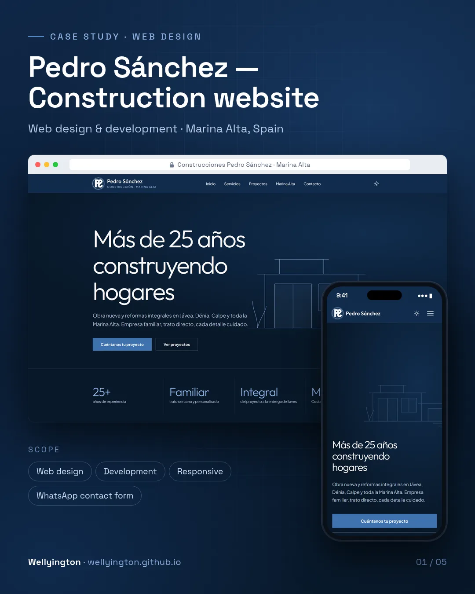
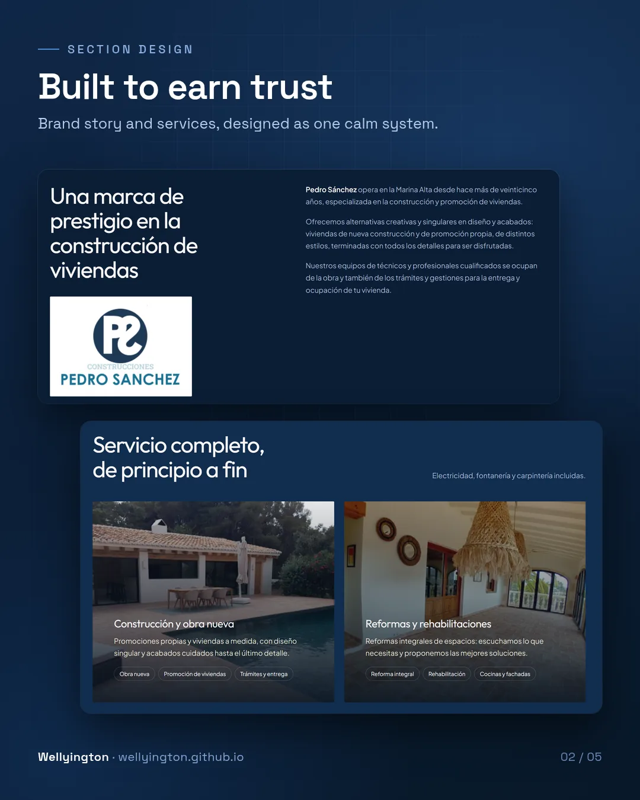
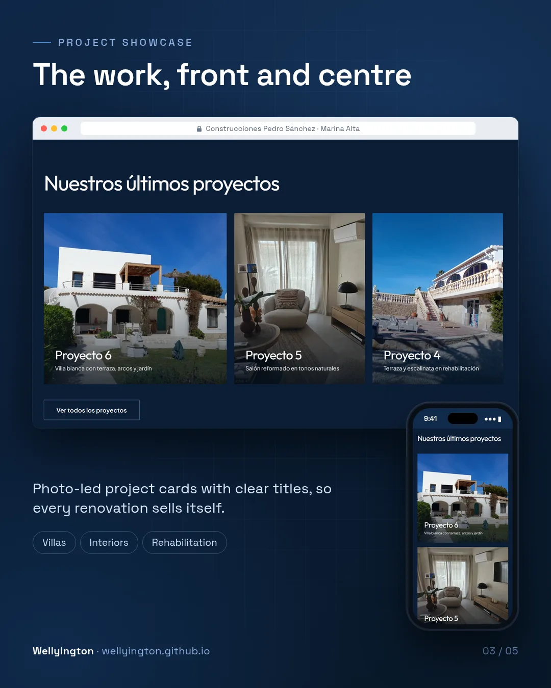
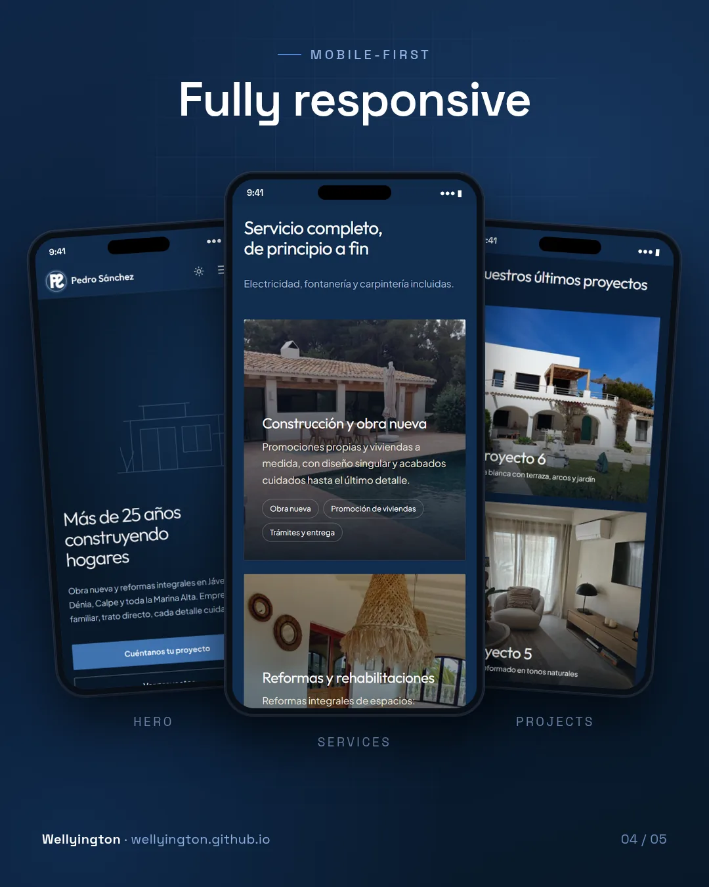

17 ноября я выложил короткую заметку. Первый день дела, которое веду открыто: сто дней, сто дел, сто сайтов. Первый — одна страница для Pedro Sánchez Construcción, семейной строительной фирмы в Марина-Альте. Она уже открывается.

Я работаю из Эстепоны. Обычная неделя — сайт для магазина, мастерской или ремесла, такой, чтобы он вёл себя как само дело: было понятно, что предлагают, и чтобы до него можно было дозвониться обычным днём. Этот я собрал до того, как кто-то меня нанял.

Его можно открыть здесь: [Pedro Sánchez Construcción, день первый](https://wellyington.github.io/challenge/day1/). Пока он лежит на моём адресе. Так честнее, пока хозяин его не забрал.

## сто дней, по одному делу

Одно дело в день, и каждый раз настоящий сайт, а не картинка, припасённая для встречи, которой может не случиться. К концу ста дней мне нужны сто страниц, которые человек откроет и узнает. Эта фирма — первая. Впереди ещё девяносто девять.

Идея Рамайи Траска. Он считает, что такая полоса дней — здравый способ собрать дело по сайтам, и причина на стороне клиента. Нанять кого-то обычно значит воображать страницу, которой нет: чужие сайты, предложение, своё имя всё ещё на пустом месте. Готовая страница решается проще. Вы её открываете, видите свои города и свою работу и передаёте телефон через стол. Да, или нет, или поправьте вот это.

С Педро я не говорил. Насколько мне известно, страницу он не видел, и я не стану писать так, будто видел. Она лежит здесь, чтобы он смотрел на готовую вещь, а не на обещание, что страница когда-нибудь появится. Пока он ничего мне не подтвердил, и я не собираюсь дописывать за него согласие.

## что нужно клиенту строителя

Страница представляет семейную фирму, которая больше двадцати пяти лет строит дома в Марина-Альте. Названы Хавеа, Дения и Кальпе и берег вокруг, на Коста-Бланке, в Аликанте. Верхняя строка — та, с которой они начинают: больше двадцати пяти лет строим дома. Новые дома, полные ремонты, близкий разговор с людьми и внимание к мелочи.

Эту историю я не выдумал, чтобы фирма звучала старше. Её и слушает клиент. Двадцать пять лет на одном берегу значат, что компания была здесь до модных кухонь этого года и, скорее всего, ещё возьмёт трубку, если стройка затянется. «Семейная» на странице расписана как trato directo. Вы говорите с ними, а не с коммутатором.

Работа стоит двумя частями, рядом. Новые дома: одни они строят как свои, другие рисуют под конкретного человека, и дом можно жить, а не только показывать. Полные ремонты, где сначала слушают, потом предлагают путь. Электрика, сантехника и столярка входят в работу. Последняя строка важна, если вы уже ремонтировали. В таких делах бывает скверная середина, когда электрика «это чужая забота», а тот чужой ещё не нанят. Я передаю то, что написано на странице. На их объектах я не стоял.

Посетитель, которого я держал в голове, живёт конкретную неделю. Участок. Дом, который больше не вмещает. Кухня, которая не нравится уже годы. Он сравнивает две-три фирмы и хочет простых ответов. Можно ли доверить этим людям дом. Можно ли увидеть работу. Как написать им на этой неделе, не заводя учётную запись.

## первый экран

Первые слова крупные: «Más de 25 años construyendo hogares». Больше двадцати пяти лет строим дома. За ними линейный рисунок дома, светлый на тёмно-синем. Под заголовком: новые дома и полные ремонты в Хавеа, Дении, Кальпе и остальной Марина-Альте. Семейная фирма, прямой разговор, каждая мелочь на месте.

Две кнопки. Расскажите о проекте или посмотрите проекты. Говорить сейчас или сначала увидеть дома.

Внизу четыре коротких факта. Больше двадцати пяти лет. Семейная фирма, близко и лично. Весь путь от проекта до дня, когда отдают ключи. Само место: Марина-Альта, Коста-Бланка, Аликанте. Они стоят там, куда глаз падает ещё до прокрутки.

На телефоне тот же экран складывается стопкой. Заголовок, несколько строк, кнопка. Рисунок остаётся, меньше, и страница всё ещё их.

*Начало страницы, на большом экране и на телефоне.*

## история и два вида работ

Ниже несколько абзацев о том, кто они. Больше двадцати пяти лет строят и ведут дома в Марина-Альте. Свои объекты и новые дома разных характеров, доведённые до того, что в них можно жить. Люди, которых они нанимают, ведут стройку и бумаги сдачи дома. Заголовок называет их уважаемым именем в строительстве жилья. Это их фраза. Страница её не перекрикивает.

Знак — монограмма PS, имя и слова construcción и Marina Alta. Он говорит, чья это страница, наверху и снова внизу.

Дальше услуги, под заголовком, который обещает работу от начала до конца. Рядом: электрика, сантехника и столярка включены. Объясняют две фотографии. Одна — одноэтажный дом, черепичная крыша, бассейн и стол под деревьями: новое строительство, свои объекты и дома под размер. Другая — длинная крытая комната, арки по одной стороне, большая плетёная лампа, сад в дальнем конце: ремонты, где слушают и потом предлагают. На снимках мелкие подписи для того, кто спешит. Новый дом, своя застройка, бумаги и сдача. Полный ремонт, восстановление, кухни и фасады.

Под фотографиями порядок, в котором это проживает клиент. Сначала слушают, потому что каждый проект свой. Потом предлагают. Потом делают, от плана до последнего дня на объекте.

Дальше короткий кусок о жизни в Марина-Альте. Бухты, мягкие зимы, тёплое лето, еда и немного тишины. Дения, Хавеа и Кальпе названы сами по себе. Многие, кто заказывает здесь дом, выбирают город не меньше, чем фирму, поэтому страница говорит об этом коротко и возвращается к работе.

*Кто они и два вида работ: новые дома и полные ремонты.*

## сами дома

Строителю верят, когда видно дома. На странице три недавних проекта: фотография, название и одна строка.

Белая вилла с террасой, арками и садом. Гостиная после ремонта в природных тонах: светлые шторы, низкое кресло, дерево, лампа. Терраса и наружная лестница ещё в работе, за ними берег. Третья важна. Незаконченное дело говорит, что ремонт здесь своя работа, а не придаток к готовым виллам.

Есть ход ко всем проектам. На телефоне фотография идёт раньше подписи. Я не ходил по этим комнатам и не стану выдумывать, каковы они. Их показывают крупно, обычным испанским. Слова «портфолио» нет. За кухонным столом клиент и так говорит «проекты».

*Недавняя работа: фотографии с названием и одной строкой.*

## как с ними связаться

Конец страницы делает полезным всё остальное. Можно написать в WhatsApp или заполнить короткую форму: имя, телефон, почта и в чём проект. Вы отмечаете, что прочитали заметку о конфиденциальности. Кнопка говорит: отправить через WhatsApp. Тогда открывается WhatsApp, сообщение уже написано, и отправляете его вы сами. Оно не пропадает в ящике, который никто не открывает. Следующий шаг виден.

Под номером одна строка: напишите в WhatsApp или заполните форму, и вам ответят. Заголовок над этим: «оставьте проект в руках тех, кто этим занимается». На этом берегу многое из настоящих договорённостей уже идёт через WhatsApp. Другой номер потом — маленькая правка.

## та же страница на телефоне

Пара выходит с просмотра. Кто-то посылает кухню, которую хочет снести, человеку, без чьего согласия нельзя. Имя, услышанное в Дении, открытое на стоянке. Экран узкий, момент короткий.

Телефон показывает тот же сайт. Первая строка, оба вида работ со своими фотографиями, электрика, сантехника и столярка названы сверху, проекты по-прежнему читаются как дома. Кнопка там, куда достаёт большой палец. Меню уходит, как только вы выбрали. Не нужно щипать экран. Не нужно поворачивать телефон, чтобы фраза поместилась.

*Тот же сайт на телефоне: начало, услуги и проекты.*

## что дальше с этим сайтом

Его можно отдавать. Ради этого я и собрал его до разговора. Кто-то в фирме может открыть страницу сегодня и сказать да, или нет, или да, если сдвинуть несколько вещей.

Если она им нужна, дальше работа обычная, без второго проекта «с нуля». Свой адрес, чтобы людей приводили к фирме, а не в папку на моём сайте. Фраза, которую они лучше напишут сами. Фотография, которая им ближе. Проект, который стоит добавить или снять. Там, где сейчас мои слова стоят вместо разговора, которого не было, появятся их слова и их снимки. Потом страница выходит под их именем, на их телефоне, и отвечают на неё так, как отвечают они.

До того она остаётся там, куда я её положил. Открытый адрес, первый день задания, без притворства, будто они уже согласились. Мне не сказали, что они смотрели. Если вы Педро или работаете там, я лучше услышу «поменяйте эту террасу», чем не услышу ничего.

## если у вас небольшое дело

Вы можете не строить дома. Из Эстепоны я почти каждый месяц вижу ту же связку, у людей выше и ниже по берегу. Делу нужен сайт или сайт лучше той страницы, которую наспех собрали годы назад. Вам показывают чужие ремёсла и просят представить своё. Часто цена приходит раньше любой страницы, и решение будто должно выйти из встречи, в которой самой страницы ещё не было.

Можно наоборот. Страница есть сначала. На ней ваше имя, работа, которую вы и так делаете, города, где вы работаете, и способ до вас достучаться, похожий на то, как вы уже говорите с людьми. Вы открываете её на телефоне, который и так носите с собой. Показываете партнёру, брату или сестре, тому, кто смотрит за деньгами. Сначала смотрите вместе. Потом решаете, оставлять ли её.

В этом толк этих ста дней, и так я предпочитаю работать, когда никакого вызова нет. Если вам нужна такая страница, напишите мне с [основного сайта](https://wellyington.github.io/ru/). Скажите, что вы делаете и где. Отвечу обычным языком.

## небольшая просьба

Этот первый сайт для фирмы, с которой я хотел бы работать, и чёрного хода у меня нет. Если вы знаете Педро Санчеса или кого-то в компании, перешлите им страницу. Об этом и была просьба в заметке, и она всё ещё стоит: [день первый, написанный открыто](https://x.com/wellyington/status/2122700118528872815).

Я продолжаю. Одно дело, один сайт, следующий день. Если страница найдёт хозяина, хорошо. Если она только сделает вторую яснее, это тоже считается.
