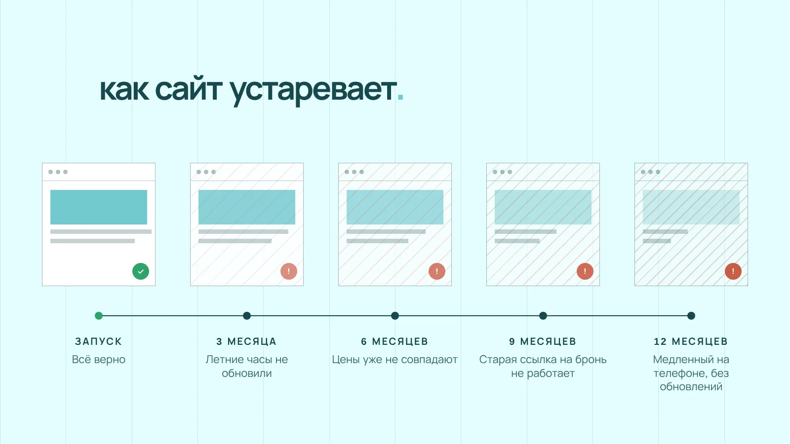
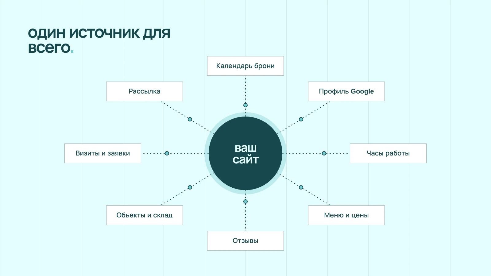
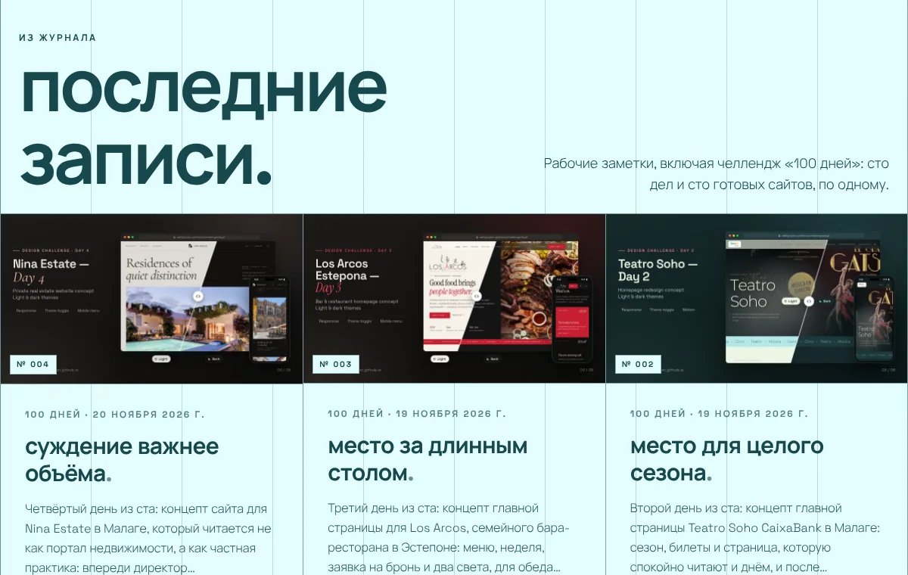
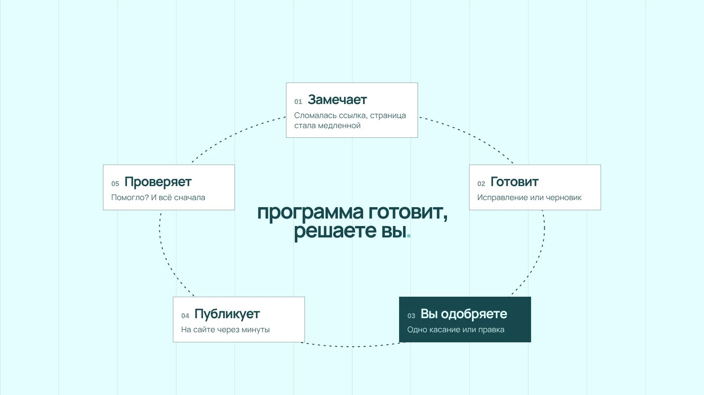
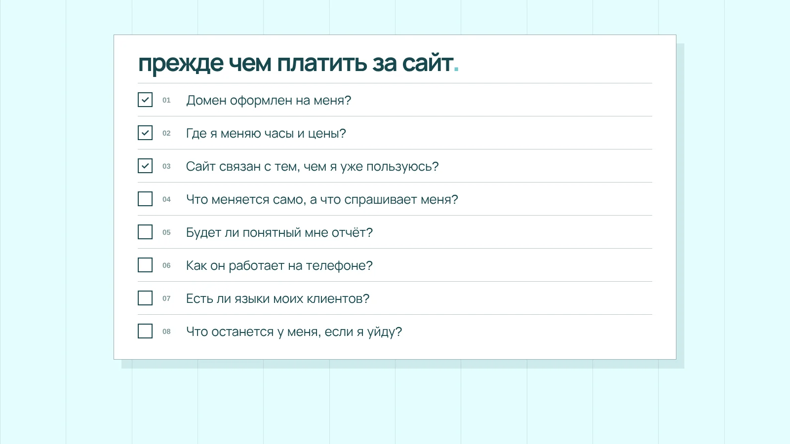

Вопрос, который мне задаёт почти каждый клиент, обычно в конце первого разговора: «Когда сайт будет готов, на этом всё, да? Платить дальше не нужно?»

Вопрос честный. Двадцать лет ответ был, в общем, «да». Вы платили кому-то за сайт, вам его передавали, и он так и стоял, как печатный буклет. Иногда его обновляли. Чаще о нём забывали.

На этой неделе я прочитал в DataDrivenInvestor статью [The Slow Death of the Static Website](https://medium.datadriveninvestor.com/the-slow-death-of-the-static-website-why-autonomous-apis-are-finally-fixing-the-small-business-web-4b79db5da819), «Медленная смерть статичного сайта». Её мысль, если коротко: сайт малого бизнеса перестаёт быть буклетом, которому постоянно нужен ручной уход, и становится ближе к системе, которая может сама поддерживать себя в актуальном состоянии, потому что теперь он связан с другими инструментами, которыми бизнес уже пользуется. Статья написана для тех, кто делает сайты, и полна слов вроде API, системы управления контентом и автономных агентов.

Эта заметка — версия, которую я рассказал бы клиенту за столом. Без кода, без аббревиатур без объяснения, и с честной границей между тем, что работает уже сегодня, тем, что пока в основном слова продавцов, и тем, что вам по-прежнему стоит делать самим.

## буклет в ящике стола

Вспомните последний печатный буклет вашего бизнеса. В день, когда его привезли из типографии, он был идеальным. Цены верные, фотографии свежие, часы работы правильные.

Через полгода одна цена выросла. Через год на фото команды был человек, который уже ушёл. Через два года коробка с буклетами лежала в ящике, и их никто не раздавал, потому что в них было три мелкие ошибки, и все об этом знали.

У большинства сайтов малого бизнеса такая же жизнь. Разница в том, что сайт никто не убирает в ящик. Он остаётся в интернете, на виду, отвечает за вас на вопросы в три часа ночи, и отвечает неправильно.

Сайт, сделанный так, в моей профессии называют статичным. Это технический термин, и я ещё к нему вернусь, потому что из-за него бывает путаница. Пока понимайте «статичный» в обычном смысле: он остаётся таким, каким был в день сдачи, пока человек не сядет и не изменит его.

## как сайт незаметно устаревает

Никто не решает дать своему сайту устареть. Это происходит постепенно, по одной мелочи, и почти всегда клиенты замечают это раньше владельца.

В первые месяцы на лето меняются часы работы, а на сайте их никто не обновляет. Кто-то приходит к закрытой двери. Потом цены в меню или на странице услуг расходятся с ценами на кассе. Потом вы переходите на новую систему бронирования, а старая кнопка «забронировать» по-прежнему ведёт на прежнюю. Потом пропадает фотография или ломается ссылка на партнёра, потому что он поменял свой сайт.

Под поверхностью происходят вещи, которых не видно. Программам, на которых держится сайт, нужны обновления, и без них сайт легче взломать. Копятся дополнения: окошко чата, баннер про cookies, три системы аналитики от трёх разных маркетологов. Каждое немного замедляет страницу на телефоне, а медленные страницы теряют посетителей и позиции в Google. Автор исходной статьи называет это тихим техническим гниением, и название подходит. Ни в какой конкретный день ничего не ломается. Просто каждый месяц становится чуть хуже.

Сюда же относится поиск. Представление Google о хорошей странице всё время меняется. Сайт, который хорошо шёл в первый год, может съезжать вниз, даже если его никто не трогал, просто потому что другие сайты продолжали улучшаться, а этот нет. Раньше работу с поиском считали списком, который проходят перед запуском. На деле она не заканчивается никогда.

Самое неприятное в том, что владелец почти никогда не видит свой сайт глазами клиента. Вы знаете правильные часы работы, поэтому взгляд просто скользит мимо неправильных на странице. А у клиента есть только страница. Для него написанное там и есть правда о вашем бизнесе, пока он не окажется перед закрытой дверью или не начнёт спорить о цене у прилавка. К этому моменту сайт уже чего-то вам стоил, и никто не может сказать, в какой день это началось.

Никто в этом не виноват. Владелец малого бизнеса занят тем, что ведёт бизнес. Сайт — единственный сотрудник, который ничего не просит, поэтому о нём и забывают.

*Как сайт устаревает: никогда сразу, всегда понемногу.*

## что такое API без технических слов

Вся статья держится на одном слове, которое большинству владельцев бизнеса знать не нужно, поэтому вот короткая версия.

API — это способ, которым две программы разговаривают друг с другом без человека, который переносит данные из одной в другую. Проще всего представить официанта. Кухня не выходит к вашему столу, и вы не заходите на кухню. Официант относит понятный заказ в одну сторону и приносит понятный ответ в другую.

Вы уже пользуетесь сервисами, у которых есть такой официант, даже если никогда его не видели. Он есть у вашего календаря бронирования. Он есть у вашего профиля компании в Google, того блока на Google Картах с часами работы и отзывами. Он есть у интернет-магазинов, складских списков, сайтов отзывов, сервисов рассылок и платёжных систем. Даже у прогноза погоды он есть.

Когда сайт подключён к таким сервисам, он перестаёт быть копией вашей информации и начинает читать её из первоисточника. Вы меняете часы в одном месте, и сайт показывает новые. Последний столик на субботу занят в системе бронирования, и сайт перестаёт его предлагать. Продана последняя квартира в доме, и она исчезает из списка.

Это первая и самая полезная половина перемен, о которых пишет статья. Искусственный интеллект для неё вообще не нужен. Это в основном аккуратная сантехника.

*Сайт читает данные оттуда, где ваша информация уже живёт, вместо того чтобы хранить свою копию.*

## одно место для изменений

Цель, к которой я стремлюсь с клиентами, звучит просто: каждую единицу информации нужно вводить только в одном месте.

На третий день моего стодневного челленджа я сделал концепт главной страницы для Los Arcos, семейного бара-ресторана здесь, в Эстепоне. У такого ресторана три разных расписания: у ресторана, у бара и у утреннего кафе. На странице они на вкладках, а крупная строка слева отвечает на единственный вопрос, который есть почти у всех: открыто ли сейчас. Маленькая зелёная отметка в навигации пишет «кафе открыто», когда кафе открыто.

Честно о том, где сейчас этот концепт: часы там один раз записаны в самой странице, а остальное страница считает по часам на устройстве. Следующим шагом, если Los Arcos этого захочет, было бы читать эти часы оттуда же, где они уже ведут их для Google, чтобы изменение к Рождеству делалось один раз и появлялось везде. Вот о таких связях я и говорю. В них нет ничего эффектного, зато они избавляют живых людей от напрасной поездки.

*Из концепта Los Arcos: три расписания и один простой ответ на вопрос «открыто ли сейчас?».*

Есть пример поменьше прямо на этом сайте. Главная страница wellyington.github.io теперь показывает последние записи этого журнала на каждом из четырёх языков. Этот раздел никто не обновляет руками. Когда я публикую статью, главная через минуту пересобирается сама, и новая запись оказывается наверху. Мелочь, но это ровно та идея: написать один раз, а остальное подтянется.

*Главная этого сайта сама показывает свежие записи журнала. Опубликовал один раз, и запись появилась и там.*

## от подключённого к «автономному»

Вторая половина статьи идёт дальше, и здесь появляются громкие слова. Идея в том, что программа, обычно построенная на том же искусственном интеллекте, что и чат-боты, которыми многие уже пользуются, работает поверх всех этих связей и действует сама. Не только читает ваши часы работы, но замечает проблемы и исправляет их, пишет новые страницы и публикует их.

Статья перечисляет, к чему подключена такая система: к части сайта, где редактируется текст, к Google Search Console, к статистике посещений, к системе бронирования или складу и к хранилищу всего, что бизнес знает о себе: его тона, продуктов, правил.

Про Google Search Console нужна одна фраза, потому что он всплывает в каждом разговоре на эту тему. Это бесплатный отчёт Google, который показывает, по каким запросам находят ваш сайт, какие страницы Google может прочитать, а какие нет, и что идёт не так. Считайте его табелем, который ваш сайт получает от Google. Большинство малых бизнесов ни разу его не открывали, а многие даже не подключили.

Система с доступом к этому отчёту, к вашей статистике и к броням теоретически может увидеть, что страница на прошлой неделе перестала появляться в поиске, понять почему и предложить исправление раньше, чем вы бы вообще заметили. Это обещание. Часть его уже работает. Часть пока остаётся демонстрацией.

## что это уже умеет хорошо

Вот что я сегодня доверил бы программе на сайте малого бизнеса почти без риска.

Каждую неделю проверять, что все ссылки на сайте куда-то ведут, и сообщать обычными словами, когда какая-то сломалась. Измерять, как быстро главные страницы открываются на телефоне, и предупреждать, когда новое дополнение их замедлило. Следить за отчётом Search Console и раз в месяц присылать короткую сводку, написанную для человека, а не для программиста: по каким запросам приходили люди, какие страницы проседают, что стоит исправить.

Держать списки в согласии с источником: события из календаря, номера или столики из системы бронирования, объекты из файла с объявлениями, часы работы из профиля Google. Готовить первый черновик новости или страницы события по вашим собственным заметкам, чтобы вы прочитали и поправили. Делать первую версию перевода, чтобы англоязычные, испаноязычные или русскоязычные посетители не оставались в стороне, опять же с проверкой человеком. Предлагать заголовки и описания получше для страниц, которые люди находят в поиске, но почти не открывают.

Ни одна из этих задач не гениальна. Все они из тех, что выпадают из списка занятого человека и, выпав, тихо стоят денег.

## чего ей не стоит делать самой

Та же программа, которая чинит сломанную ссылку, может за секунды и с полной уверенностью показать всем посетителям неправильную цену. Эту часть истории восторженные статьи обычно пропускают.

Об этом хорошо рассказали те, кто такие системы строит. Недавно в журнале о дизайне вышла статья создателей платформы автономных сайтов. Они хотели, чтобы сайты работали полностью сами, считая, что именно этого хотят владельцы. Когда платформой начали пользоваться настоящие владельцы, те засомневались. Оказалось, что почти никто не хочет сайт, который целиком меняет себя сам, ни о чём не спрашивая.

Это совпадает с тем, что вижу я. Владелец бизнеса не против, чтобы программа ночью починила ссылку. Но он совсем не рад проснуться и обнаружить новый абзац про свои цены, гарантии или работу в праздник, который он никогда не писал. И он прав. Некоторые вещи на сайте — это обещания, а обещания должен давать человек.

Поэтому моё правило простое. Программа может замечать, измерять и готовить. Человек одобряет всё, что меняет то, что говорит бизнес: цены, предложения, обещания, работу в особые дни, всё, что касается здоровья, денег или закона, всё, что касается других людей, и всё, что написано голосом бизнеса. Одобрение может быть одним касанием на телефоне. Важно, чтобы оно было.

*Программа замечает и готовит. Вы одобряете. Потом она публикует и проверяет, помогло ли изменение.*

## статичный — не значит плохой

Теперь слово, к которому я обещал вернуться. В моей профессии у слова «статичный» есть технический смысл, помимо обычного. Технически статичный сайт — это сайт, где каждая страница готовится заранее и отдаётся посетителю готовым файлом, а не собирается из базы данных каждый раз, когда кто-то её открывает.

Такой статичный сайт не умирает. Он быстрый, дешёвый в размещении, его трудно взломать, и он хорошо работает на телефоне со слабым сигналом. Этот журнал сделан именно так. Как и концепты из ста дней. Быть статичным в этом смысле и быть устаревшим — разные вещи.

Умирает брошенный буклет: сделанный один раз, больше ни разу не проверенный, понемногу уходящий от правды. Избежать этого можно с помощью простых быстрых страниц, подключённых к местам, где живёт ваша информация, пересобирающихся при каждом изменении и регулярно проверяемых кем-то или чем-то. Технология за кулисами значит гораздо меньше, чем то, обращает ли кто-нибудь или что-нибудь на сайт внимание.

## что это значит для денег

Вот честный ответ на вопрос из начала.

Старая модель — большая сумма за разработку, а потом ничего. Или ежемесячный платёж, который покрывал хостинг и почти ничего больше. Ни то ни другое не оплачивало то, что действительно держит сайт полезным: чтобы кто-то заметил, когда он начал расходиться с реальностью.

Сейчас разумнее обычно разработка поскромнее, потому что простые быстрые страницы не обязаны стоить целое состояние, а потом умеренная ежемесячная сумма за реальную работу, которую вы видите. Проверки идут каждую неделю. Связи с системой бронирования, профилем Google и вашими списками поддерживаются в рабочем состоянии. Вы получаете короткий отчёт обычными словами. И есть человек, которому можно позвонить, когда нужно изменение, которое не стоит доверять машине.

Когда вам предлагают ежемесячный тариф, спросите, что происходит в обычный месяц. Если ответ «мы держим сайт онлайн», вы платите за буклет в ящике. Если ответ — список того, что проверяется, обновляется и о чём вам сообщают, вы платите за сайт, о котором заботятся.

И ещё про деньги: убедитесь, что то, за что вы платите, принадлежит вам. Адрес сайта, тексты, фотографии и список обращений ваших клиентов должны быть вашими, и вы должны иметь возможность забрать их с собой, если уйдёте. Сайт, который следит за собой, — хорошая новость, только если он по-прежнему ваш.

## что спросить, прежде чем кому-то платить

Если вы собираетесь заказать сайт или недовольны тем, что есть, эти вопросы скажут вам почти всё, что нужно знать. Понимать технические ответы не обязательно. Достаточно услышать, понятные ли они.

Кому принадлежит адрес сайта, и оформлен ли он на меня? Когда я меняю часы работы или цены, где я это делаю и в скольких местах? Подключён ли сайт к системе бронирования, магазину или календарю, которыми я уже пользуюсь, или хранит свою копию? Что сайт делает сам, а о чём спрашивает меня перед изменением? Буду ли я получать понятный отчёт, и как часто? Как он работает на телефоне со слабым сигналом? Есть ли на нём языки, на которых говорят мои клиенты? И если я перестану с вами работать, что я заберу с собой?

Хороший ответ на вопрос об одобрении стоит больше, чем всё остальное в этом списке.

*Восемь вопросов. Следить за техническими ответами не нужно, достаточно услышать, понятные ли они.*

## как это делаю я

Для бизнесов, с которыми я работаю на этом побережье, практическая версия выглядит так.

Страницы быстрые и простые, подготовленные заранее, чтобы открываться сразу на телефоне на автобусной остановке. Информация, которая меняется, — часы работы, события, меню, объекты, цены — берётся из одного места, лучше всего из того, которым бизнес уже пользуется. Каждое изменение этой информации пересобирает сайт за минуты. Каждую неделю идут небольшие проверки, которые сообщают мне, а важные — и владельцу. Всё, что меняет обещания бизнеса, перед публикацией показывают человеку.

Слово «автономный» для этого не нужно. Это больше похоже на хорошо устроенный магазин: полки пополняются со склада, кто-то каждое утро обходит зал, а цены утверждает хозяин.

## так умирает ли статичный сайт?

Сайт-буклет, о котором никто не заботится, уходит в прошлое, и я не буду по нему скучать. Он отправляет клиентов к закрытым дверям и называет прошлогодние цены, и всё это время выглядит прекрасно в глазах владельца, который почти никогда на него не заходит.

То, что приходит ему на смену, не обязано быть загадочной системой, которая ведёт ваш бизнес за вас. Для большинства малых бизнесов это нечто скромнее и полезнее: быстрый сайт, который берёт данные оттуда же, где вы их уже храните, предупреждает, когда что-то не так, готовит скучную работу и ждёт вашего «да», прежде чем сказать что-то новое от вашего имени.

Программы научились ждать и замечать. Говорить «да» — по-прежнему ваша работа, и я думаю, так и должно оставаться.

Я веб-дизайнер из Эстепоны, с Коста-дель-Соль, и делаю такие сайты для бизнеса по всей Испании. Если хотите узнать, что нужно вашему нынешнему сайту, чтобы перестать устаревать, напишите мне с [основного сайта](https://wellyington.github.io/ru/). Расскажите, чем вы занимаетесь и где, и я отвечу обычным языком. Статья, с которой началась эта заметка, — [The Slow Death of the Static Website](https://medium.datadriveninvestor.com/the-slow-death-of-the-static-website-why-autonomous-apis-are-finally-fixing-the-small-business-web-4b79db5da819) в DataDrivenInvestor, если хотите техническую версию на английском.
