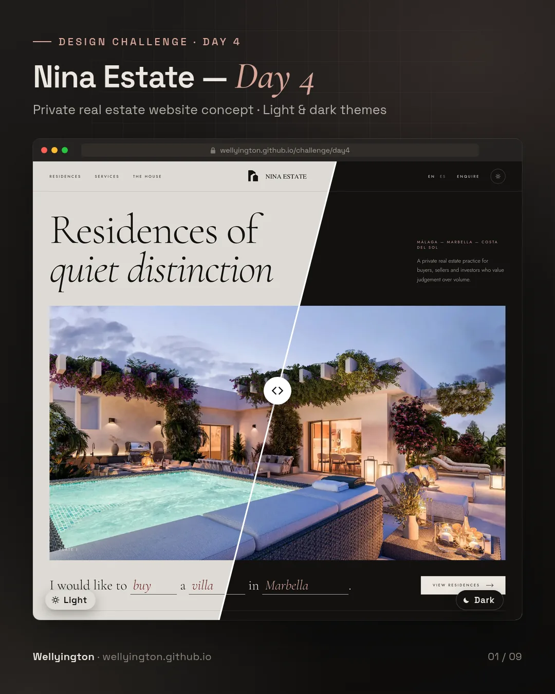
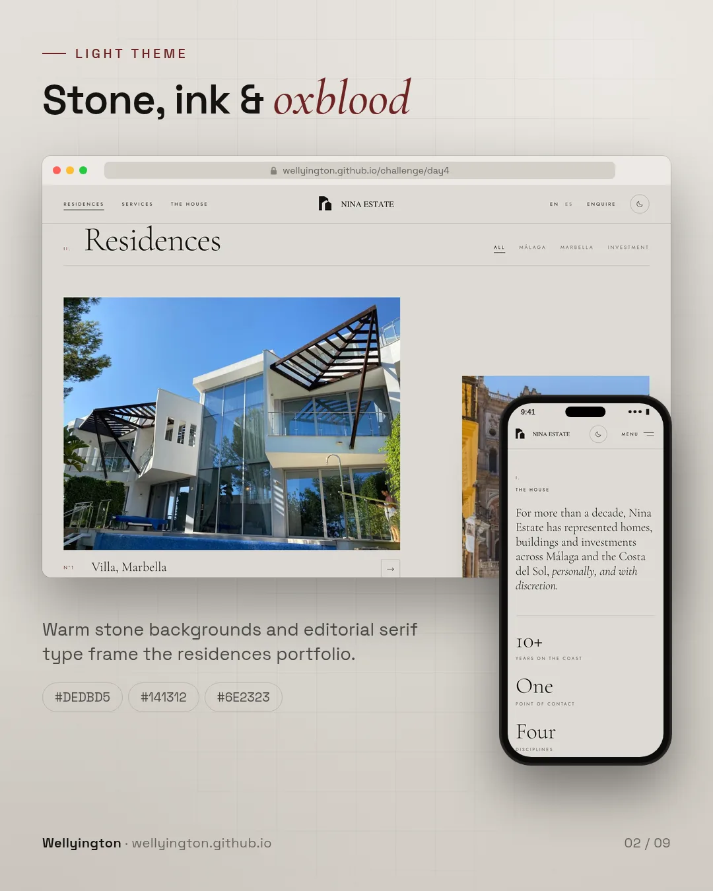
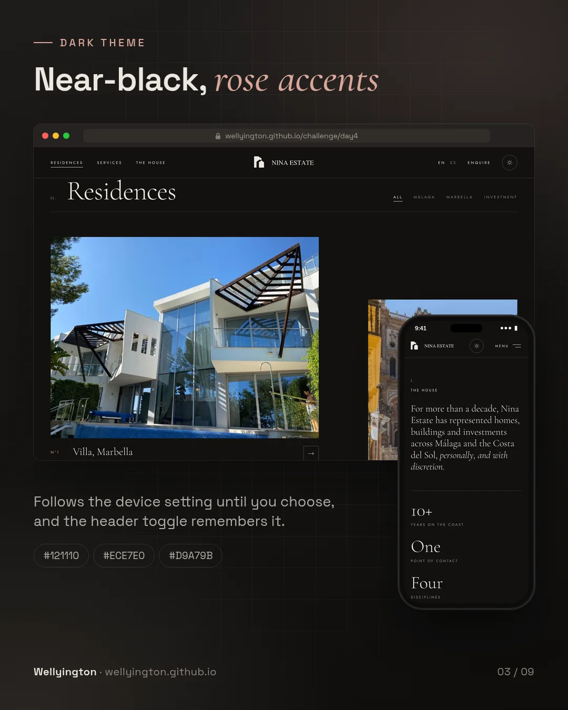
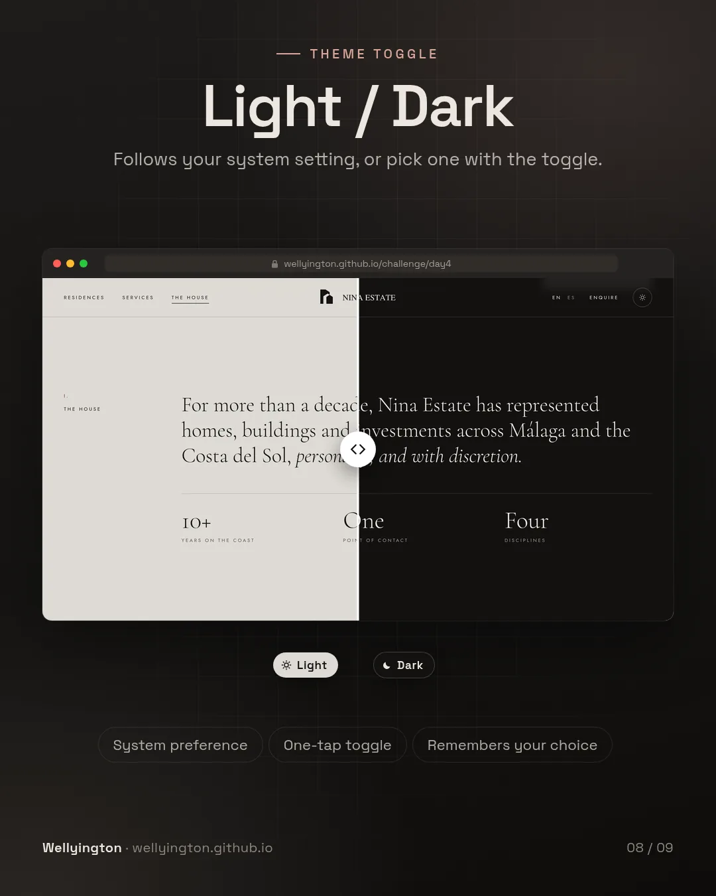
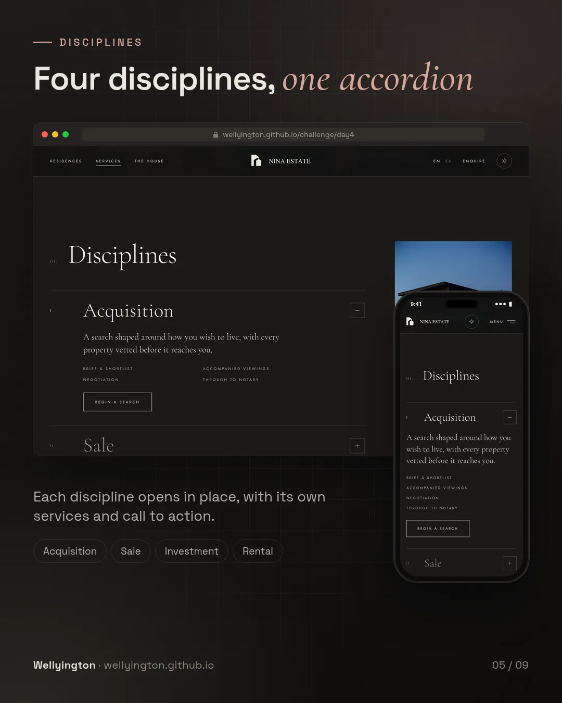
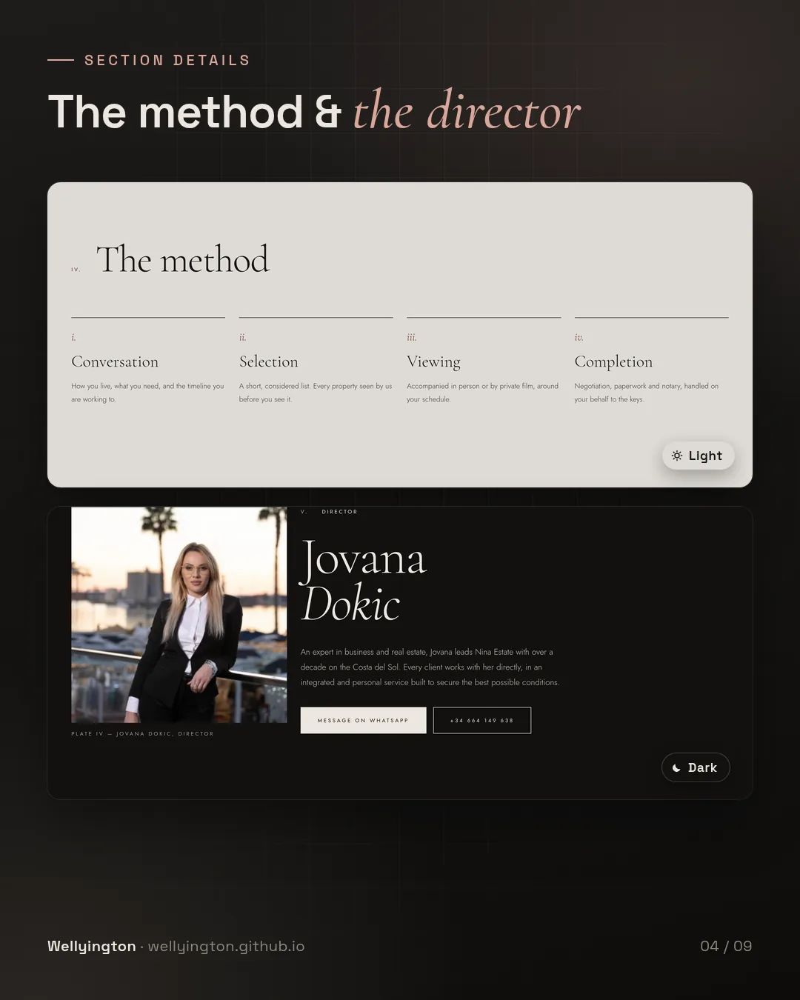
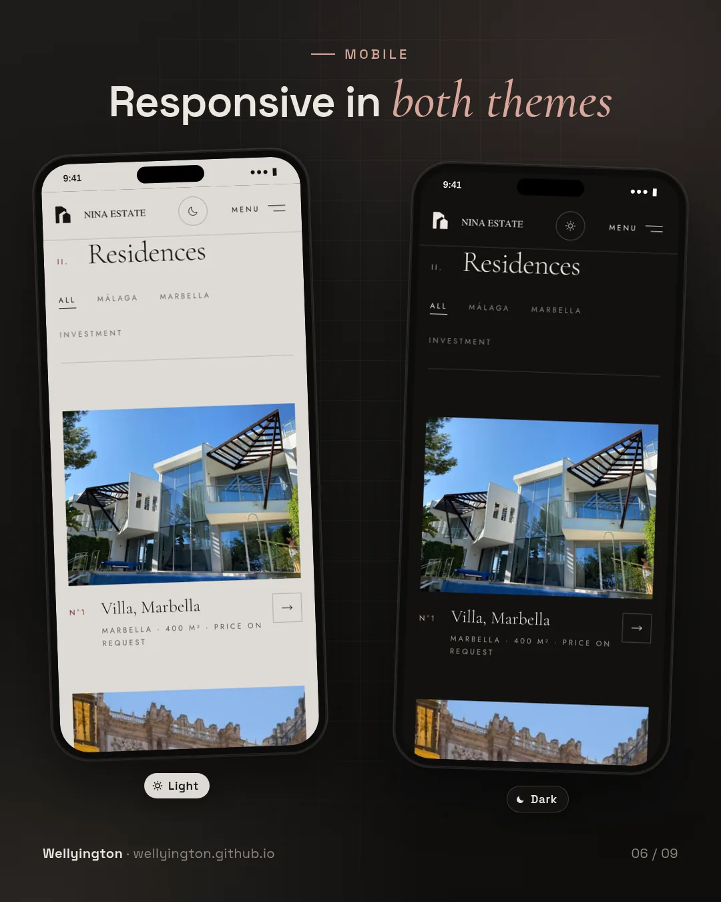
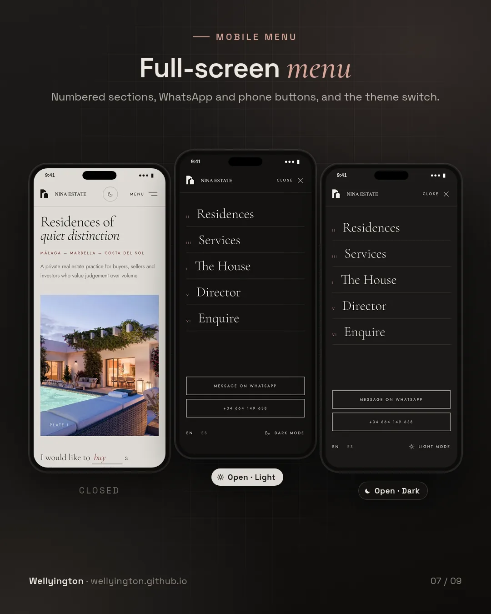

20 ноября я выложил четвёртую заметку этого ряда, челленджа, который придумал Рамайя Траск: сто дней, сто дел, сто сайтов. Первым днём была семейная строительная фирма в Марина-Альте, которой нужна была первая ясная страница. [Та страница здесь.](https://wellyington.github.io/journal/ru/articles/sait-do-slova-da/) Вторым был театр в Малаге с полным сезоном и без порядка. [Он здесь.](https://wellyington.github.io/journal/ru/articles/mesto-dlya-tselogo-sezona/) Третьим был семейный ресторан в моём собственном городе, куда заходят по многим причинам. [Он здесь.](https://wellyington.github.io/journal/ru/articles/mesto-za-dlinnym-stolom/) Сегодня дело продаёт то, о чём люди думают месяцами.

Nina Estate — агентство недвижимости в Малаге, с офисом на проспекте Кановас-дель-Кастильо. Оно работает в городе и на Коста-дель-Соль: дома, целые здания, инвестиции и долгосрочная аренда. Сайт у него уже есть, [ninaestate.com](https://ninaestate.com/): там рассказано об опыте, объектах и услугах. Мой концепт здесь: [Nina Estate, день четвёртый](https://wellyington.github.io/challenge/day4/).

Это независимый редизайн. Это не сотрудничество с Nina Estate, никто оттуда меня не просил, и ничто на странице не означает, что они его одобрили. Пока он живёт на моём собственном адресе, как и три предыдущих.

## другая страница для агентства

Большинство сайтов недвижимости устроены как витрина. Поиск наверху, сетка объявлений, цена на каждой карточке, телефон в углу. Это работает для агентства, которое берёт объёмом: сотни объектов и покупатель, который хочет листать.

У Nina Estate другая форма. Немного объектов, часть из них — здания целиком. Цены по запросу. Один человек, директор, который сам ведёт каждого клиента. Тот, кто покупает или продаёт на этом уровне рынка элитной недвижимости, в первую очередь выбирает не объявление. Он выбирает, кому доверить выбор.

Поэтому я пошёл другим путём, чем нынешний сайт. Меньше похоже на обычное агентство, больше на частную практику, где подача, личное обслуживание и внимание к деталям — часть того, что получает клиент. Нынешний сайт начинает с опыта, объектов и услуг. Концепт начинает с отношений: с кем вы будете иметь дело, как пройдёт поиск и что происходит от первого звонка до ключей.

Мысль короткая. Сайт должен быть ближе к той услуге, которую он продаёт.

## дома тихого достоинства

Первый экран почти пустой, и это сделано намеренно. Заголовок крупной тонкой антиквой: residences of quiet distinction, дома тихого достоинства, вторая строка курсивом. Под ним маленькая строка цвета бычьей крови: Малага, Марбелья, Коста-дель-Соль. Справа одна фраза, которая работает вместо миссии: частная практика в недвижимости для покупателей, продавцов и инвесторов, которые ценят суждение выше объёма.

Ниже одна широкая фотография с подписью Plate I, таблица I, как в книге: вилла в сумерках, подсвеченный бассейн, бугенвиллея над террасой, фонари на низкой стенке. Страница держит снимок в этом размере и ничего на него не кладёт.

Под фотографией, там, где большинство агентств поставили бы форму поиска с десятком полей, стоит фраза, которую нужно закончить. I would like to buy a villa in Marbella: я хотел бы купить виллу в Марбелье. Каждое из трёх слов курсивом — выпадающий список. «Купить» можно поменять на «снять», «вложиться в» или «продать». «Виллу» — на дом, квартиру или здание. «Марбелью» — на центр Малаги, Эль-Лимонар или Коста-дель-Соль. И одна кнопка: смотреть объекты.

Мелочь, но она меняет тон. Форма поиска просит вас отфильтровать. Фраза спрашивает, чего вы хотите, так, как спросил бы агент по телефону. В концепте фраза ведёт к объектам. Она не притворяется поиском, который этому делу не нужен.

*Первый экран, разрезанный надвое. Одно и то же приветствие днём и вечером.*

## камень, чернила и бычья кровь

Цвета взяты из того, как этот рынок выглядит, когда всё сделано хорошо: штукатурка, старая бумага, тёмное дерево, бокал красного на столе.

Светлая тема — тёплый камень, #DEDBD5, почти чёрные чернила, #141312, для текста и цвет бычьей крови, #6E2323, для мелочей, которые важны: номеров, активного фильтра, слов курсивом во фразе. Тёмная тема почти чёрная, #121110, с текстом цвета слоновой кости, #ECE7E0, и приглушённым розовым, #D9A79B, на месте тёмно-красного. Ни одна из них не главная. Это два полноценных сайта, и один и тот же объект должен хорошо смотреться в обоих.

Почти всю работу делает шрифт. Cormorant Garamond, тонкая контрастная антиква, для заголовков и названий объектов. Jost, простой гротеск, очень мелкий и разреженный, для подписей. Разделы пронумерованы римскими цифрами, от I до VI, а фотографии называются таблицами. Всё это читается скорее как печатный каталог галереи, чем как приложение, и так ближе к тому, как эти дома продают вживую.

Как и в предыдущие дни, страница следует настройке телефона или компьютера. Если включена тёмная тема, сайт открывается тёмным. Круглая кнопка в шапке переключает тему, и сайт запоминает выбор до следующего раза.

*Светлая тема: тёплый камень, чернила и бычья кровь, с журнальной антиквой.*

*Тёмная тема. Она следует настройке устройства, пока вы не выберете сами, и кнопка в шапке запоминает выбор.*

## дом

Раздел I называется The House, дом, и состоит из одного абзаца. Больше десяти лет Nina Estate представляет дома, здания и инвестиции в Малаге и на Коста-дель-Соль, лично и без лишнего шума.

Под ним три числа, у каждого маленькая подпись. 10+, лет на побережье. Один, контакт. Четыре, направления. Мне хотелось чисел, которые клиент может проверить, а не сумм проданных квадратных метров или счётчика счастливых семей. Второе — самая важная строка на странице. На этом уровне покупателю нужно знать, что человек, который ответил на первый звонок, будет рядом и у нотариуса.

*Следует настройке системы, или выбираете вы, кнопкой.*

## четыре объекта, а не четыреста

Раздел II — портфолио, под простым заголовком Residences, объекты. Справа четыре фильтра: все, Малага, Марбелья, инвестиции. При выборе фильтра карточки перестраиваются без перезагрузки страницы.

В концепте четыре объекта. № 1 — вилла в Марбелье, 400 квадратных метров. № 2 — здание у собора в Малаге, продаётся целиком. № 3 — ещё одно здание в историческом центре. № 4 — резиденция в Эль-Лимонаре, 329 квадратных метров. У всех цена по запросу. Карточки крупные, стоят на разной высоте, а не плотной сеткой, и у каждой маленькая стрелка, чтобы открыть объект.

Четыре — это немного для сайта недвижимости, и я оставил четыре. Длинная сетка сделала бы дело похожим на портал, а это не портал. Под карточками строка курсивом: some of our finest homes are never published, некоторые из наших лучших домов никогда не публикуются. Рядом кнопка: запросить закрытый доступ. В этом сегменте рынка многие лучшие объекты переходят из рук в руки без публичного объявления. Страница говорит об этом прямо и показывает, как туда попасть.

Ниже вторая фотография на всю ширину, таблица II, с одной фразой поверх спокойной части снимка: конфиденциальность — не услуга, а стандарт.

## четыре направления, по одному

Раздел III делит работу на четыре части: покупка, продажа, инвестиции и аренда. На нынешнем сайте услуги читаются как список. Здесь каждая — строка, которая раскрывается на месте, так что продавцу не нужно читать процесс покупателя, чтобы найти свой.

Покупка: поиск, построенный вокруг того, как вы хотите жить, и каждый объект проверен до того, как попадёт к вам. Дальше задание и шорт-лист, показы с сопровождением, переговоры, вплоть до нотариуса, и кнопка «начать поиск». Продажа: ваш объект подан так, как ждут покупатели этого уровня, и показан нужным людям: оценка, журнальная фотосъёмка, проверенные покупатели и деликатный маркетинг. Инвестиции: здания, активы и доходная недвижимость в историческом центре и на побережье: здания целиком, анализ доходности, предложения вне порталов и сопровождение актива. Аренда: долгосрочная аренда, в которой заботятся и о владельцах, и о жильцах: подбор арендаторов, договоры и опись, представительство владельца и переезд.

Каждое направление заканчивается своим следующим шагом: начать поиск, запросить оценку, обсудить инвестицию, спросить про аренду. Тому, кто пришёл только продать, никогда не придётся читать про доходность.

*Каждое направление раскрывается на месте, со своими услугами и следующим шагом.*

## метод

Раздел IV отвечает на вопрос, который рано или поздно задаёт каждый, кто впервые покупает в Испании: что именно происходит и в каком порядке? Четыре шага, пронумерованные маленькими римскими цифрами и стоящие рядом.

Разговор: как вы живёте, что вам нужно и в какие сроки. Отбор: короткий продуманный список, и каждый объект агентство видело до вас. Показ: с сопровождением вживую или частным видео под ваш график, что важно, когда покупатель живёт в Лондоне или Дубае. Сделка: переговоры, документы и нотариус, всё от вашего имени, до передачи ключей.

Ничего нового для того, кто уже покупал здесь. Но, записанный в четыре короткие строки, процесс кажется знакомым ещё до начала, а в дорогом и долгом решении это немалая часть того, за что платит клиент.

## человек за делом

Раздел V — изменение, которое для меня важнее всего. На многих сайтах агентств люди — это маленькие фотографии на странице «о нас», если они вообще есть. Здесь у директора свой раздел, того же размера, что и объекты.

Йована Докич. Имя набрано крупно, фамилия курсивом, рядом портрет на террасе над портом в сумерках. Текст короткий: специалист в бизнесе и недвижимости, она руководит Nina Estate больше десяти лет на Коста-дель-Соль, и каждый клиент работает с ней напрямую, в комплексном и личном сопровождении, построенном так, чтобы добиться лучших условий. Под текстом две кнопки: написать в WhatsApp и номер телефона, +34 664 149 638.

Причина практическая. В фирме такого размера человек и есть услуга. Клиенты будут говорить с ней, смотреть объекты с ней и подписывать документы, когда она рядом. Сайт, который прячет это за стоковыми фото ключей и рукопожатий, недооценивает единственное, что большому агентству трудно скопировать.

*Метод в четыре шага и директор, с прямой связью с ней.*

## по предварительной записи

Последний раздел, VI, называется «частные запросы», а заголовок гласит by appointment, по предварительной записи. Слева три способа связаться: телефон, почта jovana@ninaestate.com и офис, проспект Кановас-дель-Кастильо, 8, Малага.

Справа короткая форма. Имя, почта, телефон, выбор темы запроса, совпадающий с четырьмя направлениями, и сообщение. При отправке открывается почтовое приложение посетителя, где всё уже написано и адресовано Йоване. Строка под кнопкой говорит, что на каждый запрос отвечают лично и конфиденциально. Нет ни личного кабинета, ни автоответа, который делает вид, что он человек. Частная практика сама отвечает на свою почту.

## на телефоне

Многие первые контакты с таким агентством происходят на телефоне, в странное время, из другой страны. Покупатель в лобби отеля ищет агента, которого посоветовал друг. Продавец за границей проверяет, кому он сейчас позвонит.

На телефоне объекты идут один под другим, у каждого номер, название, район, площадь и цена по запросу, и квадратная стрелка, чтобы открыть. Фильтры переносятся на две строки, а не сжимаются. Обе темы работают одинаково.

Меню открывается на весь экран. Пять разделов, пронумерованных, как на странице: объекты, услуги, дом, директор, связаться. Под ними две кнопки, которыми человек с телефоном в руке пользуется на самом деле: написать в WhatsApp и номер телефона, а дальше выбор языка и переключатель темы. Всё, что нужно, чтобы связаться, помещается на первом экране меню.

*Объекты на телефоне, в обеих темах.*

*Меню на весь экран: пронумерованные разделы, WhatsApp и телефон, выбор языка и переключатель темы.*

## английский и испанский

Покупатели на этом побережье приезжают отовсюду, а продавцы часто испанцы. В концепте EN и ES стоят в шапке и в мобильном меню с самого начала, потому что такой практике оба языка нужны с первого дня.

Чтобы было ясно, что уже есть: концепт написан по-английски, переключатель на испанский стоит на месте, но испанские страницы ещё не написаны. Я лучше напишу их вместе с агентством, чем буду угадывать, как Йована говорит со своими испанскими клиентами.

## независимый концепт

Nina Estate меня не нанимала, и это не их сайт. Объекты, имя и слова директора, телефон, почта и офис взяты из того, что Nina Estate уже публикует. Факты я не менял. Я поменял порядок, тон и внешний вид: частная практика вместо каталога, человек на первом плане и процесс, записанный словами.

У меня нет цифр ни по запросам, ни по продажам, и я не стану их выдумывать. Если в Nina Estate это никому не нужно, концепт останется там, где есть, как день четвёртый. Если нужно, остальное практично: их собственные слова там, где я заполнил своими, испанские страницы, отдельная страница для каждого объекта, форма, которая уходит туда, куда скажут, и перенос сайта на ninaestate.com.

## если ваши клиенты решают месяцами

Вы можете не продавать недвижимость. Многие дела продают то, о чём решают медленно: школа, клиника, архитектор, юрист, яхтенный брокер. И всё равно сайт часто сделан для быстрых решений: сетки, цены, счётчики и спешка.

Для медленного решения помогает обратное. Скажите, с кем клиент будет иметь дело, и покажите этого человека. Запишите процесс в несколько шагов. Покажите немного работы, но в таком размере, чтобы её можно было как следует рассмотреть. Дайте один прямой способ добраться до человека. И пусть дизайн будет достаточно спокойным, чтобы посетитель читал, а не пролистывал.

Я веб-дизайнер из Эстепоны, с Коста-дель-Соль, и делаю такие сайты для бизнеса по всей Испании. Если это похоже на ваше дело, напишите мне с [основного сайта](https://wellyington.github.io/ru/). Скажите, что вы делаете и где, и я отвечу обычным языком. Концепт [здесь](https://wellyington.github.io/challenge/day4/), а сайт самой Nina Estate [здесь](https://ninaestate.com/), если захотите сравнить. Четыре готово, осталось девяносто шесть.
