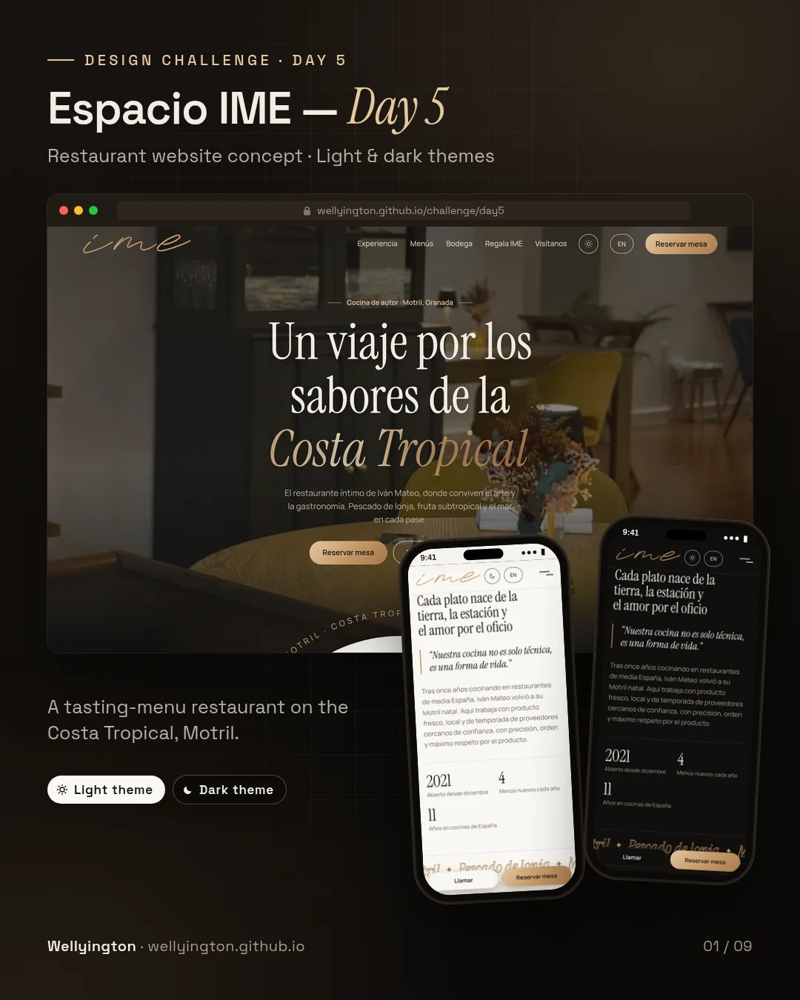
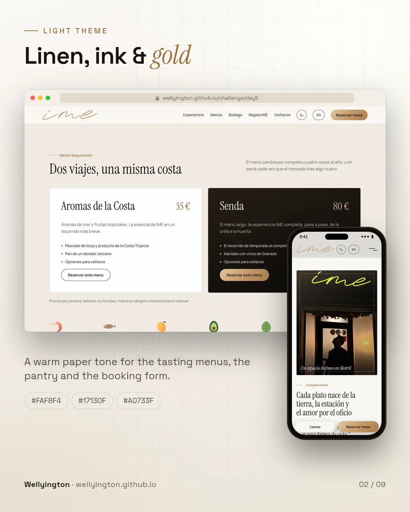
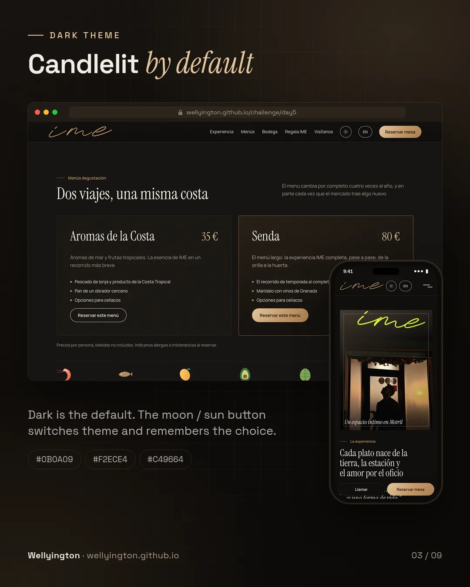
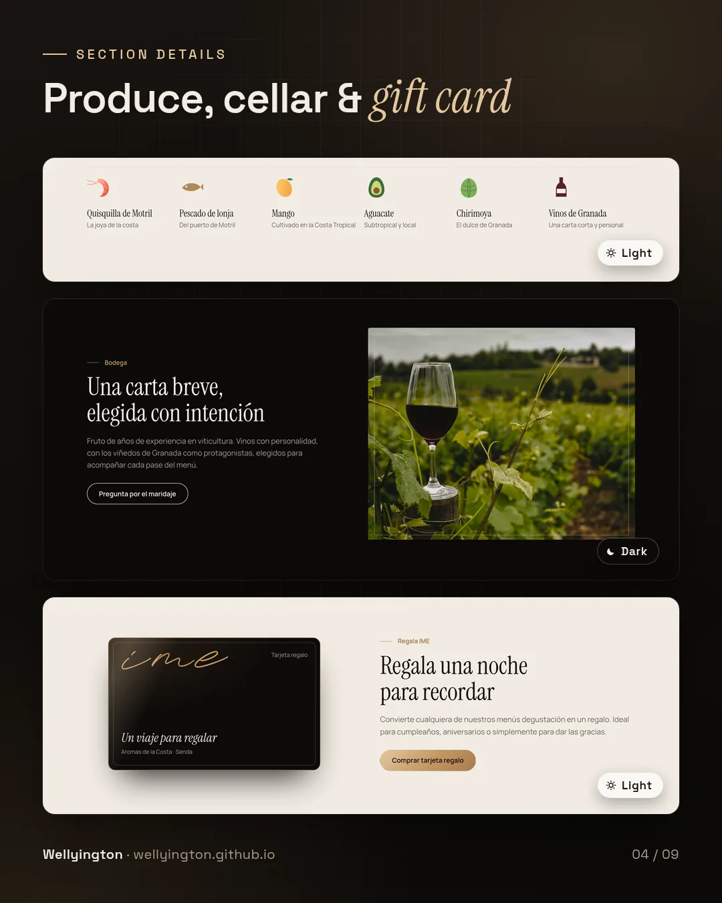
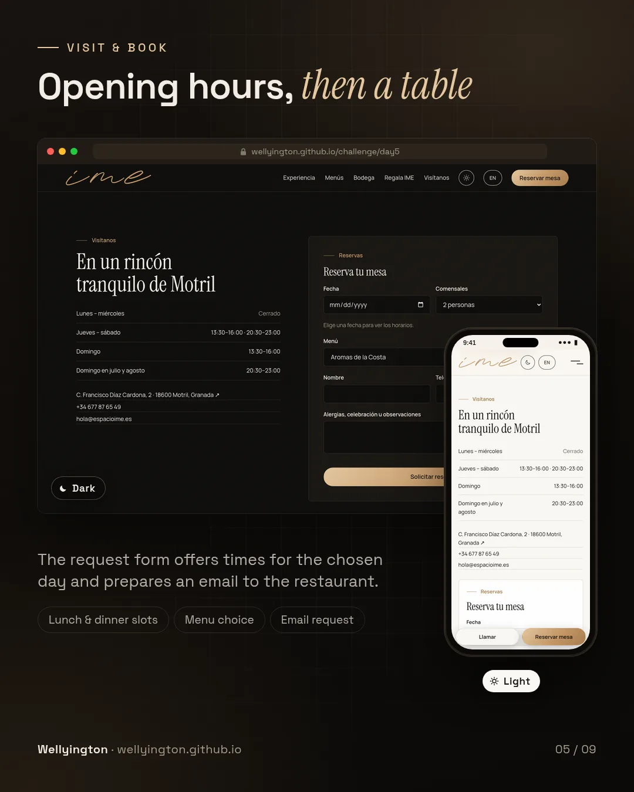
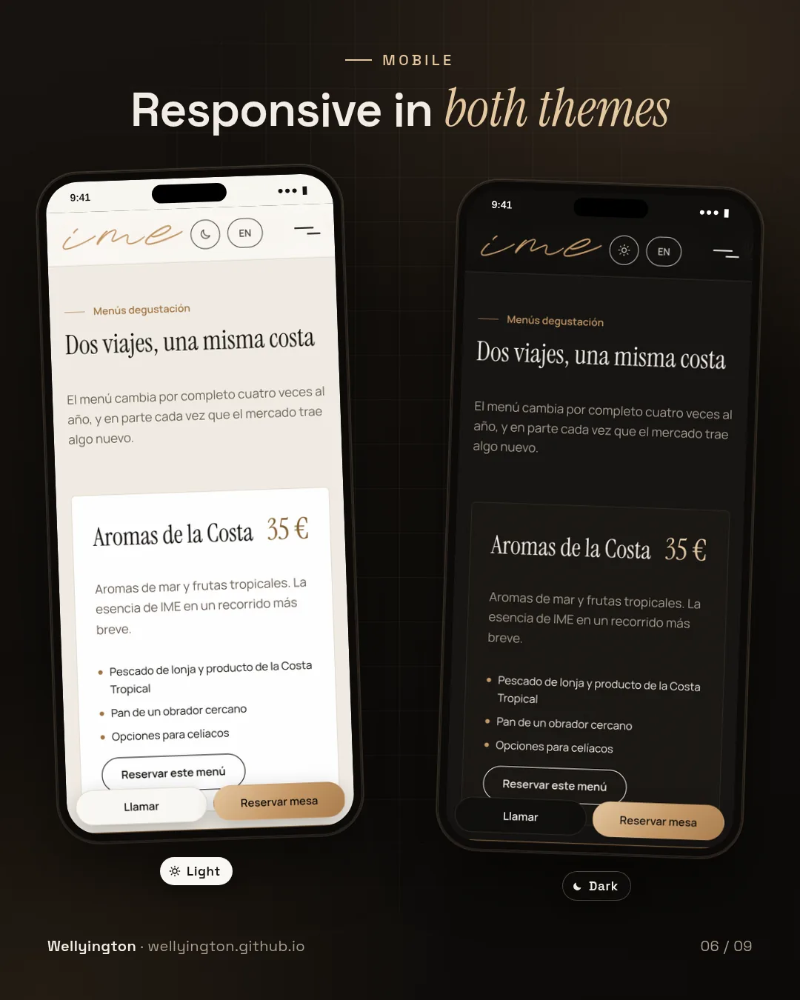
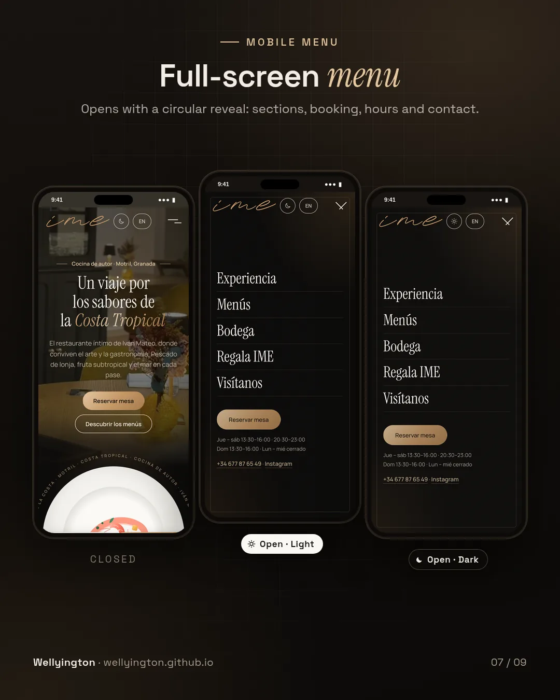
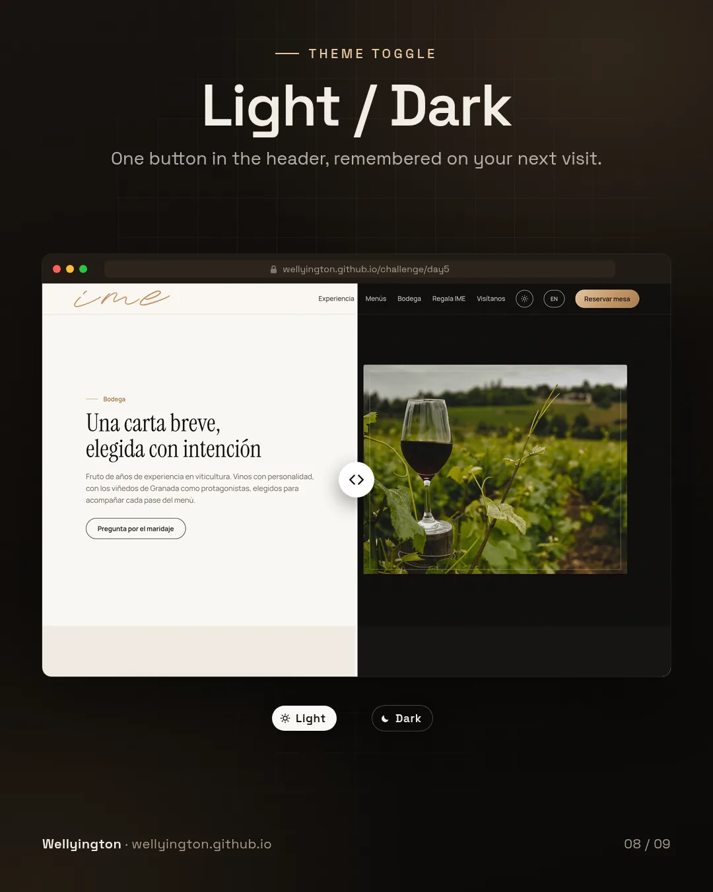

21 ноября я выложил пятую заметку этого ряда, челленджа, который придумал Рамайя Траск: сто дней, сто дел, сто сайтов. Первым днём была семейная строительная фирма в Марина-Альте. [Та страница здесь.](https://wellyington.github.io/journal/ru/articles/sait-do-slova-da/) Вторым был театр в Малаге. [Он здесь.](https://wellyington.github.io/journal/ru/articles/mesto-dlya-tselogo-sezona/) Третьим был семейный ресторан в моём собственном городе, Эстепоне. [Он здесь.](https://wellyington.github.io/journal/ru/articles/mesto-za-dlinnym-stolom/) Четвёртым была частная практика в недвижимости в Малаге. [Она здесь.](https://wellyington.github.io/journal/ru/articles/suzhdenie-vazhnee-obema/) Сегодня снова ресторан, но совсем другой.

Espacio IME — маленький ресторан дегустационных сетов в Мотриле, на Коста-Тропикаль, том отрезке побережья Гранады, где манго, авокадо и черимойя растут в нескольких минутах от моря. Шеф — Иван Матео. Он вернулся в Мотриль после одиннадцати лет работы на кухнях ресторанов по всей Испании и руководит IME с декабря 2021 года. Его кухня держится на местных продуктах: рыба с мотрильского рыбного рынка, субтропические фрукты побережья, вина Гранады.

Гиды это заметили. Espacio IME — рекомендованный ресторан Гида Repsol 2026 года. Он отобран в Гид Michelin. Macarfi, гид, который оценивает кухню, интерьер и сервис, посвящает ему отдельную карточку и выделяет рис с мотрильскими креветками кискилья как блюдо, ради которого уже стоит приехать.

Некоторые рестораны заслуживают сайта не хуже своей еды. Концепт здесь: [Espacio IME, день пятый](https://wellyington.github.io/challenge/day5/). Сайт самого ресторана — [espacioime.es](https://www.espacioime.es/), его Instagram — [@espacioime](https://www.instagram.com/espacioime/).

Это независимый дизайнерский концепт. Это не сотрудничество с Espacio IME, никто оттуда меня не просил, и ничто на странице не означает, что они его одобрили. Как и четыре предыдущих, пока он живёт на моём собственном адресе.

## сайт, достойный наград

Подумайте, как люди попадают в такой ресторан. Почти никто не находит дегустационный сет в Мотриле, проходя мимо двери. О нём читают в гиде, видят тарелку в Instagram, слышат от друга, который приезжал из Гранады. Потом ищут в интернете. Сайт — это второе впечатление, и оно приходит сразу после того, как гид сказал, что ради этого места стоит специально ехать.

Если после этого сайт выглядит как шаблон, со стоковыми фото и формой обратной связи в углу, посетитель чувствует разрыв. Не потому, что шаблон — преступление, а потому, что всё остальное в этом месте говорит о заботе: продукты, подача, короткая винная карта, маленький зал. Сайт — единственная часть впечатления, которую ресторан отдаёт бесплатно, всем, ещё до того, как кто-то что-то попробовал.

Поэтому я поставил себе простую задачу. Сайт должен быть таким же внимательным к деталям, как кухня. Ясный порядок, продукт впереди, сеты с ценами, вино, подарок и спокойный способ попросить столик. Ничего, что кричит.

## путешествие по вкусам побережья

Сайт открывается в зале. Широкая фотография зала занимает экран, затемнённая так, чтобы текст удобно лежал поверх: деревянные столы, горчичные стулья, ваза с сухоцветами.

Заголовок набран высокой узкой антиквой: un viaje por los sabores de la Costa Tropical, путешествие по вкусам Коста-Тропикаль. Последние два слова курсивом и мягким золотом. Над ним маленькая строка, cocina de autor, Motril, Granada, авторская кухня, Мотриль, Гранада, — так описал бы это место гид. Под ним одна фраза: камерный ресторан Ивана Матео, где искусство и гастрономия живут вместе, с рыбой с рынка, субтропическими фруктами и морем в каждой подаче.

Дальше две кнопки: забронировать столик или посмотреть сеты. Внизу экрана поднимается белая тарелка, и по её краю идёт строка текста, как клеймо на керамике: Costa Tropical, Motril, авторская кухня, Иван Матео.

Сразу под первым экраном стоит тихая строка с тремя признаниями: Гид Michelin 2026, Гид Repsol 2026 и Macarfi. Они небольшие и набраны тем же шрифтом, что и всё остальное, а в подвале страницы есть ссылки на страницы ресторана в гидах Michelin и Repsol. Награды работают лучше, когда их легко проверить и о них не кричат.

*Первый экран на большом экране и раздел об опыте на двух телефонах.*

## каждое блюдо рождается из земли

Первый раздел после первого экрана рассказывает о поваре, а не о меню. Его заголовок: cada plato nace de la tierra, la estación y el amor por el oficio. Каждое блюдо рождается из земли, сезона и любви к ремеслу.

Рядом одна цитата с кухни, крупно, курсивом, с тонкой золотой линией сбоку: наша кухня — это не только техника, это образ жизни. Потом короткий абзац. После одиннадцати лет на кухнях ресторанов по всей Испании Иван Матео вернулся в родной Мотриль. Здесь он работает со свежими, местными, сезонными продуктами от проверенных поставщиков поблизости, с точностью, порядком и максимальным уважением к продукту.

Раздел закрывают три числа. 2021, открыт с декабря. 4, новых меню в год. 11, лет на кухнях Испании. Такие числа я предпочитаю прилагательным. Гость может проверить каждое, и вместе они говорят о месте больше, чем слово «исключительный».

## продукт по имени

Дегустационный сет трудно описать заранее, потому что он меняется. Не меняется то, откуда он берётся. Поэтому между историей и меню проходит полоса ингредиентов, с маленьким рисунком для каждого и строкой под ним.

Кискилья из Мотриля, местная креветка, жемчужина побережья. Рыба с рынка, из порта Мотриля. Манго, выращенное на Коста-Тропикаль. Авокадо, субтропическое и местное. Черимойя, сладкий плод Гранады. И вина Гранады, короткая и личная карта.

Те же названия проплывают по экрану выше медленной лентой, золотым курсивом, одно за другим. Гость из Мадрида или Лондона может не знать, что такое кискилья. После этой страницы ему захочется её попробовать.

## два путешествия, одно побережье

Дальше идут сеты, под заголовком dos viajes, una misma costa: два путешествия, одно побережье. Одна строка объясняет, как работает кухня. Меню полностью меняется четыре раза в год и частично каждый раз, когда рынок приносит что-то новое.

Сетов два, рядом друг с другом, каждый на своей карточке, с ценой крупно в углу, как в печатном меню.

Aromas de la Costa за 35 евро — короткий маршрут: ароматы моря и тропических фруктов, суть IME в более коротком пути. В нём рыба с рынка и продукты Коста-Тропикаль, хлеб из соседней пекарни и варианты для людей с целиакией.

Senda за 80 евро — длинный сет: полный опыт IME, подача за подачей, от берега до огорода. Он включает весь сезонный маршрут, сопровождение винами Гранады и ту же заботу о гостях с целиакией. В светлой теме эта карточка тёмная, а в тёмной у неё золотая рамка, так что глаз сам понимает, где полный опыт, без подсказок.

Каждая карточка заканчивается одной кнопкой: забронировать этот сет. Строка под обеими говорит, что цены указаны за человека, напитки не включены, а об аллергиях и непереносимостях лучше сообщить при бронировании.

Показать цены было решением. Некоторые рестораны этого уровня их прячут, и чтобы узнать, нужно писать. Это отпугивает как раз тех, кто планирует день рождения или годовщину и хочет понимать, чего ждать. Понятные цены — тоже гостеприимство.

*Светлая тема: лён, чернила и золото для сетов, продуктов и формы бронирования.*

## при свечах по умолчанию

У всех сайтов этого ряда до сих пор были светлая и тёмная темы. Этот первый, где отправная точка — тёмная.

Дегустационный сет — это чаще всего ужин, а свет в зале приглушён. Поэтому сайт открывается в тёмной версии: почти чёрный, #0B0A09, тёплый белый текст, #F2ECE4, и приглушённое золото, #C49664, для всего, на что можно нажать. Светлая тема — лён и чернила, #FAF8F4 и #17130F, с более глубоким золотом, #A0733F. Маленькая кнопка с солнцем и луной в шапке переключает их, и сайт запоминает ваш выбор до следующего визита.

Шрифты — пара, которую я давно хотел использовать: Instrument Serif, узкая антиква с красивым курсивом, для заголовков, меню и цен, и Manrope, чистый гротеск, для всего остального. Логотип — тонкое рукописное ime золотом.

*Тёмная тема — по умолчанию. Кнопка с луной и солнцем переключает тему и запоминает выбор.*

## винная карта и подарок

Дальше идут два небольших раздела, и оба важнее, чем кажется по их размеру.

Первый — винный, bodega. Заголовок: una carta breve, elegida con intención, короткая карта, выбранная с умыслом. Текст объясняет, что карта — плод многолетнего опыта в виноделии: вина с характером, где главные — виноградники Гранады, выбранные под каждую подачу. Рядом фотография бокала красного среди лоз. Никакой длинной таблицы бутылок и годов. Короткая карта и есть идея, а кнопка просто говорит: спросите о сочетании вин.

Второй — подарок. Regala IME, подарите IME. Заголовок: regala una noche para recordar, подарите вечер, который запомнится. Любой из дегустационных сетов можно превратить в подарок, на день рождения, годовщину или просто чтобы сказать спасибо. Слева подарочный сертификат, нарисованный как предмет: тёмный, с золотой подписью IME и словами un viaje para regalar, путешествие в подарок. Кнопка «купить подарочный сертификат» ведёт прямо на страницу подарков, которая у ресторана уже есть. Новый магазин я не строил. Существующий работает, а задача концепта — сделать так, чтобы его было легче найти.

Подарочные сертификаты — тихая часть бизнеса многих хороших ресторанов. Тот, кто поел в особенном месте, хочет отправить туда родителей, друзей, лучшего клиента. Заметный и хорошо оформленный раздел подарков даёт им для этого повод.

*Продукты, винная карта и подарочный сертификат, у каждого своё место.*

## сначала часы работы, потом столик

Последний раздел страницы называется visítanos, приходите к нам, и первыми в нём идут часы работы. С понедельника по среду закрыто. С четверга по субботу обед с 13:30 до 16:00 и ужин с 20:30 до 23:00. В воскресенье только обед, с 13:30 до 16:00. В воскресенье в июле и августе ужин с 20:30 до 23:00. Под часами адрес, улица Франсиско Диас Кардона, 2, Мотриль, который открывается на карте, телефон и почта.

Рядом с часами — заявка на бронь, reserva tu mesa. Сначала дата и число гостей. Когда дата выбрана, форма предлагает только то время, когда кухня в этот день действительно работает, с шагом в полчаса, на обед, на ужин или на то и другое. Выберите понедельник, вторник или среду, и она вежливо сообщит, что ресторан закрыт, и предложит четверг — воскресенье. Выберите воскресенье в августе, и она предложит ужин вместо обеда. Дальше сет: Aromas de la Costa, Senda или «решим за столом». Потом имя, телефон и поле для аллергий, праздников и всего, что стоит знать кухне.

На кнопке написано «отправить заявку», и именно это она и делает. Она готовит письмо в ресторан, где всё уже заполнено, остаётся только отправить. Ресторан подтверждает. Я не стал притворяться, что концепт — полноценная система бронирования. Маленький ресторан с несколькими столиками обычно предпочитает видеть каждую заявку и отвечать на неё лично, и страница это уважает.

*Сначала часы работы. Форма предлагает только то время, когда кухня в выбранный день открыта.*

## на телефоне

Большинство людей увидят этот сайт на телефоне, часто в тот же день, когда хотят забронировать. На маленьком экране всё идёт в том же порядке: история, продукты, сеты, вина, подарок, часы работы.

Две кнопки всё время закреплены внизу экрана: позвонить и забронировать столик. Они под большим пальцем в любом месте страницы. Тому, кто уже решил, не нужно листать до конца, чтобы найти форму.

Меню открывается на весь экран кругом, который расходится от кнопки в углу, будто штору отдёргивают с одной стороны. Внутри пять разделов, крупно, антиквой: опыт, сеты, вина, подарите IME, приходите к нам. Ниже кнопка бронирования, часы работы одной короткой строкой, телефон и Instagram. Всё, что нужно гостю, чтобы решиться, помещается на этом экране.

*Сеты на телефоне, в обеих темах, а позвонить и забронировать всегда под рукой.*

*Меню на весь экран открывается кругом: разделы, бронирование, часы работы и контакты.*

## сначала испанский, английский в одно касание

Собственный сайт IME на испанском, и концепт тоже в первую очередь на испанском. Но на Коста-Тропикаль приезжают и гости из-за границы, а многие из тех, кто живёт на этом побережье, читают по-английски легче, чем по-испански.

Поэтому в шапке есть кнопка EN. Нажимаете — и весь текст страницы переходит на английский: заголовки, меню, часы работы, подписи формы, кнопки. Это не машинный перевод, наложенный сверху. У каждой строки есть английская версия, написанная рядом с испанской, чтобы обе читались нормально.

## почему, по-моему, этот стоит внимания

У каждого дня этого ряда своя задача. Строительной фирме нужна была первая ясная страница. Театру — порядок. Семейному ресторану — показать много причин зайти. Практике в недвижимости — поставить человека впереди.

Espacio IME нужно было то, что ближе к самой кухне: сдержанность, хорошие материалы и внимание к мелочам. Золотая линия рядом с цитатой. Тарелка, поднимающаяся внизу первого экрана. Цены, набранные как в печатном меню. Форма бронирования, которая знает, что по вторникам кухня закрыта.

Скажу прямо: по-моему, этот концепт заслуживает внимания Awwwards. Если оно будет, хорошо. Если нет, страница всё равно делает то, ради чего её сделали: стоит рядом с карточкой в Гиде Michelin и не выглядит чужой.

*Одна кнопка в шапке, и сайт помнит выбор при следующем визите.*

## независимый концепт

Espacio IME меня не нанимал, и это не их сайт. История шефа, сеты и цены, продукты, часы работы, адрес и карточки в гидах взяты из того, что уже публикуют ресторан и гиды. Ни одного факта я не менял. Я поменял порядок, шрифты, тон и то, как страница ведёт себя на телефоне.

У меня нет цифр ни по броням, ни по посещениям, и я не стану их выдумывать. Если в IME это никому не нужно, концепт останется там, где есть, как день пятый. Если нужно, остальное практично: их собственные слова там, где я заполнил своими, новые фотографии под меню каждого сезона, заявки на бронь, которые уходят туда, куда скажут, и перенос сайта на espacioime.es.

## если ваша кухня лучше вашего сайта

Вы можете не держать ресторан дегустационных сетов. Но многие небольшие дела на этом побережье в том же положении: то, что они делают, лучше того, как они выглядят в интернете. Пекарня с наградами и сайтом в две строки. Винодельня с красивым погребом и страницей, на которой почти один телефон. Отель с десятью идеальными номерами и модулем бронирования из 2015 года.

Помогает то же, что и здесь. Поставьте вперёд людей и продукт. Покажите цены, если можете. Дайте гостю спокойный способ попросить то, что он хочет. И пусть дизайн будет таким же тщательным, как сама работа.

Я веб-дизайнер из Эстепоны, с Коста-дель-Соль, и делаю такие сайты для бизнеса по всей Испании. Если это похоже на ваше дело, напишите мне с [основного сайта](https://wellyington.github.io/ru/). Расскажите, чем вы занимаетесь и где, и я отвечу обычным языком. Концепт [здесь](https://wellyington.github.io/challenge/day5/), а сайт самого Espacio IME [здесь](https://www.espacioime.es/), если захотите сравнить. Пять готово, осталось девяносто пять.
