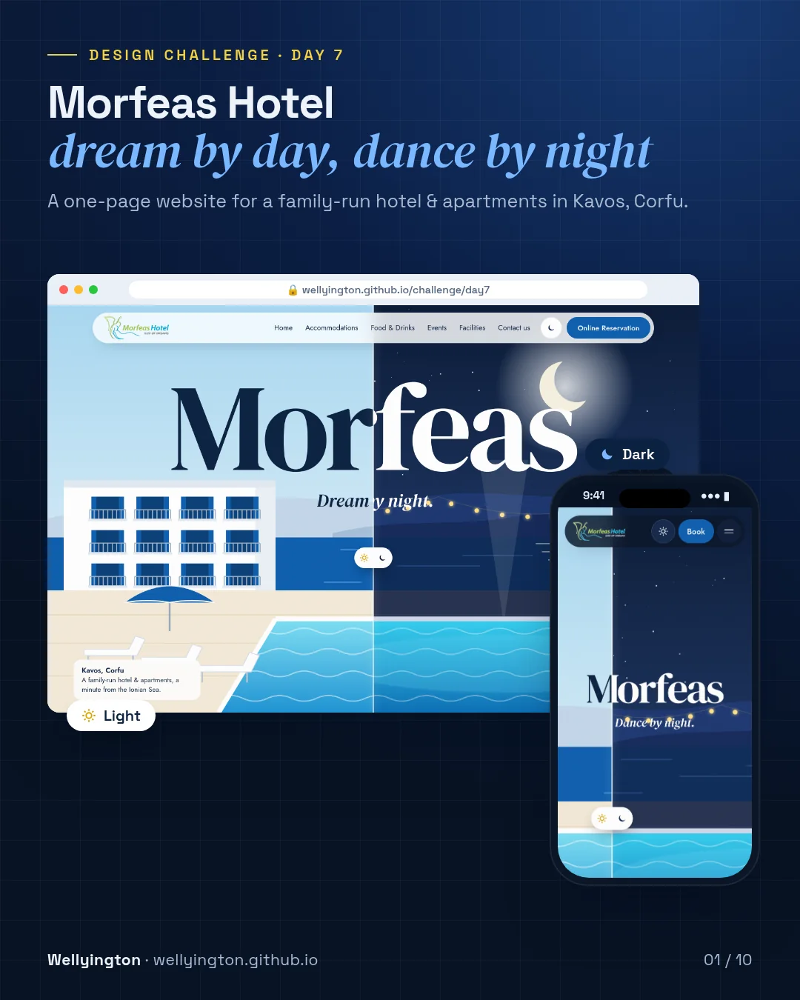
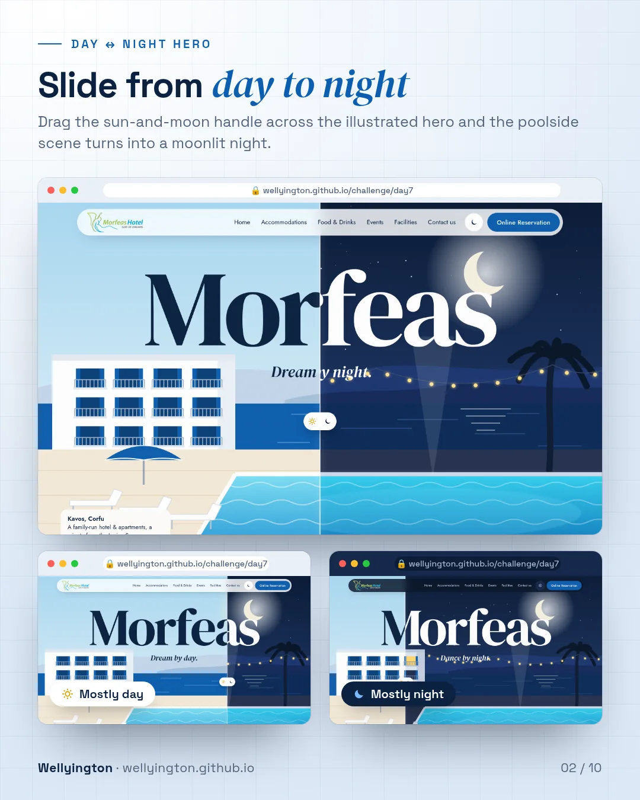
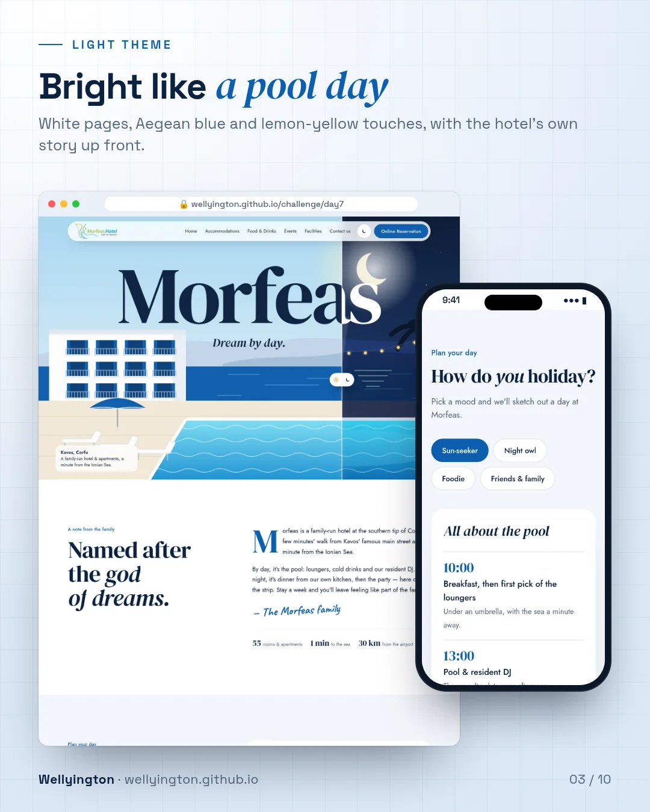
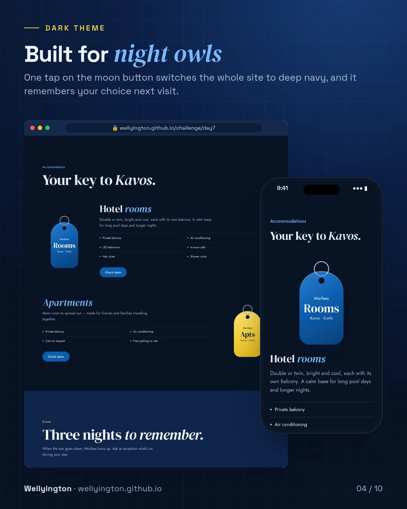
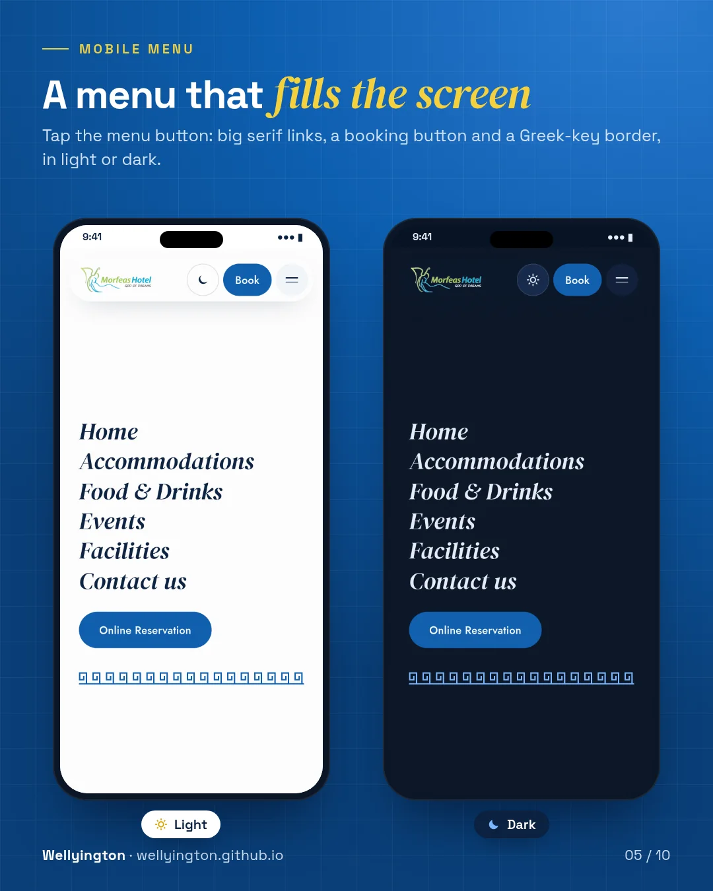
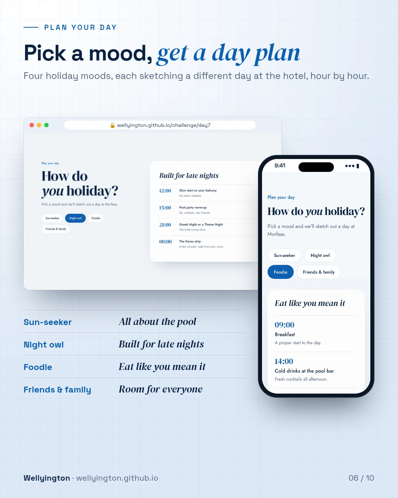
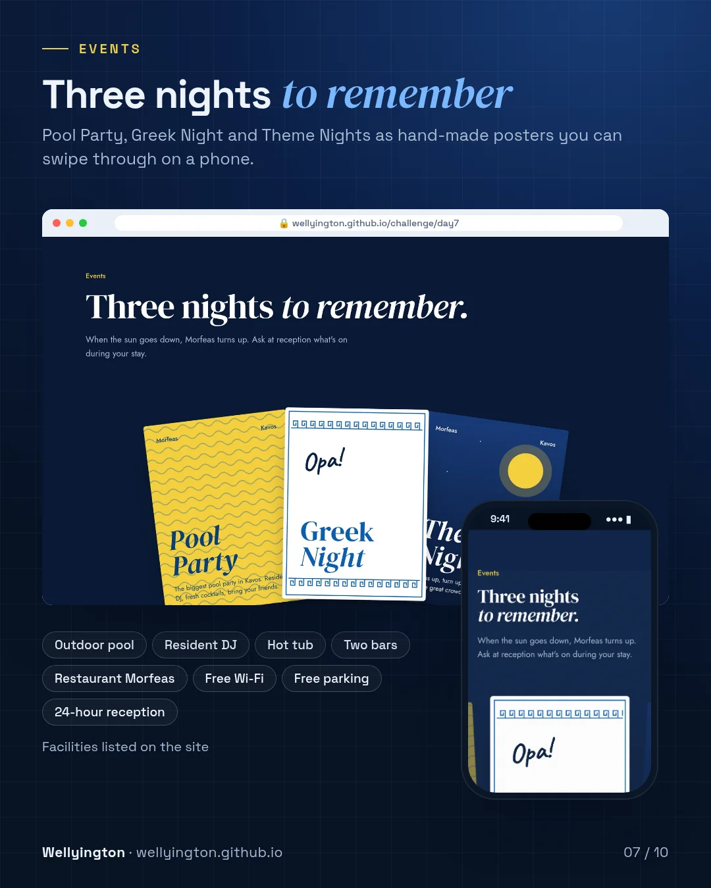
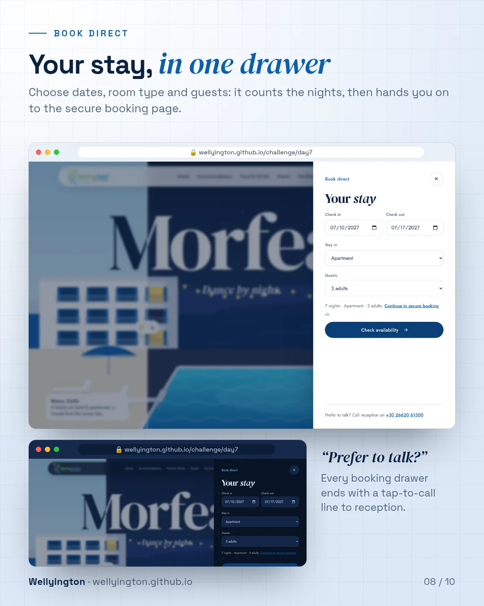
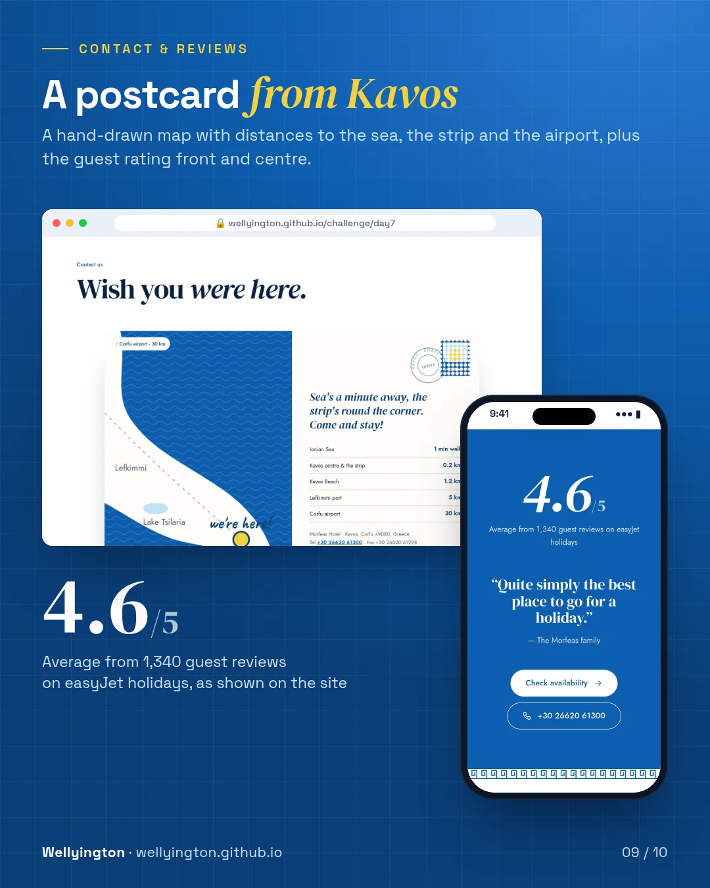

23 ноября я опубликовал седьмую заметку этой серии, челленджа, который придумал Рамайя Траск: сто дней, сто компаний, сто сайтов. Первым днём была семейная строительная компания в Марина-Альте. [Та страница здесь.](https://wellyington.github.io/journal/ru/articles/sait-do-slova-da/) Вторым — театр в Малаге. [Она здесь.](https://wellyington.github.io/journal/ru/articles/mesto-dlya-tselogo-sezona/) Третьим — семейный ресторан в Эстепоне. [Она здесь.](https://wellyington.github.io/journal/ru/articles/mesto-za-dlinnym-stolom/) Четвёртым — частная консалтинговая практика по недвижимости в Малаге. [Она здесь.](https://wellyington.github.io/journal/ru/articles/suzhdenie-vazhnee-obema/) Пятым — ресторан дегустационных сетов в Мотриле. [Она здесь.](https://wellyington.github.io/journal/ru/articles/tak-zhe-tshchatelno-kak-na-kukhne/) Шестым — заведение с курицей-гриль в Эстепоне. [Она здесь.](https://wellyington.github.io/journal/ru/articles/ot-prilavka-do-cheka/)

Сегодня первая компания серии за пределами Испании. Morfeas Hotel — семейный отель с номерами и апартаментами в Кавосе, на южной оконечности Корфу. До Ионического моря одна минута, до главной улицы Кавоса несколько минут пешком, а Кавос знаменит одним: ночной жизнью. Отель назван в честь Морфея, греческого бога сновидений. Его сайт — [morfeashotel.com](https://www.morfeashotel.com/).

Концепт здесь: [Morfeas Hotel, седьмой день](https://wellyington.github.io/challenge/day7/).

Это независимый концепт редизайна. Это не официальное сотрудничество с Morfeas Hotel, никто оттуда меня об этом не просил, и ничто на странице не означает, что они его одобрили. Как и шесть предыдущих, пока он живёт на моём собственном адресе.

## один отель, два отпуска

Большинство сайтов отелей описывают один отпуск. Бассейн, номер, завтрак, закат. Для тихого отеля это работает. Для отеля в Кавосе — нет.

У гостей Morfeas два отпуска за одну неделю, а иногда и за один день. Днём — бассейн: шезлонги, холодные напитки, резидентный диджей. Ночью — ужин с кухни отеля, а потом вечеринка, в отеле или на улице за углом. Те же люди, тот же бассейн, два разных настроения. Отель уже говорит это в одной из своих фраз: dream by day, dance by night. Мечтай днём, танцуй ночью.

Поэтому концепт не выбирает одно из двух, а показывает оба и даёт посетителю решить, на какое он смотрит.

*Седьмой день: один отель, один бассейн, два настроения.*

## от дня к ночи одним движением

Верх страницы — рисунок, а не фотография: белое здание отеля с синими ставнями, пляжный зонтик, два шезлонга, море позади и бассейн на переднем плане. Поперёк всего — слово Morfeas крупной антиквой, настолько большой, насколько позволяет экран.

Рисунок существует дважды, днём и ночью, и обе версии лежат точно друг на друге. Посередине — маленький ползунок: с одной стороны солнце, с другой луна. Потяните его, и граница между рисунками пойдёт за пальцем. Слева — бледно-голубое небо и фраза dream by day. Справа — тёмно-синее небо, звёзды, полумесяц, силуэт пальмы, гирлянда праздничных огней над водой и луч света, поднимающийся от бассейна. Там фраза — dance by night. Протяните ползунок до конца, и весь отель перейдёт из полудня в полночь.

Когда страница открывается, ползунок стоит не посередине. Он склоняется к тому, который сейчас час в Кавосе. Кто заходит днём, видит в основном день. Кто смотрит в одиннадцать вечера по времени Корфу, видит в основном ночь. Маленькие часы в шапке показывают время в Кавосе с солнцем или луной рядом: мелочь, но полезная для того, кто планирует отпуск из другого часового пояса.

Я нарисовал сцену, а не взял фотографии, по двум причинам. Рисунок может перейти от дня к ночи без второй фотосессии. И в маленьком размере, на телефоне, простой рисунок читается быстрее, чем пёстрая фотография бассейна, полного людей.

*Потяните ползунок, и бассейн перейдёт из полудня в полночь. При открытии страницы он склоняется к времени в Кавосе.*

## светлая тема и тёмная

Меняется не только главный экран. У всего сайта есть светлая тема и тёмная.

Светлая тема — это день у бассейна: белые страницы, глубокий эгейский синий греческих ставен и дверей и лимонно-жёлтые акценты. Тёмная — тот же сайт после заката: глубокие тёмно-синие страницы, светло-голубые ссылки и кнопки, тот же лимонно-жёлтый. Ни одна из них не сделана в последний момент. Я проработал обе, раздел за разделом, чтобы тёмная версия не была просто светлой с инвертированными цветами.

Кнопка с луной или солнцем в шапке переключает их. Сайт запоминает выбор до следующего визита. Если человек ни разу её не нажимал, сайт следует тому, что уже выбрано в его телефоне или компьютере. При смене темы сдвигается и ползунок на главном экране, чтобы рисунок наверху соответствовал остальной странице.

*Светлая тема: белые страницы, эгейский синий и лимонно-жёлтый, а почти в самом начале — записка от самой семьи.*

*Тёмная тема. Одно касание луны — и весь сайт становится тёмно-синим, и таким остаётся в следующий раз.*

## записка от семьи

Под главным экраном первое, что читаешь, — не список услуг. Это короткая записка от семьи, подписанная от руки: Morfeas — семейный отель на южной оконечности Корфу, в минуте от моря и в нескольких минутах ходьбы от главной улицы. Днём — бассейн. Ночью — ужин с собственной кухни, а потом вечеринка. Поживите неделю — и уедете, чувствуя себя частью семьи.

Рядом — три числа крупным шрифтом: 55 номеров и апартаментов, одна минута до моря, 30 километров от аэропорта. Они отвечают на три вопроса, которые люди задают о любом островном отеле раньше всего остального: какой он по размеру, далеко ли море, далеко ли аэропорт.

## ваш ключ от Кавоса

Раздел размещения называется your key to Kavos, ваш ключ от Кавоса, и у каждого типа проживания свой брелок, старомодный, какие висят на ключах на ресепшене. Синий — для номеров отеля. Жёлтый — для апартаментов. Появляясь на экране, они мягко покачиваются.

Номера — с двуспальной или двумя отдельными кроватями, у каждого свой балкон, кондиционер, телевизор, сейф, фен и душ. В апартаментах больше места, для друзей и семей, которые путешествуют вместе, детские кроватки по запросу и бесплатная парковка. У каждого типа есть кнопка проверки дат, которая открывает панель бронирования с уже выбранным типом.

## меню на весь экран

На телефоне шапка сводится к трём вещам: логотип, кнопка Book и кнопка меню. Нажмите на меню, и оно заполнит весь экран: шесть разделов сайта крупным курсивом с засечками, кнопка онлайн-бронирования и греческий меандр внизу, узор, который видишь на тарелках и плитке по всем островам. В обеих темах оно работает одинаково.

Стоит немного прокрутить вниз, и внизу экрана появляется панель с двумя вещами: проверить наличие мест и кнопка звонка на ресепшен. На сайте отеля бронирование никогда не должно быть дальше одного касания.

*Меню на весь экран: крупные ссылки с засечками, кнопка бронирования и меандр, в светлой или тёмной теме.*

## выберите настроение — получите план дня

Эту часть мне больше всего хотелось бы, чтобы отели забирали себе.

Отель в Кавосе выбирают не за полотенца. Его выбирают за тот отпуск, которого хочется. Поэтому раздел спрашивает: how do you holiday?, как вы отдыхаете? Ответов четыре, в виде кнопок: sun-seeker, любитель солнца; night owl, сова; foodie, гурман; и friends and family, друзья и семья. Выберите один, и сайт набросает день в Morfeas для такого гостя, час за часом.

День любителя солнца — весь про бассейн: завтрак в десять, а потом первым занять шезлонг, диджей в час, джакузи и коктейль в четыре, прогулка к морю перед ужином. День совы начинается в полдень на балконе, без будильника, разогревается на вечеринке у бассейна в три, продолжается греческой или тематической ночью в девять и в полночь выходит на главную улицу. День гурмана строится вокруг завтрака, бара у бассейна и ужина в ресторане отеля. День для друзей и семьи заканчивается тем, что все сидят на балконе, потому что он есть у каждого номера и апартамента.

Каждая строка этих планов взята из того, что в отеле действительно есть. Ничего не придумано, чтобы день звучал лучше. Смысл в том, чтобы посетитель узнал в нём себя и за четыре строки понял, его ли это отель. Переключаться между настроениями можно и стрелками на клавиатуре.

*Четыре настроения отпуска. Каждое рисует свой день в отеле, час за часом.*

## три ночи, которые запомнятся

У вечера в Morfeas три постоянных события: вечеринка у бассейна, греческая ночь и тематические ночи. На большинстве сайтов отелей это были бы три строки в списке. Здесь это три афиши, какие висят у стойки ресепшена.

Афиша вечеринки у бассейна — лимонно-жёлтая, с волнистыми линиями, как вода. Греческая ночь — белая, с синим меандром и надписью Opa! от руки наверху. Тематические ночи — тёмно-синие с большой жёлтой луной. На компьютере они прислонены друг к другу, как афиши на стене. На телефоне их листаешь по одной, а маленькие точки показывают, где ты. Над ними одна честная строка: спросите на ресепшене, что будет во время вашего отдыха. Даты меняются каждый сезон, и сайт, который обещает дату, которую не сможет выдержать, хуже сайта, который отправляет к стойке.

Дальше идёт еда: ресторан отеля, завтрак, бар у бассейна, ужин и music lounge, со ссылкой на меню. Потом удобства: открытый бассейн, резидентный диджей, джакузи, два бара, ресторан, кондиционер, бесплатный Wi-Fi, бесплатная парковка и круглосуточный ресепшен.

*Pool Party, Greek Night и Theme Nights как нарисованные от руки афиши, которые на телефоне листаются пальцем.*

## ваш отдых в одной панели

Все кнопки бронирования на странице — в шапке, под типом номера или внизу — открывают одно и то же: панель, которая выезжает сбоку, под названием your stay, ваш отдых. Она спрашивает четыре вещи: дату заезда, дату выезда, номер в отеле или апартаменты и сколько гостей, от одного взрослого до двух взрослых с двумя детьми.

По ходу она считает ночи и возвращает всё одной строкой: 7 ночей, апартаменты, 3 взрослых. Потом передаёт вас на защищённую страницу бронирования отеля. Если не хватает даты, она говорит об этом и ставит курсор в нужное поле, вместо того чтобы дать нажать кнопку и гадать, почему ничего не произошло.

Внизу панели ещё одна строка: предпочитаете поговорить? Позвоните на ресепшен — номер готов к нажатию. Многие до сих пор бронируют семейный отпуск по телефону, и панель считает это совершенно нормальным ответом.

Чтобы было ясно, что концепт делает в этот момент: панель собирает данные и отправляет посетителя на нынешний сайт отеля. Даты в концепте туда не передаются. В настоящей версии она открывала бы систему бронирования отеля с уже заполненными датами и типом номера.

*Выберите даты, тип номера и гостей. Панель посчитает ночи и передаст вас дальше. Каждая панель заканчивается номером телефона.*

## открытка из Кавоса

Раздел контактов — это открытка. Заголовок — wish you were here, жаль, что тебя здесь нет. На левой половине — нарисованная от руки сине-белая карта юга Корфу с жёлтой булавкой и рукописным we're here, мы здесь, рядом. Справа, где пишут текст открытки, — короткая записка: море в минуте, главная улица за углом, приезжайте. Под ней расстояния: Ионическое море — минута пешком; центр Кавоса и главная улица — 0,2 км; пляж Кавоса — 1,2 км; порт Лефкими — 5 км; аэропорт Корфу — 30 км. В углу — марка, плитка с меандром и маленьким жёлтым солнцем, и почтовый штемпель.

Дальше — оценка гостей, такая же крупная, как название отеля наверху: 4,6 из 5, среднее по 1340 отзывам гостей на easyJet holidays, как она указана на собственном сайте отеля. Строка от семьи, кнопка проверки наличия мест и телефон. Страницу закрывает меандр.

*Нарисованная от руки открытка с теми расстояниями, которые важны, и оценка гостей на самом видном месте.*

## детали

Шрифты: DM Serif Display для заголовков, крупно и плотно, с курсивом для более тёплых слов. Jost, чистый геометрический гротеск, для всего, что читается. Caveat, рукописный шрифт, для подписи семьи, Opa! и we're here.

Цвета держатся близко к острову: эгейский синий ставен и дверей, глубокий ночной тёмно-синий, лимонно-жёлтый и много белого. Логотип — собственный логотип отеля.

Заголовки при прокрутке поднимаются на место слово за словом, разделы плавно появляются, брелоки покачиваются, а звёзды над ночным бассейном мерцают. Всё это отключается для тех, кто попросил свой телефон или компьютер уменьшить анимацию, и страница без этого работает точно так же. Ползунок дня и ночи можно двигать и с клавиатуры, а не только мышью или пальцем.

## что такое этот концепт и чем он не является

Данные на странице взяты с нынешнего сайта отеля и из публичных источников: номера и апартаменты, удобства, события, адрес, телефоны, расстояния и оценка гостей. Записку от семьи и планы дня написал я, только на основе этих данных. Если семья когда-нибудь захочет, она заменит мои слова своими.

Новое — то, как всё складывается вместе: один отель в двух настроениях, страница, которая знает, который час в Кавосе, планировщик, который говорит о типе гостя, а не о типе номера, и шаг бронирования, который не уводит со страницы, пока вы не готовы.

Цифр по бронированиям у меня нет, и придумывать их я не буду. Если в Morfeas это никому не нужно, концепт останется там, где он есть, седьмым днём. Если нужно, остальное — практическая работа: их слова вместо моих, их фотографии рядом с рисунками, панель бронирования, подключённая к их системе бронирования, версия на греческом и перенос сайта на morfeashotel.com.

## если ваш бизнес меняется вместе с часами

Возможно, у вас нет отеля в Кавосе. Но у многих компаний два лица: пляжный бар, который становится коктейль-баром, кафе, где подают ужины, ресторан с тихим обедом и шумной субботней ночью, площадка, где днём свадьбы, а вечером концерты. Их сайты обычно показывают только одно из двух, а второй половине клиентов приходится гадать.

Помогает то же, что и здесь. Покажите оба настроения и дайте людям выбрать. Используйте время суток, если оно важно. Описывайте впечатление в том порядке, в каком его проживает гость, а не в порядке прайс-листа. Держите кнопку бронирования под рукой на каждом экране. И всегда оставляйте телефон для тех, кто предпочитает поговорить.

Я веб-дизайнер из Эстепоны, на Коста-дель-Соль, и проектирую и делаю сайты для компаний в Испании и за её пределами. Если это похоже на ваш бизнес, напишите мне через [основной сайт](https://wellyington.github.io/ru/). Расскажите, чем вы занимаетесь и где, и я отвечу простым языком. Концепт [здесь](https://wellyington.github.io/challenge/day7/), а нынешний сайт Morfeas Hotel [здесь](https://www.morfeashotel.com/), чтобы вы могли их сравнить. Семь готово, осталось девяносто три.
