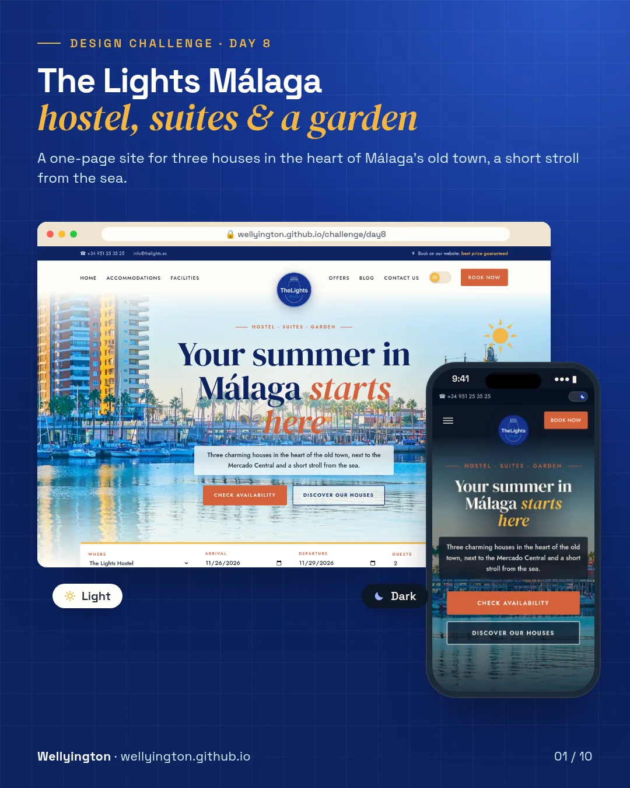
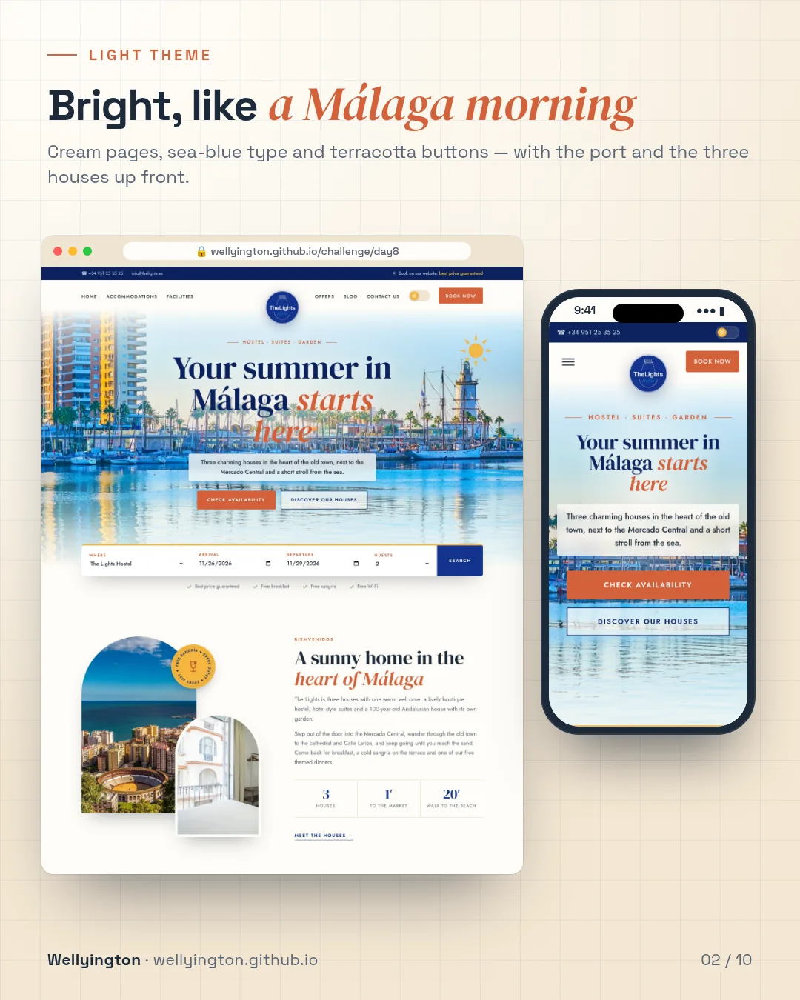
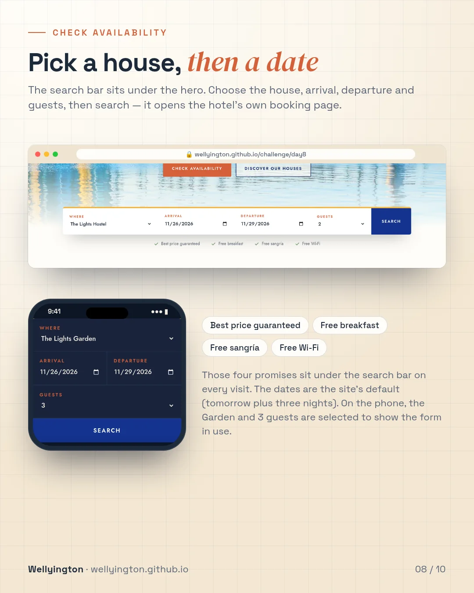
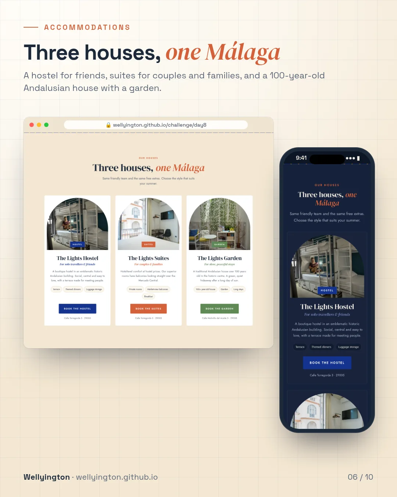
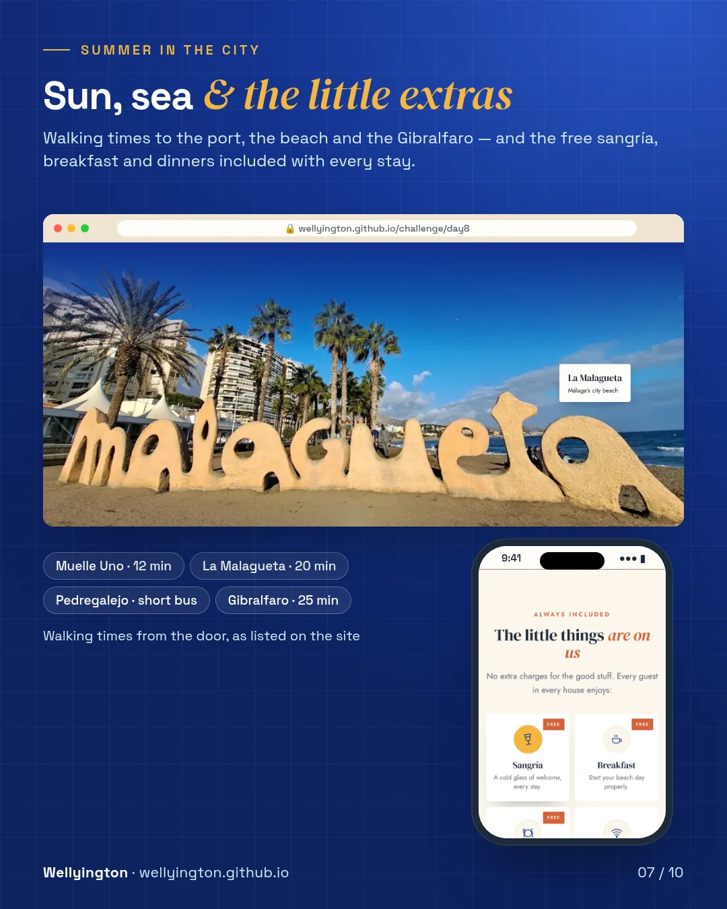
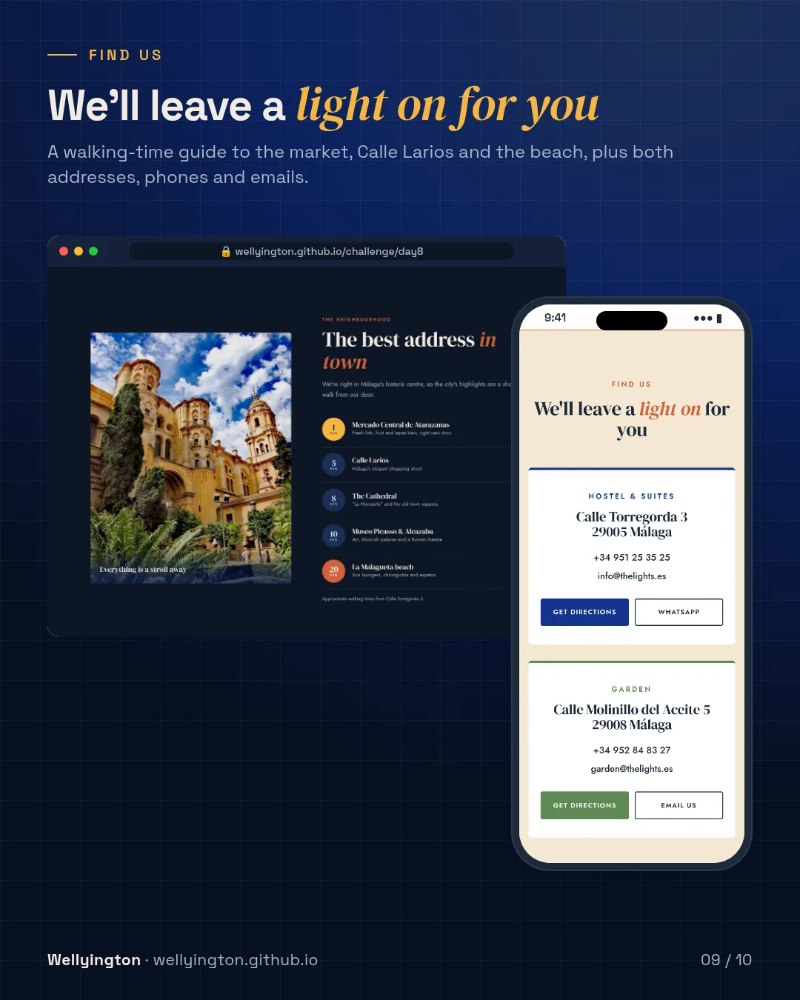
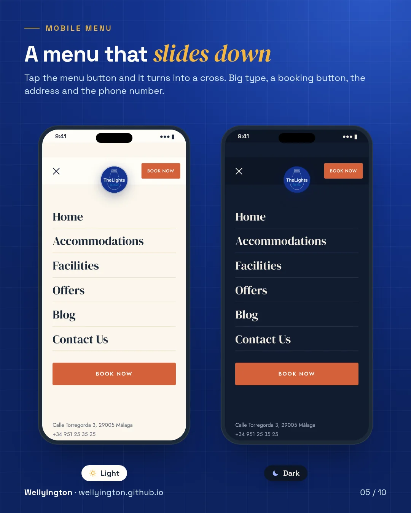
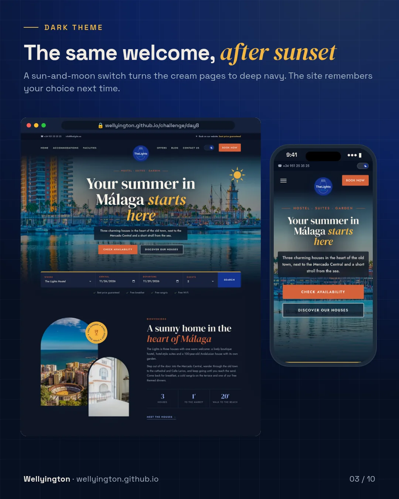
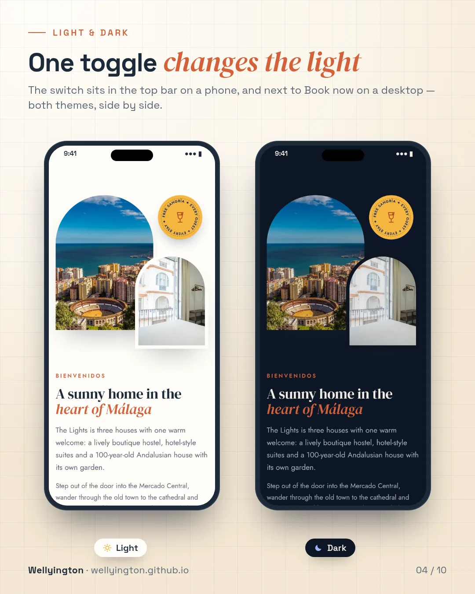

25 ноября я опубликовал восьмую заметку этой серии, челленджа, который придумал Рамайя Траск: сто дней, сто компаний, сто сайтов. Первым днём была семейная строительная компания в Марина-Альте. [Та страница здесь.](https://wellyington.github.io/journal/ru/articles/sait-do-slova-da/) Вторым — театр в Малаге. [Она здесь.](https://wellyington.github.io/journal/ru/articles/mesto-dlya-tselogo-sezona/) Третьим — семейный ресторан в Эстепоне. [Она здесь.](https://wellyington.github.io/journal/ru/articles/mesto-za-dlinnym-stolom/) Четвёртым — частная консалтинговая практика по недвижимости в Малаге. [Она здесь.](https://wellyington.github.io/journal/ru/articles/suzhdenie-vazhnee-obema/) Пятым — ресторан дегустационных сетов в Мотриле. [Она здесь.](https://wellyington.github.io/journal/ru/articles/tak-zhe-tshchatelno-kak-na-kukhne/) Шестым — заведение с курицей-гриль в Эстепоне. [Она здесь.](https://wellyington.github.io/journal/ru/articles/ot-prilavka-do-cheka/) Седьмым — семейный отель в Кавосе на Корфу. [Она здесь.](https://wellyington.github.io/journal/ru/articles/tot-zhe-bassein-nochyu/)

Сегодня мы снова на Коста-дель-Соль, в самой Малаге. The Lights — это три места для проживания в историческом центре под одним именем. The Lights Hostel — бутик-хостел в историческом андалусском здании. The Lights Suites — частные номера в духе отеля в том же здании, у некоторых балконы выходят на рынок Меркадо Сентраль. The Lights Garden — традиционный андалусский дом старше ста лет в нескольких улицах оттуда, с собственным садом. Их нынешний сайт — [thelights.es](https://www.thelights.es/).

Концепт здесь: [The Lights Málaga, восьмой день](https://wellyington.github.io/challenge/day8/).

## три дома, три гостя

Сложность здесь не в дизайне. Она в задаче, которая спрятана внутри самого бизнеса.

Хостел, сьюты и тихий старый дом — это три разных продукта для трёх разных людей. Хостел — для тех, кто путешествует один, и для компаний друзей, которым нужна терраса, общий ужин и с кем пойти на пляж. Сьюты — для пар и семей, которым нужен отдельный номер и балкон дешевле, чем в отеле. Дом с садом — для тех, кто ищет покоя после долгого солнечного дня, и часто для долгих поездок.

Соберите всё это на одном сайте, и обычно получается страница, которая не говорит ни с кем. Гость хостела читает про тихий сад. Семья читает про двухъярусные кровати и вечеринки. А кнопку бронирования не находит никто, потому что их три в трёх разных местах.

Поэтому задача была объединить их под одним образом — одно имя, одна команда, одни и те же бесплатные бонусы, — и при этом дать каждому дому сохранить свой характер. И сделать так, чтобы три вещи невозможно было не заметить на любом экране: где это, какой номер вы получаете и как забронировать его напрямую.

*Восьмой день: три дома в самом сердце старой Малаги, в нескольких минутах ходьбы от моря.*

## летний главный экран

Малага продаёт лето. Большинство тех, кто бронирует кровать в центре, едут за солнцем, морем и долгими вечерами, поэтому первый экран говорит именно об этом.

Фон — фотография порта у Муэлье-Уно: пальмы, маяк, парусники и вода. Поверх — крупной антиквой глубокого морского синего цвета фраза your summer in Málaga starts here, ваше лето в Малаге начинается здесь, а последние два слова — терракотовым курсивом. В углу медленно вращается маленькое нарисованное солнце. Над заголовком три слова мелкими заглавными: hostel, suites, garden. Весь бизнес в трёх словах, ещё до того, как кто-то начал прокручивать.

Под заголовком одна фраза: три уютных дома в самом сердце старого города, рядом с Меркадо Сентраль и в нескольких минутах ходьбы от моря. Затем две кнопки: проверить наличие мест и посмотреть наши дома.

Логотип — тот, которым The Lights уже пользуется: круглый синий значок с фонариком в центре шапки. Я его не перерисовывал. Вокруг него в шапке — шесть разделов, которые у компании уже есть: Home, Accommodations, Facilities, Offers, Blog и Contact Us, и терракотовая кнопка Book now справа.

*Светлая тема: кремовые страницы, морской синий текст и терракотовые кнопки, а впереди — порт и три дома.*

## сначала — панель бронирования

Прямо под главным экраном, поверх нижнего края фотографии, — панель бронирования. Где, заезд, выезд, гости, поиск. Это первое на странице, чем действительно можно воспользоваться.

«Где» — выбор из трёх домов. В датах уже стоят разумные значения — завтра и через три ночи, — так что менять нужно только то, что отличается. Гостей можно выбрать от одного до шести, а дальше — семь и больше, группа. На телефоне панель превращается в аккуратную форму, поле под полем, с большой кнопкой поиска внизу.

Под панелью — четыре коротких обещания, каждое с галочкой: лучшая цена гарантирована, бесплатный завтрак, бесплатная сангрия, бесплатный Wi-Fi. Именно эти четыре вещи гости сравнивают на сайтах бронирования, и здесь они написаны раньше, чем их придётся искать.

Чтобы было ясно, что концепт делает в этот момент: кнопка поиска отправляет даты, дом и число гостей на нынешний сайт The Lights. У каждого дома своя система бронирования, и в настоящей версии кнопка открывала бы нужную с уже заполненными датами. Это подключение — первое в списке, если концепт пойдёт дальше.

*Сначала дом, потом дата. Четыре обещания стоят под поиском при каждом посещении.*

## три дома, одна Малага

Сердце страницы — раздел three houses, one Málaga, три дома, одна Малага. Его первая строка говорит, что общего у всех трёх: та же дружелюбная команда и те же бесплатные бонусы. Выберите стиль, который подходит вашему лету.

Дальше — три карточки: рядом на компьютере и одна за другой на телефоне. У каждой фотография в арочной рамке — отсылка к дверям и окнам старых андалусских домов, свой цвет и строка о том, для кого этот дом.

The Lights Hostel — синий, для тех, кто путешествует один, и для друзей: бутик-хостел в историческом андалусском здании, общительный, центральный и располагающий, с террасой, созданной для знакомств. Терраса, тематические ужины, камера хранения.

The Lights Suites — терракотовые, для пар и семей: комфорт уровня отеля по цене хостела, номера повышенной категории с балконами прямо на Меркадо Сентраль. Отдельные номера, балконы с видом на рынок, завтрак.

The Lights Garden — оливково-зелёный, для неспешного отдыха: традиционный андалусский дом старше ста лет в историческом центре, зелёный и тихий уголок после долгого солнечного дня. Столетний дом, сад, долгие поездки.

Каждая карточка заканчивается своей кнопкой — book the hostel, book the suites, book the garden, — которая возвращает к панели бронирования с уже выбранным домом. А под кнопкой — адрес, потому что у двух домов он общий, а у сада свой. Тот, кто забронировал сад, не должен оказаться у дверей хостела.

Эти три цвета — синий, терракотовый и оливковый — проходят через всю страницу. Увидев их в карточках, вы понимаете, о каком доме говорит кнопка или строка, даже не читая подписи.

*Хостел для друзей, сьюты для пар и семей и столетний андалусский дом с садом.*

## мелочи — за наш счёт

Хостелы Малаги конкурируют ценой, а на сайтах бронирования цены всегда похожи. Отличается то, что входит в стоимость. У The Lights входит многое, а нынешний сайт упоминает об этом вскользь.

Поэтому для этого есть отдельный раздел — the little things are on us, мелочи за наш счёт, — с простой строкой: никаких доплат за хорошее. Дальше восемь небольших карточек. Бесплатная сангрия — холодный бокал в знак приветствия при каждом заезде. Бесплатный завтрак — чтобы правильно начать пляжный день. Бесплатные тематические ужины — общие столы и новые друзья. Быстрый Wi-Fi, бесплатно во всём доме. Солнечная терраса — солнце днём и сангрия вечером. Камера хранения — для раннего рейса или позднего заезда. Карты и советы от команды. И группы — с индивидуальными предложениями для больших компаний. На первых трёх — маленькая терракотовая метка free, бесплатно, потому что их никто не ждёт.

В приветственном разделе есть и круглая жёлтая наклейка с надписью free sangría, every guest, every stay — бесплатная сангрия для каждого гостя при каждом заезде. Она медленно вращается, как бирка на чемодане. Это самая дружелюбная фраза на странице, поэтому ей позволено двигаться.

## солнце, море и город

Перед бонусами — фотография во всю ширину: надпись на пляже Ла-Малагета, городском пляже, и короткое приглашение: оставьте машину дома. От двери лучшие летние дни Малаги — в пешей доступности.

Рядом — время пешком, записанное так, как планируют день. Муэлье-Уно и порт — около двенадцати минут. Пляж Ла-Малагета — около двадцати. Пляжи Педрегалехо и Эль-Пало — короткая поездка на автобусе. Закат на Хибральфаро — около двадцати пяти минут пешком. Это вопросы, которые люди задают на ресепшене в первое утро, — с ответами ещё до приезда.

*Время пешком до порта, пляжа и Хибральфаро и бесплатные сангрия, завтрак и ужины при каждом заезде.*

## лучший адрес в городе

Самый сильный аргумент в пользу The Lights — их расположение, поэтому оно не спрятано в подвале сайта. У него свой раздел — the best address in town, лучший адрес в городе.

С одной стороны — фотография собора, который малагеньо называют Ла-Манкита, «однорукая», потому что вторую башню так и не достроили. С другой — пронумерованный список времени пешком от двери на улице Торрегорда, каждое число в круглом значке. Минута до рынка Меркадо Сентраль де Атарасанас — свежая рыба, фрукты и тапас-бары. Пять минут до улицы Ларьос — главной торговой улицы. Восемь минут до собора и площадей старого города. Десять минут до Музея Пикассо и Алькасабы. Двадцать минут до пляжа Ла-Малагета. Маленькая заметка внизу говорит, что время приблизительное, — так и есть.

Продают здесь цифры. «Одна минута до рынка» говорит о расположении больше, чем любое прилагательное.

*Путеводитель по времени пешком до рынка, улицы Ларьос и пляжа, плюс оба адреса, телефоны и почта.*

## бронируйте напрямую и экономьте

Каждое бронирование, которое хостел получает через крупную платформу, стоит ему комиссии. The Lights уже обещает лучшую цену на своём сайте и пишет об этом мелким шрифтом в шапке. Концепт говорит об этом крупно.

Есть раздел always the best price here, здесь всегда лучшая цена, с одной честной фразой: забудьте о платформах бронирования; бронируя на нашем сайте, вы всегда получаете самую низкую цену и несколько бонусов, которые можем предложить только мы. Затем четыре причины. Лучшая цена гарантирована. Скидка для подписчиков — с эксклюзивным кодом для тех, кто следит за ними в соцсетях. Предложения для групп — индивидуальная цена для большой компании. И особые тарифы для долгого проживания в Малаге. Одна кнопка — проверить наличие мест — возвращает к панели бронирования.

То же обещание проходит по верхней полосе каждого экрана: book on our website, best price guaranteed, золотом. А на телефоне, как только вы прокрутили панель бронирования, внизу появляется тонкая полоса с названием, фразой best price, booked direct и кнопкой book now. Она остаётся там до самого ухода со страницы.

## мы оставим для вас свет

Раздел контактов берёт заголовок из названия компании: we'll leave a light on for you, мы оставим для вас свет. Такую фразу маленький отель написал бы на записке от руки.

Ниже — две карточки, по одной на адрес, потому что The Lights находится в двух местах. Хостел и сьюты — улица Торрегорда, 3, с телефоном, почтой, кнопкой маршрута и кнопкой WhatsApp. Garden — улица Молинильо-дель-Асейте, 5, со своим телефоном, своей почтой и своей кнопкой маршрута. У каждой карточки кайма цвета своего дома — синяя для хостела и сьютов, зелёная для сада, — чтобы их никогда не перепутать.

## меню, которое опускается

На телефоне в шапке остаются три вещи: кнопка меню, логотип посередине и book now. Над ней — тонкая полоса с телефоном и переключателем светлой и тёмной темы.

Нажмите на меню — оно опускается и заполняет весь экран, а три полоски кнопки превращаются в крестик. Шесть разделов появляются крупной антиквой, под ними кнопка book now во всю ширину, а внизу, там, куда дотягивается большой палец, — адрес и телефон. В обеих темах всё работает одинаково.

*Крупный шрифт, кнопка бронирования, адрес и телефон.*

## тот же приём после заката

Как и у вчерашнего отеля на Корфу, у The Lights есть светлая и тёмная тема. Маленький переключатель с солнцем и луной стоит рядом с book now на компьютере и в верхней полосе на телефоне.

Светлая тема — это утро в Малаге: кремовые и песочные страницы, текст глубокого морского синего цвета, терракотовые кнопки и солнечно-жёлтые акценты. Тёмная — тот же город после заката: глубокие тёмно-синие страницы, кремовый текст, та же терракота, а жёлтый становится золотым. Обе темы проработаны раздел за разделом, а не получены инверсией цветов. Сайт запоминает выбор до следующего визита, а если человек ни разу не трогал переключатель, следует настройке его телефона или компьютера.

*Переключатель с солнцем и луной делает кремовые страницы тёмно-синими, и сайт запоминает выбор.*

*Один переключатель меняет свет: обе темы рядом.*

## детали

Шрифты: DM Serif Display для заголовков, крупно, с терракотовым курсивом для более тёплых слов — starts here, one Málaga, light on. Jost, чистый геометрический гротеск, для всего, что читается, разреженными заглавными для мелких подписей и кнопок.

Цвета — цвета города: глубокий синий моря и самого логотипа The Lights, терракота крыш, песок и крем стен старого города, солнечный жёлтый и оливково-зелёный для сада. Тонкая пунктирная линия синего и жёлтого цвета, как край пляжного полотенца, разделяет некоторые разделы.

При прокрутке всё плавно появляется, фото на главном экране очень медленно смещается, а солнце и наклейка с сангрией вращаются. Всё это останавливается для тех, кто попросил свой телефон или компьютер уменьшить анимацию, и страница без этого работает точно так же. Шрифты загружаются с моего собственного сайта, а не из Google, поэтому открытие страницы не передаёт ничей адрес третьим лицам.

## что такое этот концепт и что дальше

Сведения на странице — три дома, их адреса, телефоны и почта, бесплатные бонусы, предложения и обещание лучшей цены — взяты с нынешнего сайта The Lights. Логотип и разделы меню сохранены как есть. Время пешком приблизительное, и страница об этом говорит.

Новое — это структура: единый образ, который держит три разных дома, панель бронирования раньше всего остального, свой цвет для каждого дома, бонусы как повод бронировать напрямую и раздел о расположении, где говорят цифры.

Цифр по бронированиям у меня нет, и придумывать их я не буду. Чтобы превратить концепт в работающий сайт, нужны практические шаги: подключить каждый дом к его системе бронирования, чтобы даты передавались, сделать испанскую версию рядом с английской, страницы блога и предложений и поставить собственные фотографии команды везде, где они есть.

## если у вас больше одного места

Возможно, у вас не хостел. Но у многих компаний на этом побережье несколько мест под одним именем: ресторанная группа с пляжным баром и рестораном в центре, компания посуточной аренды с апартаментами в трёх посёлках, спортзал с двумя филиалами, языковая школа с летним кампусом.

Помогает то же, что и здесь. Сначала скажите, что их объединяет, а потом дайте каждому месту сохранить свой характер. Дайте каждому свой цвет и придерживайтесь его. Ставьте каждый адрес рядом с тем, к чему он относится, а не только в подвале сайта. Сделайте расположение причиной выбрать вас — с реальными расстояниями вместо прилагательных. И ставьте кнопку бронирования туда, куда смотрят в первую очередь, а не туда, где осталось место.

Я веб-дизайнер из Эстепоны, на Коста-дель-Соль, и проектирую и делаю сайты для компаний в Испании и за её пределами. Если это похоже на ваш бизнес, напишите мне через [основной сайт](https://wellyington.github.io/ru/). Расскажите, чем вы занимаетесь и где, и я отвечу простым языком. Концепт [здесь](https://wellyington.github.io/challenge/day8/), а нынешний сайт The Lights [здесь](https://www.thelights.es/), чтобы вы могли их сравнить. Восемь готово, осталось девяносто два.
